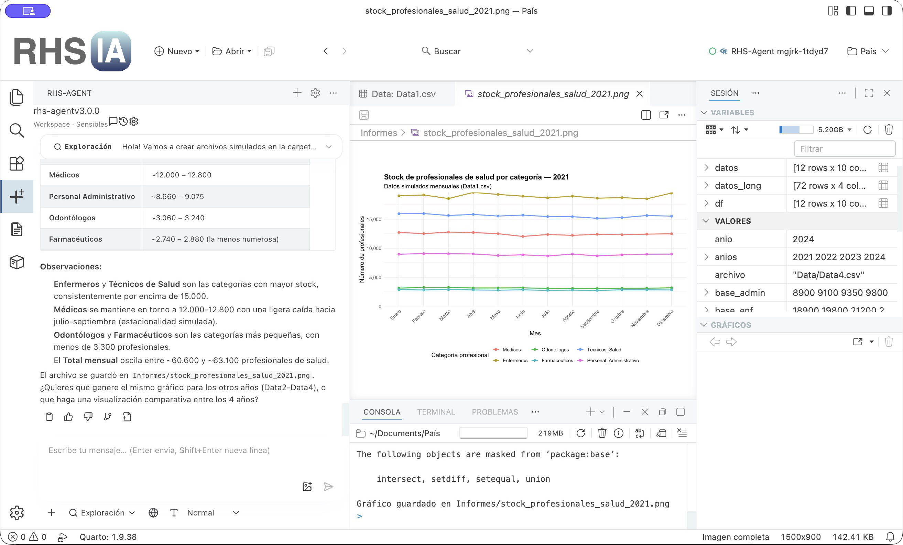

# Napo (RHS-IA Minimal)

Napo is a desktop platform for data analysis, modelling, simulation, and planning. It is based on [Positron](https://github.com/posit-dev/positron), which is built on [Code OSS](https://github.com/microsoft/vscode). It combines an editor, R and Python runtime support, notebooks, Quarto, data tools, and the integrated Capibara agent. New application profiles default to Spanish; an explicit English language choice is preserved.



*Napo with integrated Capibara, showing simulated health workforce data.*

## Project status

The source is being prepared for a **Napo** handover. The underlying Code OSS package version and Positron base version are independent of that release name. The current macOS arm64 package has technical acceptance and a reproducible release manifest, but this repository does not yet publish a verified Napo installer or download channel. Source-build instructions below are for maintainers; public distribution remains blocked by human legal review, macOS signing/notarization, and the institutional knowledge-source gate. The update channel itself is decided: manual, explicit, hash-verified, signed, and reversible.

Current limitations that affect deployment:

- Development macOS builds use a temporary mock Keychain and the Napo bundle identifier `org.rhsia.napo`. Do not store real credentials in test builds. Signing, notarization, and a safe credential migration need a separate release decision.
- Automatic application updates are disabled. Napo accepts only manually delivered candidates after local manifest, hash, and signature verification, retaining the previous version for rollback; it does not discover, download, or install updates automatically.
- Capibara is integrated as a complete extension from `extensions/rhs-agent4`; its provider configuration remains explicit and user-controlled.
- Remote server installation still refers to a Posit-hosted artifact. That dependency has not been validated as an RHS-IA release channel.
- The executable Positron test suite passes. `npm run audit-napo-positron-typecheck` reports any inherited test-typing debt explicitly and fails if a diagnostic reaches a Napo-modified file.

See the [customization ledger](docs/upgrades/rhs-customizations.md) for implemented behavior and validation obligations, and the [branding audit](docs/upgrades/rhs-ia-branding-audit.md) for remaining references and release gates.

The current implementation and remaining release gates are summarized in [`AUDITORIA_CIERRE_NAPO.md`](AUDITORIA_CIERRE_NAPO.md) and the requirement-by-requirement [`MATRIZ_CUMPLIMIENTO_NAPO.md`](MATRIZ_CUMPLIMIENTO_NAPO.md). Historical validation notes remain in [`BITACORA.md`](BITACORA.md).

The packaged Capibara capability surface is checked with `npm run audit-napo-capabilities`; the report covers analytical programming, simulations, predictive modelling, Quarto, reproducible reports, grounded citations, project knowledge, and institutional planning.

The deterministic engine smoke is `npm run smoke-napo-modeling`; it checks R and Python model fitting, simulation, scenario comparison, and a reproducible Quarto report.

The focused UI evidence for the canonical live-analysis route is `reports/napo-capibara-positron-e2e.json`: Capibara uses `positron_execute_code`, Napo requests visible approval, and the live R session executes the model, simulation, and scenario contract.

Sensitivity coordination is recorded in `reports/napo-capibara-sensitivity-e2e.json`: three shocks are evaluated in the live R session with the same approval and provenance path.

Versioned-source planning coordination is recorded in `reports/napo-capibara-planning-e2e.json`: Capibara requests visible approval, the live R session reads `Docs/planning-policy.md`, and Napo calculates a 20-unit capacity gap with a 15/5 staffing and training allocation. This is local-source coordination evidence, not a declaration of legal validity.

Institutional or legal source roots use lateral `*.source.json` manifests. `npm run audit-napo-knowledge-bundle -- --root PATH --require-approved` validates the complete root, detects duplicate identities and blocks planning until human approval is present; it never downloads `sourceUri` or infers legal authority.

To make an already approved local bundle visible to Capibara through a workspace's `Docs/`, run `npm run prepare-napo-knowledge-bundle -- --root PATH --workspace PATH --require-approved` first as a dry-run, then repeat with `--apply` after reviewing the report. The transfer preserves sidecar manifests, refuses pending sources, collisions, and destination symlinks, and writes a provenance receipt under `.napo/knowledge/`.

## Source setup

Use a clean checkout with its two Git submodules. The repository pins Node.js **24.18.0** in [`.nvmrc`](.nvmrc) and declares npm **10.9.2** as its package manager in [`package.json`](package.json). The installed Node 24.18.0 runtime used for prior acceptance reports npm **11.16.0**; that mismatch remains a release-reproducibility issue. The current dependency tree also uses Rust for the Ark R kernel, Python for build and test tooling, and platform-specific native build tools. Install those prerequisites for the target you intend to build. Follow [repository agent guidance](AGENTS.md) when changing source.

From the repository root, with the pinned Node version active:

```sh
rtk git submodule update --init --recursive
rtk npm ci
rtk npm run prelaunch
rtk proxy ./scripts/code.sh
```

`prelaunch` prepares Electron, compiled output, and built-in extensions for the development launcher. The development launcher can resolve to English even when the packaged application's fresh-profile default is Spanish; verify localization in a package with a disposable profile.

For a macOS arm64 package build on an equipped macOS host:

```sh
rtk npm run gulp core-ci
rtk npm run gulp vscode-darwin-arm64-min-ci
```

Linux DEB/RPM packaging additionally requires `RHS_IA_LINUX_MAINTAINER` to contain the approved maintainer in `Name <email>` form. The build deliberately has no upstream contact fallback. Windows Store/AppX packaging is not supported.

These commands build a local artifact; they do not sign, notarize, or publish an installer. Check the actual output, bundled extensions, executable architectures, and startup behavior before distribution. Build targets for other platforms exist in the upstream toolchain but are not validated by this README.

## Validation for maintainers

Compile before running relevant tests. Do not use `npm run compile` for TypeScript in this repository.

```sh
rtk npm run build-fast
rtk npm run compile-extensions-build
rtk npm run typecheck-client
rtk npm run audit-napo-positron-typecheck
rtk npm run audit-napo-destination-tests
rtk npm run gulp compile-extensions
rtk npm run validate-rhs-ia-extension-inventory
rtk npm run validate-spanish-session-localization
rtk npm run valid-layers-check
```

For changes under `build/`, also run `rtk npm run typecheck` from that directory. The [offline documentation extension](extensions/rhs-ia-documentation/README.md) documents its own generate, build, audit, test, and bundle sequence. The [hygiene guide](docs/hygiene-guide-for-agents.md) covers source formatting and precommit checks. Use disposable profiles for startup, settings, and credential migration tests.

For the Napo package acceptance gate, run:

```sh
npm run validate-napo-package -- --require-runtime
npm run smoke-napo-runtime -- --package ../VSCode-darwin-arm64/Napo.app
npm run smoke-napo-privacy -- --package ../VSCode-darwin-arm64/Napo.app
npm run audit-napo-macos-signature -- --package ../VSCode-darwin-arm64/Napo.app
npm run validate-napo-gate -- --package ../VSCode-darwin-arm64/Napo.app
npm run audit-napo-data-integrity
npm run audit-napo-license-inventory
npm run audit-napo-extension-surface
npm run audit-napo-extension-functional-coverage -- --package ../VSCode-darwin-arm64/Napo.app
node scripts/audit-napo-extension-surface.mjs --package ../VSCode-darwin-arm64/Napo.app --out reports/napo-extension-surface-package.json
node scripts/test-napo-surface-reduction.mjs --extensions bat
node scripts/audit-napo-license-inventory.mjs --package ../VSCode-darwin-arm64/Napo.app --out reports/napo-license-inventory-package.json
```

La reducción de extensiones ajenas al flujo R/Python/Quarto/datos o a Capibara está aplicada únicamente al empaquetado de Napo: el paquete actual contiene 59 extensiones, con 46 conservadas y 13 clasificadas como `requiere-prueba`. `debug-server-ready`, `make`, `javascript` y `html` fueron retiradas después de pruebas reversibles; sus carpetas fuente siguen presentes para mantener una ruta reversible. La evidencia estructural y de runtime está en [`reports/napo-extension-surface-package.json`](reports/napo-extension-surface-package.json), y el manifiesto vigente registra 32.904 archivos con digest `ea4efbd9a3144e0f58fc2c32d1dd7605e00e92a54cd16618a33c09487e83a53e`.

El inventario también clasifica la superficie por rol. Las 13 extensiones que permanecen bajo revisión conservadora tienen cobertura funcional reconciliada en [`reports/napo-extension-functional-coverage.json`](reports/napo-extension-functional-coverage.json): presencia física, evidencia UI `pass`, contrato sin errores y arranque sin errores. Este informe no autoriza retirar extensiones ni sustituye revisión legal.

La auditoría de contratos declarados (`npm run audit-napo-extension-contracts`) revisa esas 13 extensiones y confirma entradas principales, comandos, vistas, menús y recursos. El reporte actual tiene 0 errores; sus 4 advertencias están explicadas como entradas web opcionales o comandos provistos por el host. La evidencia UI manual está ligada al digest vigente y conserva sus limitaciones.

La evidencia UI manual está en [`reports/napo-extension-ui-evidence.json`](reports/napo-extension-ui-evidence.json): documentación local, navegador integrado con contenido local, visor de imágenes y flujos de las extensiones bajo revisión. `npm run validate-napo-extension-ui-evidence` comprueba que esa evidencia corresponde al digest vigente y `npm run audit-napo-extension-functional-coverage` reconcilia su cobertura con contratos y arranque.

El receptor configura el host de extensiones de Napo con resolución IPv4-first para que las extensiones Positron conserven su comprobación estándar de `localhost` y, al mismo tiempo, Napo pueda coexistir con una instancia de RHS-IA ya abierta.

El empaquetado macOS arm64 construye automáticamente el binding nativo local de `policy-watcher` cuando falta. Para reconstruirlo de manera explícita antes de empaquetar, usa `NAPO_FORCE_POLICY_WATCHER_BUILD=1 npm run build-napo-policy-watcher`; el flujo normal `npm run gulp vscode-darwin-arm64` lo ejecuta como parte de la preparación del artefacto.

The license inventory records extension manifests, legal files, sizes, and SHA-256 hashes. Entries without a directly declared license remain a human-review queue; the report is not a legal approval. The extension-surface report is a reversible dependency and classification inventory; it does not authorize physical removal of extensions.

## Repository map

| Path                                                                   | Purpose                                                                            |
| ---------------------------------------------------------------------- | ---------------------------------------------------------------------------------- |
| [`src/`](src/)                                                         | Core desktop and workbench implementation, including RHS-IA startup and UI changes |
| [`extensions/`](extensions/)                                           | Built-in R, Python, theme, and documentation extensions                            |
| [`extensions/rhs-ia-documentation/`](extensions/rhs-ia-documentation/) | Offline bilingual help, search, source pages, and validation scripts               |
| [`build/`](build/) and [`scripts/`](scripts/)                          | Build, packaging, developer launch, and validators                                 |
| [`resources/`](resources/)                                             | Platform product resources                                                         |
| [`docs/upgrades/`](docs/upgrades/)                                     | Customization inventory and upstream-upgrade record                                |
| [`product.json`](product.json)                                         | Product identity, extension catalogs, endpoints, and runtime policy                |

Configuration belongs in the application's settings or the approved provider's configuration flow. Keep API keys and other secrets out of this repository and use disposable credentials for validation. The product catalog includes upstream extension and service identifiers whose names and URLs cannot be changed without replacing those dependencies.

## Maintenance and reporting

Review the [customization ledger](docs/upgrades/rhs-customizations.md) and its [machine-readable inventory](docs/upgrades/rhs-customizations.json) before changing an RHS-IA adaptation or importing a new upstream version. Record both the implementation and its verification in those files. Open an issue in the [RHS-IA repository](https://github.com/juliusHeartS/RHS-IA/issues) for repository-specific problems. Upstream issues belong to their respective upstream projects.

## Attribution and license

RHS-IA modifies Positron by Posit Software, PBC, and Code OSS by Microsoft. It is not an official Positron distribution. Preserve the notices in [`LICENSE.txt`](LICENSE.txt), [`NOTICE`](NOTICE), and [`ThirdPartyNotices.txt`](ThirdPartyNotices.txt), along with the licenses and attribution supplied by individual extensions and submodules. Positron trademarks and copyright remain with their owners. The offline documentation extension has its own [license and provenance](extensions/rhs-ia-documentation/LICENSE.txt).

### Revalidación vigente de Napo — 2026-10-13

El paquete `dist/Napo.app` vigente contiene 32.904 archivos y tiene el digest de árbol `ea4efbd9a3144e0f58fc2c32d1dd7605e00e92a54cd16618a33c09487e83a53e`. Esta reconstrucción incorpora en el host de Napo el override que mantiene Capibara disponible al abrir carpetas de proyecto no confiables; no modifica el código, manifiesto ni runtime de Capibara.
