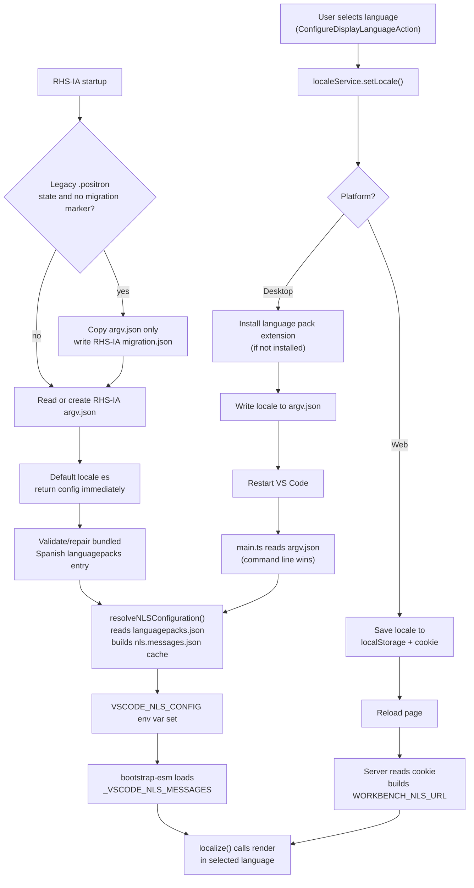

Here is the full end-to-end flow, split by platform, with the RHS-IA Spanish default additions called out.

---

## 0. RHS-IA first launch and migration

RHS-IA defaults new desktop profiles to Spanish without requiring a Marketplace language-pack download. Its product identity uses separate RHS-IA application, data-folder, server, installer, lock, URL-protocol, and platform identifiers, so it does not share Positron's runtime state.

The macOS/Linux identifier is currently `org.paho.rhsia`, chosen because an organization-owned reverse-DNS value was not provided. Treat it as a release assumption and replace it consistently if PAHO supplies the authoritative identifier. Existing Posit-managed service and distribution URLs are intentionally unchanged pending RHS-IA-owned endpoints.

On a non-portable startup, `src/main.ts` first checks for a completion marker in the RHS-IA state directory. If needed, it reads only the legacy `~/.positron/argv.json`, copies that runtime configuration to RHS-IA's `argv.json`, and writes `migration.json` in the RHS-IA directory. The legacy directory is never modified and its extensions, caches, and other state are not copied. Explicit `es` and `en` values are preserved; an absent locale becomes `es`. Portable mode skips this migration.

If RHS-IA's `argv.json` is missing, `readArgvConfigSync()` writes `"locale": "es"` and returns the parsed new config immediately. It also persists Spanish when an existing RHS-IA config has no explicit locale. Thus the first process uses Spanish instead of waiting for a second launch.

Before calling `resolveNLSConfiguration(...)`, RHS-IA calls `ensureBundledSpanishLanguagePackConfigSync(...)`. For an effective Spanish locale, this validates the bundled `ms-ceintl.vscode-language-pack-es` version, translation paths/files, and hash in `userDataPath/languagepacks.json`. A moved or upgraded bundled entry is refreshed in place; unrelated language entries and user-managed extensions are retained. For English, the bundled Spanish registration is not added or refreshed.

This makes first launch deterministic:

1. `argv.json` asks for Spanish, unless the command line supplies `--locale`.
2. `languagepacks.json` points at the current bundled Spanish translations.
3. `resolveNLSConfiguration(...)` can generate the Spanish `clp` cache before the workbench starts.

An explicit English selection is written as `"locale": "en"`, so it survives restart and upgrades despite Spanish being the product default.

---

## 1. User picks a language (`ConfigureDisplayLanguageAction`)

The command palette entry "Configure Display Language" is registered as `ConfigureDisplayLanguageAction`. [1](#0-0)

When run, it fetches installed and available (Marketplace) language packs and shows a quick pick. On accept, it calls `localeService.setLocale(selectedLanguage)`. [2](#0-1)

---

## 2. `setLocale` — Desktop (Electron) path

`NativeLocaleService.setLocale` in `src/vs/workbench/services/localization/electron-browser/localeService.ts`:

1. **Installs the language pack extension** from the Marketplace (via `extensionManagementService.installFromGallery`) if it isn't already installed. [3](#0-2)

   For RHS-IA's default Spanish path, this Marketplace install is not needed because the Spanish pack is bundled as `ms-ceintl.vscode-language-pack-es` and registered by the startup repair step.

2. **Writes the locale to `argv.json`** — the runtime settings file — using `jsonEditingService.write` targeting the `locale` key. [4](#0-3)

3. **Restarts VS Code** via `hostService.restart()`. [5](#0-4)

After restart, `main.ts` reads `argv.json` synchronously via `readArgvConfigSync()` and calls `getEffectiveUserLocale(args['locale'], argvConfig)` to extract the locale. [6](#0-5)

This locale is passed to `resolveNLSConfiguration()` **before** the Electron `app.ready` event fires. [7](#0-6)

---

## 3. NLS resolution at startup (`resolveNLSConfiguration`)

`resolveNLSConfiguration` in `src/vs/base/node/nls.ts`:

1. Reads `languagepacks.json` from the user data directory — this file is normally maintained by `NativeLanguagePackService` and maps locale IDs to translation file paths. [8](#0-7)

   RHS-IA validates or repairs the bundled Spanish registration before NLS resolution so the current pack is available immediately, including after an app move or upgrade.

2. Resolves the locale against the installed packs (with fallback stripping, e.g. `zh-CN` → `zh`). [9](#0-8)

3. Builds a **per-commit cache** of translated NLS messages at `userDataPath/clp/<hash>.<locale>/<commit>/nls.messages.json` by merging the language pack's translation JSON with the default English `nls.keys.json`/`nls.messages.json`. [10](#0-9)

4. Returns an `INLSConfiguration` object, which is serialized into the `VSCODE_NLS_CONFIG` environment variable. [11](#0-10)

---

## 4. NLS messages loaded into the process (`bootstrap-esm.ts`)

At bootstrap, `doSetupNLS()` reads `VSCODE_NLS_CONFIG`, finds the `languagePack.messagesFile` path, and loads the translated strings into `globalThis._VSCODE_NLS_MESSAGES`. [12](#0-11)

All calls to `localize(...)` throughout the codebase then use these pre-loaded messages to render UI strings in the selected language.

---

## 5. `setLocale` — Web path

`WebLocaleService.setLocale` in `src/vs/workbench/services/localization/browser/localeService.ts`:

- Saves the locale to `localStorage` under key `vscode.nls.locale` **and** sets a cookie with the same key/value. [13](#0-12)

- Prompts the user to reload the page. [14](#0-13)

On reload, the web server (`webClientServer.ts`) reads the `vscode.nls.locale` cookie and constructs a `WORKBENCH_NLS_URL` pointing to the CDN-hosted translated `nls.messages.js` for that locale/commit/version. [15](#0-14)

---

## Summary diagram



---

## Fresh first-run test

Use portable mode to test the RHS-IA first-launch path on an existing machine:

```bash
TEST_ROOT="$(mktemp -d)"
VSCODE_PORTABLE="$TEST_ROOT" /path/to/RHS-IA.app/Contents/MacOS/RHS-IA
```

Then inspect:

```bash
cat "$TEST_ROOT/argv.json"
cat "$TEST_ROOT/user-data/languagepacks.json"
find "$TEST_ROOT/user-data/clp" -name nls.messages.json
```

Use a packaged app for this UI test. `./scripts/code.sh` sets `VSCODE_DEV=1`, and `resolveNLSConfiguration()` bypasses language packs in dev mode.

### Citations

**File:** src/vs/workbench/contrib/localization/common/localizationsActions.ts (L15-30)
```typescript
export class ConfigureDisplayLanguageAction extends Action2 {
	public static readonly ID = 'workbench.action.configureLocale';

	constructor() {
		super({
			id: ConfigureDisplayLanguageAction.ID,
			title: localize2('configureLocale', "Configure Display Language"),
			menu: {
				id: MenuId.CommandPalette
			},
			metadata: {
				description: localize2('configureLocaleDescription', "Changes the locale of VS Code based on installed language packs. Common languages include French, Chinese, Spanish, Japanese, German, Korean, and more.")
			}
		});
	}

```

**File:** src/vs/workbench/contrib/localization/common/localizationsActions.ts (L66-72)
```typescript
		disposables.add(qp.onDidAccept(async () => {
			const selectedLanguage = qp.activeItems[0] as ILanguagePackItem | undefined;
			if (selectedLanguage) {
				qp.hide();
				await localeService.setLocale(selectedLanguage);
			}
		}));
```

**File:** src/vs/workbench/services/localization/electron-browser/localeService.ts (L80-86)
```typescript
	private async writeLocaleValue(locale: string | undefined): Promise<boolean> {
		if (!(await this.validateLocaleFile())) {
			return false;
		}
		await this.jsonEditingService.write(this.environmentService.argvResource, [{ path: ['locale'], value: locale }], true);
		return true;
	}
```

**File:** src/vs/workbench/services/localization/electron-browser/localeService.ts (L109-118)
```typescript
				await this.progressService.withProgress(
					{
						location: ProgressLocation.Notification,
						title: localize('installing', "Installing {0} language support...", languagePackItem.label),
					},
					progress => this.extensionManagementService.installFromGallery(languagePackItem.galleryExtension!, {
						// Setting this to false is how you get the extension to be synced with Settings Sync (if enabled).
						isMachineScoped: false,
					})
				);
```

**File:** src/vs/workbench/services/localization/electron-browser/localeService.ts (L121-125)
```typescript
			if (!skipDialog && !await this.showRestartDialog(languagePackItem.label)) {
				return;
			}
			await this.writeLocaleValue(locale);
			await this.hostService.restart();
```

**File:** src/main.ts (L122-131)
```typescript
const userLocale = getEffectiveUserLocale(args['locale'], argvConfig);
if (userLocale) {
	nlsConfigurationPromise = resolveNLSConfiguration({
		userLocale,
		osLocale,
		commit: product.commit,
		userDataPath,
		nlsMetadataPath: import.meta.dirname
	});
}
```

**File:** src/main.ts (L203-205)
```typescript
async function startup(codeCachePath: string | undefined, nlsConfig: INLSConfiguration): Promise<void> {
	process.env['VSCODE_NLS_CONFIG'] = JSON.stringify(nlsConfig);
	process.env['VSCODE_CODE_CACHE_PATH'] = codeCachePath || '';
```

**File:** src/vs/platform/languagePacks/node/rhsIaStartup.ts
```typescript
function getEffectiveUserLocale(cliLocale: string | undefined, argvConfig: IArgvConfig): string | undefined {
	if (cliLocale) {
		return cliLocale.toLowerCase();
	}
	return typeof argvConfig.locale === 'string' ? argvConfig.locale.toLowerCase() : undefined;
}
```

**File:** src/vs/base/node/nls.ts (L78-115)
```typescript
		const languagePackId = `${languagePack.hash}.${resolvedLanguage}`;
		const globalLanguagePackCachePath = join(userDataPath, 'clp', languagePackId);
		const commitLanguagePackCachePath = join(globalLanguagePackCachePath, commit);
		const languagePackMessagesFile = join(commitLanguagePackCachePath, 'nls.messages.json');
		const translationsConfigFile = join(globalLanguagePackCachePath, 'tcf.json');
		const languagePackCorruptMarkerFile = join(globalLanguagePackCachePath, 'corrupted.info');

		if (await Promises.exists(languagePackCorruptMarkerFile)) {
			await promises.rm(globalLanguagePackCachePath, { recursive: true, force: true, maxRetries: 3 }); // delete corrupted cache folder
		}

		const result: INLSConfiguration = {
			userLocale,
			osLocale,
			resolvedLanguage,
			defaultMessagesFile: join(nlsMetadataPath, 'nls.messages.json'),
			languagePack: {
				translationsConfigFile,
				messagesFile: languagePackMessagesFile,
				corruptMarkerFile: languagePackCorruptMarkerFile
			},

			// NLS: below properties are a relic from old times only used by vscode-nls and deprecated
			locale: userLocale,
			availableLanguages: { '*': resolvedLanguage },
			_languagePackId: languagePackId,
			_languagePackSupport: true,
			_translationsConfigFile: translationsConfigFile,
			_cacheRoot: globalLanguagePackCachePath,
			_resolvedLanguagePackCoreLocation: commitLanguagePackCachePath,
			_corruptedFile: languagePackCorruptMarkerFile
		};

		if (await Promises.exists(languagePackMessagesFile)) {
			touch(commitLanguagePackCachePath).catch(() => { }); // We don't wait for this. No big harm if we can't touch
			mark('code/didGenerateNls');
			return result;
		}
```

**File:** src/vs/base/node/nls.ts (L163-178)
```typescript
/**
 * The `languagepacks.json` file is a JSON file that contains all metadata
 * about installed language extensions per language. Specifically, for
 * core (`vscode`) and all extensions it supports, it points to the related
 * translation files.
 *
 * The file is updated whenever a new language pack is installed or removed.
 */
async function getLanguagePackConfigurations(userDataPath: string): Promise<ILanguagePacks | undefined> {
	const configFile = join(userDataPath, 'languagepacks.json');
	try {
		return JSON.parse(await promises.readFile(configFile, 'utf-8'));
	} catch (err) {
		return undefined; // Do nothing. If we can't read the file we have no language pack config.
	}
}
```

**File:** src/vs/base/node/nls.ts (L180-199)
```typescript
function resolveLanguagePackLanguage(languagePacks: ILanguagePacks, locale: string | undefined): string | undefined {
	try {
		while (locale) {
			if (languagePacks[locale]) {
				return locale;
			}

			const index = locale.lastIndexOf('-');
			if (index > 0) {
				locale = locale.substring(0, index);
			} else {
				return undefined;
			}
		}
	} catch (error) {
		console.error('Resolving language pack configuration failed.', error);
	}

	return undefined;
}
```

**File:** src/bootstrap-esm.ts (L49-79)
```typescript
async function doSetupNLS(): Promise<INLSConfiguration | undefined> {
	performance.mark('code/willLoadNls');

	let nlsConfig: INLSConfiguration | undefined = undefined;

	let messagesFile: string | undefined;
	if (process.env['VSCODE_NLS_CONFIG']) {
		try {
			nlsConfig = JSON.parse(process.env['VSCODE_NLS_CONFIG']);
			if (nlsConfig?.languagePack?.messagesFile) {
				messagesFile = nlsConfig.languagePack.messagesFile;
			} else if (nlsConfig?.defaultMessagesFile) {
				messagesFile = nlsConfig.defaultMessagesFile;
			}

			globalThis._VSCODE_NLS_LANGUAGE = nlsConfig?.resolvedLanguage;
		} catch (e) {
			console.error(`Error reading VSCODE_NLS_CONFIG from environment: ${e}`);
		}
	}

	if (
		process.env['VSCODE_DEV'] ||	// no NLS support in dev mode
		!messagesFile					// no NLS messages file
	) {
		return undefined;
	}

	try {
		globalThis._VSCODE_NLS_MESSAGES = JSON.parse((await fs.promises.readFile(messagesFile)).toString());
	} catch (error) {
```

**File:** src/vs/workbench/services/localization/browser/localeService.ts (L23-30)
```typescript
	setLocale(locale: string): void {
		localStorage.setItem(LocaleStorage.LOCAL_STORAGE_LOCALE_KEY, locale);
		this.doSetLocaleToCookie(locale);
	}

	private doSetLocaleToCookie(locale: string): void {
		document.cookie = `${LocaleStorage.LOCAL_STORAGE_LOCALE_KEY}=${locale};path=/;max-age=3153600000`;
	}
```

**File:** src/vs/workbench/services/localization/browser/localeService.ts (L79-88)
```typescript
		const restartDialog = await this.dialogService.confirm({
			type: 'info',
			message: localize('relaunchDisplayLanguageMessage', "To change the display language, {0} needs to reload", this.productService.nameLong),
			detail: localize('relaunchDisplayLanguageDetail', "Press the reload button to refresh the page and set the display language to {0}.", languagePackItem.label),
			primaryButton: localize({ key: 'reload', comment: ['&& denotes a mnemonic character'] }, "&&Reload"),
		});

		if (restartDialog.confirmed) {
			this.hostService.restart();
		}
```

**File:** src/vs/server/node/webClientServer.ts (L393-402)
```typescript
		const cookies = cookie.parse(req.headers.cookie || '');
		const locale = cookies['vscode.nls.locale'] || req.headers['accept-language']?.split(',')[0]?.toLowerCase() || 'en';
		let WORKBENCH_NLS_BASE_URL: string | undefined;
		let WORKBENCH_NLS_URL: string;
		if (!locale.startsWith('en') && this._productService.nlsCoreBaseUrl) {
			WORKBENCH_NLS_BASE_URL = this._productService.nlsCoreBaseUrl;
			WORKBENCH_NLS_URL = `${WORKBENCH_NLS_BASE_URL}${this._productService.commit}/${this._productService.version}/${locale}/nls.messages.js`;
		} else {
			WORKBENCH_NLS_URL = ''; // fallback will apply
		}
```
