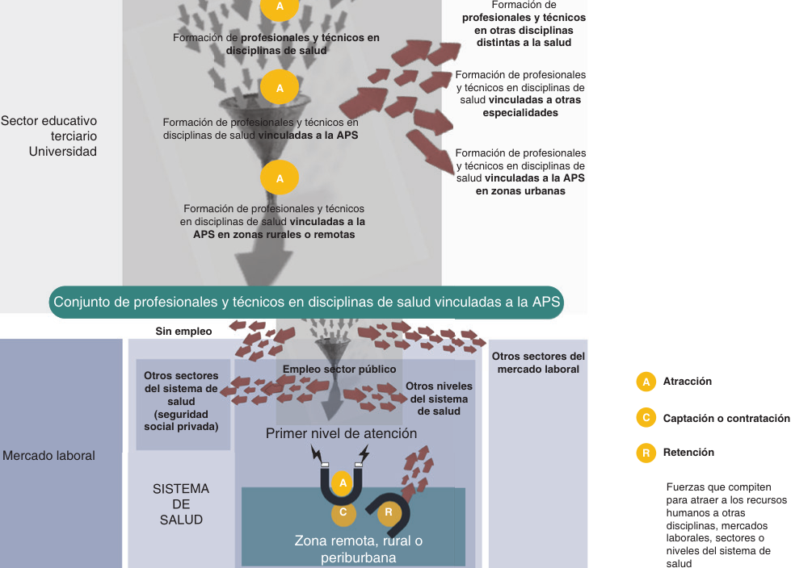
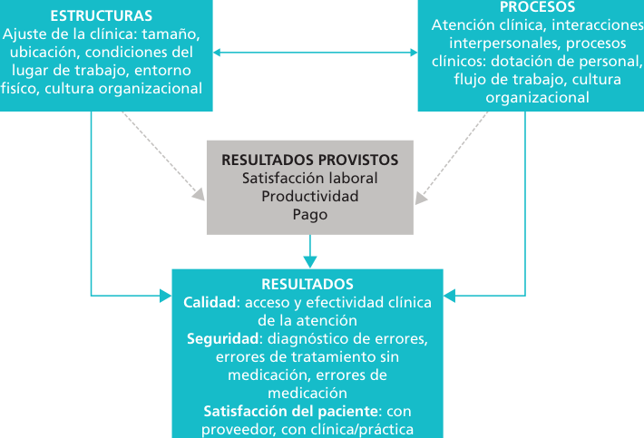
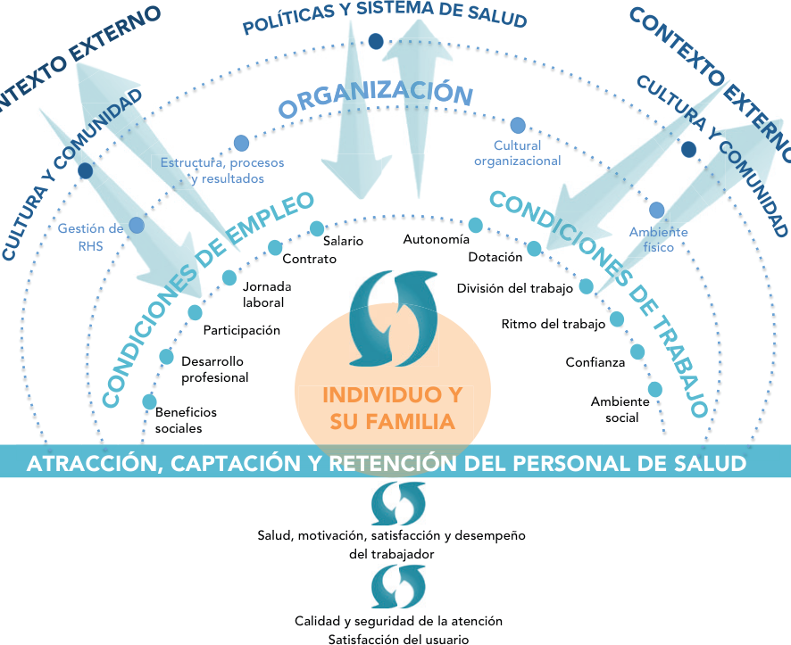
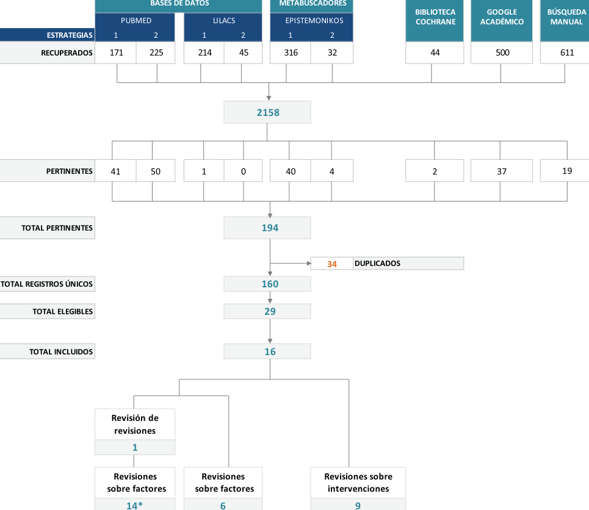
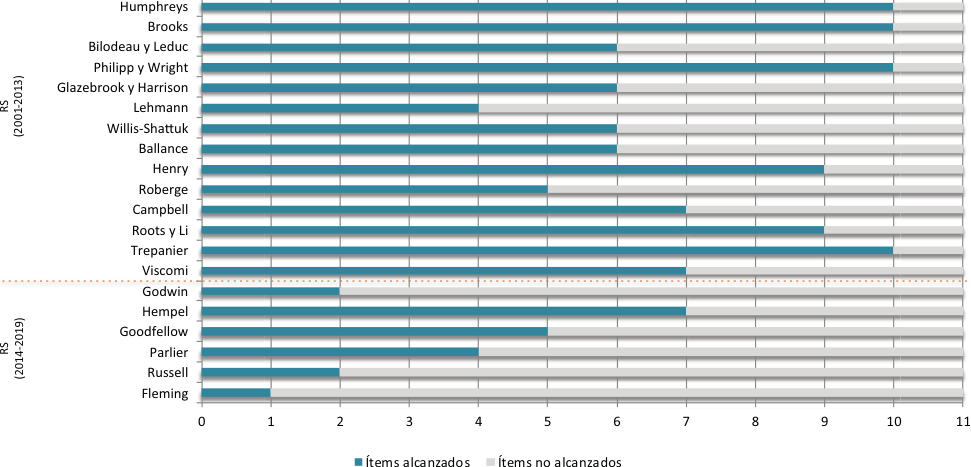
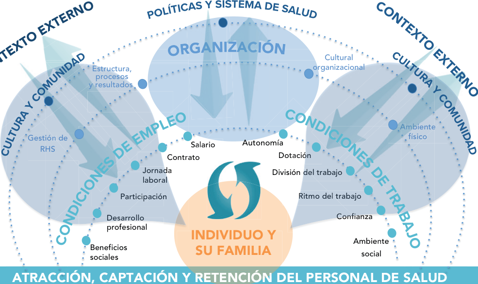

<!-- Extracted and reviewed by rhs-agent from sources/pdf/paho_pdfs/PDF_SPA/doc_10_link_01_9789275324721_spa.pdf. -->
<!-- PAGE: 1/76 -->

# SISTEMAS Y SERVICIOS DE SALUD

Cómo atraer, captar y retener al personal de salud en zonas rurales, remotas y desatendidas Una revisión rápida

<!-- PAGE: 2/76 -->

_[Página en blanco]_

<!-- PAGE: 3/76 -->

Cómo atraer, captar y retener al personal de salud en zonas rurales, remotas y desatendidas Una revisión rápida

Washington, D.C., 2022

<!-- PAGE: 4/76 -->

Cómo atraer, captar y retener al personal de salud en zonas rurales, remotas y desatendidas. Una revisión rápida

## © Organización Panamericana de la Salud, 2022

ISBN: 978-92-75-32471-4 (impreso)

ISBN: 978-92-75-32472-1 (pdf)

Algunos derechos reservados. Esta obra está disponible en virtud de la licencia Reconocimiento-NoComercial-CompartirIgual 3.0 Organizaciones intergubernamentales de Creative Commons (CC BY-NC-SA 3.0 IGO); https://creativecommons.org/licenses/by-nc-sa/ 3.0/igo/deed.es).

Con arreglo a las condiciones de la licencia, se permite copiar, redistribuir y adaptar la obra con fines no comerciales, siempre que se utilice la misma licencia o una licencia equivalente de Creative Commons y se cite correctamente, como se indica a continuación. En ningún uso que se haga de esta obra debe darse a entender que la Organización Panamericana de la Salud (OPS) respalda una organización, producto o servicio específicos. No está permitido utilizar el logotipo de la OPS.

Adaptaciones: si se hace una adaptación de la obra, debe añadirse la siguiente nota de descargo junto con la forma de cita propuesta: “Esta publicación es una adaptación de una obra original de la Organización Panamericana de la Salud (OPS). Las opiniones expresadas en esta adaptación son responsabilidad exclusiva de los autores y no representan necesariamente los criterios de la OPS”.

Traducciones: si se hace una traducción de la obra, debe añadirse la siguiente nota de descargo junto con la forma de cita propuesta: “La presente traducción no es obra de la Organización Panamericana de la Salud (OPS). La OPS no se hace responsable del contenido ni de la exactitud de la traducción”.

Forma de cita propuesta: Cómo atraer, captar y retener al personal de salud en zonas rurales, remotas y desatendidas. Una revisión rápida. Washington, D.C.: Organización Panamericana de la Salud; 2022. Licencia: CC BY-NC-SA 3.0 IGO. https://doi.org/10.37774/9789275324721.

Datos de catalogación: pueden consultarse en http://iris.paho.org

.

Ventas, derechos y licencias: para adquirir publicaciones de la OPS, escribir a sales@paho.org. Para presentar solicitudes de uso comercial y consultas sobre derechos y licencias, véase www.paho.org/permissions.

Materiales de terceros: si se desea reutilizar material contenido en esta obra que sea propiedad de terceros, como cuadros, figuras o imágenes, corresponde al usuario determinar si se necesita autorización para tal reutilización y obtener la autorización del titular del derecho de autor. Recae exclusivamente sobre el usuario el riesgo de que se deriven reclamaciones de la infracción de los derechos de uso de un elemento que sea propiedad de terceros.

Notas de descargo generales: las denominaciones empleadas en esta publicación y la forma en que aparecen presentados los datos que contiene no implican, por parte de la OPS, juicio alguno sobre la condición jurídica de países, territorios, ciudades o zonas, o de sus autoridades, ni respecto del trazado de sus fronteras o límites. Las líneas discontinuas en los mapas representan de manera aproximada fronteras respecto de las cuales puede que no haya pleno acuerdo.

La mención de determinadas sociedades mercantiles o de nombres comerciales de ciertos productos no implica que la OPS los apruebe o recomiende con preferencia a otros análogos. Salvo error u omisión, las denominaciones de productos patentados llevan letra inicial mayúscula.

La OPS ha adoptado todas las precauciones razonables para verificar la información que figura en la presente publicación. No obstante, el material publicado se distribuye sin garantía de ningún tipo, ni explícita ni implícita. El lector es responsable de la interpretación y el uso que haga de ese material, y en ningún caso la OPS podrá ser considerada responsable de daño alguno causado por su utilización.

HSS/HR/2022

Fotografía de cubierta: © OPS Diseño: Prographics

<!-- PAGE: 5/76 -->

## Índice

iii Índice

<!-- PAGE: 6/76 -->

iv ÍNDICE

<!-- PAGE: 7/76 -->

B.3 Revisiones sistemáticas sobre un tipo de intervención —supervisión de trabajadores— para incrementar la atracción, captación y retención del personal de salud�������������������������58

B.4 Revisiones sistemáticas sobre un tipo de intervención —sistemas de incentivos— para incrementar la atracción, captación y retención del personal de salud�������������������������59

B.5 Síntesis de revisiones sobre distintos tipos de intervenciones para incrementar la atracción, captación y retención del personal de salud������������������������������������������������������60

B.6 Síntesis de revisiones sobre un tipo de intervención —supervisión de trabajadores— para incrementar la atracción, captación y retención del personal de salud�������������������������63

B.7 Síntesis de revisiones sobre un tipo de intervención —sistemas de incentivos— para incrementar la atracción, captación y retención de personal de salud��������������������������65

v ÍNDICE

<!-- PAGE: 8/76 -->

## Prefacio

El derecho a la salud mediante la cobertura universal de salud —esto es, el acceso garantizado a servicios de salud seguros y a una atención de calidad para cualquier persona, sin ningún tipo de discriminación y sin que ello suponga dificultades financieras— constituye hoy una prioridad mundial en la agenda para el desarrollo después del 2015. Para alcanzar este objetivo se debe disponer de personal de salud en número suficiente y con la cualificación adecuada para prestar servicios de calidad a toda la población, lo cual permitirá avanzar hacia el logro de los Objetivos de Desarrollo Sostenible (ODS) de garantizar una vida sana para todos y el crecimiento económico y el empleo decente para hombres y mujeres.

En marzo del 2016, la Comisión de Alto Nivel sobre el Empleo en el Ámbito de la Salud y el Crecimiento Económico reforzó la necesidad de un cambio transformador que conlleva adaptar los modelos de prestación de servicios de salud, revisar las políticas del mercado de trabajo, mejorar las condiciones laborales para garantizar la igualdad de género, disponer de políticas de migración basadas en los derechos y mejorar la capacidad para responder a situaciones de emergencia, además de garantizar la educación y la formación, teniendo en cuenta los avances tecnológicos.

En la Región de las Américas, el logro del acceso universal a la salud y la cobertura universal de salud será posible en la medida en que los países dispongan de un número suficiente de recursos humanos para la salud (RHS) calificados para dar respuesta a las demandas de la población, en particular en el primer nivel de atención (PNA) de zonas rurales, remotas y desatendidas (RRD). A tal efecto, las políticas de salud deberán dar prioridad a la identificación de los factores que contribuyen a atraer, captar y retener al personal de salud en el PNA de dichas zonas, con el fin de diseñar estrategias de intervención eficaces.

La atracción, captación y retención del personal de salud en zonas RRD supone un desafío para casi

todos los países, más acuciante incluso en aquellos de ingresos bajos y medianos. El papel que cumple el Estado es central, tanto desde su función rectora como mediante el compromiso real que asuma con la estrategia renovada de atención primaria de salud (APS) con el fin de mejorar las condiciones de empleo y reducir las tensiones y distorsiones del mercado laboral para jóvenes profesionales.

Existen varios enfoques para responder a la inequidad en la distribución geográfica del personal de salud; entre ellos, el económico y el normativo. Sin embargo, un solo factor no determinará la decisión de un profesional de la salud sobre dónde ubicar su práctica. Diferentes fuerzas interactúan y condicionan la atracción, captación y retención de quienes trabajan en la APS en zonas RRD. Los resultados varían en función de una combinación de decisiones de individuos, comunidades y gobiernos, influenciadas por factores personales, profesionales, organizativos, económicos, políticos y culturales.

La presente publicación se ha elaborado a partir de una búsqueda de bibliografía especializada que pudiera ayudarnos a dar respuesta a esa necesiad. En ella se sintetiza y se actualiza la evidencia disponible sobre factores e intervenciones destinadas a incrementar la atracción, captación y retención del personal de salud en zonas RRD.

La adopción de políticas integrales permitirá disponer de datos sobre el número, la distribución y la calificación requerida de los RHS de APS, particularmente en zonas RRD, y establecer así estrategias adecuadas según las circunstancias propias de cada país.

Fernando Menezes da Silva

Jefe de la Unidad de Recursos Humanos para la Salud Departamento de Sistemas y Servicios de Salud Organización Panamericana de la Salud

vi PREFACIO

<!-- PAGE: 9/76 -->

## Agradecimientos

Esta publicación de la Unidad de Recursos Humanos para la Salud de la Organización Panamericana de la Salud fue elaborada, como resultado de una consultoría, por Laura Antonietti, María Eugenia Esandi y Zulma Ortiz, bajo la coordinación de Malhi Cho, asesora de Recursos Humanos para la Salud del Departamento de Sistemas y Servicios de Salud, y Ludovic Reveiz Herault, asesor en Gestión de Investigaciones en Salud, y contó con la colaboración de Isabel Duré, consultora de Recursos Humanos para la Salud.

Expresamos nuestro especial agradecimiento a quienes participaron en la revisión del marco conceptual y contribuyeron con recomendaciones de naturaleza empírica, teórica y experiencial: Pedro Brito, Irma Carrasco Meza, Rodolfo Levin, Mónica Padilla, Gabriela Pradere, Fernando Tomasina y José Valderas.

vii Agradecimientos

<!-- PAGE: 10/76 -->

## Siglas

APS atención primaria de salud

CyMAT condiciones y medioambiente de trabajo

ODS Objetivos de Desarrollo Sostenible

OIT Organización Internacional del Trabajo

OMS Organización Mundial de la Salud

OPS Organización Panamericana de la Salud

PNA primer nivel de atención

RHS recursos humanos para la salud

RRD rurales, remotas y desatendidas (zonas)

viii SIGLAS

<!-- PAGE: 11/76 -->

## Introducción

En la Región de las Américas, el logro del acceso universal a la salud y la cobertura universal de salud solo será posible en la medida en que los países dispongan de un número suficiente de recursos humanos para la salud (RHS) calificados para dar respuesta a las demandas de la población. En los últimos años se han observado experiencias relacionadas con los esfuerzos de los países de la Región para implementar políticas eficaces de RHS. Sin embargo, persisten dificultades para contar con el personal de salud necesario, en particular en el primer nivel de atención (PNA) de zonas rurales, remotas y desatendidas (RRD). En ese sentido, la identificación de los factores que intervienen y las estrategias que contribuyen de manera eficaz a atraer, captar y retener al personal de salud en el PNA de dichas zonas constituye una prioridad en materia de políticas de salud.

La atracción se define como una actitud positiva con respecto al ejercicio de la medicina en zonas rurales y aisladas, que no necesariamente conduce a la instalación. En el año 2010, la Organización Mundial de la Salud (OMS) define este concepto como “la preferencia del personal a trabajar en estas zonas”. La instalación consiste en la realización de la atracción y la decisión de ejercer la práctica profesional en una zona determinada, concepto que otros autores definen como “captación”. La retención se refiere al mantenimiento de la práctica y se lleva a cabo como resultado de experimentar, vivir y trabajar en una zona determinada (1).

El objetivo de esta publicación es sintetizar las intervenciones dirigidas a incrementar la atracción, captación y retención del personal de salud, así como otros factores coadyuvantes, con el fin de que los países de la Región dispongan de evidencia actualizada para fundamentar las políticas encaminadas a fortalecer los RHS en la Región.

En esta introducción se presenta una breve reseña de los desafíos que enfrenta la Región de las Américas para disponer de personal de salud; de las tensiones entre las fuerzas que inciden, tanto en el sector educativo como en el laboral, en la atracción, captación y retención de personal de salud, así como de los determinantes geográficos, en particular en zonas rurales y remotas.

La parte 1 resume los modelos conceptuales revisados sobre condiciones y medioambiente de trabajo (CyMAT) en los dos últimos decenios y presenta un modelo conceptual que fue elaborado sobre la base de dicha síntesis y que sirvió de marco para la revisión de revisiones que se expone en el siguiente apartado. La parte 2 presenta los resultados de una revisión de revisiones sobre factores e intervenciones que inciden en las CyMAT con el fin de incrementar la atracción, captación o retención de los RHS en el PNA de zonas RRD, realizada para sintetizar la evidencia empírica disponible.

## Desafíos mundiales y regionales para mejorar la atracción, captación y retención de equipos de salud

La cobertura universal de salud —que asegura el acceso a servicios de salud seguros y de calidad para cualquier persona, sin ningún tipo de discriminación y sin que ello suponga dificultades financieras— constituye hoy una prioridad en la agenda para el desarrollo después del 2015, a escala mundial y en numerosos países (2). En el 2012, la resolución de las Naciones Unidas relativa a la salud mundial y política exterior reafirmó el derecho a la salud, el derecho a un nivel de vida adecuado que asegure la salud y el bienestar, y el derecho a la seguridad social. Asimismo, instó a los gobiernos a acelerar la transición al acceso universal a servicios básicos de salud y a la cobertura universal de salud, y, al mismo tiempo, a brindar protección contra las dificultades económicas causadas por gastos médicos desorbitados, haciendo particular hincapié en los grupos

1 Introducción

<!-- PAGE: 12/76 -->

más necesitados, incluidas las poblacionales pobres y vulnerables, sobre todo aquellas que se encuentran en zonas rurales y alejadas (3).

mejorar la capacidad para responder a situaciones de emergencia.

Uno de los desafíos más complejos para los sistemas de salud es garantizar que las personas que residen en zonas RRD accedan a servicios de atención primaria de salud (APS) seguros y de calidad. Bilodeau y Leduc (8), cuando abordan los factores que influyen en la retención del personal de salud en zonas rurales y remotas, definen tres categorías de factores que afectan la motivación de los trabajadores1 de salud para ejercer en estos lugares: individuales (edad, género, educación, etc.), profesionales (especialización, horas de trabajo, incentivos, etc.) y contextuales o ambientales (servicios comunitarios, calidad de vida, nivel educativo de la población, etc.). Las autoras definen además tres fases decisivas distintas que condicionan la retención de profesionales de la salud en estas zonas: atracción, instalación (captación) y mantenimiento (retención).

En referencia al sector de la salud, el Objetivo de Desarrollo Sostenible (ODS) 8 enlaza directamente con el llamamiento a potenciar la contratación, movilización, formación y retención del personal de salud como parte del ODS 3, con el fin de garantizar una vida sana para todas las personas (4). Sin embargo, ese logro se ve gravemente amenazado por las dificultades para disponer de personal de salud en número suficiente y con la calificación adecuada para prestar servicios de calidad a toda la población.

Reafirmando la importancia de la Declaración de Kampala y prioridades para la acción internacional (2008) (5), así como del Código de prácticas mundial de la OMS sobre contratación internacional de personal de salud (6), la OMS insta a los Estados Miembros a que ejecuten los compromisos formulados en la Declaración Política de Recife sobre Recursos Humanos para la Salud, reconociendo la necesidad de renovar e impulsar estos compromisos para avanzar hacia la cobertura universal de salud (1).

Todos los países —independientemente de su nivel de desarrollo económico— se enfrentan a este desafío de atraer, captar y retener al personal de salud en zonas RRD, aunque en aquellos de ingresos bajos y medianos el problema es aún más acuciante (9). Reconociendo el desafío, los Estados Miembros de la OMS adoptaron la Estrategia mundial de recursos humanos para la salud: personal sanitario 2030 (10). El papel rector en materia de salud de los Estados es central, dado que, sin una función rectora firme de estos, las tensiones originadas por el mercado laboral terminan distorsionando las opciones para jóvenes profesionales.

En marzo del 2016, la Comisión de Alto Nivel sobre el Empleo en el Ámbito de la Salud y el Crecimiento Económico concluyó en su informe que es preciso invertir en personal de salud con el fin de realizar progresos en la consecución de los ODS (7). Las recomendaciones de la Comisión ponen de relieve la necesidad de un cambio transformador para crear sistemas de salud sostenibles con una fuerza de trabajo que sea capaz de atender con eficacia las necesidades de salud de la población. Dicha transformación conlleva cambios en los modelos de prestación de servicios de salud, en las políticas del mercado de trabajo y en la educación y la formación, teniendo en cuenta asimismo los avances tecnológicos. Además, exige invertir en condiciones de trabajo decente, garantizar la igualdad de género, elaborar políticas de migración basadas en los derechos y

De acuerdo con la OMS, no existe una buena

descripción global de la fuerza laboral de la APS ni de su composición y distribución, lo que en parte se debe a la falta de datos nacionales desglosados ​(por ocupación, sexo, edad, tipo de instalación y zona administrativa subnacional). Abordar esta brecha requerirá la acción concertada de los países, que deberán informar sobre el ODS 8 y la meta c del ODS 3 mediante un sistema de información adecuado y sistematizado (11). Asimismo, dicho problema ha de analizarse teniendo en cuenta

1 El equipo de trabajo defiende la igualdad entre géneros y promueve el uso del lenguaje inclusivo. Sin embargo, en algunos párrafos se utiliza el masculino genérico con el fin de simplificar la lectura.

2 CÓMO ATRAER, CAPTAR Y RETENER AL PERSONAL DE SALUD EN ZONAS RURALES, REMOTAS Y DESATENDIDAS

<!-- PAGE: 13/76 -->

Con demasiada frecuencia, la fuerza laboral del primer nivel de atención tiene niveles más bajos de capacitación, remuneración, reconocimiento y acceso a recursos clínicos que sus colegas subespecialistas y el personal que se desempeña en el hospital. Esto puede comprometer la calidad y contribuir a un alto nivel de agotamiento entre los trabajadores de salud del primer nivel de atención, además de obstaculizar su captación y retención. Tales brechas han generado la reivindicación de mejores condiciones de empleo para estos trabajadores.

Fuente: Organización Mundial de la Salud y Fondo de las Naciones Unidas para la Infancia. A vision for primary health care in the 21st century: towards universal health coverage and the Sustainable Development Goals. Ginebra: Organización Mundial de la Salud; 2018 (WHO/HIS/SDS/2018.X). Licencia: CC BY-NC-SA 3.0 IGO. https://apps. who.int/iris/bitstream/handle/10665/328065/WHO-HIS-SDS-2018. 15-eng.pdf?sequence=1&isAllowed=y.

la complejidad del sistema de salud y los múltiples factores que inciden en la formación de los recursos humanos, así como en las condiciones de empleabilidad y trabajo del mercado. Según estimaciones mundiales, en el 2015, 56% de la población que vivía en las zonas rurales experimentaba carencias de cobertura de salud en comparación con 22% en las zonas urbanas; 63% de la población rural, en comparación con 33% de la población urbana, carecía de acceso a los servicios de salud debido a una financiación inadecuada de la salud (9). Por todo lo expuesto, solo con políticas integrales será posible hacer frente a la dificultad de disponer de datos y de profesionales calificados en atención primaria, particularmente en zonas RRD.

La identificación e implementación de estrategias que contribuyan efectivamente a atraer, captar y retener a trabajadores de salud en el PNA de zonas RRD constituye hoy una prioridad en materia de políticas de salud. Algunas estrategias se focalizan en incentivar la elección de carreras vinculadas a la APS en dichas zonas durante el período de educación terciaria o universitaria, mientras que otras centran su mirada en el mercado laboral o en el sistema de salud con estrategias para mejorar las CyMAT (12).

En todos los casos, es necesario comprender las prácticas sociales y garantizar una infraestructura que promueva la residencia de equipos de salud en estas zonas desatendidas. Se dispone de una evidencia

empírica considerable que respalda que la mejora del ambiente de trabajo requiere una red compleja de acciones, entre las que se incluye la formación profesional específica para el ejercicio profesional en zonas remotas o ambientes rurales (13, 14).

Un enfoque popular para superar esta creciente escasez de recursos humanos es el cambio de tareas, un proceso de delegación mediante el cual las tareas menos especializadas se trasladan a otros miembros del equipo de salud. Por ejemplo, la transferencia de tareas de profesionales de la medicina a profesionales de enfermería en atención primaria o a trabajadores comunitarios atrae enormemente a quienes toman las decisiones en el campo de la salud. Esta estrategia promete abordar la escasez de recursos humanos y las demandas de atención asequible y de alta calidad en los sistemas de salud de muchos países. Existe una evidencia sólida acerca de la eficacia de la transferencia de tareas, denominada en inglés task shifting y task sharing, especialmente en atención primaria y en contextos con una disponibilidad limitada de servicios médicos (15-17). Algunos estudios sobre la transferencia de tareas para la gestión de enfermedades crónicas no transmisibles en países de ingresos bajos y medianos (18) mostraron que, cuando se acompaña de una reestructuración del sistema de salud, puede ser una estrategia eficaz y asequible para mejorar el acceso a la asistencia de pacientes con este tipo de enfermedades (19-21). En su 29.ª Conferencia Panamericana, la Organización Panamericana de la Salud (OPS) incluyó la estrategia de delegación de tareas como una alternativa para desarrollar las condiciones y capacidades de los RHS (22).

## El sector educativo frente al mercado laboral: tensiones y dinámicas determinantes

En la figura 1 se representa la dinámica de las fuerzas que inciden, tanto desde el sector educativo como desde el mercado laboral, en la atracción, captación y retención de los trabajadores de APS en zonas RRD. Las variaciones son el resultado de una combinación de decisiones de individuos, comunidades y gobiernos, que a su vez están influenciadas por factores personales, profesionales, organizativos, económicos, políticos y culturales.

3 Introducción

<!-- PAGE: 14/76 -->

FIGURA 1 Dinámica de las fuerzas que intervienen en la formación, atracción, captación y retención de personal en el primer nivel de atención en zonas rurales, remotas y desatendidas

APS: atención primaria de salud.

Cuando los profesionales de la salud se mudan a zonas urbanas, las oportunidades de trabajar en el sector privado no tardan en llegarles. Probablemente, esta sea la razón principal por la que la mayoría prefiere desarrollar allí su carrera y, consecuentemente, lo que explica que en estas zonas se concentre el mayor número de personal de atención de salud. Las razones por las que deciden trabajar en el sector privado se vinculan con la búsqueda de mejores remuneraciones, condiciones de trabajo, seguridad y oportunidades laborales (23-26).

En consecuencia, la migración de zonas rurales a zonas urbanas se ve agravada por la migración del sector público al privado. En última instancia, el desarrollo socioeconómico desigual de las zonas rurales en comparación con las urbanas representa la principal limitación para lograr una distribución equilibrada de los recursos humanos (27).

Determinantes de la distribución geográfica de los trabajadores de salud Dussault y Franceschini (28) identifican al menos cinco categorías de determinantes que afectan la distribución

## Determinantes de la distribución geográfica de los trabajadores de salud

Dussault y Franceschini (28) identifican al menos cinco categorías de determinantes que afectan la distribución

4 CÓMO ATRAER, CAPTAR Y RETENER AL PERSONAL DE SALUD EN ZONAS RURALES, REMOTAS Y DESATENDIDAS

<!-- PAGE: 15/76 -->

geográfica: individuales, organizativos, factores relacionados con el cuidado de la salud y los sistemas educativos, estructuras institucionales y entorno sociocultural general. Los factores profesionales, personales, educativos y sociales relacionados con el estilo de vida pueden influir en gran medida en las decisiones relacionadas con el trabajo.

estos estándares responde a criterios subjetivos y se encuentra a su vez con problemas metodológicos, como la definición de personal médico o —lo que es incluso más complejo— de profesional de enfermería (la dificultad de establecer una definición se deriva de las diferencias en el modo en que cada jurisdicción determina el alcance de la práctica profesional de la salud) (28).

Distintos estudios sobre la atracción y captación de profesionales de la salud en zonas rurales han evidenciado que su origen geográfico constituye uno de los factores que predicen en mayor medida su preferencia por zonas rurales o remotas y su contratación efectiva en estos contextos. También se ha demostrado que el mercado laboral de la atención médica no es un mercado competitivo, ya que generalmente existen regulaciones de entrada sustanciales, asimetrías de información y otras fallas de mercado (28).

Distintos estudios sobre la atracción y captación de profesionales de la salud en zonas rurales han evidenciado que su origen geográfico constituye uno de los factores que predicen en mayor medida su preferencia por zonas rurales o remotas y su contratación efectiva en estos contextos. También

En síntesis, existen al menos dos enfoques principales para la distribución geográfica del personal de salud: el económico y el normativo. Desde el punto de vista de la economía, la distribución de profesionales de la salud es una función del mercado laboral de atención de salud. Los desequilibrios surgen cuando la oferta y la demanda de empleo en una zona geográfica concreta están descompensadas. Desde esta perspectiva, a medida que aumenten los salarios reales, más profesionales de la salud estarán dispuestos a trabajar y más personas ingresarán a esta fuerza de trabajo, lo que a la larga conducirá a un nuevo equilibrio y a una distribución más proporcionada. Esta teoría predice que los desequilibrios de los trabajadores de salud pueden prevenirse estableciendo un mercado laboral competitivo (28). Sin embargo, se ha demostrado que la economía es solo uno de los factores que afectan la decisión de un profesional de la salud sobre dónde ubicar su práctica (29).

se ha demostrado que el mercado laboral de la atención médica no es un mercado competitivo, ya que generalmente existen regulaciones de entrada sustanciales, asimetrías de información y otras fallas de mercado (28).

La visión normativa define los desequilibrios a partir de la comparación de la densidad de personal de una zona determinada —establecida por una organización internacional o por una política nacional—, o bien con una región en particular. Desde esa perspectiva, las desviaciones en la densidad profesional del estándar definido en una zona geográfica se consideran desequilibrios. Por definición, el establecimiento de

5 Introducción

<!-- PAGE: 16/76 -->

## PARTE 1

## Condiciones y medioambiente de trabajo en zonas rurales, remotas y desatendidas

Si bien el concepto de condiciones y medioambiente de trabajo se encuentra vigente desde 1976, a partir de la puesta en marcha del Programa Internacional para el Mejoramiento de las Condiciones y Medio Ambiente de Trabajo, liderado por la Organización Internacional del Trabajo (OIT), cabe señalar que no existe una definición consensuada de ambientes y de condiciones de trabajo, y que ambos términos suelen emplearse como sinónimos. El uso de términos como ambientes saludables, salud en los lugares de trabajo, calidad de ambientes de trabajo, por citar solo algunos ejemplos, puede generar confusión al definir conceptual y operativamente las CyMAT.

Por otra parte, la educación, la formación profesional y el aprendizaje permanente son fundamentales para la empleabilidad y el empleo productivo, e indispensables para asegurar el trabajo decente y el crecimiento inclusivo (31). Por ello, deberían considerarse tanto un derecho de todos los trabajadores de salud como una responsabilidad de gobiernos, empleadores y trabajadores. La OIT incide de manera especial en la remuneración (un factor importante de la contratación). Para los trabajadores de salud la remuneración refleja el nivel de reconocimiento de su trabajo y el grado en que este se valora. Los ingresos también son importantes para que puedan desempeñar sus funciones con total independencia y de acuerdo con su ética profesional. En la primera década de este siglo, la remuneración de los trabajadores de salud asalariados como porcentaje del producto interno bruto apenas experimentó cambios a escala mundial y disminuyó en proporción al gasto total en salud. En algunos países, el salario medio de los trabajadores de las categorías peor remuneradas se situaba tan solo en 1% por encima del umbral de la pobreza (32).

El trabajador de salud, en su labor de cuidar a otras personas, está sujeto a unas determinadas condiciones y medioambiente de trabajo, que dan lugar a distintas cargas o exigencias laborales en su actividad diaria (30). Aquí se da también una construcción subjetiva, individual y colectiva, derivada de la vivencia del trabajador como tal y de su vinculación e interacción con otras personas. No se trata, por tanto, de algo medible. El trabajo decente, la carrera profesional en el campo de la salud, la regulación del ejercicio profesional y la movilidad interna y externa son elementos que conforman las CyMAT. Entre los aspectos objetivos, susceptibles de una identificación clara, medibles cuantitativamente y, por lo tanto, comparables con las normas mencionadas se encuentran, por ejemplo, los salarios, la existencia de un contrato y su naturaleza, y cuestiones relativas al tiempo de trabajo y a la duración del contrato.

A partir de una iniciativa de la OPS y con el fin de facilitar la evaluación de las intervenciones orientadas a mejorar la atracción, captación y retención del personal de salud en zonas RRD, y de otros factores coadyuvantes, se realizó una revisión de modelos conceptuales y documentos relacionados con las CyMAT publicados a lo largo de las dos últimas décadas, que permitió elaborar una propuesta de modelo conceptual integral (33).

6 CÓMO ATRAER, CAPTAR Y RETENER AL PERSONAL DE SALUD EN ZONAS RURALES, REMOTAS Y DESATENDIDAS

<!-- PAGE: 17/76 -->

Metodología para elaborar el modelo conceptual sobre las condiciones y el medioambiente de trabajo en el ámbito de la salud para zonas rurales, remotas y desatendidas El desarrollo y la validación del modelo se llevaron a cabo mediante una revisión narrativa que permitió identificar los elementos constitutivos principales de seis marcos conceptuales o enfoques teóricos y generar una primera versión del modelo conceptual.

## Metodología para elaborar el modelo conceptual sobre las condiciones y el medioambiente de trabajo en el ámbito de la salud para zonas rurales, remotas y desatendidas

El desarrollo y la validación del modelo se llevaron a cabo mediante una revisión narrativa que permitió identificar los elementos constitutivos principales de seis marcos conceptuales o enfoques teóricos y generar una primera versión del modelo conceptual.

Posteriormente, a partir de deliberaciones organizadas por la Unidad de Recursos Humanos para la Salud de la OPS, se sumaron cinco modelos conceptuales al análisis inicial y, tras una actualización de la bibliografía, se incorporaron cuatro modelos más.

## Síntesis de los modelos y documentos sobre condiciones y medioambiente de trabajo

Se identificaron 15 modelos o enfoques relacionados con las CyMAT, propuestos en los últimos 20 años, en los cuales se identificaron dimensiones y elementos diversos, que varían en función del interés de los investigadores y las organizaciones. La mayoría de los modelos respondían a inquietudes e intereses de países de ingresos altos. Al margen de las diferencias de enfoque, en todos los trabajos se visualizan las CyMAT como un fenómeno dinámico que repercute en la salud, motivación, satisfacción y desempeño laboral, lo que a su vez afecta la calidad y la seguridad de la atención de salud.

Una minoría de los modelos revisados (34-36) centró su análisis en las CyMAT en zonas remotas y rurales; entre ellos, los más recientes aportan una perspectiva más integral.

Los documentos analizados permitieron identificar los siguientes aspectos vinculados a las CyMAT:

a) Trabajo decente: implica la existencia de empleos suficientes, de una remuneración, de seguridad en el trabajo y de condiciones laborales salubres. También son esenciales la seguridad social y la seguridad de ingresos,

aun cuando dependan de la capacidad y del nivel de desarrollo de cada sociedad. El concepto de trabajo decente es inescindible del respeto por los derechos fundamentales en el trabajo y del diálogo social (37-39).

b) Trabajo y salud: en 2001, en Estados Unidos de América, Eisenberg et al. propusieron un modelo conceptual que identifica el ambiente, la cultura y la organización del trabajo como factores fundamentales de los entornos laborales, que repercuten en la salud de los trabajadores y en la calidad de atención. Por lo tanto, señalaron una relación recíproca entre la salud física y emocional de los trabajadores —influenciada por el entorno laboral— y la calidad de atención y viceversa (40).

En el modelo propuesto por Franco et al. un año después, se destacó la relevancia de la interacción entre los factores personales y los factores organizativos, así como de la motivación como factor crítico del desempeño laboral (41). En este modelo definen la motivación como la disposición y voluntad de una persona para realizar y mantener sus esfuerzos en pos del logro de los objetivos de la organización; la diferencian de la satisfacción, que se define como un estado emocional positivo o placentero que resulta de la evaluación del propio trabajo o de las experiencias laborales (42). Estos autores señalan que la motivación de los trabajadores depende de los factores externos y de su interacción con los factores individuales (43), lo que tendría implicaciones en el diseño e implementación de estrategias destinadas a fortalecer la motivación y el desempeño de las personas en su trabajo. Los factores externos al individuo de este modelo se solapan con las condiciones de trabajo de los otros modelos revisados, ya que los describen como factores organizativos e incluyen en este grupo la estructura, los procesos y los recursos de que dispone la organización, así como la gestión de los recursos humanos y la cultura organizativa.

En América Latina, en 2002, Neffa hizo grandes aportaciones a la conceptualización de las CyMAT con un planteamiento diferente al concepto tradicional higienista en el que presta atención a las dimensiones

Condiciones y medioambiente de trabajo en zonas rurales, remotas y desatendidas

7

<!-- PAGE: 18/76 -->

relacionales, afectivas y cognitivas de los trabajadores, destacando las dimensiones subjetivas de las CyMAT, la heterogeneidad de percepciones y las diferencias en la capacidad de adaptación y resistencia de los trabajadores. En síntesis, el autor propone una noción que supera la visión del trabajador como individuo, postulando que el trabajo es una realidad social y compleja, por lo que debe abordarse desde una visión global, integrada y multidisciplinaria (44-46).

c) Trabajo y calidad de atención: la Agencia para la Investigación y la Calidad del Cuidado de la Salud concluyó que las condiciones de trabajo y las características individuales del personal de salud repercuten en la seguridad del paciente y, por ende, en la calidad de los resultados de salud (47).

d) Trabajo y valores: Gilson et al. propusieron un marco conceptual centrado en el ambiente de trabajo que reconoce a la confianza —tanto la confianza laboral como la confianza entre paciente y quien presta servicios de salud— como un valor esencial para permitir relaciones que generen resultados positivos en las organizaciones de salud (48).

e) Condiciones frente a ambientes: en la última década se destacó la propuesta de Wiscow et al., quienes relacionaron el concepto de ambiente de trabajo atractivo con la atracción, retención y desempeño eficaz (49). Aunque los términos condiciones de trabajo y medioambiente de trabajo se emplean con frecuencia de manera indistinta, Wiscow et al. establecen una diferenciación y señalan que ambiente de trabajo es un término más amplio que incluye las condiciones de trabajo, mientras que limitan la definición de condiciones de trabajo a aquellos aspectos directamente relacionados con el empleo y el trabajo de las personas. Los autores señalan que el ambiente de trabajo determina y está determinado por la funcionalidad de la organización, la satisfacción individual, el equilibrio entre vida laboral y familiar, el desarrollo continuo y la cultura organizativa. Además, diferencian las condiciones que definen la calidad del empleo de aquellas que definen la calidad del trabajo, conceptos que se apoyan en una iniciativa europea encaminada a definir, medir y promocionar la calidad del trabajo (50, 51).

f) Intervenciones en zonas rurales y remotas: en 2010, la OMS formuló una serie de recomendaciones para incrementar la retención del personal de salud en zonas remotas y rurales. Se identificaron y tipificaron cuatro categorías de intervenciones que inciden en las CyMAT y buscan fortalecer la captación y permanencia de los trabajadores en estas zonas: educación, regulación, incentivos financieros y apoyo personal y profesional (1, 34). Según los autores, los factores descritos inicialmente por Henderson y Tulloch (52) vinculados con los aspectos personales y con el sistema de salud y el entorno político, social y económico son la clave para generar las mejores CyMAT (cuadro 1).

g) Las condiciones y el medioambiente de trabajo en la atención primaria de salud: el trabajo de Kapinos et al. analizó la evidencia sobre las CyMAT en contextos de APS y sus efectos sobre los resultados en el paciente en función de los indicadores definidos por la Agencia para la Investigación y la Calidad del Cuidado de la Salud de Estados Unidos de América y Donabedian (53) (figura 2). De manera secundaria, evaluaron el efecto en los propios trabajadores mediante indicadores como la satisfacción laboral, la productividad y la paga (54).

h) Condiciones de trabajo y salud laboral: en 2012, la OPS definió las condiciones de trabajo y salud como el “conjunto de circunstancias que rodean al trabajo en el que se desempeñan los individuos”, destacando el concepto de trabajo decente (55). El estudio comparó las condiciones de trabajo y salud de los trabajadores de cuatro países de la Región, considerando: a) modalidades de contratación; b) jornada diaria y semanal; c) salarios y remuneraciones; d) actividades de capacitación (en general y vinculadas con la problemática de riesgos del trabajo), y e) conocimiento y percepción de los riesgos laborales por parte de los trabajadores.

En el mismo año, Acevedo et al. retomaron el concepto de trabajo decente y propusieron un conjunto de indicadores objetivos para medir sus componentes principales (56). Describieron los indicadores estadísticos sugeridos por la OIT, que se resumen en el cuadro 2, elaborado por dichos autores sobre la base de lo propuesto por Anker (57).

8 CÓMO ATRAER, CAPTAR Y RETENER AL PERSONAL DE SALUD EN ZONAS RURALES, REMOTAS Y DESATENDIDAS

<!-- PAGE: 19/76 -->

## CUADRO 1 Intervenciones para mejorar la captación, contratación y permanencia del personal de salud en las zonas remotas o rurales, según categoría

| p Ó | , g g |
| --- | --- |
| DIMENSIÓN | ELEMENTOS |
| A. Formación | A.1. Estudiantes procedentes de zonas rurales |
|  | A.2. Escuelas de formación en disciplinas de salud fuera de las principales ciudades |
|  | A.3. Prácticas clínicas rotatorias en zonas rurales durante los estudios |
|  | A.4. Formación profesional continua de los agentes de salud rurales |
| B. Regulación | B.1. Ampliación del ámbito del ejercicio profesional |
|  | B.2. Categorías diferentes de agentes de salud |
|  | B.3. Servicio obligatorio |
|  | B.4. Formación subsidiada a cambio de prestación de servicios |
| C. Incentivos económicos | C.1. Incentivos económicos apropiados |
| D. Apoyo profesional y personal | D.1. Mejores condiciones de vida |
|  | D.2. Entorno laboral propicio y seguro |
|  | D.3. Apoyo periférico |
|  | D.4. Programas de promoción profesional |
|  | D.5. Redes de profesionales |
|  | D.6. Medidas para lograr reconocimiento público |

Fuente: Adaptado de Organización Mundial de la Salud. Increasing access to health workers in remote and rural areas through improved retention: global policy recommendations [Internet]. Ginebra: Organización Mundial de la Salud; 2010 [fecha de consulta: 10 de agosto del 2021]. Disponible en: https://www.ncbi.nlm. nih.gov/books/NBK138618/.

/.

## FIGURA 2 El efecto de las condiciones de trabajo en la atención al paciente: revisión sistemática

Modelo conceptual: calidad del cuidado en atención primaria

Fuente: Adaptado de Muñoz de Bustillo M, Fernández-Macías E, Antón JI, Esteve F. Indicators of job quality in the European Union [Internet]. Bruselas: Parlamento Europeo; 2009 [fecha de consulta: 4 de julio del 2019]. Disponible en: http://www.europarl.europa.eu/document/activities/ cont/201107/20110718ATT24284/20110718ATT24284EN.pdf.

.

Condiciones y medioambiente de trabajo en zonas rurales, remotas y desatendidas

9

<!-- PAGE: 20/76 -->

CUADRO 2 Resumen de indicadores propuestos para la medición del trabajo decente

| Í | p p p j |
| --- | --- |
| CATEGORÍAS | INDICADORES PROPUESTOS |
| Oportunidades de empleo | Tasa de actividad. |
|  | Tasa de empleo (relación empleo-profesionales de la salud). |
|  | Tasa de desempleo. |
| Remuneración suficiente | Remuneración insuficiente (porcentaje de ocupados cuyos ingresos de trabajo son inferiores a la |
| y trabajo productivo | mitad de la mediana o a un mínimo absoluto —la cifra superior de ambos valores—, desglosado |
|  | según la situación en el empleo). |
|  | Ingresos medios de determinadas profesiones (indicador muy valioso para apreciar las |
|  | tendencias y los diferenciales de los salarios entre distintos sectores de trabajadores, por |
|  | ejemplo: hombres/mujeres o trabajadores calificados/no calificados. |
| Jornada laboral decente | Jornada laboral excesiva (porcentaje de ocupados que trabajan más horas que las admitidas, |
|  | según su situación en el empleo). |
| Estabilidad y seguridad | Antigüedad inferior a un año (porcentaje de ocupados que desepeñan su empleo o trabajo |
| del empleo | principal desde hace menos de un año, desglosado por edad y por situación en el empleo). |
| Trato justo en el trabajo | Segregación profesional por sexo (porcentaje de empleo no agrícola en las ocupaciones donde |
|  | predominan los hombres o las mujeres e índice de disimilitud). |
|  | Porcentaje de mujeres en puestos superiores de dirección y administración. |
| Seguridad en el trabajo | Tasa de accidentes de trabajo mortales (por cada 100.000 asalariados). |
|  | Inspección del trabajo (inspectores por cada 100.000 asalariados y por cada 100.000 asalariados |
|  | asegurados). |
| Diálogo social y relaciones | Cobertura del seguro de accidentes de trabajo (porcentaje de asalariados amparados por el |
| laborales | seguro). Índice de afiliación sindical. |

Fuente: Acevedo G, Farias M, Sánchez J, Astegiano C, Fernández R. Condiciones de trabajo del equipo de salud en centros de atención primaria desde la perspectiva del trabajo decente. Rev Argent Salud Pública 2012;3(12):15-22.

i) Empleo decente con un enfoque basado en los derechos: en 2017, entre los documentos elaborados para proporcionar evidencia a la Comisión de Alto Nivel sobre el Empleo en el Ámbito de la Salud y el Crecimiento Económico de las Naciones Unidas (58), en el capítulo dedicado al trabajo decente se insistió en la necesidad de invertir en empleo seguro, con un enfoque basado en los derechos —prestando particular atención a las desigualdades de género— y con la negociación colectiva, la organización y la libertad sindical como elementos fundamentales (59).

sistema, tomando en consideración las particularidades del entorno (60).

k) Retención en zonas remotas: Wakerman et al. se centraron en los factores que inciden en la retención de personal de salud en zonas remotas, destacando la importancia de garantizar una financiación y una infraestructura adecuadas, facilitar contratos flexibles, asegurar un buen "ajuste" entre los individuos y la comunidad, promover la capacitación del personal y brindar entornos de práctica positivos que cuenten con la participación de la comunidad (35).

j) Gestión de recursos humanos para la salud: en el marco conceptual propuesto por Cometto et al. orientado a la gestión de RHS se retomó el concepto de trabajo decente, que se vincula con la capacidad de captar y retener la fuerza laboral que requiere el

l) Retención en zonas rurales: recientemente, Cossgrave propuso un marco específico para la retención del personal de salud en zonas rurales, con una perspectiva holística y centrado en las personas. La autora identificó

10 CÓMO ATRAER, CAPTAR Y RETENER AL PERSONAL DE SALUD EN ZONAS RURALES, REMOTAS Y DESATENDIDAS

<!-- PAGE: 21/76 -->

una serie de condiciones necesarias para mejorar la retención en cada una de las dimensiones: trabajar de manera amigable y en un lugar de trabajo solidario e inclusivo; tener oportunidades para desarrollar habilidades y acceder a una carrera profesional, y sentirse socialmente conectado y tener sensación de pertenencia (36).

## Propuesta de modelo conceptual

De acuerdo con la metodología descrita anteriormente, se elaboró un modelo conceptual sobre CyMAT en el PNA de zonas remotas y rurales (figura 3), a fin de orientar la revisión bibliográfica sobre intervenciones dirigidas a las CyMAT en el ámbito de la salud, así como otros factores coadyuvantes, y su impacto en la atracción, captación y retención del personal de salud.

Sobre la base del análisis de los modelos incluidos y el intercambio con expertos, se elaboró un modelo conceptual integral que reconoce todos los antecedentes y los organiza de manera que da cuenta de las fuerzas que operan en cada uno y de cómo se vinculan entre sí.

## Elementos del modelo conceptual que se propone

Los elementos incluidos en el modelo conceptual propuesto son: i) el contexto externo, que está influenciado por las políticas, el sistema de salud y la comunidad: su cultura y organización; ii) los factores organizativos, que incluyen el diseño organizativo, la gestión de los recursos humanos, la cultura organizativa y el ambiente físico; iii) las condiciones de empleo y trabajo, y iv) los factores propios del individuo (figura 2).

## Factores del contexto externo

Aunque se expresan como contexto externo y se categorizan en dos grandes grupos con el fin de establecer un orden, ambos grupos se imbrican y condicionan estrechamente entre sí y con relación a los demás elementos del modelo. Los factores del contexto externo incluyen tanto las políticas, las reformas y la organización del sistema de salud como la cultura y la organización de la comunidad. Esto se explica porque las intervenciones a nivel macro pueden incidir

directa o indirectamente en los trabajadores de salud tanto en el ámbito organizativo como en el individual y porque las culturas de los grupos sociales de zonas RRD influyen en la cultura organizativa de la red y de los centros de servicios de salud de dichas zonas, así como en la motivación interna y la satisfacción del personal de salud. En zonas remotas y rurales, en particular en países en desarrollo, estas características de la comunidad son más marcadas, por lo que pueden tener un efecto mayor en las organizaciones y en los trabajadores de salud que allí se establecen (61).

## Factores organizativos

En el modelo que se propone, se identifican cuatro elementos de carácter organizativo, que, en conjunto, determinan las condiciones de empleo y de trabajo. Estas condiciones, al interactuar con las características propias de los trabajadores, determinan su preferencia (atracción), contratación efectiva (captación) y permanencia (retención) en la organización de salud. Esto es causa y a la vez consecuencia del bienestar, motivación y satisfacción con el trabajo y, por lo tanto, del desempeño laboral. Todos estos factores determinan, en última instancia, la calidad y la seguridad de la atención, así como la satisfacción del usuario de los servicios de salud. En el modelo propuesto se incluyen a) el diseño organizativo, b) la gestión de los RHS, c) la cultura organizativa y d) el ambiente físico. El diseño organizativo contempla las actividades que movilizan y motivan a las personas para permitirles alcanzar su mayor potencial en el trabajo y contribuir así al logro de los objetivos de la organización (62). La gestión de RHS está vinculada especialmente con la estructuración y autonomía en el trabajo, el sistema de beneficios y premios de los trabajadores, los salarios, el control y seguimiento de la actividad laboral, la capacitación y desarrollo de los trabajadores y su retiro de la organización, entre otros factores. Incluye también los procesos de negociación colectiva con las asociaciones sindicales, la comunicación interna y el apoyo de la organización a los trabajadores. La cultura organizativa hace referencia a los supuestos básicos compartidos que los integrantes de la organización han aprendido y validado (63), y que incluyen los estilos de liderazgo y de trabajo, la forma de comunicarse y la confianza existente entre integrantes de la organización.

Condiciones y medioambiente de trabajo en zonas rurales, remotas y desatendidas

11

<!-- PAGE: 22/76 -->

## FIGURA 3 Modelo conceptual: condiciones y ambientes de trabajo en el ámbito de la salud para zonas rurales, remotas y desatendidas

*Nota: Las flechas representan las fuerzas de atracción y señalan las tensiones y dinámicas de fuerzas que actúan promoviendo o desalentando la atracción, captación y retención de personal de salud en áreas remotas y rurales. RHS: recursos humanos para la salud.*

El ambiente físico incluye aspectos relacionados con la seguridad ambiental, el confort de los trabajadores y la disponibilidad de recursos que faciliten las tareas y mejoren la calidad o seguridad de la atención.

de los trabajadores y el desarrollo profesional, y se presta particular atención a la igualdad de género y la protección de las mujeres, y se da cuenta del grado de apoyo social que se brinda al personal (58, 59, 64). Estos factores inciden en la preferencia (atracción), contratación efectiva (captación) y permanencia (retención) de los trabajadores en la organización, que en el contexto de la APS deben analizarse en relación con las condiciones de vida de cada lugar y las características del entorno, considerando que el hecho de que compartan la categoría de zona remota o rural no implica que sean homogéneas (65).

## Condiciones de empleo y de trabajo

Las condiciones de empleo y de trabajo están determinadas por las políticas vigentes en materia de empleo, el diseño y la cultura organizativa, la gestión de los RHS y el ambiente físico ya explicitados. Incluyen la remuneración, los tipos de contrato, la duración de la jornada laboral, los beneficios sociales, la participación

12 CÓMO ATRAER, CAPTAR Y RETENER AL PERSONAL DE SALUD EN ZONAS RURALES, REMOTAS Y DESATENDIDAS

<!-- PAGE: 23/76 -->

## Factores individuales

oportunidades de desarrollo profesional (capacitación y desarrollo de habilidades) —como factores que conforman las condiciones de empleo— cobrarán sentido en función de los valores y el altruismo de cada persona. A la vez, esto es causa y consecuencia del bienestar, la motivación y la satisfacción con el trabajo y, por lo tanto, del desempeño laboral. Todos estos factores determinan, en última instancia, la calidad, la seguridad de la atención y la satisfacción del usuario de los servicios de salud.

Estos factores tienen una vinculación directa con las condiciones de empleo, en tanto que la motivación y la satisfacción con el trabajo pueden estar determinadas por factores organizativos, pero siempre dependerán de las características del individuo y de su entorno cercano (que incluye a la familia y los vínculos socioafectivos más estrechos). Por ejemplo, el equilibrio entre la vida laboral y familiar, los beneficios sociales, la posibilidad de participación de la persona empleada y las

Condiciones y medioambiente de trabajo en zonas rurales, remotas y desatendidas

13

<!-- PAGE: 24/76 -->

## PARTE 2

## Revisión sobre factores e intervenciones que inciden en las condiciones y el medioambiente de trabajo

El objetivo de este trabajo fue mapear y sintetizar la evidencia empírica disponible sobre los factores e intervenciones que inciden en las CyMAT para incrementar la atracción, captación y retención de los RHS en el PNA de zonas RRD sobre la base del modelo conceptual propuesto. De manera secundaria, se analizaron otros desenlaces, como el bienestar, la satisfacción y el desempeño de los trabajadores.

un mayor énfasis en el ambiente laboral (66) y las características propias del individuo y de la comunidad, en particular cuando se trata de servicios de salud ubicados en zonas remotas y rurales, en las cuales cobran relevancia las especificidades del contexto (65).

## Metodología

## Diseño del estudio

En este planteamiento se diferencian dos conceptos: por un lado, las intervenciones y, por otro, las condiciones y ambientes de trabajo en que inciden dichas intervenciones para incrementar la atracción, captación y retención de los trabajadores de salud en el PNA de zonas RRD.

Revisión bibliográfica rápida con el fin de describir los conocimientos actuales sobre los factores y las intervenciones que inciden en las CyMAT para incrementar la atracción, captación y retención del personal de salud en el PNA de zonas RRD.

## Preguntas que guiaron la revisión

Las intervenciones se clasifican según los criterios propuestos por la OMS (2010): educación, regulación, incentivos financieros y apoyo personal y profesional, y pueden ser empleadas individualmente o como un paquete de intervenciones que combine dos o más categorías (1).

¿Qué factores e intervenciones que inciden en las condiciones y el medioambiente de trabajo en el PNA en zonas RRD afectan o se asocian a:

- la atracción, captación y retención del personal de salud? (desenlace primario);

- la mejora de la salud, y la motivación, satisfacción y desempeño del personal de salud? (desenlace secundario).

Se resolvió incluir la definición clásica de CyMAT complementada con elementos extraídos de publicaciones más recientes, en las que se pone

14 CÓMO ATRAER, CAPTAR Y RETENER AL PERSONAL DE SALUD EN ZONAS RURALES, REMOTAS Y DESATENDIDAS

<!-- PAGE: 25/76 -->

## Búsqueda de la evidencia

sus correspondientes bloques temáticos, así como las estrategias de búsqueda empleadas, las cuales se detallan en el anexo A.

Se realizó una búsqueda sistemática de la evidencia con el fin de identificar estudios secundarios o terciarios publicados en los últimos cinco años (2014-2019) que respondieran al menos una de las preguntas de la revisión.

Selección de la evidencia La selección de la evidencia se realizó de manera secuencial.

## Selección de la evidencia

La selección de la evidencia se realizó de manera secuencial.

La búsqueda se organizó por grupos temáticos establecidos a partir de los componentes de las preguntas de investigación; empleó dos estrategias básicas definidas según el tipo de desenlace (primario o secundario); consideró múltiples fuentes de información, y empleó filtros por tipo de estudio (“revisión sistemática”) y año de publicación (“igual o mayor a 2014”).

## 1. Selección de artículos potencialmente elegibles del total de recuperados por cada estrategia de búsqueda

Se consideraron potencialmente elegibles aquellos artículos cuyo título incluyera palabras relacionadas, al menos, con el bloque temático 1 o el bloque temático 4 y se trataran de un estudio por revisión publicado en el año 2014 o con posterioridad. Una revisora (MEE) llevó a cabo esta selección a partir de la lectura del título de las publicaciones.

La búsqueda se centró en bases de datos electrónicas (PubMed, Lilacs); metabuscadores (Epistemonikos) y la Biblioteca Cochrane. También se llevó a cabo una búsqueda de literatura gris en Google Académico y una búsqueda manual a partir de las referencias de artículos incluidos y mediante el contacto con expertos de la OPS. En el cuadro 3 se describen los componentes de las preguntas de la investigación y

## 2. Selección de artículos elegibles

Se consideraron elegibles aquellos artículos que: a) fueran revisiones bibliográficas; b) incluyeran en la población objeto de estudio al personal del PNA;

## CUADRO 3 Preguntas de investigación

## ¿QUÉ FACTORES E INTERVENCIONES QUE INCIDEN EN LAS CONDICIONES Y EL MEDIOAMBIENTE DE TRABAJO EN EL PRIMER NIVEL DE ATENCIÓN EN ZONAS RURALES, REMOTAS Y DESATENDIDAS AFECTAN O SE ASOCIAN A:

| a) la atracción, captación y retención del personal de salud? (desenlace primario) |  |  |
| --- | --- | --- |
| Estrategia 1 |  |  |
| Bloque temático 1 | Bloque temático 2 Bloque temático 3 | Bloque temático 4 |
| Palabras clave relacionadas con | Palabras clave Palabras clave relacionadas | Palabras clave relacionadas |
| intervenciones o factores que | relacionadas con el primer con zonas remotas, rurales y | con la atracción, captación y |
| inciden en las condiciones y el | nivel de atención desatendidas | retención |
| medioambiente de trabajo |  |  |
| b) la mejora de la salud, y la motivación, satisfacción y desempeño del personal de salud? (desenlace secundario) |  |  |
| Estrategia 2 |  |  |
| Bloque temático 1 | Bloque temático 2 Bloque temático 3 | Bloque temático 4 |
| Palabras clave relacionadas con | Palabras clave Palabras clave relacionadas | Palabras clave relacionadas |
| intervenciones o factores que | relacionadas con el primer con zonas remotas, rurales y | con la salud, motivación, |
| inciden en las condiciones y el | nivel de atención desatendidas | satisfacción y desempeño |
| medioambiente de trabajo |  |  |

Fuente: Acevedo G, Farias M, Sánchez J, Astegiano C, Fernández R. Condiciones de trabajo del equipo de salud en centros de atención primaria desde la perspectiva del trabajo decente. Rev Argent Salud Pública 2012;3(12):15-22.

REVISIÓN SOBRE FACTORES E INTERVENCIONES QUE INCIDEN EN LAS CONDICIONES Y EL MEDIOAMBIENTE DE TRABAJO

15

<!-- PAGE: 26/76 -->

c) abarcaran como ámbito de estudio zonas RRD, y d) consideraran como desenlaces la atracción, la captación, la retención (desenlaces primarios) o la salud o bienestar, la motivación, la satisfacción y el desempeño de los trabajadores de salud (desenlaces secundarios). Entre los estudios que evaluaron estos últimos desenlaces solo se incluyeron los que guardaban relación con al menos uno de los desenlaces primarios de la revisión (atracción, captación o retención). Para ser seleccionados debían cumplir todos estos criterios. En este caso, la selección la realizaron dos revisoras (ZO; LA) a partir de la lectura del título y el resumen de las publicaciones. Las discrepancias entre ellas se resolvieron por consenso. Todos los artículos que ambas revisoras consideraron “no elegibles” fueron evaluados, de manera independiente, por una tercera revisora (MEE).

## 3. Selección de artículos que cumplen los criterios para ser incluidos en la revisión

Los criterios de inclusión y de exclusión se establecieron en función del: a) tipo de estudio; b) tipo de intervención o factores que inciden en las CyMAT; c) tipo de participantes; d) ámbito geográfico considerado, y e) desenlace de interés.

La selección definitiva de los artículos incluidos se realizó a partir de la lectura del texto completo y corrió a cargo de dos revisoras que trabajaron de manera independiente (MEE; LA). Una tercera revisora (ZO) se encargó de resolver los casos en que hubo discrepancia entre ellas.

## a) Tipo de estudio

- Estudios secundarios y terciarios que emplearon un método sistemático de búsqueda, selección y síntesis de la evidencia científica (por ejemplo, revisiones sistemáticas, revisiones realistas, revisiones integrativas, revisiones de alcance, revisiones rápidas, revisiones de revisiones), así como estudios primarios cualitativos y cuantitativos (experimentales, cuasiexperimentales y observacionales).

- Estudios secundarios o terciarios cuyo objetivo fue evaluar las intervenciones dirigidas a las CyMAT, u otros factores coadyuvantes, en el PNA para mejorar la atracción, captación (contratación) y retención del personal de salud en zonas RRD. También se incluyeron aquellos estudios secundarios o terciarios que evaluaban otros desenlaces asociados al bienestar, la motivación, la satisfacción o el desempeño del trabajador, que guardaban relación con alguno de los desenlaces primarios.

- Investigaciones publicadas entre 2014 y 2019 en inglés, portugués y español. No se incluyeron estudios primarios ni revisiones narrativas.

## b) Tipo de intervención o factores que inciden en las CyMAT

Las intervenciones se definieron según la taxonomía propuesta por la OMS (1) en el año 2010:

- Intervenciones educativas: intervenciones dirigidas a fortalecer el conocimiento y las competencias del personal de salud que se desempeña en el PNA del sistema de salud en zonas RRD. Se incluyen en este grupo las rotaciones clínicas y los programas de residencia de profesionales graduados en zonas RRD, así como los programas de educación médica continua o de desarrollo profesional dirigidos al personal de salud que se desempeña en estas zonas.

- Intervenciones financieras: incluyen todo beneficio adicional pagado o provisto al personal de salud (por ejemplo, subsidios monetarios, subsidios para vivienda, transporte gratuito, vacaciones pagadas) con el fin de atraerlo, captarlo o retenerlo en zonas RRD.

- Intervenciones regulatorias: comprenden,

de manera genérica, toda medida de control gubernamental que, por medio de herramientas legislativas, administrativas, legales o políticas, busca incrementar la proporción de trabajadores en zonas RRD. Se incluyen en este grupo: 1) el reconocimiento del alcance de la práctica del

16 CÓMO ATRAER, CAPTAR Y RETENER AL PERSONAL DE SALUD EN ZONAS RURALES, REMOTAS Y DESATENDIDAS

<!-- PAGE: 27/76 -->

trabajador de salud que se desempeña en dichas zonas mediante alguna medida regulatoria;2 2) la creación de distintos tipos de profesionales con formación específica para trabajar en estas zonas; 3) el servicio preceptivo de trabajadores en estas zonas impuesto por el gobierno (en puestos estatales) o ligado a otras políticas (por ejemplo, como actividad obligatoria antes de obtener un título de especialista), y 4) subsidios educativos condicionados a la localización obligatoria en estas zonas tras la graduación.3

de especialistas, servicios de telesalud para asistir a los trabajadores con el fin de que puedan atender a sus pacientes y resolver problemas con ellos o capacitarse); 4) diseño e implementación de una carrera profesional específica para trabajadores de salud en zonas RRD; 5) intervenciones para favorecer el intercambio de conocimiento entre trabajadores de zonas RRD y de zonas urbanas mediante la creación de redes de profesionales, asociaciones o revistas de salud rural, y 6) actos de reconocimiento público del personal rural, como, por ejemplo, celebración del Día del Trabajo Rural, entrega de premios o nombramientos honoríficos.

- Intervenciones de apoyo personal o profesional: incluye intervenciones de apoyo al personal de salud con el fin de combatir el aislamiento al que está expuesto en zonas RRD. Pueden ser a título personal (buena infraestructura, oportunidades de interacción social, escolarización de hijos e hijas y empleo de cónyuges, entre otras) o profesional (por ejemplo, oportunidades para avanzar en la carrera y para comunicarse y consultar con pares a través de redes o canales de telemedicina). La OMS reconoce seis tipos de intervenciones en este grupo: 1) inversiones destinadas a garantizar mejores condiciones de vida para el trabajador y su familia mediante infraestructuras y servicios básicos (agua potable, alcantarillado, electricidad, telecomunicaciones, acceso a Internet, oportunidades laborales para cónyuges y de escolarización para hijos e hijas);4 2) inversiones para garantizar un ambiente apropiado y seguro en la organización en la que trabaja, lo que incluye que el trabajador cuente con equipo e insumos en cantidad y calidad adecuadas, así como la provisión de supervisión de apoyo o tutoría; 3) programas o actividades de extensión que faciliten la colaboración entre trabajadores de zonas urbanas y de zonas RRD (por ejemplo, por medio de visitas de especialistas o equipos

## c) Trabajadores de salud del PNA

Se definió como primer nivel de atención aquel nivel del sistema de salud de carácter “multidisciplinario que cubre a toda la población y sirve como puerta de entrada al sistema, que integra y coordina la atención de salud, además de satisfacer la mayor parte de las necesidades de salud de la población” (67). Se incluyeron estudios que consideraran a trabajadores de salud, profesionales y no profesionales de distintas disciplinas (por ejemplo, personal médico, profesionales de enfermería, personal de disciplinas auxiliares, dentistas, trabajadores comunitarios voluntarios o remunerados), siempre que se desempeñaran en este nivel de atención. Se excluyeron las revisiones centradas exclusiva o principalmente en el personal que trabaja en el segundo o tercer nivel de atención.

## d) Ámbito rural, remoto y zonas desatendidas

Dado que existen diversas definiciones e interpretaciones de ruralidad, para los fines de esta revisión se consideraron zonas remotas o rurales todas aquellas que hubiesen sido

2 Se refiere a la autorización o el reconocimiento de tareas que desempeña el personal de salud de zonas rurales, remotas o desatendidas que no se corresponden con su capacitación formal, debido a la falta de personal más calificado para dichas tareas. Se les reconocen estas prácticas mediante alguna medida regulatoria (como, por ejemplo, un decreto).

3 El Estado subsidia la educación a cambio de un acuerdo con el estudiante para que trabaje en estas zonas durante un número determinado de años una vez que se haya graduado.

Este conjunto de intervenciones suelen reconocerse como incentivos no financieros.

4

REVISIÓN SOBRE FACTORES E INTERVENCIONES QUE INCIDEN EN LAS CONDICIONES Y EL MEDIOAMBIENTE DE TRABAJO

17

<!-- PAGE: 28/76 -->

incluidas como tales, independientemente de la definición empleada. Desde la perspectiva de los servicios de salud, una zona rural implica algo más que “no urbana”, por lo que se tienen en cuenta factores como, por ejemplo, los tiempos de traslado al hospital más próximo o las representaciones sociales (68-70). Se incluyeron también los estudios centrados en los trabajadores de salud de zonas suburbanas, periurbanas o desatendidas (se decidió emplear el término desatendidas para describir estas zonas). Se excluyeron aquellas revisiones centradas en zonas urbanas o que no ofrecían información sobre zonas RRD en ninguna de sus secciones.

- Motivación: medida en la que las intervenciones logran incidir en la disposición y voluntad de los trabajadores de salud para que se esfuercen de manera constante en lograr los objetivos de la organización (41).

- Satisfacción: medida en que las intervenciones logran que los trabajadores de salud valoren positivamente su propio trabajo o experiencias laborales o les resulten placenteros (41).

- Desempeño laboral: para los fines de la revisión, se consideraron los estudios que evaluaban el desempeño del trabajador y que incluían, entre otros, aspectos relacionados con el incremento de su autoestima, las actitudes, las competencias (comunicación, diagnóstico, tratamiento, referencia), la adherencia a los procedimientos y la capacidad para vincularse con los miembros de la comunidad a la que asiste, así como de empoderarse.

## e) Desenlaces de interés

Desenlaces primarios

- Atracción: medida en la que las intervenciones inciden en la preferencia del personal de salud por trabajar en zonas RRD (1).

No se incluyeron estudios que abordaran medidas de desempeño centradas en los procesos mediadores del sistema (como mejora del acceso, capacidad de respuesta, calidad, productividad y capacidad de la comunidad de demandar) o del usuario final o el paciente (mejora en la utilización de servicios, en sus capacidades para demandar la atención, en el empoderamiento de la comunidad y en la adopción de prácticas) (72).

- Captación: medida en la que las intervenciones logran que los trabajadores de salud desempeñen su labor en zonas RRD (1).

- Retención: medida en la que las intervenciones logran que los trabajadores de salud que desempeñan su labor en zonas RRD permanezcan en sus lugares de trabajo durante un período de tiempo determinado (1).

- Retención: medida en la que las intervenciones logran que los trabajadores de salud

que desempeñan su labor en zonas RRD permanezcan en sus lugares de trabajo durante un período de tiempo determinado (1).

## 4. Evaluación de la calidad de los estudios incluidos

## Desenlaces secundarios

Se evaluó la calidad de las revisiones sistemáticas incluidas por medio del instrumento AMSTAR 1,5 de cuya aplicación se encargó una revisora. Se excluyeron de esta evaluación otro tipo de revisiones, como las realistas y de alcance.

- Salud o bienestar del personal de salud: medida en la que las intervenciones inciden positiva o negativamente en la salud física, mental o emocional de los trabajadores de salud. Se consideró el concepto de bienestar con una connotación positiva y no meramente como la ausencia de sufrimiento, y se incluyó la percepción de los trabajadores de que prosperan y se desarrollan en sus trabajos, con lo que logran el éxito en varios aspectos de la vida personal y profesional (71).

## 5. Extracción de datos de los estudios incluidos

La extracción de datos fue realizada por dos revisoras mediante un formulario diseñado de acuerdo con los lineamientos metodológicos propuestos

5 Se decidió emplear este instrumento dado que fue el empleado por Mbemba et al. para evaluar las revisiones incluidas en una revisión sistemática sobre factores que inciden en la captación y retención de trabajadores en el PNA.

18 CÓMO ATRAER, CAPTAR Y RETENER AL PERSONAL DE SALUD EN ZONAS RURALES, REMOTAS Y DESATENDIDAS

<!-- PAGE: 29/76 -->

por Smith et al. (73) y Aromataris et al. (74) para sintetizar los resultados de una revisión de revisiones. El formulario se estructuró en las cuatro secciones siguientes:

1. Descripción de la revisión 1.1 Año, nombre del primer autor (país de filiación) 1.2 Tipo de revisión 1.3 Objetivo 1.4 Participantes incluidos 1.5 Ámbito geográfico (rural, remoto, zonas desatendidas) 1.6 Países incluidos 1.7 Estrategia de búsqueda empleada

## 1. Descripción de la revisión

1.1 Año, nombre del primer autor (país de filiación)

1.2 Tipo de revisión

1.3 Objetivo

1.4 Participantes incluidos

1.5 Ámbito geográfico (rural, remoto, zonas desatendidas)

1.6 Países incluidos

1.7 Estrategia de búsqueda empleada

2. Descripción de la intervención 2.1 Tipo de intervención (según la clasificación de la OMS de 2010)

## 2. Descripción de la intervención

2.1 Tipo de intervención (según la clasificación de la OMS de 2010)

3. Resultados de la revisión 3.1 Cantidad y tipos de estudios incluidos 3.2 Cantidad de participantes incluidos 3.3 Descripción cuantitativa de los desenlaces primarios 3.4 Descripción cualitativa de los desenlaces primarios (cuando 3.3 no es posible) 3.5 Descripción de los desenlaces secundarios 3.6 Síntesis de las conclusiones de la revisión

## 3. Resultados de la revisión

3.1 Cantidad y tipos de estudios incluidos

3.2 Cantidad de participantes incluidos

3.3 Descripción cuantitativa de los desenlaces primarios

3.4 Descripción cualitativa de los desenlaces primarios (cuando 3.3 no es posible)

3.5 Descripción de los desenlaces secundarios

3.6 Síntesis de las conclusiones de la revisión

4. Relación con el marco conceptual 4.1 Niveles del modelo conceptual en el que actúa la intervención 4.2 Componentes de cada nivel del modelo conceptual en el que actúa la intervención 4.3 Justificación del tipo de relación propuesta entre la intervención y el modelo conceptual

## 4. Relación con el marco conceptual

4.1 Niveles del modelo conceptual en el que actúa la intervención

4.2 Componentes de cada nivel del modelo conceptual en el que actúa la intervención

4.3 Justificación del tipo de relación propuesta entre la intervención y el modelo conceptual

## 6. Síntesis de datos

Se realizó un análisis temático de los resultados de cada revisión con el fin de capturar cualquier aspecto pertinente para la pregunta de investigación. Los resultados de los estudios incluidos se agruparon temáticamente, según estuviesen relacionados con factores asociados a las CyMAT o con la eficacia de las intervenciones dirigidas a mejorar la atracción,

captación y retención de RHS en zonas RRD. En el primer caso se identificaron aquellos que mostraban una asociación positiva o negativa con los desenlaces primarios (atracción, captación y retención) y se sintetizaron los hallazgos sobre asociaciones positivas en una matriz comparativa de las revisiones sistemáticas incluidas. En el segundo caso, se tuvo en cuenta el efecto observado en los estudios incluidos en la revisión (positivo o negativo), independientemente del indicador empleado en cada caso.

## Resultados

A partir de una búsqueda en múltiples fuentes de información, se recuperaron 2.158 citas, de las cuales 194 se consideraron como potencialmente pertinentes para la revisión. Tras eliminar los registros duplicados (n = 34), 29 citas se consideraron elegibles y, de estas, 16 cumplieron los criterios de inclusión. Se discriminaron los hallazgos de acuerdo con los puntos finales evaluados y se organizaron en las dos categorías siguientes: 1) evidencia sobre los factores que inciden en la atracción, captación y retención del personal de salud en zonas RRD; y 2) evidencia sobre la eficacia de intervenciones para mejorar la atracción, captación y retención.

Siete revisiones —entre ellas, una revisión de 14 revisiones sistemáticas— evaluaron factores asociados con la atracción, captación o retención de los trabajadores de salud en zonas RRD, y 9 revisiones evaluaron la eficacia de intervenciones destinadas a mejorar estos mismos desenlaces (figura 4).

## 1. Evidencia sobre los factores asociados a la atracción, captación y retención

¿Qué factores inciden en las condiciones y el medioambiente de trabajo en el PNA en zonas RRD y se asocian con la atracción, captación y retención del personal de salud?

## Descripción de las revisiones sistemáticas

Se identificó una revisión de revisiones sistemáticas (8, 66, 75-87) sobre factores que influyen en la captación y retención de trabajadores de salud en zonas rurales y remotas, publicada por Mbemba et al. (88) en el año 2016, y 6 nuevas revisiones, publicadas entre

REVISIÓN SOBRE FACTORES E INTERVENCIONES QUE INCIDEN EN LAS CONDICIONES Y EL MEDIOAMBIENTE DE TRABAJO

19

<!-- PAGE: 30/76 -->

FIGURA 4 Flujograma de selección de artículos

- Se excluyó una de las revisiones cuya población destinataria eran únicamente estudiantes.

2014 y 2019, que actualizan la evidencia aportada por este autor (89-94). En total, se incluyeron 20 revisiones sistemáticas: 14 identificadas en la revisión de Mbemba —una se excluyó por tratarse de estudiantes— y 6 identificadas durante la revisión rápida.

(Viscomi et al.) (87), lo que constituye un cuerpo de evidencia exhaustivo sobre esta temática.

La mayoría de las revisiones se centraron en estudios realizados en países de ingresos altos, como Australia (n = 10), Canadá (n = 7), Estados Unidos de América (n = 7). Solo dos revisiones sistemáticas, publicadas en el año 2008, incluyeron estudios de países de ingresos bajos y medianos (66, 79).

Desde el año 2001, se realizaron 20 revisiones sistemáticas con el objetivo de sintetizar la evidencia disponible sobre factores que inciden en la atracción, captación y retención del personal de salud en el PNA de zonas RRD. El rango de estudios incluidos en cada revisión varió entre 8 (Rusell et al.) (93) y 88 estudios

De las 20 revisiones sistemáticas, 10 analizaron los factores que inciden en la atracción, captación y

20 CÓMO ATRAER, CAPTAR Y RETENER AL PERSONAL DE SALUD EN ZONAS RURALES, REMOTAS Y DESATENDIDAS

<!-- PAGE: 31/76 -->

retención de personal médico en el PNA; 2 se centraron en profesionales de enfermería; 3, en profesionales de ciencias auxiliares y 1, en dentistas. Por último, cuatro consideraron a los trabajadores de salud que se desempeñan en el PNA, independientemente de su profesión o especialidad (las dos revisiones de países de ingresos bajos y medianos se incluyeron en este último grupo).

En ninguna de las revisiones sistemáticas evaluadas en el presente estudio se mencionó la atracción como un desenlace objeto de medición, probablemente porque no se incluyeron revisiones orientadas a evaluar intervenciones dirigidas a estudiantes.

En el cuadro 4 se presentan las características principales de las revisiones incluidas.

Si bien, en el año 2001, Humphreys señaló la importancia de diferenciar los determinantes que inciden en la captación y en la retención (75), en un número considerable de revisiones sistemáticas publicadas posteriormente se consideraron ambos desenlaces de manera conjunta (n = 9). Por el contrario, 8 se centraron en el análisis de los determinantes relacionados con la retención y 5, en la captación. Una de las revisiones sistemáticas (Parlier et al.) (92) incluyó ambos desenlaces, pero realizó un análisis independiente de los factores que inciden en la captación, por un lado, y en la retención, por el otro.

La calidad de las revisiones sistemáticas fue variable: la de Philipp y Wright (77) es la que presentó una puntuación más baja en AMSTAR, mientras que las de Brooks (76) y Trepanier (86) obtuvieron la puntuación más elevada (10/11). La calidad de las revisiones sistemáticas identificadas en la presente revisión fue baja, a excepción de la de Hempel (90), que presentó la puntuación más alta (figura 5). La media de ítems de AMSTAR alcanzados en las revisiones sistemáticas identificadas por Mbemba et al. fue de 5,8, mientras que en las más recientes fue de solo 3,5.

## CUADRO 4 Características de las 20 revisiones sistemáticas sobre factores que inciden en la atracción, captación y retención de los recursos humanos para la salud en zonas rurales, remotas y desatendidas

|  | Í | Ñ | Í |  |  |  |  | Ó |
| --- | --- | --- | --- | --- | --- | --- | --- | --- |
| ID | AUTORÍA | AÑO | PAÍS | N.º DE | TIPO DE | DESENLACE | FACTORES ASOCIADOS | PUNTUACIÓN |
|  |  |  |  | ESTUDIOS | TRABAJADORES | CONSIDERADO | POSITIVAMENTE CON | AMSTAR |
|  |  |  |  |  |  |  | LA CAPTACIÓN O RETENCIÓN |  |
| 1 | Humphreys | 2001 | Australia | 28 | Personal | Retención | Apoyo profesional | 6/11 |
|  |  |  |  |  | médico |  | Educación médica continua |  |
|  |  |  |  |  | generalista |  | Oportunidades para la práctica |  |
|  |  |  |  |  |  |  | familiar |  |
|  |  |  |  |  |  |  | Autonomía |  |
|  |  |  |  |  |  |  | Estilo de vida rural |  |
| 2 | Brooks | 2002 | Estados | 21 | Personal | Captación | Origen rural | 10/11 |
|  |  |  | Unidos de |  | médico de | y retención | Rotación rural en la formación |  |
|  |  |  | América |  | atención |  | de grado |  |
|  |  |  |  |  | primaria |  | Rotación rural en la residencia |  |
| 3 | Bilodeau | 2003 | Australia | 37 | Personal | Captación | Origen rural | 6/11 |
|  | y Leduc |  |  |  | médico | y retención | Rotación en zonas rurales |  |
|  |  |  |  |  |  |  | Oportunidades en la carrera |  |
|  |  |  |  |  |  |  | profesional |  |
|  |  |  |  |  |  |  | Apoyo profesional |  |
|  |  |  |  |  |  |  | Autonomía |  |
| 4 | Philipp | 2005 | Estados | S/D | Personal | Captación | Origen rural | 4/11 |
|  | y Wright |  | Unidos de |  | de salud |  | Rotación clínica rural |  |
|  |  |  | América |  |  |  | Incentivos financieros |  |
|  |  |  |  |  |  |  | Apoyo profesional |  |

REVISIÓN SOBRE FACTORES E INTERVENCIONES QUE INCIDEN EN LAS CONDICIONES Y EL MEDIOAMBIENTE DE TRABAJO

21

<!-- PAGE: 32/76 -->

|  | Í | Ñ | Í |  |  |  |  | Ó |
| --- | --- | --- | --- | --- | --- | --- | --- | --- |
| ID | AUTORÍA | AÑO | PAÍS | N.º DE | TIPO DE | DESENLACE | FACTORES ASOCIADOS | PUNTUACIÓN |
|  |  |  |  | ESTUDIOS | TRABAJADORES | CONSIDERADO | POSITIVAMENTE CON | AMSTAR |
|  |  |  |  |  |  |  | LA CAPTACIÓN O RETENCIÓN |  |
| 5 | Glazebrook | 2006 | Australia | 66 | Personal | Retención | Oportunidades en la carrera | 6/11 |
|  | y Harrison |  |  |  | médico |  | profesional |  |
|  |  |  |  |  | generalista |  | Educación médica continua |  |
|  |  |  |  |  |  |  | Apoyo familiar |  |
|  |  |  |  |  |  |  | Condiciones de vida generales |  |
|  |  |  |  |  |  |  | Condiciones de trabajo |  |
|  |  |  |  |  |  |  | Incentivos financieros |  |
| 6 | Lehmann | 2008 | Países de | 55 | Personal | Captación | Origen rural | 6/11 |
|  |  |  | ingresos |  | de salud | y retención | Oportunidades en la carrera |  |
|  |  |  | bajos y |  |  |  | profesional |  |
|  |  |  | medianos |  |  |  | Ingresos más altos |  |
|  |  |  |  |  |  |  | Ambiente de trabajo |  |
|  |  |  |  |  |  |  | Condiciones de vida generales |  |
| 7 | Willis- | 2008 | Países de | 20 | Personal | Retención | Incentivos financieros | 9/11 |
|  | Shattuk |  | ingresos |  | de salud |  | Desarrollo en la carrera |  |
|  |  |  | bajos y |  |  |  | profesional |  |
|  |  |  | medianos |  |  |  | Apoyo profesional |  |
|  |  |  |  |  |  |  | Condiciones de trabajo |  |
|  |  |  |  |  |  |  | Reconocimiento de pares |  |
| 8 | Ballance | 2009 | Estados | 21 | Personal | Captación | Origen rural | 5/11 |
|  |  |  | Unidos de |  | médico | y retención | Rotación rural en la formación |  |
|  |  |  | América |  |  |  | de grado |  |
| 9 | Henry | 2009 | Australia | S/D | Personal | Captación | Origen rural | 5/11 |
|  |  |  |  |  | médico |  | Rotación clínica rural |  |
|  |  |  |  |  | graduado |  | Estilo de vida rural |  |
|  |  |  |  |  |  |  | Apoyo profesional |  |
| 10 | Roberge | 2009 | Canadá | S/D | Profesionales | Retención | Apoyo profesional | 6/11 |
|  |  |  |  |  | de enfermería |  | Estilo de vida rural |  |
|  |  |  |  |  |  |  | Reconocimiento de pares |  |
|  |  |  |  |  |  |  | Autonomía |  |
|  |  |  |  |  |  |  | Satisfacción de la comunidad |  |
| 11 | Campbell | 2012 | Australia | 35 | Profesionales | Captación | Desarrollo profesional | 7/11 |
|  |  |  |  |  | de ciencias | y retención | Aislamiento profesional |  |
|  |  |  |  |  | auxiliares |  | Supervisión insuficiente |  |
|  |  |  |  |  |  |  | Estilo de vida rural |  |
|  |  |  |  |  |  |  | Autonomía |  |
|  |  |  |  |  |  |  | Vinculación con la comunidad |  |
| 12 | Roots y Li | 2013 | Canadá | 12 | Profesionales | Captación | Origen rural | 9/11 |
|  |  |  |  |  | de | y retención | Desarrollo profesional |  |
|  |  |  |  |  | rehabilitación |  | Apoyo profesional |  |
| 13 | Trepanier | 2013 | Canadá | 15 | Profesionales | Captación | Origen rural | 10/11 |
|  |  |  |  |  | de enfermería |  | Rotación clínica rural |  |
|  |  |  |  |  | recientemente |  | Oportunidades para la práctica |  |
|  |  |  |  |  | graduados |  | familiar |  |
|  |  |  |  |  |  |  | Apoyo profesional y de pares |  |
|  |  |  |  |  |  |  | Ingresos potenciales |  |
| 14 | Viscomi | 2013 | Captación | 86 | Personal | Captación | Origen rural | 7/11 |
|  |  |  | y retención |  | médico de | y retención | Rotación rural (grado y |  |
|  |  |  |  |  | familia |  | residencia) |  |
|  |  |  |  |  |  |  | Oportunidades en la carrera |  |
|  |  |  |  |  |  |  | profesional |  |
|  |  |  |  |  |  |  | Estilo de vida rural |  |

22 CÓMO ATRAER, CAPTAR Y RETENER AL PERSONAL DE SALUD EN ZONAS RURALES, REMOTAS Y DESATENDIDAS

<!-- PAGE: 33/76 -->

|  | Í | Ñ | Í |  |  |  |  | Ó |
| --- | --- | --- | --- | --- | --- | --- | --- | --- |
| ID | AUTORÍA | AÑO | PAÍS | N.º DE | TIPO DE | DESENLACE | FACTORES ASOCIADOS | PUNTUACIÓN |
|  |  |  |  | ESTUDIOS | TRABAJADORES | CONSIDERADO | POSITIVAMENTE CON | AMSTAR |
|  |  |  |  |  |  |  | LA CAPTACIÓN O RETENCIÓN |  |
| 15 | Godwin | 2014 | Australia | 16 | Dentistas | Retención | Origen rural | 2/11 |
|  |  |  |  |  |  |  | Rotación clínica rural |  |
|  |  |  |  |  |  |  | Incentivos financieros (salario) |  |
|  |  |  |  |  |  |  | Condiciones de trabajo (redes |  |
|  |  |  |  |  |  |  | de apoyo profesional) |  |
|  |  |  |  |  |  |  | Estilo de vida rural |  |
|  |  |  |  |  |  |  | Vinculación con la comunidad |  |
| 16 | Hempel | 2015 | Estados | 24 | Personal | Captación | Origen y exposición rural | 7/11 |
|  |  |  | Unidos de |  | médico del | y retención | Rotación rural en la formación |  |
|  |  |  | América |  | PNA |  | de grado |  |
|  |  |  |  |  |  |  | Estilo de vida rural |  |
|  |  |  |  |  |  |  | Vinculación con la comunidad |  |
| 17 | Goodfellow | 2016 | Estados | 72 | Personal | Captación | Origen rural | 5/11 |
|  |  |  | Unidos de |  | médico del |  | Pertenencia a la población de |  |
|  |  |  | América |  | PNA |  | zonas desatendidas o dominio |  |
|  |  |  |  |  |  |  | de su idioma |  |
|  |  |  |  |  |  |  | Currículos de grado que |  |
|  |  |  |  |  |  |  | incluyan medicina rural o |  |
|  |  |  |  |  |  |  | familiar |  |
|  |  |  |  |  |  |  | Rotación rural en la formación |  |
|  |  |  |  |  |  |  | de grado |  |
|  |  |  |  |  |  |  | Rotación rural en la residencia |  |
|  |  |  |  |  |  |  | Especialidad (medicina familiar |  |
|  |  |  |  |  |  |  | o APS) |  |
|  |  |  |  |  |  |  | Factores financieros (programas |  |
|  |  |  |  |  |  |  | de reembolso de deuda |  |
|  |  |  |  |  |  |  | educativa) |  |
|  |  |  |  |  |  |  | Factores familiares |  |
| 18 | Parlier | 2016 | Estados | 83 | Personal | Captación | Origen rural | 4/11 |
|  |  |  | Unidos de |  | médico del |  | Género (masculino) |  |
|  |  |  | América |  | PNA |  | Currículos de grado que |  |
|  |  |  | Canadá |  |  |  | incluyan medicina rural o |  |
|  |  |  | Australia |  |  |  | familiar |  |
|  |  |  |  |  |  |  | Rotación clínica rural (grado o |  |
|  |  |  |  |  |  |  | residencia) |  |
|  |  |  |  |  |  |  | Especialidad (medicina familiar |  |
|  |  |  |  |  |  |  | o APS) |  |
|  |  |  |  |  |  |  | Factores financieros (programas |  |
|  |  |  |  |  |  |  | de reembolso de deuda |  |
|  |  |  |  |  |  |  | educativa) |  |
|  |  |  |  |  |  |  | Factores familiares |  |
|  |  |  |  |  |  |  | Características de la práctica |  |
|  |  |  |  |  |  |  | rural |  |
|  |  |  |  |  |  |  | Condiciones de trabajo |  |
|  |  |  |  |  |  |  | (oportunidades de capacitación |  |
|  |  |  |  |  |  |  | continua, supervisión, trabajo |  |
|  |  |  |  |  |  |  | en red) |  |
|  |  |  |  |  |  |  | Estilo de vida rural |  |
|  |  |  |  |  |  |  | Vinculación con la comunidad |  |

REVISIÓN SOBRE FACTORES E INTERVENCIONES QUE INCIDEN EN LAS CONDICIONES Y EL MEDIOAMBIENTE DE TRABAJO

23

<!-- PAGE: 34/76 -->

|  | Í | Ñ | Í |  |  |  |  | Ó |
| --- | --- | --- | --- | --- | --- | --- | --- | --- |
| ID | AUTORÍA | AÑO | PAÍS | N.º DE | TIPO DE | DESENLACE | FACTORES ASOCIADOS | PUNTUACIÓN |
|  |  |  |  | ESTUDIOS | TRABAJADORES | CONSIDERADO | POSITIVAMENTE CON | AMSTAR |
|  |  |  |  |  |  |  | LA CAPTACIÓN O RETENCIÓN |  |
| 19 | Russell | 2017 | Australia | 8 | Personal | Retención | Edad adulta | 2/11 |
|  |  |  |  |  | del PNA |  | Factores familiares |  |
|  |  |  |  |  |  |  | Factores financieros (programas |  |
|  |  |  |  |  |  |  | de reembolso de deuda |  |
|  |  |  |  |  |  |  | educativa) |  |
|  |  |  |  |  |  |  | Características de la práctica rural |  |
|  |  |  |  |  |  |  | Condiciones de trabajo |  |
|  |  |  |  |  |  |  | (oportunidades de capacitación |  |
|  |  |  |  |  |  |  | continua, supervisión, trabajo |  |
|  |  |  |  |  |  |  | en red) |  |
|  |  |  |  |  |  |  | Estilo de vida rural |  |
|  |  |  |  |  |  |  | Vinculación con la comunidad |  |
| 20 | Fleming | 2018 | Canadá | S/D | Personal | Retención | Origen rural | 1/11 |
|  |  |  |  |  | médico del |  | Especialidad (medicina familiar |  |
|  |  |  |  |  | PNA |  | o APS) |  |
|  |  |  |  |  |  |  | Características de la práctica rural |  |
|  |  |  |  |  |  |  | Condiciones de trabajo |  |
|  |  |  |  |  |  |  | (oportunidades de capacitación |  |
|  |  |  |  |  |  |  | continua, supervisión, trabajo |  |
|  |  |  |  |  |  |  | en red) |  |
|  |  |  |  |  |  |  | Factores familiares |  |

APS: atención primaria de salud; PNA: primer nivel de atención; S/D: sin detallar.

Fuente: Los datos de las revisiones sistemáticas 1 a 15 fueron tomados y reproducidos con permiso de Mbemba GI, Gagnon MP, Hamelin-Brabant L. Factors Influencing Recruitment and Retention of Healthcare Workers in Rural and Remote Areas in Developed and Developing Countries: An Overview. J Public Health Afr 2016;7(2):565. Los datos de las revisiones sistemáticas 16 a 20 son de elaboración propia.

Publicaciones consideradas en la revisión: 1 Humphreys J, Jones J, Jones M, Hugo G, Bamford E, Taylor D. A critical review of rural medical workforce retention in Australia. Aust Health Rev 2001;24(4):91-102. 2 Brooks RG, Walsh M, Mardon RE, Lewis M, Clawson A. The roles of nature and nurture in the recruitment and retention of primary care physicians in rural areas: a review of the literature. Acad Med 2002;77(8):790-798. 3 Organización Mundial de la Salud. Global strategy on human resources for health: workforce 2030 [Internet]. Ginebra: OMS; 2016 [fecha de consulta: 10 de agosto del 2021]. Disponible en: http://www.who.int/hrh/resources/pub_globstrathrh-2030/en/. 4 Philipp D, Wright D. Recruiting Healthcare Professionals to Rural Areas. Radiol Manag 2005;27(6):44-50. 5 Glazebrook RM, Harrison SL. Obstacles and solutions to maintenance of advanced procedural skills for rural and remote medical practitioners in Australia. Rural Remote Health 2006;6(4):502. 6 Lehmann U, Dieleman M, Martineau T. Staffing remote rural areas in middle- and low-income countries: a literature review of attraction and retention. BMC Health Serv Res 2008;8:19. 7 Willis-Shattuck M, Bidwell P, Thomas S, et al. Motivation and retention of health workers in developing countries: a systematic review. BMC Health Serv Res 2008;8:247. 8 Ballance D, Kornegay D, Evans P. Factors that influence physicians to practice in rural locations: a review and commentary. J Rural Health 2009;25:276-281. 9 Henry JA, Edwards BJ, Crotty B. Why do medical graduates choose rural careers? Rural Remote Health 2009;9(1):1083. 10 Roberge C. Who stays in rural nursing practice? An international review of the literature on factors influencing rural nurse retention. Online J Rural Nurs Healthc 2009;9(1):82:93. 11 Campbell N, McAllister L, Eley D. The influence of motivation in recruitment and retention of rural and remote allied health professionals: a literature review. Rural Remote Health 2012;12:1900. 12 Roots R, Li L. Recruitment and retention of occupational therapists and physiotherapists in rural regions: A meta-synthesis. BMC Health Serv Res 2013;13:59. 13 Trepanier A, Gagnon MP, Mbemba GI, Côté J, Paré G, Fortin JP, Duplàa E, Courcy F. Factors associated with intended and effective settlement of nursing students and newly graduated nurses in a rural setting after graduation: a mixed-methods review. Int J Nurs Stud 2013;50(3):314-325. 14 Viscomi M, Larkins S, Gupta TS. Recruitment and retention of general practitioners in rural Canada and Australia: a review of the literature. Can J Rural Med 2013;18(1):13-23. 15 Godwin DM, Hoang H, Crocombe LA, Bell E. Dental practitioner rural work movements: a systematic review. Rural and remote health 2014;14(3):2825. 16 Hempel S, Gibbons MM, Ulloa JG, Macqueen IT, Miake-Lye IM, Beroes JM, Shekelle P. Rural Healthcare Workforce: A Systematic Review. Washington D.C.: Departamento de Asuntos de los Veteranos de Estados Unidos de América; 2015. 17 Goodfellow A, Ulloa JG, Dowling PT, Talamantes E, Chheda S, Bone C, Moreno G. Predictors of Primary Care Physician Practice Location in Underserved Urban or Rural Areas in the United States: A Systematic Literature Review. Acad Med 2016;91(9):1313-1321. 18 Parlier AB, Galvin SL, Thach S, Kruidenier D, Fagan EB. The Road to Rural Primary Care: A Narrative Review of Factors That Help Develop, Recruit, and Retain Rural Primary Care Physicians. Acad Med 2018;93(1):130-140. 19 Russell DJ, McGrail MR, Humphreys JS. Determinants of rural Australian primary health care worker retention: A synthesis of key evidence and implications for policymaking. Australian J of Rural Health 2017;25(1):5-14. 20 Fleming, Patrick, Sinnot, Mari-Lynne. Rural physician supply and retention: factors in the Canadian context. Can J Rural Med 2018;23(1):15-20.

24 CÓMO ATRAER, CAPTAR Y RETENER AL PERSONAL DE SALUD EN ZONAS RURALES, REMOTAS Y DESATENDIDAS

<!-- PAGE: 35/76 -->

## FIGURA 5 Resultados de la valoración de la calidad de las revisiones sistemáticas sobre factores que inciden en las condiciones y el medioambiente de trabajo para mejorar la atracción, captación y retención

*Fuente: Elaboración propia a partir de datos propios y de Lekoubou A, Awah P, Fezeu L, Sobngwi E, Kengne AP. Hypertension, Diabetes Mellitus and task shifting and their management in Sub-saharan Africa. Int J Environ Res Public Health 2010;7(2):353-363.*

## Síntesis de la evidencia

diseño de distintas intervenciones para incrementar la captación o retención de trabajadores en zonas RRD, como, por ejemplo, la modificación de los criterios de admisión en las universidades a fin de facilitar plazas para los estudiantes de zonas rurales o la localización de universidades en lugares próximos a dichas zonas. Sin embargo, debe tenerse en cuenta que los estudiantes rurales constituyen un grupo minoritario del total de estudiantes de ciencias de la salud, por lo que, a pesar de la fuerte asociación entre este factor y la práctica rural, su impacto potencial para incrementar la captación y retención en términos absolutos es más limitada. En efecto, entre 50% y 74% del personal médico que trabaja en estas zonas no es de origen rural (92).

Sobre la base de los resultados de las revisiones sistemáticas, los factores que inciden en la captación o retención de trabajadores de salud en zonas RRD se agruparon en siete tipos diferentes (cuadro 5). A continuación, se describen los hallazgos más significativos de cada tipo de factor.

## 1. Factores individuales

Se refieren a los factores relacionados con los antecedentes o las características del propio trabajador. En este grupo, se destaca el “origen rural”: 15 de las 20 revisiones sistemáticas señalaron este factor como uno de los que guardaban una mayor relación con la preferencia o la decisión de ir a trabajar a zonas RRD (captación) e incluso de permanecer trabajando en estas zonas (retención) (8, 76, 77, 80-82, 85-87, 89-92, 94). La evidencia identifica el origen o la crianza en estos ámbitos como uno de los predictores más fuertes de la práctica rural. Estos resultados se emplearon en el

El antecedente de haber estado expuesto a los ambientes rurales, por ejemplo, gracias a actividades recreativas, como estadías en zonas rurales con el fin de descansar o practicar deporte, ha sido señalado como un determinante en la revisión sistemática de Hempel (90).

REVISIÓN SOBRE FACTORES E INTERVENCIONES QUE INCIDEN EN LAS CONDICIONES Y EL MEDIOAMBIENTE DE TRABAJO

25

<!-- PAGE: 36/76 -->

## CUADRO 5 Factores identificados en las revisiones sistemáticas publicadas entre 2001 y 2019, según tipo de desenlace

| 2019, | según tipo de desenlace |  |  |  |  |  |  |  |  |  |  |  |  |  |  |  |  |  |  |  |  |  |
| --- | --- | --- | --- | --- | --- | --- | --- | --- | --- | --- | --- | --- | --- | --- | --- | --- | --- | --- | --- | --- | --- | --- |
|  | REVISIONES SISTEMÁTICAS (2001-2019) |  |  |  |  |  |  |  |  |  |  |  |  |  |  |  |  |  |  |  |  | TOTAL RS CON FACTOR ASOCIADO |
| ID DE LA RS | 1 | 2 | 3 | 4 | 5 | 6 | 7 | 8 | 9 | 10 | 11 | 12 | 13 | 14 | 15 | 16 | 17 | 18 |  | 19 | 20 |  |
| DESENLACE CONSIDERADO | R | CyR | CyR | C | R | CyR | R | CyR | C | R | CyR | CyR | C | CyR | R | CyR | CyR | C | R | R | R |  |
| Factores individuales |  |  |  |  |  |  |  |  |  |  |  |  |  |  |  |  |  |  |  |  |  |  |
| Origen rural |  | 1 | 1 | 1 |  |  | 1 | 1 | 1 |  |  | 1 | 1 | 1 | 1 | 1 | 1 | 1 |  |  | 1 | 14 |
| Género (masculino) |  |  |  |  |  |  |  |  |  |  |  |  |  |  |  |  |  | 1 |  |  |  | 1 |
| Edad (adultos) |  |  |  |  |  |  |  |  |  |  |  |  |  |  |  |  |  |  |  | 1 |  | 1 |
| Pertenencia o dominio del idioma de población de áreas desatendidas |  |  |  |  |  |  |  |  |  |  |  |  |  |  |  |  | 1 |  |  |  |  | 1 |
| Otra exposición a áreas rurales |  |  |  |  |  |  |  |  |  |  |  |  |  |  | 1 |  |  |  |  |  |  | 1 |
| Factores familiares |  |  |  |  |  |  |  |  |  |  |  |  |  |  |  |  |  |  |  |  |  |  |
| Satisfacción de preferencias y/o necesidades de la pareja y/o hijos/as |  |  |  |  | 1 |  |  |  |  |  |  |  |  |  |  |  | 1 | 1 |  | 1 | 1 | 5 |
| Exposición y/o entrenamiento en la formación de grado |  |  |  |  |  |  |  |  |  |  |  |  |  |  |  |  |  |  |  |  |  |  |
| Currículos con contenidos de medicina familiar o rural |  |  |  |  |  |  |  |  |  |  |  |  |  |  |  |  | 1 | 1 |  |  |  | 2 |
| Rotación clínica en área rural |  | 1 | 1 | 1 |  |  |  | 1 | 1 |  |  |  | 1 | 1 | 1 | 1 | 1 | 1 |  |  |  | 11 |
| Exposición y/o entrenamiento en la formación de posgrado |  |  |  |  |  |  |  |  |  |  |  |  |  |  |  |  |  |  |  |  |  |  |
| Residencia en medicina familiar o APS |  |  |  |  |  |  |  |  |  |  |  |  |  |  |  |  | 1 | 1 |  |  | 1 | 3 |
| Rotación clínica en área rural |  | 1 | 1 | 1 |  |  |  |  | 1 |  |  |  | 1 | 1 | 1 |  | 1 | 1 |  |  |  | 9 |
| Factores financieros |  |  |  |  |  |  |  |  |  |  |  |  |  |  |  |  |  |  |  |  |  |  |
| Participación en programas de reembolso de deuda educacional |  |  |  |  |  |  |  |  |  |  |  |  |  |  |  |  | 1 | 1 |  | 1 |  | 3 |
| Incentivos financieros y salario |  |  |  | 1 | 1 | 1 | 1 |  |  |  |  |  | 1 |  | 1 |  |  |  |  |  |  | 6 |

26 CÓMO ATRAER, CAPTAR Y RETENER AL PERSONAL DE SALUD EN ZONAS RURALES, REMOTAS Y DESATENDIDAS

<!-- PAGE: 37/76 -->

|  | REVISIONES SISTEMÁTICAS (2001-2019) |  |  |  |  |  |  |  |  |  |  |  |  |  |  |  |  |  |  |  |  | TOTAL RS CON FACTOR ASOCIADO |
| --- | --- | --- | --- | --- | --- | --- | --- | --- | --- | --- | --- | --- | --- | --- | --- | --- | --- | --- | --- | --- | --- | --- |
| ID DE LA RS | 1 | 2 | 3 | 4 | 5 | 6 | 7 | 8 | 9 | 10 | 11 | 12 | 13 | 14 | 15 | 16 | 17 | 18 |  | 19 | 20 |  |
| DESENLACE CONSIDERADO | R | CyR | CyR | C | R | CyR | R | CyR | C | R | CyR | CyR | C | CyR | R | CyR | CyR | C | R | R | R |  |
| Características de la práctica rural y condiciones de trabajo |  |  |  |  |  |  |  |  |  |  |  |  |  |  |  |  |  |  |  |  |  |  |
| Características de la práctica rural |  |  |  |  |  |  |  |  |  |  |  |  |  |  |  |  |  |  | 1 | 1 | 1 | 3 |
| Trabajo en red y apoyo profesional | 1 |  | 1 | 1 |  | 1 |  |  | 1 | 1 | 1 | 1 | 1 |  | 1 |  |  |  | 1 | 1 | 1 | 13 |
| Condiciones de trabajo |  |  |  |  | 1 | 1 | 1 |  |  |  |  |  |  |  | 1 |  |  |  | 1 | 1 | 1 | 7 |
| Oportunidades de desarrollo de la carrera profesional |  |  | 1 |  | 1 | 1 | 1 |  |  |  | 1 | 1 |  | 1 |  |  |  |  |  |  |  | 7 |
| Educación médica continua | 1 |  |  |  | 1 |  |  |  |  |  |  |  |  |  |  |  |  |  |  |  |  | 2 |
| Autonomía | 1 |  | 1 |  |  |  |  |  |  | 1 | 1 |  |  |  |  |  |  |  |  |  |  | 4 |
| Comunidades y estilo de vida rural |  |  |  |  |  |  |  |  |  |  |  |  |  |  |  |  |  |  |  |  |  |  |
| Condiciones de vida generales |  |  |  |  | 1 |  | 1 |  |  |  |  |  |  |  |  |  |  |  |  |  |  | 2 |
| Estilo de vida rural y vinculación con la comunidad | 1 |  |  |  |  |  |  |  | 1 | 1 | 1 |  |  | 1 | 1 | 1 |  |  | 1 | 1 |  | 9 |

Nota: Las revisiones sistemáticas 6 y 7 se destacan en otro color porque corresponden a revisiones de países de ingresos bajos y medianos. APS: atención primaria de salud; C: capacitación; ID: número de identificación; R: retención; RS: revisión sistemática.

La pertenencia a grupos minoritarios o el dominio de su idioma constituye otro de los elementos relacionados con la decisión de trabajar en las zonas desatendidas donde residen estos grupos. Esto resultó más evidente en las revisiones sistemáticas realizadas en Estados Unidos de América, en el caso del personal médico latino u oriental (90, 91).

## 2. Factores familiares

En 5 de las 20 revisiones sistemáticas, y sobre todo en aquellas publicadas en los últimos años, se ha jerarquizado la relevancia que poseen los factores asociados con la situación familiar del trabajador. El hecho de que las parejas puedan tener oportunidades laborales o que los hijos e hijas tengan facilidades para acceder a la educación constituyen factores que inciden en la decisión de aceptar la práctica rural (captación) (91, 92) y, más aún, de permanecer en estos destinos (retención) (1, 91, 93, 94).

Con relación a la edad y el género, no se encontraron asociaciones significativas, a excepción de la revisión sistemática de Parlier et al. (92), en la que se identificó una mayor predisposición en los hombres a elegir las zonas rurales como destino profesional en comparación con las mujeres. En lo que respecta a la edad, Russell et al. señalan que los trabajadores en la etapa media de su vida solían permanecer más tiempo en su trabajo que aquellos más jóvenes o de edad más avanzada, que tendían a migrar con mayor frecuencia (93).

## 3. Exposición o capacitación durante la formación de grado

Parlier et al. proponen que la identidad rural no solo se deriva del origen y la crianza rurales, sino que también puede adquirirse mediante exposiciones repetidas a

REVISIÓN SOBRE FACTORES E INTERVENCIONES QUE INCIDEN EN LAS CONDICIONES Y EL MEDIOAMBIENTE DE TRABAJO

27

<!-- PAGE: 38/76 -->

estos ámbitos, que permiten al trabajador conocer la cultura, las formas de relacionarse de las personas de estos lugares y las características de la práctica rural. Sobre la base de este supuesto, algunas escuelas de medicina han incorporado contenidos de medicina rural o familiar en sus currículos, así como rotaciones en zonas rurales. Goodfellow et al. (91) y Parlier et al. (92) encontraron que era más frecuente que el personal médico que trabajaba en el ámbito rural hubiese tenido una formación de grado orientada a estas especialidades. Más significativa fue la frecuencia con la que se identificaron las rotaciones rurales como un elemento propicio para la captación de profesionales en estos ámbitos: 11 de las 20 revisiones sistemáticas jerarquizaron este factor (8, 76, 77, 80, 81, 86, 87, 89-92).

## 4. Exposición o capacitación durante la residencia

De manera similar a lo que se observa en el pregrado, realizar una residencia en especialidades vinculadas a la APS o medicina familiar (19, 20, 22) y haber participado en experiencias de rotación en zonas rurales fueron factores que se asociaron positivamente con la captación (8, 76, 77, 81, 87, 90, 91) y, en menor medida, con la retención (89) de trabajadores en el ámbito rural. En ciertos programas de residencias se ha propuesto el modelo “1+2”, que requiere un año de capacitación en una zona urbana y dos en una zona rural. Parlier et al. observan que distintos estudios han señalado que este tipo de programas lograron localizar entre 49% y 86% de sus graduados en zonas rurales y que entre 35% y 50% permanecían trabajando en la zona rural incluso hasta siete años después de haber finalizado dicho programa (92). Existen otros modelos más cortos, por ejemplo, de tres meses de duración, que también suelen asociarse con la práctica rural posterior.

Deben considerarse algunas particularidades al analizar las rotaciones rurales, tanto durante la formación de grado como en las residencias. En primer lugar, las altas tasas de éxito de este tipo de rotaciones pueden estar sobreestimadas debido a un sesgo de selección: los estudiantes con origen rural o exposición previa a ámbitos rurales suelen interesarse más por este tipo de rotaciones. Aun así, algunos autores señalan

que la exposición rural durante estas rotaciones influye también en las decisiones de los estudiantes que nacieron y crecieron en grandes ciudades. En un estudio canadiense sobre personal médico rural de origen urbano, quienes habían realizado una rotación rural en su residencia mostraban estar mejor preparados para la práctica, cultura y vida rurales que quienes manifestaban no haber realizado dicha rotación (92). En este sentido, una de las claves del éxito de este tipo de programas radica en la capacitación en las habilidades duras que se requieren para la práctica rural, así como en habilidades blandas, como el trabajo en equipo y, sobre todo, el liderazgo, función que a menudo deben asumir estos profesionales en entornos rurales (91, 92). El otro aspecto que ha de considerarse tiene que ver con las condiciones de trabajo en el momento de realizar las rotaciones: una exposición rural en circunstancias adversas puede “inocular” un rechazo a la práctica rural y generar un efecto contrario al buscado. Para que estas experiencias educativas sean exitosas es importante garantizar que los participantes hayan sido preparados para abordar las complejidades de la práctica en los entornos rurales y reciban el apoyo adecuado durante la rotación (95).

## 5. Factores financieros

Existen dos factores relacionados con los aspectos financieros: por una parte, la deuda que asumen los estudiantes que fueron becados durante su formación mediante programas de financiamiento de sus estudios a cambio de servicios posteriores en ciertas zonas o ámbitos de trabajo y, por otra, aquellos relacionados con los incentivos financieros y el salario.

Los programas de reembolso de deuda educativa han sido una de las intervenciones más empleadas en Australia, Canadá y Estados Unidos de América para promover la captación de profesionales en los ámbitos rurales. Las revisiones sistemáticas de Goodfellow et al. (Estados Unidos de América) (91), Parlier et al. (Canadá, Australia y Estados Unidos de América) (92) y Russell et al. (Australia) (93) coincidieron en señalar la participación en estos programas de reembolso como un factor que se asoció positivamente con la

28 CÓMO ATRAER, CAPTAR Y RETENER AL PERSONAL DE SALUD EN ZONAS RURALES, REMOTAS Y DESATENDIDAS

<!-- PAGE: 39/76 -->

captación de profesionales en los entornos rurales. En el caso de la de Hempel et al. (90), los resultados no fueron concluyentes ya que, si bien 5 estudios mostraron una asociación positiva con la captación de personal médico de APS en Estados Unidos de América, en otros 3 estudios no se pudo demostrar dicha asociación.

Los incentivos financieros y mejores salarios se señalaron como un factor con un impacto positivo en la captación y retención de trabajadores de salud en 6 de las 20 revisiones incluidas: en las 2 revisiones sistemáticas realizadas en países de ingresos bajos y medianos [Lehmann et al. (66) y Willis-Shattuk et al. (79)], en 2 que analizaron la asociación con una mayor captación de profesionales en Estados Unidos de América (77) y Canadá (86), y en otras 2 que analizaron su relación con la retención de personal médico (78) y dentistas (89) en Estados Unidos de América. Las diferencias de contextos (países, profesionales a quienes se destinan los incentivos, intervención única o paquete de intervenciones) son aspectos que deben tenerse en cuenta al valorar el impacto potencial de este tipo de factores.

## 6. Características de la práctica rural y condiciones de trabajo

De todos los factores relacionados con las condiciones de trabajo, el trabajo en red y el apoyo y la supervisión profesional de los trabajadores que se desempeñan en entornos rurales es el que se menciona con más frecuencia en las revisiones sistemáticas: 14 de las 20 destacaron este aspecto como uno de los factores que incide positivamente en la captación (77, 81, 82, 86), la retención (75, 83, 88, 91-93) y en la captación y retención, concebidas conjuntamente, del personal de salud. Campbell et al. señalaron el aislamiento profesional y la supervisión insuficiente como un factor negativo que expulsa a los trabajadores de los entornos RRD (84).

Las oportunidades en la carrera profesional se han identificado como otro de los factores vinculados con las CyMAT de los entornos rurales con mayor impacto en la captación (82), retención (66, 78) y en la captación y retención concebidas

conjuntamente (8, 66, 84, 85, 87). En total, 8 de las 20 revisiones sistemáticas mencionaron este factor.

Las condiciones de trabajo se mencionaron en 7 de las 20 revisiones, fundamentalmente en aquellas que analizaron su asociación con la retención del personal de salud (66, 78, 79, 89, 92-94).

Cabe destacar que, además del salario, las oportunidades en la carrera profesional y las condiciones de trabajo fueron los factores destacados por su impacto en la captación y retención del personal de salud de las dos revisiones realizadas en los países de ingresos bajos y medianos (66, 79).

Las revisiones sistemáticas publicadas en los

últimos años (92-94) evidencian la relevancia de las particularidades de la práctica en entornos rurales, las cuales pueden favorecer o, por el contrario, desalentar la elección de estos entornos. Uno de los factores que repercuten en la captación y retención es el grado de autonomía que posee el trabajador en ámbitos rurales y remotos (8, 75, 83, 84). El otro factor se relaciona con el grado de adecuación entre las habilidades que poseen los profesionales y las que se requieren en la práctica rural, la cual difiere en gran medida de la práctica en zonas urbanas. El personal médico de entornos rurales suele trabajar más horas y hacer más visitas a sus pacientes; realizar prácticas hospitalarias, de emergencias, obstétricas y de cuidado de recién nacidos, así como más procedimientos y prácticas quirúrgicas. Para algunos, la autonomía profesional y la multiplicidad de tareas y procedimientos de complejidad variada constituye un desafío y un elemento que los atrae a este tipo de entornos. Para otros, la exigencia que impone la práctica rural representa una demanda que les genera estrés e insatisfacción. De cualquier manera, la naturaleza de la práctica rural es un elemento que ha de considerarse al diseñar intervenciones para promover la captación o la retención de los trabajadores de salud en estos entornos (92-94).

Por último, la educación médica continua se identificó como un factor que repercute en la retención del personal de salud de los ámbitos rurales o remotos (75, 78).

REVISIÓN SOBRE FACTORES E INTERVENCIONES QUE INCIDEN EN LAS CONDICIONES Y EL MEDIOAMBIENTE DE TRABAJO

29

<!-- PAGE: 40/76 -->

## 7. Comunidades y estilo de vida rural

Uno de los factores con mayor impacto en la retención del personal de salud en las zonas rurales y remotas se relaciona con el estilo de vida rural y con el grado de vinculación entre los trabajadores de salud y la comunidad. En 9 de las 20 revisiones sistemáticas se jerarquizó la relevancia que posee este aspecto del contexto externo en la permanencia del personal en tales zonas (75, 81, 83, 84, 87-89, 91-93). Un número importante de estudios enfatizaron la relevancia de que los trabajadores desarrollen un sentido de pertenencia a la comunidad rural en la que trabajan o viven. Cuanto mayor sea esta integración, mayor será la probabilidad de que permanezcan en sus puestos de trabajo. Por tanto, las intervenciones que buscan fortalecer la captación y, en particular, la retención del personal no solo deben contemplar su preparación para la práctica rural con todas sus particularidades, sino también para el “estilo de vida rural”.

Las condiciones de vida generales en los entornos

rurales (por ejemplo, el acceso a servicios básicos, como gas, electricidad, agua potable o alcantarillado, y de otro tipo, como, por ejemplo, Internet) se identificaron en 2 de las 20 revisiones sistemáticas (78, 79) como un factor que repercute en la retención del personal.

## Análisis

Los problemas asociados a la escasez de trabajadores en zonas RRD datan de varios años atrás, lo que motivó a numerosos investigadores a indagar sobre los factores que inciden en su captación y retención. En muchos casos, ambos desenlaces se consideraron indistintamente (9 de las 20 revisiones sistemáticas); sin embargo, varios autores han señalado la necesidad de distinguir los determinantes de ambos desenlaces, ya que corresponden a decisiones diferentes, en distintos contextos y, por tanto, tienen implicaciones diferentes en el diseño de intervenciones que buscan revertir la situación de escasez de personal en estas zonas.

Los resultados de las revisiones sistemáticas identificadas evidencian distintos patrones de factores que inciden en la captación y en la retención de personal en zonas RRD. En el cuadro B.1 del anexo B se muestran los

resultados de las que consideraron solo uno de estos dos desenlaces —4 sobre determinantes de la captación (77, 81, 82, 86) y 7 sobre determinantes de la retención (75, 78, 79, 83, 89, 93, 94)— o que realizaron un análisis independiente de los factores que inciden en ambos desenlaces (92).

Los factores individuales, familiares y aquellos asociados con la “exposición rural” de estudiantes o residentes son los que mayor peso muestran al analizar la captación de personal de salud en estas zonas. Dentro de los factores organizativos, la posibilidad de trabajar en red o de recibir supervisión o apoyo profesional incidiría tanto en la captación como en la retención de los recursos humanos para la salud.

Cuando se analiza la retención de personal en zonas RRD, el peso de los factores organizativos relacionados con las condiciones de trabajo, así como los factores externos asociados al estilo de vida rural, la comunidad y la vinculación del trabajador con dicha comunidad es gravitante. En 6 de las 8 revisiones sistemáticas que analizaron los determinantes de la retención de trabajadores se destacó el papel que ejercen el estilo de vida rural y la integración del trabajador en la comunidad como elementos que favorecen la decisión de permanecer en estos ámbitos. En los últimos años, un grupo de investigadores profundizó en su estudio de las dimensiones sociales de la retención de personal en zonas RRD. En el año 2016, de Vries et al. realizaron una revisión sistemática sobre la influencia de los recursos de salud comunitarios en la eficacia y sostenibilidad de los programas de trabajadores comunitarios en países de ingresos bajos y medianos. Se incluyeron 32 estudios, pero prácticamente en ninguno se incorporaron indicadores básicos que permitieran evaluar en qué medida participó o no la comunidad en la formulación o implementación de estos programas. Algunos de los indicadores propuestos fueron la medida en que el programa representa una iniciativa de la comunidad, los aportes de la comunidad a su diseño o implementación, la participación de miembros de la comunidad en la selección de trabajadores comunitarios y el papel de la comunidad en la motivación y retención de

30 CÓMO ATRAER, CAPTAR Y RETENER AL PERSONAL DE SALUD EN ZONAS RURALES, REMOTAS Y DESATENDIDAS

<!-- PAGE: 41/76 -->

trabajadores. Los autores hicieron hincapié en la necesidad de considerar la participación e influencia de la comunidad a la hora de diseñar, implementar, evaluar y presentar los resultados de estos programas, dado el peso significativo que poseen en la retención de los trabajadores y, por tanto, en su sostenibilidad a mediano y largo plazo (96).

Recientemente, Cosgrave et al. publicaron los resultados de una revisión de alcance, cuyo objetivo fue explorar los procesos sociales que subyacen a la retención del personal de salud en zonas rurales. Entre estos procesos destacan cuatro: a) la familiaridad del trabajador con los ámbitos rurales o su interés en ellos (ejerce un efecto de atracción por medio de unos lazos sociales fuertes con la comunidad, el conocimiento del entorno físico y el disfrute del estilo de vida rural); b) la conexión con el lugar y su integración en él (está relacionado con las oportunidades de conocer personas y desarrollar redes sociales); c) la participación en la comunidad y la satisfacción (sentido de pertenencia a la comunidad mediante el amalgamiento de la identidad individual del trabajador con la identidad de la comunidad rural), y d) el logro de las aspiraciones vitales (medida en que el trabajador satisface sus expectativas, necesidades y demandas) (64).

Precisamente en el equilibrio entre las expectativas, necesidades y demandas del trabajador y su familia, y las características y condiciones que ofrece el entorno se gestan los distintos desencadenantes que inciden en la decisión de aceptar trabajar en zonas RRD (captación) o de permanecer en ellas una vez radicados (retención) (2). El hecho de que estas decisiones se tomen en diferentes contextos y circunstancias de la vida personal y laboral de una persona podría explicar las diferencias en el patrón de determinantes que se observan al analizar la captación y la retención del personal.

En el caso de la captación, el origen rural y las experiencias satisfactorias de exposición a dichos ámbitos durante la formación de grado o la residencia en los primeros años después de graduarse, así como la posibilidad de trabajar en red o de recibir apoyo para minimizar el aislamiento profesional mejoran las expectativas y pueden, por tanto, favorecer, la

captación de trabajadores. Sin embargo, solo se tomará la decisión de permanecer en la medida en que las condiciones reales de empleo y de trabajo, el medioambiente profesional, las condiciones de vida generales y la integración del trabajador y su familia en las comunidades rurales satisfagan sus necesidades y demandas, y favorezcan su permanencia en estas zonas. Es importante tener en cuenta que dichas necesidades y demandas son dinámicas, y se ven afectadas tanto por factores internos, propios del trabajador (por ejemplo, el ciclo de vida personal, familiar y laboral), como por factores externos (por ejemplo, cambios en la comunidad, reformas en materia de salud) (64, 75).

El trabajador toma la decisión de ir a trabajar a zonas rurales o remotas mientras está en un contexto diferente, generalmente al final de su formación de grado o en etapas tempranas de su vida profesional. En contraste, toma la decisión de permanecer mientras vive o trabaja en dichas zonas y, en general, con más experiencia en su vida profesional. En esta situación tiene un mejor conocimiento de lo que implican la práctica y la vida rurales, así como de la medida en que estas satisfacen las necesidades y expectativas tanto propias como de su familia.

En el caso de la captación, se trata de un equilibrio entre las expectativas del trabajador y su familia y las oportunidades que puede brindarles el contexto en el que trabajará. En contraste, en el caso de la retención, se trata de un equilibrio entre las necesidades y demandas reales del trabajador y la práctica y vida real en zonas RRD. En este sentido, los factores organizativos y vinculados a la práctica, el estilo de vida y la vinculación con las comunidades rurales toma un peso preponderante. En la figura 6 se representan estos diferentes patrones de determinantes partiendo del modelo conceptual propuesto.

2. Evidencia sobre la eficacia de las intervenciones para mejorar la atracción, captación y retención ¿Qué intervenciones dirigidas a las condiciones y el medioambiente de trabajo incrementan la atracción, captación y retención del personal de salud en el PNA en zonas RRD?

## 2. Evidencia sobre la eficacia de las intervenciones para mejorar la atracción, captación y retención

¿Qué intervenciones dirigidas a las condiciones y el medioambiente de trabajo incrementan la atracción, captación y retención del personal de salud en el PNA en zonas RRD?

REVISIÓN SOBRE FACTORES E INTERVENCIONES QUE INCIDEN EN LAS CONDICIONES Y EL MEDIOAMBIENTE DE TRABAJO

31

<!-- PAGE: 42/76 -->

## FIGURA 6 Relación entre la evidencia sobre factores que inciden en la captación y retención de trabajadores de salud y el modelo conceptual propuesto

Nota: El círculo naranja destaca que, en la captación, el mayor peso lo poseen los factores individuales y algunas condiciones de empleo y de trabajo; los círculos azules representan el mayor peso que las condiciones de empleo y de trabajo, los factores organizativos y los vinculados a la comunidad poseen en la retención del personal. RHS: recursos humanos para la salud.

## Descripción de las revisiones sistemáticas

## 1. Revisiones que tratan sobre distintos tipos de

Se identificaron 9 revisiones cuyo objetivo fue evaluar la eficacia de intervenciones para mejorar la atracción, captación o retención del personal de salud en zonas RRD, directa o indirectamente, mediante la mejora de desenlaces secundarios, como satisfacción, motivación o desempeño: 6 revisiones sistemáticas, 1 revisión realista y 2 revisiones de alcance, que incluyen estudios multinacionales. Estas revisiones pueden dividirse en dos grupos:

intervenciones (anexo B, cuadro B.2): Incluye 3 revisiones sistemáticas (90, 97, 98), una revisión sistemática cualitativa (99) y una revisión realista (100). Las revisiones fueron publicadas entre 2015 y 2017 e incluyeron evidencia a escala mundial (97, 98). de países de Europa (99) y de Estados Unidos de América (94). La revisión sistemática de Verma et al. incluyó evidencia de un país de América Latina (Chile), junto a la de países de ingresos altos de todo el mundo (98).

32 CÓMO ATRAER, CAPTAR Y RETENER AL PERSONAL DE SALUD EN ZONAS RURALES, REMOTAS Y DESATENDIDAS

<!-- PAGE: 43/76 -->

## Tres de las revisiones consideraron a distintos

integrantes del equipo de salud del PNA (90, 97, 100) y dos se centraron en la atracción, captación y retención de profesionales de la salud, de las cuales una consideró profesionales médicos (98) y la segunda analizó también otras profesiones (99).

2. Revisiones sobre un tipo particular de intervención: Incluye dos revisiones sistemáticas (101, 102) y una revisión de alcance (103) que evalúan los efectos de la supervisión de personal de salud que trabaja en zonas RRD (anexo B, cuadro B.6). Se incluye también en este grupo una revisión de alcance, seguida de estudios multinacionales, que evalúa el impacto que tuvieron los sistemas de incentivos en trabajadores que desempeñan su labor en zonas rurales o de difícil acceso de países en América Latina (anexo B, cuadro B.3) (104).

La mayoría de las revisiones se publicaron entre 2015 y 2017 (101-104). Tres de ellas evalúan intervenciones en países de ingresos bajos y medianos a escala mundial (103), de África Subsahariana (102) y de América Latina (104). La calidad de las dos revisiones sistemáticas (101, 102) es moderada (5/11 en ambos casos).

A diferencia de las revisiones sistemáticas sobre factores que inciden en la atracción, captación y retención, las que versan sobre la eficacia de las intervenciones establecieron criterios más estrictos para la inclusión de estudios según el tipo de diseño. En particular, la de Cochrane publicada por Grobler et al. (97) empleó la metodología EPOC y solo incluyó estudios aleatorizados o cuasialeatorizados con grupo control. Por esta razón, en líneas generales, la cantidad de estudios incluidos en estas revisiones fue menor, y en muchos casos denota la ausencia de evidencia de alta calidad metodológica sobre la eficacia de las intervenciones que incrementan la atracción, captación y retención de trabajadores en zonas RRD.

La revisión de alcance multinacional que evaluó los programas de incentivos financieros en la subregión andina y en otros tres países de la Región de las Américas tuvo como objetivo sistematizar y analizar las diferentes experiencias de esquemas de incentivos,

económicos y no económicos, orientados a la

atracción, retención y fidelización del personal de salud en zonas rurales y de difícil acceso (104) (anexo B, cuadro B.4).

Las revisiones sistemáticas que fueron evaluadas por medio de AMSTAR demuestran una buena calidad metodológica (no se evaluó la calidad de otro tipo de revisiones). En prácticamente todas, la búsqueda fue exhaustiva, se realizó en múltiples bases de datos e incluyó la búsqueda de literatura gris mediante el contacto con expertos o la revisión de sitios web de organizaciones de prestigio internacional en el campo de los RHS. Solo la revisión realista de Vareilles hizo una búsqueda más acotada en dos bases de datos (100).

En ninguna de las revisiones sistemáticas fue posible realizar una síntesis cuantitativa de los resultados debido a la heterogeneidad de la evidencia identificada. La de Cochrane, que limitó la selección de estudios a diseños aleatorizados o cuasialeatorizados con grupo control, identificó un único estudio.

## Síntesis de la evidencia

La evidencia sobre la eficacia de las intervenciones para incrementar la atracción, captación y retención de trabajadores de salud en zonas RRD es muy escasa y de baja calidad (anexo B, cuadros B.5, B.6 y B.7).

La mayoría de las intervenciones están dirigidas a incrementar la captación o retención de personal médico en zonas rurales. El tipo de intervención que se consideró con más frecuencia fueron los incentivos y la supervisión. En la mayoría de los estudios, los incentivos se analizan dentro de un paquete de intervenciones, en el que se combinan con otras, como intervenciones regulatorias o de supervisión. En general, los estudios evidencian que estas intervenciones tienen algún efecto en la captación o retención; sin embargo, la calidad de los estudios incluidos es muy limitada; un número importante de estudios son observacionales o cuasiexperimentales y carecen de grupo control, lo que incrementa el riesgo de sesgo e interpretación de los resultados. Además, existe gran heterogeneidad e imprecisión, todo lo cual reduce el grado de certeza respecto a los efectos que se presentan.

REVISIÓN SOBRE FACTORES E INTERVENCIONES QUE INCIDEN EN LAS CONDICIONES Y EL MEDIOAMBIENTE DE TRABAJO

33

<!-- PAGE: 44/76 -->

La calidad de la revisión sistemática de Grobler et al. es adecuada; sin embargo, tras una búsqueda exhaustiva de evidencia, solo logra identificar un estudio cuasiexperimental (serie de tiempo interrumpida) que cumple los criterios de inclusión establecidos según la metodología del grupo EPOC de la Colaboración Cochrane. El estudio muestra que un plan de seguros implementado a modo de política nacional basada en incentivos financieros logra mejorar la distribución geográfica de ciertos grupos profesionales al favorecer la localización en zonas rurales (97).

La revisión de Hempel et al. se centra en Estados Unidos de América e identifica solo cinco estudios —que emplean diseños cuasiexperimentales no controlados y consideran un tipo de intervención regulatoria, basada en los programas de acuerdos de servicio por reembolso de deudas educativas— que revelan algún tipo de efecto en la contratación y retención de profesionales (90). Sin embargo, de manera similar a lo que sucede con las otras revisiones, los estudios carecen de grupo control y presentan una baja calidad metodológica.

La revisión sistemática de Kroezen et al., del año 2017, sintetiza la evidencia en Europa. Emplea un criterio más amplio para la inclusión de estudios según el tipo de diseño empleado. La mayoría de los estudios que evaluaron intervenciones para incrementar la captación de trabajadores en zonas desatendidas emplearon los incentivos financieros. A partir de los resultados observados, los autores señalan que es poco probable que dichos incentivos logren sus objetivos cuando se aplican de manera aislada y destacan que los paquetes multifacéticos de intervenciones, desarrollados como paquetes coherentes de medidas que afectan a diferentes sectores, como la educación, la salud y el empleo, tendrían un mayor impacto. Además, destacan que, al diseñar este tipo de intervenciones, debe tenerse claro el tipo de problema en particular que se busca resolver (contratación, oferta, demanda, retención), el grupo profesional objetivo (profesionales de enfermería, personal médico general, etc.) y las zonas geográficas afectadas, ya que cada caso puede requerir un enfoque diferente. De manera similar a las conclusiones de las

otras revisiones, Kroezen et al. destacan la baja calidad metodológica de los estudios que evalúan este tipo de intervenciones (99).

La revisión más reciente es la de Vareilles et al., pero se trata de una revisión realista que busca explicar por qué, cómo y en qué circunstancias es más probable que la intervención destinada a mejorar el rendimiento del voluntariado de salud comunitario tenga éxito. Evalúa el efecto de las intervenciones en la satisfacción del personal e, indirectamente, en la retención. Los autores concluyen que las intervenciones de apoyo a trabajadores comunitarios y la provisión de incentivos financieros y no

financieros mejorarían la autoeficacia, autoconfianza y satisfacción del personal y, consecuentemente, su desempeño y retención en el programa. No aporta evidencia cuantitativa sobre la eficacia, sino que describe los mecanismos mediante los cuales estas intervenciones repercutirían en la satisfacción y, de manera secundaria, en la retención (100).

Tres revisiones evaluaron la eficacia de la supervisión del personal de salud (101-103). Todas presentan inconsistencias o dificultades relacionadas con la definición u operacionalización y los alcances de lo que implica una supervisión, así como con la identificación de las particularidades del contexto, tanto en lo que se refiere al ámbito (rural o remoto frente a urbano) como a los perfiles concretos del personal de salud (profesionales frente a trabajadores comunitarios). El objetivo de la revisión sistemática de Ducat y Kumar (101) fue analizar el impacto de la supervisión en profesionales de la salud de zonas no metropolitanas, mientras que la de Bayley et al. (102) y la revisión de alcance de Vasan et al. (103) se centraron en trabajadores del PNA e incluyeron algunos estudios realizados en zonas rurales. Aunque en las tres revisiones se identificaron estudios que evidenciaron mejoras tanto en el desempeño del personal como en su percepción de la supervisión, sobre todo cuando esta se asocie al apoyo o respaldo profesional (mediante herramientas como la retroalimentación, guías, árboles de decisión o tecnologías como la telemedicina, entre otras), los resultados fueron mixtos. Ninguna de ellas

34 CÓMO ATRAER, CAPTAR Y RETENER AL PERSONAL DE SALUD EN ZONAS RURALES, REMOTAS Y DESATENDIDAS

<!-- PAGE: 45/76 -->

fue concluyente en cuanto a la eficacia de la supervisión para la mejora en la calidad de atención, la motivación, la satisfacción o el desempeño del personal, particularmente cuando estos factores se vinculan al impacto en la captación o retención en el PNA de zonas RRD. Asimismo, en todas se mencionó la dificultad de definir los alcances y características de lo que implica una supervisión, y la necesidad de establecer indicadores adecuados para evaluar y comparar su eficacia, así como la necesidad de profundizar en las investigaciones sobre esta temática.

Por último, una revisión de alcance multinacional de 2015 liderada por el Organismo Andino de Salud evaluó los resultados de 12 programas de incentivos (financieros y no financieros) implementados en 6 países de la subregión andina y en otros 3 países de la Región de las Américas (104). Se trata de la única revisión de estudios en la Región. Solo en 2 de los 12 programas evaluados se registraron datos oficiales del impacto; en ambos se incrementó la captación de profesionales de la salud medida por un incremento en la cobertura de la plazas en zonas rurales y remotas, y en uno también mejoró la retención. Sin embargo, la calidad metodológica es deficitaria, ya que no informa acerca de la cantidad de estudios identificados e incluidos ni sobre la metodología de la revisión. El estudio se centró en describir las características de los programas, por lo que no aporta evidencia cuantitativa consistente sobre la eficacia de estos.

## Análisis

La evidencia de alta calidad sobre la eficacia de las intervenciones dirigidas específicamente a las CyMAT para mejorar la atracción, captación y retención de los RHS en zonas RRD es aún muy limitada. Diez años antes de realizar la presente revisión, la OMS señaló la necesidad de promover estudios de mayor calidad metodológica (1); sin embargo, los progresos en este sentido han sido muy escasos.

La dificultad para producir este tipo de evidencia puede explicarse, en parte, por la naturaleza de las intervenciones que se evalúan, que suelen ser multifacéticas y, por lo tanto, complejas. Tanto

su diseño como su implementación dependen en gran medida del contexto (77, 99, 105), lo cual puede explicar también la variabilidad observada con relación a la eficacia de un mismo tipo de intervención. Esta revisión identificó una multiplicidad de factores a nivel micro, meso y macro que inciden en la captación o en la retención del personal de salud en zonas RRD. La preponderancia de cada uno de estos factores depende del contexto y del desenlace de interés. Por lo tanto, el diseño de este tipo de intervenciones debería apoyarse en un diagnóstico de situación adecuado que identifique el tipo de desenlace, los factores determinantes, el grupo profesional objetivo y las zonas geográficas involucradas, ya que cada caso puede requerir un enfoque diferente.

Por otra parte, la evaluación de estas intervenciones exige un enfoque teórico y metodológico distinto, que considere no solo la evaluación de la eficacia, sino también de las estrategias de implementación empleadas. Este tipo de diseños suele demandar recursos financieros y humanos calificados que no siempre están disponibles, sobre todo en países de ingresos bajos y medianos.

La principal limitación del estudio se relaciona con la naturaleza de su diseño, dado que se trata de una revisión de revisiones denominada revisión rápida. Se realiza en un tiempo acotado no superior a tres meses, lo que permite adecuaciones metodológicas que pueden dar lugar a sesgos, y esto limita la generalización de sus resultados (106). Aunque la búsqueda incluyó zonas desatendidas, casi la totalidad de los resultados correspondieron a zonas remotas y rurales. Se excluyeron estudios sobre intervenciones dirigidas a estudiantes. A pesar de estas limitaciones, sus resultados y su integración en un modelo teórico- conceptual sobre las CyMAT permitieron actualizar y complementar la evidencia difundida por la OMS en 2010 (1).

## Conclusiones

En síntesis, la evidencia sobre factores que inciden en las CyMAT y se relacionan positivamente con la

REVISIÓN SOBRE FACTORES E INTERVENCIONES QUE INCIDEN EN LAS CONDICIONES Y EL MEDIOAMBIENTE DE TRABAJO

35

<!-- PAGE: 46/76 -->

captación y retención de trabajadores en el PNA de zonas RRD es suficiente y debería tenerse en cuenta al diseñar las intervenciones. En contraste, la evidencia de alta calidad sobre la eficacia de las intervenciones es aún escasa y denota la necesidad de promover estudios controlados, con rigurosidad metodológica y,

sobre todo, representativos de experiencias propias de la Región de las Américas. Los diseños no controlados u observacionales no serían tan necesarios por cuanto no contribuirían a ampliar el conocimiento ya disponible sobre esta temática y representarían una inversión ineficiente en investigación.

36 CÓMO ATRAER, CAPTAR Y RETENER AL PERSONAL DE SALUD EN ZONAS RURALES, REMOTAS Y DESATENDIDAS

<!-- PAGE: 47/76 -->

## Referencias

1. Organización Mundial de la Salud. Increasing access to health workers in remote and rural areas through improved retention: global policy recommendations [Internet]. Ginebra: OMS; 2010 [fecha de consulta: 10 de agosto del 2021]. Disponible en: https://www. ncbi.nlm.nih.gov/books/NBK138618/.

/.

2. Kieny MP, Bekedam H, Dovlo D, Fitzgerald J, Habicht J, Harrison G, Kluge H, Lin V, Menabde N, Mirza Z, Siddiqi S, Travis P. Strengthening health systems for universal health coverage and sustainable development. Bull World Health Organ 2017;95:537-539. Disponible en: https://www.ncbi.nlm.nih.gov/pmc/articles/PMC5487973/pdf/BLT.16.187476.pdf.

.

3. Naciones Unidas. Salud mundial y política exterior [Internet]. Sexagésimo séptimo período de sesiones de la Asamblea de las Naciones Unidas. Nueva York: Naciones Unidas; 2012 (resolución A/RES/67/81) [fecha de consulta: 20 de enero del 2020]. Disponible en: http://www.un.org/en/ga/search/view_doc.asp?symbol=A/RES/67/81&referer=/english/&Lang=S.

.

4. Oficina Internacional del Trabajo. Mejora del empleo y de las condiciones de trabajo en el ámbito de los servicios de salud: Informe para la discusión en la Reunión tripartita sobre la mejora del empleo y las condiciones de trabajo en el ámbito de los servicios de salud (Ginebra, 24-28 de abril de 2017). Ginebra: OIT; 2017. Disponible en: https://www.ilo.org/wcmsp5/groups/public/--- ed_dialogue/---sector/documents/publication/wcms_548292.pdf.

5. Organización Mundial de la Salud. Declaración de Kampala y prioridades para la acción internacional [Internet]. Ginebra: OMS; 2008 [fecha de consulta: 23 de mayo del 2013]. Disponible en: http://www.who.int/workforcealliance/20090521_Kampala_Sp.pdf.

6. Organización Mundial de la Salud. Código de prácticas mundial de la OMS sobre contratación internacional de personal de salud [Internet]. 63.a Asamblea Mundial de la Salud. Ginebra: OMS; 2010 [fecha de consulta: 10 de agosto del 2021]. Disponible en: https://apps.who.int/gb/ebwha/pdf_files/WHA63/A63_R16-sp.pdf.

.

7. Comisión de Alto Nivel sobre el Empleo en el Ámbito de la Salud y el Crecimiento Económico. Working for health and growth: investing in the health workforce. Report of the High-level Commission on Health Employment and Economic Growth. Ginebra: OMS; 2016. Disponible en: http://apps.who.int/iris/bitstream/handle/10665/250047/9789241511308-eng.pdf?sequence=1.

.

8. Bilodeau H, Leduc N. Inventory of the main factors determining the attraction, installation and retention of physicians in remote areas. Cah Sociol Demogr Med 2003;43(3):485-504.

9. Organización Mundial de la Salud. Global strategy on human resources for health: Workforce 2030 [Internet]. Ginebra: OMS: 2016 [fecha de consulta: 10 de agosto del 2021]. Disponible en: http://apps.who.int/iris/bitstream/handle/10665/250368/9789241511131- eng.pdf;jsessionid=5503120464001FE5DFBE2442BEBD2585?sequence=1.

.

10. Dussault G, Kawar R, Castro Lopes S, Campbell J. Building the primary health care workforce of the 21st century. Background paper to the Global Conference on Primary Health Care: From Alma-Ata Towards Universal Health Coverage and the Sustainable Development Goals. Ginebra: OMS; 2018. Disponible en: https://www.who.int/docs/default-source/primary-health-care-conference/ workforce.pdf.

.

11. Scheil-Adlung X (ed.). Global evidence on inequities in rural health protection: New data on rural deficits in health coverage for 174 countries. Ginebra: OIT; 2015. Disponible en: https://reliefweb.int/sites/reliefweb.int/files/resources/RessourcePDF.pdf.

.

12. Sousa A, Scheffler RM, Nyoni J, Boerma T. A comprehensive health labour market framework for universal health coverage. Bull World Health Organ 2013;91:892-894. Disponible en: https://www.ncbi.nlm.nih.gov/pmc/articles/PMC3853957/pdf/BLT.13.118927.pdf.

13. Levin Echeverri R, Toledo Viera A, Romero Aguilar M. Investigación cualitativa sobre facilitadores y obstáculos socio culturales para la radicación de los profesionales médicos en el interior del país [Internet]. Montevideo: Agencia Nacional de Investigación e Innovación; 2021 [fecha de consulta: 31 de agosto del 2021]. Disponible en: https://www.observatoriorh.org/sites/default/files/ webfiles/fulltext/invest_prof_interior_uru_2012.pdf.

37 Referencias

<!-- PAGE: 48/76 -->

14. Organización Mundial de la Salud y Fondo de las Naciones Unidas para la Infancia. A visión for primary health care in the 21st century: towards universal health coverage and the Sustainable Development Goals. Ginebra: OMS; 2018. Disponible en: https:// apps.who.int/iris/bitstream/handle/10665/328065/WHO-HIS-SDS-2018.15-eng.pdf?sequence=1&isAllowed=y.

15. Labhardt ND, Balo JR, Ndam M, Grimm JJ, Manga E. Task shifting to non-physician clinicians for integrated management of hypertension and diabetes in rural Cameroon: a programme assessment at two years. BMC Health Serv Res 2010;10:339 [fecha de consulta: 20 de enero del 2020]. Disponible en: https://www.ncbi.nlm.nih.gov/pmc/articles/PMC3018451/.

16. Lekoubou A, Awah P, Fezeu L, Sobngwi E, Kengne AP. Hypertension, Diabetes Mellitus and task shifting and their management in Sub-Saharan Africa. Int J Environ Res Public Health 2010;7(2):353-363. Disponible en: https://www.ncbi.nlm.nih.gov/pmc/articles/ PMC2872286/.

17. Ogedegbe G, Plange-Rhule J, Gyamfi J, Chaplin W, Ntim M, Apusiga K, Khurshid K, Cooper R. A cluster-randomized trial of task shifting and blood pressure control in Ghana: study protocol. Implement Sci 2014;9:73. Disponible en: https://implementationscience. biomedcentral.com/track/pdf/10.1186/1748-5908-9-73.pdf.

.

18. Ogedegbe G, Gyamfi J, Plange-Rhule J, et al. Task shifting interventions for cardiovascular risk reduction in low-income and Middle income countries: a systematic review of randomised controlled trials. BMJ Open 2014;4(10):e005983. Disponible en: https://bmjopen.bmj.com/content/4/10/e005983.

.

19. Martínez-González NA, Tandjung R, Djalali S, Rosemann T. The impact of physician–nurse task shifting in primary care on the course of disease: a systematic review. Hum Resour Health 2015;13:55. Disponible en: https://human-resources-health.biomedcentral.com/ track/pdf/10.1186/s12960-015-0049-8.pdf.

.

20. Joshi R, Alim M, Kengne AP, Jan S, Maulik PK, Peiris D, Patel AA. Task Shifting for Non-Communicable Disease Management in Low and Middle Income Countries – A Systematic Review. PLoS ONE 2014;9(8):e103754. Disponible en: https://journals.plos.org/ plosone/article/file?id=10.1371/journal.pone.0103754&type=printable.

.

21. Huicho, L, Scherpbier RW, Nkowane AM, Victora CG, Multi-Country Evaluation of IMCI Study Group. How much does quality of child care vary between health workers with differing durations of training? An observational multicounty study. Lancet 2008;372(9642):910–916. Disponible en: https://www.thelancet.com/journals/lancet/article/PIIS0140-6736(08)61401-4/fulltext.

.

22. Organización Panamericana de la Salud. 29.ª Conferencia Sanitaria Panamericana [Internet]. Washington, D.C.: OPS; 2017 [fecha de consulta: 12 de agosto del 2021]. Disponible en: http://www.paho.org/hq/index.php?option=com_content&view=article&id=1 3497&Itemid=2105&lang=es.

.

23. Schrecker T, Labonté R. Taming the brain drain: a challenge for public health systems in Southern Africa. Int J Occup Environ Health 2004;10(4):409-415. Disponible en: https://www.researchgate.net/publication/8029699_Taming_the_Brain_Drain_A_Challenge_ for_Public_Health_Systems_in_Southern_Africa.

.

24. McCoy D, Bennet S, Witter S, Pond B, Baker B, Gow J, Chand S, Ensor T, McPake B. Salaries and incomes of health workers in sub-Saharan Africa. Lancet 2008;371(9613):675-681. Disponible en: https://www.thelancet.com/journals/lancet/article/PIIS0140- 6736(08)60306-2/fulltext.

.

25. Nguyen L, Ropers S, Nderitu E, Zuyderduin A, Luboga S, Hagopian A. Intent to migrate among nursing students in Uganda: Measures of the brain drain in the next generation of health professionals. Human Resour Health 2008;6:5. Disponible en: https:// human-resources-health.biomedcentral.com/articles/10.1186/1478-4491-6-5.

.

26. Rutebemberwa E, Kinengyere AA, Ssengooba F, Pariyo GW, Kiwanuka SN. Financial interventions and movement restrictions for managing the movement of health workers between public and private organizations in low‐and middle‐income countries. Cochrane Database Syst Rev 2014;(2). Disponible en: https://www.cochranelibrary.com/cdsr/doi/10.1002/14651858.CD009845. pub2/epdf/full.

.

27. Van Lerberghe W, Ferrinho P, Conceição C, Van Damme W. When staff is underpaid: dealing with the individual coping strategies of health personnel [Internet]. Bull World Health Organ 2002;80(7);581-584 [fecha de consulta: 30 de mayo de 2020]. Disponible en: https://www.who.int/docstore/bulletin/pdf/2002/bul-7-E-2002/80(7)581-584.pdf.

.

28. Dussault G, Franceschini MC, Not enough there, too many here: understanding geographical imbalances in the distribution of the health workforce. Hum Resour Health 2006;4:12. Disponible en: https://www.ncbi.nlm.nih.gov/pmc/articles/PMC1481612/ pdf/1478-4491-4-12.pdf.

38 CÓMO ATRAER, CAPTAR Y RETENER AL PERSONAL DE SALUD EN ZONAS RURALES, REMOTAS Y DESATENDIDAS

<!-- PAGE: 49/76 -->

29. Thommasen H. Physician retention and recruitment outside urban British Columbia. BCMJ 2000;42(6):304-308. Disponible en: https://bcmj.org/articles/physician-retention-and-recruitment-outside-urban-british-columbia.

30. Ávila Assunção A, Rosales C, Almeida Belisário S. Condiciones de salud y trabajo en el sector salud. Brasilia: OPAS; 2008. Disponible en: https://www.observatoriorh.org/sites/default/files/webfiles/fulltext/cst_sector_salud.pdf.

.

31. Oficina Internacional del Trabajo. Una fuerza de trabajo capacitada para un crecimiento sólido, sostenible y equilibrado: Estrategia de formación del G20. Ginebra: Oficina Internacional del Trabajo; 2011. Disponible en: https://www.oitcinterfor.org/sites/default/ files/file_publicacion/g20_2010.pdf.

.

32. Oficina Internacional del Trabajo. Informe mundial sobre la protección social, 2014/15: Hacia la recuperación económica, el desarrollo inclusivo y la justicia social. Ginebra: Oficina Internacional del Trabajo; 2017. Disponible en: https://www.ilo.org/wcmsp5/ groups/public/---ed_protect/---soc_sec/documents/publication/wcms_550475.pdf.

.

33. Antonietti L, Ortiz Z, Esandi ME, Duré I, Cho M. Condiciones y medio ambiente de trabajo en salud: modelo conceptual para áreas remotas y rurales [Internet]. Rev Panam Salud Publica 2020;44:e111 [fecha de consulta: 30 de agosto del 2021]. Disponible en: https://iris.paho.org/bitstream/handle/10665.2/52708/v44e1112020.pdf?sequence=1&isAllowed=y.

y.

34. Dolea C, Stormont L, Braichet JM. Evaluated strategies to increase attraction and retention of health workers in remote and rural areas. Bull World Health Organ 2010;88(5):379-385. Disponible en: https://www.who.int/bulletin/volumes/88/5/09-070607.pdf.

.

35. Wakerman J, Humphreys J, Russell D, Guthridge S, Bourke L, Dunbar T, Zhao Y, Ramjan M, Murakami-Gold L, Jones MP. Remote health workforce turnover and retention: what are the policy and practice priorities? Hum Resour Health. 16 de diciembre del 2019;17(99). Disponible en: https://human-resources-health.biomedcentral.com/articles/10.1186/s12960-019-0432-y.

y.

36. Cosgrave C. The Whole-of-Person Retention Improvement Framework: A Guide for Addressing Health Workforce Challenges in the Rural Context. Int J Environ Res Public Health 2020;17(8):2698. Disponioble en: https://www.mdpi.com/1660-4601/17/8/2698/htm.

37. Oficina Internacional del Trabajo. Trabajo decente. Memoria del Director General a la 87.ª Reunión de la Conferencia Internacional del Trabajo. Ginebra: Oficina Internacional del Trabajo; 1999. Disponible en: https://www.ilo.org/public/spanish/standards/relm/ilc/ ilc87/rep-i.htm.

38. Rantanen J, Muchiri F, Lehtinen S. Decent Work, ILO’s Response to the Globalization of Working Life: Basic Concepts and Global Implementation with Special Reference to Occupational Health. Int J Environ Res Public Health 2020;17(10):3351. Disponible en: https://www.mdpi.com/1660-4601/17/10/3351/htm.

.

39. Fields GS. Decent work and development policies [Internet]. International Labour Review. 22 de septiembre del 2003;142(2):239- 262. Disponible en: https://labordoc.ilo.org/discovery/delivery/41ILO_INST:41ILO_V2/1287303390002676.

.

40. Eisenberg JM, Bowman CC, Foster NE. Does a healthy health care workplace produce higher-quality care? Jt Comm J Qual Improv 2001;27(9):444-457.

41. Franco LM, Bennett S, Kanfer R. Health sector reform and public sector health worker motivation: a conceptual framework. Soc Sci Med 2002;54(8):1255-1266.

42. Locke EA. The Nature and Causes of Job Satisfaction. En: Dunnette MD (ed.). Handbook of Industrial and Organizational Psychology, Vol. 1. Chicago: Rand McNally; 1976:1297–1350.

43. Carayon P, Hancock P, Leveson N, Noy I, Sznelwar L, Van Hootegem V. Advancing a sociotechnical systems approach to workplace safety. Developing the conceptual framework. Ergonomics 2015;58(4):548-564. Disponible en: https://www.tandfonline.com/doi/ full/10.1080/00140139.2015.1015623.

.

44. Neffa JC. ¿Qué son las condiciones y medio ambiente de trabajo? Propuesta de una perspectiva. Buenos Aires: HVMANITAS – CEIL; 2002. Disponible en: http://www.referato.net/uba-proceso-2/neffa_Condiciones_y_medio_ambiente_de_trabajo.pdf.

.

45. Neffa JC. Introducción al concepto de condiciones y medio ambiente de trabajo (CyMAT) [Internet]. Buenos Aires; 2015;46:6-17. [fecha de consulta: 2 de diciembre del 2019]. Disponible en: https://bit.ly/2nAUnOw.

w.

46. Neffa JC, Henry ML (coords.). ¿Quién cuida a los que cuidan? Los riesgos psicosociales en el trabajo en los establecimientos privados de salud. La Plata: Universidad Nacional de La Plata; 2017. Disponible en: http://sedici.unlp.edu.ar/bitstream/handle/10915/72269/ Documento_completo.pdf-PDFA.pdf?sequence=1&isAllowed=y.

39 Referencias

<!-- PAGE: 50/76 -->

47. Hickam DH, Severance S, Feldstein A, Ray L, Gorman P, Schuldheis S, Hersh WR, Krages KP, Helfand M. The Effect of Health Care Working Conditions on Patient safety: Summary. Rockville: Agency for Healthcare Research and Quality; 2003 [fecha de consulta: 31 de mayo del 2020]. Disponible en: https://www.ncbi.nlm.nih.gov/books/NBK11929/.

48. Gilson L, Palmer N, Schneider H. Trust and health worker performance: Exploring a conceptual framework using South African evidence. Soc Sci Med 2005;61(7):1418-1429.

49. Wiskow C, Albreht T, De Pietro C. How to create an attractive and supportive working environment for health professionals. Ginebra: OMS. 2010. Disponible en: https://www.euro.who.int/__data/assets/pdf_file/0018/124416/e94293.pdf.

.

50. Comunicación de la Comisión al Consejo, al Parlamento Europeo, al Comité Económico y Social y al Comité de las Regiones. Políticas sociales y de empleo - Un marco para invertir en la calidad. Bruselas: Comisión de las Comunidades Europeas; 2001. Disponible en: https://eur-lex.europa.eu/LexUriServ/LexUriServ.do?uri=COM:2001:0313:FIN:ES:PDF.

51. Muñoz de Bustillo M, Fernández-Macías E, Antón JI, Esteve F. Indicators of job quality in the European Union [Internet]. Bruselas: Parlamento europeo; 2009 [fecha de consulta: 4 de julio del 2019]. Disponible en: http://www.europarl.europa.eu/document/ activities/cont/201107/20110718ATT24284/20110718ATT24284EN.pdf.

.

52. Henderson LN, Tulloch J. Incentives for retaining and motivating health workers in Pacific and Asian countries. Hum Resour Health 2008;6:18. Disponible en: https://human-resources-health.biomedcentral.com/track/pdf/10.1186/1478-4491-6-18.pdf.

.

53. Donabedian A. Evaluating the quality of medical care. Milbank Q 2005;83(4):691-729. Disponible en: https://www.ncbi.nlm.nih. gov/pmc/articles/PMC2690293/pdf/milq0083-0397.pdf.

.

54. Kapinos KA, Fitzgerald P, Greer N, Rutks I, Wilt TJ. The Effect of Working Conditions on Patient Care: A Systematic Review. Washington, D.C.: Departamento de Asuntos de los Veteranos de Estados Unidos de América; 2012. Disponible en: https://www. ncbi.nlm.nih.gov/books/NBK114450/pdf/Bookshelf_NBK114450.pdf.

.

55. Organización Panamericana de la Salud. Estudio comparativo de las condiciones de trabajo y salud de los trabajadores de la salud en: Argentina, Brasil, Costa Rica y Perú [Internet]. Washington, D.C.: OPS; 2012 [fecha de consulta: 10 de octubre del 2019]. Disponible en: https://www.paho.org/hq/dmdocuments/2012/HSS-Cond-Trab-RHS2012.pdf.

.

56. Acevedo G, Farias MA, Sánchez J, Astegiano C, Fernández RA. Condiciones de trabajo del equipo de salud en centros de atención primaria desde la perspectiva del trabajo decente. Rev Argent Salud Pública 2012;3(12):15-22. Disponible en: https:// www.researchgate.net/publication/262374257_Condiciones_de_trabajo_del_equipo_de_salud_en_centros_de_atencion_primaria_ desde_la_perspectiva_del_trabajo_decente.

.

57. Anker R, Chernyshev I, Egger P, Mehran F, Ritter J. La medición del trabajo decente con indicadores estadísticos. Revista Internacional del Trabajo 2003;122(2):161-195.

58. Comisión de alto Nivel sobre el Empleo en el Ámbito de la Salud y el Crecimiento Económico. Working for health and growth: investing in the health workforce. Report of the High-Level Commission on Health Employment and Economic Growth [Internet]. Ginebra: OMS; 2016 [fecha de consulta: 31 de mayo del 2020]. Disponible en: https://www.who.int/publications/i/item/9789241511308.

59. Wiskow C. The role of decent work in the health sector. En: Buchan J, Dhillon IS, Campbell J (eds.). Health Employment and Economic Growth: An Evidence Base. Ginebra: OMS; 2017:363-386.

60. Cometto G, Buchan J, Dussault G. Developing the heatlh workforce for universal health coverage. Bull World Health Organ 2020;98(2):109-116. Disponible en: https://apps.who.int/iris/bitstream/handle/10665/330834/PMC6986219.pdf?sequence =1&isAllowed=y.

61. Kanungo RN, Mendonca M (eds.). Work motivation: Models for developing countries. Introduction: Motivational models in developing countries. Nueva Delhi: Sage; 1994:14-26.

62. Comité de Expertos de la OMS. Gestión de recursos humanos para la salud. Ginebra: OMS; 1989. Disponible en: https://apps.who. int/iris/bitstream/handle/10665/38731/WHO_TRS_783_spa.pdf?sequence=1&isAllowed=y.

y.

63. Schein EH. Organisational Culture and leadership. San Francisco: Jossey-Bass; 1989.

64. Cosgrave C, Malatzky C, Gillespie J. Social Determinants of Rural Health Workforce Retention: A Scoping Review. Int J Environ Res Public Health 2019;16(3):314. Disponible en: https://www.ncbi.nlm.nih.gov/pmc/articles/PMC6388117/.

40 CÓMO ATRAER, CAPTAR Y RETENER AL PERSONAL DE SALUD EN ZONAS RURALES, REMOTAS Y DESATENDIDAS

<!-- PAGE: 51/76 -->

65. Dieleman M, Kane S, Zwanikken PAC, Gerretsen B. Realist review and synthesis of retention studies for health workers in rural and remote areas. Ginebra: OMS; 2011. Disponible en: https://apps.who.int/iris/bitstream/handle/10665/44548/9789241501262_eng. pdf?sequence=1&isAllowed=y.

y.

66. Lehmann U, Dieleman M, Martineau T. Staffing remote rural areas in middle- and low-income countries: a literature review of attraction and retention. BMC Health Serv Res 2008;8:19. Disponible en: https://bmchealthservres.biomedcentral.com/track/ pdf/10.1186/1472-6963-8-19.pdf.

.

67. Organización Panamericana de la Salud. Redes Integradas de Servicios de Salud: Conceptos, Opciones de Política y Hoja de Ruta para su Implementación en las Américas. Washington, D.C.: OPS; 2010. Disponible en: https://iris.paho.org/bitstream/hand le/10665.2/31323/9789275331163-spa.PDF?sequence=1&isAllowed=y.

y.

68. Hart LG, Larson EH, Lischner DM. Rural Definitions for Health policy and Research. Am J Public Health 2005;95(7):1149–1155. Disponible en: https://www.ncbi.nlm.nih.gov/pmc/articles/PMC1449333/.

/.

69. Ratcliffe M, Burd C, Holder K, Fields A. Defining Rural at the US Census Bureau [Internet]. US Census Bureau 2016 [fecha de consulta: 13 de septiembre del 2019]. Disponible en: https://www.census.gov/content/dam/Census/library/publications/2016/acs/ acsgeo-1.pdf.

.

70. Organización de Cooperación y Desarrollo Económicos. National area distribution (indicator) [Internet] [fecha de consulta: 13 de septiembre del 2019]. doi: 10.1787/34f4ec4a-en. Disponible en: https://data.oecd.org/popregion/national-area-distribution.htm.

71. Wallace JE, Lemaire JB, Ghali WA. Physician wellness: a missing quality indicator. Lancet 2009;374(9702):1714–1721.

72. Kok MC, Dieleman M, Taegtmeyer M, Broerse JEW, Kane SS, Ormel H, Tijm MM, De Koning KAM. Which intervention design factors influence performance of community health workers in low- and middle- income countries? A systematic review. Health Policy Plan 2015;30(9):1207-1227. Disponible en: https://www.ncbi.nlm.nih.gov/pmc/articles/PMC4597042/.

73. Smith V, Devane D, Begley CM, Clarke M. Methodology in conducting a systematic review of systematic reviews of health care interventions [Internet]. BMC Med Res Methodol 2011;11(1):15 [fecha de consulta: 2 de agosto]. doi: 10.1186/1471-2288-11-15. Disponible en: http://www.biomedcentral.com/1471-2288/11/15.

.

74. Aromataris E, Fernandez R, Godfrey CM, Holly C, Khalil H, Tungpunkom P. Summarizing systematic reviews: methodological development, conduct and reporting of an umbrella review approach. Int J Evid Based Healthc 2015;13(3):132-140. Disponible en: https://journals.lww.com/ijebh/Fulltext/2015/09000/Summarizing_systematic_reviews__methodological.4.aspx.

.

75. Humphreys J, Jones J, Jones M, Hugo G, Bamford E, Taylor D. A critical review of rural medical workforce retention in Australia. Aust Health Rev 2001;24(4):91-102.

76. Brooks RG, Walsh M, Mardon RE, Lewis M, Clawson A. The roles of nature and nurture in the recruitment and retention of primary care physicians in rural areas: a review of the literature. Acad Med 2002;77(8):790-798. Disponible en: https://journals.lww.com/ academicmedicine/Fulltext/2002/08000/The_Roles_of_Nature_and_Nurture_in_the_Recruitment.8.aspx.

77. Philipp DL, Wright DL. Recruiting Healthcare Professionals to Rural Areas. Radiol Manage 2005;27(6):44-50.

78. Glazebrook RM, Harrison SL. Obstacles and solutions to maintenance of advanced procedural skills for rural and remote medical practitioners in Australia. Rural Remote Health 2006;6(4):502. Disponible en: https://www.rrh.org.au/journal/article/502.

79. Willis-Shattuck M, Bidwell P, Thomas S, et al. Motivation and retention of health workers in developing countries: a systematic review. BMC Health Serv Res 2008;8:247. Disponible en: https://www.ncbi.nlm.nih.gov/pmc/articles/PMC2612662/pdf/1472-6963- 8-247.pdf.

.

80. Ballance D, Kornegay D, Evans P. Factors that influence physicians to practice in rural locations: a review and commentary. J Rural Health 2009;25:276-281.

81. Henry JA, Edwards BJ, Crotty B. Why do medical graduates choose rural careers? Rural Remote Health 2009;9(1):1083. Disponible en: https://www.rrh.org.au/journal/article/1083.

.

82. McAuliffe T, Barnett F. Factors influencing occupational therapy students’ perceptions of rural and remote practice. Rural Remote Health 2009;9(1):1078. Disponible en: https://www.rrh.org.au/journal/article/1078.

41 Referencias

<!-- PAGE: 52/76 -->

83. Roberge CM. Who stays in rural nursing practice? An international review of the literature on factors influencing rural nurse retention. Online J Rural Nurs Healthc 2009;9(1):82:93. Disponible en: https://go.gale.com/ps/i.do?p=AONE&u=googlescholar&id= GALE%7CA201712846&v=2.1&it=r&sid=AONE&asid=21e7106e.

84. Campbell N, McAllister L, Eley D. The influence of motivation in recruitment and retention of rural and remote allied health professionals: a literature review. Rural Remote Health 2012;12:1900. Disponible en: https://www.rrh.org.au/journal/article/1900.

85. Roots RK, Li LC. Recruitment and retention of occupational therapists and physiotherapists in rural regions: A meta-synthesis. BMC Health Serv Res 2013;13:59. Disponible en: https://bmchealthservres.biomedcentral.com/track/pdf/10.1186/1472-6963-13-59.pdf.

.

86. Trepanier A, Gagnon MP, Mbemba GIC, Côté J, Paré G, Fortin JP, Duplàa E, Courcy F. Factors associated with intended and effective settlement of nursing students and newly graduated nurses in a rural setting after graduation: a mixed-methods review. Int J Nurs Stud 2013;50(3):314-325.

87. Viscomi M, Larkins S, Gupta TS. Recruitment and retention of general practitioners in rural Canada and Australia: a review of the literature. Can J Rural Med 2013;18(1):13-23.

88. Mbemba GIC, Gagnon MP, Hamelin-Brabant L. Factors Influencing Recruitment and Retention of Healthcare Workers in Rural and Remote Areas in Developed and Developing Countries: An Overview. J Public Health Afr 2016;7(2):565. Disponible en: https:// www.ncbi.nlm.nih.gov/pmc/articles/PMC5345405/pdf/jphia-2016-2-565.pdf.

89. Godwin DM, Hoang H, Crocombe LA, Bell E. Dental practitioner rural work movements: a systematic review. Rural Remote Health 2014;14(3):2825. Disponible en: https://www.rrh.org.au/journal/article/2825.

90. Hempel S, Gibbons MM, Ulloa JG, Macqueen IT, Miake-Lye IM, Beroes JM, Shekelle P. Rural Healthcare Workforce: A Systematic Review. Washington D.C.: Departamento de Asuntos de los Veteranos de Estados Unidos de América; 2015.

91. Goodfellow A, Ulloa JG, Dowling PT, Talamantes E, Chheda S, Bone C, Moreno G. Predictors of Primary Care Physician Practice Location in Underserved Urban or Rural Areas in the United States: A Systematic Literature Review. Acad Med 2016;91(9):1313-1321. Disponible en: https://journals.lww.com/academicmedicine/Fulltext/2016/09000/Predictors_of_Primary_Care_Physician_Practice.34.aspx.

92. Parlier AB, Galvin SL, Thach S, Kruidenier D, Fagan EB. The Road to Rural Primary Care: A Narrative Review of Factors That Help Develop, Recruit, and Retain Rural Primary Care Physicians. Acad Med 2018;93(1):130-140. Disponible en: https://journals.lww. com/academicmedicine/Fulltext/2018/01000/The_Road_to_Rural_Primary_Care__A_Narrative_Review.35.aspx.

93. Russell DJ, McGrail MR, Humphreys JS. Determinants of rural Australian primary health care worker retention: A synthesis of key evidence and implications for policymaking. Aust J Rural Health 2017;25(1):5-14.

94. Fleming P, Sinnot ML. Rural physician supply and retention: factors in the Canadian context. Can J Rural Med 2018;23(1):15-20.

95. Page S, Birden H. Twelve tips on rural medical placements: What has worked to make them successful. Med Teach 2008;30(6): 592-596.

96. De Vries DH, Pool R. The Influence of Community Health Resources on Effectiveness and Sustainability of Community and Lay Health Worker Programs in Lower-Income Countries: A Systematic Review. PLOS ONE 2017; 12(1):e0170217. Disponible en: https://journals.plos.org/plosone/article?id=10.1371/journal.pone.0170217.

.

97. Grobler L, Marais BJ, Mabunda SA, et al. Interventions for increasing the proportion of health professionals practising in rural and other underserved areas. Cochrane Database Syst Rev 2009;(1):CD005314. Disponible en: https://www.cochranelibrary.com/cdsr/ doi/10.1002/14651858.CD005314.pub2/epdf/full.

.

98. Verma P, Ford JA, Stuart A, Howe A, Everington S, Steel N. A systematic review of strategies to recruit and retain primary care doctors. BMC Health Serv Res 2016;16:126. Disponible en: https://www.ncbi.nlm.nih.gov/pmc/articles/PMC4828812/ pdf/12913_2016_Article_1370.pdf.

.

99. Kroezen H. Dussault G, Craveiro I, Dieleman M, Jansen C, Buchan J, Barriball L, Rafferty AM, Bremner J, Sermeus W. Recruitment and retention of health professionals across Europe: A literature review and multiple case study research. Health Policy 2015; 119(12):1517-1528. Disponible en: https://www.sciencedirect.com/science/article/abs/pii/S0168851015001906?via%3Dihub.

.

100. Vareilles G, Pommier J, Marchal B, Kane S. Understanding the performance of community health volunteers involved in the delivery of health programmes in underserved areas: a realist synthesis. Implementation Science 2017;12(1):22. Disponible en: https:// www.ncbi.nlm.nih.gov/pmc/articles/PMC5314678/.

42 CÓMO ATRAER, CAPTAR Y RETENER AL PERSONAL DE SALUD EN ZONAS RURALES, REMOTAS Y DESATENDIDAS

<!-- PAGE: 53/76 -->

101. Ducat WH, Kumar S. A systematic review of professional supervision experiences and effects for allied health practitioners working in non-metropolitan health care settings. J Multidiscip Healthc 2015;26;8:397-407. Disponible en: https://www.ncbi.nlm. nih.gov/pmc/articles/PMC4556303/.

102. Bailey C, Blake C, Schriver M, Cubaka VK, Thomas T, Martin Hilber AM. A systematic review of supportive supervision as a strategy to improve primary healthcare services in Sub-Saharan Africa. Int J Gynaecol Obstet 2016;132(1):117-125.

103. Vasan A, Mabey DC, Chaudhri S, Brown Epstein HA, Lawn SD. Support and performance improvement for primary health care workers in low- and middle-income countries: a scoping review of intervention design and methods. Health Policy Plan 2017;32(3):437-452. Disponible en: https://www.ncbi.nlm.nih.gov/pmc/articles/PMC5400115/.

/.

104. Becerra C, Cañizares Fuentes R, Bustos V. Desarrollo de Esquemas de Incentivos para la Retención - Fidelización del Personal de Salud en Áreas Rurales y de Difícil Acceso. En: Cañizares R, García JF (eds.). Planificación y gestión de recursos humanos en salud en los países andinos. Evidencia para la toma de decisiones. Lima: ORAS-CONHU; 2015. Disponible en: https://www. observatoriorh.org/sites/default/files/webfiles/fulltext/2015/5_esquemas_incentivos_rhus2015_oras_ops.pdf.

.

105. Liu X, Dou L, Zhang H, Sun Y, Yuan B. Analysis of context factors in compulsory and incentive strategies for improving attraction and retention of health workers in rural and remote areas: a systematic review. Human Resour Health 2015;13:61. Disponible en: https://www.ncbi.nlm.nih.gov/pmc/articles/PMC4508764/.

/.

106. Health Science Libraries. Systematic Reviews & Other Review Types [Internet] [fecha de actualización: 30 de septiembre del 2021; fecha de consulta: 3 de enero del 2020]. Disponible en: https://guides.temple.edu/c.php?g=78618&p=4156608.

43 Referencias

<!-- PAGE: 54/76 -->

## Anexos

## Anexo A. Metodología

## Sección 1. Estrategia de búsqueda de modelos conceptuales

- Atención primaria de la salud o primer nivel de atención

((((((family) AND ((medicine OR practice OR physician* OR doctor* OR health)))) OR ((exp General Practice/Maj OR Primary Health Care/Maj OR Physicians, Family/Maj OR Physicians, Primary Care/Maj OR General Practitioners/ Maj OR Community medicine/ OR Community Health Services/)))) OR ((general) AND (medicine OR practice OR practitioner* OR physician* OR doctor*))) OR ((“primary care” OR “primary health care”))) OR generalist

- Recursos humanos ((“Human Resource*” OR “workforce”)) OR ((“Workforce”[Mesh]) OR “Staff Development”[Mesh])

- Recursos humanos

((“Human Resource*” OR “workforce”)) OR ((“Workforce”[Mesh]) OR “Staff Development”[Mesh])

- Satisfacción con el trabajo – Condiciones de trabajo “Workplace”[Mesh] OR “workplace environment”[Title/Abstract]) OR “working environment”[Title/Abstract] ((“job satisfaction”[Title/Abstract]) OR “working conditions”[Title/Abstract])) (((((“employment condition*”[Title/Abstract] (((“working condition*”[Title/Abstract]) OR “work quality”[Title/Abstract]))

- Satisfacción con el trabajo – Condiciones de trabajo

“Workplace”[Mesh] OR “workplace environment”[Title/Abstract]) OR “working environment”[Title/Abstract] ((“job satisfaction”[Title/Abstract]) OR “working conditions”[Title/Abstract]))

(((((“employment condition*”[Title/Abstract]

(((“working condition*”[Title/Abstract]) OR “work quality”[Title/Abstract]))

- Atracción, captación y retención

((“attraction”[Title/Abstract] OR “recruitment”[Title/Abstract] OR “catchment”[Title/Abstract] OR “retention”[Title/ Abstract] OR recruit*[Title/Abstract] OR retention[Title/Abstract] OR turnover[Title/Abstract] OR turn over*[Title/ Abstract] OR catchment[Title/Abstract] OR “recruitment strateg*”[Title/Abstract] OR “retention strateg*”[Title/ Abstract] OR “catchment strateg*”[Title/Abstract] OR “personnel recruitment”[Title/Abstract] OR “personnel retention”[Title/Abstract] OR “personnel catchment”[Title/Abstract] OR “personnel attraction”[Title/Abstract] OR “attraction strateg*”[Title/Abstract] OR “personnel turnover”[Title/Abstract] OR “retirement”[Title/Abstract] OR “early retirement”[Title/Abstract] OR “retain”[Title/Abstract])) OR “Personnel Selection”[Mesh]

- Modelos conceptuales

“Theory”[Title/Abstract] OR “models, theoretical”[MeSH Terms] OR “Conceptual Framework”[Title/Abstract] OR “Theoretical model”[Title/Abstract] OR “Conceptual model”[Title/Abstract]

## Sección 2. Estrategia de búsqueda de factores e intervenciones que inciden en la atracción, captación y retención

## PREGUNTA PRIMARIA

¿Qué intervenciones dirigidas a las condiciones del ambiente de trabajo (A) en el primer nivel de atención (B) en zonas rurales, remotas y desatendidas (C) mejoran…

a. la atracción, captación (contratación) y retención del personal de la salud? (D1) b. la salud, motivación, satisfacción y desempeño del personal de la salud? (D2)

a. la atracción, captación (contratación) y retención del personal de la salud? (D1)

b. la salud, motivación, satisfacción y desempeño del personal de la salud? (D2)

A partir de la selección de las palabras claves del tesauro Medical Subject Headings (MeSH), se conformaron los siguientes grupos temáticos:

44 CÓMO ATRAER, CAPTAR Y RETENER AL PERSONAL DE SALUD EN ZONAS RURALES, REMOTAS Y DESATENDIDAS

<!-- PAGE: 55/76 -->

ESTRATEGIA 1

PUBMED

¿Qué intervenciones dirigidas a las condiciones del ambiente de trabajo (A) en el primer nivel de atención (B) en zonas rurales, remotas y desatendidas (C) mejoran la atracción, captación (contratación) y retención del personal de salud (D)?

A. Condiciones del ambiente de trabajo B. Personal del primer nivel de atención C. Zonas rurales, remotas y desatendidas D. Atracción, captación (contratación) y retención del personal de salud

A. Condiciones del ambiente de trabajo

B. Personal del primer nivel de atención

C. Zonas rurales, remotas y desatendidas

D. Atracción, captación (contratación) y retención del personal de salud

## A. Condiciones del ambiente de trabajo

#1: “Workplace”[Mesh] OR “workplace environment”[Title/Abstract]) OR “working environment”[Title/Abstract] #1 = 24.272

#2: (((((“employment condition*”[Title/Abstract] OR “employment quality”[Title/Abstract] OR incentive*[Title/ Abstract] OR attract*[Title/Abstract] OR pecuniary[Title/Abstract] OR non-pecuniary[Title/Abstract] OR income[Title/ Abstract] OR monetary[Title/Abstract] OR economic*[Title/Abstract] OR financial[Title/Abstract] OR opportunit*[Title/ Abstract] OR incentive*[Title/Abstract] OR contract[Title/Abstract] OR “Work Schedule”[Title/Abstract] OR “education development”[Title/Abstract] OR “professional development”[Title/Abstract] OR training[Title/Abstract] OR “medical education” OR “nursing education”[Title/Abstract])))) OR ((Train*[Title]) OR Educat*[Title])) OR ((“Contract Services”[Mesh] OR “Contracts”[Mesh] OR “Shift Work Schedule”[Mesh] OR “Work-Life Balance”[Mesh] OR “Work- Life Balance”[Mesh] OR “Medical Staff Privileges”[Mesh] OR “Personnel Management”[Mesh] OR “Occupational Health Services”[Mesh] OR “Education, Nursing, Continuing”[Mesh] OR “Education, Medical, Continuing”[Mesh] OR “Staff Development”[Mesh] OR “Education, Nursing, Continuing”[Mesh] OR “Education, Medical, Continuing”[Mesh] OR “Education, Continuing”[Mesh] OR “Education Department, Hospital”[Mesh])) #2 = 2.058.361

#3: (((“working condition*”[Title/Abstract]) OR “work quality”[Title/Abstract])) OR ((((“Trust”[ Title/Abstract] OR “Organizational Culture”[Title/Abstract] OR “Work Schedule” [Title/Abstract] OR “Workflow”[Title/Abstract] OR “Workload”[Title/Abstract]))) OR ((((“Professional Autonomy”[Mesh] OR “Organizational Culture”[Mesh] OR “Trust”[Mesh] OR “Attitude of Health Personnel”[Mesh] OR “Hospital-Physician Relations”[Mesh] OR “Work Schedule Tolerance”[Mesh] OR “Workflow”[Mesh] OR “Workload”[Mesh] OR “Occupational Stress”[Mesh] OR “Personnel Staffing and Scheduling”[Mesh] OR “Personnel Downsizing”[Mesh]))))) #3 = 283.269

A. #1 OR #2 OR #3 = 1.746.596

## B. Personal del primer nivel de atención

((((“medical staff, hospital” [Mesh] OR “Primary Health Care”[Mesh] OR “Nurses, Community Health”[Mesh] OR “Primary Care Nursing”[Mesh] OR “Physicians, Primary Care”[Mesh] OR “community health workers”[MeSH Terms] OR “Health Personnel”[Mesh]))) OR ((physician*[Title/Abstract] OR nurse*[Title/Abstract] OR hospitalist*[Title/Abstract] OR “hospital staff*”[Title/Abstract] OR “healthcare professional*”[Title/Abstract] OR “health care professional*”[Title/ Abstract] OR doctor*[Title/Abstract] OR manpower[Title/Abstract] OR workforce[Title/Abstract] OR “community health

45 Anexos

<!-- PAGE: 56/76 -->

worker”[Title/Abstract] OR “community worker”[Title/Abstract] OR “Primary health care”[Title/Abstract] OR “First Level of Care”[Title/Abstract]))) OR manpower[MeSH Major Topic]

B = 1.149.919

## C. Zonas rurales, remotas y desatendidas

(((((urban AND derived)) OR (urban AND underserved))) OR ((“Rural Population”[Mesh] OR “Rural Nursing”[Mesh] OR “Rural Health Services”[Mesh] OR “Rural Health”[Mesh] OR “Hospitals, Rural”[Mesh] OR “Communities, rural”[Mesh] OR center, rural health[MeSH Terms] OR “Medically Underserved Area”[Mesh]))) OR ((Rural*[Title/ Abstract] OR agricultur*[Title/Abstract] OR village*[Title/Abstract] OR wilderness*[Title/Abstract] OR frontier*[Title/ Abstract] OR (native[Title/Abstract] AND reservation*) title/abstract OR farmers[Title/Abstract] OR farmers[Title/Abstract] OR farming[Title/Abstract] OR farm[Title/Abstract] OR farms[Title/Abstract] OR nonurban*[Title/Abstract] OR “non- urban”[Title/Abstract] OR “periurban”[Title/Abstract] OR “peri-urban”[Title/Abstract] OR “rural-urban”[Title/Abstract] OR remote*[Title/Abstract] OR outback*[Title/Abstract] OR isolated[Title/Abstract] OR “small town”[Title/Abstract] OR “small towns”[Title/Abstract] OR settlement*[Title/Abstract])) C = 1.165.820

## D. Atracción, captación (contratación) y retención del personal de salud

((“attraction”[Title/Abstract] OR “recruitment”[Title/Abstract] OR “catchment”[Title/Abstract] OR “retention”[Title/ Abstract] OR recruit*[Title/Abstract] OR retention[Title/Abstract] OR turnover[Title/Abstract] OR turn over*[Title/ Abstract] OR catchment[Title/Abstract] OR “recruitment strateg*”[Title/Abstract] OR “retention strateg*”[Title/ Abstract] OR “catchment strateg*”[Title/Abstract] OR “personnel recruitment”[Title/Abstract] OR “personnel retention”[Title/Abstract] OR “personnel catchment”[Title/Abstract] OR “personnel attraction”[Title/Abstract] OR “attraction strateg*”[Title/Abstract] OR “personnel turnover”[Title/Abstract] OR “retirement”[Title/Abstract] OR “early retirement”[Title/Abstract] OR “retain”[Title/Abstract])) OR “Personnel Selection”[Mesh] D = 676.140

A AND B AND C AND D = 31.640 (A AND B AND C AND D) Filters: Systematic Reviews; Scientific Integrity Review; Meta-Analysis; Publication date from 2014/01/01 to 2019/12/31 = 171

ESTRATEGIA 1 Recuperadas = 171 Pertinentes = 41

## ESTRATEGIA 2

¿Qué intervenciones dirigidas a las condiciones del ambiente de trabajo (A) en el primer nivel de atención (B) en zonas rurales, remotas y desatendidas (C) mejoran la motivación, satisfacción y desempeño del personal de salud (D)?

46 CÓMO ATRAER, CAPTAR Y RETENER AL PERSONAL DE SALUD EN ZONAS RURALES, REMOTAS Y DESATENDIDAS

<!-- PAGE: 57/76 -->

A. Condiciones del ambiente de trabajo B. Personal del primer nivel de atención C. Zonas rurales, remotas y desatendidas D. Motivación, satisfacción y desempeño del personal de salud

## A. Condiciones del ambiente de trabajo

B. Personal del primer nivel de atención

C. Zonas rurales, remotas y desatendidas

D. Motivación, satisfacción y desempeño del personal de salud

## A. Condiciones del ambiente de trabajo

#1: “Workplace”[Mesh] OR “workplace environment”[Title/Abstract]) OR “workplace environment”[Title/ Abstract]) OR “working environment”[Title/Abstract] #1 = 24.252

#2: (((((((“employment condition*”[Title/Abstract] OR “employment quality”[Title/Abstract]))) OR ((“Salaries and Fringe Benefits”[Mesh] OR “Employee Incentive Plans”[Mesh] OR “Physician Incentive Plans”[Mesh] OR “Remuneration”[Mesh] OR incentive* OR attract* OR pecuniary OR non-pecuniary OR income OR monetary OR economic* OR financial OR opportunit* OR incentive*))) OR (((“Contract Services”[Mesh] OR “Contracts”[Mesh])) AND contract[Title/Abstract])) OR ((“Shift Work Schedule”[Mesh] OR “Work-Life Balance”[Mesh] OR “Work Schedule”[Title/ Abstract] OR “Work-Life Balance”[Mesh]))) OR ((“Medical Staff Privileges”[Mesh] OR “Personnel Management”[Mesh] OR “Occupational Health Services”[Mesh]))) OR ((((((“education development”[Title/Abstract] OR “professional development”[Title/Abstract] OR training[Title/Abstract] OR “medical education”[Title/Abstract] OR “nursing education”[Title/Abstract])) OR (train*[Title] OR educat*[Title])))) OR ((“Education, Nursing, Continuing”[Mesh] OR “Education, Medical, Continuing”[Mesh] OR “Staff Development”[Mesh] OR “Education, Nursing, Continuing”[Mesh] OR “Education, Medical, Continuing”[Mesh] OR “Education, Continuing”[Mesh] OR “Education Department, Hospital”[Mesh])))

#2 = 2.046.076

#3: (((“working condition*”[Title/Abstract]) OR “work quality”[Title/Abstract])) OR ((((“Trust”[ Title/Abstract] OR “Organizational Culture”[Title/Abstract] OR “Work Schedule” [Title/Abstract] OR “Workflow”[Title/Abstract] OR “Workload”[Title/Abstract]))) OR ((((“Professional Autonomy”[Mesh] OR “Organizational Culture”[Mesh] OR “Trust”[Mesh] OR “Attitude of Health Personnel”[Mesh] OR “Hospital-Physician Relations”[Mesh] OR “Work Schedule Tolerance”[Mesh] OR “Workflow”[Mesh] OR “Workload”[Mesh] OR “Occupational Stress”[Mesh] OR “Personnel Staffing and Scheduling”[Mesh] OR “Personnel Downsizing”[Mesh])))))

#3 = 283.084

A. #1 OR #2 OR #3 = 2.353.412

## B. Personal del primer nivel de atención

((“Health Personnel”[Mesh] OR physician*[tiab] OR nurses[tiab] OR nursing[tiab] OR hospitalist*[tiab] OR hospital staff*[tiab] OR healthcare professional*[tiab] OR health care professional*[tiab] OR doctor[tiab] OR doctors[tiab] OR health manpower[mh] OR manpower[tiab] OR workforce OR medical staff, hospital)) OR (((“Primary health care”[Title/ Abstract]) OR ((“First Level of Care”[Title/Abstract] OR “Primary Care Level”[Title/Abstract]))) OR (“Primary Health Care”[Mesh] OR “Nurses, Community Health”[Mesh] OR “Primary Care Nursing”[Mesh] OR “Physicians, Primary Care”[Mesh] OR “community health workers”[MeSH Terms]))

B = 1.305.968

## C. Zonas rurales, remotas y desatendidas

Rural*[tiab] OR agricultur*[tiab] OR village*[tiab] OR wilderness* OR frontier* OR (native AND reservation*) OR farmers OR farmers OR farming OR farm OR farms OR nonurban* OR “non-urban” OR remote*[tiab] OR outback* OR isolated[tiab] OR “small town” OR “small towns” OR settlement* OR “Rural Population”[Mesh] OR “Rural

47 Anexos

<!-- PAGE: 58/76 -->

Nursing”[Mesh] OR “Rural Health Services”[Mesh] OR “Rural Health”[Mesh] OR “Hospitals, Rural”[Mesh] OR “Communities, rural”[Mesh] OR center, rural health[MeSH Terms] OR “Medically Underserved Area”[Mesh] C = 1.529.460

## D. Motivación, satisfacción y desempeño del personal de salud

#1: “Job Satisfaction”[Mesh] OR “Work Performance”[Mesh]) OR “Work Engagement”[Mesh] #2: (((((((((“physician health”[Title/Abstract]) OR “Physicians´health”[Title/Abstract]) OR ((“nurse health”[Title/ Abstract] OR “Nurses´health”[Title/Abstract] OR “community worker health”[Title/Abstract] OR “community workers´health”[Title/Abstract]))) OR “Personnel Health”)) OR (((((“physician motivation”[Title/Abstract]) OR “Physicians´ motivation”[Title/Abstract]) OR ((“nurse motivation”[Title/Abstract] OR “Nurses´ motivation”[Title/ Abstract] OR “community worker motivation”[Title/Abstract] OR “community workers´ motivation”[Title/Abstract]))) OR “Personnel motivation”))) OR ((((((“physician satisfaction”[Title/Abstract]) OR “Physicians´ satisfaction”[Title/ Abstract]) OR ((“nurse satisfaction”[Title/Abstract] OR “Nurses´ satisfaction”[Title/Abstract] OR “community worker satisfaction”[Title/Abstract] OR “community workers´ satisfaction”[Title/Abstract]))) OR “Personnel satisfaction”)))) OR (((((((“physician performance”[Title/Abstract]) OR “Physicians´ performance”[Title/Abstract]) OR ((“nurse performance”[Title/Abstract] OR “Nurses´ performance”[Title/Abstract] OR “community worker performance”[Title/ Abstract] OR “community workers´ performance”[Title/Abstract]))) OR “Personnel performance”))))) OR ((((((((“physician burnout”[Title/Abstract]) OR “Physicians´ burnout”[Title/Abstract]) OR ((“nurse burnout”[Title/ Abstract] OR “Nurses´ burnout”[Title/Abstract] OR “community worker burnout”[Title/Abstract] OR “community workers´ burnout”[Title/Abstract]))) OR “Personnel burnout”)))))) OR (((((((((“physician burn* out”[Title/Abstract]) OR “Physicians´ burn* out”[Title/Abstract]) OR ((“nurse burn* out”[Title/Abstract] OR “Nurses´ burn* out”[Title/ Abstract] OR “community worker burn* out”[Title/Abstract] OR “community workers´ burn* out”[Title/Abstract]))) OR “Personnel burn* out”))))))

D = #1 OR #2 = 32.628

A AND B AND C AND D = 10.434

(A AND B AND C AND D) Filters: Systematic Reviews; Scientific Integrity Review; Meta-Analysis; Publication date from 2014/01/01 to 2019/12/31= 225

ESTRATEGIA 2 Recuperadas = 225 Pertinentes = 50

## LILACS. Literatura Latinoamericana y del Caribe en Ciencias de la Salud

Base de datos disponible en línea de acceso libre y gratuito (http://lilacs.bvsalud.org/es/). Surgió en 1982 por la necesidad de los países de la Región de registrar su producción intelectual. Sigue activa hasta hoy. Compila artículos de 918 publicaciones de 26 países, tesis, memorias de congresos, conferencias, capítulos de libros, informes técnico- científicos y publicaciones gubernamentales.

Disponible en: http://lilacs.bvsalud.org/es/. Formulario IAH: http://bases.bireme.br/cgi-bin/wxislind.exe/iah/online/?IsisScript=iah/iah.xis&base=LILACS&lang=p&form=A.

/.

48 CÓMO ATRAER, CAPTAR Y RETENER AL PERSONAL DE SALUD EN ZONAS RURALES, REMOTAS Y DESATENDIDAS

<!-- PAGE: 59/76 -->

## PREGUNTA PRIMARIA

¿Qué intervenciones dirigidas a las condiciones del ambiente de trabajo (A) en el primer nivel de atención (B) en zonas rurales, remotas y desatendidas (C) mejoran…

a. la atracción, captación (contratación) y retención de los trabajadores de la salud/del personal de salud? (D) b. la motivación, satisfacción y desempeño del personal de salud? (D)

a. la atracción, captación (contratación) y retención de los trabajadores de la salud/del personal de salud? (D)

b. la motivación, satisfacción y desempeño del personal de salud? (D)

A partir de la selección de las palabras claves del tesauro Medical Subject Headings (MeSH), se conformaron los siguientes grupos temáticos:

## ESTRATEGIA 1

¿Qué intervenciones dirigidas a las condiciones del ambiente de trabajo (A) en el primer nivel de atención (B) en zonas rurales, remotas y desatendidas (C) mejoran la atracción, captación (contratación) y retención del personal de salud (D)?

A. Condiciones del ambiente de trabajo B. Personal del primer nivel de atención C. Zonas rurales, remotas y desatendidas D. Atracción, captación (contratación) y retención del personal de salud

A. Condiciones del ambiente de trabajo

B. Personal del primer nivel de atención

C. Zonas rurales, remotas y desatendidas

D. Atracción, captación (contratación) y retención del personal de salud

## A. Condiciones del ambiente de trabajo

condiciones de trabajo OR vigilancia del ambiente de trabajo OR salud laboral OR política de salud ocupacional [Descriptor de asunto] OR servicios de salud del trabajador OR empleos en salud [Descriptor de asunto] OR programa de salud laboral OR ambiente de trabajo [Descriptor de asunto]

## B. Personal del primer nivel de atención

atención primaria de salud OR personal de salud OR servicios basicos de salud OR cuerpo médico OR enfermeras y enfermeros OR personal de hospital OR instalaciones para atención de salud, recursos humanos y servicios OR grupo de atención al paciente OR enfermería de atención primaria [Descriptor de asunto]

## C. Zonas rurales, remotas y desatendidas

salud rural OR salud suburbana OR agentes comunitarios de salud OR servicios de salud rural OR población rural OR enfermería rural OR hospitales rurales OR zonas remotas [Descriptor de asunto]

## D. Atracción, captación (contratación) y retención del personal de salud

Selección de Personal OR Admisión y Programación de Personal OR Planes para Motivación del Personal [Descriptor de asunto] or Salarios y Beneficios OR Desarrollo de Personal [Descriptor de asunto] or Compromiso Laboral OR Fuerza Laboral en Salud OR Recursos en Salud OR Actitud del Personal de Salud [Descriptor de asunto]

49 Anexos

<!-- PAGE: 60/76 -->

“REVISION apropiada” or “literatura de REVISION como asunto” or “literatura de REVISION como tema” or “REVISION de la investigacion por pares” or “REVISION de proyecto de investigacion por pares” or “REVISION de proyectos por pares” or “REVISION de publicaciones por pares” or “REVISION de subvenciones por expertos” or “REVISION de subvenciones por pares” or “REVISION del estado del arte” or “REVISION por expertos” or “REVISION por expertos de la atencion a la salud” or “REVISION por expertos de la atencion de salud” or “REVISION por expertos, subvenciones” or “REVISION por pares” or “metodo de REVISION y evaluacion de programas” or “tecnica de REVISION y evaluacion de programas” or “tecnica de REVISION y evaluacion de proyectos” [Descriptor de asunto]

((A AND B) AND C) = 12 ((A AND B) AND D) = 31 (A AND D) = 170 ((A AND D) AND E) = 1

ESTRATEGIA 1: Recuperadas = 214 Pertinentes = 1

## ESTRATEGIA 2

¿Qué intervenciones dirigidas a las condiciones del ambiente de trabajo (A) en el primer nivel de atención (B) en zonas rurales, remotas y desatendidas (C) mejoran la motivación, satisfacción y desempeño del personal de salud (D)?

A. Condiciones del ambiente de trabajo B. Personal del primer nivel de atención C. Zonas rurales, remotas y desatendidas D. La motivación, satisfacción y desempeño del personal de salud

A. Condiciones del ambiente de trabajo B. Personal del primer nivel de atención C. Zonas rurales, remotas y desatendidas

D. La motivación, satisfacción y desempeño del personal de salud

## A. Condiciones del ambiente de trabajo

condiciones de trabajo OR vigilancia del ambiente de trabajo OR salud laboral OR política de salud ocupacional [Descriptor de asunto] OR servicios de salud del trabajador OR empleos en salud [Descriptor de asunto] OR programa de salud laboral OR ambiente de trabajo [Descriptor de asunto]

## B. Personal del primer nivel de atención

atención primaria de salud OR personal de salud OR servicios basicos de salud OR cuerpo médico OR enfermeras y enfermeros OR personal de hospital OR instalaciones para atención de salud, recursos humanos y servicios OR grupo de atención al paciente OR enfermería de atención primaria [Descriptor de asunto]

50 CÓMO ATRAER, CAPTAR Y RETENER AL PERSONAL DE SALUD EN ZONAS RURALES, REMOTAS Y DESATENDIDAS

<!-- PAGE: 61/76 -->

## C. Zonas rurales, remotas y desatendidas

salud rural OR salud suburbana OR agentes comunitarios de salud OR servicios de salud rural OR población rural OR enfermería rural OR hospitales rurales OR zonas remotas [Descriptor de asunto]

## D. Motivación satisfacción y desempeño del personal de salud

Participación en las Decisiones OR Evaluación del Rendimiento de Empleados OR Motivación OR “SATISFACCion en el trabajo” or “SATISFACCion laboral” or “SATISFACCion personal” [Descriptor de asunto] or “analisis del desempeno” or “analisis y desempeno de tareas” [Descriptor de asunto] or “MOTIVACION” or “planes para MOTIVACION del personal” or “entrevista MOTIVACIONal” or “MOTIVACIONes” [Descriptor de asunto]

((A AND B) AND D)) = 44 (((A AND B) AND C) AND D)) = 1

ESTRATEGIA 2 Recuperadas = 45 Pertinentes = 0

## EPISTEMONIKOS

## ESTRATEGIA 1

¿Qué intervenciones dirigidas a las condiciones del ambiente de trabajo (A) en el primer nivel de atención en zonas rurales, remotas y desatendidas (B) mejoran la atracción, captación (contratación) y retención del personal de salud (C)?

A. Condiciones del ambiente de trabajo B. Primer nivel de atención de zonas rurales, remotas y desatendidas C. Atracción, captación (contratación) y retención del personal de salud

A. Condiciones del ambiente de trabajo

B. Primer nivel de atención de zonas rurales, remotas y desatendidas

C. Atracción, captación (contratación) y retención del personal de salud

## A. Condiciones del ambiente de trabajo

((title:(workplace) OR abstract:(workplace)) OR (title:(working) OR abstract:(working)) OR (title:(employ*) OR abstract:(employ*)) OR (title:(incentive*) OR abstract:(incentive*)) OR (title:(pecuniary) OR abstract:(pecuniary)) OR (title:(monetary) OR abstract:(monetary)) OR (title:(educat*) OR abstract:(educat*)) OR (title:(train*) OR abstract:(train*)) OR (title:(econom*) OR abstract:(econom*)) OR (title:(culture) OR abstract:(culture)) OR (title:(trust) OR abstract:(trust)) OR (title:(professional) OR abstract:(professional)) OR (title:(staff*) OR abstract:(staff*)) OR (title:(workflow) OR abstract:(workflow)) OR (title:(workload) OR abstract:(workload))

51 Anexos

<!-- PAGE: 62/76 -->

## B. Primer nivel de atención de zonas rurales, remotas y desatendidas

(title:((title:((title:(rural) OR abstract:(rural)) OR (title:(“small town*”) OR abstract:(“small town*”)) OR (title:(village) OR abstract:(village)) OR (title:(communit*) OR abstract:(communit*)) OR (title:(wilderness*) OR abstract:(wilderness*)) OR (title:(nonurban) OR abstract:(nonurban)) OR (title:(outback*) OR abstract:(outback*)) OR (title:(isolated) OR abstract:(isolated)) OR (title:(remote) OR abstract:(remote)) OR (title:(settlement*) OR abstract:(settlement*)) OR (title:(frontier*) OR abstract:(frontier*))) OR abstract:((title:(rural) OR abstract:(rural)) OR (title:(“small town*”) OR abstract:(“small town*”)) OR (title:(village) OR abstract:(village)) OR (title:(communit*) OR abstract:(communit*)) OR (title:(wilderness*) OR abstract:(wilderness*)) OR (title:(nonurban) OR abstract:(nonurban)) OR (title:(outback*) OR abstract:(outback*)) OR (title:(isolated) OR abstract:(isolated)) OR (title:(remote) OR abstract:(remote)) OR (title:(settlement*) OR abstract:(settlement*)) OR (title:(frontier*) OR abstract:(frontier*))))

## C. Atracción, captación (contratación) y retención de los trabajadores de la salud

((title:(attraction) OR abstract:(attraction)) OR (title:(recruit*) OR abstract:(recruit*)) OR (title:(retention) OR abstract:(retention)) OR (title:(catchment) OR abstract:(catchment)) OR (title:(turnover) OR abstract:(turnover)) OR (title:(turn over*) OR abstract:(turn over*))) OR abstract:((title:(attraction) OR abstract:(attraction)) OR (title:(recruit*) OR abstract:(recruit*)) OR (title:(retention) OR abstract:(retention)) OR (title:(catchment) OR abstract:(catchment)) OR (title:(turnover) OR abstract:(turnover)) OR (title:(turn over*) OR abstract:(turn over*))))

## ESTRATEGIA 1 A AND B AND C (Systematic Reviews) = 316 Pertinentes = 40

## ESTRATEGIA 2

¿Qué intervenciones dirigidas a las condiciones del ambiente de trabajo (A) en el primer nivel de atención en zonas rurales, remotas y desatendidas (B) mejoran la motivación, satisfacción y desempeño del personal de salud (C)?

## A. Condiciones del ambiente de trabajo

((title:(workplace) OR abstract:(workplace)) OR (title:(working) OR abstract:(working)) OR (title:(employ*) OR abstract:(employ*)) OR (title:(incentive*) OR abstract:(incentive*)) OR (title:(pecuniary) OR abstract:(pecuniary)) OR (title:(monetary) OR abstract:(monetary)) OR (title:(educat*) OR abstract:(educat*)) OR (title:(train*) OR abstract:(train*)) OR (title:(econom*) OR abstract:(econom*)) OR (title:(culture) OR abstract:(culture)) OR (title:(trust) OR abstract:(trust)) OR (title:(professional) OR abstract:(professional)) OR (title:(staff*) OR abstract:(staff*)) OR (title:(workflow) OR abstract:(workflow)) OR (title:(workload) OR abstract:(workload))

## B. Primer nivel de atención de zonas rurales, remotas y desatendidas

(title:((title:((title:(rural) OR abstract:(rural)) OR (title:(“small town*”) OR abstract:(“small town*”)) OR (title:(village) OR abstract:(village)) OR (title:(communit*) OR abstract:(communit*)) OR (title:(wilderness*) OR abstract:(wilderness*)) OR (title:(nonurban) OR abstract:(nonurban)) OR (title:(outback*) OR abstract:(outback*)) OR (title:(isolated) OR abstract:(isolated)) OR (title:(remote) OR abstract:(remote)) OR (title:(settlement*) OR abstract:(settlement*)) OR

52 CÓMO ATRAER, CAPTAR Y RETENER AL PERSONAL DE SALUD EN ZONAS RURALES, REMOTAS Y DESATENDIDAS

<!-- PAGE: 63/76 -->

(title:(frontier*) OR abstract:(frontier*))) OR abstract:((title:(rural) OR abstract:(rural)) OR (title:(“small town*”) OR abstract:(“small town*”)) OR (title:(village) OR abstract:(village)) OR (title:(communit*) OR abstract:(communit*)) OR (title:(wilderness*) OR abstract:(wilderness*)) OR (title:(nonurban) OR abstract:(nonurban)) OR (title:(outback*) OR abstract:(outback*)) OR (title:(isolated) OR abstract:(isolated)) OR (title:(remote) OR abstract:(remote)) OR (title:(settlement*) OR abstract:(settlement*)) OR (title:(frontier*) OR abstract:(frontier*))))

## C. Motivación satisfacción y desempeño del personal de salud

#1: “Job Satisfaction” OR “Work Performance”[Mesh]) OR “Work Engagement”[Mesh]

#2: (((((((((“physician health”[Title/Abstract]) OR “Physicians´health”[Title/Abstract]) OR ((“nurse health”[Title/ Abstract] OR “Nurses´health”[Title/Abstract] OR “community worker health”[Title/Abstract] OR “community workers´health”[Title/Abstract]))) OR “Personnel Health”)) OR (((((“physician motivation”[Title/Abstract]) OR “Physicians´ motivation”[Title/Abstract]) OR ((“nurse motivation”[Title/Abstract] OR “Nurses´ motivation”[Title/Abstract] OR “community worker motivation”[Title/Abstract] OR “community workers´ motivation”[Title/Abstract]))) OR “Personnel motivation”))) OR ((((((“physician satisfaction”[Title/Abstract]) OR “Physicians´ satisfaction”[Title/Abstract]) OR ((“nurse satisfaction”[Title/Abstract] OR “Nurses´ satisfaction”[Title/Abstract] OR “community worker satisfaction”[Title/ Abstract] OR “community workers´ satisfaction”[Title/Abstract]))) OR “Personnel satisfaction”)))) OR (((((((“physician performance”[Title/Abstract]) OR “Physicians´ performance”[Title/Abstract]) OR ((“nurse performance”[Title/Abstract] OR “Nurses´ performance”[Title/Abstract] OR “community worker performance”[Title/Abstract] OR “community workers´ performance”[Title/Abstract]))) OR “Personnel performance”))))) OR ((((((((“physician burnout”[Title/Abstract]) OR “Physicians´ burnout”[Title/Abstract]) OR ((“nurse burnout”[Title/Abstract] OR “Nurses´ burnout”[Title/Abstract] OR “community worker burnout”[Title/Abstract] OR “community workers´ burnout”[Title/Abstract]))) OR “Personnel burnout”)))))) OR (((((((((“physician burn* out”[Title/Abstract]) OR “Physicians´ burn* out”[Title/Abstract]) OR ((“nurse burn* out”[Title/Abstract] OR “Nurses´ burn* out”[Title/Abstract] OR “community worker burn* out”[Title/Abstract] OR “community workers´ burn* out”[Title/Abstract]))) OR “Personnel burn* out”))))))

ESTRATEGIA 2 A AND B AND C (Systematic Reviews) = 32

## ESTRATEGIA 2

A AND B AND C (Systematic Reviews) = 32 Pertinentes = 4

## BIBLIOTECA COCHRANE

Primary Health Care in All Text AND rural OR remote OR underserved in Title Abstract Keyword

Recuperadas = 44 Pertinentes = 2

## GOOGLE ACADÉMICO

(Rural OR remote OR non-urban) AND (primary care) AND (“health professional” OR nurse OR physician OR community health worker) AND (retention OR catchment OR recruitment) AND review

Recuperadas = 500 (solo se revisaron las primeras 50 páginas), ordenadas por pertinencia Pertinentes = 37

53 Anexos

<!-- PAGE: 64/76 -->

## Anexo B. Resultados

## CUADRO B.1 Factores que inciden en la captación y en la retención del personal de salud

| personal | de | salud | salud |  |  |  |  |  |  |  |  |  |  |  |
| --- | --- | --- | --- | --- | --- | --- | --- | --- | --- | --- | --- | --- | --- | --- |
| ID DE LA RS | 4 | 9 | 13 | 18 | TOTAL RS CON FACTOR ASOCIADO A C | 1 | 5 | 7 | 10 | 15 | 18 | 19 | 20 | TOTAL RS CON FACTOR ASOCIADO A R |
| DESENLACE CONSIDERADO | C | C | C | C |  | R | R | R | R | R | R | R | R |  |
| Factores individuales |  |  |  |  |  |  |  |  |  |  |  |  |  |  |
| Origen rural | 1 | 1 | 1 | 1 | 4 |  |  | 1 |  | 1 |  |  | 1 | 3 |
| Género (masculino) |  |  |  | 1 | 1 |  |  |  |  |  |  |  |  | 0 |
| Edad (adultos) |  |  |  |  | 0 |  |  |  |  |  |  | 1 |  | 1 |
| Pertenencia o dominio del idioma de población de áreas desatendidas |  |  |  |  | 0 |  |  |  |  |  |  |  |  | 0 |
| Otra exposición a áreas rurales |  |  |  |  | 0 |  |  |  |  | 1 |  |  |  | 1 |
| Factores familiares |  |  |  |  |  |  |  |  |  |  |  |  |  |  |
| Satisfacción de preferencias y/o necesidades de la pareja y/o hijos/as |  |  |  | 1 | 1 |  | 1 |  |  |  |  | 1 | 1 | 3 |
| Exposición y/o entrenamiento en la formación de grado |  |  |  |  |  |  |  |  |  |  |  |  |  |  |
| Currículos con contenidos de medicina familiar o rural |  |  |  | 1 | 1 |  |  |  |  |  |  |  |  | 0 |
| Rotación clínica en área rural | 1 | 1 | 1 | 1 | 4 |  |  |  |  | 1 |  |  |  | 1 |
| Exposición y/o entrenamiento en la formación de posgrado |  |  |  |  |  |  |  |  |  |  |  |  |  |  |
| Residencia en medicina familiar o APS |  |  |  | 1 | 1 |  |  |  |  |  |  |  | 1 | 1 |
| Rotación clínica en área rural | 1 | 1 | 1 | 1 | 4 |  |  |  |  | 1 |  |  |  | 1 |
| Factores financieros |  |  |  |  |  |  |  |  |  |  |  |  |  |  |
| Participación en programas de reembolso de deuda educacional |  |  |  | 1 | 1 |  |  |  |  |  |  | 1 |  | 1 |
| Incentivos financieros y salario | 1 |  | 1 |  | 2 |  | 1 | 1 |  | 1 |  |  |  | 3 |

54 CÓMO ATRAER, CAPTAR Y RETENER AL PERSONAL DE SALUD EN ZONAS RURALES, REMOTAS Y DESATENDIDAS

<!-- PAGE: 65/76 -->

| ID DE LA RS | 4 | 9 | 13 | 18 | TOTAL RS CON FACTOR ASOCIADO A C | 1 | 5 | 7 | 10 | 15 | 18 | 19 | 20 | TOTAL RS CON FACTOR ASOCIADO A R |
| --- | --- | --- | --- | --- | --- | --- | --- | --- | --- | --- | --- | --- | --- | --- |
| DESENLACE CONSIDERADO | C | C | C | C |  | R | R | R | R | R | R | R | R |  |
| Características de la práctica rural y condiciones de trabajo |  |  |  |  |  |  |  |  |  |  |  |  |  |  |
|  |  |  |  |  | 0 |  |  |  |  |  | 1 | 1 | 1 | 3 |
|  | 1 | 1 | 1 |  | 3 | 1 |  |  | 1 | 1 | 1 | 1 | 1 | 6 |
|  |  |  |  |  | 0 |  | 1 | 1 |  | 1 | 1 | 1 | 1 | 6 |
|  |  |  |  |  | 0 |  | 1 | 1 |  |  |  |  |  | 2 |
|  |  |  |  |  | 0 | 1 | 1 |  |  |  |  |  |  | 2 |
|  |  |  |  |  | 0 | 1 |  |  | 1 |  |  |  |  | 2 |
| Comunidades y estilo de vida rural |  |  |  |  |  |  |  |  |  |  |  |  |  |  |
|  |  |  | 1 |  | 1 |  |  | 1 |  |  |  |  |  | 1 |
|  |  | 1 |  |  | 1 | 1 |  | 1 | 1 | 1 | 1 | 1 |  | 6 |

APS: atención primaria de salud; C: captación; ID: número de identifcación; R: retención; RS: revisión sistemática.

55 Anexos

<!-- PAGE: 66/76 -->

## CUADRO B.2 Revisiones sistemáticas sobre distintos tipos de intervenciones para incrementar la atracción, captación y retención del personal de salud

| ID | AUTORÍA | AÑO | PAÍS DE FILIACIÓN | TIPO DE REVISIÓN | OBJETIVO | PARTICIPANTES | ÁMBITO GEOGRÁFICO | PAÍSES OBJETIVO | ESTRATEGIA DE BÚSQUEDA | PUNTUACIÓN AMSTAR |
| --- | --- | --- | --- | --- | --- | --- | --- | --- | --- | --- |
| 1 | Hempel | 2015 | Estados Unidos de América | Sistemática | Examinar la literatura para cuantificar las necesidades de personal de salud actuales y futuras, explorar sus elecciones geográficas, sintetizar la evidencia sobre intervenciones que incrementan la contratación y retención de personal y documentar la eficacia de la capacitación de estudiantes en la atención rural en Estados Unidos de América | Personal médico de distintas especialidades (medicina familiar, medicina interna, medicina de emergencias, ginecología y obstetricia, cirugía general, pediatría, geriatría, psiquiatría); profesionales de enfermería y asistentes médicos del primer nivel de atención | Zonas rurales | Estados Unidos de América | Búsqueda sistemática en PubMed, CIN/AHL, Web of Science, SCOPUS, PsyciINFO, ERIC, WorldCat y literatura gris (2005 - febrero de 2015) | 8/11 |
| 2 | Grobler | 2015 | Sudáfrica | Sistemática | Evaluar la eficacia de intervenciones dirigidas a incrementar la proporción de profesionales de la salud que trabajan en zonas rurales o desatendidas | Personal médico, profesionales de enfermería, terapeutas ocupacionales, fisioterapeutas, terapeutas de audición y lenguaje, profesionales de farmacia, nutricionistas, profesionales de psicología y dentistas | Zonas rurales y desatendidas | Mundial | Búsqueda sistemática en el Registro Cochrane Central de Ensayos Controlados (CENTRAL), Medline, Embase, Science Citation Index, Social Science Citation Index e ICTPR (1980 - abril de 2014) | 10/11 |

56 CÓMO ATRAER, CAPTAR Y RETENER AL PERSONAL DE SALUD EN ZONAS RURALES, REMOTAS Y DESATENDIDAS

<!-- PAGE: 67/76 -->

| ID | AUTORÍA | AÑO | PAÍS DE FILIACIÓN | TIPO DE REVISIÓN | OBJETIVO | PARTICIPANTES | ÁMBITO GEOGRÁFICO | PAÍSES OBJETIVO | ESTRATEGIA DE BÚSQUEDA | PUNTUACIÓN AMSTAR |
| --- | --- | --- | --- | --- | --- | --- | --- | --- | --- | --- |
| 3 | Kroezen | 2015 | Bélgica | Cualitativa Síntesis | Revisar las medidas implementadas en Europa para mejorar la contratación y la retención del personal de salud | Personal médico generalista ¥ | Primer nivel de atención en zonas desatendidas | Países de Europa | Búsqueda sistemática en PubMed y Biblioteca Virtual em Saúde, y en 16 sitios web (de la OCDE, la OIM, la OIT y la OMS). Se establecieron también contactos con expertos | N/A |
| 4 | Verma | 2016 | Reino Unido de Gran Bretaña e Irlanda del Norte | Sistemática | Evaluar intervenciones y estrategias usadas para captar (o contratar) y retener personal médico de atención primaria internacionalmente | Personal médico de atención primaria | Zonas rurales y desatendidas | Estados Unidos de América, Reino Unido de Gran Bretaña e Irlanda del Norte, Australia, Canadá, Noruega, Japón, Nueva Zelandia y Chile | Búsqueda sistemática en MEDLINE, Embase, CENTRAL, así como de literatura gris en OpenSIGLE, Google, Google Scholar, sitios web; también se estableció contacto con organizaciones | 7/11 |
| 5 | Vareilles | 2017 | Francia | Realista | Explicar por qué, cómo y en qué circunstancias es más probable que la intervención para mejorar el rendimiento del voluntariado de salud comunitario tenga éxito (evalúa indirectamente el efecto en la captación y la retención) | Trabajadores de salud comunitarios | Zonas desatendidas con población con NBI | N/D | Búsqueda sistemática en Pubmed e IDEAS | N/A |

Nota: (¥) En el tema destinado al primer nivel de atención (PNA) en zonas desatendidas se incluyó al personal médico generalista, aunque la revisión fue más amplia y abarcó ocho temas en total, entre los que se incluyeron profesionales de enfermería y otros trabajadores de salud no especificados.

ID: número de identificación; NBI: necesidades básicas insatisfechas; N/A: no aplicable; N/D: no detallado.

57 ANEXOS

<!-- PAGE: 68/76 -->

## CUADRO B.3 Revisiones sistemáticas sobre un tipo de intervención —supervisión de trabajadores— para incrementar la atracción, captación y retención del personal de salud

|  | AUTORÍA Intervenciones | sobre la | FILIACIÓN eficacia de la | REVISIÓN supervisión del personal | de salud |  | GEOGRÁFICO | OBJETIVO | BÚSQUEDA | AMSTAR |
| --- | --- | --- | --- | --- | --- | --- | --- | --- | --- | --- |
| 6 | Ducat | 2015 | Australia | Sistemática | Sintetizar la evidencia actual sobre la experiencia y los efectos de la supervisión profesional de profesionales de la salud “aliados” que trabajan en entornos de salud no metropolitanos | Profesionales de ciencias auxiliares a la salud | Zonas no metropolitanas (incluye las rurales) | Australia | Búsqueda sistemática en CINAHL, PsycInfo, Medline, Clinical Evidence, Biblioteca Cochrane, Joanna Briggs Institute (JBI) Library of Systematic Reviews y Embase | 5/11 |
| 7 | Bailey | 2015 | Reino Unido de Gran Bretaña e Irlanda del Norte | Sistemática y metasíntesis | Evaluar la eficacia de la supervisión de apoyo como estrategia para mejorar la calidad de la atención primaria de salud (centrándose en la salud materna y neonatal) | Equipos de salud del PNA y pacientes | Zonas aisladas, desatendidas y remotas | África subsahariana | Búsqueda sistemática en PUBMED, IBSS, CINAHL, ScienceDirect, JSTOR, Ingenta Connect y sitios web | 5/11 |
| 8 | Vasan | 2016 | Reino Unido de Gran Bretaña e Irlanda del Norte | De alcance | Describir las intervenciones de apoyo y mejora del rendimiento del personal de salud del PNA en países de ingresos bajos y medianos, identificar temas y explicaciones generalizables sobre cómo se diseñan estos enfoques y qué distingue a unos de otros | Personal de salud no médico del PNA (por ejemplo, profesionales de enfermería, asistentes, trabajadores de salud comunitarios) | PNA (definido como entorno comunitario y enfocado principalmente a la atención ambulatoria) | Países de ingresos bajos y medianos | Búsqueda sistemática en bases de datos: Medline, OVID, Web of Science, Embase, EBSCOHOST, PubMed, y búsqueda en Google, Google Scholar y sitios web de organizaciones internacionalmente reconocidas en el campo de los RHS | N/A |

ID: número de identificación; N/A. No aplicable; PNA: primer nivel de atención.

58 CÓMO ATRAER, CAPTAR Y RETENER AL PERSONAL DE SALUD EN ZONAS RURALES, REMOTAS Y DESATENDIDAS

<!-- PAGE: 69/76 -->

## CUADRO B.4 Revisiones sistemáticas sobre un tipo de intervención —sistemas de incentivos— para incrementar la atracción, captación y retención del personal de salud

|  | atracción, captación y retención del personal de | salud |  |  |  |
| --- | --- | --- | --- | --- | --- |
| ID | PRIMERA AÑO PAÍS DE TIPO DE OBJETIVO PARTICIPANTES | ÁMBITO | PAÍSES OBJETIVO | ESTRATEGIA DE BÚSQUEDA | PUNTUACIÓN |
|  | AUTORÍA FILIACIÓN REVISIÓN | GEOGRÁFICO |  |  | AMSTAR |
| Intervenciones sobre la eficacia de los sistemas de incentivos del personal de salud |  |  |  |  |  |
| 9 | Becerra 2015 Perú De Sistematizar y No | Zonas rurales | Subregión andina | Búsqueda sistemática | N/A |
|  | alcance analizar las diferentes especificado | y remotas | de la Región de las | en Pubmed, Cochrane, |  |
|  | experiencias de |  | Américas (Bolivia | Lilacs, literatura gris |  |
|  | planes de incentivos, |  | [Estado Plurinacional | (informes de organismos |  |
|  | económicos y no |  | de], Chile, Colombia, | técnicos, contenido de |  |
|  | económicos, orientados |  | Ecuador, Perú | páginas web oficiales de |  |
|  | a la atracción, |  | y Venezuela | gobiernos de los países |  |
|  | retención y fidelización |  | [República Bolivariana | andinos y de la Región de |  |
|  | del personal de salud |  | de]), Brasil, Canadá y | las Américas, organismos |  |
|  | en zonas rurales y de |  | Uruguay | de cooperación |  |
|  | difícil acceso |  |  | internacional |  |
|  |  |  |  | relacionadas con los RHS) |  |

ID: número de identificación; RHS: recursos humanos para la salud; N/A: no aplicable.

59 ANEXOS

<!-- PAGE: 70/76 -->

## CUADRO B.5 Síntesis de revisiones sobre distintos tipos de intervenciones para incrementar la atracción, captación y retención del personal de salud

N (TIPO DE ESTUDIOS) RESULTADOS CONCLUSIONES ID PRIMERA AUTORÍA TIPO DE REVISIÓN

1 Hempel (2015, Estados Unidos de América) Sistemática 5 (estudios cuasiexperimentales posteriores a la intervención sin control histórico o concurrente) La implementación de intervenciones regulatorias en Estados Unidos de América, basadas en programas de acuerdos de servicio por reembolso de deuda educativa, de manera independiente o asociadas a otros incentivos financieros, logró incrementar la proporción de profesionales en las zonas rurales. Un porcentaje elevado del personal asignado a estos lugares permaneció en el lugar de trabajo una vez completada su obligación. Los estudios evaluaron la eficacia de una intervención regulatoria independiente (Programa de Exención de Visado, reembolso de préstamos para becas de estudios) o combinada con incentivos financieros implementada en Estados Unidos de América. Se observó la cantidad de profesionales contratados o el porcentaje de respuesta positiva a la propuesta (contratación) y la retención (cuántos permanecían en la zona rural asignada al finalizar la obligación preestablecida por el programa). Las medidas usadas fueron diferentes, lo que limita la síntesis de resultados en una única medida global. Washington: Programa Exención de Visado (1995-2003) Contratación: 37% de 155 que se incluyeron en el programa se asignaron a zonas rurales. Retención: de 141 que respondieron, 23% aún permanecían en el lugar asignado; de este grupo, 84% permanecieron más tiempo del requerido (aunque migraron a lugares con mayor población). Minessota: Programa de Condonación de Préstamos (1990 - 2007) Contratación: 43% de 564 que se incluyeron en el programa se asignaron a zonas rurales (solo 405 respondieron la encuesta). Retención: 86% de los 405 que participaron en la encuesta seguían en el lugar asignado por el programa (se desconoce la retención en zonas rurales). Colorado: Programa de reembolso por préstamo (1992, se amplió en 1998 y en 2002 se extendió a dentistas) Contratación: 97 respondieron la encuesta, 57% trabajaron en zonas rurales. Retención: 42% de los 97 seguían trabajando en zonas rurales. Oklahoma: Asistencia financiera a graduados de la universidad para que se queden en el estado (inicio en 1975) Contratación: 333 graduados; 303 completaron su obligación; 28% (84), en zonas rurales. Retención: 71 (84%) de los 84 asignados a zonas rurales continuaban trabajando en el mismo lugar. Virginia Occidental: Programas de incentivos Financieros Contratación: 347 profesionales. Retención: 80% de los 347 se quedaron en el lugar de trabajo una vez completada su obligación.

60 CÓMO ATRAER, CAPTAR Y RETENER AL PERSONAL DE SALUD EN ZONAS RURALES, REMOTAS Y DESATENDIDAS

<!-- PAGE: 71/76 -->

| ID | PRIMERA AUTORÍA | TIPO DE REVISIÓN | N (TIPO DE ESTUDIOS) | RESULTADOS | CONCLUSIONES |
| --- | --- | --- | --- | --- | --- |
| 2 | Grobler (2015, Sudáfrica) | Sistemática | 1 estudio (serie de tiempo interrumpida) | Solo un estudio, realizado en Tailandia, cumplió los criterios de inclusión. Mostró que la implementación de un seguro de salud nacional se asociaba con una mejora de la equidad en la distribución geográfica de personal médico y de dentistas, lo cual se midió por la reducción del coeficiente de Gini. Primer año después de la implementación: personal médico occidental (estimador, error estándar: -0,008, 0,004, valor p = 0,58); personal médico chino (estimador, error estándar: -0,07, 0,013; valor p = 0,06); dentistas (estimador, error estándar: -0,013, 0,017; valor p = 0,44). Cuatro años después de la implementación: personal médico occidental (estimador, error estándar: -0,018, 0,003, valor p = 0,00); personal médico chino (estimador, error estándar: -0,016, 0,011, valor p = 0,17); dentistas (estimador, error estándar: -0,039, 0,03, valor p = 0,196). Ocho años después de la implementación: personal médico occidental (estimador, error estándar: -0,032, 0,005, valor p = 0,00); personal médico chino (estimador, error estándar: -0,025, 0,016, valor p = 0,14); dentistas (estimador, error estándar: -0,073, 0,056, valor p = 0,20). La calidad de la evidencia fue valorada como muy baja. | Apenas existen estudios bien diseñados que permitan evaluar la eficacia de intervenciones dirigidas a incrementar la proporción de profesionales de la salud que ejercen su práctica en zonas rurales o desatendidas. La implementación del seguro universal redujo las desigualdades financieras entre zonas rurales y urbanas. |
| 3 | Kroezen (2015, Bélgica) | Cualitativa | 64 estudios incluidos (37 informes de literatura gris, 23 estudios primarios, 4 revisiones y 8 estudios de caso) | La revisión bibliográfica y los estudios de casos proporcionaron evidencia de que los resultados de las intervenciones de contratación y retención de personal médico dependen en gran medida del contexto económico, legal, político u organizativo en el que se implementan, y estos factores contextuales pueden actuar como barreras o como facilitadores. Es poco probable que los incentivos financieros, establecidos para atraer a trabajadores de salud a zonas desatendidas, logren por sí solos sus objetivos; son más eficaces si se combinan con otros tipos de medidas. Los paquetes multifacéticos de intervenciones han demostrado ser más eficaces que las intervenciones individuales. | No hay suficiente evidencia para evaluar el éxito de las intervenciones encaminadas a lograr la contratación y retención conjuntamente (debido a la gran cantidad de variables de confusión que limitan la posibilidad de establecer una relación causal y a la falta de tiempo y dinero para realizar evaluaciones). Dependiendo del problema particular (contratación, oferta, demanda, retención), el grupo profesional objetivo (profesionales de enfermería, personal médico general, etc.) y las zonas geográficas afectadas, se pueden requerir enfoques diferentes. Los paquetes de intervenciones, desarrollados como paquetes coherentes de medidas que afectan a diferentes sectores, como educación, salud y empleo, tendrían un mayor impacto. Se requiere más investigación sobre las cuestiones de género, la sostenibilidad de las intervenciones y las condiciones que apoyan el cambio a más largo plazo. |

61 ANEXOS

<!-- PAGE: 72/76 -->

| ID | PRIMERA AUTORÍA | TIPO DE REVISIÓN | N (TIPO DE ESTUDIOS) | RESULTADOS | CONCLUSIONES |
| --- | --- | --- | --- | --- | --- |
| 4 | Verma (2016) Reino Unido de Gran Bretaña e Irlanda del Norte | Sistemática | 51: 38 de corte transversal (8 controlados) y 13 longitudinales (7 controlados: 6 grupos paralelos y 1 antes-después) | Todos los estudios presentaron una baja calidad metodológica. La evidencia mixta sobre incentivos financieros fue débil. De los estudios que evaluaron la formación de posgrado en zonas rurales o desatendidas, un estudio comparativo de Estados Unidos de América encontró que el personal médico capacitado en un centro de salud comunitario que atiende a comunidades desatendidas era, desde el punto de vista estadístico, significativamente más propenso (razón de posibilidades 2,7, IC 95% 1,6 a 4,7) a trabajar en zonas desatendidas. Dos estudios de Australia no incluían un grupo de comparación; a pesar de ello, uno observó que un pequeño porcentaje (14%) de las personas manifestaron que habían sido influenciadas contra la práctica rural después de su colocación. En nueve estudios no se notificó o no quedó claro el número de participantes incluidos. | Si bien se evaluaron solo estudios que incluían intervenciones, en varios el resultado fue la notificación por parte del propio profesional de la ubicación en la que se encontraba después de la intervención, dato que puede estar sesgado. Los tamaños de muestra fueron generalmente pequeños, lo que puede afectar la generalización de los resultados. La calidad metodológica de los estudios incluidos fue baja, ya que no hubo estudios aleatorizados controlados y muchos de los estudios no incluyeron un grupo de control. Es necesaria una mayor investigación a fin de identificar soluciones basadas en la evidencia a la crisis de la fuerza laboral de atención primaria e intervenciones específicas para atraer a más personal médico a zonas desfavorecidas que actualmente están desatendidas. En todas las nuevas iniciativas de contratación deben diseñarse evaluaciones que han de incluir un grupo de comparación. |
| 5 | Vareilles (2017) Francia | Realista | 23 estudios (11 cualitativos, 1 estudio clínico aleatorizado (ECA), 1 ECA por conglomerados, 6 estudios transversales, 3 casos y controles, y 1 estudio de cohorte) | Los mecanismos de autoeficacia y autoconfianza se asociaron a una mayor satisfacción. Esta se veía afectada cuando los trabajadores tenían que hacer un viaje largo para llegar a los hogares y al centro de salud; cuando la intervención se implementaba sin invertir en el fortalecimiento del sistema de salud; cuando la comunidad expresaba su incapacidad para lidiar con una enfermedad, o cuando perdía la confianza en los servicios de salud. La provisión de incentivos, tanto financieros (comidas, estipendios, acceso gratuito a fondos de atención médica y microcréditos) como no financieros (reconocimiento moral y verbal, manifestaciones de aprecio), mejora la satisfacción y, consecuentemente, el desempeño y retención en los programas de trabajadores comunitarios. | El apoyo a trabajadores comunitarios que tiene como objetivo fortalecer su autoeficacia y autoconfianza, así como la provisión de incentivos financieros y no financieros mejorarían la satisfacción de los trabajadores y, consecuentemente, su desempeño y retención en el programa. |

IC: índice de confianza; ID: número de identificación.

62 CÓMO ATRAER, CAPTAR Y RETENER AL PERSONAL DE SALUD EN ZONAS RURALES, REMOTAS Y DESATENDIDAS

<!-- PAGE: 73/76 -->

## CUADRO B.6 Síntesis de revisiones sobre un tipo de intervención —supervisión de trabajadores— para incrementar la atracción, captación y retención del personal de salud

|  | AUTORÍA Intervenciones de apoyo | REVISIÓN mediante la | ESTUDIOS) supervisión de trabajadores | trabajadores de salud |  |
| --- | --- | --- | --- | --- | --- |
| 6 | Ducat (2015, Australia) | Sistemática | 5 (2 estudios cualitativos; 2 transversales y 1 estudio antes- después) | Tanto los profesionales supervisados ​como los supervisores percibieron beneficios de la supervisión. La supervisión específica por disciplina se percibió como importante. No hubo diferencias significativas en el impacto de la supervisión según la ubicación (regional y rural frente a metropolitana), aunque los profesionales que se desempeñaban en zonas rurales le dieron mayor relevancia que los que se desempeñaban en zonas urbanas. Los supervisados ​manifestaron mejoras en la capacidad de abordar los problemas personales que interfieren en el desempeño laboral y de reservar tiempo para la supervisión. | Una limitación de esta revisión es el escaso número de trabajos y su debilidad metodológica. Ninguno de los estudios incluidos investigó específicamente las variables de contexto exclusivas de los servicios de salud no metropolitanos, y tres tuvieron una muestra mixta. La revisión mostró que los profesionales de la salud en zonas no metropolitanas, en particular en zonas rurales, perciben la supervisión como beneficiosa, tanto en términos de satisfacción laboral, confianza, conocimientos y habilidades para gestionar las situaciones vinculadas a los pacientes como en relación con los problemas personales que interfieren en el desempeño. Sin embargo, existe cierta confusión y percepciones diversas acerca de lo que es la supervisión, cómo se comunica, y sus funciones y beneficios, particularmente cuando la supervisión se estudia en múltiples profesiones de salud. |
| 7 | Bailey (2015, Reino Unido de Gran Bretaña e Irlanda del Norte) | Sistemática y metasíntesis | 18 (3 estudios cualitativos, 12 cuantitativos y 3 combinados) | Ninguno de los estudios incluidos evaluó el efecto de la supervisión en la atracción, captación y retención. La mitad de los documentos incluidos en la revisión mostraron algunas mejoras en la calidad de atención con respecto a los sistemas y procesos. La supervisión de apoyo puede aumentar la satisfacción laboral en comparación con los modelos tradicionales de supervisión o la ausencia de esta. Sin embargo, la evidencia sobre la capacidad de la supervisión de apoyo para mejorar la práctica clínica de manera consistente y eficaz fue mixta, y algunos estudios concluyeron que una mejora en el conocimiento o en la moral no se traduce necesariamente en mejoras en la calidad clínica. | No queda claro el efecto de la supervisión de apoyo (o tutoría) en la calidad de la atención y los resultados clínicos. La supervisión de apoyo por sí sola no parece ser eficaz para mejorar la calidad de la atención en contextos donde los aportes del sistema de salud son inadecuados. |

63 ANEXOS

<!-- PAGE: 74/76 -->

| ID | PRIMERA AUTORÍA | TIPO DE REVISIÓN | N (TIPO DE ESTUDIOS) | RESULTADOS | CONCLUSIONES |
| --- | --- | --- | --- | --- | --- |
| 8 | Vasan (2017, Reino Unido de Gran Bretaña e Irlanda del Norte) | De alcance | 40 (13 con diseño de plausibilidad antes y después de la intervención; 8 cualitativos; 7 ECA o estudios anidados dentro de ECA y 7 revisiones) | Según el desenlace de interés, los estudios fueron categorizados como supervisión o supervisión de apoyo, tutoría o tutoría clínica y herramientas y ayudas. De todas las intervenciones destinadas a brindar soporte o apoyo al personal de salud en el PNA, la supervisión o supervisión de apoyo fue la más estudiada. La mayoría de los estudios evaluaron la intervención de supervisión y su relación con la mejora en el desempeño medido por medio de indicadores de desempeño, conocimiento y mejora de la calidad. Aunque se observó un predominio de estudios que evidenciaron mejoras, los resultados globales fueron mixtos, por lo que la revisión no fue concluyente sobre el efecto de la supervisión en la mejora de la calidad de atención. El resto de los estudios evaluaron la productividad del personal de salud y las percepciones y opiniones que los supervisores y supervisados tienen de la supervisión, y un estudio evaluó el uso de guías clínicas. Entre los estudios que evaluaron las percepciones y opiniones, la mayoría evidenció que la supervisión y las solicitudes de valoraciones y apoyo emocional o moral por parte de los trabajadores eran insuficientes. Los tres estudios que evaluaron la tutoría o tutoría clínica hallaron una asociación estadísticamente significativa entre la estrategia de apoyo mediante tutorías y las mejoras en los indicadores y procesos de atención. Uno de esos estudios estaba orientado a profesionales de enfermería del PNA que se desempañaban en ámbitos rurales. Los resultados de cinco estudios que evaluaron desempeño de trabajadores vinculado al uso de herramientas y tecnologías de apoyo fueron diversos. La mayoría mostró una mejora en la evaluación clínica gracias al uso de herramientas de apoyo (como listas de verificación, árboles de decisión, decisiones asistidas por ordenador, guías integradas, mensajes de texto). Dos de ellos se centraron en zonas rurales. Los resultados de un estudio cualitativo que evaluó el uso de una herramienta de autoevaluación abierta y de pago por desempeño mostraron que el reconocimiento de las tareas mejoró la motivación del personal, aunque la herramienta de pago por desempeño no se incluyó en la evaluación en este estudio. | Los resultados sobre el impacto de la supervisión en la calidad de atención y el desempeño del personal de salud en el PNA no fueron concluyentes. Los estudios cualitativos demostraron que la supervisión se asociaba con un mejor nivel de conocimiento de los trabajadores de salud en el PNA, mejor percepción de su trabajo y mayor satisfacción y motivación profesional. Es probable que la supervisión sea una intervención beneficiosa para mejorar el rendimiento y la calidad de los trabajadores en entornos de atención primaria en países de ingresos bajos y medianos; sin embargo, no queda claro qué tipo de supervisión ni la frecuencia óptima para mejorar el rendimiento y sostenerlo. Se requieren más estudios sobre: a) estrategias de tutoría y asesoramiento experto (en particular, su posible aplicación en el países de ingresos bajos y medianos, como enfoques basados ​en el trabajo en equipo y la cooperación, la comunicación de estrategias y el examen del desempeño); b) herramientas y tecnologías para trabajadores del PNA, así como para supervisores y tutores, y c) diseño e impacto de las intervenciones de eSalud en las métricas de rendimiento y mejora de la calidad. |

ID: número de identificación; PNA: primer nivel de atención.

64 CÓMO ATRAER, CAPTAR Y RETENER AL PERSONAL DE SALUD EN ZONAS RURALES, REMOTAS Y DESATENDIDAS

<!-- PAGE: 75/76 -->

## CUADRO B.7 Síntesis de revisiones sobre un tipo de intervención —sistemas de incentivos— para incrementar la atracción, captación y retención de personal de salud

|  |  | , | p | y p |  |
| --- | --- | --- | --- | --- | --- |
| ID | PRIMERA | TIPO DE | N (TIPO DE | RESULTADOS | CONCLUSIONES |
|  | AUTORÍA | REVISIÓN | ESTUDIOS) |  |  |
| Intervenciones sobre la efectividad de los incentivos para trabajadores de salud |  |  |  |  |  |
| 9 | Becerra | De alcance | No informa | La evidencia proviene de una gran cantidad de estudios cualitativos y de algunas | Las mejores prácticas en |
|  | (2015, |  |  | revisiones sistemáticas de políticas públicas, por lo que es muy complejo evaluar el | esquemas de incentivos para |
|  | Perú) |  |  | impacto. En los países de la Región de las Américas existen diferentes programas de | atraer y, posteriormente, |
|  |  |  |  | incentivos financieros y no financieros orientados a promover la atracción, captación | retener a los recursos humanos |
|  |  |  |  | y retención del personal de salud. El estudio identificó 9 programas en los países de la | para la salud en zonas rurales |
|  |  |  |  | subregión andina, y 3 estudios en Canadá, Brasil y Uruguay. La mayoría de los programas | o aisladas surgen de la |
|  |  |  |  | de incentivos incluyen solo a profesionales médicos, aunque algunos también incorporan | combinación de distintos tipos |
|  |  |  |  | otras profesiones de salud. De los 12 programas relevados, solo en 2 se mencionan | de intervenciones centradas en |
|  |  |  |  | evaluaciones del impacto. En un programa que incluyó un incremento de 75% en el | la formación, el apoyo personal |
|  |  |  |  | salario, acompañado de una beca para cursar una especialización, se observó una mejora | y profesional, el respaldo |
|  |  |  |  | de la captación (la cobertura de plazas para profesionales en zonas rurales aumentó de | normativo y el financiero, |
|  |  |  |  | 36% a 60% gracias al programa de incentivos). Otro programa destinado a profesionales | que es el que ha demostrado |
|  |  |  |  | médicos recién graduados —que incluye el desempeño obligatorio en zonas rurales | lograr un mayor impacto en |
|  |  |  |  | o remotas durante un período de 3 a 6 años asociado a una beca para formación de | la retención, aunque a escala |
|  |  |  |  | especialidad al concluir ese período en el PNA, remuneraciones diferenciadas según | subregional aún no existe |
|  |  |  |  | ruralidad y nivel de dificultad del desempeño, vivienda, costos de instalación y traslado, | evidencia consistente. |
|  |  |  |  | derecho a capacitación y formación continua— mostró una mejora en la retención de |  |
|  |  |  |  | 6 años. |  |

PNA: primer nivel de atención.

Publicaciones consideradas en la revisión:

1 Hempel S, Gibbons MM, Ulloa JG, Macqueen IT, Miake-Lye IM, Beroes JM, Shekelle P. Rural Healthcare Workforce: A Systematic Review. Washington D.C.: Departamento de Asuntos de los Veteranos de Estados Unidos de América; 2015.

2 Grobler L, Marais BJ, Mabunda S. Interventions for increasing the proportion of health professionals practising in rural and other underserved areas. Cochrane Database Syst Rev 2015;(1):CD005314.

3 Kroezen H, Dussault G, Craveiro I, Dieleman M, Jansen C, Buchan J, Barriball L, Rafferty AM, Bremner J, Sermeus W. Recruitment and retention of health professionals across Europe: A literature review and multiple case study research. Health Policy 2015; 119(12):1517-1528.

4 Verma P, Ford JA, Stuart A, Howe A, Everington S, Steel N. A systematic review of strategies to recruit and retain primary care doctors. BMC Health Serv Res 2016;16:126.

5 Vareilles G, Pommier J, Marchal B, Kane S. Understanding the performance of community health volunteers involved in the delivery of health programmes in underserved areas: a realist synthesis. Implementation Science 2017;12(1):22.

6 Ducat WH, Kumar S. A systematic review of professional supervision experiences and effects for allied health practitioners working in non-metropolitan health care settings. J Multidiscip Healthc 2015;26;8:397-407.

7 Bailey C, Blake C, Schriver M, Cubaka VK, Thomas T, Martin Hilber A. A systematic review of supportive supervision as a strategy to improve primary healthcare services in Sub-Saharan Africa. Int J Gynaecol Obstet 2016;132(1):117-125.

8 Vasan A, Mabey DC, Chaudhri S, Brown Epstein HA, Lawn SD. Support and performance improvement for primary health care workers in low- and middle-income countries: a scoping review of intervention design and methods. Health Policy Plan 2017;32(3):437-452.

9 Becerra C, Cañizares Fuentes R, Bustos V. Desarrollo de Esquemas de Incentivos para la Retención - Fidelización del Personal de Salud en Áreas Rurales y de Difícil Acceso. En: Cañizares R, García JF (eds.). Planificación y gestión de recursos humanos en salud en los países andinos. Evidencia para la toma de decisiones. Lima: Organismo Andino de Salud-Convenio Hipólito Unanue; 2015.

65 ANEXOS

<!-- PAGE: 76/76 -->

SISTEMAS Y SERVICIOS DE SALUD

Esta publicación tiene por objetivo disponer de una obra que sintetice y actualice la evidencia disponible sobre los factores e intervenciones que contribuyen a incrementar la atracción, captación y retención del personal de salud en las zonas rurales, remotas y desatendidas. El propósito es que esta evidencia sirva para fundamentar discusiones sobre políticas de salud que permitan aumentar la disponibilidad de recursos humanos para la salud capacitados y distribuidos de manera adecuada, con el fin último de lograr una salud universal, de calidad y equitativa.

La revisión contiene una reseña de los desafíos que enfrenta la Región de la Américas para disponer de personal de salud, así como de las dinámicas que intervienen entre los diferentes sectores, como el educativo y el laboral, e inciden en la atracción, captación y retención de profesionales de la salud en las zonas rurales, remotas y desatendidas. En este trabajo se presentan los resultados sobre los factores e intervenciones que contribuyen a incrementar la atracción, captación y retención en el primer nivel de atención de las zonas rurales, remotas y desatendidas.

Esta publicación tiene por objetivo disponer de una obra que sintetice y actualice la evidencia disponible sobre los factores e intervenciones que contribuyen a incrementar la atracción, captación y retención del personal de salud en las zonas rurales, remotas y desatendidas. El propósito es que esta evidencia sirva para fundamentar discusiones sobre políticas de salud que permitan aumentar la disponibilidad de recursos humanos para la salud capacitados y distribuidos de manera adecuada, con el fin último de lograr una salud universal, de calidad y equitativa.

La revisión contiene una reseña de los desafíos que enfrenta la Región de la Américas para disponer de personal de salud, así como de las dinámicas que intervienen entre los diferentes sectores, como el educativo y el laboral, e inciden en la atracción, captación y retención de profesionales de la salud en las zonas rurales, remotas y desatendidas. En este trabajo se presentan los resultados sobre los factores e intervenciones que contribuyen a incrementar la atracción, captación y retención en el primer nivel de atención de las zonas rurales, remotas y desatendidas.

www.paho.org
