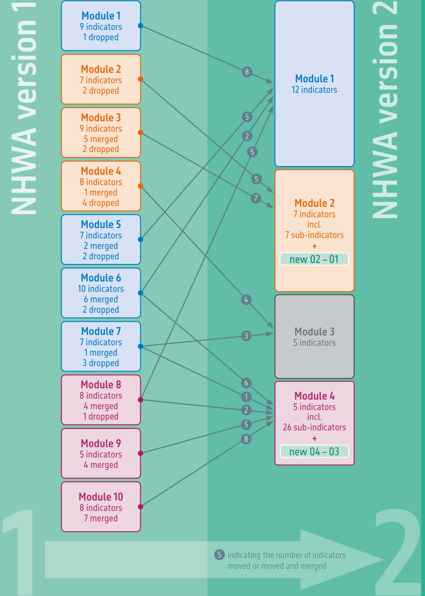
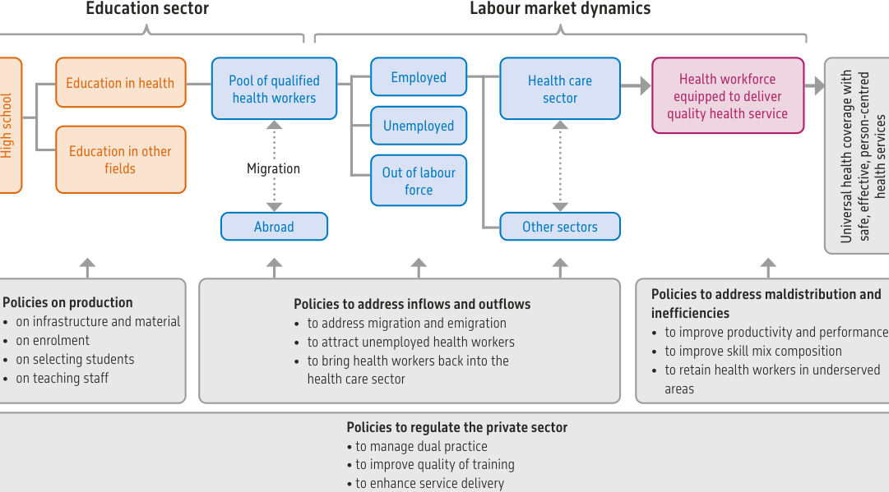
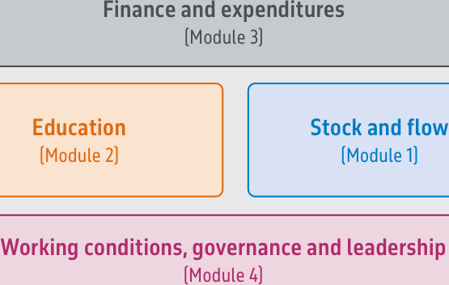

<!-- Extracted and reviewed by rhs-agent from sources/pdf/paho_pdfs/PDF_ENG/doc_12_link.1_01_9789240081291-eng.pdf. -->
<!-- PAGE: 1/132 -->

National health workforce accounts: a handbook

Second edition

<!-- PAGE: 2/132 -->

_[Página en blanco]_

<!-- PAGE: 3/132 -->

National health workforce accounts: a handbook

Second edition

<!-- PAGE: 4/132 -->

National health workforce accounts: a handbook, second edition

ISBN 978-92-4-008129-1 (electronic version) ISBN 978-92-4-008130-7 (print version)

## © World Health Organization 2023

Some rights reserved. This work is available under the Creative Commons Attribution-NonCommercial-ShareAlike 3.0 IGO licence (CC BY-NC-SA 3.0 IGO; https://creativecommons.org/licenses/by-nc-sa/3.0/igo).

Under the terms of this licence, you may copy, redistribute and adapt the work for non-commercial purposes, provided the work is appropriately cited, as indicated below. In any use of this work, there should be no suggestion that WHO endorses any specific organization, products or services. The use of the WHO logo is not permitted. If you adapt the work, then you must license your work under the same or equivalent Creative Commons licence. If you create a translation of this work, you should add the following disclaimer along with the suggested citation: “This translation was not created by the World Health Organization (WHO). WHO is not responsible for the content or accuracy of this translation. The original English edition shall be the binding and authentic edition”.

Any mediation relating to disputes arising under the licence shall be conducted in accordance with the mediation rules of the World Intellectual Property Organization (http://www.wipo.int/amc/en/mediation/rules/).

Suggested citation. National health workforce accounts: a handbook, second edition. Geneva: World Health Organization; 2023. Licence: CC BY-NC-SA 3.0 IGO.

Cataloguing-in-Publication (CIP) data. CIP data are available at https://iris.who.int/.

Sales, rights and licensing. To purchase WHO publications, see https://www.who.int/publications/book-orders. To submit requests for commercial use and queries on rights and licensing, see https://www.who.int/copyright.

Third-party materials. If you wish to reuse material from this work that is attributed to a third party, such as tables, figures or images, it is your responsibility to determine whether permission is needed for that reuse and to obtain permission from the copyright holder. The risk of claims resulting from infringement of any third-party-owned component in the work rests solely with the user.

General disclaimers. The designations employed and the presentation of the material in this publication do not imply the expression of any opinion whatsoever on the part of WHO concerning the legal status of any country, territory, city or area or of its authorities, or concerning the delimitation of its frontiers or boundaries. Dotted and dashed lines on maps represent approximate border lines for which there may not yet be full agreement.

The mention of specific companies or of certain manufacturers’ products does not imply that they are endorsed or recommended by WHO in preference to others of a similar nature that are not mentioned. Errors and omissions excepted, the names of proprietary products are distinguished by initial capital letters.

All reasonable precautions have been taken by WHO to verify the information contained in this publication. However, the published material is being distributed without warranty of any kind, either expressed or implied. The responsibility for the interpretation and use of the material lies with the reader. In no event shall WHO be liable for damages arising from its use.

<!-- PAGE: 5/132 -->

## Contents

|  | Abbreviations and acronyms | vi |
| --- | --- | --- |
|  | Acknowledgements | viii |
|  | Foreword | ix |
|  | What is new? | x |
| + | Part I: National Health Workforce Accounts in context | 1 |
|  | Global context on health and care workers | 2 |
|  | Value of the NHWA | 3 |
|  | Applications at the global level | 3 |
|  | Applications at the regional level | 5 |
|  | Applications at the national level | 5 |
|  | NHWA: concept and overview | 7 |
|  | Definition | 7 |
|  | The underpinning framework | 7 |
|  | A modular approach | 8 |
|  | Core principles of NHWA | 11 |
| + | Part II: Implementation and methods | 13 |
|  | Implementation and use of the NHWA | 14 |
|  | Methods for computing indicators | 15 |
| + | Part III: NHWA Indicators | 21 |
|  | Synthesis of indicators | 22 |
|  | Bridging table | 30 |
|  | How to read indicator metadata | 35 |

iii

<!-- PAGE: 6/132 -->

| Module 1: Stock and flow | 37 |
| --- | --- |
| 1 – 01 Health worker density | 38 |
| 1 – 02 Health worker density at subnational level | 39 |
| 1 – 03 Health worker distribution by age group | 40 |
| 1 – 04 Health worker distribution by sex | 41 |
| 1 – 05 Health worker distribution by facility ownership | 42 |
| 1 – 06 Health worker distribution by facility type | 43 |
| 1 – 07 Health worker distribution by place of birth | 44 |
| 1 – 08 Health worker distribution by place of training | 45 |
| 1 – 09 Annual inflows of health workers | 46 |
| 1 – 10 Annual outflows of health workers | 47 |
| 1 – 11 Vacancy rate | 48 |
| 1 – 12 Health worker distribution by type of contract | 49 |
| Module 2: Education | 51 |
| 2 – 01 Health workforce education and training capacity | 52 |
| 2 – 02 Ratio of applications to education and training capacity | 53 |
| 2 – 03 Ratio of enrolments to application | 54 |
| 2 – 04 Ratio of graduates to stock | 55 |
| 2 – 05 Duration of education and training | 56 |
| 2 – 06 Accreditation mechanisms for education and training institutions |  |
| and their programmes | 57 |
| 2 – 07 Standards for education and training programmes | 58 |
| Module 3: Finance and expenditures | 61 |
| 3 – 01 Expenditure on compensation of health workers | 62 |
| 3 – 02 Entry-level wages and salaries | 63 |
| 3 – 03 Total expenditure on health workforce education | 64 |
| 3 – 04 Expenditure per graduate on health workforce education | 65 |
| 3 – 05 Average tuition fee per student | 66 |
| Module 4: Working conditions, governance and leadership | 67 |
| 4 – 01 Labour regulations and policies for health workforce | 68 |
| 4 – 02 Health workforce governance and leadership capacity | 71 |
| 4 – 03 Share of women in leadership role | 73 |
| 4 – 04 IHR implementation capacity | 74 |
| 4 – 05 National capacity to monitor key metrics for health workforce |  |
| planning and global monitoring frameworks | 75 |

iv

<!-- PAGE: 7/132 -->

| + | Part IV: Examples of how to use NHWA |  |
| --- | --- | --- |
|  | to inform policy development | 77 |
|  | HWF planning | 79 |
|  | Equity and subnational distribution | 80 |
|  | Retention | 82 |
|  | Migration | 83 |
|  | Gender | 85 |
| + | Glossary | 87 |
| + | References | 95 |
| + | Annex 1: Development of the NHWA and its revision | 109 |
| + | Annex 2: List of occupations covered by the NHWA | 113 |

v

<!-- PAGE: 8/132 -->

## Abbreviations and acronyms

| AFRO | WHO Regional Office for Africa |
| --- | --- |
| CHW | Community health worker |
| CPD | Continuing professional development |
| EMRO | WHO Regional Office for the Eastern Mediterranean |
| EURO | WHO Regional Office for Europe |
| FETP | Field Epidemiology Training Program |
| GPW13 | Thirteenth Global Programme of Work |
| GSHRH | Global Strategy on Human Resources for Health: Workforce 2030 |
| HCW | Health and care worker |
| HIS | Health Information System |
| HLM | Health labour market |
| HRH | Human resources for health |
| HRHIS | Human resource for health information system |
| HWF | Health workforce |
| IHR | International Health Regulations |
| IA2030 | Immunization Agenda 2030 |
| ILO | International Labour Organization |
| ISCO | International Standard Classification of Occupations |
| ISIC | International Standard Industrial Classification |
| JEE | Joint External Evaluation |
| MDS | Minimum data set for health workforce registry |
| NHWA | National Health Workforce Accounts |
| NRI | National Reporting Instrument |
| OECD | Organisation for Economic Co-operation and Development |
| PAHO | WHO Regional Office for the Americas |
| PHC | Primary health care |
| SCI | Service coverage index (UHC) |

vi

<!-- PAGE: 9/132 -->

| SCORE | The SCORE for Health Data Technical Package: Survey-Count- |
| --- | --- |
|  | Optimize-Review-Enable |
| SDGs | Sustainable Development Goals |
| SDNM | Global Strategic Directions for Nursing and Midwifery |
| SEARO | WHO Regional Office for South-East Asia |
| SNA | System of National Accounts |
| SPAR | State Party Self-Assessment Annual Reporting Tool |
| SSL | Support and safeguards list |
| TEG | Group of technical HRH experts |
| UHC | Universal health coverage |
| UN | United Nations |
| UNESCO | United Nations Educational, Scientific and Cultural Organization |
| W4H | Working for Health programme |
| WHO | World Health Organization |
| WISN | Workload Indicators of Staffing Need |
| WPRO | WHO Regional Office for the Western Pacific |

vii

<!-- PAGE: 10/132 -->

## Acknowledgements

The National Health Workforce Accounts (NHWA) Handbook was developed under the direction of the World Health Organization (WHO) Health Workforce Department to support the implementation of the Global Strategy on Human Resources for Health: Workforce 2030.

The development of the NHWA Handbook version 2 was coordinated by the Data, Evidence and Knowledge Management unit of the Health Workforce Department: Mourtala Abdou Illou, Mathieu Boniol, Khassoum Diallo, Teena Kunjumen, Maria Sarah Nabaggala, Tapas Sadasivan Nair, Amani Siyam. Special thanks to WHO colleagues who provided contributions: James Avoka Asamani, James Campbell, Giorgio Cometto, Deki, Siobhan Fitzpatrick, Nirmal Kandel, Catherine Kane, Carey McCarthy, Michelle McIsaac, Monica Padilla, Tomas Zapata, Pascal Zurn.

WHO is grateful to the members of the Technical Expert Group (TEG) convened to provide guidance and technical expertise for the revision to version 2: Lara Badre, Martin Boyce, Lara Cleveland, Gilles Dussault, Lynn McNeely, Poonam Meena, Jane Mudyara, Janet Muriuki, Kavita Narayan, Nick Oliphant, Pia Schneider, Robert Smith.

Appreciation is due to the following staff from WHO regional offices for providing their inputs and suggestions on the revisions of NHWA during the online regional consultations: Adam Ahmat (Regional Office for Africa), Joel Caraballo (Pan American Health Organization), Silvia Cassiani (Pan American Health Organization), Ana Paula Cavalcante de Oliveira (Pan American Health Organization), Deki (Regional Office for the Western Pacific), Ibadat Singh Dhillon (Regional Office for South-East Asia), Fethiye Gulin Gedik (Regional Office for the Eastern Mediterranean), Jean Jacques Millogo (Regional Office for Africa), Sunny Okoroafor (Regional Office for Africa), Crispin David Paul Scotter (Regional Office for Europe) and Masahiro Zakoji (Regional Office for the Western Pacific).

Appreciation is also due to the following NHWA focal points for providing their inputs and suggestions on the revisions of NHWA during the online consultations: Leela Rupa Adhikari (Bhutan), Sergio Arturo Araiza Ortiz (Mexico), Kattya Baquero (Colombia), Lizett Bell (Belize), Cristina Racquel Caballero Garcia (Paraguay), Choden (Bhutan), Adam Cutler (Israel), Hadiza Dako (Nigeria), Ugyen Dema (Bhutan), Matt Edwards (United Kingdom of Great Britain and Northern Ireland), Hans-Jurgen Heilmann (Germany), Hamza Ismaila (Ghana), Tchaa Kadjanta (Togo), Vera Leiva Carvajal (Costa Rica), Courdney Marijoron (Papua New Guinea), Stephen Munene (Kenya), Lidia Maria Nina del Rosario (Dominican Republic), Angela Nyakundi (Kenya), Mollent Okech (WHO Papua New Guinea), Monica Padilla (Pan American Health Organization Colombia), Marija Palibrk (Montenegro), Sagun Paudel (WHO Nepal), Angelina Phillip-Lockhart (Trinidad and Tobago), Maniphet Phimmasane (Lao People’s Democratic Republic), Ayanna Richardson (Trinidad and Tobago), Marcus Samo (Federated States of Micronesia), Bhim Prasad Sapkota (Nepal), Vasos Scoutellas (Cyprus), Marina Shakhnazarova (Georgia), Carlos Lino Sosa Manzano (Mexico), Jackurlyn Sutton (Turks and Caicos Islands), Petros Tesfazion (United States of America), Sangay Thinley (Bhutan), Tiuala Tiotio (Samoa), Kc Dianne Torres Quintero (Panama), Dagoberto Vega (Panama), Mutile Wanyee (Kenya), Ambrose Wreh (Liberia), Lubna Yaqoob (Pakistan) and Barnabas Yeboah (Ghana).

Production coordination – Mathieu Boniol; editing – Dorothy van Schooneveld; and design – Reto Schürch.

viii

<!-- PAGE: 11/132 -->

## Foreword

## Foreword

Several years have passed since the launch of the National Health Workforce Accounts (NHWA) in 2017. And following a global pandemic that disrupted healthcare services worldwide, it is an opportune time to reflect on the progress, priorities, gaps, and adaptations of the NHWA. The NHWA has witnessed unprecedented engagement from countries, partners, and all three levels of the World Health Organization, with focal points nominated by most Member States (90%).

Thanks to collective efforts, there has been a significant improvement in the availability and quality of health workforce (HWF) data. Standardized measurement approaches, streamlined reporting mechanisms, and the involvement of multiple stakeholders from various sectors, including partner organizations, have played a vital role in this advancement. The data monitored and reported through NHWA has contributed to generating evidence on various policy issues, including HWF shortages, ageing, migration, and inequalities related to gender and subnational disparities. Furthermore, it has shed light on the significant contributions of the HWF in the response to the COVID-19 pandemic. NHWA has also facilitated the development of key global products, such as the State of the World’s Nursing report, the State of the World’s Midwifery report, as well as several national and regional reports.

Since 2017, the World Health Assembly has adopted a series of new resolutions highlighting HWF issues, such as the Strategic Directives on Nursing and Midwifery, the Working for Health Action Plan, and the Global Health and Care Worker Compact, to name a few. Additionally, the COVID-19 pandemic led to a greater recognition of the role of the HWF for universal health coverage (UHC) and health security. The development of the Roadmap for building national workforce capacity to deliver the essential public health functions, initiatives on non-communicable diseases, community health workers (CHWs), primary health care (PHC), and traditional and complementary medicine, all recognized the centrality of the health and care workforce as well as the need for data and evidence to inform policies and planning.

While ensuring continuity in the standardization of HWF statistics and maintaining the legacy of NHWA v1.0, this revision of NHWA incorporates necessary changes and adaptations to accommodate priority data needs for health and care workers (HCWs)-related new initiatives and challenges. The implementation of NHWA remains committed to core principles, which include a systems-strengthening approach, progressive implementation, multi-sectoral governance, and diversification of data sources. This revised version also provides more examples of NHWA data use.

We extend our utmost gratitude to all those who contributed to the assessment of version 1 and the development of the present revision. We hope that this revision will meet the needs of countries and assist them in addressing HWF challenges while making progress towards the 2030 Sustainable Development Goals.

ix

<!-- PAGE: 12/132 -->

## What is new?

## What is new?

This revision of the NHWA incorporates several aspects beyond data and indicators: the evolution of the global health agenda since 2017, new indicators needed and revision of existing indicators, the evolution of the occupations’ definitions, new tools and guidance.

The global health agenda has evolved drastically since the launch of NHWA, with the COVID-19 pandemic hitting the world in 2020 (1). In addition to other recent emerging events with direct impact on health and healthcare – such as armed conflict, ecological crisis, zoonotic diseases – the global COVID-19 pandemic called for actions in the field of emergency preparedness and response and through a One Health approach (2). As a consequence, there is an increased need for strengthening the public health and emergency workforce. In 2022, a Roadmap was established in partnership with associations, institutions and schools of public health (as represented by their respective national, regional and global bodies) with an objective to better monitor and plan for the workforce involved in the delivery of the essential public health functions, including emergency preparedness and response (3).

The NHWA improves HWF data and evidence at national, regional and global level. Through the measurement of HWF data in successive years, there is now a better understanding of the HWF challenges. At the mid-way of the UN SDGs era, although progress was observed, there is still a projected global HWF shortage of 10 million health and care workers (HCWs) by 2030 (3). This improved data is thanks to the contributions of the NHWA focal points of each country, with currently 181 countries, territories and areas having a nominated focal point. This rapid implementation of NHWA in countries, and the active participation of WHO regional offices and country focal points, enabled identification of areas for improvement in the implementation and the tools and guidance on NHWA.

To address the new challenges on the global health agenda, a series of programmes, directions, tools and guidance were developed. The fourth and fifth Global Forums on Human Resources for Health in Dublin (2017) and Geneva (2023) enabled identification of key policy priorities to improve the health and care workforce. The World Health Assembly also took actions on protecting, safeguarding and investing in the health and care workforce (4) with adoption of the Working for Health programme (5). The WHO developed the Global Strategic Directions on Nursing and Midwifery (SDNM) (6), through actions required to develop and strengthen CHWs, and through the development of a Global Health and Care Worker Compact (7). All these actions need monitoring frameworks, which have been incorporated through improvement of designated indicators and health occupations in this revision of NHWA. NHWA focal points and an expert advisory group recommended to reduce and rationalize the number of indicators while maintaining most key content from NHWA v1.0.

x

<!-- PAGE: 13/132 -->

This revision of NHWA implied changes and optimization of indicators while maintaining the presence of core indicators and the continuity with version 1. Based on requests from various stakeholders and NHWA focal points, a particular effort was made to reduce the overall number of indicators and modules. The NHWA version 2 now has four modules: module 1 on stock and flow, module 2 on education, module 3 on finance and expenditures, and module 4 on working conditions, governance and leadership.

Overall, about 80% of the information in NHWA version 1 is still present in NHWA version 2 (Figure 1). Out of the 78 indicators present in the NHWA version 1, 16 indicators were dropped, and 2 new indicators were added: the HWF education and training capacity, and the share of women in leadership role. As compared to NHWA version 1, several optimizations were identified to simplify the presentation of indicators such as: removing redundancies, when possible defining disaggregation instead of separate indicators, grouping capacity questions (with single answers such as: yes, partial, no) into a single composite indicator. All these optimizations enabled to compact NHWA into 29 indicators. To facilitate the update of national systems to NHWA version 2, bridging tables have been developed.

The list of HCW occupations was revised to include all occupations regularly reported through the NHWA over the past five years following the International Standard of Occupations (ISCO- 08) classification. The list of occupations was expanded for some occupational groups to account for feedback received throughout the years on NHWA v1.0.

Lastly, all tools available for policy makers, for NHWA focal points, and researchers have been updated. The NHWA data platform for focal points is aligned with the revised indicators and occupations, while the public data portal is updated to include additional features for users such as a searchable online handbook, and a repository of HWF-related national, regional and global documents such as national human resources for health (HRH) plans.

xi

<!-- PAGE: 14/132 -->

## Figure 1. NHWA version 2 includes 80% of information from NHWA version 1

Out of 78 indicators in NHWA V1, 62 were maintained, 16 were dropped and 2 new indicators were added.

Please check details of moved, merged and dropped indicators in

the bridging table included in part III of this report.

Note: Highlighted in green are two new indicators included in NHWA version 2.

<!-- PAGE: 15/132 -->

# Part I

## Part I

National Health Workforce Accounts in context

1

<!-- PAGE: 16/132 -->

## Global context on health and care workers

## Global context on health and care workers

A health workforce (HWF) of adequate size and skill mix is critical to the attainment of any population health goal. This includes the achievement of universal health coverage (UHC) (8) and the health-related targets of the United Nations Sustainable Development Goals (SDGs). Yet countries globally are affected by multifaceted challenges, such as difficulties in HWF education and training, deployment, performance and retention (9). Suboptimal allocation of health workers is one of the main challenges that directly influences the availability, accessibility, quality and performance of national health services (10), and may leave populations with inadequate access to the health services they need. Therefore, the World Health Organization (WHO) and its partners developed the Global Strategy on Human Resources for Health: Workforce 2030 (GSHRH), which sets out the policy agenda to ensure a HWF that is fit for purpose to attain the targets of UHC and the SDGs (9).

The GSHRH (9), adopted by the Sixty-ninth World Health Assembly in May 2016 under resolution WHA69.19, aims to ensure universal accessibility, acceptability, coverage and quality of the HWF within strengthened health systems (11). This can be achieved through adequate investments and the implementation of effective policies at national, regional and global levels. To realize this, the GSHRH presented multiple objectives, including one on strengthening data on human resources for health (HRH), as well as global milestones to be achieved by 2020 and 2030 respectively. Responsible change in any country will rely on the availability, completeness and quality of HWF data. Strengthening national human resources for health information systems (HRHIS) to collect and analyse reliable and up-to-date HWF data on stock, education, distribution, flows, demand, capacity and remuneration can drive evidence-based HWF planning and policy-making at national level.

In line with the GSHRH, the High-Level Commission on Health Employment and Economic Growth published ‘Working for health and growth: investing in the health workforce’ (12), a report and five-year action plan for health employment and inclusive economic growth. The three agencies that support the action plan are the International Labour Organization (ILO), the Organisation for Economic Co-operation and Development (OECD) and WHO. This report was reviewed by the Seventieth World Health Assembly, which recommended enforcement of the High-Level Commission’s recommendations (13). The High-Level Commission formulated its vision as follows: “Accelerate progress towards universal health coverage and attaining the goals of the 2030 Agenda for Sustainable Development by ensuring equitable access to health workers within strengthened health systems”. This vision is translated into 10 recommendations to transform national HWFs for the SDGs, and to develop labour market policies accordingly. To enlarge and attain a fit-for-purpose HWF, coordinated actions across all sectors involved with the health labour market (HLM) are required. Accordingly, the Working for Health programme was established as a joint ILO-OECD-WHO partnership in 2017 to bring about measurable

National health workforce accounts: a handbook – second edition 2

2

National health workforce accounts: a handbook – second edition

<!-- PAGE: 17/132 -->

action towards advancing UHC and making progress to achieve SDGs 3, 4, 5 and 8 (health, education, gender equality, decent work and economic growth) (14). The report also highlighted the need for immediate action on HWF data and indicators as well as harmonized metrics and methodologies for robust research and analysis of HLMs in and among nations. The National Health Workforce Accounts (NHWA) supports countries to achieve this.

The global impact of COVID-19 between 2020 and 2023 has shown us the central role of the HWF in maintaining the delivery of essential health services as well as simultaneously managing the pandemic response. A series of global pulse surveys on the continuity of essential health services during the COVID-19 pandemic has consistently indicated that the lack of sufficient health workers was the most common cause of disruptions to essential health services as well as the biggest bottleneck to access to essential COVID-19 tools (including diagnostics, therapeutics and vaccines) (15-18). The devastating impacts of the pandemic on countries across the world has highlighted the importance of developing an integrated multidisciplinary multisectoral workforce in every country that is capable of delivering all the essential public health functions, including emergency preparedness and response (19).

## Value of the NHWA

## Value of the NHWA

Applications at the global level

From the Action Plan of the High-Level Commission, and specifically the GSHRH, the concept of NHWA was clearly promoted as an important means to support countries in their national HWF policy and planning. The Sixty-ninth World Health Assembly adopted resolution WHA69.19 in support of its implementation (11). The purpose of the NHWA is to facilitate the standardization of HRHIS for interoperability, i.e. the ability to exchange HWF data within broader subnational or national health information systems (HIS), as well as within international databases. In this way, rapid aggregation and display of HWF data for decision-making can be fully realized, and the NHWA can serve as a guiding and supporting tool for countries to inform national evidence-based HWF policy decisions.

Since the launch of the NHWA in 2017, there has been a tremendous improvement in global HWF data availability and quality. The NHWA has succeeded in its mandate of fostering a harmonized approach for annual and timely collection of HWF information and defining core indicators in support of strategic workforce planning and global monitoring. As of April 2023, 181 countries, territories and areas have appointed national focal points for annual reporting of HWF data on the NHWA data platform. Meanwhile, the NHWA data portal contains the latest available global HWF data for key indicators, country profiles, occupation profiles and other visualizations, and boasts more than 4 800 registered users (20).

3 Part I: National Health Workforce Accounts in context

Part I: National Health Workforce Accounts in context

3

<!-- PAGE: 18/132 -->

The NHWA data has been used to measure key characteristics of the global HWF and has been instrumental in the development of various seminal knowledge products (3, 21-27). In addition, the NHWA has become a mechanism to monitor existing and upcoming global initiatives and frameworks such as the SDGs (28), tracking of UHC (29), the Thirteenth Global Programme of Work (GPW13) (30), the WHO Global Code of Practice on the International Recruitment of Health Personnel (31), the Global Strategic Directions for Nursing and Midwifery (6), the Primary Health Care Measurement Framework (32), the Working for Health programme (5), the Global Health and Care Worker Compact (7), the Immunization Agenda 2030 (33) and the Global Oral Health Action Plan (26). Thus, the NHWA is being used to track and support countries’ HWF efforts towards UHC, the SDGs and the global GSHRH milestones. In addition, data from the NHWA was also useful during the COVID-19 pandemic to estimate the deaths among health and care workers (HCWs) due to COVID-19 (34), determine the surge workforce requirements for COVID-19 vaccination (35), and monitor the global inequity in COVID-19 vaccination among HCWs (36, 37). Figure 2 illustrates various knowledge products using NHWA data.

Figure 2. NHWA data contributes to various knowledge products

National health workforce accounts: a handbook – second edition 4

<!-- PAGE: 19/132 -->

## Applications at the regional level

Through country reporting and international comparisons, the NHWA has also been able to facilitate comparability of the HWF landscape at regional level, facilitate cross-country capacity-building initiatives, information and knowledge exchange, developing regional HRH strategies or frameworks, and monitoring progress, as well as more sophisticated research about future HWF trends within and across systems. Thus, WHO regional offices have used the NHWA as an avenue to drive improved monitoring of the HWF across their respective countries (38-40).

## Applications at the national level

The NHWA indicators have been selected with clear policy relevance in mind, so that they can be used by any country according to its own specific needs. While designed to support a coherent framework for HWF policy analysis and design, the NHWA can be implemented and used in a flexible, modular way. It is important for countries to note that while the NHWA modules provide full coverage of indicators for all components and policy domains and form a natural whole across the HLM framework, there is also significant room for selecting country- specific indicators. As countries strongly differ in terms of the build-up of their education sector, HLM dynamics and health services, they will differ in their need to develop and conduct policies across these components. Hence, countries can select and prioritize NHWA modules according to their specific needs and goals at a given time, and eventually mature towards selecting and covering all NHWA indicators. This is not a goal in itself, however, and a flexible approach should always be adopted.

The NHWA is progressive in nature, so that some of the benefits for countries will be immediate, while others will become available over the longer term. The more indicators available at national and subnational level, the better the overview of the HWF landscape will be, along with the potential for more sophisticated analyses, more efficient HWF policies, and progress towards UHC. Over the last five years of NHWA implementation, countries have been able to use the NHWA to drive the HWF agenda at national level, by establishing multi-stakeholder governance mechanisms, in identifying diverse data sources and streamlining data flows, in strengthening national HRHIS, and in creating a culture of data use (27).

5 Part I: National Health Workforce Accounts in context

Part I: National Health Workforce Accounts in context

5

<!-- PAGE: 20/132 -->

## Box 1 Application of NHWA implementation at national level

- A better understanding of the HWF, including its size, characteristics and distribution; from this, countries can generate insight into the needs and possibilities for strengthening their HWF. • High-quality information on the HWF that informs evidence-based policy decisions according to country needs. • An efficient HWF through identifying significant improvements in health service coverage and health outcomes, especially if causal links with health system characteristics can be established. • An ability to guide and inform the transformation and scale-up of HWF education and training in support of UHC. • Strengthened policies, strategies and plans, through intersectoral policy dialogue among the relevant ministries, including those of education, health and finance. • Cross-cutting investments – in all modules of the NHWA – that will foster the demands of data-driven plans and policies, and capacity-building. • Improved measuring and monitoring of HWF trends, and better, comprehensive HWF planning.

- A better understanding of the HWF, including its size, characteristics and distribution; from this, countries can generate insight into the needs and possibilities for strengthening their HWF.

- High-quality information on the HWF that informs evidence-based policy decisions according to country needs.

- An efficient HWF through identifying significant improvements in health service coverage and health outcomes, especially if causal links with health system characteristics can be established.

- An ability to guide and inform the transformation and scale-up of HWF education and training in support of UHC.

- Strengthened policies, strategies and plans, through intersectoral policy dialogue among the relevant ministries, including those of education, health and finance.

- Cross-cutting investments – in all modules of the NHWA – that will foster the demands of data-driven plans and policies, and capacity-building.

- Improved measuring and monitoring of HWF trends, and better, comprehensive HWF planning.

To conclude, the NHWA can inspire countries to address or reconsider major policy questions related to current HWF challenges and optimizing planning systems, such as:

- Is the current HWF available, accessible, acceptable and of the appropriate competencies to provide good quality health services?

- Can the current gaps be addressed by improving performance through better allocation of resources, through increasing productivity, through effective retention policies, and through effective public–private partnerships?

- Can the current gaps be addressed by increasing investments in education and production, and/or increasing in-migration?

- Can policies and strategies aimed at improving performance and increasing inputs be financed (costing of policies and strategic options, including investments and recurring costs (salaries); negotiations with the government (ministries of finance, education, labour) as well as negotiations with the private sector)?

- Can the production of health workers replace the health worker loss caused by exits? Can financial incentives for health workers stimulate them to settle in underserved areas and lead to a more balanced geographical distribution of the HWF across the country or region?

National health workforce accounts: a handbook – second edition 6

6

National health workforce accounts: a handbook – second edition

<!-- PAGE: 21/132 -->

## NHWA: concept and overview

Definition

## Definition

The NHWA can be defined as – “a system by which countries progressively improve the availability, quality, and use of data on health workforce through monitoring of a set of indicators to support achievement of Universal Health Coverage, Sustainable Development Goals and other health objectives”.

## The underpinning framework

The concept of the NHWA is closely aligned with the HLM framework for UHC (41) (Figure 3), which also takes a central place in the High-Level Commission’s report ‘Working for health and growth: investing in the health workforce’ (12). This framework provides a comprehensive picture of the education sector and HLM dynamics, in which the economy, population and society act as drivers to attaining UHC and optimal health-care services as the outcome. In this sense, the HLM framework offers tangible directions for countries in terms of HWF policies that may contribute to achieving the GSHRH milestones, UHC and the SDGs.

At the lower level of the framework, four specific groups of policies are included that can tackle HWF challenges and support attaining equitable access to quality health services:

1. Policies on production

2. Policies to address inflows and outflows

2. Policies to address inflows and outflows

3. Policies to address maldistribution and inefficiencies

3. Policies to address maldistribution and inefficiencies

4. Policies to regulate the private sector.

The first three policies are related to different parts of the education sector and HLM dynamics and are interrelated in an ‘input–throughput–output’ sequence within the system. The policies to regulate the private sector cover the full scope of the HLM.

The development process of the NHWA and its revision is described in Annex 1.

7 Part I: National Health Workforce Accounts in context

Part I: National Health Workforce Accounts in context

7

<!-- PAGE: 22/132 -->

## Figure 3: The health labour market framework

Economy, population and broader societal drivers

## A modular approach

The NHWA contains a set of 29 indicators, spread over 4 modules, that aim to support national- level HWF policies to progress towards UHC and SDGs (Figure 4).

## National health workforce accounts: a handbook – second edition 8

8

National health workforce accounts: a handbook – second edition

<!-- PAGE: 23/132 -->

Figure 4: Overview of labour market components supported by the NHWA modules

The aim and content of each of the 4 modules are described in more detail below. Module 1 is the key starting point to the NHWA framework, as it collects the most crucial information on the HWF.

## Module 1: Stock and flow

This module provides a comprehensive overview of the composition and distribution of the HWF, and their participation in the HLM. Indicators are gathered on density at national level, distribution by age and by sex, institutional sector and facility types. Regarding policy relevance, this module helps to explore whether the current workforce is adequate to provide UHC-oriented services. It enables the detection of gaps in certain professions or competencies, mismatches in geographical or sectoral distribution, and enables an understanding of occupational segregation by gender. Understanding HWF composition and distribution enables the planning and implementation of policy interventions on HWF education, retention, or reallocation of resources. Module 1 contains an indicator on the subnational distribution of health workers, which allows monitoring progress towards halving inequalities in access to a health worker (Global milestone 1, by 2030) (9). Indicators on the share of foreign-trained and foreign-born health workers are also related to GSHRH, which targets that countries should make progress towards halving the dependency on foreign-trained health professionals through implementing

9 Part I: National Health Workforce Accounts in context

Part I: National Health Workforce Accounts in context

9

<!-- PAGE: 24/132 -->

the WHO Global Code of Practice (Global milestone 3, by 2030) (9, 31). Inflows to and outflows from the HLM are also measured in this module. The indicator on inflows differentiates the results of domestic replenishment efforts from dependency on foreign health workers, while the indicator on outflows monitors both voluntary and involuntary exits. Information about the balance of the HLM is gathered by tracking vacancies. A better understanding of the magnitude and the drivers of flows can provide a basis for effective recruitment and retention policies.

## Module 2: Education

This module provides information on HWF education and training capacity, applications, enrolments, and graduations. Indicators are aligned with SDG 4 (Education) targets and indicators supporting intersectoral coordination, for example on gender equality (SDG 5). The module enables the planning and monitoring of policies on student selection and enrolment. This module also supports mechanisms to coordinate an intersectoral HWF agenda. Indicators based on education regulation provide information on quality assurance, and education and training requirements. Accreditation mechanisms and their standards are of key importance (Global milestone 4, by 2020) (9), so that national education plans for the HWF are aligned with the national health plans to ensure that all health workers have the skills that match the needs of the population. These indicators can add information to enhance the quality and relevance of HWF education and training as well as to identify areas of intervention in the regulation or management of education and training.

## Module 3: Finance and expenditure

This module seeks to support an effective financing architecture that strengthens intersectoral collaboration, particularly between health and education sectors, as well as map expenditures on the HWF and remunerations in the health sector, including an oversight of earnings in the private sector where relevant. These data can be used to advance understanding on targeted investments that promote equitable access to education, as well as to identify and commit adequate budgetary resources for investments in transformative education, skills and job creation. Data on these indicators can make an important contribution to decent work as promoted by SDG 8 and to gender equality under SDG 5. Moreover, economic analyses are crucial for budget negotiations with the government (e.g. ministries of finance, labour, education) as well as with private sector representatives.

## Module 4: Working conditions, governance and leadership

This module includes indicators on working conditions, HWF governance and leadership capacity, and on the capacity of national HRHIS. The indicator on working conditions measures the existence of labour regulations and policies for HCWs and can serve as input for progressing towards decent work for all, as promoted by SDG 8. The indicator on HWF governance and leadership capacity assesses the existence of a central HRH unit and its capabilities in terms of planning and policy-making processes. This indicator is key to demonstrate whether the

National health workforce accounts: a handbook – second edition 10

10

National health workforce accounts: a handbook – second edition

<!-- PAGE: 25/132 -->

country has mechanisms to effectively use and apply information collected under indicators in the other modules. The indicator on HRHIS capacity assesses the ability of the national HRHIS to monitor various characteristics that are relevant for workforce planning at national and/or subnational level (such as outputs from education and training institutions, entrants to the labour market, active stock on the labour market, exits from the labour market, geocoded location of health facilities, and the gender pay gap) as well as for global monitoring frameworks (such as the WHO Global Code of Practice and the International Health Regulations (IHR)).

All indicators in the 4 NHWA modules are specified in the descriptive pages with standard information.

## Core principles of NHWA

The NWHA is beyond just a list of indicators; it is a system-strengthening approach to improve the collection, collation, analysis and use of HWF data and enable evidence-informed HWF planning and policy-making. By emphasizing national needs and interests, the NHWA keeps countries at the heart of the process and allows them to define the pace for progressive implementation. An inclusive multi-sectoral and multi-stakeholder governance mechanism at national level is critical for the implementation of the NHWA. By bringing different stakeholders together, it is possible to identify diverse data sources that are relevant for HWF planning and policymaking, standardize data collection methods across various stakeholders, foster partnerships to improve data availability, develop analytical products that are relevant for national contexts, catalyze data use for decision-making, raise awareness on HRH challenges and advocate for resource mobilization.

## Box 2 Core principles of NHWA

The following principles represent the “DNA” of NHWA implementation:

g p p p p • Multi-stakeholder and multi-sectoral governance mechanism of the NHWA data at national level • System strengthening approach • Progressive self-paced implementation • Parsimonious approach to collecting validated indicators/proxies • Inclusive country-owned and country-led (through the vital role of NHWA focal-points) process in prioritizing and reporting indicators and terminology at national level • Continuous updating mechanism using valid, reliable and diverse data sources (no primary data collection) • Annual data release

- Multi-stakeholder and multi-sectoral governance mechanism of the NHWA data at national level

- System strengthening approach

- Progressive self-paced implementation

- Parsimonious approach to collecting validated indicators/proxies

- Inclusive country-owned and country-led (through the vital role of NHWA focal-points) process in prioritizing and reporting indicators and terminology at national level

- Continuous updating mechanism using valid, reliable and diverse data sources (no primary data collection)

- Annual data release

11 Part I: National Health Workforce Accounts in context

Part I: National Health Workforce Accounts in context

11

<!-- PAGE: 26/132 -->

_[Página en blanco]_

<!-- PAGE: 27/132 -->

# Part II

## Part II

Implementation and methods

13

<!-- PAGE: 28/132 -->

## Implementation and use of the NHWA

## Implementation of the NHWA

The NHWA contains indicators with clear policy relevance across the entire spectrum of HWF priorities and those related to the HLM framework. The implementation of the NHWA is a country-led activity, building on national systems and using existing mechanisms to coordinate data-gathering for the evaluation of the HWF.

WHO has developed a set of tools to help countries implement the NHWA. These include, in addition to this Handbook, an implementation guide (42) and an online platform for data reporting and visualization, as well as an online data portal (20) where annually updated HWF data is made publicly available as a global public good to facilitate international comparisons (Figure 5).

Figure 5 – Overview of NHWA implementation tools

NHWA Handbook Sets of standards and norms on health workforce indicators

## NHWA Handbook

NHWA implementation guide Step by step implementation for policy makers

Sets of standards and norms on health workforce indicators

NHWA web platform Online platform for NHWA focal points to monitor and report their HWF statistics

NHWA data portal Public portal with data validated by countries

## NHWA web platform

## NHWA data portal

Online platform for NHWA focal points to monitor and report their HWF statistics

Public portal with data validated by countries

National health workforce accounts: a handbook – second edition 14

14

National health workforce accounts: a handbook – second edition

<!-- PAGE: 29/132 -->

The WHO regional offices can provide direct support in the implementation of the NHWA and respond to queries from countries in their region. The Health Workforce Department at WHO headquarters can also provide support to countries; queries or feedback on NHWA can be sent by email to hrhstatistics@who.int.

## Potential use of the NHWA

As described in the metadata sheets in Part III, the NHWA includes both numeric and ‘capability’ indicators that provide information on regulation and other mechanisms related to the HWF. Tangible examples on what implementation of the NHWA can mean for countries, and how it can support them in policy-making at national level, are provided in Part IV.

It is implicit that the availability of the institutional processes, plans and units listed in indicator 4-02 (HWF governance and leadership capacity) maximizes in each case the use of the indicators in a policy relevant direction. In addition, elements listed in indicator 4-05 address the national capacity to monitor key metrics for HWF planning and global monitoring frameworks.

## Methods for computing indicators

## Computation of densities

The density of HCWs is expressed per 10 000 population. It uses the stock of health workers divided by the size of the population multiplied by 10 000. The definition of the stock can vary and the preferred stock statistic is the number of practicing workers of the relevant occupation, i.e. those who are directly providing services to or for patients and communities, for which they received the corresponding training. When data with this definition are not available, then the alternative could be to use statistics on professionally active HCWs. These include practising workers as well as those who are directly not providing services but for whom their medical or paramedical education is a prerequisite for the execution of the job (e.g. education, research, public administration). If statistics are available for neither practicing nor professionally active workers, then data on HCWs licensed to practice could be used. These include all personnel who are registered and entitled to practice. Note that these data can sometimes include unemployed workers or workers who migrated. These data are therefore to be considered with caution as they may overestimate the actual size of the workforce delivering health and care services (43).

For global reporting, the mid-year population estimates from the latest revision of the World Population Prospects from the UN Population Division (44) are used as denominator.

15 Part II: Implementation and methods

Part II: Implementation and methods

15

<!-- PAGE: 30/132 -->

## Computation of statistics on distribution of HCWs

Several indicators in module 1 are based on the distribution of health workers such as age, sex, place of birth, place of training, facility ownership, and facility type. Each of these indicators are different disaggregates and they need to be reported completely and not partially. Indeed, while it could seem tempting to report one single disaggregate and rely on the total for the denominator, this could create discrepancies due to varying data sources. For example, to estimate the share of women, one could monitor and report only the stock of women and divide it by the total number of health workers. However, the sources of data for total and gender data are very frequently different. The total could be originated from a main national licensing system while the share of men and women (if not available in the licensing system) could be extracted from a labour force survey. In this situation, the numerator and denominator could have different properties (coverage, completeness, precision, etc.). To ensure consistency between numerator and denominator for each indicator on distribution, it is therefore suggested to report all disaggregates for the specific indicator and to only use this reported data for computing the indicator. For a distribution with n disaggregates, the percentage of disaggregate a could be expressed as:

Percentage (a) = × 100 n Stocka ∑x=1 Stockx

## Computation of scores

Four indicators of NHWA version 2 are based on a series of sub-indicators. The answer (yes, partial, no) to these sub-indicators results in a score that summarizes how much progress the country has made on the specific thematic. For each of these indicators, a score defined from 0 to 5 will be computed if data are reported for at least 4 sub-indicators. For each sub-question, a “yes” response will provide 1 point, “partial” 0.5 points, and “no” 0 point. The sum of points from all sub-indicators will be computed and expressed on a scale from 0 to 5. The rounded value will then be compared to the following table and classified with categories similar to those used in WHO SCORE system (45) as follows:

| Value of average score | Classification |
| --- | --- |
| 4.5 to 5 | Sustainable |
| 3.5 to 4.4 | Well-developed |
| 2.5 to 3.4 | Moderate |
| 1.5 to 2.4 | Limited |
| < 1.5 | Nascent |
| Data not reported for at least 4 sub-indicators | Not reported |

National health workforce accounts: a handbook – second edition 16

16

National health workforce accounts: a handbook – second edition

<!-- PAGE: 31/132 -->

For example, for an indicator with 9 sub-indicators, 5 being reported as “Yes”, 2 being reported as “Partial”, 1 reported as “No” and 1 not reported. The overall number of sub-indicators with a response provided is 8 so there are at least 4 sub-indicators and a score can be computed. The sum of points is therefore 5x1 + 2x0.5 = 6 points out of the 8 reported sub-indicators. Expressed on a scale from 0 to 5, the score would be 6 (points) x 5 (scale) /8 (number of sub-indicators reported) = 3.75. With a computed score of 3.75, the country would be classified as “Well- developed” for this indicator.

In case some sub-indicators have disaggregation by occupation, a first average will be made at the sub-indicator level, using only reported categories, before being used in the computation. For example, for a sub-indicator on medical doctors reported as “Yes”, nursing personnel as “Partial”, midwifery personnel as “Partial”, dentists reported as “No” and pharmacists not reported, the average point for this sub-indicator would be (1+0.5+0.5+0)/4 = 0.5 points.

## Annual measurement

The monitoring of indicators in the NHWA is expected to occur on an annual basis, although more regular monitoring schemes are possible. This implies reporting on indicators to cover a period of one calendar year. Where data reporting is expected less regularly, this is marked in the individual indicator descriptive sheets.

Measurements may be performed using three different time frames.

## Cross-sectional

Such measurement provides a snapshot of a metric for a specific year, as at the end of the year. For example, the density of health workers metric for 2022 corresponds to the density of workers on 31 December 2022.

## Cumulative

Such metrics are accumulated throughout a year and correspond to the cumulative sum of a variable observed from 1 January to 31 December. For example, the total expenditure on the health workforce in 2022 supposes the sum of all HWF expenditures in 2022, i.e. all expenditures from 1 January to 31 December 2022 should be included.

## Measurement of flows of individuals from a cohort

Indicators including the notion of flow have to be considered carefully, particularly for the definition of the denominator to use. For these indicators, the cohort to which the indicator belongs should be defined. For inflow, the denominator should be defined at the end of the year as the entrants belong to the cohort measurable at the end of the period. For outflow, the denominator should be defined at the beginning of the year as the exits belong to the cohort observed at the beginning of the year.

17 Part II: Implementation and methods

Part II: Implementation and methods

17

<!-- PAGE: 32/132 -->

For example, the entry rate in the labour market in 2022 corresponds to health workers entering between 1 January and 31 December 2022. The cohort to be used as the denominator should therefore be the number of active health workers as of 31 December 2022 because the newcomers belong to this cohort and were not part of the cohort of workers as of 31 December 2021.

In contrast, the exit rate of workers in 2022 corresponds to health workers leaving the health system between 1 January and 31 December 2022. The cohort to be used in this case is the number of active workers as of the preceding year, i.e. 31 December 2021, because those who exit no longer belong to the cohort of workers observed as at 31 December 2022.

## Level of disaggregation

At least one level of disaggregation is necessary to describe each indicator. Disaggregation factors with a specific definition to enable harmonization of data gathering have been proposed for each indicator. The standard use of a comma “,” or of the word “and” is proposed in the present document to distinguish between single and multiple levels of disaggregation. A comma “,” between two or more factors indicates that the stratification is to be conducted independently of each factor. An “and” indicates that the stratification is to be conducted jointly on two (or more) factors.

For example, disaggregation “by occupation, by occupation and age” should be read as: first a disaggregation by occupation only, which corresponds to summarizing the indicator in a column; second, a disaggregation combining information on occupation and age, which corresponds to summarizing this indicator in a table with occupation in rows and age groups in columns.

Disaggregation proposed in the Handbook are ordered by level of complexity, and it is expected that the first level of disaggregation is initially monitored. Progressive implementation of the NHWA will enable the monitoring and reporting of more complex levels of disaggregation. For instance, a disaggregation “by occupation, by occupation and sex, by occupation and subnational level” could be first implemented “by occupation”, then “by occupation and sex”, and “by occupation and subnational level” implemented in subsequent years when data become available.

## Disaggregation by subnational level

For some indicators, a disaggregation by subnational level is indicated. These subnational levels should be defined according to Member States’ needs. The use of a disaggregation based on administrative units down to the first or second subnational level is recommended (depending on the structure of administrative units and the size of subnational territories), without overlaps between the administrative units. Examples of subnational administrative units are states, regions, provinces, counties, and districts.

National health workforce accounts: a handbook – second edition 18

18

National health workforce accounts: a handbook – second edition

<!-- PAGE: 33/132 -->

## Currency

Several indicators cover financial information available from HLM data. Such indicators can be collected at national level using the official currency in a specific country. However, for information reported at international level, currencies should be standardized to the US$. The United Nations Treasury provides operational rates of exchange (https://treasury.un.org/) for the conversion of currencies, with monthly rates reported for each country for the 10 preceding years. For indicators reported as a sum over a whole year, the mid-year conversion rate should be used.

## Population estimates

Several indicators are expressed as density computed with a population size as denominator. Such population size data would usually be reported by national statistical offices based on census data or inter-census estimates. For the purposes of international comparisons, standard population estimates will be used instead of national estimates, such as the mid-year population estimates from the World Population Prospects published by the United Nations Population Division (44). Therefore, only the numerator data for these indicators are to be recorded by NHWA focal points.

## List of occupations

Throughout the Handbook, indicators for the NHWA are defined by occupations of the HWF. It is strongly recommended to use occupation definitions following the most recent international classification. The proposed list of occupations in Annex 2 is based on the ISCO-08 (46). Countries are encouraged to register detailed information at the unit level of ISCO-08 (4-digit level) to better inform on HWF statistics. The WHO recommends using additional categories and sub-categories for classifying some HCWs, such as for specialist medical practitioners, epidemiologists etc.

The NHWA primarily focuses on HCWs – this includes personal care workers as well as health management and support workers.

## Deviation from definitions

The NHWA indicator definitions and calculation methods are based on agreed international classifications when available. However, as data availability and definitions used at national level may vary, Member States are encouraged to report data even in cases where it is not possible to follow the methodology stated in NHWA Handbook. In such cases, the deviation from the standard definition should be noted, and a detailed description of the methodology used should be reported.

19 Part II: Implementation and methods

Part II: Implementation and methods

19

<!-- PAGE: 34/132 -->

_[Página en blanco]_

<!-- PAGE: 35/132 -->

# Part III

## Part III

## NHWA Indicators

21

<!-- PAGE: 36/132 -->

| flow and Stock – 1 Module | Disaggregation | occupation by level occupation, activity By and | occupation By | occupation by occupation, sex By and | occupation By | occupation By | occupation By | occupation By | of and foreign- place and occupation among foreign-trained by occupation training occupation, of by among country trained, birth By |
| --- | --- | --- | --- | --- | --- | --- | --- | --- | --- |
|  | Denominator | population** Total | subnational at population Total level | health headcounts active in of defined number workers, Total | and defined male active workers, of health number headcounts female Total in | health headcounts active in of defined number workers, Total | health headcounts active in of defined number workers, Total | health headcounts active in of defined number workers, Total | health headcounts active in of defined number workers, Total |
|  | Numerator | workers, health headcounts active of in Number defined | in workers administrative health active subnational of 1 Number level units | workers health categories active of group Number age in | workers health active categories of Number sex in | private workers, working given or for-profit) the (public health by private headcounts, sector active owned or of in facilities institutional not-for-profit Number defined in | in workers, working health type headcounts, active facility of in specific Number defined a | birth health of active place of by Number workers | training health of active place of by Number workers |
|  | name full Indicator | per workers health population of 000 Density 10 | level per workers subnational health at active population of 000 Density 10 | workers health groups active of age different Percentage in | workers health active of Percentage sex by | workers ownership health active facility of by Percentage employed | workers health type active facility of by Percentage employed | workers health birth active of of place Percentage their by | workers health training active of of place Percentage their by |
|  | name abbreviated Indicator | worker* Health density | density level worker subnational Health at | by worker group distribution Health age | by worker distribution Health sex | by ownership worker distribution Health facility | by worker type distribution Health facility | by worker birth of distribution Health place | by training worker of distribution Health place |
|  | Indicator Number | 1-01 | 1-02 | 1-03 | 1-04 | 1-05 | 1-06 | 1-07 | 1-08 |

Synthesis of indicators

22 National health workforce accounts: a handbook – second edition

<!-- PAGE: 37/132 -->

| flow and Stock – 1 Module | Disaggregation | and occupation, occupation sex by and by training, training occupation, of of place place By | sex and and occupation (voluntary/involuntary), exit of by type occupation, exit occupation, of type By by | occupation By | occupation By |
| --- | --- | --- | --- | --- | --- |
|  | Denominator | health headcounts active in of defined number workers, Total | health headcounts active in of defined number workers, Total | full- unfilled) funded and of (filled number posts Total time | health headcounts active in of defined number workers, Total |
|  | Numerator | active newly workers of Number health | who health workers the in health inactive of market Number became labour | least posts at for full-time filled been funded not months of have Number twelve that | workers contracts health of part-time) active types vs of specific Number (full-time in |
|  | name full Indicator | workers health health active active of stock newly total of the workers Ratio to | leaving total the workers to workers market health health labour active active of health of Ratio stock the | total to posts posts funded unfilled of of number Ratio | contract health of type active their of by Percentage workers |
|  | name abbreviated Indicator | of inflows workers Annual health | workers outflows health Annual of | rate Vacancy | by contract worker distribution of Health type |
|  | Indicator Number | 1-09 | 1-10 | 1-11 | 1-12 |

the United Nations Department of Economic and Social Affairs * Health workers refers to all occupations of the health and care workforce listed in Annex 2 ** Total population from World Population Prospects published by the Population Division of

23 Part III: NHWA Indicators

Part III: NHWA Indicators

23

<!-- PAGE: 38/132 -->

| Education – 2 Module | Disaggregation | education programme workforce training health By and | health training by education and programme, sex workforce education and training health workforce programme By and | health training by education and programme, sex workforce education and training health workforce programme By and | health training training education ownership by health education and by and health programme, sex, institution workforce education education and and training training (public/private) health workforce programme workforce programme By and and | education programme workforce training health By and | education programme workforce training health By and |
| --- | --- | --- | --- | --- | --- | --- | --- |
|  | Denominator | population Total | available health and places a of of education programme year number first workforce the training Total in | health applications and a of of year education programme number first the workforce training Total for | headcounts health in active defined of Number workers, |  |  |
|  | Numerator | education health in institutions places of training Number and | first education the for workforce programme applications health of a training of Number year and | the in programme workforce enrolments training health of a and of number year education Total first | and cohort a education from graduates workforce programme of health Number a training of | applicable Not | applicable Not |
|  | name full Indicator | education 000 10 per workforce capacity health training of population Ratio and | to training health for and capacity education applications training of workforce Ratio the | first the education the programmes in to enrolled workforce programmes these for students health training of of applications Ratio year and | to workforce programmes workers health health of training active graduates and of of stock education Ratio the | programmes, workforce training health and of Duration education years in | for workforce institutions and/ mechanisms health training national programmes of and of subnational (Yes/Partial/No) accreditation their Existence education or and |
|  | name abbreviated Indicator | workforce and capacity education Health training | applications and capacity of education training Ratio to | enrolments applications of Ratio to | graduates of stock Ratio to | education of training Duration and | for institutions and Accreditation mechanisms their programmes education training and |
|  | Indicator Number | 2-01 | 2-02 | 2-03 | 2-04 | 2-05 | 2-06 |

24 National health workforce accounts: a handbook – second edition

<!-- PAGE: 39/132 -->

| Education – 2 Module | Disaggregation | and last but education all (for 2-07.7) workforce programme health sub-indicator training By |
| --- | --- | --- |
|  | Denominator | community training accreditation social the training education programmes for for of for national for of on professional standards standards mechanisms standards workforce agree of standards applicable) training mechanisms (Yes/Partial/No) to element continuing of health bodies an subnational subnational subnational subnational accreditation for as mechanisms accreditation between workforce (Yes/Partial/No/Not regulatory training and/or and/or in and/or systems and/or in health cooperation and health national accreditation national of (Yes/Partial/No) national education (Yes/Partial/No) national (Yes/Partial/No) in-service the national curriculum of of of of institutions (Yes/Partial/No) of of for of in determinants plans Existence Existence Existence Existence Existence Existence Existence workers’ Sub-indicators: (Yes/Partial/No) interprofessional training accountability programmes programmes development standards education 2-07.1 2-07.2 social 2-07.3 2-07.4 2-07.5 2-07.6 2-07.7 health and |
|  | Numerator |  |
|  | name full Indicator | education for programmes standards of training Existence and |
|  | name abbreviated Indicator | programmes for and Standards education training |
|  | Indicator Number | 2-07 |

25 Part III: NHWA Indicators

Part III: NHWA Indicators

25

<!-- PAGE: 40/132 -->

| expenditures and Finance – 3 Module | Disaggregation | private public/ By | occupation by public/private occupation, By and | health training by education and institution programme, (public/private) workforce education and training health workforce programme ownership By and | health training by education and institution programme, (public/private) workforce education and training health workforce programme ownership By and | education programme workforce training health By and |
| --- | --- | --- | --- | --- | --- | --- |
|  | Denominator |  |  |  | from and education graduates of programmes workforce number Total health training | workforce students training of health and number in programmes enrolled education Total |
|  | Numerator | applicable Not | applicable Not | applicable Not | workforce health on expenditure education Total | education given students a for by workforce paid programmes fees health tuition in training enrolled Total and year |
|  | name full Indicator | compensation on workers expenditure health Total of | salary and wage contributions entry-level social Average excluding | education health on pre-service capital) expenditure and workforce (current Total | health training of and graduate education per Expenditure workforce programme | workforce per programmes fee health tuition in training annual enrolled and Average student education |
|  | name abbreviated Indicator | of on workers compensation Expenditure health | wages salaries Entry-level and | workforce expenditure health education Total on | health education per on Expenditure graduate workforce | fee tuition student Average per |
|  | Indicator Number | 3-01 | 3-02 | 3-03 | 3-04 | 3-05 |

26 National health workforce accounts: a handbook – second edition

<!-- PAGE: 41/132 -->

Not applicable

Sub-indicators: 4-01.3 Existence of national/subnational policies/laws regulating social protection (Yes/Partial/No) 4-01.4 Existence of national/subnational policies/laws regulating dual practice (Yes/Partial/No) 4-01.5 Existence of national/subnational policies/laws regulating compulsory service (Yes/Partial/No) 4-01.6 Existence of national/subnational policies/laws for prevention of attacks on health workers (Yes/Partial/No) 4-01.9 Existence of regulatory mechanisms for promoting health worker safety (Yes/Partial/No) 4-01.10 Existence of regulatory mechanisms to ensure oversight of the activities of health workers within the private sector (Yes/Partial/No) 4-01.11 Existence of remuneration of community health workers through salary (Yes/Partial/No/Not applicable) 4-01.12 Existence of advanced nursing roles (Yes/Partial/No) 4-01.7 Existence of national/subnational care packages for mental well-being of health workers (Yes/Partial/No) 4-01.8 Existence of mechanisms for in-kind renumeration to promote rural retention (Yes/Partial/No) 4-01.1 Existence of national/subnational policies/laws regulating working hours and conditions (Yes/Partial/No) 4-01.2 Existence of national/subnational policies/laws regulating minimum wage (Yes/Partial/No)

and policies on the employment characteristics, protection and working conditions of the health workforce Existence of labour regulations

and policies for health workforce abbreviated name Indicator full name Numerator Denominator Disaggregation

Module 4 – Working conditions, governance, and leadership Indicator Number Indicator

4-01 Labour regulations

27 Part III: NHWA Indicators

Part III: NHWA Indicators

27

<!-- PAGE: 42/132 -->

| leadership and governance, conditions, Working – 4 Module | Disaggregation | applicable Not | applicable Not | applicable Not |
| --- | --- | --- | --- | --- |
|  | Denominator | workforce Health workforce, monitoring coordinate on workforce of plans health to health and Ministry and bodies health (Yes/Partial/No) the national assessing (Yes/Partial/No) the or policies for for in the unit models plans for mechanisms and agenda monitoring models delivery and plan workforce education workforce and health service institutional health (Yes/Partial/No) mechanisms national institutional (Yes/Partial/No) a developing national health health of of of (Yes/Partial/No) of of for the for Existence Existence workforce Existence Existence Existence needs intersectoral with Sub-indicators: strategy/plan responsible 4-02.1 4-02.2 health 4-02.3 planning 4-02.4 aligned 4-02.5 staffing an | in defined and roles men Health, of leadership of number in Ministry headcounts women Total the in |  |
|  | Numerator |  | roles in defined leadership Health, in of women of Ministry headcounts Number the in | applicable Not |
|  | name full Indicator | levels capacity workforce subnational leadership health and and/or of national governance Existence at | in senior in positions Health of women of management Ministry Share the | to requirements Health resources Developed/ Sustainable) capacity human International of core (None/Limited/ Demonstrated/ Availability implement Regulation |
|  | name abbreviated Indicator | capacity and workforce governance leadership Health | role women of leadership Share in | Regulations implementation International Health capacity |
|  | Indicator Number | 4-02 | 4-03 | 4-04 |

28 National health workforce accounts: a handbook – second edition

<!-- PAGE: 43/132 -->

| leadership and governance, conditions, Working – 4 Module | Disaggregation | applicable Not |
| --- | --- | --- |
|  | Denominator | on information on Practice (Yes/Partial/No) entrants active exits on (Yes/Partial/No) (Yes/Partial/No) reporting of (Yes/Partial/No/ generate for generate Code track track track information for to to to gap to metrics to Global Personnel pay data (Yes/Partial/No) information institutions information information information geocoded mechanism) mechanism) WHO (Yes/Partial/No) gender HRH workforce Health (Yes/Partial/No) on other other the of of generate training generate (Yes/Partial/No) generate generate (Yes/Partial/No) generate monitor health Regulations report and facilities (or (or to to to to to to on Recruitment market to HRHIS HRHIS implementation HRHIS HRHIS HRHIS HRHIS market HRHIS HRHIS HIS report Health education market health of of of of of of labour of of of to of labour Ability applicable) Ability Ability on International Ability from Ability labour Ability the Ability Ability Ability Sub-indicators: International on the location information report 4-05.1 Not 4-05.2 4-05.3 to the 4-05.4 outputs 4-05.5 the to 4-05.6 stock 4-05.7 from 4-05.8 the 4-05.9 |
|  | Numerator |  |
|  | name full Indicator | resources to for planning global systems human relevant for workforce and frameworks national information metrics health policy-making of key health monitoring Capacity monitor national for and |
|  | name abbreviated Indicator | monitoring health planning capacity key for monitor global frameworks National metrics workforce to and |
|  | Indicator Number | 4-05 |

29 Part III: NHWA Indicators

Part III: NHWA Indicators

29

<!-- PAGE: 44/132 -->

## Bridging table

The following table shows how indicators from NHWA version 1 are classified in NHWA version 2. The status explains if the indicator is maintained as in version 1, merged with another indicator, modified substantially, or dropped.

| indicator, | modified substantially, or dropped. |  |  |  |
| --- | --- | --- | --- | --- |
| NHWA V1 Indicator ID | V1 Indicator abbreviated name | Status | NHWA V2 Indicator ID | V2 Indicator abbreviated name |
| Module 1 – Active health workforce stock |  |  |  |  |
| 01-01 | Health worker density | Maintained | 1-01 | Health worker density |
| 01-02 | Health worker density at subnational level | Maintained | 1-02 | Health worker density at subnational level |
| 01-03 | Health worker distribution by age group | Maintained | 1-03 | Health worker distribution by age group |
| 01-04 | Female health workforce | Maintained | 1-04 | Health worker distribution by sex |
| 01-05 | Health worker distribution by facility ownership | Maintained | 1-05 | Health worker distribution by facility ownership |
| 01-06 | Health worker distribution by facility type | Maintained | 1-06 | Health worker distribution by facility type |
| 01-07 | Share of foreign-born health workers | Maintained | 1-07 | Health worker distribution by place of birth |
| 01-08 | Share of foreign-trained health workers | Maintained | 1-08 | Health worker distribution by place of training |
| 01-09 | Share of workers across health and social sectors | Dropped | Not in NHWA V2 |  |
| Module 2 – Education and training |  |  |  |  |
| 02-01 | Master list of accredited health workforce education and training institutions | Dropped | Not in NHWA V2 |  |
| 02-02 | Duration of education and training | Maintained | 2-05 | Duration of education and training |
| 02-03 | Applications for education and training | Modified | 2-02 | Ratio of applications to education and training capacity |
| 02-04 | Ratio of admissions to available places | Modified | 2-03 | Ratio of enrolments to applications |
| 02-05 | Ratio of students to qualified educators for education and training | Dropped | Not in NHWA V2 |  |
| 02-06 | Exit/drop-out rate from educa- tion and training programmes | Modified | 2-04 | Ratio of graduates to stock |
| 02-07 | Graduation rate from education and training programmes | Modified | 2-04 | Ratio of graduates to stock |

National health workforce accounts: a handbook – second edition 30

30

National health workforce accounts: a handbook – second edition

<!-- PAGE: 45/132 -->

| NHWA V1 Indicator ID | V1 Indicator abbreviated name | Status | NHWA V2 Indicator ID | V2 Indicator abbreviated name |
| --- | --- | --- | --- | --- |
| Module 3 – Education and training regulation and accreditation |  |  |  |  |
| 03-01 | Standards for the duration and content of education and training | Dropped | Not in NHWA V2 |  |
| 03-02 | Accreditation mechanisms for education and training institutions and their programmes | Maintained | 2-06 | Accreditation mechanisms and standards for education and training institutions and their programmes |
| 03-03 | Standards for social accountability | Maintained | 2-07 | Standards for education and training programmes |
| 03-04 | Standards for social accountability effectively implemented | Dropped | Not in NHWA V2 |  |
| 03-05 | Standards for social determinants of health | Merged with 03-03 | 2-07 | Standards for education and training programmes |
| 03-06 | Standards for interprofessional education | Merged with 03-03 | 2-07 | Standards for education and training programmes |
| 03-07 | Agreement on accreditation standards | Merged with 03-03 | 2-07 | Standards for education and training programmes |
| 03-08 | Continuing professional development | Merged with 03-03 | 2-07 | Standards for education and training programmes |
| 03-09 | In-service training | Merged with 03-03 | 2-07 | Standards for education and training programmes |
| Module 4 – Education finances |  |  |  |  |
| 04-01 | Total expenditure on higher education | Dropped | Not in NHWA V2 |  |
| 04-02 | Total expenditure on health workforce education | Maintained | 3-03 | Total expenditure on health workforce education |
| 04-03 | Average tuition fee per student | Maintained | 3-05 | Average tuition fee per student |
| 04-04 | Investment in transformative education and training | Dropped | Not in NHWA V2 |  |
| 04-05 | Expenditure per graduate on health workforce education | Maintained | 3-04 | Expenditure per graduate on health workforce education |
| 04-06 | Cost per graduate of medical specialist education programmes | Merged with 04-05 | 3-04 | Expenditure per graduate on health workforce education |
| 04-07 | Cost of qualified educators per graduate | Dropped | Not in NHWA V2 |  |
| 04-08 | Total expenditure on in-service training and continuing professional development | Dropped | Not in NHWA V2 |  |

31 Part III: NHWA Indicators

Part III: NHWA Indicators

31

<!-- PAGE: 46/132 -->

| NHWA V1 Indicator ID | V1 Indicator abbreviated name | Status | NHWA V2 Indicator ID | V2 Indicator abbreviated name |
| --- | --- | --- | --- | --- |
| Module 5 – Health labour market flows |  |  |  |  |
| 05-01 | Graduates starting practice within one year | Dropped | Not in NHWA V2 |  |
| 05-02 | Replenishment rate from domestic efforts | Maintained | 1-09 | Annual inflows of health workers |
| 05-03 | Entry rate for foreign health workers | Merged with 05-02 | 1-09 | Annual inflows of health workers |
| 05-04 | Voluntary exit rate from health labour market | Maintained | 1-10 | Annual outflows of health workers |
| 05-05 | Involuntary exit rate from health labour market | Merged with 05-04 | 1-10 | Annual outflows of health workers |
| 05-06 | Unemployment rate | Dropped | Not in NHWA V2 |  |
| 05-07 | Vacancy rate | Maintained | 1-11 | Vacancy rate |
| Module 6 – Employment characteristics and working conditions |  |  |  |  |
| 06-01 | Standard working hours | Dropped | Not in NHWA V2 |  |
| 06-02 | Health workers with a part-time contract | Maintained | 1-12 | Health workers distribution by type of contract |
| 06-03 | Regulation on working hours and conditions | Maintained | 4-01 | Labour regulations and policies for health workforce |
| 06-04 | Regulation on minimum wage | Merged with 06-03 | 4-01 | Labour regulations and policies for health workforce |
| 06-05 | Regulation on social protection | Merged with 06-03 | 4-01 | Labour regulations and policies for health workforce |
| 06-06 | Health worker status in employment | Merged with 06-02 | 1-12 | Health workers distribution by type of contract |
| 06-07 | Regulation on dual practice | Merged with 06-03 | 4-01 | Labour regulations and policies for health workforce |
| 06-08 | Regulation on compulsory service | Merged with 06-03 | 4-01 | Labour regulations and policies for health workforce |
| 06-09 | Measures to prevent attacks on health workers | Merged with 06-03 | 4-01 | Labour regulations and policies for health workforce |
| 06-10 | Attacks on health-care system | Dropped | Not in NHWA V2 |  |
| Module 7 – Health workforce spending and remuneration |  |  |  |  |
| 07-01 | Total expenditure on health workforce | Dropped | Not in NHWA V2 |  |
| 07-02 | Total official development assistance on health workforce | Dropped | Not in NHWA V2 |  |

National health workforce accounts: a handbook – second edition 32

32

National health workforce accounts: a handbook – second edition

<!-- PAGE: 47/132 -->

| NHWA V1 Indicator ID | V1 Indicator abbreviated name | Status | NHWA V2 Indicator ID | V2 Indicator abbreviated name |
| --- | --- | --- | --- | --- |
| 07-03 | Total expenditure on compensation of health workers | Maintained | 3-01 | Expenditure on compensation of health workers |
| 07-04 | Public expenditure on compensation of health workers | Merged with 07-03 | 3-01 | Expenditure on compensation of health workers |
| 07-05 | Entry-level wages and salaries | Maintained | 3-02 | Entry-level wages and salaries |
| 07-06 | Policies on public sector wage ceilings | Dropped | Not in NHWA V2 |  |
| 07-07 | Gender wage gap | Modified | 4-05 | National capacity to monitor key metrics for health workforce planning and global monitoring frameworks |
| Module 8 – Skill-mix composition for models of care |  |  |  |  |
| 08-01 | Percentage of health workforce working in hospitals | Merged with 01-06 | 1-06 | Health worker distribution by facility type |
| 08-02 | Percentage of health workforce working in residential long- term care facilities | Merged with 01-06 | 1-06 | Health worker distribution by facility type |
| 08-03 | Percentage of health workforce working in ambulatory health care | Merged with 01-06 | 1-06 | Health worker distribution by facility type |
| 08-04 | Specialist surgical workforce | Merged with 01-01 | 1-01 | Health worker density |
| 08-05 | Family medicine practitioners | Maintained | 1-01 | Health worker density |
| 08-06 | Existence of advanced nursing roles | Maintained | 4-01 | Labour regulations and policies for health workforce |
| 08-07 | Availability of human resources to implement the International Health Regulations | Maintained | 4-04 | International Health Regulations implementation capacity |
| 08-08 | Applied epidemiology training programme | Dropped | Not in NHWA V2 |  |
| Module 9 – Governance and health workforce policies |  |  |  |  |
| 09-01 | Mechanisms to coordinate an intersectoral health workforce agenda | Maintained | 4-02 | Health workforce governance and leadership capacity |
| 09-02 | Central health workforce unit | Merged with 09-01 | 4-02 | Health workforce governance and leadership capacity |
| 09-03 | Health workforce planning processes | Merged with 09-01 | 4-02 | Health workforce governance and leadership capacity |

33 Part III: NHWA Indicators

Part III: NHWA Indicators

33

<!-- PAGE: 48/132 -->

| NHWA V1 Indicator ID | V1 Indicator abbreviated name | Status | NHWA V2 Indicator ID | V2 Indicator abbreviated name |
| --- | --- | --- | --- | --- |
| 09-04 | Education plans aligned with national health plan | Merged with 09-01 | 4-02 | Health workforce governance and leadership capacity |
| 09-05 | Institutional models for assessing health care staffing needs | Merged with 09-01 | 4-02 | Health workforce governance and leadership capacity |
| Module 10 – Health workforce information systems |  |  |  |  |
| 10-01 | HRHIS for reporting on International Health Regulations | Maintained | 4-05 | National capacity to monitor key metrics for health workforce planning and global monitoring frameworks |
| 10-02 | HRHIS for WHO Code of Practice reporting | Merged with 10-01 | 4-05 | National capacity to monitor key metrics for health workforce planning and global monitoring frameworks |
| 10-03 | HRHIS for reporting on skilled attendance at birth requirements | Merged with 10-01 | 4-05 | National capacity to monitor key metrics for health workforce planning and global monitoring frameworks |
| 10-04 | HRHIS for reporting on outputs from education and training institutions | Merged with 10-01 | 4-05 | National capacity to monitor key metrics for health workforce planning and global monitoring frameworks |
| 10-05 | HRHIS for tracking the number of entrants to the labour market | Merged with 10-01 | 4-05 | National capacity to monitor key metrics for health workforce planning and global monitoring frameworks |
| 10-06 | HRHIS for tracking the number of active stock on the labour market | Merged with 10-01 | 4-05 | National capacity to monitor key metrics for health workforce planning and global monitoring frameworks |
| 10-07 | HRHIS for tracking the number of exits from the labour market | Merged with 10-01 | 4-05 | National capacity to monitor key metrics for health workforce planning and global monitoring frameworks |
| 10-08 | HRHIS for producing the geocoded location of health facilities | Merged with 10-01 | 4-05 | National capacity to monitor key metrics for health workforce planning and global monitoring frameworks |

National health workforce accounts: a handbook – second edition 34

34

National health workforce accounts: a handbook – second edition

<!-- PAGE: 49/132 -->

## How to read indicator metadata

## How to read indicator metadata

The indicators in the NHWA are presented as metadata sheets. The indicators are mostly numeric (quantitative), i.e. representing in numbers certain ratios with a numerator and denominator related to a HRH policy field. There are also capability indicators on the existence of certain regulations, processes, etc. reflecting the status of development of the HRH management system of a country. The metadata sheets aim to provide a definition with explanations for the connecting terms and methodology for the calculation. Definitions for key terms are presented in the Glossary, with an indication in the metadata sheets. External links and references are provided for further understanding, and the most relevant data sources for each indicator are also identified.

The metadata sheets follow the same structure for each indicator and include the current information in the following order:

- Indicator number: according to the standard numbering of the NHWA indicator system. It contains two numbers: the first number refers to the module, the second one to the indicator itself inside the module.

- Abbreviated name of the indicator: this name is for general use when referring to the indicator.

- Name of the indicator: full name of the indicator, which provides information about the definition. Some indicators are categoric, such as on the existence of a regulation; for these indicators, the possible values are provided in parenthesis (for example: Yes/Partial/No).

- Numerator: Numerator to be used for the calculation of the indicator (applicable only for numeric indicators).

- Denominator: Denominator to be used for the calculation of the indicator (applicable only for numeric indicators).

- Disaggregation of an indicator: the factors by which the value of the indicator can be disaggregated (e.g. by sex, age, facility type); for some indicators more than one disaggregation factor occurs.

35 Part III: NHWA Indicators

Part III: NHWA Indicators

35

<!-- PAGE: 50/132 -->

- Definition: details of the content of the indicator and additional technical notes. Where capability indicators consist of questions, these and options for the answers are listed here.

- Glossary: key terms from the indicator definition for which an explanation can be found in the Glossary of the Handbook.

- Data reporting frequency: whether the data should be collected on an annual basis or every three years.

- Potential data sources: relevant data sources at national level that can provide information for the current indicator, listed in order of decreasing relevance.

- Further information and related links: these represent the key literature, governing body, resolution, or programme publication that was used as a reference, or provide further information on the context of the indicator.

National health workforce accounts: a handbook – second edition 36

36

National health workforce accounts: a handbook – second edition

<!-- PAGE: 51/132 -->

# Module 1

## Module 1

# Stock and flow

## Module summary

This module provides a comprehensive overview of the size, composition and distribution of the HWF as well as its flow throughout the HLM.

| 1 – 01 | Health worker density |
| --- | --- |
| 1 – 02 | Health worker density at subnational level |
| 1 – 03 | Health worker distribution by age group |
| 1 – 04 | Health worker distribution by sex |
| 1 – 05 | Health worker distribution by facility ownership |
| 1 – 06 | Health worker distribution by facility type |
| 1 – 07 | Health worker distribution by place of birth |
| 1 – 08 | Health worker distribution by place of training |
| 1 – 09 | Annual inflows of health workers |
| 1 – 10 | Annual outflows of health workers |
| 1 – 11 | Vacancy rate |
| 1 – 12 | Health worker distribution by type of contract |

<!-- PAGE: 52/132 -->

Abbreviated name Health worker density 1– 01

| Indicator name | Density of health workers per 10 000 population |
| --- | --- |
| Numerator | Number of active health workers, defined in headcounts |
| Denominator | Total population |
| Disaggregation | By occupation, by occupation and activity level |
| Definition | Number of health workers per 10 000 population. |
|  | For activity level the following categories are recommended: practising health workers, professionally active health workers, and health workers licensed to practise. |
|  | Total population as estimated in the World Population Prospects published by the Population Division of the Department of Economic and Social Affairs of the United Nations Secretariat. In case of other methodology used, WHO recalculates densities according to the UN population estimates in |
|  | order to harmonize the densities and ensure comparability. |
| Glossary | • Active health worker |
|  | • Activity level |
|  | • Occupation |
| Data reporting frequency | Annual |
| and reporting frameworks | Reporting frameworks: UN SDG 3.c.1, SDG 3.8.1, WHO Global Code of Practice on the International Recruitment of Health Personnel, Global Strategy for Human Resources for Health: Workforce 2030 (GSHRH), Working for Health programme, Global Strategic Directions for Nursing and Midwifery (SDNM), Immunization Agenda 2030 (IA2030), SCORE for Health Data Technical Package (SCORE), Primary Health Care (PHC) Measurement Framework, Community Health Workers (CHWs), Global Oral |
|  | Health Action Plan |
| Potential data sources | • Health workforce registry or database |
|  | • Aggregate data from health facilities (routine administrative records, Health Management Information System, District Health Information System census and/or survey) |
|  | • Professional council/chamber/association registers |
|  | • Labour force surveys |
|  | • Population census data |
|  | • United Nations Population Division |
| Further information | (5, 6, 9, 31, 33, 45-55) |
| and related links |  |

National health workforce accounts: a handbook – second edition 38

38

National health workforce accounts: a handbook – second edition

<!-- PAGE: 53/132 -->

Abbreviated name Health worker density at subnational level

1– 02

# 1– 02

Indicator name Density of active health workers per 10 000 population at subnational level

Numerator Number of active health workers in level 1 subnational administrative units

Denominator Total population at subnational level

Disaggregation By occupation

Definition Number of active health workers per 10 000 population in the given subnational administrative unit. Preferably, the subnational unit should correspond to the place of work of health workers. The use of administrative units to the first subnational level is recommended (depending on the structure of administrative units and the size of subnational territories), without overlaps between the administrative units. Examples of subnational administrative units include states, regions, provinces, counties, and districts.

Glossary • Active health worker

- Active health worker

- Occupation

- Subnational level

- Subnational level

Annual Data reporting frequency and reporting frameworks Reporting frameworks: UN SDG 3.c.1, Global Strategy for Human Resources for Health: Workforce 2030 (GSHRH), Working for Health programme, Global Strategic Directions for Nursing and Midwifery (SDNM), SCORE for Health Data Technical Package (SCORE), Primary Health Care (PHC) Measurement Framework

## Annual

Potential data sources • Health workforce registry or database

## Potential data sources

- Health workforce registry or database

- Aggregate data from health facilities (routine administrative records, Health Management Information System, District Health Information System census and/or survey) • Professional council/chamber/association registers • Population census data

- Health facility database (with location)

## • United Nations Population Division

(5, 6, 9, 25, 45, 47-51) Further information and related links

Part III: NHWA Indicators 39

Part III: NHWA Indicators

39

<!-- PAGE: 54/132 -->

Abbreviated name Health worker distribution by age group 1– 03

| Indicator name | Percentage of active health workers in different age groups |
| --- | --- |
| Numerator | Number of active health workers in age group categories |
| Denominator | Total number of active health workers, defined in headcounts |
| Disaggregation | By occupation, by occupation and sex |
| Definition | Percentage of active health workers in the given age and sex category. |
|  | This indicator enables to create the population pyramid of health workers. Age groups considered are the following: < 25, 25–34, 35–44, 45–54, 55–64, ≥ 65 years. Sex groups corresponds to male or female |
|  | health workers. |
| Glossary | • Active health worker |
|  | • Age group |
|  | • Sex |
|  | • Occupation |
| Data reporting frequency | Annual |
| and reporting frameworks | Reporting frameworks: UN SDG 3.c.1, Global Strategic Directions for Nursing and Midwifery (SDNM), SCORE for Health Data Technical Package (SCORE) |
| Potential data sources | • Health workforce registry or database |
|  | • Aggregate data from health facilities (routine administrative records, Health Management Information System, District Health Information System census and/or survey) |
|  | • Professional council/chamber/association registers |
|  | • Labour force surveys |
|  | • Population census data |
| Further information | (6, 45, 48-51, 56) |
| and related links |  |

National health workforce accounts: a handbook – second edition 40

40

National health workforce accounts: a handbook – second edition

<!-- PAGE: 55/132 -->

Abbreviated name Health worker distribution by sex

1– 04

# 1– 04

| Indicator name | Percentage of active health workers by sex |
| --- | --- |
| Numerator | Number of active health workers in sex categories |
| Denominator | Total number of active male and female health workers, defined in headcounts |
| Disaggregation | By occupation |
| Definition | Percentage of active health workers in the given sex category. |
|  | Sex group corresponds to male or female health workers. |
| Glossary | • Active health worker |
|  | • Occupation |
|  | • Sex |
| Data reporting frequency | Annual |
| and reporting frameworks | Reporting frameworks: UN SDG 3.c.1, Global Strategic Directions for Nursing and Midwifery (SDNM), SCORE for Health Data Technical Package (SCORE) |
| Potential data sources | • Health workforce registry or database |
|  | • Aggregate data from health facilities (routine administrative records, Health Management Information System, District Health Information System census and/or survey) |
|  | • Labour force surveys |
|  | • Population census data |
| Further information | (6, 45, 48-51, 54) |
| and related links |  |

Part III: NHWA Indicators 41

Part III: NHWA Indicators

41

<!-- PAGE: 56/132 -->

Abbreviated name Health worker distribution by facility ownership 1– 05

| Indicator name | Percentage of active health workers employed by facility ownership |
| --- | --- |
| Numerator | Number of active health workers, defined in headcounts, working in facilities owned by the given institutional sector (public or private not-for-profit or private for-profit) |
| Denominator | Total number of active health workers, defined in headcounts |
| Disaggregation | By occupation |
| Definition | Percentage of active health workers employed by facility ownership (public, private not-for-profit, private for-profit). |
|  | The categories of facility ownership can be aligned to institutional sector definitions of the System of National Accounts (SNA 2008). |
| Glossary | • Active health worker |
|  | • Facility/institution ownership type |
|  | • Institutional sector |
| Data reporting frequency | Annual |
| and reporting frameworks | Reporting frameworks: SCORE for Health Data Technical Package (SCORE) |
| Potential data sources | • Health workforce registry or database |
|  | • Aggregate data from health facilities (routine administrative records, Health Management Information System, District Health Information System census and/or survey) |
|  | • Labour force surveys |
|  | • Census |
| Further information | (45, 49, 50, 54, 57) |
| and related links |  |

National health workforce accounts: a handbook – second edition 42

42

National health workforce accounts: a handbook – second edition

<!-- PAGE: 57/132 -->

Abbreviated name Health worker distribution by facility type

1– 06

# 1– 06

Indicator name Percentage of active health workers employed by facility type

Numerator Number of active health workers, defined in headcounts, working in a specific facility type

Denominator Total number of active health workers, defined in headcounts

Disaggregation By occupation

Definition Percentage of active health workers employed in the given facility type. Health facility types are based on the classification of System of Health Accounts: • Hospitals (HP.1) • Residential long-term care facilities (HP.2) • Providers of ambulatory health care (HP.3) • Ancillary services (HP.4, including transportation, emergency rescue, laboratories and othe • Retailers (HP.5, including pharmacies) • Providers of preventive care (HP.6)

Glossary • Active health worker • Facility type • Occupation

Data reporting frequency Annual

Potential data sources • Health workforce registry or database • Aggregate data from health facilities (routine administrative records, Health Management Information System, District Health Information System census and/or survey) • Labour Force Surveys • Census

(51, 53, 58) Further information and related links

- Providers of ambulatory health care (HP.3)

- Ancillary services (HP.4, including transportation, emergency rescue, laboratories and others)

Part III: NHWA Indicators 43

Part III: NHWA Indicators

43

<!-- PAGE: 58/132 -->

Abbreviated name Health worker distribution by place of birth 1– 07

| Indicator name | Percentage of active health workers by their place of birth |
| --- | --- |
| Numerator | Number of active health workers by place of birth |
| Denominator | Total number of active health workers, defined in headcounts |
| Disaggregation | By occupation |
| Definition | Percentage of active health workers by their place of birth. |
|  | Place of birth is defined as national-born or foreign-born. |
|  | This indicator will capture the information on the health workers coming from abroad. |
| Glossary | • Active health worker |
|  | • Occupation |
|  | • Place of birth |
| Data reporting frequency | Annual |
| and reporting frameworks | Reporting frameworks: WHO Global Code of Practice on the International Recruitment of Health Personnel, Global Strategic Directions for Nursing and Midwifery (SDNM) |
| Potential data sources | • Health workforce registry or database |
|  | • Professional council/chamber/association registers |
|  | • Health facility data |
|  | • Population census data |
| Further information | (31, 48, 49, 51, 59, 60) |
| and related links |  |

National health workforce accounts: a handbook – second edition 44

44

National health workforce accounts: a handbook – second edition

<!-- PAGE: 59/132 -->

Abbreviated name Health worker distribution by place of training

1– 08

# 1– 08

| Indicator name | Percentage of active health workers by their place of training |
| --- | --- |
| Numerator | Number of active health workers by place of training |
| Denominator | Total number of active health workers, defined in headcounts |
| Disaggregation | By occupation, by occupation and country of training among foreign-trained, by occupation and place of birth among foreign-trained |
| Definition | Percentage of active health workers by their place of training. |
|  | Place of training is defined as either domestic-trained, foreign-trained or unknown location of training. |
|  | The disaggregation by occupation and country of training is applicable to foreign-trained workers, and enables the monitoring of health worker migration by country of training. The disaggregation by occupation and place of birth is applicable to foreign-trained workers, and enables the monitoring of foreign-trained – national-born and foreign-trained – foreign-born workers. |
| Glossary | • Active health worker |
|  | • Occupation |
|  | • Place of training |
| Data reporting frequency | Annual |
| and reporting frameworks | Reporting frameworks: WHO Global Code of Practice on the International Recruitment of Health Personnel, Global Strategy for Human Resources for Health: Workforce 2030 (GSHRH), Global Strategic Directions for Nursing and Midwifery (SDNM) |
| Potential data sources | • Health workforce registry or database |
|  | • Professional council/chamber/association registers |
|  | • Health facility data |
| Further information | (31, 48, 49, 61, 62) |
| and related links |  |

Part III: NHWA Indicators 45

Part III: NHWA Indicators

45

<!-- PAGE: 60/132 -->

Abbreviated name Annual inflows of health workers 1– 09

# 1– 09

| Indicator name | Ratio of newly active health workers to the total stock of active health workers |
| --- | --- |
| Numerator | Number of newly active health workers |
| Denominator | Total number of active health workers, defined in headcounts |
| Disaggregation | By occupation, by occupation and place of training, by occupation, place of training and sex |
| Definition | Newly active health workers are those who started their activity in the given profession. In case data are available only for newly licensed health workers, the total number of licensed health workers should be used as denominator regardless of availability of data on active health workers. For total number of active health workers, data at the middle or the end of the reference year should be used. |
|  | Disaggregation by place of training (domestic-trained vs foreign-trained) enables to capture the health labour market dynamics of migration. |
| Glossary | • Active health worker |
|  | • Newly active health worker |
|  | • Activity level |
|  | • Place of training |
|  | • Sex |
|  | • Occupation |
| Data reporting frequency | Annual |
| and reporting frameworks | Reporting frameworks: Global Strategic Directions for Nursing and Midwifery (SDNM), SCORE for Health Data Technical Package (SCORE) |
| Potential data sources | • Ministry of Health database |
|  | • Health workforce registry or database |
|  | • Professional council/chamber/association registers |
|  | • Aggregate data from health facilities (routine administrative records, Health Management Information System, District Health Information System census and/or survey) |
| Further information | (45, 49-51) |
| and related links |  |

National health workforce accounts: a handbook – second edition 46

46

National health workforce accounts: a handbook – second edition

<!-- PAGE: 61/132 -->

Abbreviated name Annual outflows of health workers

1– 10

# 1– 10

| Indicator name | Ratio of active health workers leaving the health labour market to the total stock of |
| --- | --- |
|  | active health workers |
| Numerator | Number of health workers who became inactive in the health labour market |
| Denominator | Total number of active health workers, defined in headcounts |
| Disaggregation | By occupation, by occupation and type of exit (voluntary vs involuntary), by occupation, type of exit and sex |
| Definition | Percentage of active health workers who became inactive in the health labour market |
|  | due to voluntary reason or involuntary reason |
|  | The disaggregation by type of exit has the following two categories: |
|  | • Voluntary exit corresponds to the following situations: emigration, temporary leave, change of sector, early retirement or other voluntary reason. Only early retirement should be considered |
|  | as voluntary exit; retirement at standard age is to be counted in the involuntary exit. |
|  | • Involuntary exit corresponds to the following situations: death, retirement (excluding early retirement), suspension from work, long-term illness or other involuntary reason. |
|  | For the total number of active health workers, data at the end of the previous year should be used. |
| Glossary | • Active health worker |
|  | • Activity level |
|  | • Sex |
|  | • Occupation |
| Data reporting frequency | Annual |
| and reporting frameworks | Reporting frameworks: SCORE for Health Data Technical Package (SCORE) |
| Potential data sources | • Health workforce registry or database |
|  | • Professional council/chamber/association registers |
|  | • Aggregate data from health facilities (routine administrative records, Health Management Information System, District Health Information System census and/or survey) |
|  | • Data from pension and/or retirement administration units |
|  | • Mortality records |
| Further information | (45, 47, 49-51, 53, 54, 63) |
| and related links |  |

Part III: NHWA Indicators 47

Part III: NHWA Indicators

47

<!-- PAGE: 62/132 -->

Abbreviated name Vacancy rate 1– 11

| Indicator name | Ratio of unfilled posts to total number of funded posts |
| --- | --- |
| Numerator | Number of funded full-time posts that have not been filled for at least twelve months |
| Denominator | Total number of funded full-time posts (filled and unfilled) |
| Disaggregation | By occupation |
| Definition | Ratio of unfilled posts to total number of posts. |
|  | By limiting the count of unfilled posts for at least twelve months, this indicator enables to distinguish between a systematic job vacancy situation versus potential rapid turnover of staff. |
| Glossary | • Occupation |
|  | • Job vacancy |
|  | • Subnational level |
|  | • Vacancy rate |
| Data reporting frequency | Annual |
| and reporting frameworks | Reporting frameworks: Global Strategic Directions for Nursing and Midwifery (SDNM), SCORE for Health Data Technical Package (SCORE) |
| Potential data sources | • Labour force surveys |
|  | • Health facility assessments |
|  | • Employment offices and/or job agencies |
| Further information | (49, 53, 64) |
| and related links |  |

National health workforce accounts: a handbook – second edition 48

48

National health workforce accounts: a handbook – second edition

<!-- PAGE: 63/132 -->

Abbreviated name Health worker distribution by type of contract

1– 12

# 1– 12

Part III: NHWA Indicators 49

Part III: NHWA Indicators

49

<!-- PAGE: 64/132 -->

_[Página en blanco]_

<!-- PAGE: 65/132 -->

# Module 2

## Module 2

## Education

## Module summary

| This module addresses capacity and quality in HWF education and training. These are aligned with education sector (SDG 4) indicators, which can assist in coordinating policies on production. |  |
| --- | --- |
| 2 – 01 Health workforce education and training capacity 2 – 02 Ratio of applications to education and training capacity 2 – 03 Ratio of enrolments to applications 2 – 04 Ratio of graduates to stock |  |
| 2 – 05 Duration of education and training 2 – 06 Accreditation mechanisms for education and training institutions and their programmes 2 – 07 Standards for education and training programmes |  |

<!-- PAGE: 66/132 -->

Abbreviated name Health workforce education and training capacity 2– 01

| Indicator name | Ratio of health workforce education and training capacity per 10 000 population |
| --- | --- |
| Numerator | Number of places in health education and training institutions |
| Denominator | Total population |
| Disaggregation | By health workforce education and training programme |
| Definition | The health workforce education and training capacity refers to the number of places or seats. This indicator enables to estimate the availability of the training capacity and express it per 10 000 population. |
|  | Total population as estimated in the World Population Prospects by the United Nations Population Division. In case of other methodology used, WHO recalculates densities according to the UN |
|  | population estimates in order to harmonize the densities and ensure comparability. |
| Glossary | • Health workforce education and training capacity |
|  | • Health workforce education and training programme |
|  | • Health workforce education and training institution |
| Data reporting frequency | Annual |
| Potential data sources | • Ministry of Education |
|  | • Data on education and training statistics |
|  | • Education and training institutions |
|  | • United Nations Population Division |
| Further information | (68) |
| and related links |  |

National health workforce accounts: a handbook – second edition 52

52

National health workforce accounts: a handbook – second edition

<!-- PAGE: 67/132 -->

Abbreviated name Ratio of applications to education and training capacity

2– 02

# 2– 02

| Indicator name | Ratio of applications for health workforce education and training to the training capacity |
| --- | --- |
| Numerator | Number of applications for the first year of a health workforce education and training programme |
| Denominator | Total number of places available in the first year of a health workforce education and training |
|  | programme |
| Disaggregation | By health workforce education and training programme, by health workforce education and |
|  | training programme and sex |
| Definition | Applications for the first year of a health workforce education and training programme divided by the number of training places for this first year. |
| Glossary | • Health workforce education and training place |
|  | • Health workforce education and training programme |
|  | • Applications |
|  | • Sex |
| Data reporting frequency | Annual |
| and reporting frameworks | Reporting frameworks: Global Strategic Directions for Nursing and Midwifery (SDNM) |
| Potential data sources | • Ministry of Education |
|  | • Ministry of Higher Education |
|  | • Databases on education and training statistics; education and training institutions |
| Further information | (51, 52, 68, 69) |
| and related links |  |

Part III: NHWA Indicators 53

Part III: NHWA Indicators

53

<!-- PAGE: 68/132 -->

Abbreviated name Ratio of enrolments to application 2– 03

| Indicator name | Ratio of students enrolled in the first year of health workforce education and training programmes to applications for these programmes |
| --- | --- |
| Numerator | Total number of enrolments in the first year of a health workforce education and training programme |
| Denominator | Total number of applications for the first year of a health workforce education and training |
|  | programme |
| Disaggregation | By health workforce education and training programme, by health workforce education and |
|  | training programme and sex |
| Definition | Ratio of enrolment in health workforce education and training programmes to applications. |
| Glossary | • Applications |
|  | • Enrolments |
|  | • Health workforce education and training programme |
|  | • Sex |
| Data reporting frequency | Annual |
| and reporting frameworks | Reporting frameworks: Global Strategy for Human Resources for Health: Workforce 2030 (GSHRH), Global Strategic Directions for Nursing and Midwifery (SDNM) |
| Potential data sources | • Databases on education statistics |
|  | • Education and training institutions |
| Further information | (6, 9, 68, 70) |
| and related links |  |

National health workforce accounts: a handbook – second edition 54

54

National health workforce accounts: a handbook – second edition

<!-- PAGE: 69/132 -->

Abbreviated name Ratio of graduates to stock

2– 04

# 2– 04

| Indicator name | Ratio of graduates of health workforce education and training programmes to the stock of |
| --- | --- |
|  | active health workers |
| Numerator | Number of graduates from a cohort of a health workforce education and training programme |
| Denominator | Number of active health workers, defined in headcounts |
| Disaggregation | By health workforce education and training programme, by health workforce education and training programme and sex, by health workforce education and training programme and health education and training institution ownership (public/private) |
| Definition | This indicator aims to approach the graduation rate using data available on an annual basis. The exact graduation rate can also be calculated from longitudinal information on students following cohorts of students. If such data are available, the graduation rate estimated from the most recent complete cohort can be reported. In addition to the total number of graduates, distribution of graduates by sex and by ownership enables to identify potential maldistribution and inequities. |
| Glossary | • Graduate |
|  | • Health workforce education and training programme |
|  | • Sex |
|  | • Student |
|  | • Active health worker |
| Data reporting frequency | Annual |
| and reporting frameworks | Reporting frameworks: Global Strategy for Human Resources for Health: Workforce 2030 (GSHRH), Working for Health programme, Global Strategic Directions for Nursing and Midwifery (SDNM), SCORE for Health Data Technical Package (SCORE) |
| Potential data sources | • Databases of health education and training institutions |
|  | • Health workforce registry or database |
|  | • Professional council/chamber/association registers |
| Further information | (6, 9, 45, 47) |
| and related links |  |

Part III: NHWA Indicators 55

Part III: NHWA Indicators

55

<!-- PAGE: 70/132 -->

Abbreviated name Duration of education and training 2– 05

| Indicator name | Duration of health workforce education and training programmes, in years |
| --- | --- |
| Disaggregation | By health workforce education and training programme |
| Definition | Duration of health workforce education and training is the number of years required to complete a full curriculum for each health workforce education and training programme. This duration does not include specializations or time to obtain additional, optional, certifications. |
| Glossary | • Health workforce education and training programme |
|  | • Duration of health workforce education and training |
| Data reporting frequency | Annual |
| and reporting frameworks | Reporting frameworks: Global Strategic Directions for Nursing and Midwifery (SDNM) |
| Potential data sources | • Ministry of Education |
|  | • Database on education and training statistics |
|  | • Education and training institutions |
| Further information | (6, 51, 52, 69) |
| and related links |  |

National health workforce accounts: a handbook – second edition 56

56

National health workforce accounts: a handbook – second edition

<!-- PAGE: 71/132 -->

Accreditation mechanisms for education and training institutions and their programmes

Abbreviated name

2– 06

# 2– 06

## Abbreviated name Accreditation mechanisms for education and

Indicator name Existence of national and/or subnational mechanisms for accreditation of health workforce education and training institutions and their programmes (Yes/Partial/No)

Disaggregation By health workforce education and training programme

## Disaggregation

Definition

By health workforce education and training programme

Definition The following questions should guide a response to this indicator:

The following questions should guide a response to this indicator:

- Have national and/or subnational mechanisms for accreditation of health workforce education and training institutions and their programmes been established?

- Are national and/or subnational mechanisms for accreditation of health workforce education and training institutions and their programmes compulsory?

- Are there national and/or subnational mechanisms for accreditation of health workforce education and training institutions and their programmes that are not compulsory?

- If established, do national and/or subnational mechanisms for accreditation of health workforce education and training institutions and their programmes take into account national education plans for the health workforce?

Glossary • Accreditation

## Glossary

- Accreditation

- Health workforce education and training programme

- Health workforce education and training institution

## Data reporting frequency and reporting frameworks

Every three years Reporting frameworks: Global Strategy for Human Resources for Health: Workforce 2030 (GSHRH), Working for Health programme, Global Strategic Directions for Nursing and Midwifery (SDNM), Primary Health Care (PHC) Measurement Framework

Potential data sources • Ministry of Health • Ministries of Education, Higher Education or similar • National accreditation authorities • Legitimate bodies, statutory corporations • Professional council/chamber/association registers

## (6, 9, 69, 71-73) Further information and related links

Part III: NHWA Indicators 57

Part III: NHWA Indicators

57

<!-- PAGE: 72/132 -->

Abbreviated name Standards for education and training programmes 2– 07

| Indicator name | Existence of standards for education and training programmes |
| --- | --- |
| Definition | This indicator is a composite of seven sub-indicators, see below. The response to these seven sub-indicators is aggregated as a score (see part II on methods) on a scale from 1 (nascent) to 5 (sustainable). |
|  | Each sub-indicator is a self-assessment of one aspect of standards on education and training programmes. To help answer these self-assessed sub-indicators, a series of guiding questions |
|  | are provided. |
| Sub-indicator | Existence of national and/or subnational standards for social accountability in accreditation |
| 2 – 07.1 | mechanisms of training programmes (Yes/Partial/No) |
|  | Guiding questions: Is social accountability included or reflected within national and/or subnational standards for accreditation of health workforce education and training institutions and their programmes? Is there an involvement of civil society, other social stakeholders and communities in accreditation mechanisms? |
| Sub-indicator | Existence of national and/or subnational standards for the social determinants of health in |
| 2 – 07.2 | accreditation mechanisms of training programmes (Yes/Partial/No) |
|  | Guiding questions: Are the social determinants of health included or reflected within national and/ or subnational standards? Do health workforce education and training institutions measure social determinants of health in the populations they serve? Do health workforce education and training institutions adapt curricula according to social determinants of health in their communities? |
| Sub-indicator | Existence of national and/or subnational standards for interprofessional education in accreditation |
| 2 – 07.3 | mechanisms of training programmes (Yes/Partial/No) |
|  | Guiding question: Is interprofessional education, involving several health workforce education and training programmes, included or reflected within national and/or subnational standards? |
| Sub-indicator | Existence of cooperation between health workforce education and training institutions and regulatory |
| 2-07.4 | bodies to agree on accreditation standards (Yes/Partial/No) |
|  | Guiding questions: Is there a coordinating mechanism or body in place for this task? Are various stakeholders at national and institutional level involved in the coordination process? Are there |
|  | institutional mechanisms in place to coordinate accreditation systems, including negotiations with relevant ministries, government agencies and stakeholders? |
| Sub-indicator | Existence of national systems for continuing professional development (Yes/Partial/No) |
| 2 – 07.5 | Guiding questions: Are there existing national and/or subnational systems for continuing professional development (CPD)? If national and/or subnational systems for CPD exist, are they compulsory and linked to re-licensure? For occupations that have a national and/or subnational system for CPD, is it integrated into national education plans for the health workforce, for that occupation? |
| Sub-indicator | Existence of in-service training as an element of national education plans for the health workforce |
| 2 – 07.6 | (Yes/Partial/No) |
|  | Guiding questions: Is in-service training integrated into larger national education-wide sector policies, strategies and plans? Does in-service training consider and take into account national policies, strategies and plans for transforming professional, technical and vocational education and training? Does in-service training consider and take into account national policies, strategies and plans for adult learning and higher education? |

National health workforce accounts: a handbook – second edition 58

58

National health workforce accounts: a handbook – second edition

<!-- PAGE: 73/132 -->

2– 07

# 2– 07

Sub-indicator Existence of national and/or subnational standards for community health workers’ curriculum (Yes/ Partial/No/Not applicable) 2 – 07.7 Guiding questions: Is there a national and/or subnational standard describing the content for the curriculum of community health workers (CHWs), with associated knowledge, skills and competencies required by them to perform their tasks? Do national and/or subnational mechanisms for accreditation of health workforce education and training institutions and their programmes include CHW curriculum? Note: if there are no CHWs in the country, then report as “Not applicable”.

Disaggregation By health workforce education and training programme (for all but last sub-indicator 2-07.7)

Glossary • Health workforce education and training programme • Accreditation • Accreditation systems • Social accountability • Social determinants of health • Interprofessional education • Continuing professional development • Lifelong learning • Occupation • In-service training

Every three years Data reporting frequency and reporting frameworks Reporting frameworks: Global Strategy for Human Resources for Health: Workforce 2030 (GSHRH), Global Strategic Directions for Nursing and Midwifery (SDNM), Primary Health Care (PHC) Measurement Framework, Community Health Workers (CHWs)

Potential data sources • Ministry of Health • Ministries of Education, Higher Education or similar • National accreditation authorities • Legitimate bodies, statutory corporations • Professional council/chamber/association registers • Ministries responsible for labour

(6, 9, 69, 71-73) Further information and related links

Part III: NHWA Indicators 59

Part III: NHWA Indicators

59

<!-- PAGE: 74/132 -->

_[Página en blanco]_

<!-- PAGE: 75/132 -->

# Module 3

## Module 3

## Finance and expenditures

## Module summary

<!-- PAGE: 76/132 -->

Abbreviated name Expenditure on compensation of health workers 3– 01

# Abbreviated name Expenditure on compensation of health workers 3– 01

| Indicator name | Total expenditure on compensation of health workers |
| --- | --- |
| Disaggregation | By public/private |
| Definition | Total expenditure expressed in US$ on compensation of health workers. |
|  | If possible, disaggregation by public or private sources for the compensation of health workers. Sometimes information is only available for public expenditure on compensation of health workers. |
| Glossary | • Active health worker |
|  | • Remuneration |
| Data reporting frequency | Annual |
| and reporting frameworks | Reporting frameworks: Global Strategic Directions for Nursing and Midwifery (SDNM) |
| Potential data sources | • Ministry of Health records |
|  | • Ministry of Finance records |
|  | • Public/social health insurance |
|  | • System of health accounts |
| Further information | (6, 54, 58, 61) |
| and related links |  |

National health workforce accounts: a handbook – second edition 62

62

National health workforce accounts: a handbook – second edition

<!-- PAGE: 77/132 -->

Abbreviated name Entry-level wages and salaries

3– 02

# 3– 02

| Indicator name | Average entry-level wage and salary excluding social contributions |
| --- | --- |
| Disaggregation | By occupation, by occupation and public/private |
| Definition | Average wage or salary in US$ received by health workers when entering the active health |
|  | labour market, excluding social contributions. |
|  | Disaggregation by public vs private source is suggested, although often only the source from |
|  | the public sector is available. |
| Glossary | • Active health worker |
|  | • Occupation |
|  | • Remuneration |
|  | • Wage and salary |
| Data reporting frequency | Annual |
| and reporting frameworks | Reporting frameworks: Global Strategic Directions for Nursing and Midwifery (SDNM) |
| Potential data sources | • Ministry of Health records |
|  | • Ministry of Finance records |
|  | • Payroll data |
|  | • Income tax data |
|  | • General labour force surveys |
|  | • Specific health worker surveys |
| Further information | (6, 54, 58, 61) |
| and related links |  |

Part III: NHWA Indicators 63

Part III: NHWA Indicators

63

<!-- PAGE: 78/132 -->

Abbreviated name Total expenditure on health workforce education 3– 03

# Abbreviated name Total expenditure on health workforce education 3– 03

| Dimension | Financing of higher education |
| --- | --- |
| Indicator name | Total expenditure on health workforce pre-service education (current and capital) |
| Disaggregation | By health workforce education and training programme, by health workforce education and training programme and institution ownership (public/private) |
| Definition | Total expenditure in US$ on health workforce education (current and capital). The disaggregation enables to differentiate between public vs private sources and distribution across programmes. |
|  | Education here refers to pre-service education and does not include in-service education and training. |
| Glossary | • Total public expenditure |
|  | • Pre-service education |
| Data reporting frequency | Annual |
| and reporting frameworks | Reporting frameworks: Global Strategic Directions for Nursing and Midwifery (SDNM) |
| Potential data sources | • Integrated Financial Management Information System; Ministry of Finance; Ministry of Health; Ministry of Education; Ministry of Defence (expenditure on military HWF education may fall under the Ministry of Defence budget) |
|  | • Education Management Information System: Ministry of (Higher) Education; ministry or other accredited bodies responsible for technical and vocational education and training |
|  | • National Bureau of Statistics – Government financial statistics departments |
|  | • System of Health Accounts |
|  | • National Education Accounts |
| Further information | (6, 74-76) |
| and related links |  |

National health workforce accounts: a handbook – second edition 64

64

National health workforce accounts: a handbook – second edition

<!-- PAGE: 79/132 -->

Abbreviated name Expenditure per graduate on health workforce education

3– 04

# 3– 04

| Dimension | Education expenditure |
| --- | --- |
| Indicator name | Expenditure per graduate of health workforce education and training programme |
| Numerator | Total expenditure on health workforce education |
| Denominator | Total number of graduates from health workforce education and training programmes |
| Disaggregation | By health workforce education and training programme, by health workforce education and training programme and institution ownership (public/private) |
| Definition | Expenditure in US$ on health workforce education per graduate. |
|  | The disaggregation by programme enables to identify inequities across programmes. |
|  | The disaggregation by institution ownership enables to distinguish between publicly |
|  | and privately owned education institutions. |
| Glossary | • Health workforce education and training programme |
|  | • Graduate |
|  | • Total expenditure on health workforce education |
| Data reporting frequency | Annual |
| Potential data sources | • Integrated Financial Management Information System: Ministry of Finance; Ministry of Health; Ministry of Education; Ministry of Defence (expenditure on military HWF education may fall under this budget) |
|  | • Education Management Information System: Ministry of (Higher) Education; ministry or other accredited body responsible for technical and vocational education and training |
|  | • National Bureau of Statistics – Government financial statistics departments |
|  | • System of Health Accounts |
|  | • National Education Accounts |
| Further information | (75, 76) |
| and related links |  |

Part III: NHWA Indicators 65

Part III: NHWA Indicators

65

<!-- PAGE: 80/132 -->

3– 05

Abbreviated name Average tuition fee per student

# Abbreviated name Average tuition fee per student 3– 05

| Indicator name | Average annual tuition fee per student enrolled in health workforce education and training |
| --- | --- |
| Numerator | Total tuition fees paid by students enrolled in health workforce education and training programmes for a given year |
| Denominator | Total number of students enrolled in health workforce education and training programmes |
| Disaggregation | By health workforce education and training programme |
| Definition | Average tuition fee in US$ per student enrolled in health workforce education and training per year, by health workforce education and training programme. |
|  | Whenever possible, this indicator should exclude students exonerated from paying tuition fees. |
| Glossary | • Health workforce education and training programme |
|  | • Student |
| Data reporting frequency | Annual |
| Potential data sources | • Ministry of Finance |
|  | • Ministry of Education |
|  | • Databases on education statistics |
|  | • Education and training institutions |
| Further information | (75, 77) |
| and related links |  |

National health workforce accounts: a handbook – second edition 66

66

National health workforce accounts: a handbook – second edition

<!-- PAGE: 81/132 -->

# Module 4

## Module 4

## Working conditions, governance and leadership

## Module summary

This module addresses working conditions, governance and leadership from various perspectives: health workers, national leadership capacity, and contribution of the country to regional and global mandates. The first indicator, from the workers’ perspective, aims at identifying how well regulations and policy protect them. The second and third indicators are from the national leadership perspective. They seek to identify the extent to which mechanisms and tools exist at national level to coordinate the HRH agenda, including promoting women in leadership roles. The IHR indicator provides an assessment aligned with the existing monitoring framework on the availability of HWF for emergency preparedness and response. The final indicator is to assess the country’s capacity to report key metrics on various frameworks, most of which have been adopted through resolutions of the World Health Assembly. These indicators provide a broad national level assessment of the working conditions, governance and leadership for all HCWs; therefore no disaggregation is expected for them.

| 4 – 01 | Labour regulations and policies for health workforce |
| --- | --- |
| 4 – 02 | Health workforce governance and leadership capacity |
| 4 – 03 | Share of women in leadership role |
| 4 – 04 | International Health Regulations implementation capacity |
| 4 – 05 | National capacity to monitor key metrics for health workforce planning and global monitoring frameworks |

<!-- PAGE: 82/132 -->

Abbreviated name Labour regulations and policies for health workforce 4– 01

| Indicator name | Existence of labour regulations and policies on the employment characteristics, protection and working conditions of the health workforce |
| --- | --- |
| Definition | This indicator is a composite of twelve sub-indicators, see below. The response to these twelve sub-indicators is aggregated as a score (see part II on methods) on a scale from 1 (nascent) to 5 (sustainable). |
|  | Each sub-indicator is a self-assessment of one aspect of labour regulation and policies, primarily to protect and safeguard health and care workers. To help answer these self-assessed sub-indicators, a series of guiding questions are provided. |
| Sub-indicator | Existence of national/subnational policies/laws regulating working hours and conditions |
| 4 – 01.1 | (Yes/Partial/No) |
|  | Guiding questions: Has the government and its competent authorities regulated |
|  | • the maximum number of working days allowed per week? |
|  | • the premium for night work, for work on a weekly rest day, for overtime work (as a percentage of hourly pay)? |
|  | • whether non-pregnant and non-nursing women can work the same night hours as men? |
|  | • whether there are restrictions on night work, overtime or holiday work? |
|  | • the average paid annual leave for workers with 1, 5 and 10 years of tenure? |
|  | • whether regulations, laws or policies differ according to employment status? |
| Sub-indicator | Existence of national/subnational policies/laws regulating minimum wage (Yes/Partial/No) |
| 4 – 01.2 | Guiding questions: Are health workers eligible to receive a minimal wage according to national/ subnational laws? Is this minimal wage automatically revised according to economic parameters such as the cost of living? |
| Sub-indicator | Existence of national/subnational policies/laws regulating social protection (Yes/Partial/No) |
| 4 – 01.3 | Guiding questions: Is there a national policy or programme regarding |
|  | • maternity leave or pregnancy leave? |
|  | • parental leave? |
|  | • childcare support? |
|  | • leave entitlements to care for sick family members? |
|  | • leave entitlements for in-service training and continuing professional development? |
| Sub-indicator | Existence of national/subnational policies/laws regulating dual practice (Yes/Partial/No) |
| 4 – 01.4 | Guiding questions: Is there a national policy or programme regarding |
|  | • health workers working in a public service provision role and a role external to public services, i.e. in a completely separate private environment? |
|  | • health workers working in a public service provision role and a parallel role, i.e. in a private ward or clinic physically associated with a public facility but run as a separate business? |
|  | • health workers working in a public service provision role and another role within the public service, i.e. where private services are offered inside a public facility but outside public service operating hours or space? |

National health workforce accounts: a handbook – second edition 68

68

National health workforce accounts: a handbook – second edition

<!-- PAGE: 83/132 -->

4– 01

# 4– 01

| Sub-indicator | Existence of national/subnational policies/laws regulating compulsory service (Yes/Partial/No) |
| --- | --- |
| 4 – 01.5 | Guiding questions: Is there a national policy or programme regarding |
|  | • condition of service/state employment programmes for health workers? |
|  | • compulsory service with incentives for health workers? |
|  | • compulsory service without incentives for health workers? |
| Sub-indicator | Existence of national/subnational policies/laws for prevention of attacks on health workers |
| 4 – 01.6 | (Yes/Partial/No) |
|  | Guiding questions: Has the government and its competent authorities |
|  | • made the reduction/elimination of workplace violence in the health sector an essential part of national/regional/local policies and plans on occupational health and safety, human rights protection, economic sustainability, enterprise development and gender equality? |
|  | • promoted the participation of all parties concerned with such policies and plans? |
|  | • revised labour laws and other legislation and introduced special legislation where necessary, and ensured the enforcement of such legislation? |
|  | • encouraged the inclusion of provisions to reduce and eliminate workplace violence in national, sectoral and workplace/enterprise agreements? |
|  | • requested the collection of information and statistical data on the spread, causes and consequences of workplace violence? |
| Sub-indicator | Existence of national/subnational care packages for mental well-being of health workers |
| 4 – 01.7 | (Yes/Partial/No) |
|  | Guiding questions: Are health workers eligible to receive mental well-being support in their care packages? Has the government and its competent authorities included the improvement of mental well-being of health workers in national/regional/local policies and plans? |
| Sub-indicator | Existence of mechanisms for in-kind renumeration to promote rural retention (Yes/Partial/No) |
| 4 – 01.8 | Guiding questions: Are health workers eligible to receive in-kind remuneration for settling their health care activities in rural area? Has the government and its competent authorities included the promotion of rural retention of health workers in national/regional/local policies and plans? |
| Sub-indicator | Existence of regulatory mechanisms for promoting health worker safety (Yes/Partial/No) |
| 4 – 01.9 | Guiding questions: Is there a mechanism to monitor and report health workers’ safety? Do continuous professional development education and training programmes include curriculum on health workers’ safety? Has the government and its competent authorities included the promotion of health workers’ safety in national/regional/local policies and plans? |
| Sub-indicator | Existence of regulatory mechanisms to ensure oversight of the activities of health workers within |
| 4 – 01.10 | the private sector (Yes/Partial/No) |
|  | Guiding questions: Is there a government (and its competent authorities) led mechanism for private sector to report on key indicators on health workforce? Are there norms and standards defining the qualifications and competencies of health workers applicable to the private sector? Do legal mechanisms enable sanctioning of non-compliance to national or subnational standards on health workforce? |

Part III: NHWA Indicators 69

Part III: NHWA Indicators

69

<!-- PAGE: 84/132 -->

4– 01

# 4– 01

| Sub-indicator | Existence of remuneration of community health workers through salary |
| --- | --- |
| 4 – 01.11 | (Yes/Partial/No/Not applicable) |
|  | Guiding questions: Do community health workers (CHWs) receive a remuneration for their work? What is their source of remuneration? Is the remuneration provided as a salary or for performing specific activities? |
|  | Follow these guiding questions, the suggested classification would be: |
|  | • “Yes”: CHWs receive fixed salary |
|  | • “Partial”: CHWs receive monetary incentives for performing specific activities (irregular source of income) |
|  | • “No”: CHWs receive non-monetary incentives or are not paid at all |
|  | • “Not applicable”: there are no CHWs in the country |
| Sub-indicator | Existence of advanced nursing roles (Yes/Partial/No) |
| 4 – 01.12 | Guiding questions: Is there a commonly accepted definition of ‘nurse practitioner’? Is there another commonly accepted definition of other types of nurses working in advanced roles? Are there formal requirements to become a nurse practitioner or other type of advanced-practice nurse in terms of specified training, qualifications, experience, certification/ registration, etc.? Are there ad-hoc/ local methods for nurses being trained “on the job” to acquire specific skills that could lead to their employment in advanced roles? |
| Glossary | • Status in employment |
|  | • Occupation |
|  | • Community health workers |
|  | • Childcare support |
|  | • Continuing professional development |
|  | • In-service training |
|  | • Leave entitlements to care for sick family members |
|  | • Parental leave |
|  | • Dual practice |
| Data reporting frequency | Every three years |
| and reporting frameworks | Reporting framework: Global Strategy for Human Resources for Health: Workforce 2030 (GSHRH), Working for Health programme, Global Strategic Directions for Nursing and Midwifery (SDNM), Global Health and Care Worker Compact, Community Health Workers (CHWs) |
| Potential data sources | • Employment laws, policies and regulations |
|  | • Social security records |
|  | • Government or legislative records |
|  | • Survey among country experts or informants |
|  | • Policy and strategic documents of governments and competent authorities |
| Further information | (6, 78-85) |
| and related links |  |

National health workforce accounts: a handbook – second edition 70

70

National health workforce accounts: a handbook – second edition

<!-- PAGE: 85/132 -->

Abbreviated name Health workforce governance and leadership capacity

4– 02

# 4– 02

| Indicator name | Existence of health workforce governance and leadership capacity at national and/or subnational levels |
| --- | --- |
| Definition | This indicator is a composite of five sub-indicators, see below. The response to these five sub-indicators is aggregated as a score (see part II on methods) on a scale from 1 (nascent) to 5 (sustainable). |
|  | Each sub-indicator is a self-assessment of one aspect of countries’ governance and leadership capacity vis-à-vis of health and care workers. To help answer these self-assessed sub-indicators, a series of guiding questions are provided. |
| Sub-indicator | Existence of institutional mechanisms or bodies to coordinate an intersectoral health workforce |
| 4 – 02.1 | agenda (Yes/Partial/No) |
|  | Guiding questions: Is there a coordinating mechanism or body in place for this task? Are various stakeholders (ministries, public, private, nongovernmental, international bodies) involved in the coordination process? Has an agenda been formulated? Has the agenda been approved at inter- Ministerial level (Ministries of Education, Finance, Public Service, Health)? |
| Sub-indicator | Existence of a health workforce unit in the Ministry of Health responsible for developing and |
| 4 – 02.2 | monitoring policies and plans on health workforce (Yes/Partial/No) |
|  | Guiding questions: Are there functions to monitor health workforce policies and plans as part of the monitoring of health services development? Are there institutional mechanisms in place to coordinate an intersectoral health workforce agenda, including negotiations and intersectoral relationships with relevant other line ministries, government agencies and stakeholders? |
| Sub-indicator | Existence of mechanisms and models for health workforce planning (Yes/Partial/No) |
| 4 – 02.3 | Guiding questions: Is there a coordinated communication and information flow among national- level intersectoral stakeholders? Is there a dedicated and established Human Resources for Health Planning Committee, a designated entity or a specific group at the national level responsible for the health workforce? Is there a methodology established for health workforce planning? Are complete data with full coverage of the population available in a sustainable manner to provide quantitative assessment required for health workforce planning? Are policy actions based on the recommendations of the Human Resources for Health Planning Committee implemented? |
| Sub-indicator | Existence of national education plans for the health workforce, aligned with the national health plan |
| 4 – 02.4 | and the national health workforce strategy/plan (Yes/Partial/No) |
|  | Guiding questions: Do education plans for the health workforce match health worker competencies with population, health systems, and health labour market needs? Do plans take into account efforts to scale up transformative education and training? Do recognized institutes such as national public health institutes, universities and collaborating centres offer training courses on the implementation and monitoring of Health in All Policies and related concepts? Are strategic steps taken when considering and taking into account the workforce market needs and absorptive capacities for the education plan development? |
| Sub-indicator | Existence of institutional models for assessing and monitoring staffing needs for health service |
| 4 – 02.5 | delivery (Yes/Partial/No) |
|  | Guiding questions: Is there a mechanism and/or responsible body in charge of determining the number of health workers of a particular occupation required to effectively and safely deliver health services in health facilities? Is there a mechanism to assess the workload of health workers in health facilities? |

Part III: NHWA Indicators 71

Part III: NHWA Indicators

71

<!-- PAGE: 86/132 -->

4– 02

# 4– 02

Glossary • Occupation

## Glossary

- Occupation

- Health workforce planning

- Lifelong learning

- Continuing professional development

- In-service training

## Data reporting frequency and reporting frameworks

Every three years Reporting framework: Global Strategy for Human Resources for Health: Workforce 2030 (GSHRH), Working for Health programme, Global Strategic Directions for Nursing and Midwifery (SDNM)

Potential data sources • Ministry of Health, Education, Labour

## Potential data sources

- Ministry of Health, Education, Labour

- Regional and/or subnational ministries of health and education

- Institutions or units responsible for policies on health workforce

- Relevant ministries according to the national government structure and constitutional arrangements/ level of devolution

- Educational institutions

- Educational institutions

## • Health facilities

(6, 9, 52, 53, 63, 86-94) Further information and related links

National health workforce accounts: a handbook – second edition 72

72

National health workforce accounts: a handbook – second edition

<!-- PAGE: 87/132 -->

Abbreviated name Share of women in leadership role

4– 03

# 4– 03

| Indicator name | Share of women in senior management positions in the Ministry of Health |
| --- | --- |
| Numerator | Number of women in leadership roles in the Ministry of Health, defined in headcounts |
| Denominator | Total number of men and women in leadership roles in the Ministry of Health, defined in headcounts |
| Definition | Share of women, expressed as a percentage, of women in senior management positions in the Ministry of Health. |
|  | To monitor and report on this indicator, it is advised to count all individuals at director-level or equivalent positions within the Ministry of Health. Using the organigram of the Ministry of Health, focusing on the senior positions, should be sufficient to estimate this indicator. Alternative approaches could be based on the count of men and women in delegations participating to the |
|  | annual World Health Assemblies. |
| Glossary | • Active health worker |
|  | • Leadership role |
|  | • Gender |
| Data reporting frequency | Every three years |
| Potential data sources | Ministry of Health organigram or official documents |
| Further information | (21, 95, 96) |
| and related links |  |

Part III: NHWA Indicators 73

Part III: NHWA Indicators

73

<!-- PAGE: 88/132 -->

Abbreviated name International Health Regulations implementation capacity 4– 04

National health workforce accounts: a handbook – second edition 74

74

National health workforce accounts: a handbook – second edition

<!-- PAGE: 89/132 -->

Abbreviated name National capacity to monitor key metrics for health workforce planning and global monitoring frameworks

4– 05

# 4– 05

| Indicator name | Capacity of national human resources for health information systems to monitor key metrics relevant for national health workforce planning and policy-making and for global monitoring frameworks |
| --- | --- |
| Definition | This indicator is a composite of nine sub-indicators, see below. The response to these nine sub-indicators is aggregated as a score (see part II on methods) on a scale from 1 (nascent) to 5 (sustainable). |
|  | Each sub-indicator is a self-assessment of one aspect of the capacity of the national human resources for health information system (HRHIS) or other mechanisms to report on key metrics that are relevant for national health workforce planning and policy-making as well as for global monitoring frameworks. To help answer some of these self-assessed sub-indicators, guiding |
|  | questions are provided. |
| Sub-indicator | Ability of HIS to report on HRH data (Yes/Partial/No/Not applicable) |
| 4 – 05.1 | Guiding questions: Is the country’s national Health Information System (HIS) able to report routinely and annually stock statistics on health and care workers? |
| Sub-indicator | Ability of HRHIS (or other mechanism) to generate information to report on health workforce |
| 4 – 05.2 | metrics for International Health Regulations (IHR) (Yes/Partial/No) |
| Sub-indicator | Ability of HRHIS (or other mechanism) to generate information to report on implementation of the |
| 4 – 05.3 | WHO Global Code of Practice on the International Recruitment of Health Personnel (Yes/Partial/No) |
| Sub-indicator | Ability of HRHIS to generate information for reporting on outputs from education and training |
| 4 – 05.4 | institutions (Yes/Partial/No) |
|  | Guiding questions: Is there a master list of accredited education and training institutions at national level? If yes, is this master list geocoded? Is this master list updated on a regular basis? Do education and training institutions record the number of graduates by health workforce education and training, and by sex? Is information on the number of graduates provided to the relevant national body on an annual basis? |
| Sub-indicator | Ability of HRHIS to generate information to track entrants to the labour market (Yes/Partial/No) |
| 4 – 05.5 |  |
| Sub-indicator | Ability of HRHIS to generate information to track active stock on the labour market (Yes/Partial/No) |
| 4 – 05.6 |  |
| Sub-indicator | Ability of HRHIS to generate information to track exits from the labour market (Yes/Partial/No) |
| 4 – 05.7 |  |
| Sub-indicator | Ability of HRHIS to generate geocoded information on the location of health facilities (Yes/Partial/No) |
| 4 – 05.8 |  |
| Sub-indicator | Ability of HRHIS to monitor gender pay gap (Yes/Partial/No) |
| 4 – 05.9 |  |

Part III: NHWA Indicators 75

Part III: NHWA Indicators

75

<!-- PAGE: 90/132 -->

# 4– 05

4– 05

Glossary • International Health Regulations • Subnational level • Active health worker • Occupation • Remuneration • Status in employment • Gender

Annual Data reporting frequency and reporting frameworks Reporting framework: Global Strategy for Human Resources for Health: Workforce 2030 (GSHRH), Working for Health programme, Global Strategic Directions for Nursing and Midwifery (SDNM), SCORE for Health Data Technical Package (SCORE)

Potential data sources • Ministry of Health and regional ministries of health • Professional chambers • Institutions or units responsible for monitoring, or for policies on the health workforce • Ministry of Labour • National Statistical Office • National Focal Point for WHO Global Code of Practice • Ministry of Health and subnational ministries of health • Institutions collecting health workforce data

(6, 9, 31, 51, 63, 98-100) Further information and related links

National health workforce accounts: a handbook – second edition 76

76

National health workforce accounts: a handbook – second edition

<!-- PAGE: 91/132 -->

# Part IV

## Part IV

Examples of how to use NHWA to inform policy development

77

<!-- PAGE: 92/132 -->

This section illustrates how the NHWA indicators could be combined and used to inform the development of policies for HCWs. Each of the following HWF topics can receive a specific in-depth study within a HLM analysis (68), in which all NHWA indicators could be relevant, and for which additional studies and data might be required. However, once these main policies are identified as priority for the country, a regular monitoring on selected indicators would be required. Time-trend analysis of selected indicators enables tracking whether the identified policy challenge evolves positively through time or if new policies are required. Each topic is presented below with this perspective: to help countries identify indicators for routine follow-up on the policy challenges.

National health workforce accounts: a handbook – second edition 78

78

National health workforce accounts: a handbook – second edition

<!-- PAGE: 93/132 -->

## HWF planning

HWF planning is a requirement to strengthen PHC and UHC (9). The development of HWF national plan or other specific health plan can only be achieved if the leadership and governance capacity is available, building on a solid situation analysis that allows planners to identify gaps and trends. This includes the national coordination of multiple sectors (e.g, health, education, employment, finance, decentralization, social protection). HWF planning would in principle require most of the indicators from the present handbook, particularly if an analysis of the stock and trend is envisaged. This would indeed require to integrate all components of the health labour market (68), stock, flows, migration, ageing, education dynamic, financing, etc. The table below shows selected indicators that could be used to better understand and implement HWF planning in a country. The first three indicators deal with the dynamic of the stock of HCWs and whether the trends show an improvement over time. The last three indicators facilitate an analysis of whether the country has put in place all systems necessary to enable a proper HWF planning, including through its capacity to implement IHR.

| to enable a | proper HWF planning, | including through its capacity | to implement IHR. |
| --- | --- | --- | --- |
| Indicator number | Indicator name | Indicator element | Evidence that this indicator enables to estimate |
| 1-01 | Health worker density | Number of active health workers, defined in head- counts, per 10 000 popula- tion | Define the current level of staffing. Time trend analysis can show if the stock is growing. The density per 10 000 population also enables checking whether the stock matches the population need |
| 1-09 | Annual inflows of health workers | Number of newly active health workers | Enables understanding of how many workers are entering the HLM |
| 1-10 | Annual outflows of health workers | Number of health workers who became inactive in the health labour market | Enables understanding of how many workers are leaving the HLM |
| 4-02 | Health workforce governance and leader- ship capacity | All sub-indicators |  |
| 4-04 | International Health Regulations implemen- tation capacity | Availability of human resources to implement International Health Regula- tions core capacity require- ments (None/Limited/ Developed/Demonstrated/ Sustainable) |  |
| 4-05 | National capacity to monitor key metrics for health workforce planning and global monitoring frameworks | All sub-indicators |  |

79 Part IV: Examples of how to use NHWA to inform policy development

Part IV: Examples of how to use NHWA to inform policy development

79

<!-- PAGE: 94/132 -->

## Equity and subnational distribution

There is globally a major inequity in the distribution of HCWs (3). This inequity is also present at subnational level of countries, and poses an even bigger problem in countries with already low density of health workers (25). Several factors can explain these inequities, such as differences in salaries across countries that could influence migration of workers, absence of education targeting rural areas’ needs, or the absence of retention mechanism to stimulate the installation of HCWs in rural and hard-to-reach areas. To ensure equitable distribution of workforce, health planners must have access to information on the number of health workers and the corresponding demand on the health workers based on workload statistics. Complementary studies can be conducted at the facility levels, scaling up to national level, to address this, and using tools such as the Workload Indicators of Staffing Need (WISN), among others (94).

The table below suggests a series of indicators that can be used to monitor and analyse the equity and subnational distribution of HCWs.

| equity and | subnational distribution | of HCWs. |  |
| --- | --- | --- | --- |
| Indicator number | Indicator name | Indicator element | Evidence that this indicator enables to estimate |
| 1-01 | Health worker density | Number of active health workers, defined in headcounts, per 10 000 population | Comparison between countries, income groups or subregions with consideration for existing thresh- olds or targets Analysis of the trends, progress made and needs by countries, subregions, income groups to improve health workers’ availability in relation to the demographic dynamics |
| 1-02 | Health worker density at subnational level | Density of specialists by subnational levels | For a given country, to analyse the gap of specialists between subna- tional areas, the needs to reach national or international thresholds for health specialists, the possi- bility to redeploy from some areas to another |
| 1-06 | Health worker distribu- tion by facility type | Number of active health workers employed by facility type | Provide a better understanding of the distribution of HCWs by type of facilities, to highlight facility types and levels with more needs |

National health workforce accounts: a handbook – second edition 80

80

National health workforce accounts: a handbook – second edition

<!-- PAGE: 95/132 -->

| Indicator number | Indicator name | Indicator element | Evidence that this indicator enables to estimate |
| --- | --- | --- | --- |
| 1-09 | Annual inflows of health workers | Trends in foreign born/ trained | Analysis of the dynamic of health workers’ migration Analysis of the share of foreign- born/trained reported to the newly active health workers or to the total number of active health workers Identification of countries of interest to strengthen cooperation and monitoring flows on HWF education and training |
| 2-07 | Standards for education and training programmes | Sub-indicators: 2-07.1 Existence of national and/or subnational stand- ards for social accountability in accreditation mechanisms of training programmes (Yes/Partial/No) 2-07.2 Existence of national and/or subnational stand- ards for the social determi- nants of health in accredita- tion mechanisms of training programmes (Yes/Partial/ No) | Assess if the education sector has mechanisms to ensure social accountability and social deter- minants of health are inculcated in HWF education and training programmes, both of which are particularly relevant to ensure that the education can also account for the needs of rural areas |
| 3-02 | Entry-level wages and salaries | All | Better understand the difference in earnings from HCW across coun- tries, occupation groups, by sector |
| 4-01 | Labour regulations and policies for health workforce | Sub-indicators: 4-01.8 Existence of mech- anisms for in-kind renu- meration to promote rural retention (Yes/Partial/No) | Assess if a mechanism is in place to promote rural retention of HCW |

81 Part IV: Examples of how to use NHWA to inform policy development

Part IV: Examples of how to use NHWA to inform policy development

81

<!-- PAGE: 96/132 -->

# Retention

## Retention

The progress in reducing subnational inequities mentioned above relies on the capacity of countries to retain HCWs in rural, remote and other underserved areas. Retention challenges can be observed in the HLM when a misalignment exists with two phenomena occurring at the same time: unemployment of HCWs while several jobs are available and posts remain vacant. Incentives are sometimes used as a mechanism to improve retention of HCWs in rural or hard- to-reach areas.

The table below suggests a series of indicators that can help monitoring retention challenges in countries.

| Indicator number | Indicator name | Indicator element | Evidence that this indicator enables to estimate |
| --- | --- | --- | --- |
| 1-01 | Health worker density | Number of active health workers, defined in head- counts, per 10 000 popula- tion | Analysis of the HCW availability by occupation and by activity level can provide information on the differ- ence between the overall licensed workforce in comparison to those actually practising |
| 1-11 | Vacancy rate | Number of funded full-time posts that have not been filled for at least twelve months by occupation | Analyse the evolution of vacancy rates, according to areas and occupation, and their consequences on the capacity and performance of health facilities to provide PHC |
| 4-01 | Labor regulations and policies for health workforce retention | All sub-indicators | Analyse the existence and effectiveness of laws, policies and mechanisms on each of the following components and their interactions: retention, dual prac- tice, health and safety and working conditions for health workers |
| 4-02 | Existence of health workforce governance and leadership capacity at subnational level | All sub-indicators | Determine the capacity of decen- tralized HRH management units to: i) effectively monitor the career of agents in their health areas; (ii) properly analyse current (capacity building) and future (staffing) staffing needs; iii) propose better redeployment and retention strategies; iv) precisely support the central level in developing new HRH policies and resource mobilization |

National health workforce accounts: a handbook – second edition 82

82

National health workforce accounts: a handbook – second edition

<!-- PAGE: 97/132 -->

## Migration

The migration of HCWs is a policy question affecting most countries, either because of their reliance on foreign-trained HCWs or because a large proportion of their HWF emigrates. The WHO Global Code of Practice on the International Recruitment of Health Personnel is monitored through the National Reporting Instrument (NRI). Since the launch of NHWA in 2017, quantitative indicators included in the NRI are part of the NHWA indicators.

Approximately 15% of HCWs globally are working outside their country of birth or first professional qualification, and this varies by Region and by occupation (101). While the historic patterns of mobility (e.g. south to north, low-income to high-income) are still evident, the distinction between source and destination countries is becoming increasingly blurred. GSHRH 2030 milestone 3 aims to assess if all countries are making progress towards halving their reliance on foreign-trained health professionals, implementing the WHO Global Code of Practice (31).

The density of selected HCWs enables to define, along with the universal health service coverage index (UHC SCI), if the country is included on the WHO health workforce Support and Safeguards List (SSL) (102).

The table below summarizes key indicators to monitor migration policies.

| The table below | summarizes key | indicators to monitor migration | policies. |
| --- | --- | --- | --- |
| Indicator number | Indicator name | Indicator element | Evidence that this indicator enables to estimate |
| 1-01 | Health worker density | Number of active health workers, defined in head- counts, per 10 000 popula- tion | Density of health workers (medical doctors, nursing personnel, midwifery personnel, dentists and pharmacists) per 10 000 population was one of the two criteria used for establishing the WHO SSL |
| 1-07 | Health worker distribution by place of birth | Number of active health workers by place of birth by occupation | Dependency on foreign-born health workers |
| 1-08 | Health worker distribution by place of training | Number of active health workers by place of training, by occupation and by country of training | Dependency on foreign-trained health workers and their country of training |
| 1-09 | Annual inflows of health workers | Number of newly active health workers, by occupa- tion and place of training | Annual inflow of HCWs, thus a notion of the increasing/decreasing dependency on foreign-trained health workers |

83 Part IV: Examples of how to use NHWA to inform policy development

Part IV: Examples of how to use NHWA to inform policy development

83

<!-- PAGE: 98/132 -->

| Indicator number | Indicator name | Indicator element | Evidence that this indicator enables to estimate |
| --- | --- | --- | --- |
| 4-05 | National capacity to monitor key metrics for health workforce planning and global monitoring frameworks | Sub-indicators: 4-05.3 Ability of HRHIS (or other mechanism) to generate information to report on implementation of the WHO Global Code of Practice on the International Recruitment of Health Personnel (Yes/Partial/No) 4-05.5 Ability of HRHIS to generate information to track entrants to the labour market (Yes/Partial/No) 4-05.7 Ability of HRHIS to generate information to track exits from the labour market (Yes/Partial/No) | National capacity to monitor and report information relevant for policies on HCW migration |

National health workforce accounts: a handbook – second edition 84

84

National health workforce accounts: a handbook – second edition

<!-- PAGE: 99/132 -->

# Gender

## Gender

One feature that characterizes the health and care sector in many countries is that it is a highly feminized sector. Across the world women represent 67% of wage workers in the health and care sector (103). One widespread feature of the health and care sector is a significant degree of occupational segregation by gender, both across health and care occupations and within them. Data is needed to better understand these phenomena. Notably, in addition women across the sector are often paid less for work of equal value. Women are paid an average of 76 cents for every dollar men are paid in the sector (103). Also, several factors within the education sector could lead to gender imbalances.

The table below suggests selected indicators to monitor gender inequities. The first four indicators enable tracking of differences between men and women in workforce stock by occupation and by age, as well as inflows and outflows from the HLM. Indicators 2-02 to 2-04 enable monitoring of potential differences in the HWF education and training pathways, from application to graduation. The last two indicators track the governance-level situation of women in leadership positions, and of HRHIS capacity to measure and monitor the gender pay gap.

| Indicator number | Indicator name | Indicator element | Evidence that this indicator enables to estimate |
| --- | --- | --- | --- |
| 1-03 | Health worker distribution by age group | Number of active health workers in age group categories by occupation and by sex | Construction of the population age pyramid and identification of the different population dynamics between men and women |
| 1-04 | Health worker distribution by sex | Number of active health workers in sex categories by occupation | Share of women by occupation and identification of potential occupational segregation |
| 1-09 | Annual inflows of health workers | Number of newly active health workers by occupation, place of training and by sex | Differences between the entrance rates of men and women in the HLM |
| 1-10 | Annual outflows of health workers | Number of health workers who became inactive in the health labour market by occupation, type of exit and by sex | Differences between the exit rates of men and women from the HLM |
| 2-02 | Ratio of applications to education and training capacity | Number of applications for the first year of a health workforce education and training programme by sex | Differential applications to health workforce education and training programmes between men and women |

85 Part IV: Examples of how to use NHWA to inform policy development

Part IV: Examples of how to use NHWA to inform policy development

85

<!-- PAGE: 100/132 -->

| Indicator number | Indicator name | Indicator element | Evidence that this indicator enables to estimate |
| --- | --- | --- | --- |
| 2-03 | Ratio of enrolments to applications | Total number of enrolments in the first year of a health workforce education and training programme by sex | Differential enrolment to health workforce education and training programmes between men and women |
| 2-04 | Ratio of graduates to stock | Number of graduates of a health workforce education and training programme by sex | Differential graduations from health workforce education and training programmes between men and women |
| 4-03 | Share of women in leadership role | Number of women in leader- ship roles in the Ministry of Health, defined in head- counts | Assessment of whether gender inequities are present in leadership position of the Ministry of Health |
| 4-05 | National capacity to monitor key metrics for health workforce planning and global monitoring frameworks | Sub indicator: 4-05.9 Ability of HRHIS to monitor gender pay gap (Yes/Partial/No) | Assesses the capacity of the HRHIS to measure and report on gender pay gap. |

Note: The disaggregation presented in NHWA indicators is by sex as the main disaggregation used in various information systems, including civil registries. But this is used here not to describe biological differences, but as a proxy of gender describing the social identity that can lead to inequities described above.

National health workforce accounts: a handbook – second edition 86

<!-- PAGE: 101/132 -->

_[Página en blanco]_

<!-- PAGE: 102/132 -->

| Accreditation | In a health workforce context, the evaluation of educational institutions and programs of study against pre-defined standards required for the delivery of education. The outcome of the process is certification of the suitability of education programmes and the capability of education institutions to deliver initial and/or continuing education. (69) |
| --- | --- |
| Active health worker | One who provides services to patients and communities (practising health worker) or whose medical education is a prerequisite for the execution of the job (e.g. education, research, public administration) even if the health worker is not directly providing services (professionally active health worker). If data are not available for practising or professionally active health workers, data with the closest definition can be used, such as “health worker licensed to practice”. Categories of level are based on the definitions of OECD/Eurostat/WHO-Europe Joint questionnaire on non- monetary health care statistics. (48) |
| Activity level | • Practising: This includes all health and care personnel directly providing services to or for patients and communities. |
|  | • Professionally active: This includes practising health and care personnel as well as other personnel who are directly not providing services to patients but for whom their medical or paramedical education is a prerequisite for the execution of the job (e.g. education, research, public administration). |
|  | • Licensed to practice: This includes all health and care personnel who are registered and entitled to practice. |
|  | (43) |
| Age group | Subgroup of a population, disaggregated by age; the following categories are recommended (in years): < 25, 25–34, 35–44, 45–54, 55–64, ≥ 65. (43) |
| Applications | The request to access to an educational programme. (104) |
| Childcare support | Financial support to parents to pay fees to childcare institutions (e.g. day-care centres, family day care) for the services they provide to them and their children. (79) |
| Community health workers | Health workers who provide health education, referral and follow-up, case management, basic preventive health care and home visiting services to specific communities. They provide support and assistance to individuals and families in navigating the health and social services system. (46) |
| Continuing professional development | Training that is beyond clinical update and includes wide-ranging competences like research and scientific writing; multidisciplinary context of patient care; professionalism and ethical practice; communication, leadership, management and behavioural skills; team building; information |
|  | technology; auditing; and appropriate attitudinal change to ensure improved patient service, research outcomes, and attainment of the highest degree of satisfaction by stakeholders. |
|  | The form of continuing professional development (CPD) may include: courses and lectures; training days; peer review; clinical audit; reading journals; attending conferences; e-learning activity. CPD may be included in national standards of conduct, performance and ethics that govern health workers. (105) |
| Contract type | The contract type is a key employment characteristic of all workers, including health workers. Personnel may be categorized as full-time workers or part-time workers, depending on their specific contract types. Part-time workers refers to those employed persons whose normal hours of work (calculated weekly or on average over a given period of employment) are less than those of comparable full-time workers. (66) |
| Dual practice | Multiple health-related practices by a health worker in the same or different sites. Dual practice in this sense may be public-on-public, public-on-private, or private-on-private. (106) |
| Duration of health workforce education | This is defined as the number of years required to complete a full curriculum for each health workforce education and training programme. (69) |
| and training |  |

National health workforce accounts: a handbook – second edition 88

88

National health workforce accounts: a handbook – second edition

<!-- PAGE: 103/132 -->

## Number of new entrants in the first year of an education programme. (74)

## Enrolments

Facility types are categorized following the system of health accounts through the classification of health care industries. These enable arrangement of country-specific institutions in common, internationally applicable categories.

## Facility type

The categories are as follows:

## Hospitals (HP.1)

Hospitals comprise licensed establishments that are primarily engaged in providing medical, diagnostic and treatment services that include physician, nursing and other health services to inpatients and the specialised accommodation services required by inpatients. Hospitals provide inpatient health services, many of which can be delivered only by using specialised facilities and professional knowledge as well as advanced medical technology and equipment, which form a significant and integral part of the provision process. Although the principal activity is the provision of inpatient medical care they may also provide day care, outpatient and home health care services. The tasks of hospitals may vary by country and are usually defined by legal requirements. In some countries, health care facilities need in addition a minimum size (such as a number of beds and medical staff to guarantee 24-hour access) in order to be registered as a hospital.

## Residential long-term care facilities (HP.2)

The category of Residential long-term care facilities comprises establishments that are primarily engaged in providing residential long-term care that combines nursing, supervisory or other types of care as required by the residents. In these establishments, a significant part of the production process and the care provided is a mix of health and social services, with the health services being largely at the level of nursing care, in combination with personal care services. The medical components of care are, however, much less intensive than those provided in hospitals.

## Providers of ambulatory health care (HP.3)

This item comprises establishments that are primarily engaged in providing health care services directly to outpatients who do not require inpatient services. This includes both offices of general medical practitioners and medical specialists and establishments specialising in the treatment of day-cases and in the delivery of home care services. Health practitioners in ambulatory health care primarily provide services to patients who visit the health professional’s office, or the practitioners visit the patients at home. Consequently, these establishments do not usually provide inpatient services.

## Ancillary services (HP.4, including transportation, emergency rescue, laboratories and others)

) This category comprises establishments that provide specific ancillary type of services directly to outpatients under the supervision of health professionals and not covered within the episode of treatment by hospitals, nursing care facilities, ambulatory care providers or other providers. Included are providers of patient transportation and emergency rescue, medical and diagnostic laboratories, dental laboratories and other providers of ancillary services. These specialised providers may charge patients directly for their services rendered or may provide these ancillary services as benefits-in-kind under special service contracts.

89 Glossary

Glossary

89

<!-- PAGE: 104/132 -->

## Retailers (HP.5, including pharmacies)

This item comprises specialised establishments whose primary activity is the retail sale of medical goods to the general public for individual or household consumption or utilisation. Establishments whose primary activity is the manufacture of medical goods, such as making lenses, orthopaedic or prosthetic appliances for direct sale to the general public for individual or household use, are also included, as is fitting and repair done in combination with sale. Note: Due to special medical safety and quality regulations, retailers of over-the-counter medical products and other providers of medical goods are subject to licensing and/or pharmaceutical authorisation in order to be eligible to provide their activities. Non-health care products such as cosmetics, dietetic products and natural products are excluded from health expenditures.

## Providers of preventive care (HP.6)

This category comprises organisations that primarily provide collective preventive programmes and campaigns/public health programmes for specific groups of individuals or the population- at-large, such as health promotion and protection agencies or public health institutes as well as specialised establishments providing primary preventive care as their principal activity. This includes the promotion of healthy living conditions and lifestyles in schools by special outside health care professionals, agencies or organisations.

## (58)

Classification for ownership type:

## Facility/institution ownership type

ownership type • Publicly-owned: Facilities owned or controlled by a governmental unit or a public corporation (where control is defined as the ability to determine the general corporate policy) corresponding to the institutional sector “government units” defined in the System of National Accounts 2008. • Not-for-profit privately-owned: Facilities that are legal or social entities created for the purpose of producing goods and services, whose status does not permit them to be a source of income, profit, or other financial gain for the unit(s) that establish, control or finance them, corresponding to the institutional sector “non-profit institutions serving households” defined in the System of National Accounts 2008. • For-profit privately-owned: Facilities that are legal entities set up for the purpose of producing goods and services and are capable of generating a profit or other financial gain for their owners corresponding to the institutional sector “non-financial corporations” defined in the System of National Accounts 2008. (57)

Gender Gender refers to the characteristics of women, men, girls and boys that are socially constructed. This includes norms, behaviours and roles associated with being a woman, man, girl or boy, as well as relationships with each other. As a social construct, gender varies from society to society and can change over time. Gender is hierarchical and produces inequalities that intersect with other social and economic inequalities. (107)

Graduate An individual who has successfully completed an education programme, according to the International Standard Classification of Education 2011. (108)

Health workforce education and training capacity This is defined as the number of training places for a health workforce education and training programme per 10 000 population. The health workforce education and training capacity depends on various factors, such as physical infrastructure, human resources, financial resources, organizational and operational capacity, and other non-infrastructure physical inputs. (69)

Health workforce education and training institution An established institution that provides education as its main purpose, such as a school, college, university or training centre. Such institutions are normally accredited or sanctioned by the relevant national education authorities or equivalent to award qualifications. Educational institutions may also be operated by private organizations, such as religious bodies, special interest groups or private educational and training enterprises, both for-profit and not-for-profit. (108)

National health workforce accounts: a handbook – second edition 90

90

National health workforce accounts: a handbook – second edition

<!-- PAGE: 105/132 -->

Types of health workforce education and training institutions are:

|  | • Public: Public educational institutions provide core educational services such as teaching activities and ancillary services. They include schools, colleges, universities, and training centres. |
| --- | --- |
|  | They are controlled and managed directly by a public education authority or governing body (council, committee, etc.), the majority of whose members are appointed by a public authority. |
|  | • Private: Private educational institutions provide core educational products such as teaching activities and ancillary services. They include schools, colleges, universities, and training centres, |
|  | that are controlled and directly managed either by a private organization such as a church, trade |
|  | union, or business enterprise, or by a governing board whose members have mostly not been selected by a public authority. Whether or not an institution is private is therefore a matter of management, not funding. A school, for example, could in theory be entirely publicly funded but still be considered private because it is not managed by the government. In practice, for |
|  | international comparability, any educational institution not managed by a government institution is classified as private. |
| Health workforce | A place may be offered by a health workforce education and training institution to an applicant who |
| education and | meets the published minimum admission requirements for a particular programme. The number of |
| training place | places denotes the capacity of an education and training institution and its programmes. |
| Health workforce education and | A “coherent set or sequence of educational activities or communication designed and organized to achieve pre-determined learning objectives or accomplish a specific set of educational tasks over a |
| training programme | sustained period” with the objective to improve health knowledge, skills and competencies applied to health and enable the training of new health workers. Health workforce education and training programmes will often have a numerus clausus that restricts the number of places for a given programme. (108) |
| Health workforce | Strategies that address the adequacy of the supply and distribution of the health workforce |
| planning | according to policy objectives and the consequential demand for health labour. (63) |
| In-service training | Training received while one is fully employed in the health sector. The aim is to equip health workers or the trainers of health workers with the skills to deliver specific interventions. (69) |
| Institutional sector | Relevant sectors based on the System of National Accounts 2008: government units; non-profit institutions serving households; non-financial corporations; and households. (57) |
| International Health Regulations (IHR) | An international legal instrument that is binding on 196 countries across the globe, including all Member States of WHO. Its aim is to help the international community prevent and respond to acute public health risks that have the potential to cross borders and threaten people worldwide. (109) |
| Interprofessional | When two or more health professionals learn about, from and with each other to enable effective |
| education | collaboration and improve health outcomes. “Professional” is an all-encompassing term that includes individuals with the knowledge and/or skills to contribute to the physical, mental and social well-being of a community. (110) |
| Job vacancy | A paid post that is newly created, unoccupied, or about to become vacant: (a) for which the employer is taking active steps and is prepared to take further steps to find a suitable candidate from outside the enterprise concerned; and (b) which the employer intends to fill either immediately or within a specific period of time. (111) |
| Leadership role | A senior government official position (e.g., Commissioner, Director-General, Director, etc.) at the national level in the Ministry of Health |
| Leave entitlements to care for sick family members | Entitlements to leave, sometimes paid, for employees with a child, partner, parent or other family member who is in need of care because of illness. (79) |

91 Glossary

Glossary

91

<!-- PAGE: 106/132 -->

| Lifelong learning | All general education, vocational education and training, non-formal education and informal learning undertaken throughout life, at all levels and all settings, resulting in an improvement in knowledge, skills and competences, which may include professional ethics. (112) |
| --- | --- |
| Newly active | A health worker who starts activity in the given year in the given profession. (51) |
| health worker |  |
| Occupation | The concept of occupation is defined as a “set of jobs whose main tasks and duties are characterized by a high degree of similarity”. A job is defined as “a set of tasks and duties performed, or meant to be performed, by one person, including for an employer or in self-employment”. The National Health Workforce Accounts covers health and health-related occupations grouped according to the International Standard Classification of Occupations 2008. (46) |
| Parental leave | Employment-protected leave of absence for employed parents, often supplementary to maternity and paternity leave, and frequently, but not in all countries, following the period of maternity leave. (79) |
| Place of birth | This is defined as the place where the health worker was born. Personnel may be categorized as either foreign-born or national-born. Note that ‘foreign-born’ indicates the health worker’s place of birth was outside the country of interest, but not necessarily that their nationality is foreign. (101) |
| Place of training | This is defined as the place of first qualification for the health worker. Personnel may be categorized as either domestic-trained, foreign-trained, or their place of training may be unknown. The foreign- trained health personnel may also be disaggregated into “foreign-trained national-born” (people born in a country who went to study in another country but have come back afterwards to practice in their home country) and “foreign-trained foreign-born”. (101) |
| Pre-service education | All mandatory educational activities occurring before graduates enter into service, i.e. excluding all education and training activities done in-service and continuing professional development. |
| Public health workforce | The public health workforce comprises all individuals who contribute to the delivery of at least one of the essential public health functions as part of integrated services and systems. This workforce comprises diverse and multidisciplinary occupations, from the health as well as other non-health sectors. This workforce can be conceptualized as three broad groupings: core group of public health personnel who have undergone professional training and/or registration with professional bodies in public health and could be from either health or another background; health and care workers who contribute to one or more public health functions as part of their clinical and/or social care roles; and personnel from a wide group of other allied occupations who contribute to addressing the determinants of health – for instance, personnel engaged in water and sanitation, food supply chains and road safety. (19) |
| Remuneration | Average gross annual income earned by employees or those self-employed, i.e. income per year and per person, before any deductions are made for social security contributions or income tax. A person may have more than one qualifying job in any given reference period. |
|  | • Income earned by employees (earnings) refers to all payments – in cash or in kind, for work done or time worked – made by their employers, and includes basic wages, overtime and other bonuses (such as for night work, work on weekends), all allowances paid by the employer (such as for working away from home or for housing) and all commissions and gratuities paid by the employer. Employers may be the government, corporations, non-profit institutions or households. |
|  | • Income earned by self-employed workers refers to all payments, in cash or in kind, made by customers for goods or services, and includes capitation or fee-for-service reimbursement, bonuses, commissions, and gratuities. It should be net of operation costs/practice expenses. |
|  | (58) |
| Sex | Male or Female, based on physical characteristics observed at birth. (51) |

National health workforce accounts: a handbook – second edition 92

92

National health workforce accounts: a handbook – second edition

<!-- PAGE: 107/132 -->

| Social accountability | The obligation of an authorized body to direct its education, research, and service activities towards addressing the priority health concerns of the community, region, and/or nation it has a mandate to serve. (113) |
| --- | --- |
| Social determinants of health | The conditions in which people are born, grow, work, live, and age, and the wider set of forces and systems shaping the conditions of daily life. These forces and systems include economic policies and systems, development agendas, social norms, social policies and political systems. (114) |
| Status in employment | One of two categories of the total employed: |
|  | (a) wage and salaried workers (employees): workers who hold a job defined as “paid employment”, with explicit (written or oral) or implicit employment contracts that give them a basic remuneration that is not directly dependent upon the revenue of the unit for which they work, |
|  | and |
|  | (b) self-employed workers: workers who, working on their own account or with one or more partners or in a cooperative, hold a “self-employment job”, i.e. one in which the remuneration is directly dependent upon the profits derived from the goods and services produced. |
|  | (93) |
| Student | A person not economically active who attends any regular educational institution, public or private, for systematic instruction at any level of education. (76) |
| Subnational level | To be defined according to the specific conditions, governing structures, and constitutional provisions existing in a given country. Disaggregation based on administrative boundaries down to the first or second subnational level is recommended (depending on the structure of administrative boundaries and the size of subnational territories), without overlaps between the administrative units. Examples for subnational administrative units are states, regions, provinces, counties, and districts. (47) |
| Total expenditure on health workforce education | Current and capital expenditure expressed as a percentage of gross national income (or gross national product) in a given financial year. This indicator shows the proportion of income spent by government authorities on health workforce education over a given financial year. This can also be calculated based on gross domestic product. (74) |
| Total public expenditure | The sum of expenditures on compensation of employees (FP.1): wages and salaries (FP.1.1); social contributions (FP.1.2); all other costs related to employees (FP.1.3); self-employed professional remuneration (FP.2). Expenditure on mandatory continuing professional development should be included within social contributions. (58) |
| Vacancy rate | The proportion of total posts that are vacant according to the definition of the job vacancy, expressed as a percentage of total positions, both filled and unfilled. (111) |
| Wage and salary | Gross remuneration in cash and in kind paid to employees, as a rule at regular intervals (usually monthly) for time worked or work done, together with remuneration for time not worked (such as annual vacation, other type of paid leave or holidays). (115) |

93 Glossary

Glossary

93

<!-- PAGE: 108/132 -->

_[Página en blanco]_

<!-- PAGE: 109/132 -->

_[Página en blanco]_

<!-- PAGE: 110/132 -->

1. Tangcharoensathien V, Ghebreyesus TA. Ending the pandemic is not a matter of chance; it’s a matter of choice. Bull World Health Organ. 2022;100:90-A. doi: 10.2471/ BLT.22.287849.

2. Food and Agriculture Organization of the United Nations, United Nations Environment Programme, World Organisation for Animal Health, Organization 7WH. One health joint plan of action (2022‒2026): working together for the health of humans, animals, plants and the environment. Rome (Italy): FAO; 2022 (https://doi.org/10.4060/cc2289en, accessed 26 July 2023).

3 Boniol M, Kunjumen T, Nair TS, Siyam A, Campbell J, Diallo K. The global health workforce stock and distribution in 2020 and 2030: a threat to equity and ‘universal’ health coverage? BMJ Global Health. 2022. doi: 10.1136/bmjgh-2022-009316.

4 World Health Assembly. WHA74.14 Protecting, safeguarding and investing in the health and care workforce. Geneva: World Health Organization; 2021 (https://apps.who.int/gb/ ebwha/pdf_files/WHA74/A74_R14-en.pdf, accessed 26 July 2023).

5. WHO. Working for health 2022-2030 action plan. Geneva: World Health Organization; 2022 (https://www.who.int/publications/i/item/9789240063389, accessed 26 July 2023).

6. WHO. Global strategic directions for nursing and midwifery 2021-2025. Geneva:World Health Organization; 2021 (https://apps.who.int/iris/bitstream/handle/10665/344562/9 789240033863-eng.pdf, accessed 26 July 2023)

7. WHO. Global health and care worker compact - technical guidance compilation. Geneva: World Health Organization; 2022 (https://cdn.who.int/media/docs/ default-source/health-workforce/global-health-care-worker-compact. pdf?sfvrsn=5547f5c7_3&download=true, accessed 26 July 2023)

8. WHO. Universal Health Coverage. Geneva: World Health Organization; 2023 (https:// www.who.int/health-topics/universal-health-coverage#tab=tab_1, accessed 27 July 2023).

9. WHO. Global strategy on human resources for health: Workforce 2030. Geneva: World Health Organization; 2016 (https://apps.who.int/iris/bitstream/handle/10665/250368/ 9789241511131-eng.pdf, accessed 27 July 2023).

National health workforce accounts: a handbook – second edition 96

96

National health workforce accounts: a handbook – second edition

<!-- PAGE: 111/132 -->

10. Horton R, Araujo EC, Bhorat H, Bruysten S, Jacinto CG, McPake B et al. Final report of the expert group to the High-level commission on health employment and economic growth. Geneva: World Health Organization; 2016 (https://apps.who.int/iris/bitstream/handle/1 0665/250040/9789241511285-eng.pdf, accessed 27 July 2023).

11. World Health Assembly. Global strategy on human resources for health: Workforce 2030. Geneva: World Health Organization; 2016 (https://apps.who.int/gb/ebwha/pdf_files/ WHA69-REC1/A69_2016_REC1-en.pdf#page=1, accessed 10 August 2023).

12. High-Level Commission on Health Employment and Economic Growth. Working for health and growth: investing in the health workforce. Geneva: World Health Organization; 2016 (https://apps.who.int/iris/handle/10665/250047, accessed 27 July 2023).

13. Seventieth World Health Assembly. Human resources for health and implementation of the outcomes of the United Nations’ High-Level Commission on Health Employment and Economic Growth. Geneva: World Health Organization; 2017 (https://apps.who.int/iris/ handle/10665/275640, accessed 27 July 2023).

14. WHO. A review of the relevance and effectiveness of the five-year action plan for health employment and inclusive economic growth (2017-2021) and ILO-OECD-WHO Working for Health programme. Geneva: World Health Organization; 2021 (https://apps.who.int/iris/ rest/bitstreams/1341901/retrieve, accessed 27 July 2023).

15. WHO. Pulse survey on continuity of essential health services during the COVID-19 pandemic: interim report, 27 August 2020. Geneva: World Health Organization; 2020 (https://apps.who.int/iris/handle/10665/334048, accessed 27 July 2023).

16. WHO. Second round of the national pulse survey on continuity of essential health services during the COVID-19 pandemic. Geneva: World Health Organization; 2021 (https://www.who.int/publications/i/item/WHO-2019-nCoV-EHS-continuity- survey-2021.1, accessed 27 July 2023).

17. WHO. Third round of the global pulse survey on continuity of essential health services during the COVID-19 pandemic. Geneva: World Health Organization; 2022 (https://apps. who.int/iris/rest/bitstreams/1408436/retrieve, accessed 27 July 2023).

97 References

References

97

<!-- PAGE: 112/132 -->

18. WHO. Fourth round of the global pulse survey on continuity of essential health services during the COVID-19 pandemic: November 2022–January 2023: interim report, 1 May 2023 [Technical documents]. Geneva: World Health Organization; 2023 (https://apps.who.int/ iris/handle/10665/367352, accessed 30 July 2023).

19. WHO. National workforce capacity to implement the essential public health functions including a focus on emergency preparedness and response. Roadmap for aligning WHO and partner contributions. Geneva: World Health Organization; 2022 (https://apps.who. int/iris/handle/10665/354384, accessed 30 July 2023).

20. National Health Workforce Accounts Data Portal [online database]. Geneva: World Health Organization; 2021 (https://apps.who.int/nhwaportal/, accessed 30 July 2023).

21. Boniol M, McIsaac M, Xu L, Wuliji T, Diallo K, Campbell J. et al. Gender equity in the health workforce: analysis of 104 countries. Geneva: World Health Organization; 2019 (https://apps.who.int/iris/handle/10665/311314, accessed 30 July 2023).

22. WHO. State of the world’s nursing 2020: investing in education, jobs and leadership. Geneva: World Health Organization; 2020 (https://apps.who.int/iris/ handle/10665/331677, accessed 31 July 2023)

23. UNFPA, International Confederation of Midwives, WHO. The State of the World’s Midwifery 2021 Geneva: UNFPA; 2021 (https://www.unfpa.org/publications/sowmy-2021, accessed 31 July 2023).

24. Kamenov K, Martinez R, Kunjumen T, Chadha S. Ear and Hearing Care Workforce: Current Status and its Implications. Ear Hear. 2021 Mar/Apr;42(2):249-257. doi: 10.1097/ AUD.0000000000001007.

25. Boniol M, McCarthy C, Lawani D, Guillot G, McIsaac M, Diallo K. Inequal distribution of nursing personnel: a subnational analysis of the distribution of nurses across 58 countries. Human resources for health. 2022;20. doi: 10.1186/s12960-022-00720-5.

26. WHO. Global oral health status report: towards universal health coverage for oral health by 2030. Geneva: World Health Organization; 2022 (https://www.who.int/ publications/i/item/9789240061484, accessed 31 July 2023).

27. Strengthening the collection, analysis and use of health workforce data and information: a handbook. Geneva: World Health Organization; 2022 (https://www.who.int/ publications/i/item/9789240058712, accessed 2 August 2023).

National health workforce accounts: a handbook – second edition 98

98

National health workforce accounts: a handbook – second edition

<!-- PAGE: 113/132 -->

28. United Nations. The Sustainable Development Goals Report 2022. New York: United Nations; 2022 (https://unstats.un.org/sdgs/report/2022/, accessed 2 August 2023).

29. WHO, International Bank for Reconstruction and Development/ The World Bank. Tracking Universal Health Coverage: 2021 Global monitoring report. Geneva: World Health Organization; 2021 (https://www.who.int/publications/i/item/9789240040618, accessed 2 August 2023).

30. WHO. Thirteenth general programme of work, 2019–2023: promote health, keep the world safe, serve the vulnerable. Geneva: World Health Organization; 2019 (https://apps.who. int/iris/handle/10665/324775, accessed 2 August 2023).

31. Sixty-third World Health Assembly. WHO global code of practice on the international recruitment of health personnel. Geneva: World Health Organization; 2010 (https://apps.who.int/iris/handle/10665/3090, accessed 2 August 2023).

32. WHO, United Nations Children’s Fund (UNICEF). Primary health care measurement framework and indicators: monitoring health systems through a primary health care lens. Geneva: World Health Organization; 2022 (https://apps.who.int/iris/ handle/10665/352205, accessed 2 August 2023).

33. Seventy-fourth World Health Assembly. Immunization Agenda 2030: report by the Director-General. Geneva: World Health Organization; 2021 (https://apps.who.int/iris/ handle/10665/357686, accessed 2 August 2023).

34. WHO. The impact of COVID-19 on health and care workers: a closer look at deaths. Geneva: World Health Organization; 2021 (https://apps.who.int/iris/ handle/10665/345300, accessed 2 August 2023).

35. Boniol M, Siyam A, Desai S, Gurung S, Mirelman A, Nair TS et al. Estimating the health workforce requirements and costing to reach 70% COVID-19 vaccination coverage by mid-2022: a modelling study and global estimates. BMJ Open. 2022;12. doi: 10.1136/ bmjopen-2022-063059.

36. Nabaggala MS, Nair TS, Gacic-Dobo M, Siyam A, Diallo K, Boniol M. The global inequity in COVID-19 vaccination coverage among health and care workers. International Journal for Equity in Health. 2022;21. doi: 10.1186/s12939-022-01750-0.

37. WHO. COVID-19 weekly epidemiological update, edition 134, 16 March 2023 (https://apps. who.int/iris/handle/10665/366534, accessed 9 August 2023).

99 References

References

99

<!-- PAGE: 114/132 -->

38. Pan American Health Organization. Strategy on Human Resources for Universal Access to Health and Universal Health Coverage. Washington (DC); 2017 (https://iris.paho.org/ handle/10665.2/53838, accessed 2 August 2023).

39. World Health Organization Regional Office for South-East Asia. Decade for health workforce strengthening in the South-East Asia Region 2015–2024; Second review of progress, 2018. 2018 (https://apps.who.int/iris/handle/10665/274310, accessed 2 August 2023).

40. World Health Organization Regional Office for Europe. Health and care workforce in Europe: time to act. Copenhagen: 2022 (https://apps.who.int/iris/handle/10665/362379, accessed 2 August 2023).

41. Sousa A, Scheffler RM, Nyoni J, Boerma T. A comprehensive health labour market framework for universal health coverage. Bull World Health Organ. 2013; Nov 1;91(11):892-4. doi: 10.2471/blt.13.118927.

42. WHO. National health workforce accounts: implementation guide. Geneva: World Health Organization; 2018 (https://apps.who.int/iris/handle/10665/275473, accessed 2 August 2023).

43. OECD, Eurostat, World Health Organization Regional Office for Europe. Joint data collection on non-monetary health care statistics, Joint questionnaire 2022. Paris: OECD; 2022 (https://www.oecd.org/statistics/data-collection/Guidelines_JQNMHC_2022.pdf, accessed 2 August 2023).

44. United Nations - Department of Economic and Social Affairs - Population Division. World Population Prospects 2019 ( https://population.un.org/wpp/publications/files/ wpp2019_highlights.pdf, accessed 3 August 2023).

45. WHO. SCORE for health data technical package: tools and standards for SCORE essential interventions. Geneva: World Health Organization; 2020 (https://apps.who.int/iris/ handle/10665/334006, accessed 3 August 2023).

46. International Labour Organization. ISCO-08. Geneva: International Labour Organization; 2012 (https://www.ilo.org/public/english/bureau/stat/isco/docs/publication08.pdf, accessed 23 August 2017).

National health workforce accounts: a handbook – second edition 100

100

National health workforce accounts: a handbook – second edition

<!-- PAGE: 115/132 -->

47. WHO. Global reference list of 100 core health indicators. Geneva: World Health Organization; 2015 (http://apps.who.int/iris/bitstream/10665/173589/1/WHO_HIS_ HSI_2015.3_eng.pdf, accessed 3 August 2023).

48. OECD. Health Workforce Policies in OECD Countries: Right Jobs, Right Skills, Right Places. Paris: OECD Publishing; 2016 (http://dx.doi.org/10.1787/9789264239517-en, accessed 3 August 2023).

49. WHO, The World Bank, USAID. Handbook on monitoring and evaluation of human resources for health with special applications for low- and middle-income countries. Geneva: World Health Organization; 2009 (http://apps.who.int/iris/bitst ream/10665/44097/1/9789241547703_eng.pdf, accessed 3 August 2023)

50. USAID, CapacityPlus. Human resources for health (HRH) indicator compendium 2015. (https://www.capacityplus.org/files/resources/HRH_Indicator_Compendium.pdf, accessed 3 August 2023).

51. WHO. Human resources for health information system: minimum data set for health workforce registry. Geneva: World Health Organization; 2015 (https://apps.who.int/iris/ handle/10665/330091, accessed 24 August 2017).

52. Pan American Health Organization. Handbook for Measurement and Monitoring Indicators of the Regional Goals for Human Resources for Health: A Shared Commitment. Washington (DC): PAHO; 2011 (http://www.paho.org/hq/index.php?option=com_ docman&task=doc_view&gid=10910&Itemid=270, accessed 3 August 2023).

53. WHO Regional Office for the Western Pacific. Regional strategy on human resources for health 2006-2015. WHO Regional Office for the Western Pacific; 2007 (https://apps.who. int/iris/handle/10665/207534, accessed 3 August 2023).

54. Bossert T, Bärnighausen T, Bowser D, Mitchell A, Gedib B. Assessing financing, education, management and policy context for strategic planning of human resources for health. Geneva: World Health Organization; 2007 (https://apps.who.int/iris/ handle/10665/43780, accessed 3 August 2023).

55. Hogan DR, Gretchen SA, Hosseinpoor AR, Boerma T. Monitoring universal health coverage within the Sustainable Development Goals: development and baseline data for an index of essential health services. The Lancet Global Health. 2018;6(2):E152-E68. doi:10.1016/ S2214-109X(17)30472-2.

101 References

References

101

<!-- PAGE: 116/132 -->

56. International Labour Organization. Resolution concerning statistics of work, employment and labour underutilization 2013 (http://ilo.org/wcmsp5/groups/public/---dgreports/-- -stat/documents/normativeinstrument/wcms_230304.pdf, accessed 3 August 2023).

57. European Communities, International Monetary Fund, Organisation for Economic Co-operation and Development, United Nations, World Bank. System of National Accounts 2008. New York: United Nations; 2009 (https://unstats.un.org/unsd/ nationalaccount/sna2008.asp, accessed 3 August 2023).

58. Organisation for Economic Co-operation and Development, Statistical Office of the European Communities, World Health Organization. A system of health accounts. Paris: OECD; 2011 (https://apps.who.int/iris/handle/10665/44775, accessed 3 August 2023).

59. Wismar M, Maier CB, Glinos IA, Dussault G, Figueras J, eds. Health professional mobility and health systems: evidence from 17 European countries. WHO Regional Office for Europe, European Observatory on Health Systems and Policies; 2011 (Observatory Studies Series, 23; https://apps.who.int/iris/handle/10665/170421, accessed 3 August 2023).

60. EU Joint Action on Health Workforce Planning and Forecasting. D042 Report on mobility data 2016.

61. OECD. Health at a Glance 2021: OECD Indicators. Paris: OECD; 2021 (https://doi. org/10.1787/ae3016b9-en, accessed 21 August 2023).

62. OECD. International Migration Outlook 2022. Paris: OECD; 2022 (https://www.oecd- ilibrary.org/fr/social-issues-migration-health/international-migration-outlook- 2022_30fe16d2-en, accessed 21 August 2023).

63. EU Joint Action on Health Workforce Planning and Forecasting. Handbook on healthworkforce planning methodologies across EU countries 2015 (https://ja-archive. healthworkforce.eu/work-package-5/, accessed 21 August 2023)

64. Eurostat. 1st and 2nd International Workshops on Methodologies for Job Vacancy Statistics – Proceedings 2010. Luxembourg: European Union; 2010 (http://ec.europa.eu/ eurostat/documents/3888793/5847769/KS-RA-10-027-EN.PDF/87d9c80c-f774-4659- 87b4-ca76fcd5884d, accessed 4 August 2023).

National health workforce accounts: a handbook – second edition 102

102

National health workforce accounts: a handbook – second edition

<!-- PAGE: 117/132 -->

65. OECD. Part-time employment rate (indicator). 2023 (https://data.oecd.org/emp/part- time-employment-rate.htm, accessed 21 August 2023).

66. International Labour Organization. What is part-time work? Geneva: International Labour Organization; 2004 (https://www.ilo.org/wcmsp5/groups/public/---ed_protect/--- protrav/---travail/documents/publication/wcms_170717.pdf, accessed 4 August 2023).

67. Causa O, Luu N, Abendschein M. Labour market transitions across OECD countries:Stylised facts. 2021 (https://doi.org/10.1787/62c85872-en, accessed 23 August 2023).

68. WHO. Health labour market analysis guidebook. Geneva: World Health Organization; 2021 (https://apps.who.int/iris/handle/10665/348069, accessed 4 August 2023).

69. WHO. Transforming and scaling up health professionals’ education and training: World Health Organization guidelines 2013. Geneva: World Health Organization; 2013 (https://apps.who.int/iris/handle/10665/93635, accessed 4 August 2023).

70. UNESCO. Metadata for the global and thematic indicators for the follow-up and review of SDG 4 and Education 2030. Paris: United Nations Educational, Scientific and Cultural Organization; 2018 (http://uis.unesco.org/sites/default/files/documents/metadata- global-thematic-indicators-sdg4-education2030-2017-en_1.pdf, accessed 4 August 2023).

71. WHO Regional Office for the Eastern Mediterranean. Report on the Regional standards for accreditation of health professions education. Tunis, Tunisia 22-25 November 2011. Cairo: World Health Organization Regional Office for the Eastern Mediterranean; 2012 (http://applications.emro.who.int/docs/IC_Meet_Rep_2011_EN_14538.pdf, accessed 4 August 2023).

72. WHO-WFME Task Force on Accreditation, World Health Organization, World Federation for Medical Education. Accreditation of medical education institutions : report of a technical meeting, Schaeffergården, Copenhagen, Denmark, 4-6 October 2004. Geneva: World Health Organization; 2005 (https://apps.who.int/iris/handle/10665/43128, accessed 4 August 2023).

73. International Pharmaceutical Federation. Quality assurance of pharmacy education: The FIP global framework, 2nd edition. 2014 (http://fip.org/files/fip/PharmacyEducation/ Quality_Assurance/QA_Framework_2nd_Edition_online_version.pdf, accessed 4 August 2023).

103 References

References

103

<!-- PAGE: 118/132 -->

74. UNESCO. Education Indicators Technical guidelines. Paris: United Nations Educational, Scientific and Cultural Organization; 2009 (http://uis.unesco.org/sites/default/files/ documents/education-indicators-technical-guidelines-en_0.pdf, accessed 4 August 2023).

75. UNESCO. Methodology of national education accounts. Paris: United Nations Educational, Scientific and Cultural Organization; 2016 (http://unesdoc.unesco.org/ images/0024/002457/245781e.pdf, accessed 4 August 2023).

76. OECD. Education at a Glance 2022: OECD Indicators. Paris: OECD; 2022 (https://doi.org/10.1787/3197152b-en, accessed 4 August 2023).

77. The World Bank. The economics of health professional education and careers : insights from a literature review. Washington: The World Bank; 2015 (http://documents. worldbank.org/curated/en/570681468190783192/pdf/99535-PUB-Box393201B-PUBLIC- PUBDATE-9-16-15-DOI-10-1596-978-1-4648-0616-2-EPI-210616-SERIES-World-Bank- Studies.pdf, accessed 4 August 2023).

78. International Labour Organization. Measurement of decent work based on guidance received at the Tripartite Meeting of Experts on the Measurement of Decent Work. 2008 (http://www.ilo.org/wcmsp5/groups/public/---dgreports/---integration/documents/ meetingdocument/wcms_115402.pdf, accessed 4 August 2023).

79. OECD. OECD Family Database. 2017 (http://www.oecd.org/els/family/database.htm, accessed 4 August 2023).

80. McPake B, Russo G, Hipgrave D, Hort K, Campbell J. Implications of dual practice for universal health coverage. Bull World Health Organ. 2016;94(2):142-6. doi: 10.2471/ blt.14.151894.

81. Frehywot S, Mullan F, Payne PW, Ross H. Compulsory service programmes for recruiting health workers in remote and rural areas: do they work? Bull World Health Organ. 2010;88 (5):364-370. doi: 10.2471/blt.09.071605.

82. ILO/ICN/WHO/PSI Joint Programme on Workplace Violence in the Health Sector. Framework guidelines for addressing workplace violence in the health sector / Joint Programme on Workplace Violence in the Health Sector. 2002 (https://apps.who.int/iris/ handle/10665/42617, accessed 4 August 2023).

National health workforce accounts: a handbook – second edition 104

104

National health workforce accounts: a handbook – second edition

<!-- PAGE: 119/132 -->

83. Nurses ICo. Guidelines on advanced practice nursing 2020. Geneva: International Council of Nurses; 2020 (https://www.icn.ch/system/files/documents/2020-04/ICN_APN%20 Report_EN_WEB.pdf, accessed 4 August 2023).

84. Delamaire M-L, Lafortune G. Nurses in Advanced Roles: a description and evaultion of experiences in 12 developed countries.: OECD; 2010. (OECD Working Papers 17). (https://www.oecd-ilibrary.org/social-issues-migration-health/nurses-in-advanced- roles_5kmbrcfms5g7-en, accessed 4 August 2023).

85. Buchan J, Calman L. Skill-Mix and Policy Change in the Health Workforce: Nurses in Advanced Roles. Paris: OECD; 2004 (OECD Working Papers, 17; https://www.oecd.org/ els/health-systems/33857785.pdf, accessed 4 August 2023).

86. WHO. Models and tools for health workforce planning and projections. Geneva: World Health Organization; 2010 (Human Resoures for Health Observer, Issue no. 3; http://apps.who.int/iris/bitstream/10665/44263/1/9789241599016_eng.pdf, accessed 4 August 2023).

87. WHO. Policies and practices of countries that are experiencing a crisis in human resources for health: tracking survey. Geneva: World Health Organization; 2010 (Human Resources for Health Observer, Issue No 6; http://apps.who.int/iris/bitst ream/10665/44480/1/9789241500821_eng.pdf, accessed 4 August 2023).

88. Schmets G, Rajan D, Kadandale S, eds. Strategizing national health in the 21st century: a handbook. Geneva: World Health Organization; 2016 (http://apps.who.int/iris/bitstream /10665/250221/41/9789241549745-eng.pdf, accessed 4 August 2023).

89. WHO. Global monitoring of action on the social determinants of health: a proposed framework and basket of core indicators. Consultation Paper. Geneva: World Health Organization; 2016 (https://cdn.who.int/media/docs/default-source/documents/social- determinants-of-health/consultation-paper-sdh-action-monitoring.pdf, accessed 4 August 2023).

90. EU Joint Action on Health Workforce Planning and Forecasting. Report on health workforce planning data 2016.

105 References

References

105

<!-- PAGE: 120/132 -->

91. Ono T, Lafortune G, Schoenstein M. Health Workforce Planning in OECD Countries. A review of 26 projection models from 18 countries. Paris: OECD; 2013 (Health Working Paper no. 62; http://www.oecd.org/officialdocuments/ publicdisplaydocumentpdf/?cote=DELSA/HEA/WD/HWP(2013)3&docLanguage=En, accessed 4 August 2023).

92. Sixty-sixth World Health Assembly Resolution 66.23: Transforming health workforce education in support of universal health coverage. Geneva: World Health Organization; 2013 (http://apps.who.int/gb/ebwha/pdf_files/WHA66/A66_R23-en.pdf, accessed 4 August 2023).

93. International Labour Organization. Key indicators of the labour market - ninth edition 2016 (http://www.ilo.org/wcmsp5/groups/public/---dgreports/---stat/documents/ publication/wcms_498929.pdf, accessed 4 August 2023).

94. WHO. Workload indicators of staffing need (2010), Revised 2014. Geneva: World Health Organization; (https://apps.who.int/iris/handle/10665/44414, accessed 4 August 2023).

95. van Daalen KR, Chowdhury M, Dada S, Khorsand P, El-Gamal S, Kaidarova G et al. Does global health governance walk the talk? Gender representation in World Health Assemblies, 1948–2021. BMJ Global Health. 2022;7(8). doi: 10.1136/bmjgh-2022-009312.

96. WHO. Closing the leadership gap: gender equity and leadership in the global health and care workforce: policy action paper, June 2021. Geneva: World Health Organization; 2021 (https://apps.who.int/iris/handle/10665/341636, accessed 4 August 2023).

97. WHO. Joint External Evaluation tool: International Health Regulations (2005), 3rd ed. Geneva: World Health Organization; 2022 (https://apps.who.int/iris/ handle/10665/357087, accessed 4 August 2023).

98. WHO. International Health Regulations (2005): state party self-assessment annual reporting tool, 2nd ed. Geneva: World Health Organization; 2021 (https://apps.who.int/ iris/handle/10665/350218, accessed 4 August 2023).

99. Monitoring the building blocks of health systems: a handbook of indicators and their measurement strategies. Geneva: World Health Organization; 2010 (https://apps.who. int/iris/handle/10665/258734, accessed 4 August 2023).

National health workforce accounts: a handbook – second edition 106

106

National health workforce accounts: a handbook – second edition

<!-- PAGE: 121/132 -->

100. OECD Gender wage gap (indicator). 2023 (https://data.oecd.org/earnwage/gender- wage-gap.htm, accessed 21 August 2023).

101. Seventy-fifth World Health Assembly. WHA75/14. Human resources for health. WHO WHO health workforce support and safeguards list 2023. World Health Organization; 2023 Global Code of Practice on the International Recruitment of Health Personnel: fourth round of national reporting. Geneva: World Health Organization; 2022 (https:// apps.who.int/gb/ebwha/pdf_files/WHA75/A75_14-en.pdf, accessed 4 August 2023).

102. WHO. WHO health workforce support and safeguards list 2023. Geneva: World Health Organization; 2023 (https://apps.who.int/iris/handle/10665/366398, accessed 4 August 2023).

103. WHO, International Labour Organization. The gender pay gap in the health and care sector: a global analysis in the time of COVID-19. Geneva: World Health Organization; 2022 (https://apps.who.int/iris/handle/10665/358057, accessed 4 August 2023).

104. WHO. Working together for health : the world health report 2006: overview. Geneva: World Health Organization; 2006 (https://apps.who.int/iris/handle/10665/69256, accessed 6 August 2023).

105. Federation of the Royal Colleges of Physicians of the United Kingdom. Continuing professional development. 2020 (https://www.rcpe.ac.uk/sites/default/files/files/ federation_cpd_diary_guidelines_0_2.pdf, accessed 6 August 2023).

106. Ferrinho P, Van Lerberghe W, Fronteira I, Hipolito F, Biscaia A. Dual practice in the health sector: review of the evidence. Hum Resour Health. 2004;2:14. doi: 10.1186/1478-4491-2- 14.

107. WHO. Gender and health. Geneva: World Health Organization; 2023 (https://www.who.int/health-topics/gender, accessed 6 August 2023).

108. UNESCO. International Standard Classification of Education - ISCED 2011. Montreal: UNESCO Institute for Statistics; 2012 (http://uis.unesco.org/sites/default/files/ documents/international-standard-classification-of-education-isced-2011-en.pdf, accessed 6 August 2023).

107 References

References

107

<!-- PAGE: 122/132 -->

109. WHO. International Health Regulations (2005) - 3rd edition. Geneva: World Health Organization; 2016 (https://apps.who.int/iris/handle/10665/246107, accessed 6 August 2023).

110. WHO. Framework for action on interprofessional education and collaborative practice. Geneva: World Health Organization; 2010 (https://apps.who.int/iris/ handle/10665/70185, accessed 6 August 2023).

111. Eurostat. Job vacancies. 2023 (https://ec.europa.eu/eurostat/web/labour-market/ information-data/job-vacancies, accessed 6 August 2023).

112. European Union. Directive 2013/55/EU of the European Parliament and of the Council amending Directive 2005/36/EC on the recognition of professional qualifications and Regulation. 2013 (http://eur-lex.europa.eu/legal-content/EN/ALL/, accessed 6 August 2023).

113. Boelen C, Heck JE. Defining and measuring the social accountability of medical schools. Geneva: World Health Organization; 1995 (http://apps.who.int/iris/ bitstream/10665/59441/1/WHO_HRH_95.7.pdf, accessed 6 August 2023).

114. Commission on Social Determinants of Health. Closing the gap in a generation: health equity through action on the social determinants of health: final report: executive summary. Geneva: World Health Organization; 2008 (https://apps.who.int/iris/ handle/10665/69832, accessed 6 August 2023).

115. International Labour Organization. Quick guide on sources and uses of labour statistics. Geneva: International Labour Organization; 2017 (https://www.ilo.org/global/statistics- and-databases/publications/WCMS_590092/lang--en/index.htm, accessed 6 August 2023).

National health workforce accounts: a handbook – second edition 108

108

National health workforce accounts: a handbook – second edition

<!-- PAGE: 123/132 -->

# Annex 1

## Annex 1

Development of the NHWA and its revision

109

<!-- PAGE: 124/132 -->

The NHWA was officially launched as the data sharing mechanism for Member States at the Fourth Global Forum on Human Resources for Health, in Dublin 2017. NHWA serves to address the World Health Assembly Resolution WHA69.19, which urged Member States to “implement policy options towards consolidating a core set of human resources for health (HRH) data […] to support national policy and planning”.

The NHWA, in particular the version 1 indicators, were developed through a stepwise process that included several phases of consultation on preselected indicators.

In October 2015, over 450 indicators were selected from diverse sources of international and subregional literature and filtered down to a set of 255. The filtering process was executed to remove duplicates by eliminating multiple indicators that capture the same underlying concept (data), as well as to embrace all recommended data so that no underlying concepts (data) were excluded.

A global consultation (Delphi study) of this list was conducted in November 2015 with the objective of rating the indicators. The consultation comprised over 70 experts from around the world, including deans of faculty, academics, teaching instructors, information systems experts, policy planners, and health professionals. The experts were asked to evaluate the value of these indicators based on criteria of relevance, availability and current utilization in a national context. Experts of a Technical Advisory Group, representing various institutions engaged in HRH data monitoring, collection and management, discussed and interpreted the results of this global consultation in a series of workshops at WHO headquarters. As a result of these discussions, a final list of indicators was defined for inclusion in the NHWA system and presented in the Handbook version 1.

In addition to the Handbook, WHO also developed other capacity-building resources, such as the NHWA implementation guide, to facilitate the national-level implementation of NHWA.

The first five years of NHWA implementation in countries has resulted in a tremendous increase in the availability of country-validated HWF information at the global level. The information gathered through the NHWA system covers all aspects of the HLM framework. Much of the available data was applied in understanding labour market dynamics in the country at national and subnational level. Such in-depth HLM studies at the national level then in turn generated further evidence that enabled the development of evidence-based policies and actions.

WHO was deeply engaged in the roll-out and implementation process with the capacity- building workshops at regional and national levels, stakeholder meetings, landscape and bottleneck analysis and development of roadmaps in countries. Throughout these activities, WHO monitored and documented feedback on the feasibility of data collection at national level and the relevance of indicators at the national, regional and global levels.

National health workforce accounts: a handbook – second edition 110

110

National health workforce accounts: a handbook – second edition

<!-- PAGE: 125/132 -->

A dedicated process was launched in 2022 to formally review the indicators listed in the NHWA Handbook and the experiences and lessons learnt from NHWA implementation. It was apparent that the principles of NHWA implementation and guidance presented in the NHWA implementation guide remained valid. Much of the focus on the revision was directed toward streamlining and adapting the NHWA indicators to maintain its relevance and purpose to serve the national, regional and global agendas.

The Data Evidence and Knowledge Management Unit, Health Workforce department, WHO, carried out an assessment of the NHWA indicators based on the existing reporting rates from Member States and drafted a proposal of which indicators could be retained, revised, rejected or discussed further. This assessment was shared with all NHWA national focal points, soliciting their feedback via online survey on elements to improve in version 2. A similar online survey was sent to all WHO regional offices. Responses to these surveys came from countries covering all 6 WHO regions as well as from staff of all WHO regional offices. To add to the feedback from the online surveys, a series of short semi-structured interviews were conducted with select WHO experts from WHO headquarters and regional offices. A group of technical HRH experts (TEG) were convened in a 2 day workshop i) to review the findings from the feedback received and consultations conducted on the existing NHWA indicators; ii) to suggest either to retain, reject, modify or merge these indicators; and iii) to suggest new indicators to maintain policy relevance and address policy questions for new global and regional initiatives. Furthermore, the TEG also made recommendations on the implementation aspects of NHWA.

The NHWA is an evolving system with ongoing monitoring. The system will be reviewed and updated on a regular basis as measurement methodologies improve and changing HRH trends require.

## Contributors to the development of NHWA Handbook version 1:

Principal contributors to NHWA version 1: Zoltan Aszalos, Ronald Batenburg, Mathieu Boniol, James Campbell, Zoltan Cserháti, Khassoum Diallo, John Fellows, Julian Fisher, Lars Hagander, David Hunter, Rania Kawar, Marieke Kroezen, Teena Kunjumen, Gaetan Lafortune, Anneke Schmider, Amani Siyam, Angelica Sousa, Nathalie Van de Maele, Michel Van Hoegaerden, Tana Wuliji.

Members of the Technical Advisory Group on NHWA, who provided guidance and technical input to the development of the concept and the elaboration of version 1 of the Handbook: Adam Ahmat, Edson Araujo, Zoltan Aszalos, Ronald Batenburg, James Buchan, Ariella Camera, James Campbell, Zoltan Cserháti, Martinho Dgedge, Khassoum Diallo, Matt Edwards, John Fellows, Julian Fisher, Diana Frymus, José Francisco Garcia Gutiérrez, Fethiye Gulin Gedik, Indrajit Hazarika, Rania Kawar, Ramesh Krishnamurthy, Marieke Kroezen, Teena Kunjumen, Gaetan Lafortune, Suzanne McQueen, Lisa Maniscalco, Siv Steffen Nygaard, Tom Oluoch, Galina

111 Annex 1: Development of the NHWA and its revision

Annex 1: Development of the NHWA and its revision

111

<!-- PAGE: 126/132 -->

Perfilieva, Jessica Rose, Amani Siyam, Michel Van Hoegaerden, Keith Waters, Tomas Zapata, Alexandra Zuber.

Contribution of the Health Workforce Information Reference Group and participants to the first Delphi study on health workforce indicators: Walid Abubaker, Moses Ahabwe, Onyema Ajuebor, Hadeel Al-Qassis, Raeda Abu Al-Rub, Elvis Edem Amoaku, Jennifer Andall, Despena Andrioti, James Antwi, Joanne Ashton, David Atchoarena, Magda Awases, Asfaw Demissie Bikilla, Nava Brenner, Nilesh Buddha, Marcelle Diane Claquin, Nadia Cobb, Zoltan Cserháti, Mladen Davidovic, Claire de Burbure, Deki, Marilyn A DeLuca, John Dewdney, Marjolein Dieleman, Ousmane Diouf, Julian Fisher, Bianca Frogner, José Francisco Garcia Gutiérrez, John Gilbert, Mika Gissler, Abreham Gobena, David Gordon, Ana Paula Gouveia, Bernard Groen, Gabriel Gulis, Puspita Hayati, Elif Islek, Bertha Katjivena, Alison Kennedy, Erin Maura Kenney, Riitta-Liisa Kolehmainen Aitken, Anna Kurniati, Francis Kyereboah, Ilta Lange, Kate McNabb, Akjemal Magtymova, Juan Ignacio Martínez Millán, Kwadwo Mensah, Mohamed Elsayed Mohamed, Silvia Montoya, Grace Namaganda, Pilar Navarro, Edgar Necochea, Thu Nguyen, Edson Niyonzima, Rajesh Noah, Siv Nygaard, Tomoko Ono, Akaoma Onyemelukwe, Osama Osama, Monica Padilla, Francesc Pedro, Supa Pengpid, Andrea Porter-Chapman, Lucy Ramirez, Jack Reamy, Martha Rogers, Victor Slenter, Tracey Steedman, Sujith Raj Sundararajan, Akhenaten Tankwanchi, Ignacio Garcia Tellez, Javier Rodriguez Tello, Dorel Petru Tirt, Emmanuel Turyatunga, Michel Van Hoegaerden, Vamsi Vasireddy, Nilda Villacres, Ferruccio Vio, Caryn West, Charmaine Worrell.

Financial support for technical meetings for the development of the NHWA and for the development of the version 1 of the Handbook: the Government of Germany, the Government of Ireland, the Government of Japan, the Government of Norway and the United States Agency for International Development.

National health workforce accounts: a handbook – second edition 112

112

National health workforce accounts: a handbook – second edition

<!-- PAGE: 127/132 -->

# Annex 2

## Annex 2

List of occupations covered by the NHWA

113

<!-- PAGE: 128/132 -->

In order to provide a comprehensive overview of the HWF, most of the quantitative indicators in the NHWA are disaggregated by occupation. Although various classifications for occupations may exist at national level, it is strongly recommended that all data is mapped to the globally accepted ISCO-08, when sharing with WHO.

Given that the health occupations listed in ISCO-08 do not present the level of granularity desired for national level HWF planning, all countries are encouraged to develop their own national occupation classifications that are relevant to the country context. Having said that, all data shared or disseminated externally is best received when presented as or alongside the ISCO -08.

The NHWA data platform strives to strike a balance in maintaining the ISCO-08 classification and including additional selected health occupations that are collected as part of another initiative such as the OECD/Eurostat/WHO-Europe Joint questionnaire on non-monetary health care statistics, and occupations that are globally relevant but are not explicitly listed in ISCO-08.

The list below provides detailed occupation titles and corresponding ISCO-08 codes useful for monitoring the HWF. This list should be adapted and completed as much as possible to national priorities.

| 1 – Medical Doctors | M01 x | M02 | M03 x | M04 | 221 |
| --- | --- | --- | --- | --- | --- |
| 1.1 – Generalist Medical Practitioners (incl. family medicine practitioners) | x | x | x |  | 2211 |
| 1.2 – Specialist Medical Practitioners x x x 2212 |  |  |  |  |  |
| 1.2.1 – General Pediatricians Practitioners | x |  |  |  |  |
| 1.2.2 – Obstetricians and Gynecologists x |  |  |  |  |  |
| 1.2.3 – Psychiatrists Practitioners | x |  |  |  |  |
| 1.2.4 – Medical group of Specialists Practitioners x |  |  |  |  |  |
| 1.2.5 – Surgical group of Specialists Practitioners | x |  |  |  |  |
| 1.2.6 – Other Specialists Practitioners x |  |  |  |  |  |
| 1.3 – Medical doctors not further defined | x |  |  |  |  |

National health workforce accounts: a handbook – second edition 114

114

National health workforce accounts: a handbook – second edition

<!-- PAGE: 129/132 -->

| 2 – Nursing Personnel | M01 x | M02 | M03 x | M04 |  |
| --- | --- | --- | --- | --- | --- |
| 2.1 – Nursing Professionals | x | x |  |  | 2221 |
| 2.2 – Nursing Associate Professionals x x 3221 |  |  |  |  |  |
| 2.3 – Nurses not further defined | x | x |  |  |  |
| 3 – Midwifery personnel x x |  |  |  |  |  |
| 3.1 – Midwifery Professionals | x | x |  |  | 2222 |
| 3.2 – Midwifery Associate Professionals x x 3222 |  |  |  |  |  |
| 3.3 – Midwives not further defined | x | x |  |  |  |
| 4 – Dentists x x x 2261 |  |  |  |  |  |
| 5 – Dental Assistants and Therapists | x |  |  |  | 3251 |
| 6 – Dental Prosthetic Technicians x |  |  |  |  |  |
| 7 – Pharmacists | x | x | x |  | 2262 |
| 8 – Pharmaceutical Technicians x 3213 |  |  |  |  |  |
| 9 – Paramedical Practitioners | x |  |  |  | 2240 |
| 10 – Medical and Pathology Laboratory scientists x |  |  |  |  |  |
| 11 – Medical and Pathology Laboratory Technicians | x |  |  |  | 3211 |
| 12 – Medical Imaging and Therapeutic Equipment x 3212 Technicians |  |  |  |  |  |
| 13 – Environmental and Occupational Health Professionals | x |  |  |  | 2263 |
| 14 – Environmental and Occupational Health Inspectors/ x 3257 associates |  |  |  |  |  |
| 15 – Traditional and Complementary Medicine Professionals | x |  |  |  | 2230 |
| 16 – Traditional and Complementary Medicine Associate x 3230 Professionals |  |  |  |  |  |
| 17 – Community Health Workers | x | x |  | x | 3253 |
| 18 – Personal care workers in health service x 532 |  |  |  |  |  |
| 18.1 – Health Care Assistants | x |  |  |  | 5321 |
| 18.2 – Home–based Personal Care Workers x 5322 |  |  |  |  |  |
| 18.3 – Personal care workers in health service not elsewhere classified | x |  |  |  | 5329 |
| 19 – Physiotherapists x 2264 |  |  |  |  |  |
| 20 – Physiotherapy Technicians and Assistants | x |  |  |  | 3255 |

115 Annex 2: List of occupations covered by the NHWA

Annex 2: List of occupations covered by the NHWA

115

<!-- PAGE: 130/132 -->

| 21 – Dieticians | M01 x | M02 | M03 | M04 |  |
| --- | --- | --- | --- | --- | --- |
| 22 – Nutritionists | x |  |  |  |  |
| 23 – Audiologists and Speech Therapists x 2266 |  |  |  |  |  |
| 24 – Optometrists and Ophthalmic Opticians | x |  |  |  | 2267 |
| 25 – Dispensing Opticians x 3254 |  |  |  |  |  |
| 26 – Medical Prosthetic Technicians | x |  |  |  |  |
| 27 – Medical Records Technicians x 3252 |  |  |  |  |  |
| 28 – Medical Assistants | x |  |  |  | 3256 |
| 29 – Ambulance Workers x 3258 |  |  |  |  |  |
| 30 – Social work and counselling professionals | x |  |  |  | 2635 |
| 31 – Social work associate professionals x 3412 |  |  |  |  |  |
| 32 – Biomedical engineers | x |  |  |  | 2149 |
| 33 – Psychologists x 2634 |  |  |  |  |  |
| 34 – Medical secretaries | x |  |  |  | 3344 |
| 35 – Managerial staff x |  |  |  |  |  |
| 36 – Administrative staff | x |  |  |  |  |
| 37 – Health information systems personnel x |  |  |  |  |  |
| 38 – Engineering and maintenance staff | x |  |  |  |  |
| 39 – Other non–medical professional staff x |  |  |  |  |  |
| 40 – Other non-medical support staff | x |  |  |  |  |
| 41 – Epidemiologists (incl. FETP course graduates) x |  |  |  |  |  |
| 41.1 – Field Epidemiologists | x |  |  |  |  |

x = Possible to enter data in the NHWA data platform.

National health workforce accounts: a handbook – second edition 116

116

National health workforce accounts: a handbook – second edition

<!-- PAGE: 131/132 -->

Classifying health workers: mapping occupations to the international standard classification. Geneva: World Health Organization; 2019. (https://www.who.int/publications/m/item/ classifying-health-workers, accessed 6 August 2023).

International Labour Organization (2012). International Standard Classification of Occupations: ISCO-08. Geneva: International Labour Office (www.ilo.org/wcmsp5/groups/public/--- dgreports/---dcomm/---publ/documents/publication/wcms_172572.pdf, accessed 6 August 2023).

WHO, World Bank, USAID. Handbook on monitoring and evaluation of human resources for health, with special applications for low- and middle-income countries, (http://apps.who.int/ iris/bitstream/10665/44097/1/9789241547703_eng.pdf, accessed 6 August 2023).

Annex 2: List of occupations covered by the NHWA 117

Annex 2: List of occupations covered by the NHWA

117

<!-- PAGE: 132/132 -->

_[Página visual sin texto legible; contenido gráfico preservado como imagen]_
