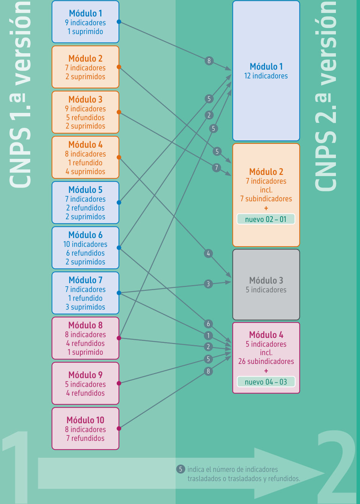
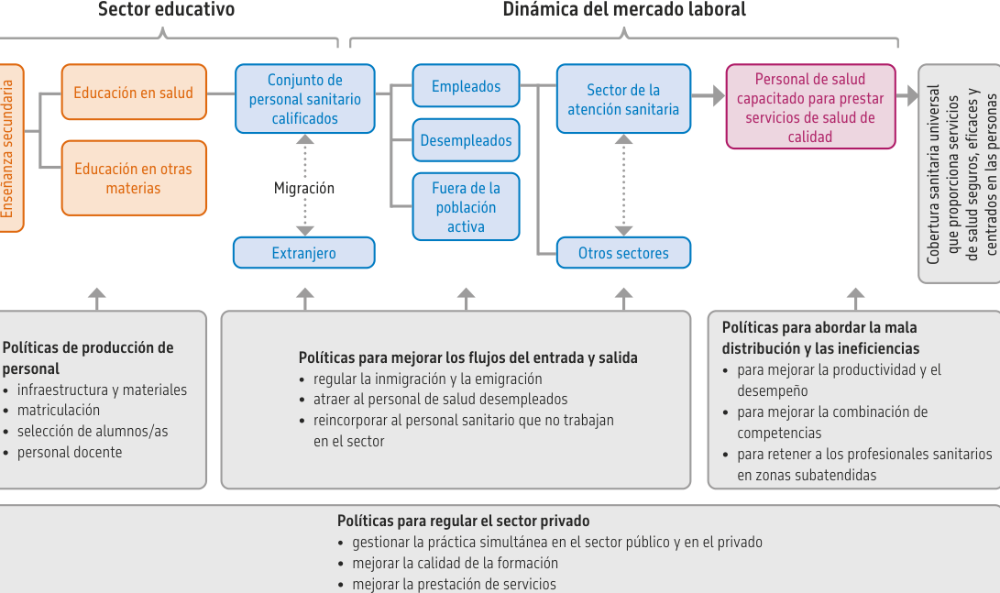
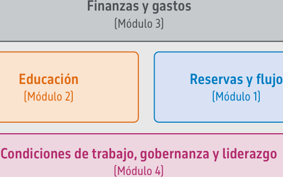

<!-- Extracted and reviewed by rhs-agent from sources/pdf/paho_pdfs/PDF_SPA/doc_12_link_01_9789240087316-spa.pdf. -->
<!-- PAGE: 1/144 -->

Cuentas Nacionales del Personal de Salud: un manual

Segunda edición

<!-- PAGE: 2/144 -->

_[Página en blanco]_

<!-- PAGE: 3/144 -->

Cuentas Nacionales del Personal de Salud: un manual

Segunda edición

<!-- PAGE: 4/144 -->

Cuentas nacionales del personal de salud: un manual, segunda edición [National health workforce accounts: a handbook, second edition]

ISBN 978-92-4-008731-6 (versión electrónica) ISBN 978-92-4-008732-3 (versión impresa)

## © Organización Mundial de la Salud 2023

Algunos derechos reservados. Esta obra está disponible en virtud de la licencia 3.0 OIG Reconocimiento-NoComercial-CompartirIgual de Creative Commons (CC BY-NC-SA 3.0 IGO; https://creativecommons.org/licenses/by-nc-sa/3.0/igo).

Con arreglo a las condiciones de la licencia, se permite copiar, redistribuir y adaptar la obra para fines no comerciales, siempre que se cite correctamente, como se indica a continuación. En ningún uso que se haga de esta obra debe darse a entender que la OMS refrenda una organización, productos o servicios específicos. No está permitido utilizar el logotipo de la OMS. En caso de adaptación, debe concederse a la obra resultante la misma licencia o una licencia equivalente de Creative Commons. Si la obra se traduce, debe añadirse la siguiente nota de descargo junto con la forma de cita propuesta: «La presente traducción no es obra de la Organización Mundial de la Salud (OMS). La OMS no se hace responsable del contenido ni de la exactitud de la traducción. La edición original en inglés será el texto auténtico y vinculante».

Toda mediación relativa a las controversias que se deriven con respecto a la licencia se llevará a cabo de conformidad con el Reglamento de Mediación de la Organización Mundial de la Propiedad Intelectual (https://www.wipo.int/amc/es/mediation/rules).

Forma de cita propuesta. Cuentas nacionales del personal de salud: un manual, segunda edición [National health workforce accounts: a handbook, second edition]. Ginebra: Organización Mundial de la Salud; 2023. Licencia: CC BY-NC-SA 3.0 IGO.

Catalogación (CIP). Puede consultarse en https://iris.who.int/?locale-attribute=es&.

Ventas, derechos y licencias. Para comprar publicaciones de la OMS, véase https://www.who.int/publications/book-orders. Para presentar solicitudes de uso comercial y consultas sobre derechos y licencias, véase https://www.who.int/es/copyright.

Materiales de terceros. Si se desea reutilizar material contenido en esta obra que sea propiedad de terceros, por ejemplo cuadros, figuras o imágenes, corresponde al usuario determinar si se necesita autorización para tal reutilización y obtener la autorización del titular del derecho de autor. Recae exclusivamente sobre el usuario el riesgo de que se deriven reclamaciones de la infracción de los derechos de uso de un elemento que sea propiedad de terceros.

Notas de descargo generales. Las denominaciones empleadas en esta publicación y la forma en que aparecen presentados los datos que contiene no implican, por parte de la OMS, juicio alguno sobre la condición jurídica de países, territorios, ciudades o zonas, o de sus autoridades, ni respecto del trazado de sus fronteras o límites. Las líneas discontinuas en los mapas representan de manera aproximada fronteras respecto de las cuales puede que no haya pleno acuerdo.

La mención de determinadas sociedades mercantiles o de nombres comerciales de ciertos productos no implica que la OMS los apruebe o recomiende con preferencia a otros análogos. Salvo error u omisión, las denominaciones de productos patentados llevan letra inicial mayúscula.

La OMS ha adoptado todas las precauciones razonables para verificar la información que figura en la presente publicación, no obstante lo cual, el material publicado se distribuye sin garantía de ningún tipo, ni explícita ni implícita. El lector es responsable de la interpretación y el uso que haga de ese material, y en ningún caso la OMS podrá ser considerada responsable de daño alguno causado por su utilización.

<!-- PAGE: 5/144 -->

## Índice

|  | Siglas y acrónimos | vi |
| --- | --- | --- |
|  | Nota de agradecimiento | vii |
|  | Prefacio | ix |
|  | ¿Cuáles son las novedades segunda edición | xi |
| + | Parte I: Contexto de las Cuentas Nacionales |  |
|  | del Personal de Salud | 1 |
|  | Contexto mundial de los trabajadores de la salud y asistenciales | 2 |
|  | Importancia de las CNPS | 3 |
|  | Aplicaciones a nivel mundial | 3 |
|  | Aplicaciones a nivel regional | 5 |
|  | Aplicaciones a nivel nacional | 6 |
|  | CNPS: concepto y exposición general | 8 |
|  | Definición | 8 |
|  | El marco básico | 8 |
|  | Un enfoque modular | 9 |
|  | Principios básicos de las CNPS | 12 |
| + | Parte II: Implementación y métodos | 15 |
|  | Implementación y uso de las CNPS | 16 |
|  | Métodos para calcular los indicadores | 17 |
| + | Parte III: Indicadores de las CNPS | 23 |
|  | Síntesis de los indicadores | 24 |
|  | Cuadro de correspondencias | 32 |
|  | Cómo deben leerse los metadatos sobre los indicadores | 38 |

iii

<!-- PAGE: 6/144 -->

| Módulo 1: Reservas y flujo | 41 |
| --- | --- |
| 1 – 01 Densidad de trabajadores de la salud | 42 |
| 1 – 02 Densidad de trabajadores de la salud a nivel subnacional | 43 |
| 1 – 03 Distribución de los trabajadores de la salud por grupo de edad | 44 |
| 1 – 04 Distribución de los trabajadores de la salud por sexo | 45 |
| 1 – 05 Distribución de los trabajadores de la salud por titularidad del establecimiento | 46 |
| 1 – 06 Distribución de los trabajadores de la salud por tipo de establecimiento | 47 |
| 1 – 07 Distribución de los trabajadores de la salud por lugar de nacimiento | 48 |
| 1 – 08 Distribución de los trabajadores de la salud por lugar de formación | 49 |
| 1 – 09 Flujos de entrada anuales de trabajadores de la salud | 50 |
| 1 – 10 Flujos de salida anuales de trabajadores de la salud | 51 |
| 1 – 11 Tasa de vacantes | 52 |
| 1 – 12 Distribución de los trabajadores de la salud por tipo de contrato | 53 |
| Módulo 2: Educación | 55 |
| 2 – 01 Capacidad en materia de formación y capacitación del personal de salud | 56 |
| 2 – 02 Proporción de solicitudes con respecto a la capacidad en materia de |  |
| formación y capacitación | 57 |
| 2 – 03 Proporción de matrículas con respecto a las solicitudes | 58 |
| 2 – 04 Proporción de graduados con respecto a las reservas de personal | 59 |
| 2 – 05 Duración de la formación y capacitación | 60 |
| 2 – 06 Mecanismos de acreditación para instituciones de formación y |  |
| capacitación y sus programas | 61 |
| 2 – 07 Normas de los programas de formación y capacitación | 62 |
| Módulo 3: Finanzas y gastos | 65 |
| 3 – 01 Gasto en retribuciones a trabajadores de la salud | 66 |
| 3 – 02 Salarios y sueldos iniciales | 67 |
| 3 – 03 Gasto total en formación del personal de salud | 68 |
| 3 – 04 Gasto por graduado de formación de personal de salud | 69 |
| 3 – 05 Costo de matrícula promedio por alumno | 70 |
| Módulo 4: Condiciones de trabajo, gobernanza y liderazgo | 71 |
| 4 – 01 Reglamentos y políticas laborales para el personal de salud | 72 |
| 4 – 02 Gobernanza del personal de salud y capacidad de liderazgo | 76 |
| 4 – 03 Proporción de mujeres en roles de liderazgo | 78 |
| 4 – 04 Capacidad de implementación del Reglamento Sanitario Internacional | 79 |
| 4 – 05 Capacidad nacional para monitorear los parámetros clave para |  |
| la planificación del personal de salud y marcos mundiales de vigilancia | 80 |

iv

<!-- PAGE: 7/144 -->

| + | Parte IV: Ejemplos de cómo utilizar las CNPS para |  |
| --- | --- | --- |
|  | fundamentar la formulación de políticas | 83 |
|  | Planificación de los recursos humanos para la salud | 85 |
|  | Equidad y distribución subnacional | 87 |
|  | Retención | 89 |
|  | Migración | 91 |
|  | Género | 93 |
| + | Glosario | 95 |
| + | Referencias | 103 |
| + | Anexo 1: El desarrollo de las CNPS y su revisión | 117 |
| + | Anexo 2: Lista de ocupaciones abarcadas por las CNPS | 121 |

v

<!-- PAGE: 8/144 -->

## Siglas y acrónimos

| Siglas | y acrónimos |
| --- | --- |
| 13.º PGT | 13.º Programa General de Trabajo |
| AFRO | Oficina Regional de la OMS para África |
| APS | Atención primaria de salud |
| CIIU | Clasificación Industrial Internacional Uniforme |
| CIUO | Clasificación Internacional Uniforme de Ocupaciones |
| CNPS | Cuentas Nacionales del Personal de Salud |
| CSU | Cobertura sanitaria universal |
| EEC | Evaluación externa conjunta |
| EMRO | Oficina Regional de la OMS para el Mediterráneo Oriental |
| EURO | Oficina Regional de la OMS para Europa |
| ICS | Índice de cobertura de los servicios (CSU) |
| OCDE | Organización para la Cooperación y el Desarrollo Económicos |
| ODS | Objetivo de Desarrollo Sostenible |
| OIT | Organización Internacional del Trabajo |
| OMS | Organización Mundial de la Salud |
| OPS | Organización Panamericana de la Salud |
| RSI | Reglamento Sanitario Internacional |
| SCN | Sistema de Cuentas Nacionales |
| SCORE | Paquete técnico SCORE para datos de salud: estudiar, contabilizar, |
|  | optimizar, evaluar y facilitar |
| SEARO | Oficina Regional de la OMS para Asia Sudoriental |
| SIRHS | Sistema de información sobre los recursos humanos para la salud |
| SPAR | instrumento de autoevaluación para la presentación anual de informes |
|  | de los Estados Partes |
| UNESCO | Organización de las Naciones Unidas para la Educación, la Ciencia y la Cultura |
| WISN | indicadores de carga de trabajo para la estimación del personal necesario |
| WPRO | Oficina Regional de la OMS para el Pacífico Occidental |

vi

<!-- PAGE: 9/144 -->

## Nota de agradecimiento

El Manual sobre las Cuentas Nacionales del Personal de Salud (CNPS) se elaboró bajo la dirección del Departamento de Trabajadores de salud de la Organización Mundial de la Salud (OMS) con el objetivo de apoyar la aplicación de la Estrategia mundial de recursos humanos para la salud: personal sanitario 2030.

La elaboración de la segunda edición del Manual sobre CNPS fue coordinada por la unidad de Gestión de Datos, Evidencia y Conocimiento del Departamento de Trabajadores de salud: Mourtala Abdou Illou, Mathieu Boniol, Khassoum Diallo, Teena Kunjumen, Maria Sarah Nabaggala, Tapas Sadasivan Nair, Amani Siyam. Agradecemos especialmente a los colegas de la OMS que contribuyeron con sus aportaciones: James Avoka Asamani, James Campbell, Giorgio Cometto, Deki, Siobhan Fitzpatrick, Nirmal Kandel, Catherine Kane, Carey McCarthy, Michelle McIsaac, Monica Padilla, Tomas Zapata, Pascal Zurn.

La OMS agradece a los miembros del Grupo de Expertos Técnicos (GET) convocados para proporcionar orientación y conocimientos técnicos especializados para la revisión de la segunda edición: Lara Badre, Martin Boyce, Lara Cleveland, Gilles Dussault, Lynn McNeely, Poonam Meena, Jane Mudyara, Janet Muriuki, Kavita Narayan, Nick Oliphant, Pia Schneider, Robert Smith.

Agradecemos a los siguientes miembros del personal de las oficinas regionales de la OMS sus aportaciones y sugerencias sobre las revisiones de las CNPS durante las consultas regionales en línea: Adam Ahmat (Oficina Regional de la OMS para África), Joel Caraballo (Organización Panamericana de la Salud), Silvia Cassiani (Organización Panamericana de la Salud), Ana Paula Cavalcante de Oliveira (Organización Panamericana de la Salud), Gisele Almeida (Organización Panamericana de la Salud), María Isabel Duré (Organización Panamericana de la Salud), Deki (Oficina Regional de la OMS para el Pacífico Occidental), Ibadat Singh Dhillon (Oficina Regional de la OMS para Asia Sudoriental), Fethiye Gulin Gedik (Oficina Regional de la OMS para el Mediterráneo Oriental), Jean Jacques Millogo (Oficina Regional de la OMS para África), Sunny Okoroafor (Oficina Regional de la OMS para África), Crispin David Paul Scotter (Oficina Regional de la OMS para Europa) y Masahiro Zakoji (Oficina Regional de la OMS para el Pacífico Occidental).

También deseamos expresar nuestra gratitud a los siguientes puntos focales de las CNPS por sus aportaciones y sugerencias sobre las revisiones de las CNPS durante las consultas en línea: Leela Rupa Adhikari (Bután), Sergio Arturo Araiza Ortiz (México), Kattya Baquero (Colombia), Lizett Bell (Belice), Cristina Racquel Caballero Garcia (Paraguay), Choden (Bután), Adam Cutler (Israel), Hadiza Dako (Nigeria), Ugyen Dema (Bután), Matt Edwards (Reino Unido de Gran Bretaña e Irlanda del Norte), Hans-Jurgen Heilmann (Alemania), Hamza Ismaila

vii

<!-- PAGE: 10/144 -->

(Ghana), Tchaa Kadjanta (Togo), Vera Leiva Carvajal (Costa Rica), Courdney Marijoron (Papúa Nueva Guinea), Stephen Munene (Kenia), Lidia Maria Nina del Rosario (República Dominicana), Angela Nyakundi (Kenia), Mollent Okech (oficina de la OMS en Papúa Nueva Guinea), Monica Padilla (oficina de la OPS en Colombia), Marija Palibrk (Montenegro), Sagun Paudel (oficina de la OMS en Nepal), Angelina Phillip-Lockhart (Trinidad y Tabago), Maniphet Phimmasane (República Democrática Popular Lao), Ayanna Richardson (Trinidad y Tabago), Marcus Samo (Estados Federados de Micronesia), Bhim Prasad Sapkota (Nepal), Vasos Scoutellas (Chipre), Marina Shakhnazarova (Georgia), Carlos Lino Sosa Manzano (México), Jackurlyn Sutton (Islas Turcas y Caicos), Petros Tesfazion (Estados Unidos de América), Sangay Thinley (Bután), Tiuala Tiotio (Samoa), Kc Dianne Torres Quintero (Panamá), Dagoberto Vega (Panamá), Mutile Wanyee (Kenia), Ambrose Wreh (Liberia), Lubna Yaqoob (Pakistán) y Barnabas Yeboah (Ghana).

Coordinación de producción: Mathieu Boniol; edición: Dorothy van Schooneveld; y diseño: Reto Schürch.

viii

<!-- PAGE: 11/144 -->

## Prefacio

## Prefacio

Han pasado ya varios años desde la publicación de las Cuentas Nacionales del Personal de Salud (CNPS) en 2017. Y tras una pandemia mundial que alteró los servicios de salud en todo el mundo, es un momento oportuno para reflexionar sobre los progresos, las prioridades y las carencias de las CNPS y sus adaptaciones. Las CNPS han contado con una participación sin precedentes de los países, los asociados y los tres niveles de la Organización Mundial de la Salud, con la designación de puntos focales por la mayoría de los Estados Miembros (90%).

Gracias al esfuerzo colectivo, se ha producido una mejora significativa en la disponibilidad y la calidad de los datos sobre el personal de salud. En este avance han desempeñado un papel fundamental la normalización de los enfoques de medición, la racionalización de los mecanismos de presentación de informes y la participación de múltiples partes interesadas de diversos sectores, incluidas las organizaciones asociadas. Los datos registrados y comunicados a través de las CNPS han contribuido a generar una base empírica sobre diversas cuestiones en materia de políticas, como la escasez de personal de salud, su envejecimiento, la migración y las desigualdades relacionadas con el género y las disparidades subnacionales. Asimismo, han puesto de manifiesto la importante contribución del personal de salud en la respuesta a la pandemia de COVID-19. Las CNPS también han facilitado la elaboración de productos mundiales fundamentales, como el informe sobre la Situación de la enfermería en el mundo, el informe sobre El estado de las parteras en el mundo, así como varios informes nacionales y regionales. Desde 2017, la Asamblea Mundial de la Salud ha adoptado una serie de resoluciones que ponen de relieve cuestiones relacionadas con el personal de salud, como las orientaciones estratégicas mundiales sobre enfermería y partería, el Plan de Acción «Trabajar en Pro de la Salud» y el Pacto Mundial para los Trabajadores de la Salud y Asistenciales, por nombrar algunas. Además, la pandemia de COVID-19 llevó a un mayor reconocimiento del papel del personal de salud en la cobertura sanitaria universal (CSU) y la seguridad sanitaria. La hoja de ruta para la creación de capacidad nacional en materia de recursos humanos para desempeñar las funciones esenciales de salud pública, las iniciativas sobre enfermedades no transmisibles, los trabajadores comunitarios de salud , la atención primaria de salud (APS) y la medicina tradicional y complementaria reconocieron la importancia del personal de salud y asistencial, así como la necesidad de disponer de datos y evidencia para fundamentar las políticas y planificación.

Al tiempo que garantiza la continuidad en la normalización de las estadísticas sobre el personal de salud y mantiene el legado de la primera edición, esta revisión de las Cuentas incorpora los cambios y adaptaciones necesarios para dar cabida a las necesidades prioritarias de datos frente a las nuevas iniciativas y retos relacionados con los trabajadores de la salud y asistenciales. La implementación de las CNPS mantiene su compromiso con los principios básicos, es decir, un enfoque de fortalecimiento de los sistemas, la implementación progresiva,

ix

<!-- PAGE: 12/144 -->

la gobernanza multisectorial y la diversificación de las fuentes de datos. Esta versión revisada también ofrece más ejemplos del uso de los datos de las CNPS.

Extendemos nuestra más profunda gratitud a todos aquellos que han contribuido a la evaluación de la primera edición y a la elaboración de la presente revisión. Esperamos que esta revisión satisfaga las necesidades de los países y les ayude a hacer frente a los retos en materia de personal de salud mientras avanzan hacia los Objetivos de Desarrollo Sostenible de 2030.

x

<!-- PAGE: 13/144 -->

## ¿Cuáles son las novedades segunda edición

Esta revisión de las CNPS incorpora varios aspectos que van más allá de los datos y los indicadores, a saber: la evolución de la agenda mundial de la salud desde 2017, los nuevos indicadores necesarios y la revisión de los existentes, la evolución de las definiciones de las ocupaciones, nuevas herramientas y nuevas orientaciones.

La agenda mundial de la salud ha evolucionado drásticamente desde la publicación de las CNPS, con la pandemia de COVID-19 que sacudió el mundo en 2020 (1). Además de otros acontecimientos que se han producido recientemente y que han tenido una repercusión directa en la salud y la atención de salud, como conflictos armados, crisis ecológicas o enfermedades zoonóticas, la pandemia de COVID-19 que afectó a todo el planeta exigió la adopción de medidas en el ámbito de la preparación y respuesta ante emergencias, así como la aplicación de un enfoque de «Una sola salud» (2). En consecuencia, existe una necesidad creciente de fortalecer el personal de salud pública y de emergencias. En 2022 se estableció una hoja de ruta en colaboración con asociaciones, instituciones y escuelas de salud pública (representadas por sus respectivos órganos nacionales, regionales y mundiales) con el objetivo de mejorar el seguimiento y la planificación del personal que participa en la prestación de las funciones esenciales de salud pública, incluida la preparación y respuesta ante emergencias (3).

Las CNPS mejoran los datos y la base empírica sobre el personal de salud a escala nacional, regional y mundial. La medición de los datos sobre este colectivo en años sucesivos ha permitido comprender mejor los retos a los que se enfrenta. En camino hacia el cumplimiento de los ODS de las Naciones Unidas, aunque se han observado avances, todavía se prevé un déficit mundial de 10 millones de trabajadores de la salud y asistenciales para 2030 (3). Esta mejora de los datos se debe a las contribuciones de los puntos focales de las CNPS de cada país, y en la actualidad 181 países, territorios y zonas cuentan con un punto focal designado. La rápida implantación de las CNPS en los países y la participación activa de las oficinas regionales de la OMS y de los puntos focales en los países han permitido determinar las esferas susceptibles de mejora en la implementación y las herramientas y orientaciones sobre las CNPS.

Para hacer frente a los nuevos retos de la agenda mundial de la salud, se ha desarrollado un conjunto de programas, orientaciones, herramientas y directrices. El cuarto y quinto Foro Global sobre Recursos Humanos para la Salud, celebrados en Dublín (2017) y Ginebra (2023) respectivamente, permitieron determinar las principales prioridades en materia de políticas para mejorar el trabajadores de la salud y asistencial. La Asamblea Mundial de la Salud también ha adoptado medidas para proteger y salvaguardar al trabajadores de la salud y asistencial e invertir en él (4) con la adopción del programa «Trabajar en pro de la salud» (5). La OMS elaboró las orientaciones estratégicas mundiales sobre enfermería y partería (6), con medidas necesarias para desarrollar y reforzar a los trabajadores de la salud y asistenciales, y con la

xi

<!-- PAGE: 14/144 -->

elaboración de un Pacto Mundial para los Trabajadores de la Salud y Asistenciales (7). Todas estas iniciativas necesitan marcos de seguimiento, que se han incorporado en esta revisión de las CNPS mediante la mejora de los indicadores designados y las ocupaciones en el sector de la salud. Los puntos focales de las CNPS y un grupo consultivo de expertos recomendaron reducir y racionalizar el número de indicadores, manteniendo al mismo tiempo la mayor parte del contenido fundamental de la primera edición.

Esta revisión de las CNPS ha supuesto cambios y la optimización de los indicadores, al tiempo que ha mantenido la presencia de los indicadores básicos y la continuidad con la primera edición. Atendiendo a las peticiones de varias partes interesadas y de los puntos focales de las CNPS, se ha hecho un esfuerzo especial para reducir el número total de indicadores y módulos. La segunda edición de las CNPS consta ahora de cuatro módulos: el módulo 1 sobre reservas y flujo, el módulo 2 sobre educación, el módulo 3 sobre finanzas y gastos, y el módulo 4 sobre condiciones de trabajo, gobernanza y liderazgo.

En general, alrededor del 80% de la información de la primera edición de la CNPS sigue estando presente en la segunda edición (figura 1). De los 78 indicadores presentes en la primera edición de la CNPS, se han eliminado 16 y se han añadido dos nuevos: la capacidad en materia de formación y capacitación del personal de salud y la proporción de mujeres en roles de liderazgo. En comparación con la primera edición de las CNPS, se han introducido varias optimizaciones para simplificar la presentación de los indicadores: eliminación de redundancias, definición de desagregaciones en lugar de indicadores separados cuando sea posible, agrupación de preguntas sobre capacidad (con respuestas únicas como: sí, parcialmente, no) en un único indicador compuesto. Todas estas optimizaciones han permitido condensar las CNPS en 29 indicadores. Para facilitar la actualización de los sistemas nacionales a la segunda edición de las CNPS, se han elaborado cuadros puente.

La lista de ocupaciones de los trabajadores de la salud y asistenciales se ha revisado para incluir todas las ocupaciones que se han notificado regularmente a través de las CNPS en los últimos cinco años siguiendo la Clasificación Internacional Uniforme de Ocupaciones (CIUO- 08). La lista de ocupaciones se ha ampliado para algunos grupos ocupacionales a fin de tener en cuenta las observaciones recibidas a lo largo de los años sobre la primera edición de las CNPS.

Por último, se han actualizado todas las herramientas a disposición de las instancias normativas, los puntos focales de las CNPS y los investigadores. La plataforma de datos de las CNPS para los puntos focales se ha adaptado a la revisión de los indicadores y las ocupaciones, mientras que el portal público de datos se ha actualizado para incluir funciones adicionales para los usuarios, como un manual en línea en el que se pueden realizar búsquedas y un repositorio de documentos nacionales, regionales y mundiales relacionados con el personal de salud, como los planes nacionales de recursos humanos para la salud (RHS).

xii

<!-- PAGE: 15/144 -->

## Figura 1: La segunda edición de las CNPS incorpora el 80% de la información de la primera edición.

De los 78 indicadores de la primera edición de la CNPS, 62 se han mantenido, 16 se han suprimido y se han añadido 2 nuevos indicadores.

1

CNPS. Los detalles de los indicadores trasladados, refundidos y suprimidos pueden consultarse

en el cuadro puente incluido en la parte III de este informe.

Nota: Se han resaltado en verde los dos nuevos indicadores incluidos en la segunda versión de las

<!-- PAGE: 16/144 -->

_[Página en blanco]_

<!-- PAGE: 17/144 -->

# Parte I

## Parte I

Contexto de las Cuentas Nacionales del Personal de Salud

1

<!-- PAGE: 18/144 -->

## Contexto mundial de los trabajadores de la salud y asistenciales

Para lograr cualquier objetivo relacionado con la salud de la población, es fundamental contar con suficiente personal de salud y combinaciones de competencias adecuadas. Esto abarca la consecución de la cobertura sanitaria universal (CSU) (8) y de las metas relacionadas con la salud de los Objetivos de Desarrollo Sostenible (ODS) de las Naciones Unidas. Sin embargo, en todo el mundo los países se ven afectados por problemas multifacéticos relacionados con el personal de salud, ya se trate de dificultades en materia de formación y capacitación o con respecto a la distribución, el desempeño y la retención del personal de salud (9). La asignación deficiente del personal de salud es uno de los principales problemas que se plantean que influye directamente en la disponibilidad, la accesibilidad, la calidad y el desempeño de los servicios nacionales de salud (10), y puede impedir el acceso adecuado de la población a los servicios de salud que necesita. Por consiguiente, la Organización Mundial de la Salud (OMS) y sus asociados elaboraron la Estrategia mundial de recursos humanos para la salud: personal sanitario 2030, en la que se establece la agenda de políticas para conseguir un personal de salud capaz de cumplir su cometido de lograr las metas relativas a la cobertura sanitaria universal y los ODS (9).

La Estrategia mundial de recursos humanos para la salud: personal sanitario 2030 (9), adoptada por la 69.ª Asamblea Mundial de la Salud en mayo de 2016 en virtud de la resolución WHA69.19, tiene por objeto garantizar la accesibilidad, aceptabilidad, y cobertura universal, así como la calidad del personal de salud, en sistemas de salud fortalecidos (11). Esto puede lograrse mediante la realización de inversiones adecuadas y la aplicación de políticas eficaces a nivel nacional, regional y mundial. A tal efecto, la Estrategia establece múltiples objetivos, entre ellos el fortalecimiento de los datos relacionados con los recursos humanos para la salud (RHS), así como metas de referencia mundiales para alcanzar en 2020 y 2030, respectivamente. En cualquier país, las iniciativas de cambio responsable han de basarse en la disponibilidad, exhaustividad y calidad de los datos sobre el personal de salud. Fortalecer los sistemas nacionales de información sobre los recursos humanos para la salud (SIRHS) para reunir y analizar datos fiables y actualizados sobre las reservas, la formación, la distribución, los flujos, la demanda, la capacidad y la remuneración del personal de salud puede facilitar la planificación y la formulación de políticas sobre el personal de salud basadas en evidencia a nivel nacional.

En consonancia con la Estrategia mundial de recursos humanos para la salud, la Comisión de Alto Nivel sobre el Empleo en el Ámbito de la Salud y el Crecimiento Económico publicó el documento Working for health and growth: investing in the health workforce (12), que contiene un informe y un plan de acción quinquenal para el empleo en el ámbito de la salud y el crecimiento económico inclusivo. Este plan cuenta con el apoyo de tres organismos: la OMS, la Organización para la Cooperación y el Desarrollo Económicos (OCDE) y la Organización

Cuentas Nacionales del Personal de Salud: un manual – segunda edición 2

2

Cuentas Nacionales del Personal de Salud: un manual – segunda edición

<!-- PAGE: 19/144 -->

Internacional del Trabajo (OIT). El informe fue examinado por la 70.ª Asamblea Mundial de la Salud, que recomendó el cumplimiento de las recomendaciones de la Comisión de Alto Nivel (13). La Comisión expuso su aspiración de la siguiente manera: «Agilizar los avances hacia la cobertura sanitaria universal y el logro de los Objetivos de la Agenda 2030 para el Desarrollo Sostenible garantizando el acceso equitativo a personal de salud en sistemas de salud fortalecido». Esta aspiración se concretó en 10 recomendaciones para transformar al personal de salud nacional con miras a la consecución de los ODS y elaborar políticas sobre el mercado laboral de la salud acordes con esa finalidad. Para aumentar la dotación de personal de salud capaz de cumplir su cometido, se deben coordinar medidas en todos los sectores que participan en el mercado laboral de la salud. En consecuencia, en 2017 se estableció el programa «Trabajar en pro de la salud» como alianza conjunta de la OIT, la OCDE y la OMS para llevar a cabo acciones cuantificables encaminadas a promover la cobertura sanitaria universal y avanzar en el cumplimiento de los ODS 3, 4, 5 y 8 (salud, educación, igualdad de género, trabajo decente y crecimiento económico) (14). En el informe también se subrayaba la necesidad de adoptar medidas inmediatas con respecto a los datos e indicadores sobre el personal de salud, así como de armonizar los parámetros y las metodologías para llevar a cabo una investigación y un análisis rigurosos del personal de salud en los países y entre los países. Las Cuentas Nacionales del Personal de Salud (CNPS) ayudan a los países a conseguirlo.

El impacto mundial de la COVID-19 entre 2020 y 2023 nos ha mostrado el papel central que desempeña el personal de salud en el mantenimiento de la prestación de servicios de salud esenciales, así como en la gestión simultánea de la respuesta a la pandemia. Una serie de encuestas mundiales rápidas sobre la continuidad de los servicios de salud esenciales durante la pandemia de COVID-19 ha indicado sistemáticamente que la falta de personal de salud suficiente fue la causa más frecuente de interrupción de los servicios de salud esenciales, así como el mayor obstáculo para el acceso a las herramientas esenciales frente a la COVID-19 (por ejemplo, pruebas diagnósticas, tratamientos y vacunas) (15-18). Los efectos devastadores de la pandemia en los países de todo el mundo han puesto de relieve la importancia de desarrollar en cada país un personal integrado, pluridisciplinar y multisectorial que sea capaz de desempeñar todas las funciones esenciales de salud pública, incluidas la preparación y respuesta ante emergencias (19).

## Importancia de las CNPS

## Aplicaciones a nivel mundial

El concepto de las CNPS, derivado del plan de acción de la Comisión de Alto Nivel, y en especial de la Estrategia mundial de recursos humanos para la salud, se promueve claramente como un instrumento importante para apoyar la labor normativa y de planificación de los países en materia de personal de salud. La 69.ª Asamblea Mundial de la Salud adoptó la resolución

3 Parte I: Contexto de las Cuentas Nacionales del Personal de Salud

Parte I: Contexto de las Cuentas Nacionales del Personal de Salud

3

<!-- PAGE: 20/144 -->

WHA69.19 para apoyar su aplicación (11). La finalidad de las CNPS es facilitar la normalización de los sistemas de información sobre los recursos humanos para la salud para lograr la interoperabilidad, es decir, la capacidad de intercambiar datos sobre el personal de salud dentro de sistemas de información para la salud de ámbito nacional o subnacional más amplios, así como en el marco de bases de datos internacionales. De esta manera se consigue plenamente la rápida recopilación y presentación de los datos sobre el personal de salud para la toma de decisiones; las CNPS pueden ser un instrumento de orientación y apoyo para que los países fundamenten sus decisiones normativas en materia de personal de salud basadas en evidencia.

Desde la publicación de las CNPS en 2017, se ha producido una enorme mejora en la disponibilidad y calidad de los datos mundiales sobre el personal de salud. Las CNPS han cumplido su mandato de fomentar un enfoque armonizado para la recopilación anual y oportuna de información sobre el personal de salud y de definir indicadores básicos para apoyar la planificación estratégica del personal de salud y su seguimiento a escala mundial. En abril de 2023, 181 países, territorios y zonas habían designado puntos focales nacionales para el reporte anual de datos sobre el personal de salud en la plataforma de datos de las CNPS. Al mismo tiempo, el portal de datos de las CNPS contiene los últimos datos mundiales disponibles sobre el personal de salud en lo referente a indicadores clave, perfiles de países, perfiles de ocupaciones y otras presentaciones visuales, y cuenta con más de 4.800 usuarios registrados (20).

Los datos de las CNPS se han utilizado para medir características básicas del personal de salud mundial y han contribuido de forma decisiva a la elaboración de varios productos de conocimiento fundamentales (3, 21-27). Además, las CNPS se han convertido en un mecanismo de monitoreo de las iniciativas y marcos mundiales actuales y futuros, como los ODS (28), el seguimiento de la cobertura sanitaria universal (29), el 13.º Programa General de Trabajo (30), el Código de Prácticas Mundial de la OMS sobre Contratación Internacional de Personal de Salud (31), las orientaciones estratégicas mundiales sobre enfermería y partería (6), el marco de medición de la atención primaria de salud (32), el programa Trabajar en pro de la salud (5), el Pacto Mundial para los Trabajadores de la Salud y Asistenciales (7), la Agenda de Inmunización 2030 (33) y el plan de acción mundial sobre salud bucodental (26). Así pues, las CNPS se están utilizando para hacer un seguimiento y apoyar la labor que realizan los países en materia de personal de salud con miras al logro de la cobertura sanitaria universal, los ODS y las metas de referencia de la Estrategia mundial de recursos humanos para la salud. Asimismo, los datos de las CNPS también resultaron de utilidad durante la pandemia de COVID-19 para estimar las muertes entre los trabajadores de la salud y asistenciales debidas a esta enfermedad (34), determinar el aumento de las necesidades de personal para la vacunación contra la COVID-19 (35) y vigilar la desigualdad mundial en la vacunación contra la COVID-19 entre los trabajadores de la salud y asistenciales (36, 37). En la figura 2 se ilustran diversos productos del conocimiento que utilizan los datos que proporcionan las CNPS.

Cuentas Nacionales del Personal de Salud: un manual – segunda edición 4

4

Cuentas Nacionales del Personal de Salud: un manual – segunda edición

<!-- PAGE: 21/144 -->

Figura 2: Los datos de las CNPS contribuyen a diversos productos del conocimiento

## Aplicaciones a nivel regional

Gracias a los informes de los países y a las comparaciones internacionales, las CNPS también han permitido facilitar la comparabilidad del panorama del personal de salud a nivel regional, facilitar las iniciativas de creación de capacidad transnacional, el intercambio de información y conocimientos, la elaboración de estrategias o marcos regionales de recursos humanos para la salud y el seguimiento de los progresos, así como la realización de investigaciones más elaboradas sobre las tendencias futuras del personal de salud, tanto dentro de los sistemas como entre los distintos sistemas. Así, las oficinas regionales de la OMS han utilizado las CNPS como vía para impulsar un mejor seguimiento del personal de salud en sus respectivos países (38-40).

5 Parte I: Contexto de las Cuentas Nacionales del Personal de Salud

Parte I: Contexto de las Cuentas Nacionales del Personal de Salud

5

<!-- PAGE: 22/144 -->

## Aplicaciones a nivel nacional

En la selección de los indicadores de las CNPS se ha asignado mucha importancia a su pertinencia para las políticas, de manera que cualquier país pueda utilizarlos de acuerdo con sus necesidades. Si bien se han concebido para apoyar un marco coherente de análisis y formulación de las políticas relativas al personal de salud, las CNPS se pueden aplicar y utilizar de una forma flexible y modular. Es importante que los países tengan en cuenta que, aun cuando los indicadores de los módulos de las CNPS abarcan plenamente todos los componentes y ámbitos normativos y constituyen un todo natural en el marco del mercado laboral de la salud, también queda un margen bastante amplio para seleccionar indicadores nacionales específicos. Puesto que los países difieren mucho en cuanto al desarrollo de su sector educativo, la dinámica de su mercado laboral de la salud y sus servicios de salud, también diferirán sus necesidades en cuanto a la formulación y aplicación de políticas en esos ámbitos. Por tanto, los países pueden seleccionar los módulos de las CNPS asignando prioridades acordes con sus necesidades y objetivos específicos en un momento determinado e ir madurando con el tiempo hacia la selección y cobertura de todos los indicadores de las CNPS. Sin embargo, este no es un objetivo en sí mismo y siempre debe adoptarse un enfoque flexible.

La implementación de las CNPS es esencialmente gradual, de manera que algunos de sus beneficios para los países serán inmediatos mientras que otros se lograrán a más largo plazo. Cuanto mayor sea el número de indicadores disponibles en los planos nacional y subnacional, más preciso será el panorama general que se obtenga de la situación en materia de personal de salud, con más posibilidades de realizar análisis más refinados, formular políticas más eficaces acerca de ese personal y avanzar hacia la cobertura sanitaria universal. Durante los últimos cinco años de implementación de las CNPS, los países las han utilizado para impulsar la agenda sobre el personal de salud a nivel nacional, mediante el establecimiento de mecanismos de gobernanza de múltiples partes interesadas, la determinación de diversas fuentes de datos y la racionalización de los flujos de datos, el fortalecimiento de los SIRHS nacionales y la creación de una cultura de uso de datos (27).

Cuentas Nacionales del Personal de Salud: un manual – segunda edición 6

6

Cuentas Nacionales del Personal de Salud: un manual – segunda edición

<!-- PAGE: 23/144 -->

Recuadro 1: Utilidad de las CNPS a escala nacional

## Recuadro 1: Utilidad de las CNPS a escala nacional

- Una mejor comprensión del personal de salud —su cantidad, sus características y su distribución–, lo que permite a los países ser conscientes de las necesidades de ese personal y las posibilidades de fortalecer. • Información de gran calidad sobre el personal de salud para fundamentar decisiones normativas basadas en evidencia y acordes con las necesidades de cada país. • Un personal de salud eficiente gracias a la determinación de importantes posibilidades de mejora en la cobertura de servicios de salud y en los resultados de salud, sobre todo si se pueden establecer nexos causales con características del sistema de salud. • Aptitud para orientar y fundamentar la transformación y ampliación de la formación y capacitación del personal de salud a fin de apoyar la consecución de la cobertura sanitaria universal. • Fortalecimiento de las políticas, las estrategias y los planes mediante el diálogo intersectorial sobre políticas entre los ministerios pertinentes, en el que pueden participar los de educación, salud y finanzas. • Inversiones transversales —en todos los módulos de las CNPS— que impulsarán la demanda de políticas y planes basados en datos, y creación de capacidad. • Mejoras en la medición y el monitoreo de las tendencias del personal de salud, y mejora y mayor exhaustividad en la planificación del personal de salud.

- Una mejor comprensión del personal de salud —su cantidad, sus características y su distribución–, lo que permite a los países ser conscientes de las necesidades de ese personal y las posibilidades de fortalecer.

- Información de gran calidad sobre el personal de salud para fundamentar decisiones normativas basadas en evidencia y acordes con las necesidades de cada país.

- Un personal de salud eficiente gracias a la determinación de importantes posibilidades de mejora en la cobertura de servicios de salud y en los resultados de salud, sobre todo si se pueden establecer nexos causales con características del sistema de salud.

- Aptitud para orientar y fundamentar la transformación y ampliación de la formación y capacitación del personal de salud a fin de apoyar la consecución de la cobertura sanitaria universal.

- Fortalecimiento de las políticas, las estrategias y los planes mediante el diálogo intersectorial sobre políticas entre los ministerios pertinentes, en el que pueden participar los de educación, salud y finanzas.

- Inversiones transversales —en todos los módulos de las CNPS— que impulsarán la demanda de políticas y planes basados en datos, y creación de capacidad.

- Mejoras en la medición y el monitoreo de las tendencias del personal de salud, y mejora y mayor exhaustividad en la planificación del personal de salud.

Por último, las CNPS puede ser un estímulo para que los países aborden o reexaminen importantes asuntos normativos vinculados con los interrogantes que se plantean actualmente acerca del personal de salud y la optimización de los sistemas de planificación, por ejemplo:

- ¿El personal actual de salud está disponible, es accesible, es aceptable y posee las competencias apropiadas para prestar servicios de salud de buena calidad?

- ¿Pueden subsanarse las deficiencias actuales mejorando el desempeño mediante una mejor asignación de los recursos, un incremento de la productividad y una mayor eficacia de las políticas de retención y de las alianzas público-privadas?

- ¿Pueden subsanarse las actuales deficiencias aumentando las inversiones en educación y producción de personal de salud y/o aumentando la inmigración de profesionales de la salud?

- ¿Pueden financiarse las políticas y estrategias encaminadas a mejorar el desempeño y aumentar la cantidad de personal de salud (cálculo de los costos de las políticas y las opciones estratégicas, con inclusión de las inversiones y los costos ordinarios – sueldos –, negociaciones con el gobierno – ministerios de finanzas, educación, trabajo– y con el sector privado)?

- ¿Puede la producción de profesionales de la salud compensar las pérdidas de personal de salud causadas por las salidas? ¿Pueden los incentivos financieros impulsar a estos profesionales a establecerse en zonas subatendidas y propiciar una distribución geográfica más equilibrada en el país o la región?

7 Parte I: Contexto de las Cuentas Nacionales del Personal de Salud

Parte I: Contexto de las Cuentas Nacionales del Personal de Salud

7

<!-- PAGE: 24/144 -->

## CNPS: concepto y exposición general

Definición

## Definición

Las CNPS pueden definirse como «un sistema mediante el cual los países mejoran progresivamente la disponibilidad, la calidad y el uso de los datos sobre el personal de salud por medio del monitoreo de un conjunto de indicadores para apoyar el logro de la cobertura sanitaria universal, los Objetivos de Desarrollo Sostenible y otros objetivos relacionados con la salud».

El marco básico

## El marco básico

El concepto de las CNPS está estrechamente alineado con el marco sobre el mercado laboral de la salud para la cobertura sanitaria universal (41) (figura 3), que también ocupa una posición central en el informe Working for health and growth: investing in the health workforce de la Comisión de Alto Nivel (12). Este marco proporciona una visión integral del sector educativo y la dinámica del mercado laboral de la salud, en el que la economía, la población y la sociedad actúan como factores impulsores que promueven la cobertura sanitaria universal, lo cual tendría como resultado una optimización de la atención de salud. A este respecto, el marco sobre el mercado laboral de la salud ofrece a los países orientaciones concretas en forma de políticas sobre el personal de salud que pueden contribuir al logro de las metas de referencia de la Estrategia mundial de recursos humanos para la salud, la cobertura sanitaria universal y los ODS.

En el nivel inferior del marco se incluyen cuatro grupos específicos de políticas para afrontar los problemas relacionados con el personal de salud y favorecer el acceso equitativo a servicios de salud de calidad:

1. Políticas de producción de personal.

2. Políticas para abordar las entradas y salidas.

3. Políticas para abordar la mala distribución y las ineficiencias.

4. Políticas de reglamentación del sector privado.

Las primeras tres políticas se relacionan con diferentes partes del sector educativo y la dinámica del mercado laboral de la salud y están interrelacionadas en una secuencia de «entrada – rendimiento – salida» dentro del sistema. Las políticas de reglamentación del sector privado abarcan el conjunto del mercado laboral de la salud.

En el anexo 1 se describe el proceso de elaboración de las CNPS y su revisión.

Cuentas Nacionales del Personal de Salud: un manual – segunda edición 8

8

Cuentas Nacionales del Personal de Salud: un manual – segunda edición

<!-- PAGE: 25/144 -->

## Figura 3: Marco del mercado laboral de la salud

## La economía, la población y los factores impulsores más amplios en la sociedad

Dinámica del mercado laboral

## Un enfoque modular

Las CNPS contienen un conjunto de 29 indicadores, distribuidos en 4 módulos, cuyo objetivo es apoyar las políticas de personal de salud a nivel nacional para avanzar hacia la cobertura sanitaria universal y los ODS (figura 4).

## 9 Parte I: Contexto de las Cuentas Nacionales del Personal de Salud

Parte I: Contexto de las Cuentas Nacionales del Personal de Salud

9

<!-- PAGE: 26/144 -->

Figura 4: Visión general de los componentes del mercado laboral apoyados por los módulos de las CNPS

A continuación, se describen con más detalle la finalidad y el contenido de cada uno de los cuatro módulos. El módulo 1 es el punto de partida fundamental del marco de las CNPS, ya que recoge la información más importante sobre el personal de salud.

## Módulo 1: Reservas y flujo

Este módulo proporciona una visión integral de la composición y distribución del personal de salud y su participación en el mercado laboral de la salud. Se reúnen indicadores sobre densidad a nivel nacional, distribución por edad y sexo, titularidad del establecimiento y tipo de establecimiento. Con respecto a la pertinencia para las políticas, este módulo ayuda a determinar si el personal actual es adecuado para prestar servicios orientados a la cobertura sanitaria universal. Permite detectar déficits en ciertas profesiones o competencias y desajustes en la distribución geográfica o sectorial, y permite comprender la segregación ocupacional por sexos. Conociendo la composición y distribución del personal de salud se pueden planificar y realizar intervenciones de política sobre la formación, retención o reasignación de estos trabajadores. El módulo 1 contiene un indicador sobre la distribución subnacional del personal de salud, que permite hacer un seguimiento de los progresos realizados para reducir a la mitad las desigualdades en el acceso a un profesional de la salud (Meta de referencia mundial 1, de

Cuentas Nacionales del Personal de Salud: un manual – segunda edición 10

10

Cuentas Nacionales del Personal de Salud: un manual – segunda edición

<!-- PAGE: 27/144 -->

aquí a 2030) (9). Los indicadores sobre la proporción de profesionales de la salud capacitados en el extranjero y los nacidos en el extranjero también están relacionados con la Estrategia mundial de recursos humanos para la salud, en cuyas metas se establece que los países han de avanzar para reducir a la mitad su dependencia de los profesionales de la salud capacitados en el extranjero, aplicando el Código de prácticas mundial de la OMS (Meta de referencia mundial 3, de aquí a 2030) (9, 31). En este módulo también se miden las entradas y salidas del mercado laboral de la salud. El indicador sobre las entradas distingue entre los resultados de los esfuerzos nacionales de reposición y la dependencia de profesionales de la salud extranjeros, mientras que el indicador sobre las salidas realiza un seguimiento de las salidas, ya sean voluntarias o involuntarias. La información sobre el equilibrio del mercado laboral de la salud se obtiene mediante el seguimiento de las vacantes. Una mejor comprensión de la magnitud y los factores que impulsan los flujos del mercado puede proporcionar una base para formular políticas eficaces de contratación y retención.

## Módulo 2: Educación

Este módulo proporciona información sobre la capacidad de formación y capacitación del personal de salud, las solicitudes, las matriculaciones y las graduaciones. Los indicadores están armonizados con las metas e indicadores del ODS 4 (Educación) que apoyan la coordinación intersectorial, por ejemplo, en materia de igualdad de género (ODS 5). El módulo permite la planificación y el seguimiento de las políticas sobre selección y matriculación de alumnos. Este módulo también apoya el establecimiento de mecanismos para coordinar una agenda intersectorial sobre el personal de salud. Los indicadores basados en la reglamentación de la educación aportan información sobre garantía de la calidad y requisitos en materia de formación y capacitación. Los mecanismos de acreditación y sus normas son muy importantes (Meta de referencia mundial 4, de aquí a 2020) (9) para que los planes nacionales de educación de personal de salud estén alineados con el plan de salud nacional y se garantice que todos los profesionales de la salud posean las competencias necesarias para atender las necesidades de la población. Estos indicadores pueden añadir información para aumentar la calidad y pertinencia de la formación y la capacitación del personal de salud y determinar esferas de intervención en materia de reglamentación o de gestión de la formación y la capacitación.

## Módulo 3: Finanzas y gastos

Este módulo tiene por finalidad apoyar una arquitectura de financiación eficaz que fortalezca la colaboración intersectorial, especialmente entre los sectores de la salud y educativo, así como describir los gastos en personal de salud y las remuneraciones en el sector de la salud, incluido, cuando proceda, un panorama general de los ingresos en el sector privado. Los datos aportados pueden utilizarse para comprender mejor las inversiones orientadas a promover el acceso equitativo a la educación, así como para determinar recursos presupuestarios adecuados y destinarlos a inversiones en educación transformadora, adquisición de competencias y creación de empleo. Los datos de estos indicadores pueden desempeñar una función muy importante

11 Parte I: Contexto de las Cuentas Nacionales del Personal de Salud

Parte I: Contexto de las Cuentas Nacionales del Personal de Salud

11

<!-- PAGE: 28/144 -->

en la promoción del trabajo decente y de la igualdad de género, con arreglo al ODS 8 y el ODS 5, respectivamente. Además, los análisis económicos son fundamentales para las negociaciones presupuestarias, tanto con el gobierno (p. ej., ministerios de finanzas, trabajo, educación) como con los representantes del sector privado.

## Módulo 4: Condiciones de trabajo, gobernanza y liderazgo

Este módulo engloba los indicadores sobre las condiciones de trabajo, la gobernanza del personal de salud y la capacidad de liderazgo, así como la capacidad de los SIRHS nacionales. El indicador relativo a las condiciones de trabajo mide la existencia de reglamentaciones y políticas laborales sobre los trabajadores de la salud y asistenciales y puede servir de base para avanzar hacia la consecución del trabajo decente para todos, tal como promueve el ODS 8. El indicador sobre la gobernanza del personal de salud y la capacidad de liderazgo evalúa la existencia de una dependencia central de recursos humanos para la salud y sus capacidades en lo referente a los procesos de planificación y formulación de políticas. Este indicador es fundamental para demostrar si el país posee mecanismos para utilizar y aplicar con eficacia la información recopilada mediante los indicadores de los otros módulos. El indicador sobre la capacidad del SIRHS evalúa la capacidad de este sistema para hacer un seguimiento de diversas características de importancia para la planificación de la fuerza de trabajo a nivel nacional y subnacional (como los productos de las instituciones de formación y capacitación, las personas que se incorporan al mercado laboral, las reservas activas en el mercado laboral, las salidas del mercado laboral, la geocodificación de las localidades donde se sitúan los establecimientos de salud y la brecha salarial de género), así como para los marcos de seguimiento mundiales (como el Código de Prácticas Mundial de la OMS y el Reglamento Sanitario Internacional (RSI)).

En las páginas descriptivas se especifican con información estandarizada todos los indicadores contenidos en los cuatro módulos de las CNPS.

## Principios básicos de las CNPS

Las CNPS no son simplemente una lista de indicadores, sino más bien un enfoque centrado en el fortalecimiento de los sistemas para mejorar la compilación, la comparación, el análisis y el uso de los datos sobre el personal de salud y facilitar la planificación y la formulación de políticas sobre el personal de salud basadas en evidencia. Al hacer hincapié en las necesidades e intereses nacionales, las CNPS mantienen a los países en el centro del proceso y les permiten definir el ritmo de la implementación progresiva. Para aplicar las CNPS es fundamental contar con un mecanismo de gobernanza multisectorial y de múltiples partes interesadas a nivel nacional. Al reunir a las distintas partes interesadas, se pueden identificar diversas fuentes de datos de interés para la planificación y la formulación de políticas sobre personal de salud, normalizar los métodos de recopilación de datos entre las distintas partes interesadas, fomentar las alianzas para mejorar la disponibilidad de datos, desarrollar productos analíticos

Cuentas Nacionales del Personal de Salud: un manual – segunda edición 12

12

Cuentas Nacionales del Personal de Salud: un manual – segunda edición

<!-- PAGE: 29/144 -->

adecuados para los contextos nacionales, catalizar el uso de datos para la toma de decisiones, sensibilizar sobre los problemas del personal de salud y promover la movilización de recursos.

## Recuadro 2: Principios básicos de las CNPS

Los siguientes principios representan el «código genético» de la implementación de las CNPS:

g p p p g g p • Mecanismo de gobernanza multisectorial y de múltiples partes interesadas de los datos de las CNPS a nivel nacional. • Enfoque de fortalecimiento del sistema. • Implementación progresiva al ritmo propio. • Enfoque parsimonioso para recopilar indicadores o variables representativas validados. • Proceso inclusivo asumido y dirigido por el propio país (a través del papel vital de los puntos focales de las CNPS) para establecer prioridades e informar sobre los indicadores y la terminología a nivel nacional. • Mecanismo de actualización continua utilizando fuentes de datos válidas, fiables y diversas (sin recopilación de datos primarios). • Publicación anual de datos.

- Mecanismo de gobernanza multisectorial y de múltiples partes interesadas de los datos de las CNPS a nivel nacional.

- Enfoque de fortalecimiento del sistema.

- Implementación progresiva al ritmo propio.

- Enfoque parsimonioso para recopilar indicadores o variables representativas validados.

- Proceso inclusivo asumido y dirigido por el propio país (a través del papel vital de los puntos focales de las CNPS) para establecer prioridades e informar sobre los indicadores y la terminología a nivel nacional.

- Mecanismo de actualización continua utilizando fuentes de datos válidas, fiables y diversas (sin recopilación de datos primarios).

- Publicación anual de datos.

13 Parte I: Contexto de las Cuentas Nacionales del Personal de Salud

Parte I: Contexto de las Cuentas Nacionales del Personal de Salud

13

<!-- PAGE: 30/144 -->

_[Página en blanco]_

<!-- PAGE: 31/144 -->

# Parte II

## Parte II

Implementación y métodos

15

<!-- PAGE: 32/144 -->

## Implementación y uso de las CNPS

## Implementación de las CNPS

Las CNPS contienen indicadores de clara pertinencia normativa para toda la gama de prioridades en materia de personal de salud, así como para las que se refieren al mercado laboral de la salud. La implementación de las CNPS es una actividad dirigida por los países, que se basa en los sistemas nacionales y utiliza los mecanismos existentes a fin de coordinar la recopilación de datos para la evaluación del personal de salud.

La OMS ha elaborado un conjunto de herramientass destinadas a ayudar a los países en la implementación de las CNPS. Entre ellas figuran, además del presente Manual, una guía de implementación (42) y una plataforma en línea para la presentación y visualización de datos, así como un portal de datos en línea (20) en el que los datos del personal de salud actualizados anualmente se ponen a disposición pública como un bien público mundial para facilitar las comparaciones internacionales (figura 5).

Figura 5: Panorámica de las herramientas para la implementación de las CNPS

Manual de las CNPS Conjunto de estándares y normas sobre indicadores del personal de salud

## Manual de las CNPS

Guía de implementación de las CNPS Implementación paso a paso para las instancias normativas

Conjunto de estándares y normas sobre indicadores del personal de salud

Portal de datos de las CNPS Portal público con datos validados por los países

## Plataforma web de las CNPS

## Portal de datos de las CNPS

Plataforma en línea para que los puntos focales de las CNPS puedan realizar un seguimiento e informar sus estadísticas sobre el personal de salud

Portal público con datos validados por los países

Cuentas Nacionales del Personal de Salud: un manual – segunda edición 16

16

Cuentas Nacionales del Personal de Salud: un manual – segunda edición

<!-- PAGE: 33/144 -->

Las oficinas regionales de la OMS pueden prestar apoyo directo para la implementación de las CNPS y atender las consultas de los países de la región. En la Sede de la OMS, el Departamento de Recursos Humanos para la Salud también puede prestar apoyo a los países; las consultas o los comentarios sobre las CNPS pueden enviarse a la dirección de correo electrónico hrhstatistics@who.int.

## Posibles usos de las CNPS

Según se describe en las hojas de metadatos de la Parte III, las CNPS contienen indicadores numéricos e indicadores sobre capacidad que aportan información sobre reglamentación y otros mecanismos relacionados con el personal de salud. En la Parte IV figuran ejemplos concretos sobre lo que puede significar para los países la implementación de las CNPS y el apoyo que estas pueden prestarles en la formulación de políticas nacionales.

Queda implícito que la disponibilidad de los procesos, planes y dependencias institucionales que se enumeran en el indicador 4-02 (Gobernanza del personal de salud y capacidad de liderazgo), maximizan en cada caso el uso de los indicadores de una manera pertinente para las políticas. Además, los elementos que se enumeran en el indicador 4-05 se ocupan de la capacidad nacional para supervisar los parámetros clave para la planificación del personal de salud y los marcos mundiales de vigilancia.

## Métodos para calcular los indicadores

## Cálculo de densidades

La densidad de los trabajadores de la salud y asistenciales se expresa por cada 10 000 habitantes. Se calcula dividiendo las reservas de trabajadores de la salud entre el tamaño de la población, multiplicado por 10 000. La definición de las reservas puede variar y la estadística de reservas de primera elección es el número de trabajadores en ejercicio (de la práctica clínica) de la ocupación pertinente, es decir, los que prestan servicios directamente a los pacientes y las comunidades, para lo cual han recibido la formación correspondiente. Cuando no se disponga de datos conformes con esta definición, la alternativa podría ser utilizar estadísticas sobre trabajadores de la salud y asistenciales profesionalmente activos. Los profesionales activos incluyen a los trabajadores en ejercicio de la práctica clínica, así como a los que no realizan atención de la salud directamente, pero para los que su formación en carreras de la salud es un requisito previo para desempeñar su trabajo (por ejemplo, en la educación, la investigación o la administración pública). Si no se dispone de estadísticas para los trabajadores de la salud ni en ejercicio (de la práctica clínica) ni profesionalmente activos, podrían utilizarse los datos de los trabajadores de la salud habilitados para la práctica (ejercicio) profesional . Aquí se incluye a todo el personal registrado y/o matriculado, con derecho a ejercer. Hay que tener en cuenta que estos datos a veces pueden incluir a trabajadores desempleados o que han migrado. Por

17 Parte II: Implementación y métodos

Parte II: Implementación y métodos

17

<!-- PAGE: 34/144 -->

consiguiente, estos datos deben considerarse con precaución, ya que puede sobreestimarse el tamaño real del personal que presta servicios de salud y asistenciales (43).

Para los informes mundiales, se utiliza como denominador las estimaciones de población a mitad de año de la revisión más reciente de World Population Prospects, publicada por la División de Población de las Naciones Unidas (44).

Cálculo de las estadísticas sobre la distribución de los trabajadores de la salud y asistenciales Varios indicadores del módulo 1 se basan en la distribución de los trabajadores de la salud, por ejemplo, en función de la edad, el sexo, el lugar de nacimiento, el lugar de formación, la titularidad del establecimiento y el tipo de establecimiento. Cada uno de estos indicadores está desglosado de forma diferente y es necesario informar sobre ellos de forma completa y no parcial. De hecho, aunque podría parecer tentador informar sobre un único desglose y basarse en el total para el denominador, esto podría crear discrepancias debido a la variación de las fuentes de datos. Por ejemplo, para estimar la proporción de mujeres, se podría hacer un seguimiento e informar solo de las reservas de mujeres y dividirlas entre el número total de trabajadores de la salud. Sin embargo, las fuentes de datos para los datos totales y de género son con mucha frecuencia diferentes. El total podría proceder de un sistema nacional principal de registro de habilitación para la práctica profesional, mientras que la proporción de hombres y mujeres (si no está disponible en el sistema de registro de habilitación) podría extraerse de una encuesta sobre la fuerza de trabajo. En esta situación, el numerador y el denominador podrían tener propiedades diferentes (cobertura, exhaustividad, precisión, etc.). Por tanto, para garantizar la coherencia entre el numerador y el denominador de cada indicador sobre la distribución, se recomienda informar de todos los desgloses del indicador específico y solo utilizar estos datos comunicados para calcular el indicador. Para una distribución con n desgloses, el porcentaje del desglose a podría expresarse como:

Porcentaje (a) = × 100 n Reservasa ∑x=1 Reservasx

## Cálculo de puntuaciones

En la segunda edición de las CNPS, hay cuatro indicadores que se basan en una serie de subindicadores. La respuesta (sí, parcialmente, no) a estos subindicadores da como resultado una puntuación que resume en qué medida ha avanzado el país en la temática específica. Para cada uno de estos indicadores, se calculará una puntuación definida de 0 a 5 si se comunican datos para al menos 4 subindicadores. Para cada subpregunta, una respuesta «sí» supondrá 1 punto, «parcialmente» 0,5 puntos, y «no» 0 puntos. Se calculará la suma de los puntos de

Cuentas Nacionales del Personal de Salud: un manual – segunda edición 18

18

Cuentas Nacionales del Personal de Salud: un manual – segunda edición

<!-- PAGE: 35/144 -->

todos los subindicadores y se expresará en una escala de 0 a 5 puntos. A continuación, el valor redondeado se comparará con el cuadro siguiente y se clasificará con categorías similares a las utilizadas en el sistema SCORE de la OMS (45), como se indica a continuación:

| tema SCORE de la OMS (45), | como se indica a continuaci |
| --- | --- |
| Valor de la puntuación media | Clasificación |
| 4,5 a 5 | Sostenible |
| 3,5 a 4,4 | Bien desarrollado |
| 2,5 a 3,4 | Moderado |
| 1,5 a 2,4 | Limitado |
| < 1.5 | Incipiente |
| No se han comunicado datos de al menos 4 subindicadores | No comunicado |

Por ejemplo, para un indicador con 9 subindicadores, 5 se comunican como «Sí», 2 se comunican como «Parcialmente», 1 se comunica como «No» y 1 no se comunica. El número total de subindicadores a los que se ha dado una respuesta es 8, por lo que hay al menos 4 subindicadores y se puede calcular una puntuación. Por tanto, la suma de puntos es 5x1 + 2x0,5 = 6 puntos de los 8 subindicadores comunicados. Expresado en una escala de 0 a 5, la puntuación sería 6 (puntos) x 5 (escala) /8 (número de subindicadores comunicados) = 3,75. Con una puntuación calculada de 3,75, el país se clasificaría como «Bien desarrollado» para este indicador.

En caso de que algunos subindicadores estén desglosados por ocupación, se hará un primer promedio a nivel de subindicador, utilizando solo las categorías comunicadas, antes de utilizarlo en el cálculo. Por ejemplo, para un subindicador sobre médicos comunicado como «Sí», personal de enfermería como «Parcialmente», personal de partería como «Parcialmente», dentistas comunicados como «No» y farmacéuticos no comunicados, la puntuación media para este subindicador sería de (1+0,5+0,5+0)/4 = 0,5 puntos.

## Medición anual

Aun cuando es posible adoptar esquemas de seguimiento periódico más regular, se prevé que el monitoreo de los indicadores de las CNPS se realice anualmente. Esto implica que la presentación de datos sobre los indicadores deberá abarcar un periodo de un año. Cuando se prevea que la presentación de datos sea menos frecuente, esa circunstancia deberá señalarse en las hojas descriptivas del indicador de que se trate.

Las mediciones pueden efectuarse con arreglo a tres marcos distintos:

19 Parte II: Implementación y métodos

Parte II: Implementación y métodos

19

<!-- PAGE: 36/144 -->

## Transversal

Esta medición ofrece una visión general de un parámetro en un año determinado, tal como se presenta al final de ese año. Por ejemplo, el parámetro sobre densidad del personal de salud en 2022 corresponde a la densidad registrada a 31 de diciembre de 2022.

## Acumulado

Las mediciones se acumulan durante el año y corresponden a la suma acumulada de una variable observada desde el 1 de enero hasta el 31 de diciembre. Por ejemplo, el dato relativo al gasto total en personal de salud de 2022 representa la suma de los gastos de esa categoría realizados durante el año, de manera que deben incluirse todos los gastos realizados desde el 1 de enero hasta el 31 de diciembre de 2022.

## Medición de los flujos de individuos de una cohorte

Los indicadores que incluyen la noción de flujo requieren una atención especial, en particular con respecto a la definición del denominador que ha de usarse. En el caso de estos indicadores, se debe definir la cohorte a la que pertenece el indicador. Con respecto a las entradas, el denominador se debe definir al final del año porque las nuevas incorporaciones pertenecen a la cohorte que se mide al final del periodo. Con respecto a las salidas, el denominador debe definirse al comienzo del año porque las salidas pertenecen a la cohorte observada al comienzo del año.

Por ejemplo, la tasa de ingreso al mercado laboral en 2022 corresponde al personal que se incorporó desde el 1 de enero al 31 de diciembre de ese año. Por consiguiente, la cohorte que debe utilizarse como denominador debe ser el número de profesionales de la salud activos a 31 de diciembre de 2022 porque los de reciente incorporación pertenecen a esta cohorte y no formaban parte del personal activo a 31 de diciembre de 2021.

En cambio, la tasa de salida del personal en 2022 corresponde a los profesionales de la salud que salieron del sistema de salud desde el 1 de enero hasta el 31 de diciembre de ese año. En este caso, la cohorte que debe utilizarse es el número de profesionales activos del año anterior, es decir a 31 de diciembre de 2021, porque los profesionales que salen ya no pertenecen a la cohorte de personal observada a 31 de diciembre de 2022.

## Nivel de desagregación

Para describir un indicador se necesita al menos un nivel de desagregación. Para cada indicador se han propuesto factores de desagregación con una definición específica que permita armonizar la recopilación de datos. En el presente documento se propone el uso normal de una coma «,» o de la palabra «y» para distinguir entre un solo o varios niveles de desagregación. Una coma «,» entre dos o más factores indica que la estratificación debe efectuarse independientemente

Cuentas Nacionales del Personal de Salud: un manual – segunda edición 20

20

Cuentas Nacionales del Personal de Salud: un manual – segunda edición

<!-- PAGE: 37/144 -->

para cada factor. Una «y» indica que la estratificación debe efectuarse conjuntamente para dos (o más) factores.

Por ejemplo, donde diga «por ocupación, por ocupación y edad» debe entenderse: primero, una desagregación solo por ocupación, que corresponde a resumir el indicador en una columna; segundo, una desagregación que combine información sobre ocupación y sobre edad, que corresponde a resumir este indicador en un cuadro donde la información sobre ocupación y sobre edad figure en las filas y en las columnas, respectivamente.

Las desagregaciones propuestas en el presente Manual están ordenadas por nivel de complejidad y se prevé que el seguimiento comience por el primer nivel de desagregación. La implementación gradual de las CNPS permitirá efectuar el seguimiento y la presentación de informes correspondientes a niveles de desagregación más complejos. Por ejemplo, una desagregación «por ocupación, por ocupación y sexo, por ocupación y nivel subnacional» podría aplicarse primero «por ocupación» y en los años subsiguientes, cuando se disponga de datos, «por ocupación y sexo» y «por ocupación y nivel subnacional».

## Desagregación por nivel subnacional

Para algunos indicadores se requiere una desagregación por nivel subnacional. Estos niveles subnacionales deben definirse en función de las necesidades de los Estados Miembros. Se recomienda el uso de una desagregación basada en unidades político-administrativas que descienda hasta el primer o el segundo nivel (dependiendo de la estructura de las unidades y la extensión de los territorios subnacionales), sin superposición entre las unidades. Como ejemplos de unidades político-administrativas subnacionales pueden mencionarse los estados, las regiones, las provincias, los condados y los distritos.

## Moneda

Varios indicadores abarcan la información financiera disponible a partir de datos del mercado laboral de la salud. A nivel nacional, esa información se puede recopilar utilizando la moneda oficial del país. En el caso de la información presentada a nivel internacional, los valores monetarios deben normalizarse convirtiéndolos en dólares de los EE.UU. El Tesoro de los Estados Unidos facilita información sobre tipos de cambio operacionales (https://treasury. un.org/) para la conversión de monedas, indicando para cada país los tipos mensuales de los 10 años anteriores. Si los indicadores se refieren a una suma que abarca todo el año, se debe utilizar el tipo de cambio vigente a mitad del año.

## Estimaciones demográficas

Varios indicadores están expresados como densidad calculada utilizando como denominador un tamaño de población. Normalmente, las oficinas nacionales de estadísticas facilitarán la información sobre el tamaño de la población basándose en datos censales o en estimaciones

21 Parte II: Implementación y métodos

Parte II: Implementación y métodos

21

<!-- PAGE: 38/144 -->

entre censos. A efectos de las comparaciones internacionales, en lugar de estimaciones nacionales se usarán estimaciones demográficas estándar, por ejemplo, las estimaciones de población a mitad de año de World Population Prospects, publicada por la División de Población de las Naciones Unidas (44). Por consiguiente, los puntos focales de las CNPS deben registrar solamente los datos del numerador de estos indicadores.

## Lista de ocupaciones

En todo el Manual los indicadores de las CNPS se definen por ocupaciones del personal de salud. Se recomienda encarecidamente utilizar las definiciones de las ocupaciones que figuren en la clasificación internacional más reciente. La lista de ocupaciones propuesta en el anexo 2 se basa en la CIUO-08 (46). Para contribuir mejor a las estadísticas sobre el personal de salud, se alienta a los países a registrar información detallada a nivel de unidad de la CIUO-08 (nivel de 4 dígitos). La OMS recomienda utilizar categorías y subcategorías adicionales para clasificar a algunos trabajadores de la salud y asistenciales, como los médicos especialistas, los epidemiólogos y demás.

Las CNPS se centran principalmente en los trabajadores de la salud y asistenciales, lo que incluye a los trabajadores asistenciales y a los trabajadores de apoyo y gestión de la atención de salud.

## Desviación con respecto a las definiciones

Las definiciones y los cálculos de los indicadores de las CNPS se basan en las clasificaciones internacionales acordadas existentes. Sin embargo, dado que la disponibilidad de datos y las definiciones utilizadas pueden variar según los países, se alienta a los Estados Miembros a presentar datos incluso en los casos en que no sea posible aplicar la metodología establecida en el presente Manual. En esos casos, debe señalarse la desviación con respecto a la definición estándar y aportarse una descripción detallada de la metodología empleada.

Cuentas Nacionales del Personal de Salud: un manual – segunda edición 22

22

Cuentas Nacionales del Personal de Salud: un manual – segunda edición

<!-- PAGE: 39/144 -->

# Parte III

## Parte III

Indicateurs des CNPS

23

<!-- PAGE: 40/144 -->

| flujo y Reservas – 1 Módulo | Desagregación | nivel y ocupación por ocupación, actividad Por de | ocupación Por | sexo y ocupación por ocupación, Por | ocupación Por | ocupación Por | ocupación Por | ocupación Por |
| --- | --- | --- | --- | --- | --- | --- | --- | --- |
|  | Denominador | total** Población | nivel a total subnacional Población | en trabajadores definido de activos, total salud Número la número de | de femeninos trabajadores número y en de masculinos definido total salud Número activos, la | en trabajadores definido de activos, total salud Número la número de | en trabajadores definido de activos, total salud Número la número de | en trabajadores definido de activos, total salud Número la número de |
|  | Numerador | salud la de personas trabajadores en definido de Número activos, | salud de la político- de subnacionales trabajadores unidades las de en administrativas 1 Número activos nivel | salud de la grupo de de trabajadores categorías de por Número activos, edad | salud la de trabajadores sexo de por Número activos, | de salud que institucional sin que fines la de privado con número, sector establecimientos privado trabajadores en (público, del o definido de en propiedad lucro determinado de Número activos, trabajan son fines lucro) | de tipo la las un de en en determinado trabajadores definido trabajan que de activos, establecimiento plantillas, Número salud | salud la de nacimiento de trabajadores lugar de por Número activos, |
|  | indicador del completo Nombre | salud la de trabajadores habitantes de 000 Densidad 10 por | salud nivel la a de habitantes trabajadores 000 10 de por subnacional Densidad activos | salud de la de grupos trabajadores diferentes de los en Porcentaje activos edad | salud la de trabajadores sexo de por Porcentaje activos, | de la tipo de por establecimiento trabajadores empleados, de del activos Porcentaje titularidad salud | de la tipo de por trabajadores empleados, de activos establecimiento Porcentaje salud | salud la de trabajadores nacimiento de de lugar Porcentaje por |
|  | abreviado indicador Nombre del | la de de trabajadores Densidad salud* | de nivel de a trabajadores subnacional Densidad salud la | los la de de de grupo por Distribución trabajadores salud edad | los la de de sexo por Distribución trabajadores salud | los la de de titularidad establecimiento por Distribución trabajadores salud del | los la de de de tipo por establecimiento Distribución trabajadores salud | los la de de de lugar por Distribución trabajadores nacimiento salud |
|  | del Número indicador | 1-01 | 1-02 | 1-03 | 1-04 | 1-05 | 1-06 | 1-07 |

Síntesis de los indicadores

24 Cuentas Nacionales del Personal de Salud: un manual – segunda edición

24

Cuentas Nacionales del Personal de Salud: un manual – segunda edición

<!-- PAGE: 41/144 -->

| flujo y Reservas – 1 Módulo | Desagregación | país de extranjeros y lugar extranjeros y ocupación los entre ocupación los por entre por ocupación, capacitación formados, nacimiento formados Por de | de lugar lugar y ocupación ocupación, por por sexo y ocupación, formación, formación Por de | por tipo y sexo y ocupación (voluntaria/involuntaria), salida por de tipo ocupación, salida ocupación, Por de | ocupación Por | ocupación Por |
| --- | --- | --- | --- | --- | --- | --- |
|  | Denominador | en trabajadores definido de activos, total salud Número la número de | en trabajadores definido de activos, total salud Número la número de | en trabajadores definido de activos, total salud Número la número de | a financiados puestos vacantes) de completo total y (cubiertos Número tiempo | en trabajadores definido de activos, total salud Número la número de |
|  | Numerador | salud la de formación de trabajadores lugar de por Número activos, | salud mercado la de al trabajadores incorporación de reciente Número laboral de | salud el en la de activos salud la trabajadores estar de de laboral de dejaron Número mercado que | han se doce no tiempo que menos a al puestos financiados durante de Número completo cubierto meses | a frente contrato la de de completo tipos trabajadores con (tiempo parcial) de activos específicos Número salud tiempo |
|  | indicador del completo Nombre | salud la de formación trabajadores de lugar de por Porcentaje activos, | salud total mercado la activos de volumen al salud al trabajadores la incorporación de respecto de con trabajadores reciente Proporción laboral de de | salud al la mercado salud de respecto el la de trabajadores con abandonan salud trabajadores de la que de de Proporción activos laboral activos total | total puestos número de al número respecto financiados del con puestos Proporción vacantes de | salud la de contrato trabajadores de tipo de por Porcentaje activos, |
|  | abreviado indicador Nombre del | los la de de de lugar por Distribución trabajadores formación salud | la de entrada los de de trabajadores anuales Flujos salud | de de salida trabajadores de salud Flujos los la | vacantes de Tasa | los la de de de tipo por Distribución trabajadores contrato salud |
|  | del Número indicador | 1-08 | 1-09 | 1-10 | 1-11 | 1-12 |

25 Parte III: Indicadores de las CNPS

Parte III: Indicadores de las CNPS

25

<!-- PAGE: 42/144 -->

| Educación – 2 Módulo | Desagregación | salud y de formación personal de del programa capacitación Por | salud, salud y y de de formación formación personal personal de del de del programa programa capacitación capacitación sexo Por por y | y salud, salud y y de de formación formación personal personal de del de del programa programa capacitación capacitación Por por sexo | salud salud, salud materia de y y formación de de de en formación formación de personal institución personal personal capacitación de del de del programa del la de (pública/privada) y programa programa por capacitación capacitación capacitación sexo, titularidad formación salud Por por y y y de | salud y de formación personal de del programa capacitación Por |
| --- | --- | --- | --- | --- | --- | --- |
|  | Denominador | total Población | año formación personal plazas primer de de el del en total programa capacitación disponibles salud Número un de y de | para del programa solicitudes capacitación un de de y salud total año de formación primer Número personal el de | de en definido trabajadores activos, de salud Número número la |  |
|  | Numerador | de personal instituciones del en capacitación plazas y de formación Número salud | y primer salud el formación de para de personal solicitudes programa del de un de capacitación Número año | de personal programa del matriculaciones un de capacitación de año total y primer formación salud Número el en de | cohorte salud y una de de formación personal graduados de del programa de capacitación Número un de | aplica se No |
|  | indicador del completo Nombre | capacitación 000 en 10 por capacidad y salud formación la de de de personal Proporción habitantes materia del | personal capacidad de del la a solicitudes capacitación formación respecto de y con impartir Proporción formación salud para de | a un de capacitación respecto programas año y con primer esos estudiantes el formación salud para en de de de solicitudes personal matriculados Proporción programa del las | con salud trabajadores de de y personal de graduados formación del número activos de de al salud Proporción programas capacitación respecto la de | personal de del programas capacitación años los de y en salud, Duración formación de |
|  | abreviado indicador Nombre del | materia y del salud en de formación capacitación Capacidad personal de | materia y de con la en a formación Proporción solicitudes respecto capacidad capacitación de | de con las a Proporción matrículas solicitudes respecto | personal de con las a de Proporción graduados respecto reservas | y de formación capacitación Duración la |
|  | del Número indicador | 2-01 | 2-02 | 2-03 | 2-04 | 2-05 |

26 Cuentas Nacionales del Personal de Salud: un manual – segunda edición

26

Cuentas Nacionales del Personal de Salud: un manual – segunda edición

<!-- PAGE: 43/144 -->

| Educación – 2 Módulo | Desagregación | salud y de formación personal de del programa capacitación Por | 2-07.7) y salud de subindicador subindicadores, educación personal de los último del programa todos el formación excepto Por (para |
| --- | --- | --- | --- |
|  | Denominador |  | los salud los en los acreditación de acreditación de (Sí/Parcialmente/ el sobre sobre para salud de de servicio perfeccionamiento de acreditación de personal de el subnacionales acreditación subnacionales subnacionales normas del en salud subnacionales mecanismos de el comunitarios de formación de formación (Sí/Parcialmente/No) para y/o y/o (Sí/Parcialmente/No) y/o acordar y/o los mecanismos (Sí/Parcialmente/No) personal de en y mecanismos (Sí/Parcialmente/No) para nacionales trabajadores nacionales nacionales nacionales del nacionales salud los educación (Sí/Parcialmente/No) componente aplica) normas los en normas la de formación normas en formación cooperación de reglamentación sistemas educación normas los de se un de social formación de sociales de de interprofesional de de de de de estudios de instituciones de continuo Existencia de Existencia programas Existencia Existencia Existencia Existencia nacionales Existencia de (Sí/Parcialmente/No/No Subindicadores: responsabilidad determinantes programas las órganos programas los educación profesional programa 2-07.1 2-07.2 2-07.3 2-07.4 entre los 2-07.5 2-07.6 planes 2-07.7 de los y No) |
|  | Numerador | aplica se No |  |
|  | indicador del completo Nombre | y nacionales y salud acreditación formación de (Sí/Parcialmente/No) personal mecanismos de de del de subnacionales instituciones programas capacitación Existencia y/o para sus | para formación normas de de programas capacitación Existencia los y |
|  | abreviado indicador Nombre del | sus de para y y formación Mecanismos acreditación instituciones capacitación programas de | los de y de programas formación capacitación Normas |
|  | del Número indicador | 2-06 | 2-07 |

27 Parte III: Indicadores de las CNPS

Parte III: Indicadores de las CNPS

27

<!-- PAGE: 44/144 -->

| gastos y Finanzas – 3 Módulo | Desagregación | Público/privado | ocupación por ocupación, público/privado Por y | y salud, salud (pública/ y y de de formación personal formación personal institución de del de del la de programa programa capacitación capacitación titularidad privada) Por por | y salud, salud (pública/ y y de de formación personal formación personal institución de del de del la de programa programa capacitación capacitación titularidad privada) Por por | salud y de formación personal de de programa capacitación Por |
| --- | --- | --- | --- | --- | --- | --- |
|  | Denominador |  |  |  | y de graduados formación personal de de del total programas capacitación Número salud de | de del estudiantes programas capacitación de en salud total y de matriculados Número formación personal |
|  | Numerador | aplica se No | aplica se No | aplica se No | formación salud de en total personal Gasto del | personal matrícula de del de determinado estudiantes programas tasas capacitación año las los en de un por y en total abonadas matriculados formación salud Costo de |
|  | indicador del completo Nombre | a retribuciones salud la de en total trabajadores Gasto | sociales promedios, iniciales contribuciones sueldo las y excluidas Salario | al de previa personal capital) formación del y servicio en (corriente total al Gasto ingreso salud | programa del un de capacitación graduado y salud de por formación personal Gasto de | de personal anual programas del promedio en capacitación inscrito matrícula y de alumno formación salud Costo por de |
|  | abreviado indicador Nombre del | la a de en retribuciones trabajadores Gasto salud | sueldos y Salarios iniciales | salud en del de total formación personal Gasto | salud graduado de por carreras Gasto de | alumno matrícula por de promedio Costo |
|  | del Número indicador | 3-01 | 3-02 | 3-03 | 3-04 | 3-05 |

28 Cuentas Nacionales del Personal de Salud: un manual – segunda edición

28

Cuentas Nacionales del Personal de Salud: un manual – segunda edición

<!-- PAGE: 45/144 -->

| liderazgo y gobernanza trabajo, de Condiciones – 4 Módulo | Desagregación | aplica se No |
| --- | --- | --- |
|  | Denominador | sector de seguridad el que que que que para la la (Sí/ (Sí/Parcialmente/ nacionales/subnacionales (Sí/Parcialmente/No) la en comunitarios (Sí/Parcialmente/No) promover garantizar salud aplica) (Sí/ múltiple promover la se de enfermería nacionales/subnacionales nacionales/subnacionales nacionales/subnacionales nacionales/subnacionales nacionales/subnacionales nacionales/subnacionales salud para para para trabajadores empleo salud la trabajadores de trabajo o de la incentivos (Sí/Parcialmente/No) (Sí/Parcialmente/No) prestaciones de (Sí/Parcialmente/No) reguladores reguladores los (Sí/Parcialmente/No/No (Sí/Parcialmente/No) de (Sí/Parcialmente/No) de avanzadas profesional de los trabajadores de trabajadores de condiciones políticas/leyes políticas/leyes políticas/leyes social políticas/leyes ejercicio políticas/leyes obligatorio políticas/leyes los conjuntos los mecanismos rural mecanismos salud la mecanismos actividades remuneración sueldos funciones de las y de mínimo de de doble de de contra de de de entorno de de de (Sí/Parcialmente/No) de de de protección las Existencia horario Existencia salario Existencia Existencia el Existencia servicio Existencia ataques Existencia mental Existencia el en Existencia trabajadores Existencia de Existencia medio Existencia Subindicadores: el el la regulen Parcialmente/No) el salud por Parcialmente/No) supervisión 4-01.1 regulen 4-01.2 regulen 4-01.3 regulen 4-01.4 que 4-01.5 regulen 4-01.6 prevenir No) 4-01.7 para 4-01.8 retención 4-01.9 los de 4-01.10 privado 4-01.11 salud 4-01.12 |
|  | Numerador |  |
|  | indicador del completo Nombre | políticas personal las y características y del reglamentos protección trabajo las de sobre la de empleo, Existencia laborales condiciones salud del de |
|  | abreviado indicador Nombre del | y laborales trabajadores Reglamentos los salud políticas para de |
|  | del Número indicador | 4-01 |

29 Parte III: Indicadores de las CNPS

Parte III: Indicadores de las CNPS

29

<!-- PAGE: 46/144 -->

| liderazgo y gobernanza trabajo, de Condiciones – 4 Módulo | Desagregación | aplica se No | aplica se No | aplica se No |
| --- | --- | --- | --- | --- |
|  | Denominador | al de para dedicada seguimiento estrategia la que personal salud planificación para de unidad el de plan/la personal institucionales y (Sí/Parcialmente/No) la nacionales personal una para educación el de y de elaboración el salud órganos sobre Salud la modelos de de (Sí/Parcialmente/No) institucionales necesidades u de de personal y (Sí/Parcialmente/No) nacionales nacional las (Sí/Parcialmente/No) intersectorial Ministerio encarga ese de mecanismos mecanismos se sobre planes plan personal modelos el el seguimiento salud que de agenda en planes de salud de con ese de de salud de el Existencia una (Sí/Parcialmente/No) Existencia de y Existencia Existencia alineados sobre Existencia y servicios Subindicadores: políticas personal 4-02.1 coordinar 4-02.2 personal 4-02.3 4-02.4 salud nacional 4-02.5 evaluación preste de del | en y definido liderazgo hombres de Salud, de roles de total en Ministerio número Número mujeres el en |  |
|  | Numerador |  | Salud, de de roles en Ministerio mujeres número el en de en Número liderazgo definido | aplica se No |
|  | indicador del completo Nombre | nivel salud de a de liderazgo mecanismos personal subnacional de del de capacidad y/o Existencia gobernanza nacional de y | Ministerio puestos el en en mujeres superiores de Proporción directivos Salud de | humanos (Ninguna/ de Reglamento recursos requisitos del Limitada/Desarrollada/Demostrada/ de Internacional los básica aplicar Disponibilidad capacidad Sanitario Sostenible) para |
|  | abreviado indicador Nombre del | salud del de Gobernanza capacidad personal y | de roles de en Proporción mujeres liderazgo | del Sanitario de implementación Reglamento Internacional Capacidad |
|  | del Número indicador | 4-02 | 4-03 | 4-04 |

30 Cuentas Nacionales del Personal de Salud: un manual – segunda edición

30

Cuentas Nacionales del Personal de Salud: un manual – segunda edición

<!-- PAGE: 47/144 -->

| liderazgo y gobernanza trabajo, de Condiciones – 4 Módulo | Desagregación | aplica se No |
| --- | --- | --- |
|  | Denominador | la a las al los de laboral salud relativos generar a Reglamento generar al destinada y (Sí/Parcialmente/No) destinada destinada (Sí/ destinada geocodificada de salarial relativos relativos formación mercado laboral (Sí/Parcialmente/No) el datos para para brecha aplica) con contratación los informes informes información la de información al información mercado información información establecimientos la se relación (Sí/Parcialmente/No) sobre mecanismo) de en mecanismo) de sobre generar resultados capacitación generar incorporan generar el en generar laboral generar los monitorizar informar (Sí/Parcialmente/No/No otro (u presentación salud de (Sí/Parcialmente/No) otro (u presentación OMS la salud para los y para se que para activas para mercado para sitúan para para de sobre formación del se SIRHS SIRHS los la a personal SIRHS los la a mundial de SIRHS los SIRHS los personas SIRHS los reservas SIRHS los salidas SIRHS los donde SIRHS los personal informes (Sí/Parcialmente/No) de de el de de educativas de las de las de de de salud destinada sobre Internacional destinada prácticas de de de de las de localidades Capacidad de Capacidad Capacidad Capacidad Capacidad Capacidad Capacidad Capacidad Capacidad (Sí/Parcialmente/No) (Sí/Parcialmente/No) Subindicadores: personal información parámetros información de internacional presentación instituciones seguimiento seguimiento Parcialmente/No) seguimiento las género Sanitario 4-05.1 4-05.2 4-05.3 Código 4-05.4 4-05.5 4-05.6 4-05.7 4-05.8 sobre 4-05.9 al al al de |
|  | Numerador |  |
|  | indicador del completo Nombre | los de formulación al para de recursos (SIRHS), supervisar pertinentes respecta y vigilancia sistemas los salud para la y que nacional de clave los sobre la lo salud de para nacional, planificación en mundiales de os parámetros políticas Capacidad información human alcance la personal marcos los para de |
|  | abreviado indicador Nombre del | los salud nacional clave planificación de mundiales monitorear personal vigilancia Capacidad parámetros la marcos para para del y de |
|  | del Número indicador | 4-05 |

31 Parte III: Indicadores de las CNPS

Parte III: Indicadores de las CNPS

31

<!-- PAGE: 48/144 -->

## Cuadro de correspondencias

En el cuadro siguiente se muestra cómo se han clasificado los indicadores de la versión 1 de las CNPS en la versión 2 de las CNPS. En el apartado «Estado» se señala si el indicador se ha mantenido como en la versión 1, se ha refundido con otro indicador, se ha modificado sustancialmente o se ha descartado.

| sustancialmente | o se ha descartado. |  |  |  |
| --- | --- | --- | --- | --- |
| ID del indicador – CNPS V1 | Nombre abreviado del indicador en la V1 | Estado | ID del indicador – CNPS V2 | Nombre abreviado del indicador en la V2 |
| Módulo 1 – Reservas de personal de salud activo |  |  |  |  |
| 01-01 | Densidad de trabajadores de la salud | Mantenido | 1-01 | Densidad de los trabajadores de la salud |
| 01-02 | Densidad de trabajadores de la salud a nivel subnacional | Mantenido | 1-02 | Densidad de los trabajadores de la salud a nivel subnacional |
| 01-03 | Distribución de los trabajadores de la salud por grupo de edad | Mantenido | 1-03 | Distribución de los trabajadores de la salud por grupo de edad |
| 01-04 | Personal de salud femenino | Mantenido | 1-04 | Distribución de los trabajadores de la salud por sexo |
| 01-05 | Distribución de los trabajadores de la salud por titularidad del establecimiento | Mantenido | 1-05 | Distribución de los trabajadores de la salud por titularidad del establecimiento |
| 01-06 | Distribución de los trabajadores de la salud por tipo de establecimiento | Mantenido | 1-06 | Distribución de los trabajadores de la salud por tipo de establecimiento |
| 01-07 | Proporción de profesionales sanitarios nacidos en el extranjero | Mantenido | 1-07 | Distribución de los trabajadores de la salud por lugar de nacimiento |
| 01-08 | Proporción de profesionales sanitarios capacitados en el extranjero | Mantenido | 1-08 | Distribución de los trabajadores de la salud por lugar de formación |
| 01-09 | Proporción de personal en los sectores sanitario y social | Descartado | No figura en la V2 de las CNPS |  |
| Módulo 2 – Formación y capacitación |  |  |  |  |
| 02-01 | Lista principal de instituciones acreditadas de educación y capacitación de personal de salud | Descartado | No figura en la V2 de las CNPS |  |
| 02-02 | Duración de la educación y capacitación | Mantenido | 2-05 | Duración de la formación y capacitación |
| 02-03 | Solicitudes de educación y capacitación | Modificado | 2-02 | Proporción de solicitudes con respecto a la capacidad en materia de formación y capacitación |

Cuentas Nacionales del Personal de Salud: un manual – segunda edición 32

32

Cuentas Nacionales del Personal de Salud: un manual – segunda edición

<!-- PAGE: 49/144 -->

| ID del indicador – CNPS V1 | Nombre abreviado del indicador en la V1 | Estado | ID del indicador – CNPS V2 | Nombre abreviado del indicador en la V2 |
| --- | --- | --- | --- | --- |
| 02-04 | Proporción de admisiones con respecto a las plazas disponibles | Modificado | 2-03 | Proporción de matrículas con respecto a las solicitudes |
| 02-05 | Proporción de alumnos con respecto al número de educadores y capacitadores calificados para impartir educación y capacitación | Descartado | No figura en la V2 de las CNPS |  |
| 02-06 | Tasa de salida / abandono de programas de educación y capacitación | Modificado | 2-04 | Proporción de graduados con respecto a las reservas de personal |
| 02-07 | Tasa de graduación de programas de educación y capacitación | Modificado | 2-04 | Proporción de graduados con respecto a las reservas de personal |
| Módulo 3 – Reglamentación y acreditación para la formación y la capacitación |  |  |  |  |
| 03-01 | Normas sobre duración y contenido de la educación y la capacitación | Descartado | No figura en la V2 de las CNPS |  |
| 03-02 | Mecanismos de acreditación para instituciones de educación y capacitación y sus programas | Mantenido | 2-06 | Mecanismos y normas de acreditación para instituciones de formación y capacitación y sus programas |
| 03-03 | Normas de responsabilidad social | Mantenido | 2-07 | Normas de los programas de formación y capacitación |
| 03-04 | Normas sobre observancia efectiva de responsabilidad social | Descartado | No figura en la V2 de las CNPS |  |
| 03-05 | Normas sobre los determinantes sociales de la salud | Fusionado con 03-03 | 2-07 | Normas de los programas de formación y capacitación |
| 03-06 | Normas sobre educación interprofesional | Fusionado con 03-03 | 2-07 | Normas de los programas de formación y capacitación |
| 03-07 | Acuerdo sobre normas de acreditación | Fusionado con 03-03 | 2-07 | Normas de los programas de formación y capacitación |
| 03-08 | Perfeccionamiento profesional continuo | Fusionado con 03-03 | 2-07 | Normas de los programas de formación y capacitación |
| 03-09 | Capacitación en el servicio | Fusionado con 03-03 | 2-07 | Normas de los programas de formación y capacitación |

33 Parte III: Indicadores de las CNPS

Parte III: Indicadores de las CNPS

33

<!-- PAGE: 50/144 -->

| ID del indicador – CNPS V1 | Nombre abreviado del indicador en la V1 | Estado | ID del indicador – CNPS V2 | Nombre abreviado del indicador en la V2 |
| --- | --- | --- | --- | --- |
| Módulo 4 – Financiación de la educación |  |  |  |  |
| 04-01 | Gasto total en educación superior | Descartado | No figura en la V2 de las CNPS |  |
| 04-02 | Gasto total en educación del personal de salud | Mantenido | 3-03 | Gasto total en formación del personal de salud |
| 04-03 | Costo de matrícula promedio por alumno | Mantenido | 3-05 | Costo de matrícula promedio por alumno |
| 04-04 | Inversión en educación y capacitación transformadoras | Descartado | No figura en la V2 de las CNPS |  |
| 04-05 | Gasto por graduado de educación de personal de salud | Mantenido | 3-04 | Gasto por graduado en carreras de salud |
| 04-06 | Costo por graduado de programas de educación médica especializada | Fusionado con 04-05 | 3-04 | Gasto por graduado en carreras de salud |
| 04-07 | Costo de educadores calificados por graduado | Descartado | No figura en la V2 de las CNPS |  |
| 04-08 | Gasto total en capacitación en el servicio y perfeccionamiento profesional continuo | Descartado | No figura en la V2 de las CNPS |  |
| Módulo 5 – Flujos del mercado laboral de la salud |  |  |  |  |
| 05-01 | Personas que empiezan a ejercer durante el año posterior a su graduación | Descartado | No figura en la V2 de las CNPS |  |
| 05-02 | Tasa de reposición con personal procedente de actividades de formación nacionales | Mantenido | 1-09 | Flujos de entrada anuales de trabajadores de la salud |
| 05-03 | Tasa de entrada de personal de salud extranjero | Fusionado con 05-02 | 1-09 | Flujos de entrada anuales de trabajadores de la salud |
| 05-04 | Tasa de salida voluntaria del mercado laboral del sector sanitario | Mantenido | 1-10 | Flujos de salida de trabajadores de la salud |
| 05-05 | Tasa de salida involuntaria del mercado laboral del sector sanitario | Fusionado con 05-04 | 1-10 | Flujos de salida de trabajadores de la salud |
| 05-06 | Tasa de desempleo | Descartado | No figura en la V2 de las CNPS |  |
| 05-07 | Tasa de vacantes | Mantenido | 1-11 | Tasa de vacantes |

Cuentas Nacionales del Personal de Salud: un manual – segunda edición 34

34

Cuentas Nacionales del Personal de Salud: un manual – segunda edición

<!-- PAGE: 51/144 -->

| ID del indicador – CNPS V1 | Nombre abreviado del indicador en la V1 | Estado | ID del indicador – CNPS V2 | Nombre abreviado del indicador en la V2 |
| --- | --- | --- | --- | --- |
| Módulo 6 – Características del empleo y condiciones de trabajo |  |  |  |  |
| 06-01 | Horario normal de trabajo | Descartado | No figura en la V2 de las CNPS |  |
| 06-02 | Personal de salud contratado a tiempo parcial | Mantenido | 1-12 | Distribución de los trabajadores de la salud por tipo de contrato |
| 06-03 | Reglamentación sobre horario y condiciones de trabajo | Mantenido | 4-01 | Reglamentos y políticas laborales para el personal de salud |
| 06-04 | Reglamentación sobre salario mínimo | Fusionado con 06-03 | 4-01 | Reglamentos y políticas laborales para el personal de salud |
| 06-05 | Reglamentación sobre protección social | Fusionado con 06-03 | 4-01 | Reglamentos y políticas laborales para el personal de salud |
| 06-06 | Situación en el empleo del personal de salud | Fusionado con 06-02 | 1-12 | Distribución de los trabajadores de la salud por tipo de contrato |
| 06-07 | Reglamentación sobre el doble ejercicio profesional | Fusionado con 06-03 | 4-01 | Reglamentos y políticas laborales para el personal de salud |
| 06-08 | Reglamentación sobre el servicio obligatorio | Fusionado con 06-03 | 4-01 | Reglamentos y políticas laborales para el personal de salud |
| 06-09 | Medidas para prevenir ataques contra el personal de salud | Fusionado con 06-03 | 4-01 | Reglamentos y políticas laborales para el personal de salud |
| 06-10 | Ataques contra el sistema de atención de salud | Descartado | No figura en la V2 de las CNPS |  |
| Módulo 7 – Gasto en personal de salud y su remuneración |  |  |  |  |
| 07-01 | Gasto total en personal de salud | Descartado | No figura en la V2 de las CNPS |  |
| 07-02 | Total de AOD destinada al personal de salud | Descartado | No figura en la V2 de las CNPS |  |
| 07-03 | Gasto total en retribuciones a profesionales sanitarios | Mantenido | 3-01 | Gasto en retribuciones a trabajadores de la salud |
| 07-04 | Gasto público en retribuciones a profesionales sanitarios | Fusionado con 07-03 | 3-01 | Gasto en retribuciones a trabajadores de la salud |

35 Parte III: Indicadores de las CNPS

Parte III: Indicadores de las CNPS

35

<!-- PAGE: 52/144 -->

| ID del indicador – CNPS V1 | Nombre abreviado del indicador en la V1 | Estado | ID del indicador – CNPS V2 | Nombre abreviado del indicador en la V2 |
| --- | --- | --- | --- | --- |
| 07-05 | Salarios y sueldos iniciales | Mantenido | 3-02 | Salarios y sueldos iniciales |
| 07-06 | Políticas sobre límites salariales máximos en el sector público | Descartado | No figura en la V2 de las CNPS |  |
| 07-07 | Brecha salarial entre los géneros | Modificado | 4-05 | Capacidad nacional para monitorear los parámetros clave para la planificación del personal de salud y marcos mundiales de vigilancia |
| Módulo 8 – Combinación de competencias para modelos de atención |  |  |  |  |
| 08-01 | Porcentaje del personal de salud que trabaja en hospitales | Fusionado con 01-06 | 1-06 | Distribución de los trabajadores de la salud por tipo de establecimiento |
| 08-02 | Porcentaje del personal de salud que trabaja en establecimientos de atención residencial a largo plazo | Fusionado con 01-06 | 1-06 | Distribución de los trabajadores de la salud por tipo de establecimiento |
| 08-03 | Porcentaje del personal de salud que presta atención de salud ambulatoria | Fusionado con 01-06 | 1-06 | Distribución de los trabajadores de la salud por tipo de establecimiento |
| 08-04 | Personal de salud especializado en cirugía | Fusionado con 01-01 | 1-01 | Densidad de trabajadores de la salud |
| 08-05 | Médicos de familia | Mantenido | 1-01 | Densidad de trabajadores de la salud |
| 08-06 | Existencia de funciones de enfermería avanzada | Mantenido | 4-01 | Reglamentos y políticas laborales para el personal de salud |
| 08-07 | Disponibilidad de recursos humanos para aplicar el Reglamento Sanitario Internacional | Mantenido | 4-04 | Capacidad de implementación del Reglamento Sanitario Internacional |
| 08-08 | Programa de capacitación en epidemiología aplicada | Descartado | No figura en la V2 de las CNPS |  |
| Módulo 9 – Gobernanza y políticas sobre personal de salud |  |  |  |  |
| 09-01 | Mecanismos para coordinar una agenda intersectorial sobre personal de salud | Mantenido | 4-02 | Gobernanza del personal de salud y capacidad de liderazgo |
| 09-02 | Unidad central dedicada al personal de salud | Fusionado con 09-01 | 4-02 | Gobernanza del personal de salud y capacidad de liderazgo |
| 09-03 | Procesos de planificación del personal de salud | Fusionado con 09-01 | 4-02 | Gobernanza del personal de salud y capacidad de liderazgo |

Cuentas Nacionales del Personal de Salud: un manual – segunda edición 36

36

Cuentas Nacionales del Personal de Salud: un manual – segunda edición

<!-- PAGE: 53/144 -->

| ID del indicador – CNPS V1 | Nombre abreviado del indicador en la V1 | Estado | ID del indicador – CNPS V2 | Nombre abreviado del indicador en la V2 |
| --- | --- | --- | --- | --- |
| 09-04 | Planes de educación alineados con el plan nacional de salud | Fusionado con 09-01 | 4-02 | Gobernanza del personal de salud y capacidad de liderazgo |
| 09-05 | Modelos institucionales para evaluar las necesidades de personal de atención de salud | Fusionado con 09-01 | 4-02 | Gobernanza del personal de salud y capacidad de liderazgo |
| Módulo 10 – Sistemas de información sobre los recursos humanos para la salud |  |  |  |  |
| 10-01 | SIRHS para presentar informes sobre el Reglamento Sanitario Internacional | Mantenido | 4-05 | Capacidad nacional para monitorear los parámetros clave para la planificación del personal de salud y marcos mundiales de vigilancia |
| 10-02 | SIRHS para presentar informes sobre el Código de prácticas de la OMS | Fusionado con 10-01 | 4-05 | Capacidad nacional para monitorear los parámetros clave para la planificación del personal de salud y marcos mundiales de vigilancia |
| 10-03 | SIRHS para presentar informes sobre asistencia calificada en el parto | Fusionado con 10-01 | 4-05 | Capacidad nacional para monitorear los parámetros clave para la planificación del personal de salud y marcos mundiales de vigilancia |
| 10-04 | SIRHS para presentar informes sobre los productos de las instituciones de educación y capacitación | Fusionado con 10-01 | 4-05 | Capacidad nacional para monitorear los parámetros clave para la planificación del personal de salud y marcos mundiales de vigilancia |
| 10-05 | SIRHS para el seguimiento del número de personas que se incorporan al mercado laboral | Fusionado con 10-01 | 4-05 | Capacidad nacional para monitorear los parámetros clave para la planificación del personal de salud y marcos mundiales de vigilancia |
| 10-06 | SIRHS para el seguimiento del número de reservas activas en el mercado laboral | Fusionado con 10-01 | 4-05 | Capacidad nacional para monitorear los parámetros clave para la planificación del personal de salud y marcos mundiales de vigilancia |
| 10-07 | SIRHS para el seguimiento del número de personas que salen del mercado laboral | Fusionado con 10-01 | 4-05 | Capacidad nacional para monitorear los parámetros clave para la planificación del personal de salud y marcos mundiales de vigilancia |
| 10-08 | SIRHS para generar el código geográfico de las localidades donde se sitúan los establecimientos sanitarios | Fusionado con 10-01 | 4-05 | Capacidad nacional para monitorear los parámetros clave para la planificación del personal de salud y marcos mundiales de vigilancia |

37 Parte III: Indicadores de las CNPS

Parte III: Indicadores de las CNPS

37

<!-- PAGE: 54/144 -->

## Cómo deben leerse los metadatos sobre los indicadores

Los indicadores de las CNPS se presentan como hojas de metadatos. La mayoría de los indicadores son numéricos (cuantitativos), es decir, representan en números determinadas proporciones mediante un numerador y un denominador relacionados con una esfera de la política sobre RHS. También hay indicadores de capacidad relativos a la existencia de determinados procesos, reglamentaciones y demás que señalan el estado de desarrollo del sistema de gestión de los RHS en un país. La finalidad de las hojas de metadatos es proporcionar una definición con explicaciones para los términos conectores y la metodología de cálculo. Las definiciones de los términos clave se presentan en el Glosario, junto con indicaciones en las hojas de metadatos. Para una mayor comprensión, se facilitan enlaces externos y referencias y también se señalan las fuentes de datos más pertinentes para cada indicador.

Las hojas de metadatos se ciñen a la misma estructura para cada indicador e incluyen la información disponible en el orden siguiente:

- Número del indicador: según la numeración estándar del sistema de indicadores de las CNPS. Contiene dos números: el primero se refiere al módulo y el segundo al propio indicador dentro del módulo.

- Nombre abreviado del indicador: este nombre es de uso general para referirse al indicador.

- Nombre del indicador: nombre completo del indicador, que proporciona información sobre la definición. Algunos indicadores son categóricos, como los que se refieren a la existencia de una reglamentación; para estos indicadores se proporcionan entre paréntesis los posibles valores (Sí/Parcialmente/No).

- Numerador: numerador que se utiliza para calcular el indicador (aplicable únicamente a los indicadores numéricos).

- Denominador: denominador que se utiliza para calcular el indicador (aplicable únicamente a los indicadores numéricos).

- Desagregación de un indicador: los factores por los cuales puede desglosarse el valor del indicador (p. ej., por sexo, edad, tipo de establecimiento); para algunos indicadores hay más de un factor de desagregación.

Cuentas Nacionales del Personal de Salud: un manual – segunda edición 38

38

Cuentas Nacionales del Personal de Salud: un manual – segunda edición

<!-- PAGE: 55/144 -->

- Definición: detalles del contenido del indicador y notas técnicas adicionales. Cuando los indicadores de capacidad contienen preguntas, tanto estas como diversas opciones de respuesta se enumeran en este apartado.

- Glosario: los términos clave de la definición del indicador sobre los cuales puede encontrarse una explicación en el Glosario del Manual.

- Frecuencia de presentación de datos: sí los datos se deben recopilar anualmente o cada tres años.

- Posibles fuentes de datos: fuentes de datos pertinentes a nivel nacional que pueden proporcionar información para el indicador de que se trate, enumeradas por orden de pertinencia decreciente.

- Más información y enlaces conexos: literatura esencial, órganos competentes, resoluciones o publicaciones de programas que se han utilizado como referencia o información adicional sobre el contexto del indicador.

39 Parte III: Indicadores de las CNPS

Parte III: Indicadores de las CNPS

39

<!-- PAGE: 56/144 -->

_[Página en blanco]_

<!-- PAGE: 57/144 -->

## Módulo 1

## Reservas y flujo

## Resumen del módulo

<!-- PAGE: 58/144 -->

Nombre abreviado Densidad de trabajadores de la salud 1– 01

| Nombre del indicador | Densidad de trabajadores de la salud por 10 000 habitantes |
| --- | --- |
| Numerador | Número de trabajadores de la salud activos, definido en número |
| Denominador | Población total |
| Desagregación | Por ocupación, por ocupación y nivel de actividad |
| Definición | Número de trabajadores de la salud por 10 000 habitantes |
|  | Para los niveles de actividad se recomiendan las categorías siguientes: profesionales de la salud en ejercicio, los que prestan atención directa, profesionales de la salud activos que prestan atención directa más otras funciones en el sector de la salud y profesionales de la salud habilitados para la práctica (ejercicio) profesional. |
|  | Población total, con arreglo a World Population Prospects, publicado por la División de Población del Departamento de Asuntos Económicos y Sociales de la Secretaría de las Naciones Unidas. Cuando se emplea otra metodología, a fin de armonizar las densidades y garantizar la comparabilidad, la OMS las recalcula basándose en las estimaciones de población de las Naciones Unidas. |
| Glosario | • Trabajador de la salud activo |
|  | • Nivel de actividad |
|  | • Ocupación |
| Frecuencia de | Anual |
| comunicación de datos y marcos de presentación de informes | Marcos de presentación de informes: ODS 3.c.1 y ODS 3.8.1 de las Naciones Unidas, Código de Prácticas Mundial de la OMS sobre Contratación Internacional de Personal de Salud, Estrategia Mundial de Recursos Humanos para la Salud: personal sanitario 2030, programa «Trabajar en pro de la salud», orientaciones estratégicas mundiales sobre enfermería y partería, Agenda de Inmunización 2030 (AI2030), Paquete técnico SCORE para datos de salud (SCORE), marco de medición de la atención primaria de salud, trabajadores comunitarios de salud, plan mundial de acción sobre salud |
|  | bucodental. |

## Posibles fuentes de datos

- Datos agregados de establecimientos de salud (registros administrativos sistemáticos, Sistema de Información sobre Gestión en Salud, censo y/o encuesta del sistema distrital de información en salud distrital) • Registros de colegios/cámaras/asociaciones profesionales

- Encuestas de población activa • Datos de censos de población • Fondo de Población de las Naciones Unidas

(5, 6, 9, 31, 33, 45-55) Más información y enlaces conexos

Cuentas Nacionales del Personal de Salud: un manual – segunda edición 42

42

Cuentas Nacionales del Personal de Salud: un manual – segunda edición

<!-- PAGE: 59/144 -->

Nombre abreviado Densidad de trabajadores de la salud a nivel subnacional

1– 02

# 1– 02

Nombre del indicador Densidad de trabajadores de la salud activos por 10 000 habitantes a nivel subnacional

Numerador Número de trabajadores de la salud activos en las unidades político-administrativas subnacionales de nivel 1

Denominador Población total a nivel subnacional

Desagregación Por ocupación

Definición Número de trabajadores de la salud activos por 10 000 habitantes en la unidad administrativa subnacional determinada. Preferiblemente, la unidad subnacional debe corresponder al lugar de trabajo de los trabajadores de la salud. Se recomienda el uso de unidades político-administrativas hasta el primer nivel subnacional (dependiendo de la estructura de las unidades y la extensión de los territorios subnacionales), sin superposición entre las unidades. Como ejemplos de unidades político-administrativas subnacionales pueden mencionarse los estados, las regiones, las provincias, los condados y los distritos.

Glosario • Trabajador de la salud activo

- Trabajador de la salud activo

- Ocupación

- Nivel subnacional

- Nivel subnacional

Anual

## Frecuencia de comunicación de datos y marcos de presentación de informes

## Anual

Marcos de presentación de informes: ODS 3.c.1 de las Naciones Unidas, Estrategia Mundial de Recursos Humanos para la Salud: personal sanitario 2030, programa «Trabajar en pro de la salud», orientaciones estratégicas mundiales sobre enfermería y partería, Paquete técnico SCORE para datos de salud (SCORE), marco de medición de la atención primaria de salud

Posibles fuentes de datos • Registros o bases de datos sobre personal de salud

## Posibles fuentes de datos

- Registros o bases de datos sobre personal de salud

- Datos agregados de establecimientos de salud (registros administrativos sistemáticos, Sistema de Información sobre Gestión en Salud, censo y/o encuesta del sistema distrital de información en salud)

- Registros de colegios/cámaras/asociaciones profesionales

- Datos de censos de población

- Base de datos de establecimientos de la salud (indicar la localidad)

- Fondo de Población de las Naciones Unidas

- Fondo de Población de las Naciones Unidas

## (5, 6, 9, 25, 45, 47-51) Más información y enlaces conexos

Parte III: Indicadores de las CNPS 43

Parte III: Indicadores de las CNPS

43

<!-- PAGE: 60/144 -->

1– 03

Nombre abreviado Distribución de los trabajadores de la salud por grupo de edad

# 1– 03

| Nombre del indicador | Porcentaje de trabajadores de la salud activos en los diferentes grupos de edad |
| --- | --- |
| Numerador | Número de trabajadores de la salud activos, por categorías de grupo de edad |
| Denominador | Número total de trabajadores de la salud activos, definido en número |
| Desagregación | Por ocupación, por ocupación y sexo |
| Definición | Porcentaje de trabajadores de la salud activos en la categoría de edad y sexo determinada |
|  | Este indicador permite crear la pirámide de población de los trabajadores de la salud. Se consideran los siguientes grupos de edad: <25, 25–34, 35–44, 45–54, 55–64, ≥65 años. Los grupos de sexo corresponden a trabajadores de la salud masculinos o femeninos. |
| Glosario | • Trabajador de la salud activo |
|  | • Grupo de edad |
|  | • Sexo |
|  | • Ocupación |
| Frecuencia de | Anual |
| comunicación de datos y marcos de presentación de informes | Marcos de presentación de informes: ODS 3.c.1 de las Naciones Unidas, orientaciones estratégicas mundiales sobre enfermería y partería, Paquete técnico SCORE para datos de salud (SCORE) |
| Posibles fuentes de datos | • Registros o bases de datos sobre personal de salud |
|  | • Datos agregados de establecimientos de salud (registros administrativos sistemáticos, Sistema de Información sobre Gestión en Salud, censo y/o encuesta del sistema distrital de información en salud) |
|  | • Registros de colegios/cámaras/asociaciones profesionales |
|  | • Encuestas de población activa |
|  | • Datos de censos de población |
| Más información | (6, 45, 48-51, 56) |
| y enlaces conexos |  |

Cuentas Nacionales del Personal de Salud: un manual – segunda edición 44

44

Cuentas Nacionales del Personal de Salud: un manual – segunda edición

<!-- PAGE: 61/144 -->

Nombre abreviado Distribución de los trabajadores de la salud por sexo

1– 04

# 1– 04

Parte III: Indicadores de las CNPS 45

Parte III: Indicadores de las CNPS

45

<!-- PAGE: 62/144 -->

Nombre abreviado Distribución de los trabajadores de la salud por titularidad del establecimiento 1– 05

| Nombre del indicador | Porcentaje de trabajadores de la salud activos empleados, por tipo de titularidad del establecimiento |
| --- | --- |
| Numerador | Número de trabajadores de la salud activos, definido en número, que trabajan en establecimientos que son propiedad del sector institucional determinado (público, privado sin fines de lucro o privado con fines de lucro) |
| Denominador | Número total de trabajadores de la salud activos, definido en número |
| Desagregación | Por ocupación |
| Definición | Porcentaje de trabajadores de la salud activos empleados por tipo de titularidad del establecimiento (pública, privada sin fines de lucro, privada con fines de lucro). |
|  | Las categorías de titularidad de los establecimientos pueden armonizarse con las definiciones del sector institucional en el Sistema de Cuentas Nacionales (SCN 2008). |
| Glosario | • Trabajador de la salud activo |
|  | • Tipo de titularidad del establecimiento o institución |
|  | • Sector institucional |
| Frecuencia de | Anual |
| comunicación de datos y marcos de presentación de informes | Marcos de presentación de informes: Paquete técnico SCORE para datos de salud (SCORE) |
| Posibles fuentes de datos | • Registros o bases de datos sobre personal de salud |
|  | • Datos agregados de establecimientos de salud (registros administrativos sistemáticos, Sistema de Información sobre Gestión en Salud, censo y/o encuesta del sistema distrital de información en salud) |
|  | • Encuestas de población activa |
|  | • Censos |
| Más información | (45, 49, 50, 54, 57) |
| y enlaces conexos |  |

Cuentas Nacionales del Personal de Salud: un manual – segunda edición 46

46

Cuentas Nacionales del Personal de Salud: un manual – segunda edición

<!-- PAGE: 63/144 -->

Nombre abreviado Distribución de los trabajadores de la salud por tipo de establecimiento

1– 06

# 1– 06

Nombre del indicador Porcentaje de trabajadores de la salud activos por tipo de establecimiento

Numerador Número de trabajadores de la salud activos, definido en número, que trabajan en un tipo de establecimiento determinado

Denominador Número total de trabajadores de la salud activos, definido en número

Desagregación Por ocupación

Definición Porcentaje de trabajadores de la salud activos empleados en el tipo de establecimiento determinado. Los tipos de establecimientos de salud se basan en la clasificación del Sistema de Cuentas de Salud:

## Por ocupación

- Hospitales (HP.1) • Establecimientos de atención residencial a largo plazo (HP.2) • Proveedores de atención de salud ambulatoria (HP.3) • Servicios auxiliares (HP.4, incluidos transporte, socorro de emergencia, laboratorios, etc.) • Minoristas y otros proveedores de bienes médicos (HP.5, incluidas las farmacias) • Proveedores de atención preventiva (HP.6)

Glosario • Trabajador de la salud activo • Tipo de establecimiento • Ocupación

Anual

## Frecuencia de presentación de datos

## Anual

## Posibles fuentes de datos

s fuentes de datos • Registros o bases de datos sobre personal de salud • Datos agregados de establecimientos de salud (registros administrativos sistemáticos, Sistema de Información sobre Gestión en Salud, censo y/o encuesta del sistema distrital de información en salud) • Encuestas de población activa • Censos

(51, 53, 58) Más información y enlaces conexos

Parte III: Indicadores de las CNPS 47

Parte III: Indicadores de las CNPS

47

<!-- PAGE: 64/144 -->

Nombre abreviado Distribución de los trabajadores de la salud por lugar de nacimiento 1– 07

| Nombre del indicador | Porcentaje de trabajadores de la salud por lugar de nacimiento |
| --- | --- |
| Numerador | Número de trabajadores de la salud activos, por lugar de nacimiento |
| Denominador | Número total de profesionales de la salud activos, definido en número |
| Desagregación | Por ocupación |
| Definición | Porcentaje de trabajadores de la salud por lugar de nacimiento. |
|  | El lugar de nacimiento se define como nacido en el país o en el extranjero. |
|  | Este indicador recogerá información sobre el personal de salud procedente del exterior. |
| Glosario | • Trabajador de la salud activo |
|  | • Ocupación |
|  | • Lugar de nacimiento |
| Frecuencia de | Anual |
| comunicación de datos y marcos de presentación de informes | Marcos de presentación de informes: Código de Prácticas Mundial de la OMS sobre Contratación Internacional de Personal de Salud, orientaciones estratégicas mundiales sobre enfermería y partería |
| Posibles fuentes de datos | • Registros o bases de datos sobre personal de salud |
|  | • Registros de colegios/cámaras/asociaciones profesionales |
|  | • Datos de los establecimientos de salud |
|  | • Datos de censos de población |
| Más información | (31, 48, 49, 51, 59, 60) |
| y enlaces conexos |  |

Cuentas Nacionales del Personal de Salud: un manual – segunda edición 48

48

Cuentas Nacionales del Personal de Salud: un manual – segunda edición

<!-- PAGE: 65/144 -->

Nombre abreviado Distribución de los trabajadores de la salud por lugar de formación

1– 08

# 1– 08

## Anual Frecuencia de comunicación de datos y marcos de presentación de informes Marcos de presentación de informes: Código de Prácticas Mundial de la OMS sobre Contratación Internacional de Personal de Salud, Estrategia Mundial de Recursos Humanos para la Salud: personal sanitario 2030, orientaciones estratégicas mundiales sobre enfermería y partería

Posibles fuentes de datos • Registros o bases de datos sobre personal de salud • Registros de colegios/cámaras/asociaciones profesionales • Datos de los establecimientos de salud

(31, 48, 49, 61, 62) Más información y enlaces conexos

## Anual

Parte III: Indicadores de las CNPS 49

Parte III: Indicadores de las CNPS

49

<!-- PAGE: 66/144 -->

1– 09

Nombre abreviado Flujos de entrada anuales de trabajadores de la salud

# 1– 09

| Nombre del indicador | Proporción de trabajadores de la salud de reciente incorporación al mercado laboral con respecto |
| --- | --- |
|  | al volumen total de trabajadores de la salud activos |
| Numerador | Número de trabajadores de la salud de reciente incorporación al mercado laboral |
| Denominador | Número total de trabajadores de la salud activos, definido en número |
| Desagregación | Por ocupación, por ocupación y lugar de formación, por ocupación, lugar de formación y sexo |
| Definición | Los trabajadores de la salud de reciente incorporación al mercado laboral son los que empezaron su actividad en la profesión determinada. En caso de que solo se disponga de datos sobre los profesionales con reciente licencia para ejercer, se debe usar como denominador el número total de profesionales habilitados para la práctica (ejercicio) profesional, independientemente de la disponibilidad de datos sobre los profesionales activos. Para calcular el número total de profesionales de la salud activos deben utilizarse los datos correspondientes a mitad o al final del año de referencia. |
|  | La desagregación por lugar de formación (formados en el país frente a formados en el extranjero) permite captar la dinámica de la migración en el mercado laboral de la salud. |
| Glosario | • Trabajador de la salud activo |
|  | • Trabajador de la salud de reciente incorporación al mercado laboral |
|  | • Nivel de actividad |
|  | • Lugar de formación |
|  | • Sexo |
|  | • Ocupación |
| Frecuencia de | Anual |
| municación de datos y arcos de presentación d i f | Marcos de presentación de informes: Orientaciones estratégicas mundiales sobre enfermería y partería, Paquete técnico SCORE para datos de salud (SCORE) |

## Frecuencia de comunicación de datos y marcos de presentación de informes

Posibles fuentes de datos • Base de datos del Ministerio de Salud

## Posibles fuentes de datos

- Base de datos del Ministerio de Salud

- Registros o bases de datos sobre personal de salud

- Registros de colegios/cámaras/asociaciones profesionales

- Datos agregados de establecimientos de salud (registros administrativos sistemáticos, Sistema de Información sobre Gestión en Salud, censo y/o encuesta del sistema distrital de información en salud)

(45, 49- 51)

## Más información y enlaces conexos

Cuentas Nacionales del Personal de Salud: un manual – segunda edición 50

50

Cuentas Nacionales del Personal de Salud: un manual – segunda edición

<!-- PAGE: 67/144 -->

Nombre abreviado Flujos de salida anuales de trabajadores de la salud

1– 10

# 1– 10

- Sexo

## Frecuencia de comunicación de datos y marcos de presentación de informes

Posibles fuentes de datos • Registros o bases de datos sobre personal de salud

Posibles fuentes de datos

- Registros o bases de datos sobre personal de salud

- Registros de colegios/cámaras/asociaciones profesionales

- Datos agregados de establecimientos de salud (registros administrativos sistemáticos, Sistema de Información sobre Gestión en Salud, censo y/o encuesta del sistema distrital de información en salud) • Datos de dependencias político-administrativas encargadas de las pensiones y/o jubilaciones • Registros de defunciones

(45, 47, 49-51, 53, 54, 63)

Más información y enlaces conexos

Parte III: Indicadores de las CNPS 51

Parte III: Indicadores de las CNPS

51

<!-- PAGE: 68/144 -->

Nombre abreviado Tasa de vacantes 1– 11

# 1– 11

| Nombre del indicador | Proporción del número de puestos vacantes con respecto al número total de puestos financiados |
| --- | --- |
| Numerador | Número de puestos a tiempo completo financiados que no se han cubierto durante al menos doce |
|  | meses |
| Denominador | Número total de puestos a tiempo completo financiados (cubiertos y vacantes) |
| Desagregación | Por ocupación |
| Definición | Proporción del número total de puestos de trabajo correspondiente a los puestos vacantes |
|  | Al limitar el recuento de puestos vacantes durante al menos 12 meses, este indicador permite distinguir entre una situación sistemática de vacantes de empleo frente a una posible rotación rápida de personal. |
| Glosario | • Ocupación |
|  | • Vacante de empleo |
|  | • Nivel subnacional |
|  | • Tasa de vacantes |
| Frecuencia de | Anual |
| comunicación de datos y marcos de presentación de informes | Marcos de presentación de informes: Orientaciones estratégicas mundiales sobre enfermería y partería, Paquete técnico SCORE para datos de salud (SCORE) |
| Posibles fuentes de datos | • Encuestas de encuesta sobre la fuerza de trabajo |
|  | • Evaluaciones de establecimientos de salud |
|  | • Oficinas de empleo y/o agencias de colocación |
| Más información | (49, 53, 64) |
| y enlaces conexos |  |

Cuentas Nacionales del Personal de Salud: un manual – segunda edición 52

52

Cuentas Nacionales del Personal de Salud: un manual – segunda edición

<!-- PAGE: 69/144 -->

Nombre abreviado Distribución de los trabajadores de la salud por tipo de contrato

1– 12

# 1– 12

| Nombre del indicador | Porcentaje de trabajadores de la salud activos, por tipo de contrato |
| --- | --- |
| Numerador | Número de trabajadores de la salud activos con tipos de contrato específicos (tiempo completo frente a tiempo parcial) |
| Denominador | Número total de trabajadores de la salud activos, definido en número |
| Desagregación | Por ocupación |
| Definición | Porcentaje de trabajadores de la salud activos, con el tipo de contrato determinado. |
|  | Los tipos de contrato se definen como a tiempo completo o a tiempo parcial. |
|  | • Los trabajadores a tiempo completo se definen como trabajadores por cuenta ajena o por cuenta propia cuyo horario normal de trabajo en su empleo principal corresponde como mínimo al número legal de horas de trabajo semanales, es decir, suelen trabajar 30 horas semanales o más. |
|  | • Los trabajadores a tiempo parcial son los trabajadores por cuenta ajena o por cuenta propia cuyo horario normal de trabajo es inferior al de los trabajadores a tiempo completo comparables. |
| Glosario | • Trabajador de la salud activo |
|  | • Ocupación |
|  | • Tipo de contrato |
| Frecuencia de presentación de datos | Anual |
| Posibles fuentes de datos | • Base de datos y/o encuestas de establecimientos de salud |
|  | • Registros o bases de datos sobre personal de salud |
|  | • Encuestas encuesta sobre la fuerza de trabajode |
|  | • Dependencias de recursos humanos y de nómina de las administraciones públicas |
| Más información | (65-67) |
| y enlaces conexos |  |

Parte III: Indicadores de las CNPS 53

Parte III: Indicadores de las CNPS

53

<!-- PAGE: 70/144 -->

_[Página en blanco]_

<!-- PAGE: 71/144 -->

## Módulo 2

## Educación

## Resumen del módulo

<!-- PAGE: 72/144 -->

Nombre abreviado Capacidad en materia de formación y capacitación del personal de salud 2– 01

| Nombre del indicador | Proporción de la capacidad en materia de formación y capacitación del personal de salud por 10 000 habitantes |
| --- | --- |
| Numerador | Número de plazas en instituciones de formación y capacitación en materia de salud |
| Denominador | Población total |
| Desagregación | Por programa de formación y capacitación de personal de salud |
| Definición | La capacidad de formación y capacitación de personal de salud se refiere al número de plazas o sitios. Este indicador permite estimar la disponibilidad de la capacidad de formación y expresarla por cada 10 000 habitantes. |
|  | Población total, con arreglo a World Population Prospects, publicado por la División de Población de las Naciones Unidas. Cuando se emplea otra metodología, a fin de armonizar las densidades y garantizar la comparabilidad, la OMS las recalcula basándose en las estimaciones de población de las |
|  | Naciones Unidas. |
| Glosario | • Capacidad en materia de formación y capacitación del personal de salud |
|  | • Programa de formación y capacitación de personal de salud |
|  | • Institución de formación y capacitación de personal de salud |
| Frecuencia de presentación de datos | Anual |
| Posibles fuentes de datos | • Ministerio de Educación |
|  | • Datos estadísticos sobre formación y capacitación |
|  | • Instituciones de formación y capacitación |
|  | • Fondo de Población de las Naciones Unidas |
| Más información | (68) |
| y enlaces conexos |  |

Cuentas Nacionales del Personal de Salud: un manual – segunda edición 56

56

Cuentas Nacionales del Personal de Salud: un manual – segunda edición

<!-- PAGE: 73/144 -->

Nombre abreviado Proporción de solicitudes con respecto a la capacidad en materia de formación y capacitación

2– 02

# 2– 02

| Nombre del indicador | Proporción de solicitudes de formación y capacitación del personal de salud con respecto a la capacidad para impartir capacitación |
| --- | --- |
| Numerador | Número de solicitudes para el primer año de un programa de formación y capacitación del |
|  | personal de salud |
| Denominador | Número total de plazas disponibles en el primer año de un programa de formación y capacitación del personal de salud |
| Desagregación | Por programa de formación y capacitación del personal de salud, por programa de formación y capacitación del personal de salud y sexo |
| Definición | Número de solicitudes de ingreso al primer curso de un programa de formación y capacitación de personal de salud dividido por el número de plazas de formación disponibles para ese curso |
| Glosario | • Plaza de formación y capacitación de personal de salud |
|  | • Programa de formación y capacitación de personal de salud |
|  | • Solicitudes |
|  | • Sexo |
| Frecuencia de | Anual |
| comunicación de datos y marcos de presentación de informes | Marcos de presentación de informes: Orientaciones estratégicas mundiales sobre enfermería y partería |
| Posibles fuentes de datos | • Ministerio de Educación |
|  | • Ministerio de Educación Superior |
|  | • Bases de datos estadísticos sobre formación y capacitación; instituciones de formación y capacitación |
| Más información | (51, 52, 68, 69) |
| y enlaces conexos |  |

Parte III: Indicadores de las CNPS 57

Parte III: Indicadores de las CNPS

57

<!-- PAGE: 74/144 -->

Nombre abreviado Proporción de matrículas con respecto a las solicitudes 2– 03

| Nombre del indicador | Proporción de estudiantes matriculados en el primer año de un programa de formación y capacitación |
| --- | --- |
|  | del personal de salud con respecto a las solicitudes para esos programas |
| Numerador | Número total de matriculaciones en el primer año de un programa de formación y capacitación |
|  | del personal de salud |
| Denominador | Número total de solicitudes para el primer año de un programa de formación y capacitación |
|  | del personal de salud |
| Desagregación | Por programa de formación y capacitación del personal de salud, por programa de formación y capacitación del personal de salud y sexo |
| Definición | Proporción de matriculaciones en programas de formación y capacitación de personal de salud con respecto al número de solicitudes |
| Glosario | • Solicitudes |
|  | • Matriculaciones |
|  | • Programa de formación y capacitación de personal de salud |
|  | • Sexo |
| Frecuencia de | Anual |
| comunicación de datos y marcos de presentación de informes | Marcos de presentación de informes: Estrategia mundial de recursos humanos para la salud: personal sanitario 2030; Orientaciones estratégicas mundiales sobre enfermería y partería |
| Posibles fuentes de datos | • Bases de datos estadísticos sobre educación |
|  | • Instituciones de formación y capacitación |
| Más información | (6, 9, 68, 70) |
| y enlaces conexos |  |

Cuentas Nacionales del Personal de Salud: un manual – segunda edición 58

58

Cuentas Nacionales del Personal de Salud: un manual – segunda edición

<!-- PAGE: 75/144 -->

Proporción de graduados con respecto a las reservas de personal

Nombre abreviado

2– 04

# 2– 04

## Nombre abreviado Proporción de graduados con respecto a las reservas de personal

Nombre del indicador Proporción de graduados de programas de formación y capacitación del personal de salud con respecto al número de trabajadores de la salud activos

Numerador Número de graduados de una cohorte de un programa de formación y capacitación de personal de salud

Denominador Número de trabajadores de la salud activos, definido en número

Desagregación Por programa de formación y capacitación del personal de salud, por programa de formación y capacitación del personal de salud y sexo, por programa de formación y capacitación del personal de salud y titularidad de la institución de formación y capacitación en materia de salud (pública/privada)

Definición La finalidad de este indicador es abordar la tasa de graduación utilizando los datos disponibles cada año. La tasa de abandono exacta también puede calcularse a partir de información longitudinal sobre los alumnos obtenida mediante el seguimiento las cohortes. Si se dispone de esos datos, puede notificarse la tasa estimada de abandono de la cohorte completa más reciente. Además del número total de graduados, la distribución de los graduados por sexo y por titularidad permite detectar posibles desigualdades y distribuciones deficientes.

Glosario • Graduado

- Programa de formación y capacitación de personal de salud

- Sexo

- Sexo

- Estudiante

- Estudiante

- Trabajador de la salud activo

Anual

## Frecuencia de comunicación de datos y marcos de presentación de informes

## Anual

Marcos de presentación de informes: Estrategia Mundial de Recursos Humanos para la Salud: personal sanitario 2030, programa «Trabajar en pro de la salud», orientaciones estratégicas mundiales sobre enfermería y partería, Paquete técnico SCORE para datos de salud (SCORE)

Posibles fuentes de datos • Bases de datos de instituciones de formación y capacitación

## Posibles fuentes de datos

- Bases de datos de instituciones de formación y capacitación

- Registros o bases de datos sobre personal de salud

- Registros de colegios/cámaras/asociaciones profesionales

(6, 9, 45, 47)

## Más información y enlaces conexos

Parte III: Indicadores de las CNPS 59

Parte III: Indicadores de las CNPS

59

<!-- PAGE: 76/144 -->

Nombre abreviado Duración de la formación y capacitación 2– 05

| Nombre del indicador | Duración de los programas de formación y capacitación del personal de salud, en años |
| --- | --- |
| Desagregación | Por programa de formación y capacitación de personal de salud |
| Definición | La duración de la formación y capacitación de personal de salud es el número de años necesarios para completar el currículo de cada programa de formación y capacitación. Esta duración no incluye las especializaciones ni el tiempo necesario para obtener certificaciones adicionales opcionales. |
| Glosario | • Programa de formación y capacitación de personal de salud |
|  | • Duración de la formación y capacitación del personal de salud |
| Frecuencia de | Anual |
| comunicación de datos y marcos de presentación de informes | Marcos de presentación de informes: Orientaciones estratégicas mundiales sobre enfermería y partería |
| Posibles fuentes de datos | • Ministerio de Educación |
|  | • Base de datos estadísticos sobre formación y capacitación |
|  | • Instituciones de formación y capacitación |
| Más información | (6, 51, 52, 69) |
| y enlaces conexos |  |

Cuentas Nacionales del Personal de Salud: un manual – segunda edición 60

60

Cuentas Nacionales del Personal de Salud: un manual – segunda edición

<!-- PAGE: 77/144 -->

Nombre abreviado Mecanismos de acreditación para instituciones de formación y capacitación y sus programas

2– 06

# 2– 06

Existencia de mecanismos nacionales y/o subnacionales de acreditación para instituciones de formación y capacitación del personal de salud y sus programas (Sí/Parcialmente/No)

## Nombre del indicador

Desagregación Por programa de formación y capacitación de personal de salud

## Desagregación

Definición

Por programa de formación y capacitación de personal de salud

Las preguntas siguientes podrían servir de orientación para aportar datos sobre este indicador:

- ¿Se han establecido mecanismos nacionales y/o subnacionales de acreditación de instituciones de formación y capacitación de personal de salud y sus programas?

- ¿Los mecanismos nacionales y/o subnacionales de acreditación de instituciones de formación y capacitación de personal de salud y sus programas son de implementación obligatoria?

- ¿Existen mecanismos nacionales y/o subnacionales de acreditación de instituciones de formación y capacitación de personal de salud y sus programas que no sean de implementación obligatoria?

- Si se han establecido, ¿se tienen en cuenta los planes nacionales de formación de personal de salud en los mecanismos nacionales y/o subnacionales de acreditación de instituciones de formación y capacitación de personal de salud y sus programas?

Glosario • Acreditación

- Acreditación

## Glosario

- Programa de formación y capacitación de personal de salud

- Institución de formación y capacitación de personal de salud

Cada tres años

## Frecuencia de comunicación de datos y marcos de presentación de informes

## Cada tres años

Marcos de presentación de informes: Estrategia Mundial de Recursos Humanos para la Salud: personal sanitario 2030, programa «Trabajar en pro de la salud», orientaciones estratégicas mundiales sobre enfermería y partería, marco de medición de la atención primaria de salud

Posibles fuentes de datos • Ministerio de Salud

## Posibles fuentes de datos

- Ministerio de Salud

- Ministerio de Educación, Educación Superior o equivalente

- Organismos nacionales de acreditación

- Órganos legítimos, empresas establecidas por ley

- Registros de colegios/cámaras/asociaciones profesionales

(6, 9, 69, 71-73)

## Más información y enlaces conexos

Parte III: Indicadores de las CNPS 61

Parte III: Indicadores de las CNPS

61

<!-- PAGE: 78/144 -->

Nombre abreviado Normas de los programas de formación y capacitación 2– 07

| Nombre del indicador | Existencia de normas para los programas de formación y capacitación |
| --- | --- |
| Definición | Este indicador es una combinación de siete subindicadores (véase más adelante). La respuesta a estos siete subindicadores se agrega en forma de puntuación (véase la parte II sobre métodos) en una escala de 1 (incipiente) a 5 (sostenible). |
|  | Cada subindicador es una autoevaluación de un aspecto de las normas en materia de programas de educación y formación. Para ayudar a responder a estos subindicadores autoevaluados, se ofrece una |
|  | serie de preguntas orientativas. |
| Subindicador | Existencia de normas nacionales y/o subnacionales de responsabilidad social en los mecanismos |
| 2 – 07.1 | de acreditación de los programas de capacitación (Sí/Parcialmente/No) |
|  | Preguntas orientativas: ¿Las normas nacionales y/o subnacionales de acreditación de instituciones de formación y capacitación de personal de salud y sus programas incluyen o reflejan la responsabilidad social? ¿La sociedad civil, otras partes interesadas sociales o las comunidades participan en los mecanismos de acreditación? |
| Subindicador | Existencia de normas nacionales y/o subnacionales sobre los determinantes sociales de la salud en |
| 2 – 07.2 | los mecanismos de acreditación de los programas de formación (Sí/Parcialmente/No) |
|  | Preguntas orientativas: ¿Los determinantes sociales de la salud se incluyen o reflejan en las normas nacionales y/o subnacionales? ¿Las instituciones de formación y capacitación de personal de salud miden los determinantes sociales de la salud en las poblaciones que atienden? ¿Las instituciones de formación y capacitación de personal de salud adaptan los currículos a los determinantes sociales de la salud en sus comunidades? |
| Subindicador | Existencia de normas nacionales y/o subnacionales sobre educación interprofesional en los |
| 2 – 07.3 | mecanismos de acreditación de los programas de formación (Sí/Parcialmente/No) |
|  | Pregunta orientativa: ¿La educación interprofesional, en la que están implicados varios programas de formación y capacitación del personal de salud, se incluye o refleja en las normas nacionales y/o subnacionales? |
| Subindicador | Existencia de cooperación para acordar normas de acreditación entre las instituciones de formación |
| 2-07.4 | y capacitación del personal de salud y los órganos de reglamentación (Sí/Parcialmente/No) |
|  | Preguntas orientativas: ¿Existe un mecanismo u órgano de coordinación para realizar esta tarea? ¿Las diferentes partes interesadas a nivel nacional e institucional participan en el proceso de coordinación? ¿Se han establecido mecanismos institucionales para coordinar los sistemas de acreditación, incluidas las negociaciones con los ministerios, los organismos gubernamentales y las partes interesadas pertinentes? |
| Subindicador | Existencia de sistemas nacionales para el perfeccionamiento profesional continuo |
| 2 – 07.5 | (Sí/Parcialmente/No) |
|  | Preguntas orientativas: ¿Existen sistemas nacionales y/o subnacionales para el perfeccionamiento profesional continuo? Si esos sistemas existen, ¿son de implementación obligatoria y están vinculados a la renovación de la licencia? En el caso de ocupaciones para las que existe un sistema nacional o subnacional de perfeccionamiento profesional continuo, ¿está integrado este sistema en la parte de los planes nacionales de educación de personal de salud dedicada a esa ocupación? |

Cuentas Nacionales del Personal de Salud: un manual – segunda edición 62

62

Cuentas Nacionales del Personal de Salud: un manual – segunda edición

<!-- PAGE: 79/144 -->

2– 07

# 2– 07

| Subindicador | Existencia de un componente de capacitación en el servicio en los planes nacionales de educación |
| --- | --- |
| 2 – 07.6 | del personal de salud (Sí/Parcialmente/No) |
|  | Preguntas orientativas: ¿La capacitación en el servicio está integrada en políticas, estrategias y planes nacionales más amplios que abarcan todo el sector educativo? ¿En la capacitación en el servicio se consideran y tienen en cuenta las políticas y estrategias y los planes nacionales para transformar la formación y la capacitación profesional, técnica y vocacional? ¿En la capacitación en el servicio se consideran y tienen en cuenta las políticas y estrategias y los planes nacionales de aprendizaje de adultos y enseñanza superior? |
| Subindicador | Existencia de normas nacionales y/o subnacionales para el programa de estudios de los trabajadores |
| 2 – 07.7 | comunitarios de salud (Sí/Parcialmente/No/No se aplica) |
|  | Preguntas orientativas: ¿Existe una norma nacional y/o subnacional en la que se describa |
|  | el contenido del programa de estudios de los trabajadores comunitarios de salud, con los |
|  | correspondientes conocimientos, aptitudes y competencias que necesitan para desempeñar sus tareas? ¿Los mecanismos nacionales y/o subnacionales para la acreditación de las instituciones de formación y capacitación del personal de salud y sus programas incluyen el programa de estudios de los trabajadores comunitarios de salud? |
|  | Nota: si no hay trabajadores comunitarios de salud en el país, deberá indicarse «No se aplica». |
| Desagregación | Por programa de formación y capacitación del personal de salud (para todos los subindicadores, excepto el último subindicador 2-07.7) |
| Glosario | • Programa de formación y capacitación de personal de salud |
|  | • Acreditación |
|  | • Sistemas de acreditación |
|  | • Responsabilidad social |
|  | • Determinantes sociales de la salud |
|  | • Educación interprofesional |
|  | • Desarrollo profesional continuo |
|  | • Educación a lo largo de la vida |
|  | • Ocupación |
|  | • Capacitación en servicio |
| Frecuencia de | Cada tres años |
| comunicación de datos y marcos de presentación de informes | Marcos de presentación de informes: Estrategia Mundial de Recursos Humanos para la Salud: personal sanitario 2030, orientaciones estratégicas mundiales sobre enfermería y partería, marco de medición de la atención primaria de salud, trabajadores comunitarios de salud trabajadores |
|  | comunitarios de salud |
| Posibles fuentes de datos | • Ministerio de Salud |
|  | • Ministerio de Educación, Educación Superior o equivalente |
|  | • Organismos nacionales de acreditación |
|  | • Órganos legítimos, empresas establecidas por ley |
|  | • Registros de colegios/cámaras/asociaciones profesionales |
|  | • Ministerios de asuntos laborales |
| Más información | (6, 9, 69, 71-73) |
| y enlaces conexos |  |

Parte III: Indicadores de las CNPS 63

Parte III: Indicadores de las CNPS

63

<!-- PAGE: 80/144 -->

_[Página en blanco]_

<!-- PAGE: 81/144 -->

## Módulo 3

# Finanzas y gastos

Resumen del módulo

Este módulo se centra en las finanzas y gastos de los trabajadores de la salud activos, así como de la formación y la capacitación de los trabajadores de la salud.

3 – 01 Gasto en retribuciones a trabajadores de la salud 3 – 02 Salarios y sueldos iniciales 3 – 03 Gasto total en formación del personal de salud 3 – 04 Gasto por graduado de carreras de salud 3 – 05 Costo promedio de matrícula por alumno

<!-- PAGE: 82/144 -->

Nombre abreviado Gasto en retribuciones a trabajadores de la salud 3– 01

| Nombre del indicador | Gasto total en retribuciones a trabajadores de la salud |
| --- | --- |
| Desagregación | Público/privado |
| Definición | Gasto total expresado en dólares de los Estados Unidos en retribuciones a trabajadores de la salud. |
|  | Si es posible, se desagrega por fuentes públicas o privadas de retribución de los trabajadores de la salud. A veces solo se dispone de información sobre el gasto público en retribuciones de los |
|  | trabajadores de la salud. |
| Glosario | • Trabajador de la salud activo |
|  | • Remuneración |
| Frecuencia de | Anual |
| comunicación de datos y marcos de presentación de informes | Marcos de presentación de informes: Orientaciones estratégicas mundiales sobre enfermería y partería |
| Posibles fuentes de datos | • Registros del Ministerio de Salud |
|  | • Registros del Ministerio de Finanzas |
|  | • Seguro de enfermedad público/social |
|  | • Sistema de cuentas de salud |
| Más información | (6, 54, 58, 61) |
| y enlaces conexos |  |

Cuentas Nacionales del Personal de Salud: un manual – segunda edición 66

66

Cuentas Nacionales del Personal de Salud: un manual – segunda edición

<!-- PAGE: 83/144 -->

Nombre abreviado Salarios y sueldos iniciales

3– 02

# 3– 02

| Nombre del indicador | Salarios y sueldos iniciales promedios, excluidas las contribuciones sociales |
| --- | --- |
| Desagregación | Por ocupación, por ocupación y público/privado |
| Definición | Salarios o sueldos iniciales promedios de los trabajadores de la salud que ingresan al mercado laboral activo de la salud, excluidas las contribuciones sociales, en dólares de los Estados Unidos. |
|  | Se recomienda la desagregación por fuentes públicas y privadas, aunque a menudo solo se dispone de la fuente del sector público. |
| Glosario | • Trabajador de la salud activo |
|  | • Ocupación |
|  | • Remuneración |
|  | • Salarios y sueldos |
| Frecuencia de | Anual |
| comunicación de datos y marcos de presentación de informes | Marcos de presentación de informes: Orientaciones estratégicas mundiales sobre enfermería y partería |
| Posibles fuentes de datos | • Registros del Ministerio de Salud |
|  | • Registros del Ministerio de Finanzas |
|  | • Datos de nómina |
|  | • Datos relativos al impuesto sobre la renta |
|  | • Encuestas generales de población activa |
|  | • Encuestas específicas sobre personal de salud |
| Más información | (6, 54, 58, 61) |
| y enlaces conexos |  |

Parte III: Indicadores de las CNPS 67

Parte III: Indicadores de las CNPS

67

<!-- PAGE: 84/144 -->

Nombre abreviado Gasto total en formación del personal de salud 3– 03

# 3– 03

| Nombre del indicador | Gasto total (corriente y de capital) en formación de personal de salud previa al ingreso al servicio |
| --- | --- |
| Desagregación | Por programa de formación y capacitación del personal de salud, por programa de formación y capacitación del personal de salud y titularidad de la institución (pública/privada) |
| Definición | Gasto total (corriente y de capital) en formación de personal de salud en dólares de los Estados Unidos. La desagregación permite diferenciar entre fuentes públicas y privadas y la distribución |
|  | entre programas. |
|  | En este contexto por formación se entiende la formación previa al ingreso al servicio, es decir, sin incluir la formación y capacitación en el servicio. |
| Glosario | • Gasto público total |
|  | • Formación previa al ingreso al servicio |
| Frecuencia de | Anual |
| comunicación de datos y marcos de presentación de informes | Marcos de presentación de informes: Orientaciones estratégicas mundiales sobre enfermería y partería |
| Posibles fuentes de datos | • Sistema integrado de información de gestión financiera; Ministerio de Finanzas; Ministerio de Salud; Ministerio de Educación; Ministerio de Defensa (el gasto en educación de personal de salud militar puede figurar en el presupuesto de este ministerio) |
|  | • Sistema de información sobre la gestión de la educación: Ministerio de Educación (Superior); ministerio u otros órganos acreditados encargados de la formación y la capacitación técnicas y profesionales |
|  | • Oficina Nacional de Estadística – Departamentos gubernamentales de estadísticas financieras |
|  | • Cuentas Nacionales de Salud |
|  | • Cuentas Nacionales de Educación |
| Más información | (6, 74-76) |
| y enlaces conexos |  |

Cuentas Nacionales del Personal de Salud: un manual – segunda edición 68

68

Cuentas Nacionales del Personal de Salud: un manual – segunda edición

<!-- PAGE: 85/144 -->

Nombre abreviado Gasto por graduado de formación de personal de salud

3– 04

# 3– 04

| Nombre del indicador | Gasto por graduado de un programa de formación y capacitación del personal de salud |
| --- | --- |
| Numerador | Gasto total en formación del personal de salud |
| Denominador | Número total de graduados de programas de formación y capacitación del personal de salud |
| Desagregación | Por programa de formación y capacitación del personal de salud, por programa de formación y capacitación del personal de salud y titularidad de la institución (pública/privada) |
| Definición | Gasto en formación de personal de salud, por graduado, en dólares de los Estados Unidos. |
|  | La desagregación por programa permite detectar las desigualdades entre programas. La desagregación por titularidad de la institución permite distinguir entre instituciones educativas de titularidad pública y privada. |
| Glosario | • Programa de formación y capacitación de personal de salud |
|  | • Graduado |
|  | • Gasto total en formación del personal de salud |
| Frecuencia de presentación de datos | Anual |
| Posibles fuentes de datos | • Sistema integrado de información de gestión financiera; Ministerio de Finanzas; Ministerio de Salud; Ministerio de Educación; Ministerio de Defensa (el gasto en educación de personal de salud militar puede figurar en el presupuesto de este ministerio) |
|  | • Sistema de información sobre la gestión de la educación: Ministerio de Educación (Superior); ministerio u otros órganos acreditados encargados de la formación y la capacitación técnicas y profesionales |
|  | • Oficina Nacional de Estadística – Departamentos gubernamentales de estadísticas financieras |
|  | • Cuentas Nacionales de Salud |
|  | • Cuentas Nacionales de Educación |
| Más información | (75, 76) |
| y enlaces conexos |  |

Parte III: Indicadores de las CNPS 69

Parte III: Indicadores de las CNPS

69

<!-- PAGE: 86/144 -->

Nombre abreviado Costo de matrícula promedio por alumno 3– 05

# 3– 05

| Nombre del indicador | Costo de matrícula promedio anual por alumno inscrito en programas de formación y capacitación |
| --- | --- |
|  | del personal de salud |
| Numerador | Costo total de las tasas de matrícula abonadas por los estudiantes matriculados en programas de formación y capacitación del personal de salud en un año determinado |
| Denominador | Número total de estudiantes matriculados en programas de formación y capacitación del personal |
|  | de salud |
| Desagregación | Por programa de formación y capacitación de personal de salud |
| Definición | Costo de matrícula promedio anual por alumno inscrito en programas de formación y capacitación de personal de salud, por programa de formación y capacitación del personal de salud. |
|  | Siempre que se pueda, en este indicador se deben excluir los alumnos exentos del pago de tasas de matrícula. |
| Glosario | • Programa de formación y capacitación de personal de salud |
|  | • Estudiante |
| Frecuencia de presentación de datos | Anual |
| Posibles fuentes de datos | • Ministerio de Finanzas |
|  | • Ministerio de Educación |
|  | • Bases de datos estadísticos sobre educación |
|  | • Instituciones de formación y capacitación |
| Más información | (75, 77) |
| y enlaces conexos |  |

Cuentas Nacionales del Personal de Salud: un manual – segunda edición 70

70

Cuentas Nacionales del Personal de Salud: un manual – segunda edición

<!-- PAGE: 87/144 -->

## Módulo 4

## Condiciones de trabajo, gobernanza y liderazgo

## Resumen del módulo

Este módulo se centra en las condiciones de trabajo, la gobernanza y el liderazgo desde varias perspectivas: los trabajadores de la salud, la capacidad de liderazgo nacional y la contribución del país a los mandatos regionales y mundiales. El primer indicador, desde la perspectiva de los trabajadores, pretende determinar en qué medida la reglamentación y las políticas los protegen. El segundo y el tercer indicador se sitúan en la perspectiva del liderazgo nacional. Pretenden determinar en qué medida existen mecanismos y herramientas a nivel nacional para coordinar la agenda de RHS, incluida la promoción de las mujeres en roles de liderazgo. El indicador sobre el Reglamento Sanitario Internacional proporciona una evaluación ajustada al marco de seguimiento existente sobre la disponibilidad de personal de salud para la preparación y respuesta ante emergencias. El último indicador tiene por objeto evaluar la capacidad del país para informar sobre parámetros clave en diversos marcos, la mayoría de los cuales se han adoptado por medio de resoluciones de la Asamblea Mundial de la Salud. Estos indicadores proporcionan una amplia evaluación a nivel nacional de las condiciones de trabajo, la gobernanza y el liderazgo de todos los trabajadores de la salud y asistenciales; por lo tanto, no se prevé ninguna desagregación.

4 – 01 Reglamentos y políticas laborales para el personal de salud 4 – 02 Gobernanza del personal de salud y capacidad de liderazgo 4 – 03 Proporción de mujeres en roles de liderazgo 4 – 04 Capacidad de implementación del Reglamento Sanitario Internacional 4 – 05 Capacidad nacional para monitorear los parámetros clave para la planificación del personal de salud y marcos mundiales de vigilancia

<!-- PAGE: 88/144 -->

4– 01

Nombre abreviado Reglamentos y políticas laborales para el personal de salud

# Nombre abreviado Reglamentos y políticas laborales para el personal de salud 4– 01

- licencia parental?

- apoyo al cuidado de los hijos?

- derecho a licencia para cuidar a familiar enfermo?

- derecho a licencia para capacitación en servicio y desarrollo profesional continuo?

Cuentas Nacionales del Personal de Salud: un manual – segunda edición 72

72

Cuentas Nacionales del Personal de Salud: un manual – segunda edición

<!-- PAGE: 89/144 -->

4– 01

# 4– 01

Subindicador Existencia de políticas/leyes nacionales/subnacionales que regulen el doble ejercicio profesional o empleo múltiple (Sí/Parcialmente/No) 4 – 01.4 Preguntas orientativas: ¿Existe una política o un programa nacional sobre: • los trabajadores de la salud que actúan como proveedores de un servicio público y desempeñan una función exterior a los servicios públicos, es decir, en un entorno privado totalmente separado? • los trabajadores de la salud que actúan como proveedores de un servicio público y desempeñan una función paralela, es decir, en una unidad o un servicio privado físicamente anexo a un establecimiento público pero gestionado como una empresa aparte? • los trabajadores de la salud que actúan como proveedores de un servicio público y desempeñan otra función en el servicio público, es decir, cuando se prestan servicios privados en un establecimiento público, pero fuera del horario o del espacio en que se prestan los servicios públicos?

Subindicador Existencia de políticas/leyes nacionales/subnacionales que regulen el servicio obligatorio (Sí/No/Parcialmente) 4 – 01.5 Preguntas orientativas: ¿Existe una política o un programa nacional sobre: • programas de empleo con condiciones de servicio/de empleo público para los trabajadores de la salud? • servicio obligatorio con incentivos para los trabajadores de la salud? • servicio obligatorio sin incentivos para los trabajadores de la salud?

Subindicador Existencia de políticas/leyes nacionales/subnacionales para prevenir ataques contra los trabajadores de la salud (Sí/Parcialmente/No) 4 – 01.6 Preguntas orientativas: ¿El gobierno y sus órganos competentes: • han incluido la reducción/eliminación de la violencia en los lugares de trabajo del sector de la salud como un elemento esencial de las políticas y los planes nacionales/regionales/locales sobre salud y seguridad ocupacional, protección de los derechos humanos, sostenibilidad económica, fomento empresarial e igualdad de género? • han promovido la intervención de todas las partes interesadas en tales políticas y planes? • han revisado las leyes y otras disposiciones legislativas e introducido legislación especial en caso necesario y han garantizado el cumplimiento de esa legislación? • han alentado la inclusión en los convenios de ámbito nacional, sectorial y empresarial de disposiciones para reducir y eliminar la violencia en los lugares de trabajo? • han pedido que se recopile información y datos estadísticos sobre la difusión, las causas y las consecuencias de la violencia en los lugares de trabajo?

Subindicador Existencia de conjuntos de prestaciones nacionales/subnacionales para la salud mental de los trabajadores de la salud (Sí/Parcialmente/No) 4 – 01.7 Preguntas orientativas: ¿Tienen derecho los trabajadores de la salud a recibir apoyo en materia de bienestar mental en sus conjuntos de prestaciones? ¿Han incluido el gobierno y sus órganos competentes la mejora del bienestar mental de los trabajadores de la salud en las políticas y planes nacionales/regionales/locales?

Parte III: Indicadores de las CNPS 73

Parte III: Indicadores de las CNPS

73

<!-- PAGE: 90/144 -->

4– 01

# 4– 01

| Subindicador | Existencia de mecanismos de incentivos para promover la retención en el entorno rural |
| --- | --- |
| 4 – 01.8 | (Sí/Parcialmente/No) |
|  | Preguntas orientativas: ¿Tienen derecho los trabajadores de la salud a recibir incentivos por establecer sus actividades de atención de salud en el medio rural? ¿Han incluido el gobierno y sus órganos competentes la promoción de la retención en el entorno rural de los trabajadores de la salud en las políticas y planes nacionales/regionales/locales? |
| Subindicador | Existencia de mecanismos reguladores para promover la seguridad de los trabajadores |
| 4 – 01.9 | de la salud (Sí/Parcialmente/No) |
|  | Preguntas orientativas: ¿Existe un mecanismo para supervisar e informar sobre la seguridad de los trabajadores de la salud? ¿Incluyen los programas de formación y capacitación para el perfeccionamiento profesional continuo un programa de estudios sobre la seguridad de los trabajadores de la salud? ¿Han incluido el gobierno y sus órganos competentes la promoción de la seguridad de los trabajadores de la salud en las políticas y planes nacionales/regionales/locales? |
| Subindicador | Existencia de mecanismos reguladores para garantizar la supervisión de las actividades de los |
| 4 – 01.10 | trabajadores de la salud en el sector privado (Sí/Parcialmente/No) |
|  | Preguntas orientativas: ¿Existe un mecanismo dirigido por el gobierno (y sus órganos competentes) para que el sector privado informe sobre indicadores clave del personal de salud? ¿Existen normas y estándares que definan las cualificaciones y competencias de los trabajadores de la salud aplicables al sector privado? ¿Permiten los mecanismos legales sancionar el incumplimiento de las normas nacionales o subnacionales relativas al personal de salud? |
| Subindicador | Existencia de remuneración de los trabajadores comunitarios de salud por medio de sueldos (Sí/ |
| 4 – 01.11 | Parcialmente/No/No se aplica) |
|  | Preguntas orientativas: ¿Reciben los trabajadores comunitarios de salud una remuneración por su trabajo? ¿Cuál es su fuente de remuneración? ¿Reciben la remuneración como salario o por realizar actividades específicas? |
|  | Siguiendo estas preguntas orientativas, la clasificación sugerida sería: |
|  | • «Sí»: Los trabajadores comunitarios de salud reciben un salario fijo. |
|  | • «Parcialmente»: Los trabajadores comunitarios de salud reciben incentivos monetarios por realizar actividades específicas (fuente irregular de ingresos). |
|  | • «No»: Los trabajadores comunitarios de salud reciben incentivos no monetarios o no reciben remuneración alguna. |
|  | • «No se aplica»: no hay trabajadores comunitarios de salud en el país. |
| Subindicador | Existencia de funciones avanzadas de enfermería (Sí/Parcialmente/No) |
| 4 – 01.12 | Preguntas orientativas: ¿Existe una definición generalmente aceptada de «personal de enfermería de atención directa»? ¿Existe otra definición generalmente aceptada de otros tipos de personal de enfermería que desempeñan funciones avanzadas? ¿Existen requisitos formales específicos (capacitación, calificaciones, experiencia, certificación/ registro, etc.) para desempeñarse como profesional de enfermería de atención directa u otro tipo de personal de enfermería de prácticas avanzadas? ¿Existen métodos especiales/locales para impartir al personal de enfermería capacitación en el trabajo a fin de que adquiera competencias específicas que puedan capacitarlo para acceder a empleos en funciones avanzadas? |

Cuentas Nacionales del Personal de Salud: un manual – segunda edición 74

74

Cuentas Nacionales del Personal de Salud: un manual – segunda edición

<!-- PAGE: 91/144 -->

4– 01

# 4– 01

| Glosario | • Situación en el empleo |
| --- | --- |
|  | • Ocupación |
|  | • Trabajadores comunitarios de salud |
|  | • Apoyo al cuidado de los hijos |
|  | • Perfeccionamiento profesional continuo |
|  | • Capacitación en el servicio |
|  | • Derecho a licencia para cuidar a familiar enfermo |
|  | • Licencia parental |
|  | • Doble ejercicio profesional o empleo múltiple |
| Frecuencia de | Cada tres años |
| comunicación de datos y marcos de presentación de informes | Marcos de presentación de informes: Estrategia Mundial de Recursos Humanos para la Salud: personal sanitario 2030, programa «Trabajar en pro de la salud», orientaciones estratégicas mundiales sobre enfermería y partería, Pacto Mundial para los Trabajadores de la Salud y Asistenciales, |
|  | trabajadores comunitarios de salud |
| Posibles fuentes de datos | • Leyes, políticas y reglamentos sobre el empleo |
|  | • Registros del sistema de seguridad social |
|  | • Registros gubernamentales o legislativos |
|  | • Encuesta a expertos o informantes del país |
|  | • Documentos normativos y estratégicos de gobiernos y organismos competentes |
| Más información | (6, 78-85) |
| y enlaces conexos |  |

Parte III: Indicadores de las CNPS 75

Parte III: Indicadores de las CNPS

75

<!-- PAGE: 92/144 -->

4– 02

Nombre abreviado Gobernanza del personal de salud y capacidad de liderazgo

# 4– 02

| Nombre del indicador | Existencia de mecanismos de gobernanza del personal de salud y de capacidad de liderazgo a nivel nacional y/o subnacional |
| --- | --- |
| Definición | Este indicador es una combinación de cinco subindicadores (véase más adelante). La respuesta a estos cinco subindicadores se agrega en forma de puntuación (véase la parte II sobre métodos) en una escala de 1 (incipiente) a 5 (sostenible). |
|  | Cada subindicador es una autoevaluación de un aspecto de la gobernanza y capacidad de liderazgo de los países con relación a los trabajadores de la salud y asistenciales. Para ayudar a responder a estos subindicadores autoevaluados, se ofrece una serie de preguntas orientativas. |
| Subindicador | Existencia de mecanismos u órganos institucionales para coordinar una agenda intersectorial sobre el |
| 4 – 02.1 | personal de salud (Sí/Parcialmente/No) |
|  | Preguntas orientativas: ¿Existe un mecanismo u órgano de coordinación para realizar esta tarea? ¿Las diferentes partes interesadas (ministerios, organismos públicos, privados, no gubernamentales e internacionales) participan en el proceso de coordinación? ¿Se ha formulado una agenda? ¿La agenda ha recibido la aprobación ministerial (ministerios de educación, de finanzas, de servicios públicos, de salud)? |
| Subindicador | Existencia en el Ministerio de Salud de una unidad dedicada al personal de salud que se encarga |
| 4 – 02.2 | de la elaboración y el seguimiento de políticas y planes sobre ese personal (Sí/Parcialmente/No) |
|  | Preguntas orientativas: ¿Existen funciones de seguimiento de las políticas y los planes sobre personal de salud como parte del seguimiento del desarrollo de los servicios de salud? ¿Se han |
|  | establecido mecanismos institucionales para coordinar una agenda intersectorial sobre personal de salud, con inclusión de negociaciones y relaciones intersectoriales con otros ministerios, organismos gubernamentales y partes interesadas pertinentes? |
| Subindicador | Existencia de mecanismos y modelos para la planificación del personal de salud (Sí/Parcialmente/No) |
| 4 – 02.3 | Preguntas orientativas: ¿Existe un flujo coordinado de comunicación e información entre las partes interesadas intersectoriales de nivel nacional? ¿Se ha establecido un comité dedicado a la planificación de los recursos humanos para la salud, una entidad designada o un grupo específico de nivel nacional encargados del personal de salud? ¿Se ha establecido una metodología para la planificación del personal de salud? ¿Se dispone de una manera sostenible de datos completos que abarquen a toda la población y permitan efectuar la evaluación cuantitativa necesaria para la planificación del personal de salud? ¿Las medidas de política se basan en la implementación de las recomendaciones del Comité De Planificación de los Recursos Humanos para la Salud? |
| Subindicador | Existencia de planes nacionales de educación de personal de salud alineados con el plan nacional |
| 4 – 02.4 | de salud y el plan/la estrategia nacional sobre ese personal (Sí/Parcialmente/No) |
|  | Preguntas orientativas: ¿Los planes de educación de personal de salud abarcan competencias adecuadas a las necesidades de la población, los sistemas de salud y el mercado laboral de la salud? ¿En los planes se tienen en cuenta las actividades encaminadas a ampliar la formación y la capacitación transformadoras? ¿Instituciones de reconocido prestigio, tales como institutos nacionales de salud pública, universidades y centros colaboradores, ofrecen cursos de capacitación sobre implementación y seguimiento de la integración de la salud en todas las políticas y sobre conceptos conexos? ¿Al elaborar planes de educación se adoptan medidas estratégicas que consideren y tengan en cuenta las necesidades y la capacidad de absorción del mercado laboral de la salud? |

Cuentas Nacionales del Personal de Salud: un manual – segunda edición 76

76

Cuentas Nacionales del Personal de Salud: un manual – segunda edición

<!-- PAGE: 93/144 -->

4– 02

# 4– 02

Existencia de modelos institucionales nacionales para la evaluación y el seguimiento de las necesidades de personal que preste servicios de salud (Sí/Parcialmente/No)

## Subindicador 4 – 02.5

Preguntas orientativas: ¿Existe un mecanismo y/o un órgano encargado de indicar el número de profesionales de una ocupación de salud determinada que se necesita para la prestación eficaz y segura de servicios de salud en establecimientos de salud? ¿Existe un mecanismo para evaluar la carga de trabajo de los profesionales de la salud en los establecimientos de salud?

Glosario • Ocupación

- Ocupación

## Glosario

- Planificación del personal de salud

- Educación a lo largo de la vida

- Perfeccionamiento profesional continuo

- Capacitación en el servicio

Cada tres años

## Frecuencia de comunicación de datos y marcos de presentación de informes

## Cada tres años

Marcos de presentación de informes: Estrategia Mundial de Recursos Humanos para la Salud: personal sanitario 2030, programa «Trabajar en pro de la salud», orientaciones estratégicas mundiales sobre enfermería y partería

Posibles fuentes de datos • Ministerios de salud, de educación y de trabajo

## Posibles fuentes de datos

- Ministerios de salud, de educación y de trabajo

- Ministerios de salud y educación de nivel regional y/o subnacional

- Instituciones o unidades encargadas de las políticas sobre personal de salud

- Ministerios competentes con arreglo a la estructura gubernamental del país y las disposiciones constitucionales / el nivel de traspaso de competencias

- Instituciones educativas

- Instituciones educativas

- Establecimientos de salud

- Establecimientos de salud

(6, 9, 52, 53, 63, 86-94)

## Más información y enlaces conexos

Parte III: Indicadores de las CNPS 77

Parte III: Indicadores de las CNPS

77

<!-- PAGE: 94/144 -->

Nombre abreviado Proporción de mujeres en roles de liderazgo 4– 03

| Nombre del indicador | Proporción de mujeres en puestos directivos superiores en el Ministerio de Salud |
| --- | --- |
| Numerador | Número de mujeres en roles de liderazgo en el Ministerio de Salud, definido en número |
| Denominador | Número total de hombres y mujeres en roles de liderazgo en el Ministerio de Salud, definido en número |
| Definición | Proporción de mujeres, expresada como porcentaje, en puestos directivos superiores en el Ministerio de Salud. |
|  | Para hacer un seguimiento de este indicador e informar sobre él, se aconseja contabilizar a todas las personas que ocupan puestos de dirección o equivalentes en el Ministerio de Salud. Para estimar este indicador debería ser suficiente con utilizar el organigrama del Ministerio de Salud, centrándose en los altos cargos. Un enfoque alternativo podría basarse en el recuento de hombres y mujeres en las delegaciones que participan en la Asamblea Mundial de la Salud anual. |
| Glosario | • Trabajador de la salud activo |
|  | • Role de liderazgo |
|  | • Género |
| Frecuencia de presentación de datos | Cada tres años |
| Posibles fuentes de datos | Organigrama o documentos oficiales del Ministerio de Salud |
| Más información | (21, 95, 96) |
| y enlaces conexos |  |

Cuentas Nacionales del Personal de Salud: un manual – segunda edición 78

78

Cuentas Nacionales del Personal de Salud: un manual – segunda edición

<!-- PAGE: 95/144 -->

Nombre abreviado Capacidad de implementación del Reglamento Sanitario Internacional

4– 04

# 4– 04

Nombre del indicador Disponibilidad de recursos humanos para aplicar los requisitos de capacidad básica del Reglamento Sanitario Internacional (Ninguna/Limitada/Desarrollada/Demostrada/Sostenible)

## Definición

Este indicador se basa en el indicador D3.2 del instrumento de evaluación externa conjunta (EEC), tercera edición (que es similar al indicador C6.1 instrumento de autoevaluación para la presentación anual de informes de los Estados Partes (SPAR)), y utiliza los siguientes elementos (de capacidad):

## Sin capacidad (nivel 1)

El país no dispone de la capacidad adecuada de recursos humanos en los sectores pertinentes para detectar, evaluar y notificar eventos, presentar informes al respecto, y responder a esos eventos de conformidad con las disposiciones del RSI

## Capacidad limitada (nivel 2)

Se dispone de los recursos humanos adecuados en algunos sectores pertinentes del nivel nacional para detectar, evaluar y notificar eventos, presentar informes al respecto, y responder a esos eventos de conformidad con las disposiciones del RSI

## Capacidad desarrollada (nivel 3)

Se dispone de los recursos humanos adecuados en todos los sectores pertinentes de los niveles nacional e intermedio para detectar, evaluar y notificar eventos, presentar informes al respecto y responder a esos eventos de conformidad con las disposiciones del RSI

## Capacidad demostrada (nivel 4)

Se dispone de los recursos humanos necesarios en todos los sectores pertinentes de los niveles nacional, intermedio y primario de salud pública para detectar, evaluar y notificar eventos, presentar informes al respecto y responder a esos eventos de conformidad con las disposiciones del RSI

## Capacidad sostenible (nivel 5)

El país ha demostrado documentalmente contar con procedimientos o políticas para dotarse de forma sostenible de los recursos humanos adecuados en todos los sectores pertinentes para detectar, evaluar y notificar eventos, presentar informes al respecto, y responder a esos eventos de conformidad con las disposiciones del RSI. Esos procedimientos o políticas se utilizan (según proceda), examinan, evalúan y actualizan periódicamente. Asimismo, el país es capaz de ayudar a otros países, en la medida de lo posible, a planificar y desarrollar recursos humanos para aplicar el RSI

Glosario • Reglamento Sanitario Internacional

## Glosario

- Reglamento Sanitario Internacional

- Personal de salud pública

Cada tres años

Frecuencia de comunicación de datos y marcos de presentación de informes

## Cada tres años

Marcos de presentación de informes: Instrumento de evaluación externa conjunta (EEC), instrumento de autoevaluación para la presentación anual de informes de los Estados Partes (SPAR)

Posibles fuentes de datos • Ministerio de Salud

## Posibles fuentes de datos

- Ministerio de Salud

- Instituciones de salud pública

(97, 98) Más información y enlaces conexos

Parte III: Indicadores de las CNPS 79

Parte III: Indicadores de las CNPS

79

<!-- PAGE: 96/144 -->

Nombre abreviado Capacidad nacional para monitorear los parámetros clave para la planificación del personal de salud y marcos mundiales de vigilancia 4– 05

| Nombre del indicador | Capacidad de los sistemas de información sobre los recursos humanos para la salud (SIRHS), de alcance nacional, para supervisar los parámetros clave pertinentes para la planificación y la formulación de políticas en lo que respecta al personal de salud nacional y para los marcos |
| --- | --- |
|  | mundiales de vigilancia |
| Definición | Este indicador es una combinación de nueve subindicadores (véase más adelante). La respuesta a estos nueve subindicadores se agrega en forma de puntuación (véase la parte II sobre métodos) en una escala de 1 (incipiente) a 5 (sostenible). |
|  | Cada subindicador es una autoevaluación de un aspecto de la capacidad del sistema nacional de información sobre recursos humanos para la salud (SIRHS) u otros mecanismos para informar sobre parámetros clave que resultan pertinentes para la planificación y la formulación de políticas nacionales sobre el personal de salud, así como para los marcos mundiales de seguimiento. Para ayudar a responder a algunos de estos subindicadores autoevaluados, se ofrecen preguntas |
|  | orientativas. |
| Subindicador | Capacidad de los SIRHS para informar sobre los datos relativos al personal de salud |
| 4 – 05.1 | (Sí/Parcialmente/No/No se aplica) |
|  | Preguntas orientativas: ¿Es capaz el sistema nacional de información sobre los recursos humanos para la salud del país de informar sistemática y anualmente sobre estadísticas de reservas de trabajadores de la salud y asistenciales? |
| Subindicador | Capacidad de los SIRHS (u otro mecanismo) para generar información destinada a la presentación |
| 4 – 05.2 | de informes relativos a los parámetros sobre el personal de salud en relación con el Reglamento Sanitario Internacional (RSI) (Sí/Parcialmente/No) |
| Subindicador | Capacidad de los SIRHS (u otro mecanismo) para generar información destinada a la presentación |
| 4 – 05.3 | de informes relativos al Código de prácticas mundial de la OMS sobre contratación internacional de personal de salud (Sí/Parcialmente/No) |
| Subindicador | Capacidad de los SIRHS para generar información destinada a la presentación de informes sobre |
| 4 – 05.4 | los productos de las instituciones de formación y capacitación (Sí/Parcialmente/No) |
|  | Preguntas orientativas: ¿Existe una lista principal de instituciones de formación y capacitación acreditadas a nivel nacional? En caso afirmativo, ¿esa lista contiene información geocodificada? ¿Esa lista se actualiza periódicamente? ¿Las instituciones de formación y capacitación llevan registros en los que se consigna el número de graduados desglosado por formación y capacitación del personal de salud, y por sexo? ¿La información sobre el número de graduados se facilita anualmente al órgano nacional competente? |
| Subindicador | Capacidad de los SIRHS para generar información destinada al seguimiento de las personas que |
| 4 – 05.5 | se incorporan al mercado laboral (Sí/Parcialmente/No) |
| Subindicador | Capacidad de los SIRHS para generar información destinada al seguimiento de las reservas |
| 4 – 05.6 | activas en el mercado laboral (Sí/Parcialmente/No) |
| Subindicador | Capacidad de los SIRHS para generar información destinada al seguimiento de las salidas |
| 4 – 05.7 | del mercado laboral (Sí/Parcialmente/No) |
| Subindicador | Capacidad de los SIRHS para generar información geocodificada sobre las localidades donde |
| 4 – 05.8 | se sitúan los establecimientos de salud (Sí/Parcialmente/No) |

Cuentas Nacionales del Personal de Salud: un manual – segunda edición 80

80

Cuentas Nacionales del Personal de Salud: un manual – segunda edición

<!-- PAGE: 97/144 -->

4– 05

# 4– 05

Capacidad de los SIRHS para monitorizar la brecha salarial de género (Sí/Parcialmente/No) Subindicador 4 – 05.9

Glosario • Reglamento Sanitario Internacional • Nivel subnacional • Trabajador de la salud activo • Ocupación • Remuneración • Situación en el empleo • Género

Anual Frecuencia de comunicación de datos y marcos de presentación de informes Marcos de presentación de informes: Estrategia Mundial de Recursos Humanos para la Salud: personal sanitario 2030, programa «Trabajar en pro de la salud», orientaciones estratégicas mundiales sobre enfermería y partería, Paquete técnico SCORE para datos de salud (SCORE)

Posibles fuentes de datos • Ministerio de Salud y ministerios regionales de salud • Colegios profesionales • Instituciones o unidades encargadas del seguimiento del personal de salud, o de las políticas sobre ese personal • Ministerio de Trabajo • Oficina Nacional de Estadística • Centro nacional de enlace sobre el Código de prácticas de la OMS • Ministerio de Salud y ministerios de salud de nivel subnacional • Instituciones que recopilan datos sobre el personal de salud

(6, 9, 31, 51, 63, 98-100) Más información y enlaces conexos

Parte III: Indicadores de las CNPS 81

Parte III: Indicadores de las CNPS

81

<!-- PAGE: 98/144 -->

_[Página en blanco]_

<!-- PAGE: 99/144 -->

# Partie IV

## Partie IV

Ejemplos de cómo utilizar las CNPS para fundamentar la formulación de políticas

83

<!-- PAGE: 100/144 -->

En esta sección se muestra cómo podrían combinarse y utilizarse los indicadores de las CNPS para fundamentar la formulación de políticas relativas a los trabajadores de la salud y asistenciales. Cada uno de los temas relacionados con el personal de salud que se mencionan a continuación puede ser objeto de un estudio específico en profundidad en el marco de un análisis del mercado laboral de la salud (68), en el que todos los indicadores de las CNPS podrían ser de interés, y para el que podrían ser necesarios estudios y datos adicionales. No obstante, una vez que se hayan determinado las principales políticas prioritarias para el país, será necesario realizar un seguimiento periódico de los indicadores seleccionados. El análisis de la tendencia temporal de los indicadores seleccionados permite comprobar si el objetivo político seleccionado evoluciona positivamente a lo largo del tiempo o si son necesarias nuevas políticas. Cada tema se presenta a continuación con la perspectiva de ayudar a los países a determinar qué indicadores deben utilizarse para el seguimiento sistemático de los objetivos de las políticas.

Cuentas Nacionales del Personal de Salud: un manual – segunda edición 84

84

Cuentas Nacionales del Personal de Salud: un manual – segunda edición

<!-- PAGE: 101/144 -->

## Planificación de los recursos humanos para la salud

La planificación de los RHS es un requisito para fortalecer la APS y la cobertura sanitaria universal (9). La elaboración de un plan nacional de personal de salud u otro plan de salud específico solo puede lograrse si se dispone de capacidad de liderazgo y gobernanza, sobre la base de un análisis robusto de la situación que permita a los planificadores determinar las carencias y las tendencias. Ello incluye la coordinación nacional de múltiples sectores (por ejemplo, salud, educación, empleo, finanzas, descentralización, protección social). En principio, la planificación del personal de salud requeriría la mayoría de los indicadores del presente manual, sobre todo si se prevé un análisis de las reservas y las tendencias. En efecto, sería necesario integrar todos los componentes del mercado laboral de la salud (68), reservas, flujos, migraciones, envejecimiento, dinámica de la educación, financiación y demás.

En el cuadro que figura a continuación se muestra una selección de indicadores que podrían utilizarse para comprender y aplicar mejor la planificación del personal de salud en un país. Los tres primeros indicadores tratan de la dinámica de las reservas de trabajadores de la salud y asistenciales y de si las tendencias muestran una mejora a lo largo del tiempo. Los tres últimos indicadores permiten analizar si el país ha puesto en marcha todos los sistemas necesarios para permitir una planificación adecuada del personal de salud, incluida su capacidad para aplicar el Reglamento Sanitario Internacional.

| aplicar el | Reglamento Sanitario | Internacional. |  |
| --- | --- | --- | --- |
| Número de indicador | Nombre del indicador | Elemento del indicador | Información que este indicador permite evidenciar |
| 1-01 | Densidad de trabajadores de la salud | Número de trabajadores de la salud activos, definido en número, por cada 10 000 habitantes | Define el nivel actual de personal. El análisis de la tendencia temporal puede mostrar si las reservas están creciendo. La densidad por cada 10 000 habitantes también permite comprobar si las reservas se ajustan a las necesidades de la población |
| 1-09 | Flujos de entrada anuales de trabajadores de la salud | Número de trabajadores de la salud de reciente incorporación al mercado laboral | Permite conocer cuántos trabajadores entran en el mercado laboral de la salud |
| 1-10 | Flujos de salida anuales de trabajadores de la salud | Número de trabajadores de la salud que dejaron de estar activos en el mercado laboral de la salud | Permite conocer cuántos trabajadores salen del mercado laboral de la salud |

85 Parte IV: Ejemplos de cómo utilizar las CNPS para fundamentar la formulación de políticas

Parte IV: Ejemplos de cómo utilizar las CNPS para fundamentar la formulación de políticas

85

<!-- PAGE: 102/144 -->

| Número de indicador | Nombre del indicador | Elemento del indicador | Información que este indicador permite evidenciar |
| --- | --- | --- | --- |
| 4-02 | Gobernanza del personal de salud y capacidad de liderazgo | Todos los subindicadores |  |
| 4-04 | Capacidad de implementación del Reglamento Sanitario Internacional | Disponibilidad de recursos humanos para aplicar los requisitos de capacidad básica del Reglamento Sanitario Internacional (Ninguna/Limitada/ Desarrollada/Demostrada/ Sostenible) |  |
| 4-05 | Capacidad nacional para monitorear los parámetros clave para la planificación del personal de salud y marcos mundiales de vigilancia | Todos los subindicadores |  |

Cuentas Nacionales del Personal de Salud: un manual – segunda edición 86

86

Cuentas Nacionales del Personal de Salud: un manual – segunda edición

<!-- PAGE: 103/144 -->

## Equidad y distribución subnacional

Existe una gran inequidad mundial en la distribución del personal de salud (3). Esta inequidad también está presente en el nivel subnacional de los países, y plantea un problema aún mayor en los países que ya tienen una baja densidad de trabajadores de la salud (25). Hay varios factores que pueden explicar estas inequidades, como las diferencias salariales entre países, que podrían influir en la migración de los trabajadores, la ausencia de una educación orientada a las necesidades de las zonas rurales o la falta de un mecanismo de retención que estimule a los trabajadores de la salud y asistenciales a instalarse en zonas rurales y de difícil acceso. Para garantizar una distribución equitativa de los trabajadores, los planificadores del ámbito de la salud deben tener acceso a información sobre el número de trabajadores de la salud y la correspondiente demanda de estos trabajadores, basada en estadísticas sobre la carga de trabajo. Para ello, se pueden realizar estudios complementarios a nivel de establecimientos, ampliándolos a escala nacional, y utilizando herramientas como los indicadores de carga de trabajo para la estimación de personal necesario, entre otras (94).

En el cuadro siguiente se sugiere una serie de indicadores que pueden utilizarse para el seguimiento y análisis de la equidad y la distribución subnacional de los trabajadores de la salud y asistenciales.

| salud y | asistenciales. |  |  |
| --- | --- | --- | --- |
| Número de indicador | Nombre del indicador | Elemento del indicador | Información que este indicador permite evidenciar |
| 1-01 | Densidad de trabajadores de la salud | Número de trabajadores de la salud activos, definido en número, por cada 10 000 habitantes | Comparación entre países, grupos de ingresos o subregiones teniendo en cuenta los umbrales u objetivos existentes |
| 1-02 | Análisis de las tendencias, los progresos realizados y las necesidades por países, subregiones, grupos de ingresos para mejorar la disponibilidad de trabajadores de la salud en relación con la dinámica demográfica | Densité des spécialistes au niveau infranational | Dans un pays donné, analyse de l'écart entre le nombre de spécialistes présents dans les différentes zones infranationales, les besoins à satisfaire pour atteindre les seuils nationaux ou internationaux, la possibilité d'assurer un redéploiement entre zones |
| 1-06 | Distribución de los trabajadores de la salud por tipo de establecimiento | Número de trabajadores de la salud activos por tipo de establecimiento | Comprender mejor la distribución de los trabajadores de la salud y asistenciales por tipo de establecimiento, para destacar los tipos y niveles de establecimiento con más necesidades |

87 Parte IV: Ejemplos de cómo utilizar las CNPS para fundamentar la formulación de políticas

Parte IV: Ejemplos de cómo utilizar las CNPS para fundamentar la formulación de políticas

87

<!-- PAGE: 104/144 -->

| Número de indicador | Nombre del indicador | Elemento del indicador | Información que este indicador permite evidenciar |
| --- | --- | --- | --- |
| 1-09 | Flujos de entrada anuales de trabajadores de la salud | Tendencias en nacidos/ formados en el extranjero | Análisis de la dinámica de la migración de los trabajadores de la salud Análisis de la proporción de nacidos/formados en el extranjero notificada con respecto a los nuevos trabajadores de la salud en activo o al número total de trabajadores de la salud en activo Determinación de los países de interés para fortalecer los flujos de cooperación y seguimiento en materia de formación y capacitación de los trabajadores de la salud |
| 2-07 | Normas de los programas de formación y capacitación | Subindicadores: 2-07.1 Existencia de normas nacionales y/o subnacionales de responsabilidad social en los mecanismos de acreditación de los programas de formación y capacitación (Sí/ Parcialmente/No) 2-07.2 Existencia de normas nacionales y/o subnacionales sobre los determinantes sociales de la salud en los mecanismos de acreditación de los programas de formación y capacitación (Sí/ Parcialmente/No) | Evaluar si el sector educativo cuenta con mecanismos para garantizar que la responsabilidad social y los determinantes sociales de la salud se incorporen en los programas de formación y capacitación del personal de salud, ya que ambos son especialmente importantes para garantizar que la educación también tenga en cuenta las necesidades de las zonas rurales |
| 3-02 | Salarios y sueldos iniciales | Todos | Comprender mejor las diferencias de ingresos de los trabajadores de la salud y asistenciales entre países, grupos profesionales y sectores |
| 4-01 | Reglamentos y políticas laborales para el personal de salud | Subindicadores: 4-01.8 Existencia de mecanismos de incentivo para promover la retención en el entorno rural (Sí/ Parcialmente/No) | Evaluar si existe un mecanismo para promover la retención rural de los trabajadores de la salud y asistenciales |

Cuentas Nacionales del Personal de Salud: un manual – segunda edición 88

88

Cuentas Nacionales del Personal de Salud: un manual – segunda edición

<!-- PAGE: 105/144 -->

## Retención

Los avances en la reducción de las inequidades subnacionales mencionados anteriormente dependen de la capacidad de los países para retener a los trabajadores de la salud y asistenciales en las zonas rurales, remotas y otras zonas desatendidas. Los problemas de retención pueden observarse en el mercado laboral de la salud cuando existe un desajuste en el que se producen dos fenómenos al mismo tiempo: el desempleo entre los trabajadores de la salud y asistenciales cuando hay varios empleos disponibles y los puestos permanecen vacantes. A veces se utilizan incentivos como mecanismo para mejorar la retención de los trabajadores de la salud y asistenciales en zonas rurales o de difícil acceso.

En el cuadro siguiente se sugiere una serie de indicadores que pueden ayudar a hacer un seguimiento de los problemas de retención en los países.

| Número de indicador | Nombre del indicador | Elemento del indicador | Información que este indicador permite evidenciar |
| --- | --- | --- | --- |
| 1-01 | Densidad de trabajadores de la salud | Número de trabajadores de la salud activos, definido en número, por cada 10 000 habitantes | El análisis de la disponibilidad de trabajadores de la salud y asistenciales por ocupación y por nivel de actividad puede proporcionar información sobre la diferencia entre el total de trabajadores de la salud habilitados para la práctica (ejercicio) profesional y los que realmente están en ejercicio de la práctica clínica |
| 1-11 | Tasa de vacantes | Número de puestos a tiempo completo financiados que no se han cubierto durante al menos 12 meses, por ocupación | Análisis de la evolución de las tasas de vacantes, en función de las zonas y la ocupación, y sus consecuencias sobre la capacidad y el rendimiento de los establecimientos de salud para prestar APS |
| 4-01 | Reglamentos y políticas laborales para la retención del personal de salud | Todos los subindicadores | Análisis de la existencia y la eficacia de leyes, políticas y mecanismos sobre cada uno de los componentes siguientes y sus interacciones: retención, doble ejercicio profesional o empleo múltiple, salud y seguridad, y condiciones de trabajo de los trabajadores de la salud |

89 Parte IV: Ejemplos de cómo utilizar las CNPS para fundamentar la formulación de políticas

Parte IV: Ejemplos de cómo utilizar las CNPS para fundamentar la formulación de políticas

89

<!-- PAGE: 106/144 -->

| Número de indicador | Nombre del indicador | Elemento del indicador | Información que este indicador permite evidenciar |
| --- | --- | --- | --- |
| 4-02 | Existencia de mecanismos de gobernanza del personal de salud y de capacidad de liderazgo a nivel subnacional | Todos los subindicadores | Determinar la capacidad de las unidades descentralizadas de gestión de los RHS para: i) hacer un seguimiento eficaz de la carrera de los agentes en sus áreas de salud; ii) analizar adecuadamente las necesidades actuales (creación de capacidades) y futuras (dotación de personal) de personal; iii) proponer mejores estrategias de redistribución y retención; iv) apoyar con precisión al nivel central en la formulación de nuevas políticas de RHS y la movilización de recursos |

Cuentas Nacionales del Personal de Salud: un manual – segunda edición 90

90

Cuentas Nacionales del Personal de Salud: un manual – segunda edición

<!-- PAGE: 107/144 -->

## Migración

La migración de los trabajadores de la salud y asistenciales es una cuestión de políticas que afecta a la mayoría de los países, ya sea por su dependencia de trabajadores de la salud formados en el extranjero o porque una buena parte de su personal de salud emigra. El seguimiento del Código de Prácticas Mundial de la OMS sobre Contratación Internacional de Personal de Salud se realiza a través del instrumento nacional de presentación de informes. Desde la publicación de las CNPS en 2017, los indicadores cuantitativos incluidos en el instrumento nacional de presentación de informes forman parte de los indicadores de las CNPS.

Aproximadamente el 15% de los trabajadores de la salud de todo el mundo trabajan fuera de su país de nacimiento o de su primera cualificación profesional, aunque existen variaciones en función de la región y la ocupación (101). Si bien el modelo de movilidad histórico (por ejemplo, de sur a norte, de ingresos bajos a ingresos altos) sigue siendo evidente, la distinción entre países de origen y países de destino está cada vez menos clara. La meta de referencia mundial 3 de la Estrategia Mundial de Recursos Humanos para la Salud: personal sanitario 2030 tiene por finalidad evaluar si todos los países están avanzando para reducir a la mitad su dependencia de los profesionales de la salud formados en el extranjero, con la implementación del Código de prácticas mundial de la OMS (31).

La densidad de determinados trabajadores de la salud permite definir, junto con el índice de cobertura de los servicios de cobertura sanitaria universal, si el país está incluido en la Lista de la OMS para el Apoyo y la Salvaguardia del Personal de Salud (102).

En el cuadro siguiente se resumen los indicadores clave para el seguimiento de las políticas migratorias.

| Número de indicador | Nombre del indicador | Elemento del indicador | Información que este indicador permite evidenciar |
| --- | --- | --- | --- |
| 1-01 | Densidad de trabajadores de la salud | Número de trabajadores de la salud activos, definido en número, por cada 10 000 habitantes | La densidad de trabajadores de la salud (médicos, personal de enfermería, personal de partería, dentistas y farmacéuticos) por cada 10 000 habitantes fue uno de los dos criterios utilizados para establecer la Lista de la OMS para el Apoyo y la Salvaguardia del Personal de Salud |
| 1-07 | Distribución de los trabajadores de la salud por lugar de nacimiento | Número de trabajadores de la salud activos, por lugar de nacimiento y por ocupación | Dependencia de trabajadores de la salud nacidos en el extranjero |

91 Parte IV: Ejemplos de cómo utilizar las CNPS para fundamentar la formulación de políticas

Parte IV: Ejemplos de cómo utilizar las CNPS para fundamentar la formulación de políticas

91

<!-- PAGE: 108/144 -->

| Número de indicador | Nombre del indicador | Elemento del indicador | Información que este indicador permite evidenciar |
| --- | --- | --- | --- |
| 1-08 | Distribución de los trabajadores de la salud por lugar de formación | Número de trabajadores de la salud activos, por lugar de formación, por ocupación y por país de formación | Dependencia de trabajadores de la salud formados en el extranjero y su país de formación |
| 1-09 | Flujos de entrada anuales de trabajadores de la salud | Número de nuevos trabajadores de la salud en activo, por ocupación y lugar de formación | Afluencia anual de trabajadores de la salud y asistenciales, es decir, una idea de la dependencia creciente o decreciente de trabajadores de la salud formados en el extranjero. |
| 4-05 | Capacidad nacional para monitorear los parámetros clave para la planificación del personal de salud y marcos mundiales de vigilancia | Subindicadores: 4-05.3 Capacidad de los SIRHS (u otro mecanismo) para generar información destinada a la presentación de informes relativos al Código de prácticas mundial de la OMS sobre contratación internacional de personal de salud (Sí/Parcialmente/No) 4-05.5 Capacidad de los SIRHS para generar información destinada al seguimiento de las personas que se incorporan al mercado laboral (Sí/Parcialmente/No) 4-05.7 Capacidad de los SIRHS para generar información destinada al seguimiento de las salidas del mercado laboral (Sí/Parcialmente/No) | Capacidad nacional para hacer un seguimiento e informar sobre cuestiones de interés para las políticas de migración de trabajadores de la salud. |

Cuentas Nacionales del Personal de Salud: un manual – segunda edición 92

92

Cuentas Nacionales del Personal de Salud: un manual – segunda edición

<!-- PAGE: 109/144 -->

## Género

Un rasgo que caracteriza al sector de la salud y asistencial en muchos países es que se trata de un sector muy feminizado. Las mujeres representan en todo el mundo el 67% de los trabajadores asalariados del sector de la salud y asistencial (103). Una característica generalizada del sector de la salud y asistencial es el alto grado de segregación ocupacional por sexos, tanto entre las ocupaciones de salud y asistenciales como dentro de ellas. Se necesitan datos para comprender mejor estos fenómenos. Además, cabe destacar que las mujeres del sector suelen cobrar menos por un trabajo de igual valor. Las mujeres cobran una media de 76 céntimos por cada dólar que cobran los hombres en el sector (103). Asimismo, existen varios factores dentro del sector educativo que podrían provocar desequilibrios entre hombres y mujeres.

En el cuadro que figura a continuación se sugiere una selección de indicadores para el seguimiento de las desigualdades de género. Los cuatro primeros indicadores permiten hacer un seguimiento de las diferencias entre hombres y mujeres en las reservas de personal por ocupación y por edad, así como de las entradas y salidas del mercado laboral de la salud. Los indicadores 2-02 a 2-04 permiten hacer un seguimiento de las posibles diferencias en los itinerarios de formación y capacitación del personal de salud, desde la presentación de la solicitud hasta la graduación. Los dos últimos indicadores hacen un seguimiento de la situación a nivel de gobernanza de las mujeres en puestos de liderazgo, y de la capacidad de los SIRHS para medir y hacer un seguimiento de la brecha salarial de género.

| para medir y | hacer un seguimiento | de la brecha salarial de | género. |
| --- | --- | --- | --- |
| Número de indicador | Nombre del indicador | Elemento del indicador | Información que este indicador permite evidenciar |
| 1-03 | Distribución de los trabajadores de la salud por grupo de edad | Número de trabajadores de la salud activos, por categorías de grupo de edad, por ocupación y por sexo | Construcción de la pirámide demográfica por edades y determinación de las diferentes dinámicas de población entre hombres y mujeres |
| 1-04 | Distribución de los trabajadores de la salud por sexo | Número de trabajadores de la salud activos, por sexo y por ocupación | Proporción de mujeres por ocupación y detección de la posible segregación ocupacional |
| 1-09 | Flujos de entrada anuales de trabajadores de la salud | Número de nuevos trabajadores de la salud activos por ocupación, lugar de formación y sexo | Diferencias entre las tasas de entrada de hombres y mujeres en el mercado laboral de la salud |
| 1-10 | Flujos de salida anuales de trabajadores de la salud | Número de trabajadores de la salud que dejaron de estar activos en el mercado laboral de la salud por ocupación, tipo de salida y sexo | Diferencias entre las tasas de salida de hombres y mujeres en el mercado laboral de la salud |

93 Parte IV: Ejemplos de cómo utilizar las CNPS para fundamentar la formulación de políticas

Parte IV: Ejemplos de cómo utilizar las CNPS para fundamentar la formulación de políticas

93

<!-- PAGE: 110/144 -->

| Número de indicador | Nombre del indicador | Elemento del indicador | Información que este indicador permite evidenciar |
| --- | --- | --- | --- |
| 2-02 | Proporción de solicitudes con respecto a la capacidad en materia de formación y capacitación | Número de solicitudes para el primer año de un programa de formación y capacitación del personal de salud por sexo | Diferencias entre hombres y mujeres en las solicitudes para los programas de formación y capacitación del personal de salud |
| 2-03 | Proporción de matrículas con respecto a las solicitudes | Número total de matriculaciones en el primer año de un programa de formación y capacitación del personal de salud, por sexo | Diferencias entre hombres y mujeres en las matriculaciones en los programas de formación y capacitación del personal de salud |
| 2-04 | Proporción de graduados con respecto a las reservas de personal | Número de graduados de un programa de formación y capacitación del personal de salud, por sexo | Diferencias entre hombres y mujeres en las graduaciones en los programas de formación y capacitación del personal de salud |
| 4-03 | Proporción de mujeres en roles de liderazgo | Número de mujeres en roles de liderazgo en el Ministerio de Salud, definido en número | Evaluación de si existen desigualdades de género en los roles de liderazgo del Ministerio de Salud |
| 4-05 | Capacidad nacional para monitorear los parámetros clave para la planificación del personal de salud y marcos mundiales de vigilancia | Subindicador: 4-05.9 Capacidad de los SIRHS para monitorizar la brecha salarial de género (Sí/Parcialmente/No) | Evalúa la capacidad de los SIRHS para medir e informar sobre la brecha salarial de género. |

Nota : La desagregación empleada en los indicadores de las CNPS es por sexo, ya que es la principal desagregación que se utiliza en diversos sistemas de información, incluidos los registros civiles. No obstante, aquí no se utiliza para describir diferencias biológicas, sino como una aproximación del género que describe la identidad social que puede dar lugar a las desigualdades descritas anteriormente.

<!-- PAGE: 111/144 -->

_[Página en blanco]_

<!-- PAGE: 112/144 -->

| Acreditación | En el contexto del personal de salud, la evaluación de las instituciones educativas y los programas de estudio con respecto a las normas vigentes aplicables a la prestación de servicios educativos. El resultado del proceso es la certificación de la idoneidad de los programas educativos y la capacidad de las instituciones educativas para impartir formación inicial o continua. (69) |
| --- | --- |
| Apoyo al cuidado | Apoyo financiero a los padres para el pago a instituciones (p. ej., guarderías, incluso familiares) por |
| de los hijos | los servicios que les prestan a ellos y a sus hijos. (79) |
| Capacidad en materia de formación y capacitación | Se define como el número de plazas de formación para un programa de formación y capacitación del personal de salud por cada 10 000 habitantes. La capacidad en materia de educación y formación del |
| del personal de salud | personal de salud depende de diversos factores, como la infraestructura física, los recursos humanos, los recursos financieros, la capacidad organizativa y operativa, y otros insumos físicos al margen de la infraestructura. (69) |
| Capacitación en el servicio | Capacitación que se recibe durante el desempeño de un empleo en el sector de la salud. El objetivo es dotar a los trabajadores de la salud o a los formadores de los trabajadores de la salud de las competencias necesarias para llevar a cabo intervenciones específicas. (69) |
| Derecho a licencia para atender a familiar enfermo | Derecho a licencia, a veces con goce de sueldo, de personas empleadas con hijos, parejas, padres u otros familiares enfermos que necesitan ser atendidos. (79) |
| Determinantes sociales de la salud | Las condiciones en que las personan nacen, crecen, trabajan, viven y envejecen, y el conjunto más amplio de fuerzas y sistemas que configuran las condiciones de la vida cotidiana. Estas fuerzas y sistemas abarcan políticas y sistemas económicos, agendas para el desarrollo, normas sociales, políticas sociales y sistemas políticos. (114) |
| Doble ejercicio profesional o empleo múltiple | Múltiple ejercicio de actividades relacionadas con la salud que un profesional de la salud realiza en el mismo lugar o en distintos lugares. Este doble ejercicio puede ser público en servicios públicos, público en servicios privados o privado en servicios privados. (106) |
| Duración de la formación y capacitación del | Se define como el número de años necesarios para completar el currículo de cada programa de formación y capacitación del personal de salud. (69) |
| personal de salud |  |
| Educación a lo | Todas las actividades de educación general, educación y formación profesionales, educación |
| largo de la vida | no formal y aprendizaje informal emprendidas a lo largo de la vida, que permitan mejorar los conocimientos, las capacidades y las competencias, y que pueden incluir la ética profesional. (112) |
| Educación interprofesional | Aprendizaje recíproco de dos o más profesionales de la salud que los habilita para colaborar eficazmente y mejorar los resultados en materia de salud. «Profesional» es un término amplio que se aplica a las personas con conocimientos y/o competencias para contribuir al bienestar físico, mental y social de una comunidad. (110) |
| Estudiante | Persona sin actividad económica que asiste a un establecimiento de educación regular, público o privado, para recibir instrucción sistemática en cualquier nivel de enseñanza. (76) |
| Formación previa al | Todas las actividades educativas que las personas graduadas deben realizar antes de empezar a |
| ingreso al servicio | ejercer en el sector de la salud. Se excluyen todas las actividades de formación y capacitación en el servicio y de desarrollo profesional continuo. |
| Gasto público total | La suma de los gastos en retribuciones a empleados (FA.[Factor de Asignación]1): salarios y sueldos (FA.1.1); contribuciones sociales (FA.1.2); todos los otros costos relacionados con los empleados (FA.1.3); remuneración de los profesionales por cuenta propia (FA.2). El gasto en desarrollo profesional continuo obligatorio se debe incluir en las contribuciones sociales. (58) |

Cuentas Nacionales del Personal de Salud: un manual – segunda edición 96

96

Cuentas Nacionales del Personal de Salud: un manual – segunda edición

<!-- PAGE: 113/144 -->

| Gasto total en formación del personal de salud | Gastos corrientes y de capital expresados como porcentaje del ingreso nacional bruto (o del producto nacional bruto) en un ejercicio financiero determinado. Este indicador muestra la proporción del ingreso que las autoridades nacionales gastan en educación de personal de salud en un ejercicio financiero determinado. También se puede calcular sobre la base del producto interior bruto. (74) |
| --- | --- |
| Género | El género se refiere a las características de las mujeres, los hombres, las niñas y los niños que se |
|  | construyen socialmente. Incluye normas, comportamientos y roles asociados a ser mujer, hombre, niña o niño, así como a las relaciones entre ellos. Como constructo social, el género varía de una sociedad a otra y puede cambiar con el tiempo. El género es jerárquico y produce desigualdades que se entrecruzan con otras desigualdades sociales y económicas. (107) |
| Graduado | Persona que ha finalizado satisfactoriamente un programa de educación, según se define en la Clasificación Internacional Normalizada de la Educación 2011. (108) |
| Grupo de edad | Subgrupo de una población desglosado por edad; se recomiendan las categorías siguientes (en años): <25, 25–34, 35–44, 45–54, 55–64, ≥65. (43) |
| Institución de formación y capacitación de | Institución establecida con el fin de proporcionar educación, tales como escuelas, centros educativos postsecundarios, universidades o centros de capacitación o formación. Normalmente, |
| personal de salud | estas instituciones están acreditadas o autorizadas por las autoridades nacionales competentes o autoridades equivalentes para otorgar calificaciones. Su funcionamiento también puede estar a cargo de organizaciones privadas, tales como organizaciones religiosas, grupos especiales de interés, o empresas privadas dedicadas a la formación y capacitación, con o sin fines de lucro. (108) |
|  | Tipos de instituciones de formación y capacitación de personal de salud: |
|  | • Públicas: Las instituciones educativas públicas suministran servicios educativos esenciales, tales como actividades docentes y servicios auxiliares. Abarcan escuelas, institutos de enseñanza secundaria, universidades y centros de capacitación. Están controladas y gestionadas directamente por un órgano o una junta directiva públicos (concejo, comité, etc.) la mayoría de cuyos miembros es designada por una autoridad pública. |
|  | • Privadas: Las instituciones educativas privadas suministran productos educativos esenciales, tales como actividades docentes y servicios auxiliares. Abarcan escuelas, institutos de enseñanza secundaria, universidades y centros de capacitación, que están controlados y gestionados directamente por una organización privada, por ejemplo, una iglesia, un sindicato o una empresa comercial, o bien por una junta directiva la mayoría de cuyos miembros no ha sido seleccionada por una autoridad pública. Por consiguiente, que una institución sea o no privada no depende de su financiación, sino de su gestión. Por ejemplo, en teoría una escuela podría ser totalmente pública y sin embargo se consideraría privada porque no está gestionada por el gobierno. En la práctica, a efectos de la comparabilidad internacional, toda institución no gestionada por una entidad gubernamental se clasifica como privada. |
| Licencia parental | Licencia con protección del empleo de que disfrutan los padres empleados, a menudo complementaria de las licencias de maternidad y paternidad, que con frecuencia, aunque no en todos los países, se concede a continuación del periodo de licencia de maternidad. (79) |
| Lugar de formación | Se define como el lugar de la primera cualificación del trabajador de la salud. El personal puede clasificarse como formado en el país, formado en el extranjero o puede desconocerse su lugar de formación. El personal de salud formado en el extranjero también puede desglosarse en «nacido en el país formado en el extranjero» (personas nacidas en un país que fueron a estudiar a otro país pero que han regresado después para ejercer en su país de origen) y «nacido en el extranjero formado en el extranjero». (101) |
| Lugar de nacimiento | Se define como el lugar de nacimiento del trabajador de la salud. El personal puede clasificarse como nacido en el extranjero o nacido en el país. Obsérvese que «nacido en el extranjero» indica que el lugar de nacimiento del trabajador de la salud está fuera del país de interés, pero no necesariamente que su nacionalidad sea extranjera. (101) |
| Matriculaciones | Número de personas que ingresan al primer curso de un programa de educación. (74) |

97 Glosario

Glosario

97

<!-- PAGE: 114/144 -->

| Nivel de actividad | • En ejercicio (de la práctica clínica asistencial): Incluye a todo el personal de salud y asistencial que presta directamente servicios a los pacientes y las comunidades. |
| --- | --- |
|  | • Activo profesionalmente: Esto incluye al personal de salud y asistencial en ejercicio de la práctica clínica asistencial, así como a los que no prestan servicios directamente a los pacientes, pero para los que su formación médica o paramédica es un requisito previo para desempeñar su trabajo (por ejemplo, en la educación, la investigación o la administración pública). |
|  | • Habilitados para la práctica (ejercicio) profesional: Este nivel incluye a todo el personal de salud y asistencial registrado y/o matriculado, con derecho a ejercer. |
|  | (43) |
| Nivel subnacional | La definición de este nivel varía según las condiciones específicas, las estructuras de gobierno y las disposiciones constitucionales de cada país. Se recomienda un desglose basado en los límites administrativos que descienda hasta el primer o el segundo nivel subnacional (según sean la estructura de los límites administrativos y el tamaño de los territorios subnacionales), sin superposición entre las unidades político-administrativas. Como ejemplos de unidades político- |
|  | administrativas subnacionales pueden mencionarse los estados, las regiones, las provincias, los condados y los distritos. (47) |
| Ocupación | El concepto de ocupación se define como un «conjunto de trabajos cuyas principales tareas y funciones se caracterizan por un alto grado de similitud». Un puesto de trabajo se define como «un conjunto de tareas y funciones desempeñadas, o destinadas a ser desempeñadas, por una persona, incluso para un empleador o por cuenta propia la ocupación». En las Cuentas Nacionales del Personal de Salud se emplean las ocupaciones de salud y relacionadas con la salud agrupadas según la Clasificación Internacional Uniforme de Ocupaciones de 2008. (46) |
| Perfeccionamiento profesional continuo | Capacitación que no se limita a la actualización clínica y abarca competencias de amplio alcance relacionadas, por ejemplo, con la investigación y la redacción de textos científicos, el contexto multidisciplinario de la atención al paciente, la profesionalidad y la praxis ética, las competencias de comunicación, de liderazgo, de gestión y conductuales, la creación de equipos, la tecnología de la información, la auditoría, y los cambios de actitud adecuados para mejorar los servicios a los pacientes y los resultados de las investigaciones y conseguir el máximo nivel de satisfacción de las |
|  | partes interesadas. |
|  | El perfeccionamiento profesional continuo puede efectuarse por diversos medios: cursos y conferencias, jornadas de capacitación, exámenes inter pares, auditorías clínicas, lectura de revistas especializadas, asistencia a conferencias o actividades de ciberaprendizaje. El perfeccionamiento continuo puede incluirse en las normas nacionales de conducta, desempeño y ética por las que se rigen los profesionales de la salud. (105) |
| Personal de salud pública | El personal de salud pública comprende a todas las personas que contribuyen a la prestación de al menos una de las funciones esenciales de salud pública como parte de los servicios y sistemas integrados. Ese personal no corresponde a una ocupación única, sino a un conglomerado de ocupaciones diversas, tanto del sector de la salud como de otros sectores. Esta fuerza de trabajo puede conceptualizarse en tres grupos amplios: el grupo central del personal de salud pública que ha recibido capacitación profesional o está registrado en organismos profesionales de salud pública, y que puede pertenecer al ámbito de la salud o a otro ámbito; el personal de salud y asistencial que, en el marco de sus labores clínicas o de atención social, contribuye a una o más funciones de salud pública; y el personal de un amplio grupo de ocupaciones afines que contribuye a hacer frente a |
|  | los determinantes de la salud, entre los que se encuentran los trabajadores del sector del agua y el saneamiento, las cadenas de suministro de alimentos, la seguridad vial, etc. (19) |
| Planificación del | Estrategias encaminadas a adecuar la oferta y distribución de personal de salud con arreglo a |
| personal de salud | objetivos de política y la consiguiente demanda de ese personal. (63) |
| Plaza de formación y capacitación de | Una institución de formación y capacitación de personal de salud puede ofrecer una plaza a un solicitante que cumpla los requisitos mínimos publicados para la admisión en un programa |
| personal de salud | determinado. El número de plazas indica la capacidad de la institución y de sus programas. |

Cuentas Nacionales del Personal de Salud: un manual – segunda edición 98

<!-- PAGE: 115/144 -->

| Programa de formación y capacitación de personal de salud | «Conjunto o secuencia de actividades educativas coherentes diseñadas y organizadas para lograr un objetivo predeterminado de aprendizaje o realizar un conjunto especifico de tareas educativas a lo largo de un periodo sostenido» a fin de mejorar los conocimientos, habilidades y competencias aplicadas a la salud y hacer posible la formación de nuevos profesionales de la salud. En los programas de formación y capacitación de personal de salud suele haber un numerus clausus, es decir, un número de plazas limitado para ingresar a un programa determinado. (108) |
| --- | --- |
| Reglamento Sanitario Internacional (RSI) | Instrumento jurídico internacional vinculante para 196 países de todo el mundo, incluidos todos los Estados Miembros de la OMS. Su finalidad es ayudar a la comunidad internacional en la prevención y respuesta ante los riesgos agudos para la salud pública que podrían traspasar las fronteras y amenazar a las personas en todo el mundo. (109) |
| Remuneración | Ingreso anual bruto promedio percibido por las personas que trabajan por cuenta ajena o propia, es decir el ingreso por persona y año, antes de cualquier deducción por contribuciones a la seguridad social o al impuesto sobre la renta. Una persona puede tener más de un trabajo computable en un periodo de referencia determinado. |
|  | • El ingreso de las personas que trabajan por cuenta ajena abarca todos los pagos —en efectivo o en especie, por trabajo realizado o por tiempo trabajado— que reciben de sus empleadores, con inclusión de salarios básicos, pagos por horas extraordinarias y bonificaciones por otros conceptos, tales como trabajo nocturno, trabajo en fin de semana o en otros horarios especiales, |
|  | todas las prestaciones que paga el empleador, tales como por trabajo lejos del hogar o para vivienda, así como todas las comisiones y gratificaciones que paga el empleador. Los empleadores pueden ser gobiernos, empresas, instituciones sin fines de lucro u hogares. |
|  | • El ingreso de las personas que trabajan por cuenta propia abarca todos los pagos, en efectivo o en especie, que efectúan los clientes de bienes o servicios, con inclusión de pagos por servicios prestados o por capitación, bonificaciones, comisiones y gratificaciones. Se deben descontar los costos de funcionamiento/gastos profesionales. |
|  | (58) |
| Responsabilidad social | Obligación que le incumbe a un órgano autorizado de dirigir sus actividades de educación, investigación y prestación de servicios para abordar los problemas de salud prioritarios de la comunidad, región y/o país a los que por mandato debe atender. (113) |
| Role de liderazgo | Un alto cargo gubernamental (por ejemplo, Comisario, director general, director, etc.) a nivel nacional en el Ministerio de Salud. |
| Salarios y sueldos | Remuneración bruta en dinero y en especia? que se paga a los empleados, por regla general a intervalos regulares (normalmente cada mes) por el tiempo trabajado o el trabajo realizado, junto con la remuneración por el tiempo no trabajado (como las vacaciones anuales, otro tipo de licencias pagadas o días festivos). (115) |
| Sector institucional | Sectores pertinentes basados en el Sistema de Cuentas Nacionales 2008: unidades gubernamentales, instituciones sin fines de lucro que sirven a los hogares, sociedades no financieras y hogares. (57) |
| Sexo | Hombre o mujer, según las características físicas observadas al nacer. (51) |

99 Glosario

Glosario

99

<!-- PAGE: 116/144 -->

|  | b) trabajadores por cuenta propia: trabajadores autoempleados o con uno o más asociados o en |
| --- | --- |
|  | cooperativa que tienen un «empleo por cuenta propia», es decir, un empleo en el que la remuneración depende directamente de las utilidades derivadas de la producción de bienes y |
|  | servicios. |
|  | (93) |
| Solicitudes | Solicitudes de ingreso a un programa educativo. (104) |
| Tasa de vacantes | Proporción de todos los puestos que están vacantes con arreglo a la definición de vacante de empleo, expresada como porcentaje del número total de puestos, tanto cubiertos como no cubiertos. (111) |
| Tipo de contrato | El tipo de contrato es una característica fundamental del empleo de todos los trabajadores, incluidos los trabajadores de la salud. El personal puede clasificarse como trabajadores a tiempo completo o trabajadores a tiempo parcial, en función de su tipo de contrato específico. Los trabajadores a tiempo parcial son aquellos empleados cuyas horas normales de trabajo (calculadas semanalmente o en promedio durante un periodo de empleo determinado) son inferiores a las de los trabajadores a tiempo completo en situación comparable. (66) |
| Tipo de establecimiento | Los tipos de establecimientos se categorizan siguiendo el sistema de cuentas de salud mediante la clasificación de los sectores de la atención de salud. Esto permite organizar las instituciones específicas de cada país en categorías comunes de aplicación internacional. |
|  | Las categorías son las siguientes: |
|  | Hospitales (HP.1) |
|  | Los hospitales engloban los establecimientos licenciados cuya actividad principal consiste en proveer atención, diagnóstico y tratamiento, incluidos servicios médicos, de enfermería y de otro tipo, a pacientes hospitalizados, así como los servicios de alojamiento especializados que |
|  | estos necesitan. Los hospitales prestan servicios de salud a pacientes hospitalizados, muchos |
|  | de los cuales solo pueden prestarse utilizando establecimientos especializados y conocimientos profesionales, así como tecnología y equipamientos médicos avanzados, que constituyen una parte importante e integral del proceso de prestación. Aunque la actividad principal es la prestación de atención de salud en régimen de hospitalización, estos establecimientos pueden prestar asimismo servicios de atención en hospitalización de día y cuidados ambulatorios o domiciliarios. Los cometidos de los hospitales pueden variar en función del país y suelen estar definidos por requisitos legales. En algunos países, los establecimientos de atención de salud necesitan tener además un tamaño mínimo (como un número de camas y personal de salud que garantice el acceso las 24 horas del día) para ser registrados como hospitales. |
|  | Establecimientos de atención residencial a largo plazo (HP.2) La categoría de establecimientos de atención residencial a largo plazo engloba los establecimientos cuya principal actividad es administrar cuidados prolongados en régimen residencial, que incluyen servicios de enfermería, de supervisión o de otro tipo en función de |
|  | las necesidades de los residentes. En estos establecimientos, una parte importante del proceso de producción y de los servicios prestados es una combinación de servicios de salud y sociales, siendo los servicios de salud en gran medida a nivel de atención de enfermería, en combinación con servicios de cuidados personales. No obstante, los componentes clínicos de la asistencia son |
|  | mucho menos intensivos que los prestados en los hospitales. |

Cuentas Nacionales del Personal de Salud: un manual – segunda edición 100

100

Cuentas Nacionales del Personal de Salud: un manual – segunda edición

<!-- PAGE: 117/144 -->

## Proveedores de atención de salud ambulatoria (HP.3)

Esta categoría engloba los establecimientos cuya actividad principal es prestar servicios de salud directamente a pacientes ambulatorios que no requieren hospitalización; incluye las consultas de médicos generalistas y especialistas, así como los centros especializados en el tratamiento ambulatorio y la prestación de servicios de atención domiciliaria. Los proveedores de atención de salud ambulatoria prestan servicios principalmente a pacientes que acuden a la consulta del profesional de la salud, o bien los profesionales visitan a los pacientes en sus domicilios. Por consiguiente, estos establecimientos no suelen prestar servicios de hospitalización.

Servicios auxiliares (HP.4, incluidos transporte, socorro de emergencia, laboratorios, etc.) Esta categoría engloba los establecimientos que prestan servicios auxiliares específicos directamente a pacientes ambulatorios bajo la supervisión de profesionales de la salud y que no están cubiertos por los tratamientos hospitalarios, las residencias, la atención ambulatoria u otros proveedores. Incluye los proveedores de transporte de pacientes y rescate de emergencia, laboratorios médicos y de diagnóstico, laboratorios dentales y otros proveedores de servicios auxiliares. Estos proveedores especializados pueden cobrar directamente a los pacientes por los servicios prestados o pueden proporcionar estos servicios auxiliares como prestaciones en especie en virtud de contratos de servicios especiales.

Minoristas y otros proveedores de bienes médicos (HP.5, incluidas las farmacias) Esta categoría engloba los establecimientos especializados cuya actividad principal es la venta al por menor de productos médicos para consumo o utilización por particulares u hogares. También incluye los establecimientos cuya actividad principal es la fabricación de productos médicos, como la fabricación de lentes, aparatos ortopédicos o prótesis para su venta directa al público en general para uso individual o doméstico, así como la instalación y reparación en combinación con la venta.

Nota: Debido a normativas especiales en materia de seguridad y calidad médicas, los minoristas de productos médicos de venta libre y otros proveedores de productos médicos están sujetos a la obtención de licencias o autorizaciones farmacéuticas para poder ejercer sus actividades. Los productos no relacionados con la atención de salud, como los cosméticos, los productos dietéticos y los productos naturales, están excluidos de los gastos de salud.

## Proveedores de atención preventiva (HP.6)

Esta categoría engloba organizaciones cuya actividad principal consiste en ofrecer programas preventivos colectivos y campañas o programas de salud pública a grupos específicos o a la población en general, como las agencias de promoción y protección de la salud o los institutos de salud pública, así como los centros especializados que prestan una atención preventiva primaria como principal actividad. Esto incluye la promoción de condiciones de vida y estilos de vida saludables en las escuelas a través de profesionales, agencias u organizaciones externas especiales de atención de salud.

(58)

101 Glosario

Glosario

101

<!-- PAGE: 118/144 -->

Clasificación por tipo de titularidad:

## Tipo de titularidad del establecimiento o institución

| Tipo de titularidad del establecimiento | Clasificación por tipo de titularidad: |
| --- | --- |
| establecimiento o institución | • De titularidad pública: Establecimientos de propiedad gubernamental o controlados por una unidad gubernamental o una sociedad pública (donde por «control» se entiende la capacidad de determinar la política general de la sociedad); pertenecientes al sector institucional «Unidades gubernamentales» del Sistema de Cuentas Nacionales 2008. • De titularidad privada sin fines de lucro: Los establecimientos sin fines de lucro son entidades jurídicas o sociales, creadas con el propósito de producir bienes y servicios, cuyos estatutos no les permiten ser fuente de ingresos, beneficios u otra ganancia financiera para las unidades que las establecen, controlan o financian; pertenecen al sector institucional «Instituciones sin fines de lucro que sirven a los hogares» del Sistema de Cuentas Nacionales 2008. • De titularidad privada con fines de lucro: Establecimientos que son entidades jurídicas creadas con el propósito de producir bienes y servicios que son capaces de generar ingresos u otra ganancia financiera para sus propietarios; pertenecen al sector institucional «Sociedades no financieras» del Sistema de Cuentas Nacionales 2008. |
|  | (57) |
| Trabajador | Profesional que presta servicios a pacientes y comunidades (profesionales de la salud de |
| de la salud activo | atención directa) o cuya formación en salud es un prerrequisito para el desempeño de sus tareas (p. ej., educación, investigación, administración pública), incluso si no presta servicios directos (profesionales de la salud que prestan atención directa más otras funciones de salud). Si no se dispone de datos sobre estas categorías de personal, pueden utilizarse datos correspondientes a las definiciones más cercanas, tales como «profesional de la salud habilitados para la práctica (ejercicio) profesional ». Las categorías de nivel se basan en las definiciones del cuestionario conjunto OCDE/Eurostat/Oficina Regional de la OMS para Europa sobre estadísticas de atención de salud no monetarias. (48) |
| Trabajador de la salud de reciente incorporación al | Trabajador de la salud que empieza a ejercer una actividad determinada en un año determinado. (51) |
| mercado laboral |  |
| Trabajadores | Profesionales de la salud que suministran a comunidades específicas servicios de educación en |
| comunitarios de salud | materia de salud, derivación y seguimiento de pacientes, gestión de casos, atención de salud preventiva y atención domiciliaria. Prestan apoyo y asistencia a personas y familias para ayudarlas a orientarse en el sistema de servicios de salud y sociales. (46) |
| Vacante de empleo | Un puesto remunerado de reciente creación, que está vacante o a punto de estarlo: a) puesto para cuya cobertura el empleador adopta, y está dispuesto a seguir adoptando, medidas activas a fin de encontrar un candidato idóneo fuera de la empresa de que se trate, y b) puesto que el empleador se propone cubrir de inmediato o en un periodo de tiempo especificado. (111) |

Cuentas Nacionales del Personal de Salud: un manual – segunda edición 102

102

Cuentas Nacionales del Personal de Salud: un manual – segunda edición

<!-- PAGE: 119/144 -->

_[Página en blanco]_

<!-- PAGE: 120/144 -->

1. Tangcharoensathien V, Ghebreyesus TA (2022). Ending the pandemic is not a matter of chance; it’s a matter of choice. Bull World Health Organ. 2022;100:90-A. doi: 10.2471/ BLT.22.287849.

2. Organización de las Naciones Unidas para la Agricultura y la Alimentación, Programa de las Naciones Unidas para el Medio Ambiente, Organización Mundial de Sanidad Animal, Organización 7WH (2022). One health joint plan of action (2022‒2026): working together for the health of humans, animals, plants and the environment. Roma: FAO (https://doi. org/10.4060/cc2289en, consultado el 26 de julio de 2023).

3. Boniol M, Kunjumen T, Nair TS, Siyam A, Campbell J, Diallo K (2022). The global health workforce stock and distribution in 2020 and 2030: a threat to equity and ‘universal’ health coverage? BMJ Global Health. 2022. doi: 10.1136/bmjgh-2022-009316.

4. Asamblea Mundial de la Salud (2021). WHA74.14, Proteger y salvaguardar al personal sanitario y asistencial e invertir en él. Ginebra: Organización Mundial de la Salud (https://apps.who.int/gb/ebwha/pdf_files/WHA74/A74_R14-sp.pdf, consultado el 26 de julio de 2023).

5. OMS (2022). Working for health 2022-2030 action plan. Ginebra: Organización Mundial de la Salud (https://www.who.int/publications/i/item/9789240063389, consultado el 26 de julio de 2023).

6. OMS (2021). Global strategic directions for nursing and midwifery 2021-2025. Ginebra: Organización Mundial de la Salud (https://apps.who.int/iris/bitstream/handle/10665/3 44562/9789240033863-eng.pdf, consultada el 26 de julio de 2023)

7. OMS (2022). Global health and care worker compact - technical guidance compilation. Ginebra: Organización Mundial de la Salud (https://cdn.who.int/media/ docs/default-source/health-workforce/global-health-care-worker-compact. pdf?sfvrsn=5547f5c7_3&download=true, consultado el 26 de julio de 2023).

8. OMS (2023). Cobertura sanitaria universal. Ginebra: Organización Mundial de la Salud (https://www.who.int/es/health-topics/universal-health-coverage, consultado el 27 de julio de 2023).

9. OMS (2016). Estrategia mundial de recursos humanos para la salud: personal sanitario 2030. Ginebra: Organización Mundial de la Salud (https://iris.who.int/bitstream/ handle/10665/254600/A69_R19-sp.pdf, consultado el 27 de julio de 2023).

Cuentas Nacionales del Personal de Salud: un manual – segunda edición 104

104

Cuentas Nacionales del Personal de Salud: un manual – segunda edición

<!-- PAGE: 121/144 -->

10. Horton R, Araujo EC, Bhorat H, Bruysten S, Jacinto CG, McPake B et al. (2016). Final report of the expert group to the High-level commission on health employment and economic growth. Ginebra: Organización Mundial de la Salud (https://apps.who.int/iris/bitstream/ handle/10665/250040/9789241511285-eng.pdf, consultado el 27 de julio de 2023).

11. Asamblea Mundial de la Salud (2016). Estrategia mundial de recursos humanos para la salud: personal sanitario 2030. Ginebra: Organización Mundial de la Salud (https://iris. who.int/bitstream/handle/10665/254600/A69_R19-sp.pdf, consultado el 10 de agosto de 2023).

12. Comisión de Alto Nivel sobre el Empleo en el Ámbito de la Salud y el Crecimiento Económico (2016). Working for health and growth: investing in the health workforce. Ginebra: Organización Mundial de la Salud (https://apps.who.int/iris/ handle/10665/250047, consultado el 27 de julio de 2023).

13. Asamblea Mundial de la Salud, 70 (2017). Recursos humanos para la salud y aplicación de los resultados de la Comisión de Alto Nivel sobre el Empleo en el Ámbito de la Salud y el Crecimiento Económico de las Naciones Unidas. Ginebra: Organización Mundial de la Salud (https://iris.who.int/handle/10665/275641, consultado el 27 de julio de 2023).

14. OMS (2021). A review of the relevance and effectiveness of the five-year action plan for health employment and inclusive economic growth (2017-2021). Ginebra: Organización Mundial de la Salud (https://iris.who.int/handle/10665/340716, consultado el 27 de julio de 2023).

15. OMS (2020). Pulse survey on continuity of essential health services during the COVID-19 pandemic: interim report, 27 August 2020. Ginebra: Organización Mundial de la Salud (https://apps.who.int/iris/handle/10665/334048, consultado el 27 de julio de 2023).

16. OMS (2021). Second round of the national pulse survey on continuity of essential health services during the COVID-19 pandemic. Ginebra: Organización Mundial de la Salud (https://www.who.int/publications/i/item/WHO-2019-nCoV-EHS-continuity- survey-2021.1, consultado el 27 de julio de 2023).

17. OMS (2022). Third round of the global pulse survey on continuity of essential health services during the COVID-19 pandemic. Ginebra: Organización Mundial de la Salud (https://iris.who.int/handle/10665/351527, consultado el 27 de julio de 2023).

105 Referencias

Referencias

105

<!-- PAGE: 122/144 -->

18. OMS (2023). Fourth round of the global pulse survey on continuity of essential health services during the COVID-19 pandemic: November 2022–January 2023: interim report, 1 May 2023 [Technical documents]. Ginebra: Organización Mundial de la Salud (https://apps.who.int/iris/handle/10665/367352, consultado el 30 de julio de 2023).

19. OMS (2022). Capacidad del personal nacional para realizar las funciones esenciales de salud pública, con atención a la preparación y respuesta ante emergencias: hoja de ruta para armonizar las contribuciones de la OMS y los asociados. Ginebra: Organización Mundial de la Salud (https://iris.who.int/handle/10665/365750, consultado el 30 de julio de 2023).

20. Portal de datos de las cuentas nacionales del personal de salud [base de datos en línea] (2021). Ginebra: Organización Mundial de la Salud (https://apps.who.int/nhwaportal/, consultado el 30 de julio de 2023).

21. Boniol M, McIsaac M, Xu L, Wuliji T, Diallo K, Campbell J. et al. (2019). Gender equity in the health workforce: analysis of 104 countries. Ginebra: Organización Mundial de la Salud (https://apps.who.int/iris/handle/10665/311314, consultado el 30 de julio de 2023).

22. OMS (2020). Situación de la enfermería en el mundo 2020: invertir en educación, empleo y liderazgo. Ginebra: Organización Mundial de la Salud (https://iris.who.int/ handle/10665/332164, consultado el 31 de julio de 2023)

23. UNFPA, Confederación Internacional de Matronas, OMS (2021). El Estado de las Matronas en el Mundo 2021. Ginebra: UNFPA (https://www.unfpa.org/es/sowmy-2021-pub, consultado el 31 de julio de 2023).

24. Kamenov K, Martinez R, Kunjumen T, Chadha S (2021). Ear and Hearing Care Workforce: Current Status and its Implications. Ear Hear. 2021 Mar/Apr;42(2):249-257. doi: 10.1097/ AUD.0000000000001007.

25. Boniol M, McCarthy C, Lawani D, Guillot G, McIsaac M, Diallo K (2022). Inequal distribution of nursing personnel: a subnational analysis of the distribution of nurses across 58 countries. Human resources for health. 2022;20. doi: 10.1186/s12960-022-00720-5.

26. OMS (2022). Informe sobre la situación mundial de la salud bucodental: hacia la cobertura sanitaria universal para la salud bucodental de aquí a 2030. Ginebra: Organización Mundial de la Salud (https://www.who.int/es/publications/i/ item/9789240061569, consultado el 27 de julio de 2023).

Cuentas Nacionales del Personal de Salud: un manual – segunda edición 106

106

Cuentas Nacionales del Personal de Salud: un manual – segunda edición

<!-- PAGE: 123/144 -->

27. Strengthening the collection, analysis and use of health workforce data and information: a handbook (2022). Ginebra: Organización Mundial de la Salud (https://www.who.int/ publications/i/item/9789240058712, consultado el 2 de agosto de 2023).

28. Naciones Unidas (2022). Informe de los Objetivos de Desarrollo Sostenible 2022. Nueva York: Naciones Unidas (https://unstats.un.org/sdgs/report/2022/The-Sustainable- Development-Goals-Report-2022_Spanish.pdf, consultado el 2 de agosto de 2023).

29. OMS y Banco Internacional de Reconstrucción y Fomento/Banco Mundial (2022). Seguimiento de la cobertura sanitaria universal: informe de monitoreo mundial 2021. Ginebra: Organización Mundial de la Salud (https://iris.who.int/bitstream/handle/10665 /357613/9789240045569-spa.pdf, consultado el 2 de agosto de 2023).

30. OMS (2019). 13.º Programa General de Trabajo 2019-2023: promover la salud, preservar la seguridad mundial, servir a las poblaciones vulnerables. Ginebra: Organización Mundial de la Salud (https://iris.who.int/handle/10665/328843, consultado el 2 de agosto de 2023).

31. Asamblea Mundial de la Salud, 63 (2010). Código de prácticas mundial de la OMS sobre contratación internacional de personal de salud. Ginebra: Organización Mundial de la Salud (https://iris.who.int/handle/10665/5182, consultado el 2 de agosto de 2023).

32. OMS y Fondo de las Naciones Unidas para la Infancia (UNICEF) (2023). Marco de medición de la atención primaria de salud e indicadores: seguimiento de los sistemas de salud desde el punto de vista de la atención primaria. Ginebra: Organización Mundial de la Salud (https://iris.who.int/handle/10665/373544, consultado el 2 de agosto de 2023).

33. Asamblea Mundial de la Salud, 74 (2021). Agenda de Inmunización 2030: informe del Director General. Ginebra: Organización Mundial de la Salud, 2021 (https://iris.who.int/ handle/10665/357688, consultado el 2 de agosto de 2023).

34. OMS (2021). The impact of COVID-19 on health and care workers: a closer look at deaths. Ginebra: Organización Mundial de la Salud (https://apps.who.int/iris/ handle/10665/345300, consultado el 2 de agosto de 2023).

35. Boniol M, Siyam A, Desai S, Gurung S, Mirelman A, Nair TS et al. (2022). Estimating the health workforce requirements and costing to reach 70% COVID-19 vaccination coverage by mid-2022: a modelling study and global estimates. BMJ Open. 2022;12. doi: 10.1136/ bmjopen-2022-063059.

107 Referencias

Referencias

107

<!-- PAGE: 124/144 -->

36. Nabaggala MS, Nair TS, Gacic-Dobo M, Siyam A, Diallo K, Boniol M (2022). The global inequity in COVID-19 vaccination coverage among health and care workers. International Journal for Equity in Health. 2022;21. doi: 10.1186/s12939-022-01750-0.

37. OMS (2023). COVID-19 weekly epidemiological update, edition 134, 16 March 2023 (https://apps.who.int/iris/handle/10665/366534, consultado el 9 de agosto de 2023).

38. OPS (2017). Estrategia de recursos humanos para el acceso universal a la salud y la cobertura universal de salud. Washington (D.C.): Organización Panamericana de la Salud (https://www.paho.org/es/documentos/estrategia-recursos-humanos-para-acceso- universal-salud-cobertura-universal-salud, consultado el 2 de agosto de 2023).

39. Oficina Regional para Asia Sudoriental (2018). Decade for health workforce strengthening in the South-East Asia Region 2015–2024; Second review of progress, 2018 (https://apps. who.int/iris/handle/10665/274310, consultado el 2 de agosto de 2023).

40. Oficina Regional de la OMS para Europa (2022). Health and care workforce in Europe: time to act. Copenague (https://apps.who.int/iris/handle/10665/362379, consultado el 2 de agosto de 2023).

41. Sousa A, Scheffler RM, Nyoni J, Boerma T (2013). A comprehensive health labour market framework for universal health coverage. Bull World Health Organ. 2013; Nov 1;91(11):892-4. doi: 10.2471/blt.13.118927.

42. OMS (2019). Cuentas nacionales del personal de salud: guía de implementación. Organización Mundial de la Salud (https://iris.who.int/handle/10665/330360, consultado el 2 de agosto de 2023).

43. OCDE, Eurostat y Oficina Regional de la OMS para Europa (2022). Joint data collection on non-monetary health care statistics, Joint questionnaire. París: OCDE (https://www. oecd.org/statistics/data-collection/Guidelines_JQNMHC_2022.pdf, consultado el 2 de agosto de 2023).

44. Naciones Unidas, Departamento de Asuntos Económicos y Sociales, División de Población (2019). World Population Prospects 2019 (https://population.un.org/wpp/ publications/files/wpp2019_highlights.pdf, consultado el 3 de agosto de 2023).

45. OMS (2021). Paquete técnico SCORE para datos de salud: instrumentos y normas para las intervenciones esenciales SCORE. Organización Mundial de la Salud (https://iris.who.int/ handle/10665/351515, consultado el 3 de agosto de 2023).

Cuentas Nacionales del Personal de Salud: un manual – segunda edición 108

108

Cuentas Nacionales del Personal de Salud: un manual – segunda edición

<!-- PAGE: 125/144 -->

46. Organización Internacional del Trabajo (2012). ISCO-08 (https://ilostat.ilo.org/es/ resources/concepts-and-definitions/classification-occupation/, consultado el 23 de agosto de 2017).

47. OMS (2015). Global reference list of 100 core health indicators. Ginebra: Organización Mundial de la Salud, (http://apps.who.int/iris/bitstream/10665/173589/1/WHO_HIS_ HSI_2015.3_eng.pdf, consultado el 3 de agosto de 2023).

48. OCDE (2016) Health Workforce Policies in OECD Countries : Right Jobs, Right Skills, Right Places (Summary in Spanish). París: OECD Publishing (https://doi.org/10.1787/ ad2bc1b4-es, consultado el 3 de agosto de 2023).

49. OMS, Banco Mundial y USAID (2009). Manual de seguimiento y evaluación de los recursos humanos para la salud con aplicaciones especiales para los países de ingresos bajos y medianos. Ginebra: Organización Mundial de la Salud (https://iris.who.int/bitstream/ handle/10665/44187/9789243547701_spa.pdf, consultado el 3 de agosto de 2023)

50. USAID, CapacityPlus (2015). Human resources for health (HRH) indicator compendium (https://www.capacityplus.org/files/resources/HRH_Indicator_Compendium.pdf, consultado el 3 de agosto de 2023).

51. OMS (2015). Human resources for health information system: minimum data set for health workforce registry. Ginebra: Organización Mundial de la Salud (https://apps.who. int/iris/handle/10665/330091, consultado el 24 de agosto de 2017).

52. Organización Panamericana de la Salud (2011). Manual de medición y monitoreo de indicadores de las metas regionales de recursos humanos para la salud: un compromiso compartido. Washington, D.C.: OPS (https://www3.paho.org/hq/dmdocuments/2011/ HSS-Manual-medicion-MetasReg-2011.pdf, consultado el 3 de agosto de 2023).

53. Oficina Regional de la OMS para el Pacífico Occidental (2007). Regional strategy on human resources for health 2006-2015. Oficina Regional de la OMS para el Pacífico Occidental (https://apps.who.int/iris/handle/10665/207534, consultado el 3 de agosto de 2023).

54. Bossert T, Bärnighausen T, Bowser D, Mitchell A, Gedib B (2007). Assessing financing, education, management and policy context for strategic planning of human resources for health. Ginebra: Organización Mundial de la Salud (https://apps.who.int/iris/ handle/10665/43780, consultado el 3 de agosto de 2023).

109 Referencias

Referencias

109

<!-- PAGE: 126/144 -->

55. Hogan DR, Gretchen SA, Hosseinpoor AR, Boerma T (2018). Monitoring universal health coverage within the Sustainable Development Goals: development and baseline data for an index of essential health services. The Lancet Global Health. 2018;6(2):E152-E68. doi:10.1016/S2214-109X(17)30472-2.

56. Organización Internacional del Trabajo (2013). Resolución sobre las estadísticas del trabajo, la ocupación y la subutilización de la fuerza de trabajo (https://www.ilo.org/ wcmsp5/groups/public/---dgreports/---stat/documents/normativeinstrument/ wcms_234036.pdf, consultado el 3 de agosto de 2023).

57. Comisión Europea, Fondo Monetario Internacional, Оrganización de Cooperación y Desarrollo Económicos, Naciones Unidas, Вanco Mundial (2016). Sistema de Cuentas Nacionales, 2008. Nueva York: Naciones Unidas (https://unstats.un.org/unsd/ nationalaccount/docs/SNA2008Spanish.pdf, consultado el 3 de agosto de 2023).

58. Organización de Cooperación y Desarrollo Económicos, Oficina Estadística de la Unión Europea, Organización Mundial de la Salud (2011). A system of health accounts. París: OCDE (https://apps.who.int/iris/handle/10665/44775, consultado el 3 de agosto de 2023).

59. Wismar M, Maier CB, Glinos IA, Dussault G, Figueras J, eds. (2011). Health professional mobility and health systems: evidence from 17 European countries. Oficina Regional de la OMS para Europa, Observatorio Europeo sobre los Sistemas y las Políticas de Salud; (Observatory Studies Series, 23 (https://apps.who.int/iris/handle/10665/170421, consultado el 3 de agosto de 2023).

60. EU Joint Action on Health Workforce Planning and Forecasting. D042 Report on mobility data 2016.

61. OCDE (2021). Health at a Glance 2021: OECD Indicators. París: OCDE (https://doi. org/10.1787/ae3016b9-en, consultado el 21 de agosto de 2023).

62. OCDE (2022). International Migration Outlook 2022. París: OCDE (https://www.oecd- ilibrary.org/fr/social-issues-migration-health/international-migration-outlook- 2022_30fe16d2-en, consultado el 21 de agosto de 2023).

63. EU Joint Action on Health Workforce Planning and Forecasting (2015). Handbook on health workforce planning methodologies across EU countries (https://ja-archive. healthworkforce.eu/work-package-5/, consultado el 21 de agosto de 2023).

Cuentas Nacionales del Personal de Salud: un manual – segunda edición 110

110

Cuentas Nacionales del Personal de Salud: un manual – segunda edición

<!-- PAGE: 127/144 -->

64. Eurostat (2010). 1st and 2nd International Workshops on Methodologies for Job Vacancy Statistics - Proceedings 2010. Luxemburgo: Unión Europea (http://ec.europa.eu/ eurostat/documents/3888793/5847769/KS-RA-10-027-EN.PDF/87d9c80c-f774-4659- 87b4-ca76fcd5884d, consultado el 4 de agosto de 2023).

65. OCDE. Part-time employment rate (indicator) (https://data.oecd.org/emp/part-time- employment-rate.htm, consultado el 21 de agosto de 2023).

66. Organización Internacional del Trabajo (2004). What is part-time work? Ginebra: Organización Internacional del Trabajo (https://www.ilo.org/wcmsp5/groups/ public/---ed_protect/---protrav/---travail/documents/publication/wcms_170717.pdf, consultado el 4 de agosto de 2023).

67. Causa O, Luu N, Abendschein M. Labour market transitions across OECD countries: Stylised facts. 2021 (https://doi.org/10.1787/62c85872-en, consultado el 23 de agosto de 2023).

68. OMS (2021). Health labour market analysis guidebook. Ginebra: Organización Mundial de la Salud (https://apps.who.int/iris/handle/10665/348069, consultado el 4 de agosto de 2023).

69. OMS (2013). Transforming and scaling up health professionals’ education and training: World Health Organization guidelines 2013. Ginebra: Organización Mundial de la Salud (https://apps.who.int/iris/handle/10665/93635, consultado el 4 de agosto de 2023).

70. UNESCO (2018). Metadata for the global and thematic indicators for the follow-up and review of SDG 4 and Education 2030. París: Organización de las Naciones Unidas para la Educación, la Ciencia y la Cultura (http://uis.unesco.org/sites/default/files/documents/ metadata-global-thematic-indicators-sdg4-education2030-2017-en_1.pdf, consultado el 4 de agosto de 2023).

71. Oficina Regional de la OMS para el Mediterráneo Oriental (2012). Report on the Regional standards for accreditation of health professions education. Tunis, Tunisia 22-25 November 2011 (http://applications.emro.who.int/docs/IC_Meet_Rep_2011_EN_14538. pdf, consultado el 4 de agosto de 2023).

111 Referencias

Referencias

111

<!-- PAGE: 128/144 -->

72. OMS, Federación Mundial de Educación Médica (2005). Task Force on Accreditation, World Health Organization, World Federation for Medical Education. Accreditation of medical education institutions : report of a technical meeting, Schaeffergården, Copenhagen, Denmark, 4-6 October 2004. Ginebra: Organización Mundial de la Salud, 2005 (https://apps.who.int/iris/handle/10665/43128, consultado el 4 de agosto de 2023).

73. Federación Internacional Farmacéutica (2014). Quality assurance of pharmacy education: The FIP global framework, 2nd edition (http://fip.org/files/fip/PharmacyEducation/ Quality_Assurance/QA_Framework_2nd_Edition_online_version.pdf, consultado el 4 de agosto de 2023).

74. UNESCO (2009). Education Indicators Technical guidelines. París: Organización de las Naciones Unidas para la Educación, la Ciencia y la Cultura (http://uis.unesco.org/ sites/default/files/documents/education-indicators-technical-guidelines-en_0.pdf, consultado el 4 de agosto de 2023).

75. UNESCO (2016). Methodology of national education accounts. París: Organización de las Naciones Unidas para la Educación, la Ciencia y la Cultura (http://unesdoc.unesco.org/ images/0024/002457/245781e.pdf, consultado el 4 de agosto de 2023).

76. OCDE (2022). Education at a Glance 2022: OECD Indicators. París: OCDE (https://doi. org/10.1787/3197152b-en, consultado el 4 de agosto de 2023).

77. Banco Mundial (2015). The economics of health professional education and careers : insights from a literature review (http://documents.worldbank.org/curated/ en/570681468190783192/pdf/99535-PUB-Box393201B-PUBLIC-PUBDATE-9-16-15-DOI- 10-1596-978-1-4648-0616-2-EPI-210616-SERIES-World-Bank-Studies.pdf, consultado el 4 de agosto de 2023).

78. Organización Internacional del Trabajo (2008). Medición del trabajo decente basadas en las orientaciones recibidas en la Reunión tripartita de expertos sobre la medición del trabajo decente (https://www.ilo.org/wcmsp5/groups/public/---dgreports/-- -integration/documents/meetingdocument/wcms_115407.pdf, consultado el 4 de agosto de 2023).

79. OCDE (2017). OECD Family Database (http://www.oecd.org/els/family/database.htm, consultado el 4 de agosto de 2023).

Cuentas Nacionales del Personal de Salud: un manual – segunda edición 112

112

Cuentas Nacionales del Personal de Salud: un manual – segunda edición

<!-- PAGE: 129/144 -->

80. McPake B, Russo G, Hipgrave D, Hort K, Campbell J (2016). Implications of dual practice for universal health coverage. Bull World Health Organ. 2016;94(2):142-6. doi: 10.2471/ blt.14.151894.

81. Frehywot S, Mullan F, Payne PW, Ross H (2010). Compulsory service programmes for recruiting health workers in remote and rural areas: do they work? Bull World Health Organ. 2010;88 (5):364-370. doi: 10.2471/blt.09.071605.

82. Organización Internacional del Trabajo, Consejo internacional de enfermeras, Organización Mundial de la Salud, Internacional de Servicios Públicos, Programa conjunto sobre la violencia laboral en el sector de la salud (2002). Directrices marco para afrontar la violencia laboral en el sector de la salud (https://www.who.int/es/publications/i/ item/9221134466, consultado el 4 de agosto de 2023).

83. Nurses Ico (2020). Guidelines on advanced practice nursing 2020. Geneva: International Council of Nurses (https://www.icn.ch/system/files/documents/2020-04/ICN_ APN%20Report_EN_WEB.pdf, consultado el 4 de agosto de 2023).

84. Delamaire M-L, Lafortune G (2010). Nurses in Advanced Roles: a description and evaultion of experiences in 12 developed countries. París: OCDE (OECD Working Papers 17) (https://www.oecd-ilibrary.org/social-issues-migration-health/nurses-in-advanced- roles_5kmbrcfms5g7-en, consultado el 4 de agosto de 2023).

85. Buchan J, Calman L (2004). Skill-Mix and Policy Change in the Health Workforce: Nurses in Advanced Roles. París: OCDE (OECD Working Papers, 17) (https://www.oecd.org/els/ health-systems/33857785.pdf, consultado el 4 de agosto de 2023).

86. OMS (2010). Models and tools for health workforce planning and projections. Ginebra: Organización Mundial de la Salud (Human Resoures for Health Observer, Issue no. 3 (http://apps.who.int/iris/bitstream/10665/44263/1/9789241599016_eng.pdf, consultado el 4 de agosto de 2023).

87. WHO. Policies and practices of countries that are experiencing a crisis in human resources for health: tracking survey. Ginebra: Organización Mundial de la Salud (Human Resources for Health Observer, Issue No 6 (http://apps.who.int/iris/bitst ream/10665/44480/1/9789241500821_eng.pdf, consultado el 4 de agosto de 2023).

113 Referencias

Referencias

113

<!-- PAGE: 130/144 -->

88. Schmets G, Rajan D, Kadandale S, eds. (2016) Strategizing national health in the 21st century: a handbook. Ginebra: Organización Mundial de la Salud (http://apps.who.int/ iris/bitstream/10665/250221/41/9789241549745-eng.pdf, consultado el 4 de agosto de 2023).

89. OMS (2016). Global monitoring of action on the social determinants of health: a proposed framework and basket of core indicators. Consultation Paper. Ginebra: Organización Mundial de la Salud (https://cdn.who.int/media/docs/default-source/documents/ social-determinants-of-health/consultation-paper-sdh-action-monitoring.pdf, consultado el 4 de agosto de 2023).

90. EU Joint Action on Health Workforce Planning and Forecasting. Report on health workforce planning data 2016.

91. Ono T, Lafortune G, Schoenstein M (2013). Health Workforce Planning in OECD Countries. A review of 26 projection models from 18 countries. París: OCDE (Health Working Paper no. 62) (http://www.oecd.org/officialdocuments/ publicdisplaydocumentpdf/?cote=DELSA/HEA/WD/HWP(2013)3&docLanguage=En, consultado el 4 de agosto de 2023).

92. Asamblea Mundial de la Salud, 66. (2013). Transformar la formación de la fuerza de trabajo sanitaria para apoyar la cobertura sanitaria universal. Ginebra: Organización Mundial de la Salud (https://iris.who.int/handle/10665/151137, consultado el 4 de agosto de 2023).

93. Organización Internacional del Trabajo (2016). Key indicators of the labour market - ninth edition 2016 (http://www.ilo.org/wcmsp5/groups/public/---dgreports/---stat/ documents/publication/wcms_498929.pdf, consultado el 4 de agosto de 2023).

94. OMS (2014). Indicadores de carga de trabajo para la estimación del personal necesario (WISN). Ginebra: Organización Mundial de la Salud (https://iris.who.int/ handle/10665/205233, consultado el 4 de agosto de 2023).

95. van Daalen KR, Chowdhury M, Dada S, Khorsand P, El-Gamal S, Kaidarova G et al. (2022). Does global health governance walk the talk? Gender representation in World Health Assemblies, 1948–2021. BMJ Global Health. 2022;7(8). doi: 10.1136/bmjgh-2022-009312.

96. OMS (2021). Closing the leadership gap: gender equity and leadership in the global health and care workforce: policy action paper, June 2021. Ginebra: Organización Mundial de la Salud (https://apps.who.int/iris/handle/10665/341636, consultado el 4 de agosto de 2023).

Cuentas Nacionales del Personal de Salud: un manual – segunda edición 114

114

Cuentas Nacionales del Personal de Salud: un manual – segunda edición

<!-- PAGE: 131/144 -->

97. OMS (2022). Herramienta de evaluación externa conjunta: Reglamento Sanitario Internacional (2005), 3.ª ed. Ginebra: Organización Mundial de la Salud, 2022 (https://apps.who.int/iris/handle/10665/357087, consultado el 4 de agosto de 2023).

98. OMS (2022). Reglamento sanitario internacional (2005): instrumento de autoevaluación para la presentación anual de informes de los estados partes, 2.ª ed. Ginebra: Organización Mundial de la Salud (https://iris.who.int/handle/10665/352713, consultado el 4 de agosto de 2023).

99. OMS (2010). Monitoring the building blocks of health systems: a handbook of indicators and their measurement strategies. Ginebra: Organización Mundial de la Salud (https:// apps.who.int/iris/handle/10665/258734, consultado el 4 de agosto de 2023).

100. OCDE (2023). Gender wage gap (indicator) (https://data.oecd.org/earnwage/gender- wage-gap.htm, consultado el 21 de agosto de 2023).

101. Asamblea Mundial de la Salud, 75 (2022). Recursos humanos para la salud. Código de Prácticas Mundial de la OMS sobre Contratación Internacional de Personal de Salud: cuarta ronda de presentación de informes nacionales. Ginebra: Organización Mundial de la Salud (https://apps.who.int/gb/ebwha/pdf_files/WHA75/A75_14-sp.pdf, consultado el 4 de agosto de 2023).

102. OMS (2023). WHO health workforce support and safeguards list 2023. Ginebra: Organización Mundial de la Salud (https://apps.who.int/iris/handle/10665/366398, consultado el 4 de agosto de 2023).

103. OMS, Organización Internacional del Trabajo (2022). La brecha salarial de género en el sector de la salud y asistencial: un análisis mundial en tiempos de COVID-19. Ginebra: Organización Mundial de la Salud (https://iris.who.int/handle/10665/362814, consultado el 4 de agosto de 2023).

104. OMS (2006). Colaboremos por la salud : informe sobre la salud en el mundo 2006: panorama general. Ginebra: Organización Mundial de la Salud (https://iris.who.int/ handle/10665/69259, consultado el 6 de agosto de 2023).

105. Federation of the Royal Colleges of Physicians of the United Kingdom. Continuing professional development. 2020 (https://www.rcpe.ac.uk/sites/default/files/files/ federation_cpd_diary_guidelines_0_2.pdf, consultado el 6 de agosto de 2023).

115 Referencias

Referencias

115

<!-- PAGE: 132/144 -->

106. Ferrinho P, Van Lerberghe W, Fronteira I, Hipolito F, Biscaia A (2004). Dual practice in the health sector: review of the evidence. Hum Resour Health. 2004;2:14. doi: 10.1186/1478- 4491-2-14.

107. OMS (2023). Gender and health. Ginebra: Organización Mundial de la Salud (https://www. who.int/health-topics/gender, consultado el 6 de agosto de 2023).

108. UNESCO (2013). Clasificación Internacional Normalizada de la Educación CINE 2011. Montreal: Instituto de Estadística de la UNESCO (https://uis.unesco.org/sites/default/ files/documents/international-standard-classification-of-education-isced-2011-sp.pdf, consultado el 6 de agosto de 2023).

109. OMS (2016). Reglamento sanitario international (2005), 3ª ed. Organización Mundial de la Salud (https://iris.who.int/handle/10665/246186, consultado el 6 de agosto de 2023).

110. OMS (2010). Framework for action on interprofessional education and collaborative practice. Ginebra: Organización Mundial de la Salud (https://apps.who.int/iris/ handle/10665/70185, consultado el 6 de agosto de 2023).

111. Eurostat (2023). Job vacancies. (https://ec.europa.eu/eurostat/web/labour-market/ information-data/job-vacancies, consultado el 6 de agosto de 2023).

112. Unión Europea (2013). Directiva 2013/55/UE del Parlamento Europeo y del Consejo de 20 de noviembre de 2013 por la que se modifica la Directiva 2005/36/CE relativa al reconocimiento de cualificaciones profesionales (http://eur-lex.europa.eu/legal- content/EN/ALL/, consultado el 6 de agosto de 2023).

113. Boelen C, Heck JE (1995). Defining and measuring the social accountability of medical schools. Ginebra: Organización Mundial de la Salud (http://apps.who.int/iris/ bitstream/10665/59441/1/WHO_HRH_95.7.pdf, consultado el 6 de agosto de 2023).

114. Comisión sobre determinantes sociales de la salud (2008). Subsanar las desigualdades en una generación : alcanzar la equidad sanitaria actuando sobre los determinantes sociales de la salud: resumen analítico del informe final (https://iris.who.int/ handle/10665/69830, consultado el 6 de agosto de 2023).

115. Organización Internacional del trabajo (2017). Quick guide on sources and uses of labour statistics. Geneva: International Labour Organization (https://www.ilo.org/global/ statistics-and-databases/publications/WCMS_590092/lang--en/index.htm, consultado el 6 de agosto de 2023).

Cuentas Nacionales del Personal de Salud: un manual – segunda edición 116

116

Cuentas Nacionales del Personal de Salud: un manual – segunda edición

<!-- PAGE: 133/144 -->

# Anexo 1

## Anexo 1

El desarrollo de las CNPS y su revisión

117

<!-- PAGE: 134/144 -->

Las CNPS se presentaron oficialmente como mecanismo de intercambio de datos para los Estados Miembros en el Cuarto Foro Global sobre Recursos Humanos para la Salud, celebrado en Dublín en 2017. Las CNPS sirven para dar cumplimiento a la Resolución WHA69.19 de la Asamblea Mundial de la Salud, en la que se insta a los Estados Miembros a aplicar «opciones normativas con el fin de [...] establecer un conjunto básico de datos relativos a los recursos humanos para la salud (HRH) [...] con el fin de respaldar las políticas y la planificación nacionales».

Las CNPS, en particular los indicadores de la primera edición, se elaboraron mediante un proceso escalonado que abarcó varias fases de consulta sobre los indicadores preseleccionados.

En octubre de 2015 se examinaron más de 450 indicadores de diversas fuentes de publicaciones internacionales y subregionales, de los que se seleccionó un conjunto de 255. En el proceso de selección se eliminaron muchos indicadores relativos al mismo concepto subyacente (los mismos datos) y se abarcaron todos los datos cuya recopilación se recomendaba, de manera que no quedara excluido ningún concepto (dato) subyacente.

En noviembre de ese año se realizó una consulta mundial (estudio Delfos) sobre la lista con objeto de clasificar los indicadores. En la consulta participaron más de 70 expertos de todo el mundo, entre ellos, decanos de facultades, académicos, formadores de docentes, expertos en sistemas de información, planificadores de políticas y profesionales de la salud. Se les pidió que evaluaran esos indicadores basándose en criterios de pertinencia, disponibilidad y utilización actual en un contexto nacional. Expertos de un grupo de asesoramiento técnico, que representaban a diversas instituciones dedicadas al seguimiento, la recopilación y la gestión de los datos relativos a los RHS, analizaron e interpretaron los resultados de esta consulta mundial en una serie de talleres organizados en la Sede de la OMS. Como resultado de esas deliberaciones, se definió la lista final de indicadores para su inclusión en el sistema de las CNPS, y se presentaron en la primera edición del Manual.

Además del Manual, la OMS también elaboró otros recursos de creación de capacidad, como la guía de implementación de las CNPS, para facilitar su implantación a nivel nacional.

Los primeros cinco años de implementación de las CNPS en los países se han traducido en un enorme aumento de la disponibilidad de información a nivel mundial sobre el personal de salud validada por los países. La información que se recaba a través del sistema de las CNPS engloba todos los aspectos del marco del mercado laboral de la salud. Gran parte de los datos disponibles se han aplicado para comprender la dinámica del mercado laboral del país tanto a escala nacional como subnacional. Estos estudios pormenorizados del mercado laboral de la salud a escala nacional han generado, a su vez, nuevas evidencias que han permitido desarrollar políticas y acciones basadas en evidencia.

Cuentas Nacionales del Personal de Salud: un manual – segunda edición 118

118

Cuentas Nacionales del Personal de Salud: un manual – segunda edición

<!-- PAGE: 135/144 -->

La OMS participó activamente en el proceso de puesta en marcha e implementación mediante talleres de creación de capacidad a escala regional y nacional, reuniones con las partes interesadas, análisis del panorama y de los cuellos de botella y elaboración de hojas de ruta en los países. A lo largo de estas actividades, la OMS supervisó y documentó los comentarios sobre la viabilidad de la recopilación de datos a nivel nacional y la pertinencia de los indicadores a nivel nacional, regional y mundial.

En 2022 se puso en marcha un proceso específico para examinar oficialmente los indicadores enumerados en el Manual de las CNPS y las experiencias y enseñanzas extraídas de su implementación. Se puso de manifiesto que los principios de la implementación de las CNPS y las orientaciones presentadas en la guía de implementación de las CNPS seguían siendo válidos. Gran parte de la revisión se centró en la racionalización y adaptación de los indicadores de las CNPS para mantener su pertinencia y finalidad al servicio de las agendas nacionales, regionales y mundiales.

La Dependencia de Gestión de Evidencia y Conocimiento, del Departamento de Personal de Salud de la OMS, llevó a cabo una evaluación de los indicadores de las CNPS basada en las tasas de notificación existentes de los Estados Miembros y elaboró una propuesta de los indicadores que podían mantenerse, revisarse, descartarse o seguir debatiéndose. Esta evaluación se distribuyó entre todos los puntos focales nacionales de las CNPS, solicitándoles su opinión a través de una encuesta en línea sobre los elementos que debían mejorarse en la segunda edición. Se remitió una encuesta en línea similar a todas las oficinas regionales de la OMS. Las respuestas a estas encuestas procedían de países de las seis regiones de la OMS, así como de personal de todas las oficinas regionales de la OMS. Para complementar los comentarios de las encuestas en línea, se realizó una serie de entrevistas breves semiestructuradas con expertos seleccionados de la Sede y de las oficinas regionales de la OMS. Se convocó a un grupo de expertos técnicos en RHS a un taller de dos días de duración para: i) examinar las conclusiones de las observaciones recibidas y las consultas realizadas sobre los indicadores existentes de las CNPS; ii) proponer que se mantuvieran, descartaran, modificaran o fusionaran estos indicadores; y iii) proponer nuevos indicadores para mantener la pertinencia de las políticas y abordar las cuestiones políticas de frente a las nuevas iniciativas mundiales y regionales. Además, el grupo de expertos técnicos también formuló recomendaciones sobre distintos aspectos de la implementación de las CNPS.

Las CNPS son un sistema en evolución sujeto a un seguimiento continuo. El sistema se examinará y actualizará regularmente según lo requieran las mejoras en las metodologías de medición y los cambios de las tendencias en materia de personal de salud.

119 Anexo 1: El desarrollo de las CNPS y su revisión

Anexo 1: El desarrollo de las CNPS y su revisión

119

<!-- PAGE: 136/144 -->

Personas que contribuyeron a la elaboración de la primera edición del Manual de las CNPS:

Principales contribuidores a la primera edición de las CNPS: Zoltan Aszalos, Ronald Batenburg, Mathieu Boniol, James Campbell, Zoltan Cserháti, Khassoum Diallo, John Fellows, Julian Fisher, Lars Hagander, David Hunter, Rania Kawar, Marieke Kroezen, Teena Kunjumen, Gaetan Lafortune, Anneke Schmider, Amani Siyam, Angelica Sousa, Nathalie Van de Maele, Michel Van Hoegaerden, Tana Wuliji.

Miembros del grupo de asesoramiento técnico sobre Cuentas Nacionales del Personal de Salud que aportaron orientación y contribuciones técnicas para la concepción y elaboración de la primera edición del Manual: Adam Ahmat, Edson Araujo, Zoltan Aszalos, Ronald Batenburg, James Buchan, Ariella Camera, James Campbell, Zoltan Cserháti, Martinho Dgedge, Khassoum Diallo, Matt Edwards, John Fellows, Julian Fisher, Diana Frymus, José Francisco Garcia Gutiérrez, Fethiye Gulin Gedik, Indrajit Hazarika, Rania Kawar, Ramesh Krishnamurthy, Marieke Kroezen, Teena Kunjumen, Gaetan Lafortune, Suzanne McQueen, Lisa Maniscalco, Siv Steffen Nygaard, Tom Oluoch, Galina Perfilieva, Jessica Rose, Amani Siyam, Michel Van Hoegaerden, Keith Waters, Tomas Zapata, Alexandra Zuber.

Contribución del Grupo de Información de Referencia sobre el personal de salud y participantes en el estudio Delfos sobre indicadores referentes al personal de salud: Walid Abubaker, Moses Ahabwe, Onyema Ajuebor, Hadeel Al-Qassis, Raeda Abu Al-Rub, Elvis Edem Amoaku, Jennifer Andall, Despena Andrioti, James Antwi, Joanne Ashton, David Atchoarena, Magda Awases, Asfaw Demissie Bikilla, Nava Brenner, Nilesh Buddha, Marcelle Diane Claquin, Nadia Cobb, Zoltan Cserháti, Mladen Davidovic, Claire de Burbure, Deki, Marilyn A DeLuca, John Dewdney, Marjolein Dieleman, Ousmane Diouf, Julian Fisher, Bianca Frogner, José Francisco Garcia Gutiérrez, John Gilbert, Mika Gissler, Abreham Gobena, David Gordon, Ana Paula Gouveia, Bernard Groen, Gabriel Gulis, Puspita Hayati, Elif Islek, Bertha Katjivena, Alison Kennedy, Erin Maura Kenney, Riitta-Liisa Kolehmainen Aitken, Anna Kurniati, Francis Kyereboah, Ilta Lange, Kate McNabb, Akjemal Magtymova, Juan Ignacio Martínez Millán, Kwadwo Mensah, Mohamed Elsayed Mohamed, Silvia Montoya, Grace Namaganda, Pilar Navarro, Edgar Necochea, Thu Nguyen, Edson Niyonzima, Rajesh Noah, Siv Nygaard, Tomoko Ono, Akaoma Onyemelukwe, Osama Osama, Monica Padilla, Francesc Pedro, Supa Pengpid, Andrea Porter-Chapman, Lucy Ramirez, Jack Reamy, Martha Rogers, Victor Slenter, Tracey Steedman, Sujith Raj Sundararajan, Akhenaten Tankwanchi, Ignacio Garcia Tellez, Javier Rodriguez Tello, Dorel Petru Tirt, Emmanuel Turyatunga, Michel Van Hoegaerden, Vamsi Vasireddy, Nilda Villacres, Ferruccio Vio, Caryn West, Charmaine Worrell.

Apoyo financiero a las reuniones para la elaboración de las Cuentas Nacionales del Personal de Salud y la primera edición del Manual: Gobierno de Alemania, Gobierno de Irlanda, Gobierno del Japón y Gobierno de Noruega, así como la Agencia de los Estados Unidos para el Desarrollo Internacional.

Cuentas Nacionales del Personal de Salud: un manual – segunda edición 120

120

Cuentas Nacionales del Personal de Salud: un manual – segunda edición

<!-- PAGE: 137/144 -->

# Anexo 2

## Anexo 2

Lista de ocupaciones abarcadas por las CNPS

121

<!-- PAGE: 138/144 -->

Con objeto de ofrecer un panorama integral del personal de salud la mayoría de los indicadores cuantitativos incluidos en las CNPS se han desglosado por ocupación. Aunque pueden existir diversas clasificaciones de las ocupaciones a nivel nacional, se recomienda encarecidamente que todos los datos se remitan a la clasificación mundialmente aceptada de la CIUO-08 cuando se comuniquen a la OMS.

Dado que las ocupaciones del sector de la salud enumeradas en la CIUO-08 no presentan el nivel de especificidad deseado para la planificación del personal de salud a nivel nacional, se alienta a todos los países a que elaboren sus propias clasificaciones nacionales de ocupaciones que resulten pertinentes para el contexto nacional. No obstante, todos los datos que se comuniquen o difundan externamente se recibirán mejor cuando se presenten como CIUO -08 o junto con esta clasificación.

En la plataforma de datos de las CNPS se intenta lograr un equilibrio entre el mantenimiento de la clasificación de la CIUO-08 y la inclusión de ocupaciones de salud seleccionadas adicionales que se recogen como parte de otras iniciativas, como el cuestionario conjunto OCDE/Eurostat/ Oficina Regional de la OMS para Europa sobre estadísticas no monetarias de atención de salud, y ocupaciones que son pertinentes a nivel mundial pero que no se enumeran explícitamente en la CIUO-08.

En la lista que figura a continuación se consignan los nombres detallados de las ocupaciones y los correspondientes códigos de la CIUO-08, que son útiles para el seguimiento del personal de salud. Esta lista debe adaptarse y completarse lo más posible teniendo en cuenta las prioridades nacionales.

| 1 – Médicos | M01 x | M02 | M03 x | M04 | 221 |
| --- | --- | --- | --- | --- | --- |
| 1.1 – Médicos generales (incluidos médicos de familia) | x | x | x |  | 2211 |
| 1.2 – Médicos especialistas x x x 2212 |  |  |  |  |  |
| 1.2.1 – Pediatras generales | x |  |  |  |  |
| 1.2.2 – Obstetras y ginecólogos x |  |  |  |  |  |
| 1.2.3 – Psiquiatras | x |  |  |  |  |
| 1.2.4 – Grupo de médicos con otras espacialidades clínicas x |  |  |  |  |  |
| 1.2.5 – Grupo de médicos con otras especialidades quirúrgicas | x |  |  |  |  |
| 1.2.6 – Otros médicos especialistas x |  |  |  |  |  |
| 1.3 – Médicos sin especificación | x |  |  |  |  |

Cuentas Nacionales del Personal de Salud: un manual – segunda edición 122

122

Cuentas Nacionales del Personal de Salud: un manual – segunda edición

<!-- PAGE: 139/144 -->

| 2 – Personal de enfermería | M01 x | M02 | M03 x | M04 |  |
| --- | --- | --- | --- | --- | --- |
| 2.1 – Profesionales de enfermería | x | x |  |  | 2221 |
| 2.2 – Profesionales de nivel medio de enfermería x x 3221 |  |  |  |  |  |
| 2.3 – Enfermeras sin especificación | x | x |  |  |  |
| 3 – Personal de partería x x |  |  |  |  |  |
| 3.1 – Profesionales de partería | x | x |  |  | 2222 |
| 3.2 – Profesionales de nivel medio de partería x x 3222 |  |  |  |  |  |
| 3.3 – Parteras sin especificación | x | x |  |  |  |
| 4 – Dentistas x x x 2261 |  |  |  |  |  |
| 5 – Dentistas auxiliares y ayudantes de odontología | x |  |  |  | 3251 |
| 6 – Técnicos en prótesis dentales x |  |  |  |  |  |
| 7 – Farmacéuticos | x | x | x |  | 2262 |
| 8 – Técnicos farmacéuticos x 3213 |  |  |  |  |  |
| 9 – Practicantes paramédicos | x |  |  |  | 2240 |
| 10 – Científicos de laboratorio clínico y de anatomía x patológica |  |  |  |  |  |
| 11 – Técnicos en aparatos de diagnóstico y tratamiento médico | x |  |  |  | 3211 |
| 12 – Técnicos de laboratorios médicos x 3212 |  |  |  |  |  |
| 13 – Profesionales de la salud y la higiene laboral y ambiental | x |  |  |  | 2263 |
| 14 – Inspectores de la salud laboral, medioambiental y x 3257 afines |  |  |  |  |  |
| 15 – Profesionales de medicina tradicional y alternativa | x |  |  |  | 2230 |
| 16 – Profesionales de nivel medio de medicina tradicional x 3230 y alternativa |  |  |  |  |  |
| 17 – Trabajadores comunitarios de salud | x | x |  | x | 3253 |
| 18 - Trabajadores de los cuidados personales en servicios x 532 de salud |  |  |  |  |  |
| 18.1 – Trabajadores de los cuidados personales en instituciones | x |  |  |  | 5321 |
| 18.2 – Trabajadores de los cuidados personales a domicilio x 5322 |  |  |  |  |  |
| 18.3 – Trabajadores de los cuidados personales en servicios de salud no clasificados bajo otros epígrafes | x |  |  |  | 5329 |

123 Anexo 2: Lista de ocupaciones abarcadas por las CNPS

Anexo 2: Lista de ocupaciones abarcadas por las CNPS

123

<!-- PAGE: 140/144 -->

| Denominación ocupacional | Módulos en los que se recoge |  |  |  | Código de la CIUO-08 |
| --- | --- | --- | --- | --- | --- |
|  | M01 | M02 | M03 | M04 |  |
| 20 – Técnicos y asistentes fisioterapeutas | x |  |  |  | 3255 |
| 21 – Dietistas x |  |  |  |  |  |
| 22 – Nutricionistas | x |  |  |  |  |
| 23 – Audiólogos y logopedas x 2266 |  |  |  |  |  |
| 24 – Optometristas | x |  |  |  | 2267 |
| 25 – Técnicos en optometría y ópticos x 3254 |  |  |  |  |  |
| 26 – Técnicos de prótesis médicas | x |  |  |  |  |
| 27 – Técnicos en documentación sanitaria x 3252 |  |  |  |  |  |
| 28 – Practicantes y asistentes médicos | x |  |  |  | 3256 |
| 29 – Ayudantes de ambulancias x 3258 |  |  |  |  |  |
| 30 – Profesionales del trabajo social | x |  |  |  | 2635 |
| 31 – Trabajadores y asistentes sociales de nivel medio x 3412 |  |  |  |  |  |
| 32 – Ingenieros biomédicos | x |  |  |  | 2149 |
| 33 – Psicólogos x 2634 |  |  |  |  |  |
| 34 – Secretarios médicos | x |  |  |  | 3344 |
| 35 – Personal directivo x |  |  |  |  |  |
| 36 – Personal administrativo | x |  |  |  |  |
| 37 – Personal del sistema de información sanitaria x |  |  |  |  |  |
| 38 – Personal de ingeniería y mantenimiento | x |  |  |  |  |
| 39 – Otros profesionales sin funciones clínico- x asistenciales |  |  |  |  |  |
| 40 – Otros trabajadores de apoyo sin funciones clínico- asistenciales | x |  |  |  |  |
| 41 – Epidemiólogos (incluidos los graduados del Programa x de Capacitación en Epidemiología de Campo) |  |  |  |  |  |
| 41.1 – Epidemiólogos de campo | x |  |  |  |  |

x = Posibilidad de introducir datos en la plataforma de datos de las CNPS

Cuentas Nacionales del Personal de Salud: un manual – segunda edición 124

124

Cuentas Nacionales del Personal de Salud: un manual – segunda edición

<!-- PAGE: 141/144 -->

OMS (2019). Classifying health workers: mapping occupations to the international standard classification. Ginebra: Organización Mundial de la Salud (https://www.who.int/ publications/m/item/classifying-health-workers, consultado el 6 de agosto de 2023).

Organización Internacional del Trabajo (2012). Clasificación Internacional Uniforme de Ocupaciones CIUO-08. Ginebra: Organización Internacional del Trabajo (https://www.ilo.org/ public/spanish/bureau/stat/isco/isco08/index.htm, consultado el 6 de agosto de 2023).

OMS, Banco Mundial y USAID (2009). Manual de seguimiento y evaluación de los recursos humanos para la salud con aplicaciones especiales para los países de ingresos bajos y medianos (https://iris.who.int/bitstream/handle/10665/44187/9789243547701_spa.pdf, consultado el 6 de agosto de 2023)

125 Anexo 2: Lista de ocupaciones abarcadas por las CNPS

Anexo 2: Lista de ocupaciones abarcadas por las CNPS

125

<!-- PAGE: 142/144 -->

_[Página en blanco]_

<!-- PAGE: 143/144 -->

_[Página en blanco]_

<!-- PAGE: 144/144 -->

_[Página visual sin texto legible; contenido gráfico preservado como imagen]_
