<!-- Extracted and reviewed by rhs-agent from sources/pdf/paho_pdfs/PDF_ENG/doc_03_link.1_01_9789275129708_eng.pdf. -->
<!-- PAGE: 1/84 -->

# The health workforce in the Americas Regional data and indicators

<!-- PAGE: 2/84 -->

_[Página en blanco]_

<!-- PAGE: 3/84 -->

## The health workforce in the Americas Regional data and indicators

Washington, D.C., 2025

<!-- PAGE: 4/84 -->

The health workforce in the Americas: Regional data and indicators

ISBN: 978-92-75-12970-8 (PDF) ISBN: 978-92-75-72970-0 (Print)

## © Pan American Health Organization, 2025

Some rights reserved. This work is available under the Creative Commons Attribution-NonCommercial-ShareAlike 3.0 IGO license (CC BY-NC-SA 3.0 IGO).

Under the terms of this license, this work may be copied, redistributed, and adapted for non-commercial purposes, provided the new work is issued using the same or equivalent Creative Commons license and it is appropriately cited, as indicated below. In any use of this work, there should be no suggestion that the Pan American Health Organization (PAHO) endorses any specific organization, product, or service. Use of the PAHO logo is not permitted.

Adaptations: If this work is adapted, the following disclaimer should be added along with the suggested citation: “This is an adaptation of an original work by the Pan American Health Organization (PAHO). Views and opinions expressed in the adaptation are the sole responsibility of the author(s) of the adaptation and are not endorsed by PAHO.”

Translations: If this work is translated, the following disclaimer should be added along with the suggested citation: “This translation was not created by the Pan American Health Organization (PAHO). PAHO is not responsible for the content or accuracy of this translation.”

Suggested citation: Pan American Health Organization. The health workforce in the Americas: Regional data and indicators. Washington, D.C.: PAHO; 2025. Available from: https://doi.org/10.37774/9789275129708.

Cataloguing-in-Publication (CIP) data: Available at http://iris.paho.org.

Sales, rights, and licensing: To purchase PAHO publications, email: sales@paho.org. To submit requests for commercial use and queries on rights and licensing, visit: https://www.paho.org/en/publications/permissions-and-licensing.

Third-party materials: If material that is attributed to a third party, such as tables, figures, or images, is reused from this work, it is the user’s responsibility to determine whether permission is needed for that reuse and to obtain permission from the copyright holder. The risk of claims resulting from infringement of any third-party-owned material or component from this work rests solely with the user.

General disclaimers: The designations employed and the presentation of the material in this publication do not imply the expression of any opinion whatsoever on the part of PAHO concerning the legal status of any country, territory, city, or area or of its authorities, or concerning the delimitation of its frontiers or boundaries. Dotted and dashed lines on maps represent approximate border lines for which there may not yet be full agreement.

The mention of specific companies or of certain manufacturers’ products does not imply that they are endorsed or recommended by PAHO in preference to others of a similar nature that are not mentioned. Errors and omissions excepted, the names of proprietary products are distinguished by initial capital letters.

All reasonable precautions have been taken by PAHO to verify the information contained in this publication. However, the published material is being distributed without warranty of any kind, either expressed or implied. The responsibility for the interpretation and use of the material lies with the reader. In no event shall PAHO be liable for damages arising from its use.

HSS/HR/2025

Cover illustration: GAMBOCORP MR DESIGN Design: Prographics

<!-- PAGE: 5/84 -->

## Contents

iii Contents

<!-- PAGE: 6/84 -->

iv Contents

<!-- PAGE: 7/84 -->

## Figures

v Contents

<!-- PAGE: 8/84 -->

vi Contents

<!-- PAGE: 9/84 -->

## Preface

Human resources for health (HRH) are the cornerstone of health systems and services. The COVID-19 pandemic highlighted the determination and dedication of healthcare workers, underscoring the urgent need to invest in their well-being. These workers are often invisible or underappreciated, and few countries have up-to-date, relevant data on their situation. Moreover, they are exposed to risks and to increasingly precarious employment rights and conditions, owing to the overload of work and adversities they face every day.

In response to these realities, the Pan American Sanitary Conference of the Pan American Health Organization (PAHO) adopted its Health Workforce Policy 2030: Strengthening Human Resources for Health to Achieve Resilient Health Systems. This policy represents a milestone in the HRH field, and provides a strategic vision and framework for strengthening and optimizing these resources in the Region of the Americas.

The policy’s first strategic line focuses on strengthening governance and promoting HRH policies and plans. Strengthening governance requires intersectoral policies that include health workforce (HWF) planning and forecasting, as well as the development of information systems to support them. National health workforce accounts (NHWAs) offer a methodologically sound tool for optimizing HWF information and management.

In this regard, the report The health workforce in the Americas: Regional data and indicators represents a pioneering tool resulting from a major effort in the presentation and analysis of NHWA data in the Americas, which provides a baseline and overview of the HWF situation, with indicators compiled between 2017 and 2021. We are confident that it will contribute to a clearer understanding of the challenges facing the health workforce in the Region of the Americas.

E. Benjamín Puertas James Fitzgerald Human Resources for Director, Department of Health Systems Health Unit and Services (HSS)

vii Preface

<!-- PAGE: 10/84 -->

## Acknowledgments

This document was prepared by the PAHO Human Resources for Health Unit of the Department of Health Systems and Services (HSS/HR), under the direction of Benjamín Puertas. This effort was coordinated by Gisele Almeida, Senior Advisor on Human Resources for Health Evidence and Knowledge, who was responsible for data collection and analysis, with the support of her team: Ana Paula Cavalcante de Oliveira, María Isabel Duré, and Mariana Lopes Galante.

Thanks go to the authors of the case studies for each country. Their detailed and contextualized viewpoints were crucial contributions: Lizett Bell, for Belize; Gloriana Mora and Vera Leiva, for Costa Rica; Verónica Bustos Flores, Claudia Godoy Cubillos, and María Isabel Acosta, for Chile; and Sergio Nuñez, Lucía Aicardi, and Gabriela Pradere, for Uruguay. The literature review and valuable contributions of Dércio Santiago Júnior, Leila Senna Maia, Mario Dal Poz, and Ranailla Lima Bandeira dos Santos, all from Rio de Janeiro State University (UERJ), are also gratefully acknowledged.

The authors would especially like to acknowledge those who conducted an exhaustive review of this report: Alejandra Carrillo Roa (PAHO/Paraguay), Bruna Moreno Dias (HSS/HS), Gilles Dussault (New University of Lisbon), Mario Dal Poz (UERJ), Michelle Guillou (independent consultant), and Mónica Padilla (PAHO/Colombia).

The important technical support provided by the World Health Organization (WHO) NHWA team, led by Khassoum Diallo and also comprising Mathieu Boniol, Tapas Nair, and Teena Kunjumen is gratefully acknowledged.

Finally, the authors would like to express deep gratitude to all the NHWA focal points, whose work and dedication have been essential for the availability of the data that support this report, as well as to the PAHO advisors in the different countries, without whose support it would not have been possible to prepare this study.

viii Acknowledgments

<!-- PAGE: 11/84 -->

## Abbreviations and acronyms

| COVID-19 | infectious disease caused by the SARS-CoV-2 coronavirus |
| --- | --- |
| ECLAC | Economic Commission for Latin America and the Caribbean |
| HIS | health information system |
| HRH | human resources for health |
| HRHIS | human resources for health information system |
| HWF | health workforce |
| IADB | Inter-American Development Bank |
| ILO | International Labour Organization |
| NHWA | national health workforce accounts |
| PAHO | Pan American Health Organization |
| PHC | primary health care |
| SDGs | Sustainable Development Goals |
| UNESCO | United Nations Educational, Scientific and Cultural Organization |
| WHO | World Health Organization |

ix Abbreviations and acronyms

<!-- PAGE: 12/84 -->

# Note on terms

## Note on terms

The terminological challenges posed by the design of national health workforce accounts (NHWAs) are many and have not gone unnoticed in the specialized literature. Countries record and report data according to their own categories, which often do not coincide with those used by other countries. The National Health Workforce Accounts Handbook (second edition)1 addresses this issue and establishes very useful guidelines.

It should be noted that the different NHWAs adopt globally standardized categories established by a number of organizations, including the International Labour Organization (ILO), the United Nations Educational, Scientific and Cultural Organization (UNESCO), and the World Health Organization (WHO).

Thus, in addition to terminological variations from one country to another, there are also variations in the expressions and categories used by these different organizations. However, the complications do not end there.

Many studies have highlighted the risk of creating gender bias in certain languages with the terms used for referring to certain occupations or professions. For example, in Spanish, the term médicos (medical doctors) has a male bias and the term enfermeras (nurses) has a female bias. With all that in mind, this report aims to provide information of interest to the target audience without neglecting the categories validated in the NHWAs, but also without encouraging the use of gender-biased language. However, it is worth noting that the categories used in the NHWAs may pose some limitations, which will surely be resolved in future editions.

Finally, to clear up any ambiguity regarding the terminology used in this publication, the following is a brief description of the scope of some expressions that could lead to confusion.

| Term | Scope | Comments |
| --- | --- | --- |
|  | General terms |  |
| Occupation | Refers both to the occupations themselves, | The semantic difference between occupation and |
|  | as well as to the professions. | profession lies in the fact that the former refers |
|  |  | to the exercise of a trade and the latter implies, in |
|  |  | addition, an academic certification of the training |
|  |  | of the person exercising that trade. |
| Occupations | Includes the occupations of physical therapy, | The occupations of interest and priority occupations |
| of interest | psychology, and community health workers. | constitute a group of eight occupations that are the |
| Priority | Includes the occupations of medical doctor, | main focus of this report. |
| occupations | nursing, midwifery, dentistry, and pharmacy. |  |

1 World Health Organization. National health workforce accounts: a handbook. 2nd edition. Geneva: WHO; 2023. Available from: https://iris.who.int/ handle/10665/374320.

x Note on terms

<!-- PAGE: 13/84 -->

| Term | Scope | Comments |
| --- | --- | --- |
| Health workers | Encompasses all persons engaged in | The term “health workers” should not be confused |
|  | occupations in the categories set out in | with “community health workers,” since the latter |
|  | the National Health Workforce Accounts | is included in the former, constituting its own |
|  | (NHWA) Handbook, including those in priority | category. |
|  | occupations and occupations of interest. |  |
|  | Specific terms |  |
| Nursing personnel | Refers to three NHWA subcategories: nursing | The category of “nurses not further defined” |
|  | professionals, nursing associate professionals, | designates cases in which it is not possible to |
|  | and nurses not further defined. | determine whether the information corresponds |
|  |  | to “nursing professionals” or “nursing associate |
|  |  | professionals.” |
| Midwifery | Refers to three NHWA subcategories: | The category “midwives not further defined” |
| personnel | midwifery professionals, midwifery associate | designates cases in which it is not possible to |
|  | professionals, and midwives not further defined. | determine whether the information corresponds to |
|  |  | “midwifery professionals” or “midwifery associate |
|  |  | professionals.” |

xi Note on terms

Note on terms

xi

<!-- PAGE: 14/84 -->

## Summary

The health workforce in the Americas: Regional data and indicators is a pioneering report in the Region of the Americas, which marks the beginning of the identification of key indicators on the health workforce, facilitating the evaluation and monitoring of regional and local contexts.

The objective of the report is to present a state of the situation regarding the information available on human resources for health (HRH) in the Region through national health workforce accounts (NHWAs), and to analyze their availability (total number, density, and composition); distribution (nature and type of facility); characteristics (sex and age); and flow (new graduates, foreign-born and foreign-trained workers, and foreign entries).

To monitor the health workforce (HWF), 17 core indicators, both quantitative and qualitative, were selected from among those available in the NHWAs. This report presents the degree of completeness of these indicators, and provides an analysis of the quantitative indicators in the 39 countries and territories that have information available in NHWAs.

Regarding health personnel density, eight occupations were evaluated: medical doctors, nursing, midwifery, dentistry, and pharmacy, which were the priority occupations; and physical therapy, psychology, and community health workers, which were the occupations of interest. It was observed that, despite their importance in primary care, little information was available regarding community health workers, whereas the data available in the NHWAs on medical doctors and nurses is considerably greater. Moreover, a rising number of countries have submitted data in recent years, reflecting the commitment of the States to the HWF in the Region.

Gender-disaggregated data indicate that nursing personnel is predominantly female, with an average of 89.78% being women, while medical doctors show a more balanced distribution, despite the fact that men continue to constitute the majority in some countries.

In terms of age, medical doctors show a trend toward retirement (with workers aged 55 and over), as is the case in the United States and Guatemala, where almost half are in that age range, while in nursing, 32% of personnel is under 35 years of age.

Data on the distribution by type of health facility show that with regard to medical doctors, countries have more information about hospitals and outpatient centers. However, in the case of nursing personnel, there is a wider variety of types of facilities.

In terms of ownership of health facilities, of the 27 countries that provided information, 9 reported data for nurses from public-sector facilities only, and only 1 from the private sector. As for data on medical doctors, information is more limited: of the 8 reporting countries, only 2 provided data for public-sector facilities.

Data on graduates were also analyzed for five occupations: nursing had the most information (from 22 countries), followed by medical doctors (12), midwifery (11), and dentistry and pharmacy (both with data from 10 countries).

xii Summary

<!-- PAGE: 15/84 -->

Regarding information on training, the available data for medical doctors (9 countries) and nurses (22 countries) show that some non-Latin Caribbean countries have a high percentage of foreign-born and foreign-trained workers.

Despite the progress made in the Region, there is still a shortage of information on the distribution and training of health workers, which shows that the main challenge remains governance of the process of collecting, managing, and analyzing information. Although data are available, the fragmentation of information underscores the need for cross-sectoral efforts, with stakeholders from different fields collaborating to address this critical need.

In the last three years, when there was close monitoring of the data being uploaded, a high turnover of NHWA focal points was detected in several countries. This situation hinders the continuity of the overall process. To ensure effective follow-up, political leadership in the ministries of health is essential, as is the availability of trained and sustainable teams to preserve the continuity and track record of these processes.

NHWAs offer a variety of indicators for monitoring the health labor market, enabling countries to prioritize the indicators they consider most relevant for the systematic tracking of worker flows, according to their possibilities and priorities. Regional agreements on the indicators presented in this report also provide a basis for this prioritization.

Technical cooperation from the Pan American Health Organization (PAHO) has been crucial in supporting countries in the development of human resources for health information systems (HRHIS). At the regional level, this cooperation provided methodologies and practical resources for mapping occupations and stakeholders, for the HRHIS maturity assessment, and for videos in the official languages to train the new NHWA focal points. At the national level, it facilitated opportunities for dialogue and promoted technical capacity-building to meet the needs of each country.

The joint work of PAHO and the participating countries promotes the exchange of good practices and the identification of common strategies for the development of HRH policies based on accurate data and solid evidence.

xiii Summary

<!-- PAGE: 16/84 -->

_[Página en blanco]_

<!-- PAGE: 17/84 -->

## Introduction

This report is the first in the Region of the Americas to consolidate and publish data from the national health workforce accounts (NHWAs), offering a comprehensive and updated view of the state of human resources for health (HRH) in the Region, mainly by analyzing the key indicators of the eight occupations that the countries have identified as priorities.

The report is divided into three main chapters. The first, “Data for decision-making in human resources for health,” discusses some fundamental concepts and the importance of human resources for health information systems (HRHISs). It considers some key development challenges, such as the fragmentation of information and the need to include stakeholders from different areas. To illustrate these points, the cases of four countries in the Region are presented, each country at a different stage in its HRHIS development process.

The second chapter, “Implementation of national health workforce accounts in the Region,” describes some of the different regional and global frameworks for health workforce (HWF) development, with special emphasis on NHWA implementation as an initiative that showed the need to collect information and promote its use in decision-making. Core indicators, defined and validated for the Americas, are also included.

The third chapter, “Overview of the health workforce,” presents an analysis of the information obtained from the NHWAs on core indicators. The data correspond to the first five years of NHWA implementation (2017–2021), with information on eight main occupations (availability, characteristics, distribution, flow, etc.), providing a broad overview of the HWF in the Region.

The report concludes with country-specific profiles that consolidate the data and enable a more detailed and contextualized comparison between countries. The publication of this report is crucial and timely, as the health systems of the Americas are facing the challenge of building greater resilience. The evolution of the data and the gaps that they reveal, together with the needs and technical cooperation actions aimed at strengthening HRHISs, make it possible to outline a regional scenario and establish working guidelines for the development and strengthening of these systems.

1 Introduction

<!-- PAGE: 18/84 -->

## CHAPTER 1

## Data for decision-making in human resources for health

This chapter presents fundamental concepts, highlighting the importance of HRHISs and the relevance of using the data obtained for decision-making, planning, and policy design in the area of human resources for health. Moreover, it underscores the complexity of obtaining data from the HWF, and the need for strong governance to ensure HRHIS operability and sustainability.

## Importance of developing and consolidating human resources for health information systems in the Region

HRH are essential for the effective functioning of health systems and services, and for achieving national and global goals such as universal access to health, universal health coverage, and the Sustainable Development Goals (SDGs). To achieve these goals, it is essential to develop and implement HRH policies that consider the education and training, recruitment, planning, deployment, retention, and mobility of health workers (1).

The Global strategy on human resources for health: Health workforce 2030 states that to achieve resilient health systems, it is essential to have sufficient, trained, and adequately distributed personnel working in safe, decent conditions (2). The COVID-19 pandemic highlighted structural gaps and preexisting HRH-related deficiencies around the world, such as understaffing, retention difficulties, distribution inequities, and insufficient investments in training, which limit the development of resilient, emergency-responsive health systems (3, 4).

The pandemic also exposed gaps in the skills and competencies of health workers, as well as a lack of information for adequate HWF planning in many countries in the Region (5, 6). While some have been successful in reducing their HRH deficits, projections indicate that by 2030 there will be a shortage of between 600 000 and 2 million workers (3, 7, 8), requiring greater investment to address problems related to precarious working conditions and inequities in the availability, distribution, and retention of health workers in rural, remote, and underserved areas, as well as to address high rates of mobility and migration (3).

Studies on migration and labor mobility show that these phenomena have become more prominent in the Americas, especially in the Caribbean, where there has been a significant emigration of workers (3). This problem is generally associated with a lack of strategic policies and planning, and a scarcity of investment in HRH training and development.

National HRH policies represent States’ commitment to designing intersectoral actions to guarantee the skills training, distribution, and mix for achieving the necessary HRH levels. To provide universal access to health and ensure equity and quality of services, HRH policies should be designed using the best available evidence, and based on principles and values that address the interests of the different stakeholders (5, 9).

2 THE HEALTH WORKFORCE IN THE AMERICAS

<!-- PAGE: 19/84 -->

According to the World Health Organization (WHO), a health information system (HIS) is an integrated set of components that collects, processes, analyzes, stores, retrieves, and uses necessary and timely information to support health programs with decision-making, planning, financing, implementation, and evaluation (10).

According to the Pan American Health Organization’s (PAHO) expanded definition, HISs represent an integrated effort for the convergence of interconnected and interoperable systems, data, information, knowledge, processes, standards, people, and institutions, supported by information and communication technologies, which interact to generate, identify, collect, process, store, and provide quality data and strategic information in an open and publicly available manner, to improve policy and decision-making processes in health systems (8).

Interoperability is fundamental for an HIS to reach its full potential. This involves enabling the effective exchange of data between platforms, with reliable information used strategically, ethically, and securely, in the interest of public health. Interoperability encompasses not only information and communication technologies but also semantic interoperability, which facilitates unambiguous data exchange through shared controlled vocabularies (11). International classifiers are key tools to achieve this objective. Finally, an HIS must be able to present data in appropriate formats, transforming them into applicable knowledge (8).

HRHISs are a type of HIS that integrate standardized processes to collect, store, manage, analyze, use, and disseminate data that generate relevant, timely, and quality information on the size, composition, and distribution of HRH. They include data on such matters as demography, training, and migration patterns. HRHISs have the capacity to improve management efficiency in many ways, including supporting the redistribution of HRH to areas of greatest need (12, 13) and improving the allocation of resources for training by incorporating workers who are better prepared to deal with emergency situations (14–16). In other words, HRHISs are tools to support HRH management, since they optimize communication in this area and facilitate medium- and long-term decision-making.

HRH management and planning of HRH is facilitated by robust, well-established information systems coordinated by a national health authority. Traditionally, countries seek to collect information with an emphasis on epidemiological and demographic analyses, population health conditions, and such issues as payroll and compensation, and reimbursement for services and/or performance (14, 17). However, there are still few countries with well-developed HRHISs. This can be attributed to the dispersion and fragmentation of information sources, which deal separately with the number and flow of workers, employment, and jobs, or which are linked to corporate organizations such as unions and professional associations, federations, and councils (18). To obtain consistent and reliable data, it is essential for each country to have regulatory guidelines and mechanisms that enable information exchange at both the national and interregional levels (13, 17).

Most HISs have focused primarily on software development and the adoption of isolated technological solutions. In recent years, emphasis has been placed on having a strategic governance mechanism to coordinate investments and efforts and to guarantee the interconnection and interoperability of databases and applications to facilitate access to reliable information and knowledge (19).

In practice, many countries are working to strengthen these systems through initiatives such as:

- Promulgation of updated legal frameworks; • Formalization of memoranda of understanding for data exchange between institutions; • Intra- and inter-institutional cooperation agreements; • Development of renewed governance and leadership models and mechanisms;

- Promulgation of updated legal frameworks;

- Formalization of memoranda of understanding for data exchange between institutions;

- Intra- and inter-institutional cooperation agreements;

- Development of renewed governance and leadership models and mechanisms;

3 Data for decision-making in human resources for health

Data for decision-making in human resources for health

3

<!-- PAGE: 20/84 -->

- Creation of standardized dictionaries of health data and specific indicators that include the disaggregation of data at all levels; • Establishment of standards and processes to guide routine, systematic data collection from health personnel and to enable their measurement and analysis; • Monitoring and continuous improvement of information quality.

- Creation of standardized dictionaries of health data and specific indicators that include the disaggregation of data at all levels;

- Establishment of standards and processes to guide routine, systematic data collection from health personnel and to enable their measurement and analysis;

- Monitoring and continuous improvement of information quality.

These initiatives present numerous technical challenges, such as data integration and interoperability (relying on internal, intra-institutional, and inter-institutional standards and processes), and the promotion of semantic and technological data interoperability between public and private actors at the local, regional, and cross-border levels (19, 20).

Therefore, HRHIS development involves a strong political component, with many associated management processes (21). In this regard, organizations such as WHO, PAHO, and other health stakeholders have highlighted the importance of improving the availability and quality of data, and of developing and strengthening HRH in the different countries, to consolidate HRH evidence and monitoring and the production of HWF information, policy design, follow-up, and evaluation.

## Using data for decision-making in human resources for health

Although there is no single data source or indicator that can capture the dynamics of all HRH numbers and flows, many countries have several data sources that provide information. These include population censuses and surveys, and databases for job searches and health facility evaluations, and other administrative databases for human resource management, such as personnel records or other information on compensation, promotions, and leave. They also include the national registers of licensed health workers and other types of payrolls for this group. It is noteworthy that most of these sources were not originally developed for the specific purpose of supporting HRH policy and planning (9, 18, 22).

HRHIS functional models use standardized processes to collect, manage, and use data to achieve accurate, timely, and comprehensive profiles of the size, composition, and distribution of the workforce (9, 23, 24). When comprehensively designed and implemented, HRHISs enable decision-makers to anticipate a variety of issues and facilitate the integration of workforce data across multiple data points. Furthermore, linking HRHIS data with broader health information, such as disease burden, health service utilization, and population health outcomes, may be key to prioritizing resource allocation for health worker training and deployment (13).

Although these systems are essential for human resource policies and practices, only isolated studies with updated information are available in the Region (25). In some cases, HRHISs inform regional and international agreements, including the Southern Common Market (MERCOSUR) (26) and the Organisation for Economic Co-operation and Development (OECD) (27), which requires standardized data collection, as well as coordination on issues such as migration, decent work, availability of training institutions, and the need for investment.

At the global level, until just over ten years ago, support for the development and evaluation of systems to generate critical HRH data depended largely on the actions of a few donors (13). This situation saw a shift, starting in 2017, with the WHO National Health Workforce Accounts initiative, which encourages building HRHISs through data- sharing agreements and other technical cooperation actions (28). Studies based on NHWA data make it possible to identify and project gaps and inequities in the distribution of health workers globally and to call for greater investment in the health workforce (29).

4 THE HEALTH WORKFORCE IN THE AMERICAS

<!-- PAGE: 21/84 -->

Although the COVID-19 pandemic spurred the use of HRHISs and gave them a higher profile (30), the literature remains scarce, reflecting the limited availability of complete HRH information. There are few studies that explicitly report how information was used for decision-making. However, their results suggest that the HRHIS implementation constitutes an important contribution to improving the distribution and skill mix of health personnel, the quality of HWF data, the availability and use of data for policy and planning, and user satisfaction (31, 32).

Therefore, it is important to highlight the need for research on HRHIS implementation processes, and for actions to create and improve them, as well as the need to advance the quality and availability of HWF data and the use of tools for needs assessments and decision-making on HRH.

## Country responses to data use challenges in human resources for health

The efficient management of health systems is a global challenge that requires integrating different sources of information, especially those related to HRH. A major obstacle is the fragmentation of data, which is often dispersed among different institutions and sectors, such as government ministries (for example, of health, of education, of labor, of foreign affairs, and of finance), professional associations and councils, health institutions, and national statistical institutes. This dispersion makes the collection and integration of information difficult, creating a complex and challenging process.

The absence of a centralized, coordinated approach can lead to data gaps and duplication, which hinders effective policy design and proper HWF management. Recognizing the importance of using accurate, up-to-date HRH information, many countries have promoted strategies to improve the overall planning and development of their HISs.

Different countries in the Americas have implemented strategies to include HRH data in their national policy management, design, and implementation processes. Their experiences show how the systematic collection, analysis, and application of HRH data can positively influence policy design, education and training, staff deployment, technological innovation, and HIS integration.

The following are cases from four countries whose strategies provide outstanding examples of good practices, which other countries can adapt to their own situations and challenges.

## Belize: The Health Sector Strategic Plan and the importance of developing HRH information systems

In Belize, the health system is organized around four health regions (North, Central, West, and South) covering six administrative districts (Corozal, Orange Walk, Belize, Cayo, Stann Creek, and Toledo). Each of these zones is responsible for providing health services to a specific population within its defined geographical catchment area, through a regional or community hospital, polyclinics, and a network of health centers (33). With a population of more than 400 000 inhabitants (34), access to health care in rural areas is provided through 55 health posts and 33 health centers (35).

Since 2001, the country’s National Health Insurance has financed and provided primary health care (PHC) services, which initially focused on the most vulnerable areas of Belize City, and gradually expanded to the southern region and northern areas. The National Health Insurance system is financed by public revenues administered by the Ministry of Finance and prioritized by the Social Security Board (SSB). However, the plan is still in the pilot phase; national coverage has yet to be achieved, given that disparities and fragmentation of services persist (36).

5 Data for decision-making in human resources for health

Data for decision-making in human resources for health

5

<!-- PAGE: 22/84 -->

In 2014, the Ministry of Health and Welfare established a 10-year Health Sector Strategic Plan (37). The seven priority objectives of this plan are: integrating PHC services, improving the governance of health organizations, improving equity and efficiency in resource allocation, strengthening HRH, improving the Belize Health Information System, implementing a quality improvement framework for accountability, and ensuring the availability of a robust infrastructure.

In November 2023, Belize eliminated the fees previously charged in public hospitals (38), to improve access to care. This was a significant but insufficient step toward achieving a comprehensive HRHIS that facilitates planning and policy formulation.

The Government of Belize faces the following challenges in implementing the Health Sector Strategic Plan (which includes HRH among its objectives):

- No HRH unit. The Ministry of Health and Welfare lacks a specific unit to develop and monitor HRH policies and plans (although there is a focal point in the Policy and Planning Unit).

- Absence of an HRH information system to manage and plan the HWF according to the needs of the health system. The use of paper-based systems persists, owing to the requirements of the Ministry of the Public Service. The Ministry of Health and Welfare has developed a data system for HRH management, but the local levels are not committed to updating it systematically. The reassignment of support staff during the implementation of the HRH management data system requires retraining, resulting in delays in updating the system. Furthermore, there are gaps in coordination and communication between managers and employees.

During the pandemic, Belize adopted measures such as staff redeployment and the hiring of 230 new community health workers, despite a general hiring freeze. Collaboration with the University of Belize enabled senior nursing students to participate in the response, driving new strategic partnerships for training. A bilateral agreement with Cuba brought in 121 health workers to strengthen the system’s capacity (36).

## Chile: Availability of quality data to support health workforce planning

Chile has a mixed health system, with public and private participation in insurance, financing, and service provision (39, 40). According to the Casen 2022 survey, 78.9% of the population (more than 15 million people) are affiliated with the public health system, known as the National Health Fund (Spanish acronym FONASA), while 15.3% (approximately 3 million people) belong to the private system, known as the Health Provision Institutions (Spanish acronym ISAPRE) (41).

To expand health coverage and improve equity of access, the Ministry of Health (MINSAL) made efforts to strengthen the public healthcare network by creating an HWF comprising qualified, competent workers in sufficient numbers to provide timely quality care (42).

To this end, MINSAL supported HWF planning through systematic studies on gaps in HRH coverage, distribution, and characteristics (40, 43–49). This effort requires continuous improvement of information on HRH, as well as research methodologies to optimize present and future staff strength (44). However, it should be noted that information on HRH in Chile is fragmented and different sources must be consulted to obtain a complete picture (45, 50).

The National Health Services System Staffing Reports for 2022 and 2023 (47, 48) show the results of recent research on different systems, including the National Registry of Individual Health Care Providers (Spanish acronym RNPI), the

6 THE HEALTH WORKFORCE IN THE AMERICAS

<!-- PAGE: 23/84 -->

HRHISs, and the HRH database for PHC. The RNPI gathers information on all health professionals and technicians legally authorized to practice in Chile, regardless of their catchment area and place of work (public or private), whether they work in the clinical field, and whether they are active, retired, or unemployed. The HRHISs include the staff of the health services network, the FONASA team, the National Supply Center (Spanish acronym CENABAST), and the Regional Ministerial Secretariats (known as SEREMI), which are responsible for public health under the aegis of the Ministry of Health. The HRH database for PHC is the platform that local levels use to report the staffing of municipal primary care facilities.

The main results obtained from these records include the number of professionals and technicians included in the RNPI who are authorized to practice in the public and private sectors, disaggregated by sex, age, professional category, geographic distribution, and population density ratio. This research also addressed the issue of worker migration, considering quantitative data, nationality, and occupational category, with emphasis on the occupations of medicine, nursing, and the core teams of the family and community medicine program, as well as trends in enrollments and graduates in the 2010–2020 period.

Although the RNPI system is a valuable source of data on the total number of licensed clinical practitioners and technicians, it has major limitations; for example, it does not include information on the employment status of professionals (47), which makes it difficult to estimate the private sector HWF. Moreover, since the main purpose of the RNPI is not HWF planning, it does not require provision of important data such as the usual place of work (40).

To improve calculations for the total number of workers, their specialties and jobs, and future HWF projections, it is essential to create a consistent and comprehensive data source that covers everyone who is active, in both the public and private sectors.

## Costa Rica: Optimizing access to global health workforce data through interoperability

The National Health System of Costa Rica, created by Executive Decree No. 19276-S of 9 November 1989, is based on universal, mandatory public health insurance. It comprises private and public actors that provide services for health promotion, disease prevention, care, and rehabilitation, under the aegis of the Ministry of Health.

During the health sector reform of the 1990s, responsibility for the provision and management of medical services was transferred to the Costa Rican Social Security Fund (Spanish acronym CCSS) (51), which provides health services under a network model that articulates different levels of care, based on mutual collaboration protocols. This approach aims to ensure continuity of care for users (52).

The system is composed of two major kinds of providers: the public and private sectors. The Costa Rican Health Sector (created through Executive Decree No. 14313 SPPS-PLAN of 1983) comprises State institutions whose specific mission is to carry out health actions in compliance with national health policies. The structure of the Sector was redefined in June 2018, by Executive Decree No. 41187.

Costa Rica has a National Health Human Resources Information System (Spanish acronym SINARHUS), developed in accordance with the action plan of the Technical Commission for the Development of Human Resources for Health (Spanish acronym CTDRHUS) of the Ministry of Health (51, 53, 54). This platform compiles data on health professionals and technicians from different public and private entities, providing relevant information for decision- making and the formulation of public and institutional policies on HRH. The data are provided by training institutions, employers, and professional associations.

7 Data for decision-making in human resources for health

Data for decision-making in human resources for health

7

<!-- PAGE: 24/84 -->

Currently in the process of modernization, SINARHUS covers 134 variables (46 related to training institutions, 24 to regulatory entities, and 64 to employers) from 98 institutions (55). The platform provides information on professionals qualified to practice, the distribution of the workforce according to their activity, and the academic availability of health professionals, classified by geographic location and institution. It also generates reports, statistical information, and updated catalogs with demographic data such as gender and age, as well as labor aspects such as type of employment, working hours, and salaries (56, 57).

The availability of this updated information enables analysis, evaluation, and monitoring of HWF supply and demand at the national level. Moreover, it supports not only the strategic planning and distribution of professionals throughout Costa Rica but also the design of evidence-based continuing education programs tailored to the specific needs of the health system and the population.

However, some complications persist in the processes for detection, generation, organization, analysis, and dissemination of SINARHUS information, hindering the identification, monitoring, and evaluation of trends, problems, and interventions in national planning (56). Among the main challenges are political issues, such as changes in government officials and budget cuts to public policies, as well as the high turnover of personnel in charge of providing feedback to the system. Therefore, it is imperative to expand the coverage and sustainability of SINARHUS (55, 57).

The experience of Costa Rica in integrating HRH information systems highlights the importance of achieving interoperability between different platforms. This facilitates access to complete, up-to-date HWF data, improving policy decision-making and promoting a more equitable and efficient allocation of resources. Early involvement of all stakeholders and the implementation of clear regulations are key elements in overcoming barriers to access and ensuring effective and transparent HRH management.

## Uruguay: Strengthening database interoperability to improve the availability of health workforce information

Since 2007, Uruguay has had an equitable healthcare system with universal coverage: the National Integrated Health System (Spanish acronym SNIS). This system integrates public and private services under the stewardship of the Ministry of Public Health, which is responsible for developing policies and standards, registering and licensing service providers, supervising health care and financial management, approving user benefit programs, and managing a national health information and surveillance system. In parallel, the National Health Fund (Spanish acronym FONASA) was created to collect, manage, and distribute the State’s financial resources to the SNIS. FONASA currently provides coverage to 73% of the Uruguayan population.

The inclusion of HRH in the health policy agenda began in 2005, during the development of information systems to facilitate the planning and design of guidelines in this area. Today, the Ministry of Public Health has multiple information systems that cover different aspects of health care. Among these is the National Health Information System (Spanish acronym SINADI), which compiles data on the jobs of professionals linked to the SNIS (58–60).

In 2021, to promote a comprehensive approach to policy management and contribute to HWF decision-making (60, 61), the Ministry of Public Health convened stakeholders in the sector to integrate HWF data into the Health Workforce Information System (Spanish acronym SIPS). The purpose of this system is to unify the sources of information, delivery dates, and criteria or codes used, in order to centralize, strengthen, and compare supplier information at the national level. Moreover, it enables data to be disaggregated according to work activity in each health facility and geographic location, facilitating georeferencing of the HWF (61).

8 THE HEALTH WORKFORCE IN THE AMERICAS

<!-- PAGE: 25/84 -->

The SIPS replaced the Human Resources Control and Analysis System (Spanish acronym SCARH), which also collected information on the HWF. Its implementation was preceded by a pilot plan that facilitated effective transition and adherence. Although the administrative records of the Ministry of Public Health cover more than 72% of workers in the health sector,2 data fragmentation remains a major challenge.

In terms of governance, the private subsector institutions that comprise FONASA must provide information as a requirement for accessing payments for their benefits. Consequently, the SIPS includes detailed data on the activity, hours worked, and remuneration of these service providers. However, some public and private suppliers participate voluntarily, making it is necessary to continue developing mechanisms to encourage adherence.

In addition, the Ministry of Public Health administers the Health Professional Qualification and Registration System (Spanish acronym SHARPS), which does not yet take into account such variables as death or retirement, which is a problem when it comes to sizing and projecting the specialized HWF. Another challenge is the integration of information from other government sources, such as demographic, epidemiological, and healthcare data (59, 61, 62).

To move forward, it is necessary to improve interoperability with information systems external to the Ministry of Public Health, such as Social Security, professional retirement funds, and the Ministry of Education and Culture, and to create a national georeferenced HWF map (63). The incorporation of all provider institutions is also essential.

Among the lessons learned, implementation of a pilot plan prior to the SIPS launch made it possible to identify the specific needs of providers, establish clear criteria for data collection and uploading, and facilitate both initial acceptance and future feedback on the system.

2 For more information, visit the website of the Ministry of Public Health of Uruguay, Health Personnel Evaluation and Monitoring Division. Available (in Spanish) at: https://www.gub.uy/ministerio-salud-publica/tematica/mercado-de-trabajo.

9 Data for decision-making in human resources for health

Data for decision-making in human resources for health

9

<!-- PAGE: 26/84 -->

## CHAPTER 2

## Implementation of national health workforce accounts in the Region of the Americas

In this chapter, progress in the implementation of NHWAs in the Region of the Americas is analyzed, highlighting their value in improving the provision and use of information in decision-making. The relevance of the NHWAs is examined, and a list of priority HRH indicators for monitoring the evolution of the health workforce in the Americas is also presented.

## Regional and global frameworks, and technical cooperation

The regional and global frameworks established by PAHO and WHO are fundamental for guiding policies and strategies to strengthen health systems. These guidelines aim to improve the distribution, competence, and quality of health workers, and to promote universal health coverage and equity in access to services.

Annex 1 presents a list of documents that reflect the international commitment to advancing policies for HWF capacity-building. All of these underscore the importance of HRHISs, showing the close relationship between HRH policies and the evidence needed to support them.

HRH challenges have been the subject of debate for many years. The WHO World Health Report 2006 (64) addressed the global HRH crisis, highlighting the need to implement integrated strategies to deal with staff shortages and inadequate distribution, as well as the urgency of investing in HRH as an essential part of systems improvement.

Recognizing the importance of health worker mobility, in 2010 WHO published the Global Code of Practice on the International Recruitment of Health Personnel (65). This code established ethical guidelines for the international recruitment of health personnel, aimed at mitigating the negative impact of labor migration in countries of origin, and ensuring that receiving countries respect the needs of sending countries. Moreover, the code urged Member States to develop and maintain HRH information systems, as well as databases on laws and regulations related to the recruitment and migration of these workers.

Subsequently, the 2014 Strategy for Universal Access to Health and Universal Health Coverage (66) underscored the need to improve equity and access to health services in the Region, emphasizing health system capacity-building (specifically in HRH) to respond to the needs of the population, promoting an accessible and inclusive approach. Moreover, the Global Strategy on Human Resources for Health: Health Workforce 2030 (2) (2016) provided a comprehensive framework for addressing HRH needs, focusing on creating, empowering, deploying, and retaining the HWF needed to achieve universal coverage by 2030.

10 THE HEALTH WORKFORCE IN THE AMERICAS

<!-- PAGE: 27/84 -->

In 2017, the Pan American Sanitary Conference adopted the Strategy on Human Resources for Universal Access to Health and Universal Health Coverage (8) to guide national HWF policies, with a focus on planning, financing, availability, accessibility, relevance, and team competencies. To achieve these objectives, countries need to be able to collect and analyze HWF data.

In this regard, the World Health Assembly resolution on the Global Strategy on Human Resources for Health: Health Workforce 2030 (67) urged Member States to establish a core set of HRH data and to progressively implement NHWAs. These accounts emerged in response to the growing need for detailed, systematic information on HRH. By providing a standardized methodological framework for data collection and analysis, they seek to improve countries’ capacity to monitor and manage their human resources, contributing to the design of effective policies and the implementation of strategies for improving both the coverage and quality of health services.

The Plan of Action on Human Resources for Universal Access to Health and Universal Health Coverage 2018– 2023 (68) was developed to monitor progress in the implementation of this strategy (66). In its line of action 1, the plan established targets to assess improvements in HRH policies and to prioritize the development of HRHISs in accordance with national needs and oriented toward supporting the formulation and monitoring of HRH policies, plans, and programs. Indicator 1.2.3 of the plan identified the number of countries that have a functioning HRHIS that responds to planning needs, monitors professional mobility, and supports decision-making. The 2023 final assessment report indicated that of the 25 countries participating in the assessment, 13 had a functioning HRHIS. Although this represented significant progress, it was insufficient for 22 countries to reach their established targets (69).

The recently approved Policy on the Health Workforce 2030: Strengthening Human Resources for Health to Achieve Resilient Health Systems (3) also highlighted the need for HRHIS development as part of strengthening governance and developing HWF policies and plans, continuing the efforts launched in 2017 with the approval of the human resources strategy.

All of these reports reiterate the importance of HRHISs, indicating the close relationship between HRH policies and the evidence needed to support them. Exponential growth in the volume of data, including HWF data, as well as the need for data standardization and analysis, have converged on the agendas of different organizations, even those not specifically concerned with health. Organizations such as the Economic Commission for Latin America and the Caribbean (ECLAC), the Inter-American Development Bank (IADB), and the World Bank agree on the need to promote initiatives for strengthening information systems. This objective requires individual efforts, through an exercise of governance and stewardship, and collective commitments at the global, regional, and subregional levels. South–South cooperation and the exchange of good practices play a key role in this process, with the firm conviction that the use of evidence favors better decision-making and contributes to the resilience of health systems.

Within this framework, PAHO, through the Human Resources for Health Unit of the Department of Health Systems and Services, implemented technical cooperation actions to support countries in the development of their HRHISs, strengthening the integration and consistency of data at the regional level and promoting the use of NHWAs as a conceptual framework and global platform.

Regional-level information on HRH from the countries was analyzed (available in the NHWAs and in the PAHO basic indicators produced annually by the Department of Evidence and Intelligence for Action in Health [EIH]). This analysis made it possible to identify gaps and coordinate with the EIH team to use a single source of data based on

11 Implementation of national health workforce accounts in the Region of the Americas

Implementation of national health workforce accounts in the Region of the Americas

11

<!-- PAGE: 28/84 -->

the NHWAs. Work was also carried out with the countries to select and validate a set of priority HRH indicators in the Region.

At the country level, progress was made with different strategies to evaluate the status of their HRHIS. A key moment in this process was the regional meeting held in Panama in September 2023, where challenges and good practices were shared (70). After this meeting, instruments were developed to assess HRHIS maturity, relevant data governance stakeholders were mapped, and progress was made in the national standardization of occupations in accordance with the International Standard Classification of Occupations (ISCO-08) (71). Furthermore, country- specific support was provided in collaboration with PAHO country offices.

Globally, joint efforts with WHO promoted the use of NHWAs in the participating countries, generating joint training spaces and tutorials in English, Portuguese, and Spanish (28) to improve understanding of NHWA structures and promote their analysis and application in decision-making.

Today, the growing visibility of HRHISs represents a unique opportunity to further intensify coordinated, comprehensive technical cooperation actions at the national, regional, and global levels.

## National health workforce accounts

NHWAs are structured on the basis of the conceptual framework of the health labor market (72), offering a comprehensive view of the processes that take place within it. This approach helps countries identify indicators to monitor the different stages of the training and work cycles, and analyze the interrelationships necessary to implement an HRHIS.

As they are developed, NHWAs adopt globally standardized categories established by organizations such as ILO, UNESCO, and WHO. This approach favors the transparency and comparability of data between HRHISs in different countries, enabling a better understanding of the needs and challenges in HRH.

Countries can advance in the development of their HRHISs by following the three phases proposed by the NHWA implementation guide (73), adapting them to their local contexts and needs. This approach makes it possible not only to improve the quality and management of available data, but also to strengthen the governance of HWF data. The overall process promotes more informed decision-making and more effective planning in the sector.

In the first of these three phases, conceptualization, it is essential to define data governance by identifying and establishing interactions with key partners. This includes structuring a working group to collect, monitor, and analyze HWF data and information (73). This phase involves mapping stakeholders that have information that could plausibly be contributed to the HRHIS, and establishing framework agreements for data safeguarding and exchange. By identifying stakeholders, analyzing available sources and their hierarchy, and determining any missing elements needed to construct the selected indicators, the necessary steps can be taken for system governance and it will be possible to draw up a road map.

In the second phase, operationalization, quality and eligibility criteria are established for data collection in an agreed format and in accordance with the corresponding legal aspects. Once the data have been validated, a communication plan is established, as well as the frequency of data collection and the mechanisms for information analysis and exchange.

12 THE HEALTH WORKFORCE IN THE AMERICAS

<!-- PAGE: 29/84 -->

In the third phase, new perspectives are identified and the necessary changes are adopted to ensure the initiatives’ sustainability and effectiveness.

Although technological platforms can facilitate data integration, the major challenges remain: systems governance, data standardization, and the selection of appropriate indicators. Modern technological tools can solve data interoperability issues, as long as there are agreements and legal frameworks for data exchange.

As already observed in the previous chapter through the presentation of country experiences, the governance process is neither linear nor does it follow a rigid sequence over the course of its three implementation phases. Each country is progressively moving toward the configuration of its best version of an HRHIS, taking into account its own current and historical context.

For NHWA data to enable evidence-based decision-making, these data must be adequately visible. Data exchange is a practice that strengthens and validates, encourages new questions, and favors exchange between countries; therefore, data collection should not be limited to isolated technical groups (74). It is necessary to broaden the community of teams and stakeholders who discuss the sector’s problems and provide feedback on data production (75).

## Core indicators for national health workforce accounts in the Region

To facilitate HWF monitoring by countries in the Americas and comparison on a global scale, a list of core indicators was selected, based on the first edition of the NHWA Handbook (76). This list was initially proposed and validated by PAHO advisors and NHWA focal points from a sample of countries, and subsequently presented and approved by the NHWA focal points at the Regional Workshop on the Development of Human Resources for Health Information Systems in the Americas, held on 11–15 September 2023 in Panama, with the participation of 90 representatives and experts from 37 countries of the Region (70). The list was subsequently harmonized with the second edition of the NHWA Handbook, published in 2023 (77).

The process culminated in the determination of 17 core indicators and sub-indicators, four of which are considered essential for country monitoring (health worker density, distribution by age group, distribution by sex, and ratio of graduates to stock); monitoring of these essential indicators over time is presented in Table 1. These core indicators are integrated with PAHO core indicators, Caribbean core indicators (78), universal health coverage metrics, and the SDGs.3

The core indicators, both qualitative4 and quantitative, are grouped into six dimensions, as detailed in Table 1.

3 Some of the HRH indicators for universal health coverage metrics and the SDGs require disaggregation of information for some of the professions.

4 The qualitative indicators are all those in the dimensions of “job characteristics, working conditions, and remuneration,” “skill-mix composition for models of care” and “regulation and accreditation,” as well as the “duration of education and training” indicator in the education and training dimension.

13 Implementation of national health workforce accounts in the Region of the Americas

Implementation of national health workforce accounts in the Region of the Americas

13

<!-- PAGE: 30/84 -->

TABLE 1. Core indicators of the national health workforce accounts for the Region of the Americas

| Dimension | Indicator | NHWA Handbook |
| --- | --- | --- |
| Number of active health workers | Health worker densitya | Module 1.01 |
|  | Health worker density at subnational level | Module 1.02 |
|  | Health worker distribution by age groupa | Module 1.03 |
|  | Health worker distribution by sexa | Module 1.04 |
|  | Health worker distribution by facility ownership Module 1.05 |  |
|  | Health worker distribution by facility type Module 1.06 |  |
| Worker flows Health worker distribution by place of birth Module 1.07 Health worker distribution by place of training Module 1.08 Annual inflows of health workers Module 1.09 • Annual inflows of foreign health workers Disaggregation |  |  |
| Job characteristics, working Labor regulations and policies Module 4.01 conditions, and remuneration • Existence of national/subnational policies, laws regulating Sub-indicator 5 compulsory service National capacity to monitor key metrics for HWF planning Module 4.05 and global surveillance frameworks • Capacity of the human resources for health information Sub-indicator 9 system to monitor gender wage gaps |  |  |
| Skill-mix composition for models Labor regulations and policies Module 4.01 of care • Existence of advanced nursing roles Sub-indicator 12 |  |  |
| Education and training Duration of education and training Module 2.05 Ratio of graduates to stocka Module 2.04 |  |  |
|  | Ratio of graduates to stocka | Module 2.04 |

Note: More information about the National Health Workforce Accounts Handbook (second edition) at the link: https://www.who.int/publications/i/ item/9789240081291.

a Recommended essential indicators for a minimum standard of monitoring by countries.

14 THE HEALTH WORKFORCE IN THE AMERICAS

<!-- PAGE: 31/84 -->

Medical doctors, nursing, midwifery, dentistry, and pharmacy were considered priority occupations. Other occupations were also considered due to their importance in primary care and other kinds of health care, such as physical therapy and psychology, and community health workers (Figure 1).

FIGURE 1. Priority occupations and occupations of interest

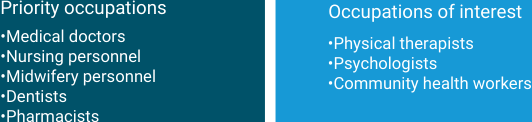

Note: The term “nursing personnel” refers to the three NHWA subcategories: nursing professionals, nursing associate professionals, and nurses not further defined. Similarly, the term “midwifery personnel” includes the three NHWA subcategories: midwifery professionals, midwifery associate professionals, and midwives not further defined.

15 Implementation of national health workforce accounts in the Region of the Americas

Implementation of national health workforce accounts in the Region of the Americas

15

<!-- PAGE: 32/84 -->

## CHAPTER 3

## Overview of the health workforce

This chapter presents an overview of the available evidence on the HWF in the Region of the Americas, focusing on its availability, distribution, characteristics, and flow. The information analyzed comes from the NHWAs, and synthesizes the results of the quantitative indicator analyses.

## Method of analysis

This report covers eight occupations: the priority occupations of medical doctors, nurses, midwives, dentists, and pharmacists; and the occupations of interest, which are physical therapists, psychologists, and community health workers.

Data were provided by the Member States through the NHWA platform and extracted by the team responsible for this report (https://extranet.who.int/dhis2/dhis-web-commons/security/login.action). This information, compiled during the last quarter of 2023, covers 2017–2021, corresponding to the first five years of NHWA implementation. The cut-off year was 2021, owing to the availability of complete data up to that date.

The dynamic NHWA platform allows data to be uploaded or amended at any time, making it a major reliable resource to meet constantly evolving information needs. However, the information presented in this report reflects the HRH situation only at the time of data extraction, which is a limitation, since there may have been subsequent updates.

Governments and organizations (in the public and private sectors) face significant challenges related to the accessibility, comparability, updating, and coverage of the HWF data collected. Although these entities regularly generate relevant information, it is usually consolidated at different times, and is not always readily available. The diversity of sources represents an additional challenge, making it difficult to compare and analyze the indicators homogeneously. These limitations complicate the performance of comprehensive and accurate assessments (79, 80).

It is also important to note that, in some cases, there are inconsistencies in the data reported by some countries. For example, while some report on practicing workers, others report data on active workers and/or those licensed to practice. Furthermore, over the years, countries may have used different sources to report the number of workers, reflecting different levels of activity, which are not always accompanied by metadata on the sources.

For analysis, the countries of the Region were grouped into four subregions, as shown below (see Figure 2 and Table 2):

- Central America, Latin Caribbean, and Mexico: 11 countries • Non-Latin Caribbean: 16 countries and territories

- Central America, Latin Caribbean, and Mexico: 11 countries

- Non-Latin Caribbean: 16 countries and territories

16 THE HEALTH WORKFORCE IN THE AMERICAS

<!-- PAGE: 33/84 -->

- North America: 2 countries • South America (Southern Cone and Andean Zone): 10 countries

- North America: 2 countries

- South America (Southern Cone and Andean Zone): 10 countries

## FIGURE 2. Distribution of countries among the groups

CALCM – Central America, LaƟn Caribbean, and Mexico NA – North America SASCAZ – South America: Southern Cone and Andean Zone NLC – Non-LaƟn Caribbean

Source: The authors, based on the OpenStreetMaps platform.

TABLE 2. Countries and territories studied in the Region of the Americas, by subregion

| Subregion/country | Country/territory |
| --- | --- |
| Central America, Latin Caribbean, | Belize, Costa Rica, Cuba, Dominican Republic, El Salvador, Guatemala, Haiti, Honduras, |
| and Mexico | Mexico, Nicaragua, and Panama |
| Non-Latin Caribbean | Anguilla, Antigua and Barbuda, Bahamas, Barbados, British Virgin Islands, Cayman |
|  | Islands, Dominica, Grenada, Guyana, Jamaica, Montserrat, Saint Kitts and Nevis, Saint |
|  | Lucia, Saint Vincent and the Grenadines, Suriname, and Trinidad and Tobago |
| North America | Canada and the United States of America |
| South America (Southern Cone and Andean Zone) | Argentina, Bolivia (Plurinational State of), Brazil, Chile, Colombia, Ecuador, Paraguay, Peru, Uruguay, and Venezuela (Bolivarian Republic of) |

Note: Some of the geographic subregions used in the PAHO basic indicators were grouped together to facilitate the analysis. The official names of the countries were used, which has advantages in terms of uniformity of information, consistency among PAHO publications, and comparability of data.

Source: Prepared by the authors, based on Pan American Health Organization. Core indicators portal: Region of the Americas. Washington, D.C.: PAHO; 2024. Available from: https://opendata.paho.org/en/core-indicators/subregions-dashboard.

17 Overview of the health workforce

<!-- PAGE: 34/84 -->

To calculate the density variable, population data from the Population Division of the United Nations Department of Economic and Social Affairs, corresponding to the mid-year estimate, were used (81).

Core indicators: What data are available? Data were analyzed for 39 countries and territories in the Americas with a country-designated NHWA focal point and at least one essential indicator reported. The availability of indicators by subregion is presented in Table 3.

## Core indicators: What data are available?

Data were analyzed for 39 countries and territories in the Americas with a country-designated NHWA focal point and at least one essential indicator reported. The availability of indicators by subregion is presented in Table 3.

## TABLE 3. Completeness of core indicators for tracking health workforce evolution on the national health workforce accounts platform, by subregion, Region of the Americas, 2017–2021

| health workforce accounts platform, by | platform, by | subregion, | Region of the | Americas, | 2017–2021 |
| --- | --- | --- | --- | --- | --- |
| Indicators Central America, Latin Caribbean, and Mexico (11 countries) n % | Central America, Latin Caribbean, and Mexico (11 countries) | Non-Latin Caribbean (16 countries and territories) | South America (Southern Cone and Andean Zone) (10 countries) | North America (2 countries) | Region of the Americas (39 countries and territories) |
|  |  | n % | n % | n % | n % |
| Number of Medical doctors, 11 100 active health nurses, and midwives workers Dentists and 11 100 pharmacists Physical therapists and 5 45 psychologists Community health 4 36 workers Subnational level 2 18 (medical doctors, nurses, and midwives) Agea 9 82 Gendera 9 82 Facility ownershipa 7 64 Facility typea 6 55 |  | 16 100 | 10 100 | 2 100 | 39 100 |
|  |  | 11 69 | 10 100 | 2 100 | 34 87 |
|  |  | 5 31 | 7 70 | 2 100 | 19 49 |
|  |  | 4 25 | 2 20 | 0 0 | 10 26 |
|  |  | 0 0 | 5 50 | 1 50 | 8 21 |
|  |  | 13 81 | 9 90 | 2 100 | 33 85 |
|  |  | 12 75 | 10 100 | 2 100 | 33 85 |
|  |  | 11 69 | 9 90 | 1 50 | 27 69 |
|  |  | 9 56 | 7 70 | 2 100 | 22 56 |
| Worker flows By place of birtha 6 55 By place of trainingb 5 45 Inflow of foreignersa 2 18 |  | 10 63 | 8 80 | 1 50 | 25 64 |
|  |  | 10 63 | 7 70 | 1 50 | 23 59 |
|  |  | 7 44 | 3 30 | 2 100 | 14 34 |
| Job Regulations on the 4 36 characteristics, obligatory provision working of services conditions, and remuneration Gender pay gap 2 18 |  | 1 6 | 2 20 | 1 50 | 8 21 |
|  |  | 1 6 | 4 40 | 0 0 | 7 18 |

18 THE HEALTH WORKFORCE IN THE AMERICAS

<!-- PAGE: 35/84 -->

TABLE 3. Completeness of core indicators for tracking health workforce evolution on the national health workforce accounts platform, by subregion, Region of the Americas, 2017–2021 (continued)

| Indicators Central America, Latin Caribbean, and Mexico (11 countries) n % | Central America, Latin Caribbean, and Mexico (11 countries) | Non-Latin Caribbean (16 countries and territories) | South America (Southern Cone and Andean Zone) (10 countries) | North America (2 countries) | Region of the Americas (39 countries and territories) |
| --- | --- | --- | --- | --- | --- |
|  |  | n % | n % | n % | n % |
| Skill-mix Existence of advanced 11 100 composition nursing roles for models of care |  | 15 94 | 7 70 | 2 100 | 35 90 |
| Education and Duration of education 9 82 training and training Ratio of graduates to 7 64 stockb |  | 11 69 | 9 90 | 1 50 | 30 77 |
|  |  | 7 44 | 6 60 | 2 100 | 22 56 |
| Regulation and Mechanisms for 11 100 accreditation the accreditation of education and training institutions and their programs Interprofessional 11 100 education standards Continuous 11 100 professional development |  | 16 100 | 10 100 | 2 100 | 39 100 |
|  |  | 16 100 | 10 100 | 2 100 | 39 100 |
|  |  | 14 88 | 9 90 | 2 100 | 36 92 |

Note: Number of countries and percentage of completeness out of 39 possible countries and territories. The term “nursing personnel” refers to the three NHWA subcategories: nursing professionals, nursing associate professionals, and nurses not further defined. Similarly, the term “midwifery personnel” includes the three NHWA subcategories: midwifery professionals, midwifery associate professionals, and midwives not further defined. a Data corresponding to medical doctors and nurses.

b Data corresponding to medical doctors and nurses. The data on education and training, as well as on regulation and accreditation, refer exclusively to university-level professions; i.e., they do not include technical and associate-level training.

All responses provided by each country were considered, regardless of their nature.

All of the countries reported data on the number of workers for at least one occupation. The completeness of the indicators ranged between 18% and 100%, for both quantitative and qualitative indicators. Qualitative indicators comprise those answers that can be “yes,” “no,” or “partial.” All responses provided by each country were considered, regardless of their nature.

Of the four core indicators, the ratio of graduates to stock is the one with the lowest number of responses in the Region: only 56% of the countries reported information for the period.

19 Overview of the health workforce

<!-- PAGE: 36/84 -->

In terms of availability of information, the following should be noted:

- Central America, the Latin Caribbean, and Mexico have more information on the different professions than the regional average, because they have more data on the number of community health workers (36%). • The non-Latin Caribbean countries and territories are the second group with the most information available on the distribution of health workers by place of training, as well as the annual inflow rate of foreign-born workers. The group of countries in the Southern Cone and the Andean Zone has the most information on the duration of education and training, as well as on the gender wage gap, density at the subnational level, place of birth and training of workers, and ownership of health facilities. • The countries of North America (Canada and United States) have developed their HRHISs over a long period of time. Among all the subregions, they have the highest number of indicators that provide information.

- Central America, the Latin Caribbean, and Mexico have more information on the different professions than the regional average, because they have more data on the number of community health workers (36%).

- The non-Latin Caribbean countries and territories are the second group with the most information available on the distribution of health workers by place of training, as well as the annual inflow rate of foreign-born workers. The group of countries in the Southern Cone and the Andean Zone has the most information on the duration of education and training, as well as on the gender wage gap, density at the subnational level, place of birth and training of workers, and ownership of health facilities.

- The countries of North America (Canada and United States) have developed their HRHISs over a long period of time. Among all the subregions, they have the highest number of indicators that provide information.

The year with the largest amount of data available for the indicators analyzed was 2018 (Table 4), with particularly complete coverage for most indicators, except for those related to the density of physical therapists and psychologists, as well as for community health workers, and density data at the subnational level. This coincides with the year in which countries collected data using the NHWA platform for the report State of the world’s nursing 2020: Investing in education, jobs and leadership, prepared by WHO in collaboration with partner organizations (82).

TABLE 4. Number and percentage of countries with information on core indicators for monitoring the evolution of the health workforce, Region of the Americas, 2017–2021

| evolution | of the health workforce, |  | Region of | the Americas, | 2017 2021 |  |  |
| --- | --- | --- | --- | --- | --- | --- | --- |
| Indicators |  |  | 2017 | 2018 | 2019 | 2020 | 2021 |
|  |  | n | % | n % | n % | n % | n % |
| Number of active | Medical doctors, nurses, | 35 | 90 | 36 92 | 22 56 | 19 49 | 17 44 |
| health workers | and midwives |  |  |  |  |  |  |
|  | Dentists and pharmacists | 24 | 62 | 26 67 | 14 36 | 12 31 | 15 38 |
|  | Physical therapists | 7 | 18 | 12 31 | 8 21 | 9 23 | 12 31 |
|  | and psychologists |  |  |  |  |  |  |
|  | Community health workers | 2 | 5 | 3 8 | 6 15 | 2 5 | 3 8 |
|  | Density at subnational level (medical doctors, nurses, and midwives) | 3 | 8 | 2 5 | 4 10 | 5 13 | 6 15 |
|  | Agea | 20 | 51 | 30 77 | 15 38 | 8 21 | 12 31 |
|  | Gendera | 23 | 59 | 29 74 | 15 38 | 10 26 | 13 33 |
|  | Facility ownershipa | 11 | 28 | 24 62 | 8 21 | 5 13 | 4 10 |
|  | Facility typea | 13 | 33 | 20 51 | 6 15 | 3 8 | 3 8 |

20 THE HEALTH WORKFORCE IN THE AMERICAS

<!-- PAGE: 37/84 -->

## TABLE 4. Number and percentage of countries with information on core indicators for monitoring the evolution of the health workforce, Region of the Americas, 2017–2021 (continued)

|  |  |  | g |  |  | ( | ) |
| --- | --- | --- | --- | --- | --- | --- | --- |
| Indicators |  |  | 2017 | 2018 | 2019 | 2020 | 2021 |
|  |  | n | % | n % | n % | n % | n % |
| Worker flows | By place of birtha | 18 | 46 | 20 51 | 4 10 | 5 13 | 9 23 |
|  | By place of trainingb | 14 | 36 | 19 49 | 4 10 | 4 10 | 8 21 |
|  | Inflow of foreignersa | 9 | 23 | 13 33 | 4 10 | 5 13 | 5 13 |
| Job | Regulations on the | 3 | 8 | 3 8 | 4 10 | 4 10 | 3 8 |
| characteristics, | obligatory provision |  |  |  |  |  |  |
| working | of services |  |  |  |  |  |  |
| conditions, and |  |  |  |  |  |  |  |
| remuneration | Gender pay gap | 4 | 10 | 6 15 | 2 5 | 1 3 | 1 3 |
| Skill-mix | Existence of advanced | 16 | 41 | 35 90 | 3 8 | 4 10 | 4 10 |
| composition for | nursing roles |  |  |  |  |  |  |
| models of care |  |  |  |  |  |  |  |
| Education and | Duration of education and | 19 | 49 | 26 67 | 9 23 | 4 10 | 2 5 |
| training | training |  |  |  |  |  |  |
|  | Ratio of graduates to stockb | 14 | 36 | 18 46 | 9 23 | 9 23 | 8 21 |
| Regulation and | Mechanisms for the | 21 | 54 | 38 97 | 12 31 | 9 23 | 6 15 |
| accreditation | accreditation of education |  |  |  |  |  |  |
|  | and training institutions and |  |  |  |  |  |  |
|  | their programs |  |  |  |  |  |  |
|  | Interprofessional education | 18 | 46 | 38 97 | 6 15 | 6 15 | 5 13 |
|  | standards |  |  |  |  |  |  |
|  | Continuous professional | 15 | 38 | 34 87 | 8 21 | 5 13 | 5 13 |
|  | development |  |  |  |  |  |  |

Note: Number of countries and percentage of completeness out of 39 possible countries and territories. The term “nursing personnel” refers to the three NHWA subcategories: nursing professionals, nursing associate professionals, and nurses not further defined. Similarly, the term “midwifery personnel” includes the three NHWA subcategories: midwifery professionals, midwifery associate professionals, and midwives not further defined. a Data corresponding to medical doctors and nurses.

b Data corresponding to medical doctors and nurses. The education and training and regulation and accreditation data refer exclusively to professions requiring a university degree. They exclude technical and associate-level training.

Figure 3 illustrates the number of countries and territories in the Region (n = 39) that have information on the density of each of the eight occupations analyzed. It can be seen that nursing is the group with the greatest amount of data available, while community health workers have the least amount of information.

21 Overview of the health workforce

<!-- PAGE: 38/84 -->

FIGURE 3. Number of countries reporting data by occupation, Region of the Americas, 2017–2021

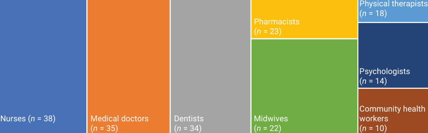

Note: Number of countries out of a total of 39 possible countries and territories. The term “nursing personnel” refers to the three NHWA subcategories: nursing professionals, nursing associate professionals, and nurses not further defined. Similarly, the term “midwifery personnel” includes the three NHWA subcategories: midwifery professionals, midwifery associate professionals, and midwives not further defined.

The country profiles with the quantitative indicators analyzed are presented in Annex 2. These provide synthesized, accessibly organized data, detailing the number of health workers according to the year reported, enabling a comprehensive, integrated view of each country’s HWF.

During the Regional Workshop on Human Resources for Health Information Systems, held in Panama on

11–15 September 2023, country representatives reviewed the preliminary profiles5 on the information included in the NHWAs (70).

Of the total number of priority HRH indicators for the Region of the Americas detailed in Table 2, ten quantitative indicators were selected and grouped into four categories:

- Availability of health workers o Worker density o Density at subnational level • Distribution of health workers o Gender distribution o Age distribution o Distribution by facility ownership o Distribution by facility type

- Availability of health workers

o Worker density

o Density at subnational level

- Distribution of health workers

o Gender distribution

o Age distribution

o Distribution by facility ownership

o Distribution by facility type

5 Some countries provided updated HWF data on the NHWA platform after the September 2023 event, which were included in this report after being validated by each country.

22 THE HEALTH WORKFORCE IN THE AMERICAS

<!-- PAGE: 39/84 -->

- Production of health workers o Ratio of graduates to stock • Flows of health workers o Flows by place of training o Flows by place of birth o Inflow of foreign-born workers

- Production of health workers

o Ratio of graduates to stock

- Flows of health workers

o Flows by place of training

o Flows by place of birth

o Inflow of foreign-born workers

## Availability of health workers

The availability of HRH is crucial to ensure health service access and quality. This includes the presence and accessibility of qualified personnel for the provision of care and services, and is a critical factor for enabling access to services and achieving favorable outcomes.

The NHWAs defines three main categories (77), which may vary from country to country:

- Practicing workers: Those who provide direct care services to patients and communities in health facilities, having received the corresponding training to do so. • Professionally active workers: This includes practicing health and care personnel, and other personnel who are not providing services directly, but for whom their training is a prerequisite for the execution of their job (e.g., education, research, public administration). • Workers licensed to practice: Those who are registered and/or enrolled, and entitled to practice.

- Practicing workers: Those who provide direct care services to patients and communities in health facilities, having received the corresponding training to do so.

- Professionally active workers: This includes practicing health and care personnel, and other personnel who are not providing services directly, but for whom their training is a prerequisite for the execution of their job (e.g., education, research, public administration).

- Workers licensed to practice: Those who are registered and/or enrolled, and entitled to practice.

Information on practicing workers was prioritized; in the absence of such data, data on professionally active health workers were used. It no data were available on either of these two groups, those corresponding to health workers licensed to practice are reported (76, 77).

## Density of health workers

The density of medical doctors, nurses, and midwives per 10 000 population is presented, using the latest available data for each country for 2017–2021 (Figure 4).

According to WHO recommendations on HWF density, in the occupations of medical doctors, nursing, and midwifery, the desirable target is 44.5 workers per 10 000 population (2).

During the period studied, densities ranged from 169.97 (Cuba) to 6.38 (Haiti), with an average of 66.57 for the Region. The subregion with the highest average is North America, with 147.85, while the lowest rates correspond to the subregion that includes Central America, the Latin Caribbean, and Mexico, with 49.75. Fourteen of the 39 countries with available data fell below the target of 44.5 (35.82%), with densities ranging from 44.32 (Suriname) to 6.38 (Haiti).

The highest density for medical doctors are those of Cuba (94.29), Uruguay (45.08), and Trinidad and Tobago (41.93), while the lowest are those for Honduras (4.89) and Haiti (2.37). The subregion with the highest average density is North America, with 30.36 medical doctors per 10 000 population, and the subregion with the lowest average is the non-Latin Caribbean, with 20.65. Six of the 39 countries and territories have a density less than half the average for the Region (Figure 5).

23 Overview of the health workforce

<!-- PAGE: 40/84 -->

FIGURE 4. Health worker density compared to the World Health Organization target, by subregion and by country, Region of the Americas, 2017–2021 (rate per 10 000 population)

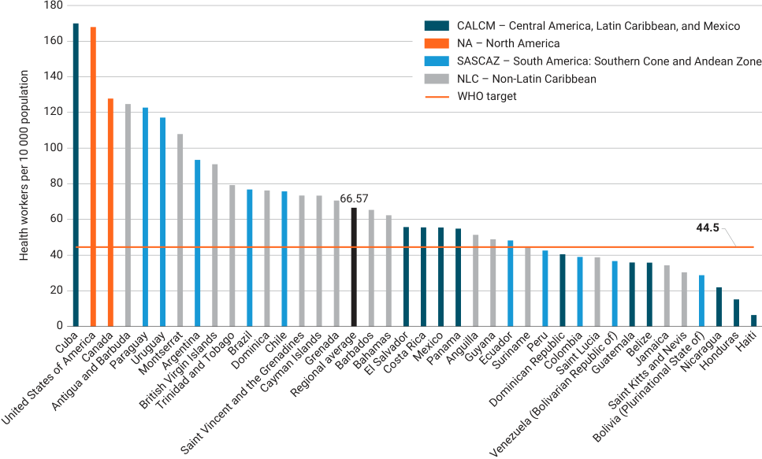

*Note: British Virgin Islands, Cayman Islands, Montserrat, and Saint Vincent and the Grenadines only have data on nurses; Saint Kitts and Nevis only has data on medical doctors; Bahamas, Bolivia (Plurinational State of), Colombia, Costa Rica, Cuba, Dominica, Dominican Republic, Ecuador, El Salvador, Grenada, Guatemala, and Nicaragua have no data on midwifery personnel. The regional average corresponds to 39 countries and territories.*

a For more information on this target, see: World Health Organization. Global strategy on human resources for health: Workforce 2030. Geneva: WHO; 2016. Available from: https://iris.who.int/handle/10665/250368.

Thirty-eight countries and territories submitted data on the density of nurses. There are significant variations among them, ranging from 3.84 workers per 10 000 population for Haiti and 7.13 for Honduras, to 102.70, 107.91, and 131.50 for Canada, Montserrat, and the United States of America, respectively. Nine have a density of less than half the average for the Region, which is 44.37 (Figure 6).

Although the variations observed are a product of the inequalities present in the Region, it is necessary to explore how each country defines and conceptualizes the “nursing” profession. Moreover, although the NHWAs define different categories of nursing, the boundaries of what is considered “professional” and “associate” nursing have particular characteristics in some countries.

The density of nurses considers the sum of the numbers reported by the countries for nursing professionals, nursing associate professionals, and nurses not further defined.6 Ten countries reported only one category: only

6 The term “nursing professionals not further defined “ refers to those workers for whom it was not possible to clarify a specific professional category (professional or associate). Therefore, they have been included within this general denomination.

24 THE HEALTH WORKFORCE IN THE AMERICAS

<!-- PAGE: 41/84 -->

## FIGURE 5. Density of medical doctors by subregion and by country, Region of the Americas, 2017–2021 (rate per 10 000 population)

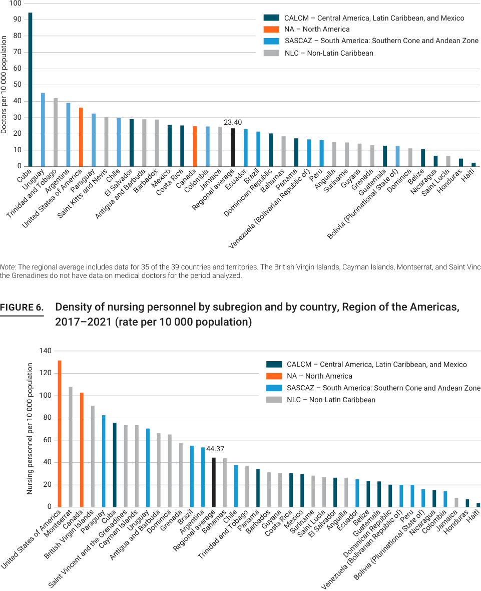

Note: The regional average includes data for 35 of the 39 countries and territories. The British Virgin Islands, Cayman Islands, Montserrat, and Saint Vincent and the Grenadines do not have data on medical doctors for the period analyzed.

*Note: The regional average was calculated with data from 38 of the 39 possible countries and territories. Saint Kitts and Nevis does not have data on nurses for the period analyzed. The term “nursing personnel” refers to the three NHWA subcategories: nursing professionals, nursing associate professionals, and nurses not further defined.*

Note: The regional average includes data for 35 of the 39 countries and territories. The British Virgin Islands, Cayman Islands, Montserrat, and Saint Vincent and the Grenadines do not have data on medical doctors for the period analyzed.

FIGURE 6. Density of nursing personnel by subregion and by country, Region of the Americas, 2017–2021 (rate per 10 000 population)

25 Overview of the health workforce

<!-- PAGE: 42/84 -->

nursing professionals not further defined were reported by Barbados, Dominica, Guyana, Haiti, and Saint Lucia, while Anguilla, Chile, Colombia, Costa Rica, and Peru reported only nursing professionals.

The subregion with the highest average density of nurses is North America with 117.10, while the lowest values correspond to Central America, Latin Caribbean, and Mexico, with 26.32.

Midwifery personnel density was identified in 22 of the 39 countries and territories analyzed, with considerable variation, ranging from 29.53 in Antigua and Barbuda to 0.003 in Mexico. The subregion with the highest average is the non-Latin Caribbean, with 4.17, and the subregion with the lowest average is North America, with 0.39 (Figure 7).

The occupation of midwifery, which encompasses university and technical-level training, may not exist in some countries. In these cases, the related functions are assumed by another occupation, such as nurses with midwifery training, or performed by midwives without formal education, who are not considered in the NHWAs.

## FIGURE 7. Density of midwifery personnel by subregion and by country, Region of the Americas, 2017–2021 (rate per 10 000 population)

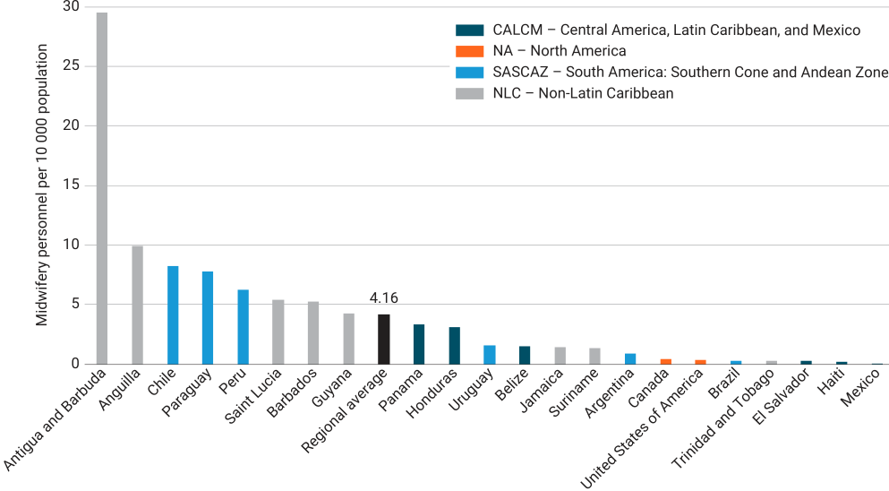

*Note: The density for Mexico is 0.0026. The term “midwifery personnel” includes all three NHWA subcategories: midwifery professionals, midwifery associate professionals, and midwives not further defined.*

Data were reported on dentists in 34 of the 39 countries and territories analyzed. The highest density value was found in Cuba (16.71), followed by Chile (14.81) and Paraguay (12.81), while the lowest densities were recorded in Haiti (0.22) and Honduras (0.32) (Figure 8). The subregion with the highest average density is North America, with 6.31, and the one with the lowest is the non-Latin Caribbean, with 1.82.

26 THE HEALTH WORKFORCE IN THE AMERICAS

<!-- PAGE: 43/84 -->

FIGURE 8. Density of dentists by subregion and by country, Region of the Americas, 2017–2021 (rate per 10 000 population)

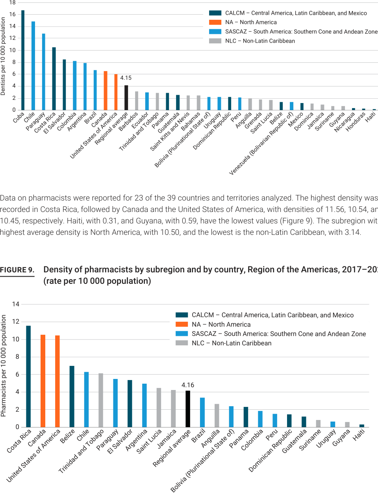

Data on pharmacists were reported for 23 of the 39 countries and territories analyzed. The highest density was recorded in Costa Rica, followed by Canada and the United States of America, with densities of 11.56, 10.54, and 10.45, respectively. Haiti, with 0.31, and Guyana, with 0.59, have the lowest values (Figure 9). The subregion with the highest average density is North America, with 10.50, and the lowest is the non-Latin Caribbean, with 3.14.

Data on pharmacists were reported for 23 of the 39 countries and territories analyzed. The highest density was recorded in Costa Rica, followed by Canada and the United States of America, with densities of 11.56, 10.54, and 10.45, respectively. Haiti, with 0.31, and Guyana, with 0.59, have the lowest values (Figure 9). The subregion with the highest average density is North America, with 10.50, and the lowest is the non-Latin Caribbean, with 3.14.

FIGURE 9. Density of pharmacists by subregion and by country, Region of the Americas, 2017–2021 (rate per 10 000 population)

27 Overview of the health workforce

<!-- PAGE: 44/84 -->

With respect to physical therapists, 18 of the 39 countries and territories provided data. The highest density was recorded in Chile, with 18.46, followed by the United States of America, with 8.79. At the other extreme are Guatemala, with 0.21, and Guyana, with 0.15 (Figure 10).

FIGURE 10. Density of physical therapists by subregion and by country, Region of the Americas, 2017–2021 (rate per 10 000 population)

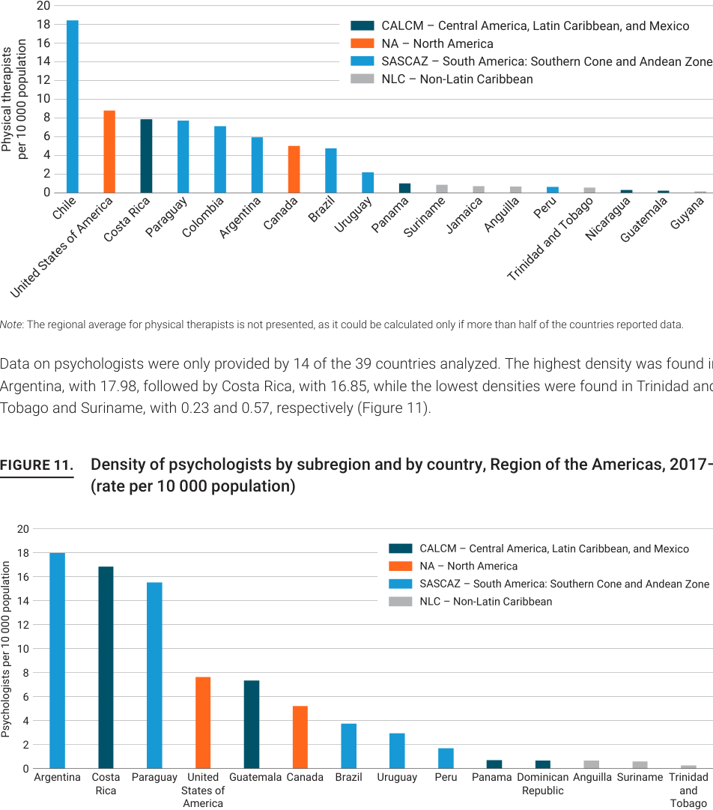

Note: The regional average for physical therapists is not presented, as it could be calculated only if more than half of the countries reported data.

Data on psychologists were only provided by 14 of the 39 countries analyzed. The highest density was found in Argentina, with 17.98, followed by Costa Rica, with 16.85, while the lowest densities were found in Trinidad and Tobago and Suriname, with 0.23 and 0.57, respectively (Figure 11).

Note: The regional average for physical therapists is not presented, as it could be calculated only if more than half of the countries reported data.

Data on psychologists were only provided by 14 of the 39 countries analyzed. The highest density was found in Argentina, with 17.98, followed by Costa Rica, with 16.85, while the lowest densities were found in Trinidad and Tobago and Suriname, with 0.23 and 0.57, respectively (Figure 11).

FIGURE 11. Density of psychologists by subregion and by country, Region of the Americas, 2017–2021 (rate per 10 000 population)

Note: The regional average for psychologists is not presented, as it could be calculated only if more than half of the countries reported data.

28 THE HEALTH WORKFORCE IN THE AMERICAS

<!-- PAGE: 45/84 -->

Data on community health workers are scarce: only 10 of the 39 countries and territories analyzed reported data. The highest density is in Brazil (13.28) and the lowest in Guatemala (0.13) (Figure 12).

## FIGURE 12. Community health worker density, by subregion and by country, Region of the Americas, 2017–2021 (rate per 10 000 population)

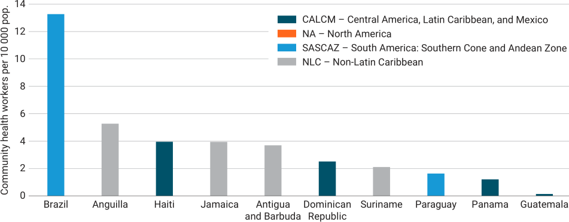

*TABLE 5. Density at the subnational level (medical doctors and nursing and midwifery personnel), for eight countries in the Region of the Americas, years 2019, 2020, and 2021*

Note: The regional average for community health workers is not presented, as it could be calculated only if more than half of the countries reported data.

## Density at subnational level

To provide a more complete overview of the situation, this section presents information on the degree of completeness of the data on density reported at the subnational level Having information at this level is important to assess equity in the distribution of these workers and to develop strategies for improving access to health care in the different areas within each country.

Density data were analyzed at the subnational level for medical doctors, nurses, and midwives, with information available from eight countries (Table 5). However, only three of them provided information on all three occupations.

| for eight | countries in the Region of | the Americas, years | 2019, 2020, and 2021 |  |
| --- | --- | --- | --- | --- |
| Country | Medical doctors | Nursing personnel | Midwifery personnel | Year |
| Argentina | x | x | x | 2020 |
| Brazil | x | x |  | 2021 |
| Canada | x | x |  | 2021 |
| Colombia | x | a |  | 2021 |
| Dominican Republic | x | x |  | 2019 |

29 Overview of the health workforce

<!-- PAGE: 46/84 -->

## TABLE 5. Density at the subnational level (medical doctors and nursing and midwifery personnel), for eight countries in the Region of the Americas, years 2019, 2020, and 2021 (continued)

| g | g | y | ( | ) |
| --- | --- | --- | --- | --- |
| Country | Medical doctors | Nursing personnel | Midwifery personnel | Year |
| Panama | x | x | x | 2021 |
| Peru | x | a | x | 2021 |
| Uruguay | x | x | x | 2021 |

a Colombia and Peru presented data for the category nursing professionals.

Distribution of health workers Gender distribution The gender distribution of medical doctors and nursing personnel is described in this section, because these two occupations are the ones with the largest amount of available information in the Region. Currently, the NHWAs only present two gender options: women and men.

## Distribution of health workers

## Gender distribution

The gender distribution of medical doctors and nursing personnel is described in this section, because these two occupations are the ones with the largest amount of available information in the Region. Currently, the NHWAs only present two gender options: women and men.

Data on the gender of medical doctors were identified in 18 countries and territories, with an average of 48.67% being women and 51.32% men. In Anguilla, Argentina, Costa Rica, Dominican Republic, Paraguay, and Uruguay, more than 50% of medical doctors are women (Figure 13).

## FIGURE 13. Distribution of medical doctors by gender, by country, Region of the Americas, 2017–2021 (percentage)

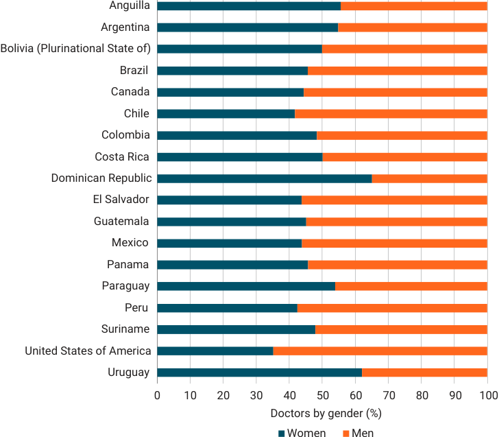

30 THE HEALTH WORKFORCE IN THE AMERICAS

<!-- PAGE: 47/84 -->

Thirty-two countries presented data on the gender of nursing personnel. In all cases there was a predominance of women, with an average of 89.78% women and 10.16% men. In 12 countries and territories, women accounted for more than 90%: Antigua and Barbuda, Belize, Bolivia (Plurinational State of), Canada, Dominican Republic, Grenada, Guyana, Honduras, Jamaica, Montserrat, Saint Vincent and the Grenadines, and Suriname (Figure 14).

FIGURE 14. Distribution of nursing personnel by gender, by country, Region of the Americas, 2017–2021 (percentage)

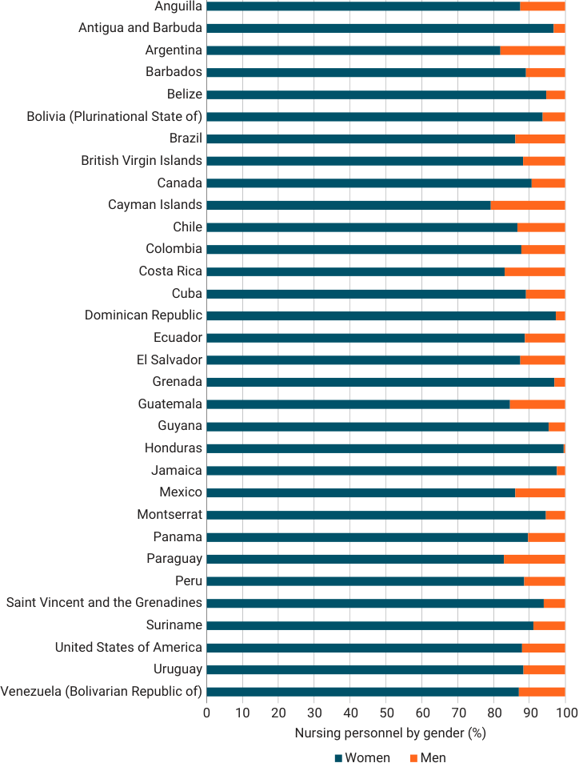

*Note: The term “nursing personnel” refers to the three NHWA subcategories: nursing professionals, nursing associate professionals, and nurses not further defined.*

31 Overview of the health workforce

<!-- PAGE: 48/84 -->

## Age distribution

The aging of the HWF is an issue of interest for country planning, since workers aged 55 and over are close to retirement, and generational replacement must be anticipated by creating appropriate training conditions. The age range with the highest number of medical doctors was 35–44 years (Figure 15).

Seventeen countries submitted data on the age distribution of medical doctors (Figure 15).

## FIGURE 15. Distribution of medical doctors by age, by country, Region of the Americas, 2017–2021 (percentage)

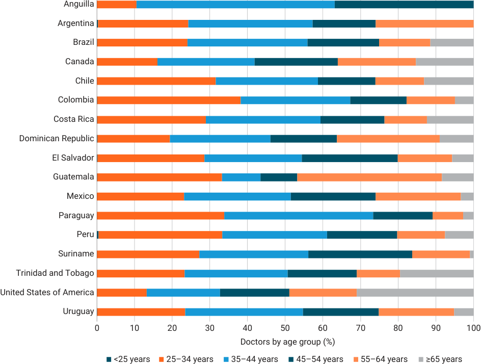

32 THE HEALTH WORKFORCE IN THE AMERICAS

<!-- PAGE: 49/84 -->

An analysis of workers aged 55 or older and those under 35 (at the beginning of their careers) shows that in the United States of America, nearly half are 55 or older (48.90%), followed by Guatemala, with 46.80%. In Colombia and Paraguay, medical doctors are younger. In Anguilla, no data were identified for this age range. Argentina did not provide information on workers over retirement age (65 years) (Figure 16).

FIGURE 16. Distribution of medical doctors aged 55 and older and under 35 years, by country, Region of the Americas, 2017–2021 (percentage)

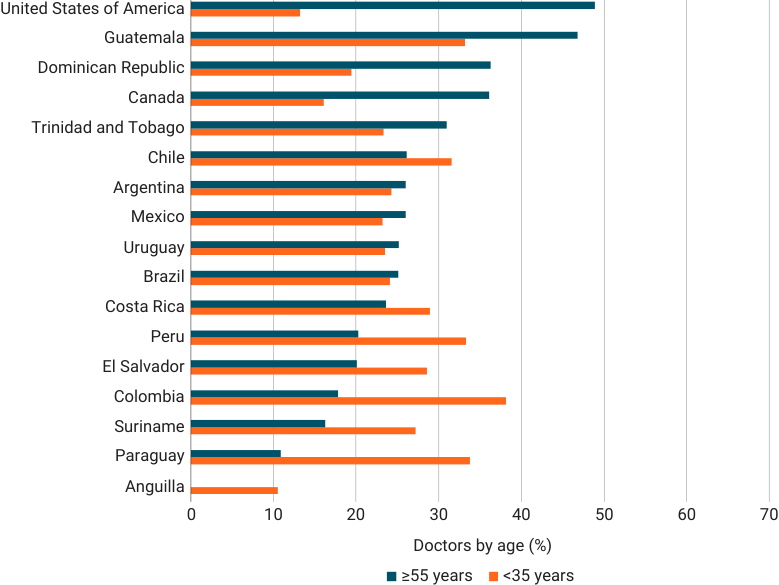

For nursing personnel, only 32 countries and territories out of 39 reported data on age distribution. The most frequent age range was also 35–44 years (Figure 17).

33 Overview of the health workforce

<!-- PAGE: 50/84 -->

## FIGURE 17. Distribution of nursing personnel by age, by country, Region of the Americas, 2017–2021 (percentage)

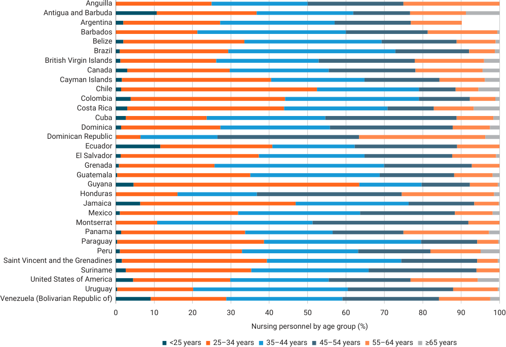

Note: The term “nursing personnel” refers to the three NHWA subcategories: nursing professionals, nursing associate professionals, and nurses not further defined.

The data on nursing personnel show that the Dominican Republic and Honduras have the highest proportion of workers aged 55 years or older, with 36.60% and 25.50%, respectively; Guyana has the highest percentage of young people (63.50%) (Figure 18).

34 THE HEALTH WORKFORCE IN THE AMERICAS

<!-- PAGE: 51/84 -->

FIGURE 18. Distribution of nursing personnel aged 55 years and older and under 35 years, by country, Region of the Americas, 2017–2021 (percentage)

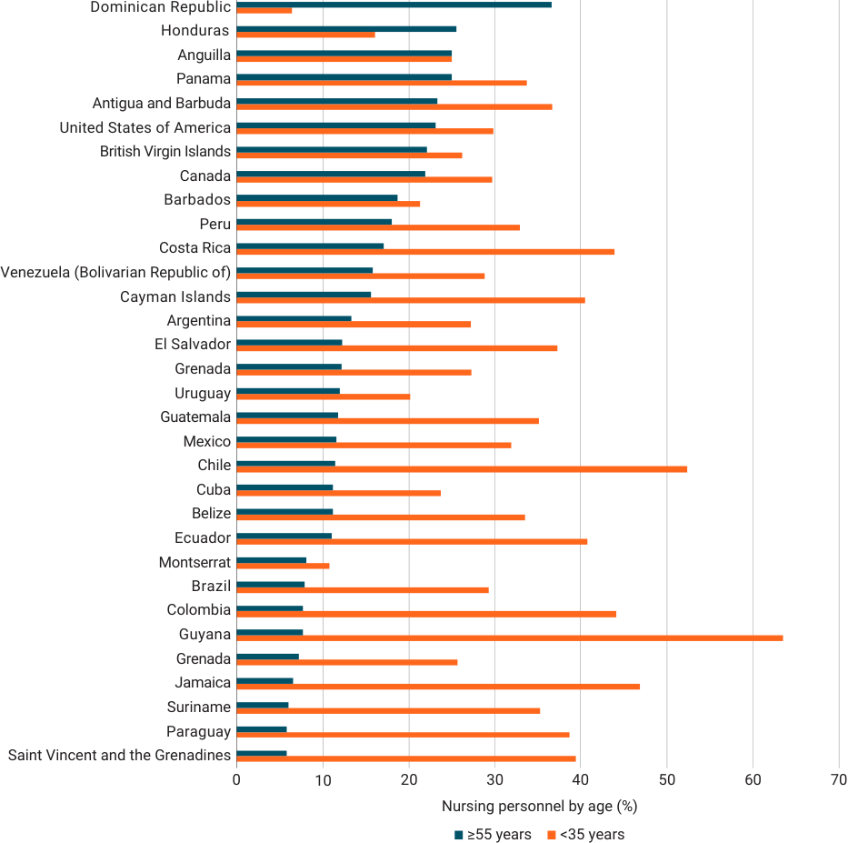

Note: The term “nursing personnel” refers to the three NHWA subcategories: nursing professionals, nursing associate professionals, and nurses not further defined.

To better interpret this information, it would be important to know whether they are practicing workers or simply licensed to practice. In the latter case, and depending on the conditions of updating for professional practice, this could include older workers who are not practicing, or who have migrated to other countries.

35 Overview of the health workforce

<!-- PAGE: 52/84 -->

Distribution by ownership of the health facility The categories corresponding to the distribution of workers by ownership of the health facility include the public sector, the private for-profit sector, and the private not-for-profit sector.

## Distribution by ownership of the health facility

The categories corresponding to the distribution of workers by ownership of the health facility include the public sector, the private for-profit sector, and the private not-for-profit sector.

In the case of medical doctors, data from eight countries were reported (Figure 19). The Plurinational State of Bolivia and the United States of America only presented public sector data.

## FIGURE 19. Distribution of medical doctors by health facility ownership in eight countries of the Region of the Americas, 2017–2021 (percentage)

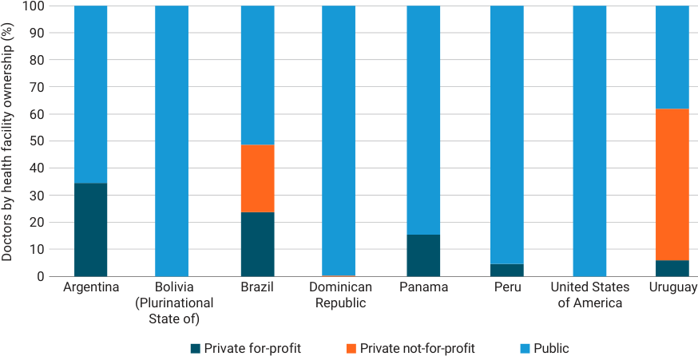

Note: The percentage corresponding to the private not-for-profit sector in the Dominican Republic is 0.34%.

Regarding nursing personnel, 27 countries and territories presented information on facility ownership (Figure 20). Barbados only reported data from the private for-profit sector, while nine countries and territories reported data from the public sector: Belize, Bolivia (Plurinational State of), Cuba, El Salvador, Grenada, Honduras, Montserrat, Trinidad and Tobago, and Venezuela (Bolivarian Republic of).

Countries can face difficulties in identifying data on the ownership of private, for-profit, not-for-profit, and other types of establishments. In many cases the information is fragmented and incomplete, making it difficult to obtain a comprehensive and accurate picture of the situation of HRH in this regard, underscoring the need to strengthen governance in data collection and reporting.

There is a significant difference between the reporting on facility ownership for medical doctors and for nursing personnel, which suggests that the sources of information are not the same. In the case of nursing, data were obtained from the State of the world’s nursing 2020 report (82), which used NHWA data for the first time and was a factor promoting their implementation.

36 THE HEALTH WORKFORCE IN THE AMERICAS

<!-- PAGE: 53/84 -->

## FIGURE 20. Distribution of nursing personnel by health facility ownership, by country, 2017–2021 (percentage)

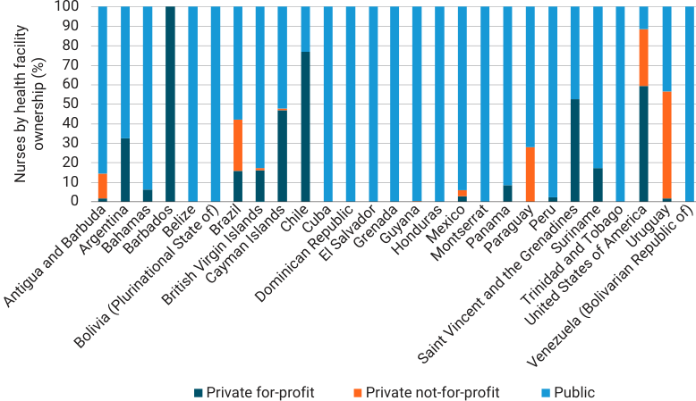

Note: The term “nursing personnel” refers to the three NHWA subcategories: nursing professionals, nursing associate professionals, and nurses not further defined.

Distribution by facility type There are several types of facilities in which health workers can perform their functions. The classification used by the NHWAs includes:

## Distribution by facility type

There are several types of facilities in which health workers can perform their functions. The classification used by the NHWAs includes:

- Hospitals • Residential long-term care facilities • Ambulatory health care • Ancillary services • Retailers • Preventive care providers

- Hospitals

- Residential long-term care facilities

- Ambulatory health care

- Ancillary services

- Retailers

- Preventive care providers

This categorization reflects the diversity and complexity of the health sector (77) and requires standardization by the reporting countries.

Only five countries reported data related to the distribution by facility type for medical doctors (Figure 21). These include the United States of America, which only submitted data from hospitals.

With respect to nursing personnel, 22 of the 39 countries and territories submitted information. Belize and Chile only provided data on personnel working in hospitals (Figure 22).

Similar considerations apply here as for facility ownership with respect to data sources and reports on nursing personnel.

37 Overview of the health workforce

<!-- PAGE: 54/84 -->

## FIGURE 21. Distribution of medical doctors by facility type for four countries in the Region of the Americas, 2017–2021 (percentage)

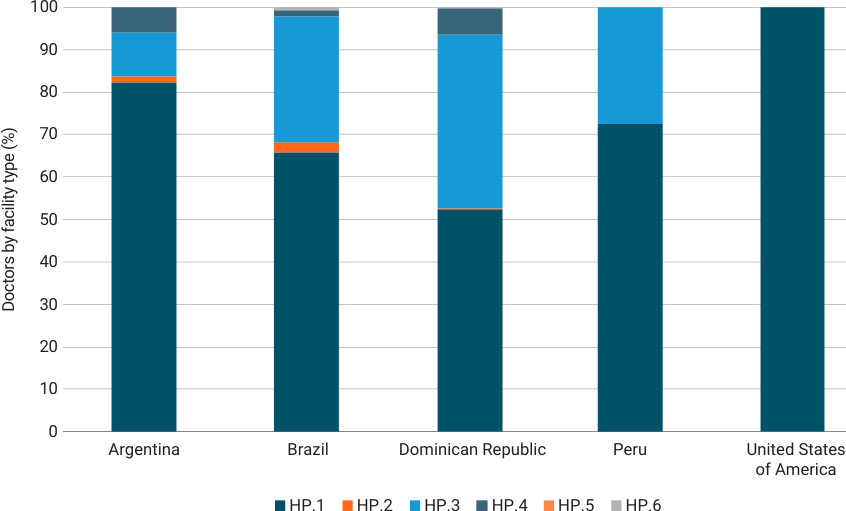

*HP.1: hospitals; HP.2: residential long-term care facilities; HP.3: providers of ambulatory health care; HP.4: ancillary services; HP.5: retailers; HP.6: providers of preventive care.*

FIGURE 22. Distribution of nursing personnel by facility type, by country, 2017–2021 (percentage)

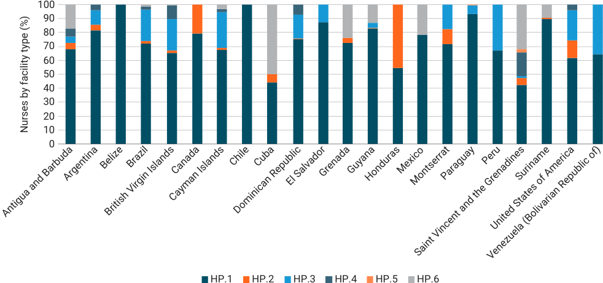

*Note: The term “nursing personnel” refers to the three NHWA subcategories: nursing professionals, nursing associate professionals, and nurses not further defined. HP.1: hospitals; HP.2: residential long-term care facilities; HP.3: providers of ambulatory health care; HP.4: ancillary services; HP.5: retailers; HP.6: providers of preventive care.*

38 THE HEALTH WORKFORCE IN THE AMERICAS

<!-- PAGE: 55/84 -->

## Production of health workers

The production of health workers in the Americas has significant implications for workforce planning and health services delivery. A low number of graduates could indicate that in the coming years, a country will not have enough personnel to replace those who are leaving the labor market due to retirement or transition to other areas.

During the 2020–2021 period, many countries in the Region faced interruptions in health worker training programs owing to the COVID-19 pandemic. Some countries opted to bring forward the graduation of students in response to urgent demand, while in other countries, training programs and graduation were temporarily suspended, a situation that generated variability in the availability of trained personnel during that period (83).

## Ratio of graduates to stock

The graduation rate of professionals in the five priority occupations, based on a population of 100 000 inhabitants, is presented below. It should be noted that the non-Latin Caribbean subregion only presented data on nursing and midwifery graduates.

Data on medical school graduates from 12 of 39 countries and territories were analyzed, showing that the rate varies between 33.92 in the Dominican Republic and 4.32 in Costa Rica (Figure 23).

## FIGURE 23. Medical graduates by subregion and by country, Region of the Americas, 2017–2021 (rate per 100 000 population)

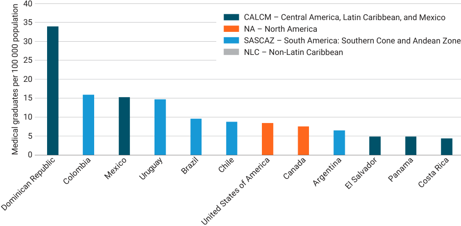

*Note: Eight countries reported data from the pandemic period: Argentina and Uruguay in 2020; and Canada, Colombia, Costa Rica, Mexico, Panama, and the United States of America in 2021.*

Regarding nursing graduates, data from 22 countries and territories were reported, with rates ranging from 110.27 in the United States of America to 2.14 in Guatemala (Figure 24).

39 Overview of the health workforce

Overview of the health workforce

39

<!-- PAGE: 56/84 -->

## FIGURE 24. Nursing graduates by subregion and by country, Region of the Americas, 2017–2021 (rate per 100 000 population)

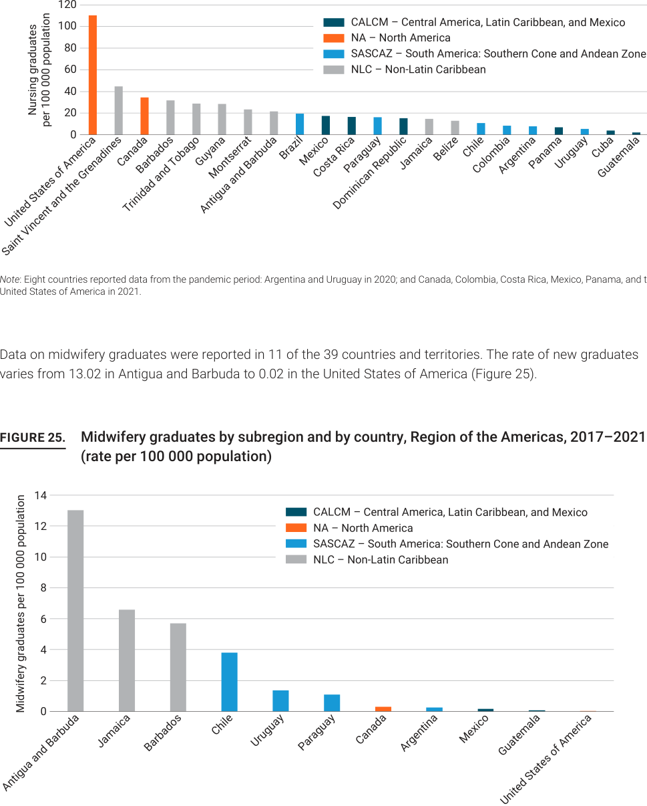

Data on midwifery graduates were reported in 11 of the 39 countries and territories. The rate of new graduates varies from 13.02 in Antigua and Barbuda to 0.02 in the United States of America (Figure 25).

*Note: The values for Guatemala and the United States of America were 0.08 and 0.02, respectively. Four countries reported data from the pandemic period: Argentina and Uruguay (2020), and Canada and the United States of America (2021).*

Note: Eight countries reported data from the pandemic period: Argentina and Uruguay in 2020; and Canada, Colombia, Costa Rica, Mexico, Panama, and the United States of America in 2021.

Data on midwifery graduates were reported in 11 of the 39 countries and territories. The rate of new graduates varies from 13.02 in Antigua and Barbuda to 0.02 in the United States of America (Figure 25).

FIGURE 25. Midwifery graduates by subregion and by country, Region of the Americas, 2017–2021 (rate per 100 000 population)

40 THE HEALTH WORKFORCE IN THE AMERICAS

<!-- PAGE: 57/84 -->

There is no midwifery degree program in some of the countries of the Region.

For dentistry graduates, data were obtained in 10 of the 39 countries and territories, with values ranging from 8.80 in Chile and 8.76 in Brazil to 0.73 in Panama (Figure 26).

FIGURE 26. Dentistry graduates by subregion and by country, Region of the Americas, 2017–2021 (rate per 100 000 population)

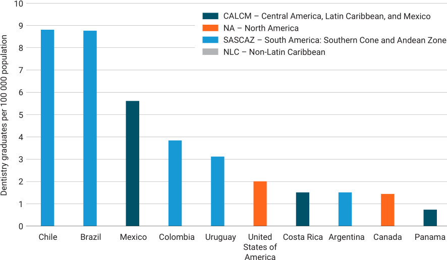

*Note: Eight countries reported data from the pandemic period: Argentina and Uruguay in 2020; and Canada, Colombia, Costa Rica, Mexico, Panama, and the United States of America in 2021.*

Data on pharmacy graduates were reported in 10 of the 39 countries and territories. The rate varies from 8.18 in Brazil to 1.08 for Argentina and Colombia (Figure 27).

41 Overview of the health workforce

<!-- PAGE: 58/84 -->

FIGURE 27. Pharmacy graduates by subregion and by country, Region of the Americas, 2017–2021 (rate per 100 000 population)

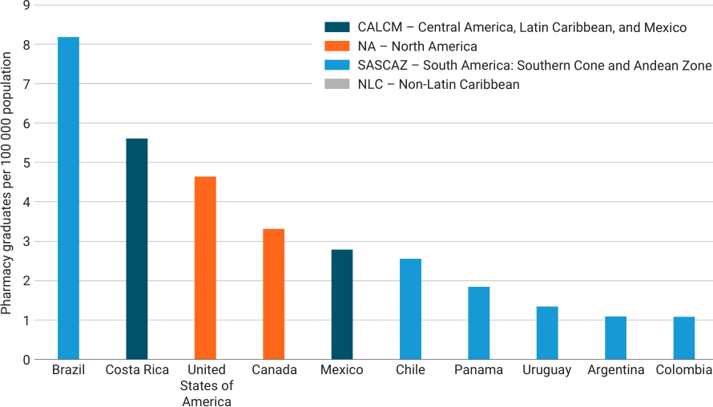

Note: Eight countries reported data from the pandemic period: Argentina and Uruguay in 2020; and Canada, Colombia, Costa Rica, Mexico, Panama, and the United States of America in 2021.

Healthcare worker flows Flows by place of training Data related to the place of training of medical doctors and nursing personnel provide a regional overview of the following factors: training capacity, attractiveness of these occupations, and working conditions.

## Healthcare worker flows

## Flows by place of training

Data related to the place of training of medical doctors and nursing personnel provide a regional overview of the following factors: training capacity, attractiveness of these occupations, and working conditions.

Health worker flows can significantly affect the availability and distribution of HRH, creating planning challenges for both sending and receiving countries. Migration or mobility can lead to shortages of workers in areas already struggling to meet their health needs, while receiving countries face the challenge of integrating these workers into their systems.

As for the percentage of domestic-trained and foreign-trained medical doctors, data from nine countries were analyzed. Belize and Saint Lucia are especially noteworthy, with 100% and 91.37% of their medical doctors trained abroad, respectively. El Salvador is at the other extreme, with only 1.77% (Figure 28).

42 THE HEALTH WORKFORCE IN THE AMERICAS

<!-- PAGE: 59/84 -->

## FIGURE 28. Medical doctors by place of training, by country, Region of the Americas, 2017–2021 (percentage)

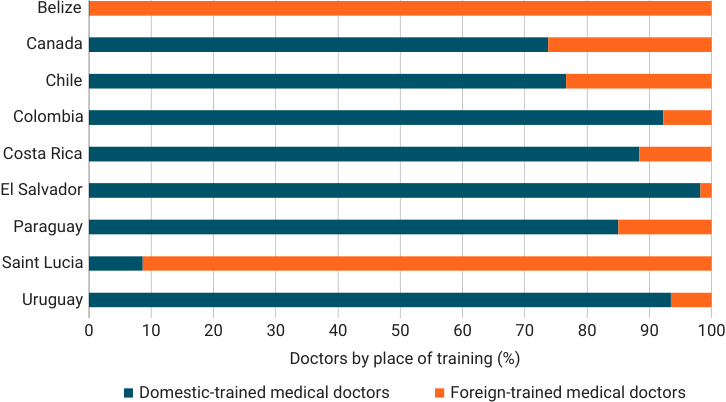

Note: Belize only reported data on foreign-trained medical doctors.

To obtain a more complete picture of a country’s training autonomy, this proportion of foreign-trained graduates should be analyzed in conjunction with the total number of professionals and with graduation rates. Belize and Saint Lucia, for example, do not have full training programs for medical doctors on their territory, which explains their high dependence on foreign-trained graduates.

As for data on nurses, only 22 countries submitted information. It was notable that non-Latin Caribbean countries and territories have a higher percentage of foreign-trained nurses, including Belize, the British Virgin Islands, Cayman Islands, and Montserrat (Figure 29).

## Flows by place of birth

Information on the place of birth of medical doctors and nursing personnel was analyzed with data from the NHWAs. Data on the number of national- and foreign-born medical doctors were identified in 6 of the 39 countries and territories evaluated. Among them, the two non-Latin Caribbean countries that provided data (Saint Lucia and Trinidad and Tobago) have the highest percentage of foreign-born professionals in their workforce (Figure 30).

43 Overview of the health workforce

Overview of the health workforce

43

<!-- PAGE: 60/84 -->

## FIGURE 29. Nurses by place of training, by country, Region of the Americas, 2017–2021 (percentage)

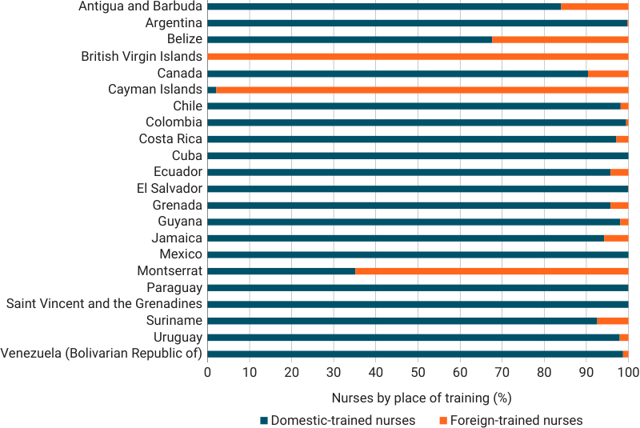

Note: British Virgin Islands only provided data on foreign-trained nurses; Cuba, Mexico, and Saint Vincent and the Grenadines only reported on domestic-trained nurses. Paraguay reported a 99.96% rate for domestic-trained nurses; the rate in El Salvador was 99.93%, and in Argentina it was 99.81%.

## FIGURE 30. Distribution of medical doctors by place of birth, by country, Region of the Americas, 2017–2021 (percentage)

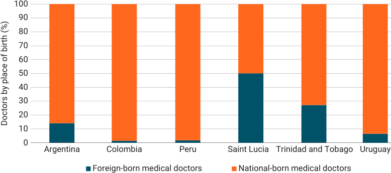

44 THE HEALTH WORKFORCE IN THE AMERICAS

<!-- PAGE: 61/84 -->

Data on nurses was provided by 24 of the 39 countries and territories. Three of them (British Virgin Islands, Cayman Islands, and Montserrat) reported that more than half of their nurses were born abroad. In contrast, Ecuador, El Salvador, Guyana, and Peru reported that less than 1% of nurses were foreign-born (Figure 31).

FIGURE 31. Distribution of nurses by place of birth, by country, Region of the Americas, 2017–2021 (percentage)

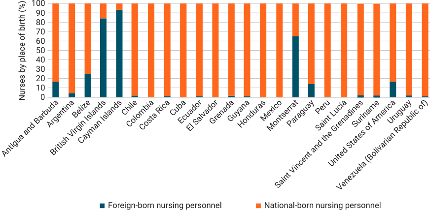

*Note: Cuba, Honduras, Mexico, and Saint Lucia reported data on national-born nurses. The term “nursing personnel” refers to the three NHWA subcategories: nursing professionals, nursing associate professionals, and nurses not further defined.*

## Inflows of newly active foreign-trained workers

Regarding newly active foreign-trained medical doctors, per total number of medical doctors, data were obtained from only four countries: Chile (3.08), Canada (2.91), the United States of America (0.66), and Uruguay (2.91). For nursing personnel, 11 countries submitted data for 2017–2021. Of these, seven belong to the non-Latin Caribbean. There is a high variation in the percentage of annual inflow, ranging from 15.55 in the Cayman Islands to 0.07 in Chile (Figure 32).

The information obtained on foreign-trained health workers,6 foreign-born health workers, and newly active health workers is crucial to understanding the dynamics of the HWF and migration, a topic of current interest in the Region. However, reporting on data corresponding to medical doctors is scarce, even in countries of the Region that are OECD members and have a commitment to report annually.

A relevant aspect is the presence of national-born workers who were trained abroad and returned to their country to exercise their occupation. This phenomenon may reflect several situations, including where the country of origin does not have sufficient capacity to train its own workers, which generates a dependence on international mobility to meet this need.

45 Overview of the health workforce

<!-- PAGE: 62/84 -->

FIGURE 32. Newly active foreign-trained nursing personnel to the total number of nursing personnel, by subregion and by country, Region of the Americas, 2017–2021 (percentage)

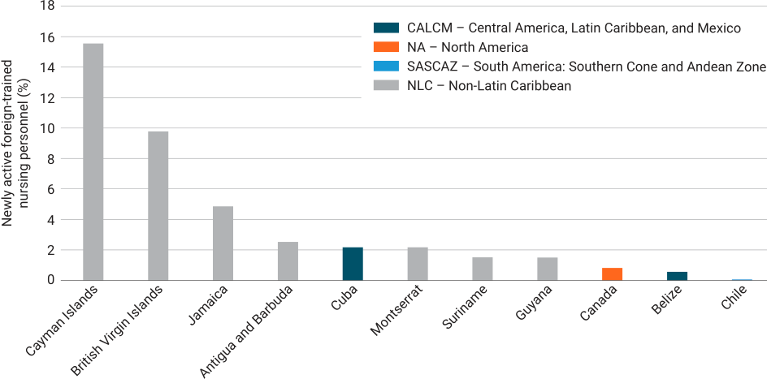

*Note: The term “nursing personnel” refers to the three NHWA subcategories: nursing professionals, nursing associate professionals, and nurses not further defined.*

46 THE HEALTH WORKFORCE IN THE AMERICAS

<!-- PAGE: 63/84 -->

## CHAPTER 4

## Final considerations: Regional situation and reflections on necessary actions

This report, the first of its kind in the Region of the Americas, was prepared using information available on the NHWA platform. It is the result of the ongoing collaborative work of the Evidence and Information team of the Human Resources for Health Unit of the PAHO Department of Health Systems and Services, and of the country focal points, complemented by the results of the regional HRHIS workshop held on 11–15 September 2023 in Panama.

In recent years, there has been a significant increase in the availability of HWF data in these countries, reflecting their commitment to this issue. The launch of the PAHO Health Workforce Policy 2030: Strengthening Human Resources for Health to Achieve Resilient Health Systems further underscored its importance, promoting policies to support health workers throughout the Region.

Based on data trends and identified gaps, as well as technical cooperation needs and actions aimed at strengthening the development of HRHISs, it has been possible to describe the regional scenario and establish working guidelines to develop and strengthen these systems.

## Overview of priority occupations

As indicated in the literature, the Region presents a scenario of high inequity in terms of access to health care, as reflected in the NHWA data analysis. To address this issue, technical cooperation actions are necessary to develop strategies and policies for training, attracting, recruiting, and retaining health workers, with special emphasis on the most disadvantaged countries.

Although the average density of medical doctors, nurses, and midwives in the Region (57, 66) exceeds the WHO recommendation of 44.5 workers per 10 000 population, more than one-third of the 39 countries and territories analyzed (14) do not meet this threshold. Six of them, located in Central America, the Latin Caribbean, and Mexico, show extremely low figures, with Haiti and Honduras being the most affected. In contrast, Cuba and the United States almost quadruple the recommended rate.

The highest density of the professions presented in this report correspond to nursing personnel. The United States has the highest rate, followed by Montserrat and Canada, in similar proportions.

In the case of medical doctors, Cuba leads the Region in density, both in its subregion and overall, doubling the rate in Uruguay, the country with the second highest value. Honduras and Haiti reported the lowest rates for medical doctors and nursing personnel, with figures for nurses similar to those of Jamaica.

47 Final considerations: Regional situation and reflections on necessary actions

Final considerations: Regional situation and reflections on necessary actions

47

<!-- PAGE: 64/84 -->

Midwifery is a key occupation in the Zero Maternal Deaths initiative (84), because care provided by skilled workers during pregnancy, childbirth, and the postpartum period can mean the difference between life and death for a woman and her child. However, midwifery shows low development at the regional level and generally does not represent a significant proportion of the total density of workers in most countries, except in the English- speaking Caribbean, such as Antigua and Barbuda, and in some South American countries, such as Chile. Promoting the recognition of the training and regulation of this profession in the different countries, as well as its integration into first-level health teams, is a technical cooperation objective being advanced jointly by the Human Resources for Health Unit and the Latin American Center for Perinatology, Women’s and Reproductive Health (CLAP/WR).

Midwifery is a key occupation in the Zero Maternal Deaths initiative (84), because care provided by skilled workers during pregnancy, childbirth, and the postpartum period can mean the difference between life and death for a woman and her child. However, midwifery shows low development at the regional level and generally does not represent a significant proportion of the total density of workers in most countries, except in the English- speaking Caribbean, such as Antigua and Barbuda, and in some South American countries, such as Chile.

Promoting the recognition of the training and regulation of this profession in the different countries, as well as its integration into first-level health teams, is a technical cooperation objective being advanced jointly by the Human Resources for Health Unit and the Latin American Center for Perinatology, Women’s and Reproductive Health (CLAP/WR).

Except in Brazil and some Central American and non-Latin Caribbean countries, which have explicitly incorporated community health workers into their core teams, little information is available on this priority occupation. Because midwifery is not regulated in most countries, the data available are often based on hiring records, which are often inconsistent. For these workers to play their role effectively in first-level health teams, it is crucial to further promote the creation of a training and regulatory framework that facilitates their formal recognition and insertion into the labor market.

In the aftermath of the COVID-19 pandemic, mental health issues gained greater visibility. Psychologists represent a crucial pillar for addressing mental disorders, which increase the risk of developing other diseases and contribute to injuries, both intentional and unintentional.

However, there are gaps in access to care for various mental health conditions (85). Further analysis is needed to determine whether these gaps in information about this profession are due to the scarcity or absence of training programs in some countries, to a limited orientation of these programs toward health care, or even to the possible private-sector predominance of these professionals. This diagnosis will be important to promoting appropriate, specific strategies for each country.

Nursing is the occupation with the most information available. This is partly because different regional and global mandates have promoted the monitoring of indicators for medical doctors and nursing personnel. Moreover, periodic global reports play a key role in the collection of this data.

Within the scope of HRHISs, the occupations included must adequately reflect the reality of these professionals, starting with a consensus on the specific activities and responsibilities of each profession in the different countries. The mapping of occupations based on ISCO-08 criteria facilitates the preparation of reports aligned with international standards, enabling global comparisons.

The same approach should be used with health facility classifiers, where discrepancies are also evident between countries that report data on medical doctors and nursing personnel in different types of facilities.

## Medical doctors and nurses: Who and where they are

Regarding the demographic characteristics of medical doctors and nursing personnel, women constitute the majority of nurses, both in the regional average and in every country. However, the data reported for medical doctors show a regional average of 51.32% in favor of men. However, one-third of the countries reported that more than 50% of their medical doctors are women, in line with the growing feminization of this profession, which has been described worldwide (82). This phenomenon requires ongoing analysis, as well as more evidence and actions that

48 THE HEALTH WORKFORCE IN THE AMERICAS

<!-- PAGE: 65/84 -->

target working and employment conditions, to favor the incorporation and retention of women, and to avoid widening gaps in HWF availability.

Information on age groups varies, but the most common age range is between 35 and 44 years, indicating a relatively young population. It is important for each country to work on its replacement rate to ensure the sustainability of its HWF. In the case of nursing personnel, in most countries the group of those under 35 years of age is larger than that of those older than 55. However, in the group of medical doctors, the situation is different: in countries such as Canada and the United States of America, the population over 55 years of age exceeds the population under 35, by 20% to 30%. This should be taken into account in their planning strategies to ensure the replacement of these workers.

The NHWAs offer a valuable tool for analyzing the density of health workers at the subnational level, as well as the distribution by ownership and type of facility, enabling in-depth analysis of access to health care in each country. However, the number of countries reporting these data is still low; only eight have information at the subnational level.

Data on the distribution of workers by facility ownership show notable differences: While only 8 countries reported information on medical doctors, 27 reported information on nursing personnel. This may be due to the previously mentioned efforts to improve reporting on nursing personnel, and because, in countries with mixed health systems, the data reported pertain mainly to the public sector.

As for the distribution of workers by facility type, the majority of medical doctors and nursing personnel are found in hospitals, with proportions that vary between 50% and 100%. An exception to this trend has been observed among nurses, with Saint Vincent and the Grenadines reporting 42.34% of these personnel in hospitals, and 44.26% in Cuba. The NHWA categories of providers of ambulatory health care and of preventive care include the first level of care in their definitions. In this regard, for nursing, Cuba and Saint Vincent and the Grenadines respectively have 50.09% and 31.99% of their personnel in preventive care facilities, while the Bolivarian Republic of Venezuela and Peru report proportions between 35.64% and 32.71% in ambulatory care facilities. The latter data indicate a higher profile for first-level care in these countries’ service systems.

Training and migration Data on the number of university graduates and those completing other professional training constitute the group of essential HRH indicators, because this information is indispensable for planning replacement rates.

## Training and migration

Data on the number of university graduates and those completing other professional training constitute the group of essential HRH indicators, because this information is indispensable for planning replacement rates.

Nursing is the career for which the largest number of countries (22) reported data. As for the other professions, less than one-third of the countries have reported data. In the non-Latin Caribbean subregion, only data on nursing and midwifery graduates were submitted.

During the COVID-19 pandemic, many institutions of higher education brought forward the graduation of healthcare students to respond to the urgent need for front-line personnel to combat the virus. However, work overload, the constant risk of contagion, and physical and emotional exhaustion led many workers to leave their jobs, a situation that makes it necessary to consider the importance of improving working conditions and providing adequate emotional support.

Migration of health workers is another issue of interest that affects HWF dynamics and distribution. Both as regards data on place of training and place of birth, it was observed that most of the information reported corresponded to nursing personnel. The non-Latin Caribbean subregion had the most foreign-born and foreign-trained workers.

49 Final considerations: Regional situation and reflections on necessary actions

Final considerations: Regional situation and reflections on necessary actions

49

<!-- PAGE: 66/84 -->

The NHWAs can be an important tool for analyzing migration trends as more complete reporting on specific indicators becomes available. Although some countries in the Region are OECD members and report annual indicators on place of training and annual flow of foreign-born workers, these data are not always included in the NHWAs, underscoring the need to strengthen good practices.

## Strengthening the governance of human resources for health information systems

The scarcity of information on the distribution and training of health workers makes it clear that the governance of information systems is the greatest challenge in the Region. Data on HRH are robust when they come from registries or databases under the primary responsibility of health ministries. However, their reliability decreases when they depend on interaction with other government ministries, the private sector, and even entities at the subnational level.

The importance of intersectoral efforts, in which managers and politicians from different sectors collaborate, is a critical aspect that countries should consider. It is essential to conduct a stakeholder mapping that enables each country to identify the different sources of information related to HRH and that promotes the necessary agreements and regulations to guarantee their interoperability. Furthermore, an accurate record of metadata is crucial to enable source consistency monitoring over different periods, and to assess such key indicators as level of activity.

To ensure good governance, especially in the process of collecting, managing, and analyzing information, it is essential for health ministries to provide political leadership supported by well-trained, sustainable teams that maintain continuity in these processes. In the last three years, close monitoring of the data has revealed a high turnover of NHWA focal points in different countries, as well as a lack of trained technical teams to ensure continuity in HRA data collection, management, and analysis. This situation compromises the sustainability of efforts to consolidate reliable data, and affects the health systems’ ability to formulate evidence-based policies and make strategic decisions on HRH.

Once data have been collected, the challenge lies in analyzing them in terms of the population’s health demands and needs. NHWAs provide a variety of indicators to monitor the healthcare labor market. They enable each country to determine which of these indicators are most appropriate for monitoring worker flows systematically, taking into account different possibilities and priorities. The regional agreements on indicators presented in this report also provide a solid basis for this prioritization.

## Regional technical cooperation

This report, a trailblazer in the presentation of NHWA data in the Region of the Americas, provides a benchmark for future research and policymaking on HRH. By presenting core indicators and highlighting some of the challenges identified, it establishes a framework for understanding the current situation and encouraging the use of data on HRH and the development of HRHISs in the countries of the Region.

PAHO technical cooperation efforts have played a fundamental role in this process, supporting countries in developing road maps to create robust HRHISs. At the regional level, PAHO has contributed to designing guidelines and tools that offer practical methodologies and resources to strengthen HRHISs, such as stakeholder and occupational mapping, HRHIS maturity assessments, and implementation of NHWAs. This includes the creation of video tutorials in the Region’s official languages to train NHWA focal points, and of webinars on specific topics, such as regional and global reports.

50 THE HEALTH WORKFORCE IN THE AMERICAS

<!-- PAGE: 67/84 -->

Cooperation at the national level facilitates spaces for dialogue and technical capacity-building, aimed at finding the best options for each HRHIS to respond to local needs.

Together, PAHO and the participating countries are promoting and assessing the exchange of good practices and identifying common strategies to develop HRH policies based on accurate data and solid evidence. Reports such as this one will be essential for monitoring and evaluating regional and local scenarios, laying the groundwork for evidence-based strategic decisions.

51 Final considerations: Regional situation and reflections on necessary actions

Final considerations: Regional situation and reflections on necessary actions

51

<!-- PAGE: 68/84 -->

## References

1. Pan American Health Organization. Health in the Americas 2022: Overview of the Region of the Americas in the Context of the COVID-19 Pandemic. Washington, D.C.: PAHO; 2022. Available from: https://iris.paho.org/handle/10665.2/56472.

2. World Health Organization. Global Strategy on Human Resources for Health: Workforce 2030. Geneva; WHO; 2016. Available from: https://iris.who.int/handle/10665/250368.

3. Pan American Health Organization. Policy on the Health Workforce 2030: Strengthening Human Resources for Health to Achieve Resilient Health Systems [Document CD60/6]. 60th PAHO Directing Council, 75th Session of the Regional Committee of WHO for the Americas; 25–29 September 2023. Washington, D.C.: PAHO: 2023. Available from: https://www.paho.org/en/documents/ cd606-policy-health-workforce-2030-strengthening-human-resources-health-achieve-resilient.

4. Cavalcante de Oliveira AP, Galante ML, Maia LS, Craveiro I, da Silva AP, Fronteira I, et al. Implementation of policy and management interventions to improve health and care workforce capacity to address the COVID-19 pandemic response: a systematic review. Hum Resour Health. 2023;21(1):80. Available from: https://doi.org/10.1186/s12960-023-00856-y.

5. Pan American Health Organization. Policy Brief: Strengthening Human Resources for Health (HRH) to Respond to COVID-19 and Other Emerging Pandemics in the Caribbean. Washington, D.C.: PAHO; 2021 [cited 19 August 2024]. Available from: https://www. paho.org/en/documents/policy-brief-strengthening-human-resources-health-hrh-respond-covid-19-and-other-emerging.

6. Pan American Health Organization. Impact of COVID-19 on human resources for health and policy response: the case of Belize, Grenada, and Jamaica. Washington, D.C.: PAHO; 2022. Available from: https://iris.paho.org/handle/10665.2/56262.

7. Global Burden of Disease Study 2019 Human Resources for Health Collaborators. Measuring the availability of human resources for health and its relationship to universal health coverage for 204 countries and territories from 1990 to 2019: a systematic analysis for the Global Burden of Disease Study 2019. Lancet. 2022;399(10341):2129–2154. Available from: https://doi. org/10.1016/S0140-6736(22)00532-3.

8. Pan American Health Organization. Strategy on Human Resources for Universal Access to Health and Universal Health Coverage. 29th Pan American Sanitary Conference, 69th Session of the Regional Committee of WHO for the Americas; 25–29 September 2017. Washington, D.C.: PAHO; 2017. Available from: https://iris.paho.org/handle/10665.2/34964.

9. Dal Poz MR, Gupta N, Quain E, Soucat ALB, World Health Organization, World Bank, et al. Handbook on monitoring and evaluation of human resources for health: with special applications for low- and middle-income countries. Geneva: WHO; 2009. Available from: https://iris.who.int/handle/10665/44097.

10. World Health Organization. Developing health management information systems: a practical guide for developing countries. Geneva: WHO; 2004. Available from: https://iris.who.int/handle/10665/207050.

11. Pan American Health Organization. Introduction to semantic interoperability. Washington, D.C.: PAHO; 2021. Available from: https://iris.paho.org/handle/10665.2/55417.

12. Waters KP, Zuber A, Simbini T, Bangani Z, Krishnamurthy RS. Zimbabwe’s Human Resources for Health Information System (ZHRIS): an assessment in the context of establishing a global standard. Int J Med Inform. 2017;100:121–128. Available from: https://doi.org/10.1016/j.ijmedinf.2017.01.011.

13. Riley PL, Zuber A, Vindigni SM, Gupta N, Verani AR, Sunderland NL, et al. Information systems on human resources for health: a global review. Hum Resour Health. 2012;10:7. Available from: https://doi.org/10.1186/1478-4491-10-7.

14. Benito GAV, Licheski AP. Sistemas de informação apoiando a gestão do trabalho em saúde [Information systems supporting health workforce management]. Rev Bras Enferm. 2009;62(3):447–450. Available (in Portuguese) from: https://www.scielo.br/j/ reben/a/CVrVqCsxdkmJmDpSZpbkCDh/abstract/?lang=pt.

52 THE HEALTH WORKFORCE IN THE AMERICAS

<!-- PAGE: 69/84 -->

15. Caffrey M, Tancred T, Falkenbach M, Raven J. What can intersectoral governance do to strengthen the health and care workforce? Structures and mechanisms to improve the education, employment and retention of health and care workers. Brussels: European Observatory on Health Systems and Policies; 2023. Available from: https://eurohealthobservatory.who.int/publications/i/ what-can-intersectoral-governance-do-to-strengthen-the-health-and-care-workforce-structures-and-mechanisms-to-improve- the-education-employment-and-retention-of-health-and-care-workers.

16. Tursunbayeva A, Bunduchi R, Franco M, Pagliari C. Human resource information systems in health care: a systematic evidence review. J Am Med Informatics Assoc. 2017;24(3):633–654. Available from: https://doi.org/10.1093/jamia/ocw141.

17. Pereira GMC, Oliveira ID de, Silva RD da, Hékis HR, Valentim RA de M. Sistemas de informação como apoio à gestão de Recursos Humanos em Saúde [Information systems supporting human resources for health management]. Rev Bras Inovação Tecnol Saúde. 2015;5(4):21–41. Available (in Portuguese) from: https://periodicos.ufrn.br/reb/article/download/8196/6232/0.

18. Siyam A, Diallo K, Lopes S, Campbell J. Data to monitor and manage the health workforce. In: Macfarlane SB, AbouZahr C, editors. The Palgrave Handbook of Global Health Data Methods for Policy and Practice. London: Palgrave Macmillan; 2019. Available from: https://doi.org/10.1057/978-1-137-54984-6_12.

19. Pan American Health Organization. Plan of Action for Strengthening Information Systems for Health 2019-2023. 57th Directing Council, 71st Session of the Regional Committee of WHO for the Americas. Washington, D.C.; 30 September–4 October 2019. Washington, D.C.: PAHO; 2019. Available from: https://iris.paho.org/handle/10665.2/51617?locale-attribute=en.

20. Naser A, editor. Gobernanza digital e interoperabilidad gubernamental: Una guía para su implementación [Digital governance and government interoperability: a guide for its implementation]. Santiago: Economic Commission for Latin America and the Caribbean (ECLAC); 2021. Available (in Spanish) from: https://repositorio.cepal.org/server/api/core/bitstreams/6a12e389-3dcb- 4cba-830a-99f038835423/content.

21. Coelho Neto GC, Chioro A. Afinal, quantos sistemas de informação em saúde de base nacional existem no Brasil? [In the end, how many nationwide health information systems are there in Brazil?] Cad Saude Publica. 2021;37(7):e00182119. Available (in Portuguese) from: https://doi.org/10.1590/0102-311X00182119.

22. Diallo K, Zurn P, Gupta N, Dal Poz M. Monitoring and evaluation of human resources for health: an international perspective. Hum Resour Health. 2003;1(1):3. Available from: https://doi.org/10.1186/1478-4491-1-3.

23. Wakibi S. Data quality considerations in human resources information systems (HRIS) strengthening. Chapel Hill, North Carolina: The Capacity Project; 2008. Available from: https://www.capacityplus.org/files/resources/projectTechBrief_10.pdf.

24. De Vries DH, Settle D, Mcquide PA. The impact of Human Resources Information Systems (HRIS) strengthening. Chapel Hill, North Carolina: The Capacity Project; 2009. Available from: https://www.intrahealth.org/sites/default/files/attachment-files/ legacyseries_6.pdf.

25. Velasco Abad MV, Carrera Herrera G. Análisis comparado de los sistemas de información de profesionales de la salud en los países de Centroamérica [Comparative analysis of information systems on health professionals in Central American countries]. Atarfe, Granada: Entorno Gráfico; 2015. Available (in Spanish) from: https://www.observatoriorh.org/sites/default/files/webfiles/ fulltext/2015/sis_inform_ca_mpdc.pdf.

26. National Ministry of Health of Argentina, National Directorate of Human Capital and Occupational Health. La construcción de la Matriz Mínima de Datos de profesionales de la salud del MERCOSUR desde sus inicios hasta el 2014 en Argentina, Brasil y Uruguay [Building the Minimum Data Matrix of health professionals in MERCOSUR, from its beginnings until 2014, in Argentina, Brazil, and Uruguay]. Buenos Aires: National Ministry of Health, National Directorate of Human Capital and Occupational Health; 2015. Available (in Spanish) from: https://www.observatoriorh.org/sites/default/files/webfiles/fulltext/2016/mmm_prof_salud_ mercosur.pdf.

27. Organisation for Economic Co-operation and Development. Health at a Glance 2023: OECD Indicators. Paris: OECD Publishing; 2023. Available from: https://www.oecd.org/en/publications/health-at-a-glance-2023_7a7afb35-en/full-report.html.

28. Pan American Health Organization. National Health Personnel Accounts. Washington, D.C.: PAHO; 2024 [cited 15 July 2024]. Available from: https://www.paho.org/en/topics/evidence-and-information-human-resources-health/national-health-workforce- accounts.

53 References

<!-- PAGE: 70/84 -->

29. Boniol M, Kunjumen T, Nair TS, Siyam A, Campbell J, Diallo K. The global health workforce stock and distribution in 2020 and 2030: a threat to equity and “universal” health coverage? BMJ Glob Health. 2022;7(6):e009316. Available from: https://gh.bmj. com/content/7/6/e009316.

30. Bustamante Izquierdo JP, Puertas EB, Hernández Hernández D, Sepúlveda H. COVID-19 and human resources for health: analysis of planning, policy responses, and actions in Latin American and Caribbean countries. Hum Resour Health. 2023;21(1):21. Available from: https://www.researchgate.net/publication/369234318_COVID-19_and_human_resources_for_health_analysis_ of_planning_policy_responses_and_actions_in_Latin_American_and_Caribbean_countries.

31. Chibuzor M, Arikpo I, Aquaisua E, Esu E, Okoroafor SC, Omar S, et al. Implementation of health workforce information systems: a review of eight sub-Saharan country experiences. J Public Health (Oxf). 2021;43(Suppl 1):i27–i40. Available from: https:// pubmed.ncbi.nlm.nih.gov/33856471/.

32. McQuide PA, Brown AN, Diallo K, Siyam A. Correction: The transition of human resources for health information systems from the MDGs into the SDGs and the post-pandemic era: reviewing the evidence from 2000 to 2022. Hum Resour Health. 2024;22(1):7. Available from: https://pubmed.ncbi.nlm.nih.gov/38041066/.

33. World Bank. The role of Belize’s primary health care system in pandemic preparedness and response: a qualitative study. Washington, D.C.: World Bank; 2023. Available from: https://documentos.bancomundial.org/es/publication/documents-reports/ documentdetail/099121523193711443/p1598650d8288b06e0a29d08d012253bcfb.

34. Statistical Institute of Belize. Mid-year estimates by age group and sex, 2011–2024. Belmopan: SIB; 2024. Available from: https:// sib.org.bz/statistics/population/.

35. Pan American Health Organization. Belize: Country Cooperation Strategy 2023–2027. Washington, D.C.: PAHO; 2023. Available from: https://www.paho.org/en/documents/belize-country-cooperation-strategy-2023-2027.

36. World Health Organization. Health systems challenges: workforce and medicines. SIDS Summit for Health: For a healthy and resilient future in Small Island Developing States. Geneva: WHO; 2021. Available from: https://cdn.who.int/media/docs/default- source/sids-summit/sids-health-systems-policy-brief.pdf?sfvrsn=b57828e8_5.

37. Ministry of Health and Wellness of Belize, Pan American Health Organization. Belize Health Sector Strategic Plan 2014–2024. Belmopan: Ministry of Health and Wellness; 2014. Available from: https://extranet.who.int/countryplanningcycles/sites/default/ files/planning_cycle_repository/belize/blz._health_sector_strategic_plan_2014-2024.pdf.

38. Pan American Health Organization. Belize takes a significant step towards ensuring universal health access by removing all fees in public hospitals. Washington, D.C.: PAHO; 2023 [cited 30 November 2024]. Available from: https://www.paho.org/pt/ node/93636.

39. Almeida PF de, Oliveira SC de, Giovanella L. Integração de rede e coordenação do cuidado: o caso do sistema de saúde do Chile [Network integration and care coordination: the case of the Chilean health system]. Cienc Saude Colet. 2018;23(7):2213–2228. Available (in Portuguese) from: https://doi.org/10.1590/1413-81232018237.09622018.

40. Goldstein E, Paredes LC. El recurso humane en el sector de la Salud en Chile [Human resources in the Chilean health sector]. Santiago: Library of the National Congress of Chile; 2021. Available (in Spanish) from: https://obtienearchivo.bcn.cl/ obtienearchivo?id=repositorio/10221/32110/2/BCN_Aproximacion_al_recurso_humano_en_Salud_EG_Final_2.pdf.

41. Ministry of Social Development and Family, Undersecretariat of Social Evaluation, Social Observatory Division. Accessor a salud en la población chilenos: Encuesta CASEN 2022 [Access to health in the Chilean population: CASEN Survey 2022]. Santiago: Ministry of Social Development and Family; 2024. Available (in Spanish) from: https://observatorio.ministeriodesarrollosocial. gob.cl/storage/docs/casen/2022/Resultados_Salud_Casen2022.pdf.

42. Orellana CIP. Programme de médicos en etapa de destinación y formación EDF-ex médico general de zona: una alternativa para mejorar la estrategia de retención del plan de formación de especialistas [Program of doctors in the destination and training stage (EDF)-ex general practitioner: an alternative to improve the retention strategy of the specialist training plan]. Santiago: Universidad de Chile; 2022. Available from: https://repositorio.uchile.cl/handle/2250/185614.

43. Guillou M, Carabantes J, Bustos V. Los recursos humanos en salud: planificación de los médicos especialistas [Human resources for health: planning for medical specialists]. Medwave. 2010;10(8). Available (in Spanish) from: http://doi.org/10.5867/ medwave.2010.08.4741.

54 THE HEALTH WORKFORCE IN THE AMERICAS

<!-- PAGE: 71/84 -->

44. Villarroel González SR. Planificación de recursos humanos de la salud en Chile: breve tránsito histórico de sus políticas públicas [Human resources for health planning in Chile: brief historical overview of public policies]. Medwave. 2016;16(10):e66011. Available (in Spanish) from: https://www.medwave.cl/revisiones/analisis/6611.html.

45. Guillou M, Carabantes CJ, Bustos FV. Disponibilidad de médicos y especialistas en Chile [Availability of physicians and specialists in Chile]. Rev Med Chile. 2011;139(5):559–570. Available (in Spanish) from: http://dx.doi.org/10.4067/S0034-98872011000500001.

46. Government of Chile, Ministry of Health, Undersecretariat of Healthcare Networks. Estudio de brechas de oferta y demanda de médicos especialistas en Chile [Study of gaps in supply and demand of medical specialists in Chile]. Technical Collaboration World Bank–Government of Chile. Santiago: Government of Chile; 2010. Available from: https://documentos.bancomundial.org/ es/publication/documents-reports/documentdetail/824501468010509985/chile-estudio-de-brechas-de-oferta-y-demanda-de- medicos-especialistas-en-chile.

47. Government of Chile, Ministry of Health, Undersecretariat of Healthcare Networks, Division of Personnel Management and Development, Department of Human Resources for Health Planning and Personnel Management in the National Health Services System. Health Personnel Supply and Gaps. Annual Report Item No. 01, Letter d - Budget Law No. 21 516. June 2023. Santiago: DIPRES; 2023. Available (in Spanish) from: https://www.dipres.gob.cl/597/articles-299417_doc_pdf.pdf.

48. Government of Chile, Ministry of Health, Undersecretariat of Healthcare Networks, Division of Personnel Management and Development, Department of Human Resources for Health Planning and Information Management. Staff sizing in the National Health Services System: staffing gaps in the National Health Services System. Downsizing plans, Item No. 32 Budget Law No. 21 289. June 2021. Santiago; 2021. Available (in Spanish) from: https://www.camara.cl/verDoc. aspx?prmTIPO=DOCUMENTOCOMUNICACIONCUENTA&prmID=104498.

49. Government of Chile, Ministry of Health, Undersecretariat of Healthcare Networks, Division of Personnel Management and Development, Department of Human Resources for Health Planning and Information Management. Study to determine the gap of general practitioners and specialists according to a methodology of rates of use of medical and specialized benefits in Chile: Final Report. Santiago: Ministry of Health; 2017. Available (in Spanish) from: https://docs.bvsalud.org/biblioref/minsal_ chile/3/7/4873.pdf.

50. Government of Chile, Ministry of Health. Management meeting of the Observatory and Information Systems of Human Resources for Health in South America. Lima: Ministry of Health; 2012. Available (in Spanish) from: http://www.ensp.fiocruz.br/observarh/ arquivos/apresentacao observatorio Chile.pdf.

51. Pan American Health Organization. Perfil del sistema y servicios de salud de Costa Rica con base al marco de monitoreo de la Estrategia Regional de Salud Universal [Profile of the Costa Rican health system and services based on the monitoring framework of the Regional Universal Health Strategy]. San José: PAHO; 2019. Available (in Spanish) from: https://iris.paho.org/ handle/10665.2/38590.

52. Costa Rican Social Security Fund (CCSS). Health services of the CCSS. San José: CCSS; 2021. Available (in Spanish) from: https://docs.bvsalud.org/biblioref/2023/01/1411945/organizacion-y-establecimientos-de-salud-de-la-ccss-al-31-12-2021.pdf.

53. Vázquez Peñaranda CM, Borrell Bentz RM. Recursos humanos en salud en Costa Rica: información actual y desafíos para una década. [Human resources for health in Costa Rica: current information and challenges for a decade]. San José: Pan American Health Organization; 2006. Available from: https://pesquisa.bvsalud.org/portal/resource/pt/biblio-981844.

54. Picado Chacón G. Human Resources Information System of the Costa Rican Social Security Fund. Workshop on Human Resources for Health Information Systems; 4–6 October 2011. Brasília: Pan American Health Organization; 2011. Available (in Portuguese) from: https://www.observatoriorh.org/sites/default/files/webfiles/informacion/reubraoct2011/cor_picado.pdf.

55. Martinez Mora I. Health workforce data management: country summary. Workshop on National Health Workforce Accounts; 28–30 August 2019. Brasília: Pan American Health Organization; 2019. Available (in Spanish) from: https://www.observatoriorh. org/sites/default/files/webfiles/fulltext/2019/nhwa_ago_bra/6_costarica_cuentas.pdf.

56. Jiménez R, Campos W, Rivera L, Villalobos S, Vásquez C. Human Resources for Health Information Systems. San José; 2014. Available (in Spanish) from: https://centro.observatoriorh.org/sites/default/files/webfiles/2014/curso_plan/ses3_cor.pdf.

57. Ministry of Health of Costa Rica. Structure, composition and dynamics of the health workforce in Costa Rica, in the context of COVID-19. San José: Pan American Health Organization; 2024. Available (in Spanish) from: https://iris.paho.org/ handle/10665.2/60342.

55 References

References

55

<!-- PAGE: 72/84 -->

58. Giovanella L. Sistemas de salud en Suramérica: desafíos para la universalidad, la integralidad y la equidad [Health systems in South America: challenges of universality, comprehensiveness, and equity]. Rio de Janeiro: South American Institute of Government in Health, UNASUR; 2012. Available (in Spanish) from: https://redeaps.org.br/wp-content/uploads/2019/07/livro_ sistema_saude_2012_esp-1.pdf.

59. Cavalleri F, Buglioli M, Silvariño R, Boggia J. La oferta de médicos especialistas en Uruguay, 2020: el caso de la nefrología [The supply of specialist physicians in Uruguay, 2020: the case of nephrology]. Rev Med Urug. 2022;38(3)e38309. Available from: https://revista.rmu.org.uy/index.php/rmu/article/view/901/882.

60. Ministry of Public Health of Uruguay, Division of Health Personnel Evaluation and Monitoring. Health Personnel Information System (SIPS). Montevideo: Ministry of Public Health; 2024. Available (in Spanish) from: https://www.gub.uy/ministerio-salud- publica/datos-y-estadisticas/microdatos/sistema-informacion-del-personal-salud-sips.

61. Ministry of Public Health of Uruguay, Division of Health Personnel Evaluation and Monitoring. Manual de cargado del sistema de información del personal de salud (SIPS) [Handbook for uploading the Health Personnel Information System (SIPS)]. Montevideo: Ministry of Public Health; 2022. Available (in Spanish) from: https://www.gub.uy/ministerio-salud-publica/sites/ministerio-salud- publica/files/2023-04/Manual%20SIPS.pdf.

62. Ministry of Public Health of Uruguay. Basic data on health personnel: Dempesa – 2021. Montevideo: Ministry of Public Health; 2021. Available (in Spanish) from: https://www.gub.uy/ministerio-salud-publica/sites/ministerio-salud-publica/files/documentos/ publicaciones/Datos%20básicos_final.pdf.

63. Ministry of Public Health of Uruguay. Transparency and accountability on health management, policies, and programs. Open Government Observatory. Montevideo: Ministry of Public Health; 2023. Available (in Spanish) from: https://miradordegobiernoabierto. agesic.gub.uy/SigesVisualizador/gu/o/GA/p/2262.

64. World Health Organization. The World Health Report 2006: Working Together for Health. Geneva: WHO; 2006. Available from: https://iris.who.int/handle/10665/43432.

65. World Health Organization. WHO Global Code of Practice on the International Recruitment of Health Personnel. Sixty-third World Health Assembly, Geneva; 21 May 2010. Geneva: WHO; 2010. Available from: https://iris.who.int/handle/10665/3090.

66. Pan American Health Organization. Strategy for Universal Access to Health and Universal Health Coverage [Document CD53/5, Rev. 2]. 53rd Directing Council, 66th Session of the Regional Committee of WHO for the Americas; 29 September–3 October 2014. Washington, D.C.: PAHO; 2014. Available from: https://iris.paho.org/handle/10665.2/28276.

67. World Health Organization. Global Strategy on Human Resources for Health: Health Workforce 2030. 69th World Health Assembly; 28 May 2016. Geneva: WHO; 2016. Available from: https://iris.who.int/handle/10665/252799.

68. Pan American Health Organization. Plan of Action on Human Resources for Universal Access to Health and Universal Health Coverage 2018–2023. Washington, D.C.: PAHO; 2018. Available from: https://iris.paho.org/handle/10665.2/49611.

69. Pan American Health Organization. Plan of Action for Strengthening Information Systems for Health 2019–2023: Final Report. 174th Session of the Executive Committee; 24–28 June 2024. Washington, D.C.: PAHO; 2024. Available from: https://www.paho. org/en/documents/ce174inf6-plan-action-strengthening-information-systems-health-2019-2023-final-report.

70. Pan American Health Organization. Latin America and Caribbean countries advance in the development of human resources for health information systems. Washington, D.C.: PAHO, 2023 [cited 10 June 2024]. Available from: https: https://www.paho.org/en/ news/20-9-2023-latin-america-and-caribbean-countries-advance-development-human-resources-health.

71. International Labour Organization. International Standard Classification of Occupations. ISCO-08. Geneva: ILO; 2008. [cited 4 June 2024]. Available from: https://ilostat.ilo.org/methods/concepts-and-definitions/classification-occupation/.

72. Sousa A, Scheffler RM, Nyoni J, Boerma T. A comprehensive health labour market framework for universal health coverage. Bull World Health Organ. 2013;91(11):892–894. Available from: https://iris.who.int/handle/10665/271428.

73. World Health Organization. National Health Workforce Accounts: Implementation Guide. Geneva: WHO; 2018. Available from: https://iris.who.int/handle/10665/275473.

56 THE HEALTH WORKFORCE IN THE AMERICAS

<!-- PAGE: 73/84 -->

74. Alazraqui M, Mota E, Spinelli H. Sistemas de información en salud: de sistemas cerrados a ña ciudadanía social: un desafío en la reducción de desigualdades en la gestión local [Health information systems: from closed systems to social citizenship: a challenge in reducing inequalities in local management]. Cad Saude Publica. 2006;22(12):2693–2702. Available (in Spanish) from: https://doi.org/10.1590/S0102-311X2006001200018.

75. Choi BCK, Barengo NC, Diaz PA. Public health surveillance and the data, information, knowledge, intelligence and wisdom paradigm. Rev Panam Salud Publica. 2024;48:e9. Available from: https://doi.org/10.26633/RPSP.2024.9.

76. World Health Organization. National Health Workforce Accounts: A Handbook. Geneva: WHO; 2019. Available from: https://iris. who.int/handle/10665/259360.

77. World Health Organization. National Health Workforce Accounts: A Handbook. 2nd ed. Geneva: WHO; 2023. Available from: https://iris.who.int/handle/10665/374320.

78. Pan American Health Organization. Strengthening human resources for health in the Caribbean: report on HRH core indicators. Washington, D.C.: PAHO; 2023. Available from: https://iris.paho.org/handle/10665.2/58667.

79. World Health Organization. Strengthening the Collection, Analysis and Use of Health Workforce Data and Information: A Handbook. Geneva WHO; 2022. Available from: https://iris.who.int/handle/10665/365680.

80. World Health Organization. Health Labour Market Analysis Guidebook. Geneva: WHO; 2021. Available from: https://iris.who.int/ handle/10665/348069.

81. United Nations Department of Economic and Social Affairs, Population Division. World Population Prospects 2024. New York: United Nations; 2024 [cited 3 July 2023]. Available from: https://population.un.org/wpp/.

82. World Health Organization. State of the World’s Nursing 2020: Investing in Education, Jobs and Leadership. Geneva: WHO; 2020. Available from: https://iris.who.int/handle/10665/331677.

83. World Health Organization. Impact of COVID-19 on human resources for health and policy response: the case of Plurinational State of Bolivia, Chile, Colombia, Ecuador, and Peru. Overview of findings from five Latin American countries. Geneva: WHO; 2021. Available from: https://iris.who.int/handle/10665/350640.

84. Pan American Health Organization. Zero Maternal Deaths: prevent the preventable. Washington, D.C.: PAHO; 2024 [cited 3 March 2024]. Available from: https://www.paho.org/en/campaigns/zero-maternal-deaths-prevent-preventable.

85. Pan American Health Organization. Mental Health. Washington, D.C.: PAHO; 2024 [cited 3 September 2024]. Available from: https://www.paho.org/en/topics/mental-health.

57 References

References

57

<!-- PAGE: 74/84 -->

# Annexes

## Annexes

Annex 1. International and regional calls to strengthen evidence and monitoring of human resources for health in the participating countries

Table A1.1 presents the sources of documents aimed at strengthening health workforce data, evidence, and monitoring.

## TABLE A1.1. Sources of documents aimed at strengthening health workforce data, evidence, and monitoring, Region of the Americas, 2005–2023

|  | monitoring, Region of the | Americas, 2005 2023 |  |
| --- | --- | --- | --- |
| Year | Source | Description | Link to document |
| 2023 | Pan American Health Organization. | Stresses the importance of | https://www.paho.org/en/documents/ |
|  | Health Workforce Policy 2030: | national HRH policies achieved | cd606-policy-health-workforce-2030- |
|  | Strengthening Human Resources | through intersectoral agreements. | strengthening-human-resources-health- |
|  | for Health to Achieve Resilient | Its first objective emphasizes the | achieve-resilient |
|  | Health Systems [Document | development of HRH information |  |
|  | CD60/6]. 60th Directing Council, | systems. |  |
|  | 75th Session of the Regional |  |  |
|  | Committee of WHO for the |  |  |
|  | Americas; 25–29 September 2023. |  |  |
|  | Washington, D.C.: PAHO; 2023. |  |  |
|  | Pan American Health Organization. | Presents a set of 32 HRH indicators | https://iris.paho.org/ |
|  | Strengthening human resources for | agreed upon by the current | handle/10665.2/58667. |
|  | health in the Caribbean: Report on | Caribbean HRH Commission, based |  |
|  | HRH core indicators. Washington, | on the WHO NHWA tool. |  |
|  | D.C.: PAHO; 2023. |  |  |

58 THE HEALTH WORKFORCE IN THE AMERICAS

<!-- PAGE: 75/84 -->

## TABLE A1.1. Sources of documents aimed at strengthening health workforce data, evidence, and monitoring, Region of the Americas, 2005–2023 (continued)

|  | g g | ( | ) |
| --- | --- | --- | --- |
| Year | Source | Description | Link to document |
| 2021 | Pan American Health Organization. | Presents policy recommendations | https://www.paho.org/en/documents/ |
|  | Strengthening Human Resources | to support and strengthen the | policy-brief-strengthening-human- |
|  | for Health (HRH) to respond to | capacity of Member States to | resources-health-hrh-respond-covid-19- |
|  | COVID-19 and other emerging | respond to COVID-19 and other | and-other-emerging |
|  | pandemics in the Caribbean. | emerging pandemics, considering |  |
|  | Washington, D.C.: PAHO; 2021. | four components: (i) planning; (ii) protecting HRH; (iii) training and |  |
|  |  | communication related to HRH, and (iv) mechanisms to enable rapid |  |
|  |  | HRH response. |  |
|  | Pan American Health Organization. | Presents a progress report and the | https://www.paho.org/en/documents/ |
|  | Plan of Action on Human | final report of two resolutions related | cd59inf16-plan-action-human-resources- |
|  | Resources for Universal Access | to this plan: Resolution CD45.R9 | universal-access-health-and-universal- |
|  | to Health and Universal Health | (Observatory of human resources | health |
|  | Coverage 2018–2023. Progress | for health) and Resolution CD52. |  |
|  | Report. 56th Directing Council, 73rd | R13 (Human Resources for Health: |  |
|  | Session of the Regional Committee | Increasing Access to Qualified |  |
|  | of WHO for the Americas; 20–24 | Health Workers in Primary Health |  |
|  | September 2021. Washington, D.C.: | Care-based Health Systems). |  |
|  | PAHO; 2021. |  |  |
| 2019 | Pan American Health Organization. | Proposes strategic lines of action | https://iris.paho.org/ |
|  | Plan of Action for Strengthening | and tools to strengthen HISs and | handle/10665.2/51617 |
|  | Information Systems for Health | their use in decision-making, policy |  |
|  | 2019–2023. 57th Directing Council, | design, monitoring, and evaluation, |  |
|  | 71st Session of the Regional | and in the production of intelligence |  |
|  | Committee of WHO for the | information. |  |
|  | Americas; 30 September–4 October |  |  |
|  | 2019. Washington, D.C.: PAHO; |  |  |
|  | 2019. |  |  |
| 2018 | Organismo Andino de Salud | Updates, in the current context, | https://www.orasconhu.org/sites/ |
|  | (ORAS). Política Andina de Salud | the international commitments | default/files/file/webfiles/doc/Politica_ |
|  | Intercultural [Andean Intercultural | and needs of Andean countries, to | Andina_de_Salud_Intercultural_2019.pdf |
|  | Health Policy]. Lima: ORAS, CONHU; | contribute to the effective exercise |  |
|  | 2019. | of the right to health. In its second |  |
|  |  | line of strategic action, it highlights |  |
|  |  | the importance of information on |  |
|  |  | healthcare personnel and training in |  |
|  |  | healthcare work management. |  |
|  | Pan American Health Organization. | A joint document of 15 CARICOM | https://www.paho.org/en/documents/ |
|  | The Caribbean Roadmap on Human | Member States, with technical | caribbean-roadmap-human-resources- |
|  | Resources for Universal Health, | support from PAHO, which identifies | universal-health-2018-2022 |
|  | 2018–2022. Washington, D.C.: | challenges, goals, and best practices, |  |
|  | PAHO; 2018. | establishing a comprehensive |  |
|  |  | subregional approach for countries |  |
|  |  | to develop common standards and |  |
|  |  | guidelines for the development of |  |
|  |  | HRH policies. |  |

59 Annexes

<!-- PAGE: 76/84 -->

## TABLE A1.1. Sources of documents aimed at strengthening health workforce data, evidence, and

## monitoring, Region of the Americas, 2005–2023 (continued)

|  | g g | ( | ) |
| --- | --- | --- | --- |
| Year | Source | Description | Link to document |
| 2017 | World Health Organization. Framing | Highlights the challenges faced and | https://iris.who.int/ |
|  | the health workforce agenda for the | progress made in HRH management | handle/10665/272600 |
|  | Sustainable Development Goals: | worldwide. Details the strategies and |  |
|  | Biennium report 2016–2017 WHO | initiatives adopted to improve the |  |
|  | health workforce. Geneva: WHO; | distribution, training, and retention |  |
|  | 2017. | of health workers. Also emphasizes |  |
|  |  | the importance of collaboration |  |
|  |  | between countries and organizations |  |
|  |  | to strengthen systems and achieve |  |
|  |  | universal health coverage. |  |
|  | World Health Organization. Dublin | Calls upon countries to disaggregate | https://cdn.who.int/media/docs/default- |
|  | Declaration on Human Resources | data on the number and distribution | source/health-workforce/20171117- |
|  | for Health: Building the Health | of all health occupations and | 4gf-dublin-declaration. |
|  | Workforce of the Future. Fourth | to support the progressive | pdf?sfvrsn=7f5f7414_3&download=true |
|  | Global Forum on Human Resources | implementation of NHWAs to make |  |
|  | for Health. Dublin; 13–17 November | projections regarding the demand |  |
|  | 2017. Dublin: WHO; 2017. | for health workers. |  |
|  | Pan American Health Organization. | Provides guidance for national | https://www.paho.org/en/documents/ |
|  | Strategy on Human Resources | human resources policies in | csp2910-strategy-human-resources- |
|  | for Universal Access to Health | accordance with the principles of | universal-access-health-and-universal- |
|  | and Universal Health Coverage. | equitable, non-discriminatory access | health-coverage |
|  | 29th Pan American Sanitary | to comprehensive, adequate, timely, |  |
|  | Conference, 69th session of the | quality health services, considering |  |
|  | Regional Committee of WHO for the | the context of each country. |  |
|  | Americas. Washington, D.C.; 25–29 |  |  |
|  | September 2017. Washington, D.C.: |  |  |
|  | PAHO; 2017. |  |  |
|  | World Health Organization. National | Presents a tool to facilitate the | https://iris.who.int/ |
|  | Health Workforce Accounts: A | standardization and interoperability | handle/10665/259360 |
|  | Handbook. Geneva: WHO; 2017. | of health workforce information, |  |
|  |  | enabling countries to progressively |  |
|  |  | improve the availability, quality, and |  |
|  |  | use of HWF data by tracking a set of |  |
|  |  | indicators. |  |

60 THE HEALTH WORKFORCE IN THE AMERICAS

<!-- PAGE: 77/84 -->

## TABLE A1.1. Sources of documents aimed at strengthening health workforce data, evidence, and monitoring, Region of the Americas, 2005–2023 (continued)

|  | g g | ( | ) |
| --- | --- | --- | --- |
| Year | Source | Description | Link to document |
| 2016 | World Health Organization. Working | Presents 10 recommendations of | https://iris.who.int/ |
|  | for health and growth: investing in | the Commission for strengthening | handle/10665/250047 |
|  | the health workforce. Report of the | health and social protection |  |
|  | High-Level Commission on Health | systems, including job creation, |  |
|  | Employment and Economic Growth. | gender equality, education, |  |
|  | Geneva: WHO; 2016. | service delivery, technologies and |  |
|  |  | innovation, investments, social |  |
|  |  | protection, international cooperation, |  |
|  |  | governance, and monitoring. |  |
|  | Council of Ministers of Health of | Establishes four lines of action to | https://www.observatoriorh.org/sites/ |
|  | Central America and the Dominican | achieve national human resource | default/files/webfiles/fulltext/2016/ |
|  | Republic (COMISCA). Central | management policies aimed at | plan_salud_comisca_2016_2020.pdf |
|  | America and Dominican Republic | regional integration: (i) design and |  |
|  | Health Plan 2016–2020. San | implement integrated information |  |
|  | Salvador: COMISCA; 2016. | mechanisms; (ii) strengthen human |  |
|  |  | resource development strategies; (iii) develop tools for monitoring and |  |
|  |  | evaluating the skills component; and (iv) improve strategic management |  |
|  |  | of HRH development. |  |
|  | World Health Organization. Global | Presents agreements on global | https://iris.who.int/ |
|  | Strategy on Human Resources for | HWF policy. Objective 4 proposes | handle/10665/250368 |
|  | Health: Workforce 2030. Geneva: | strengthening HRH data for |  |
|  | WHO; 2016. | monitoring and accountability in |  |
|  |  | the implementation of national |  |
|  |  | and regional strategies. The Global |  |
|  |  | Strategy framework establishes |  |
|  |  | milestones for recording, evaluating, |  |
|  |  | and sharing HWF information. |  |
|  | World Health Organization. Global | Resolution 69.19 urges Member | https://iris.who.int/ |
|  | Strategy on Human Resources for | States to progressively implement | handle/10665/252799 |
|  | Health: Health Workforce 2030. | NHWAs. Both the High-Level |  |
|  | 69th World Health Assembly; 28 | Commission on Health Employment |  |
|  | May 2016. Geneva: WHO; 2016. | and Economic Growth (ComHEEG) |  |
|  |  | and the United Nations General Assembly Resolution (A/ RES/71/159) adopted in December |  |
|  |  | 2016 support its implementation. |  |

61 Annexes

Annexes

61

<!-- PAGE: 78/84 -->

## TABLE A1.1. Sources of documents aimed at strengthening health workforce data, evidence, and

## monitoring, Region of the Americas, 2005–2023 (continued)

|  | g g | ( | ) |
| --- | --- | --- | --- |
| Year | Source | Description | Link to document |
| 2013 | Campbell J, Dussault G, Buchan | Calls for building the data, evidence | https://cdn.who.int/media/docs/ |
|  | J, Pozo-Martin F, Guerra Arias M, | base, and strategic intelligence | default-source/health-workforce/ghwn/ |
|  | Leone C, et al. A universal truth: | needed to implement and monitor | ghwa/ghwa_auniversaltruthreport. |
|  | no health without a workforce – | policy objectives, and to maintain | pdf?sfvrsn=966aa7ab_7&download=true |
|  | Forum Report. Third Global Forum | effective management through |  |
|  | on Human Resources for Health. | integrated, interoperable health |  |
|  | Recife, Brazil; 10–13 November | and human resources information |  |
|  | 2013. Geneva: Global Health | systems for evidence-based |  |
|  | Workforce Alliance, WHO; 2013. | decision-making and regional and |  |
|  |  | international reporting. |  |
|  | World Health Organization. The | The signatory countries recognize | https://cdn.who.int/media/docs/ |
|  | Recife Political Declaration on | the need for further progress in the | default-source/health-workforce/ghwn/ |
|  | Human Resources for Health: | field of HRH, undertaking to address | ghwa/2014-recife-declaration-hrh-3gf. |
|  | renewed commitments towards | transnational issues to strengthen | pdf?sfvrsn=785dc998_3&download=true |
|  | universal health coverage. Third | health systems. Regarding the |  |
|  | Global Forum on Human Resources | HISs, the Declaration calls for such |  |
|  | for Health. Recife, Brazil; 10–13 | measures as improving the HRHISs |  |
|  | November 2013. Geneva: Global | to facilitate labor market analysis |  |
|  | Health Workforce Alliance, WHO; | and promote evidence-based |  |
|  | 2013. | research and practices. |  |
|  | Pan American Health Organization. | Emphasizes the importance | https://iris.paho.org/ |
|  | Human Resources for Health: | of continuous education and | handle/10665.2/4441 |
|  | Increasing Access to Qualified | training of workers to meet public |  |
|  | Health Workers in Primary Health | health needs. Moreover, seeks to |  |
|  | Care-based Health Systems | ensure the equitable distribution |  |
|  | [Resolution CD52.R13]. 52nd | of health workers, especially in |  |
|  | Directing Council, 65th Session | vulnerable and remote areas, and to |  |
|  | of the Regional Committee; 30 | implement policies that encourage |  |
|  | September–4 October 2013. | these workers to remain in their |  |
|  | Washington, D.C.: PAHO; 2013. | communities. Stresses the need for |  |
|  |  | capacity-building in health systems |  |
|  |  | to develop and effectively manage |  |
|  |  | HRH, and for promoting international |  |
|  |  | cooperation to share good practices |  |
|  |  | and experiences. |  |
| 2012 | World Health Organization. WHO | Presents a tool for diagnosing the | https://iris.who.int/handle/10665/77947 |
|  | country assessment tool on the | quality of HRH data and the degree |  |
|  | uses and sources for human | to which the information is used by |  |
|  | resources for health (HRH) data. | countries in decision-making. |  |
|  | Geneva: WHO; 2012. |  |  |

62 THE HEALTH WORKFORCE IN THE AMERICAS

<!-- PAGE: 79/84 -->

## TABLE A1.1. Sources of documents aimed at strengthening health workforce data, evidence, and monitoring, Region of the Americas, 2005–2023 (continued)

|  | g g | ( | ) |
| --- | --- | --- | --- |
| Year | Source | Description | Link to document |
| 2011 | World Health Organization. From | Reviews progress and renews the | https://aidos.it/wp-content/ |
|  | Kampala to Bangkok: Reviewing | commitment to strengthening the | uploads/2011/02/bangkok_outcome_ |
|  | Progress, Renewing Commitments | health workforce globally, reaffirming | statement.pdf |
|  | Outcome Statement of the Second | the need for all countries to have a |  |
|  | Global Forum on Human Resources | strong capacity to regularly collect, |  |
|  | for Health. Second Global Forum | compile, analyze, and share data |  |
|  | on Human Resources for Health. | to inform policy design, planning, |  |
|  | Bangkok; 27–29 January 2011; | and management. Emphasizes that |  |
|  | Geneva: WHO; 2011. | new benchmarks will be needed to |  |
|  |  | consider diversity in the composition |  |
|  |  | of the health workforce. |  |
| 2010 | World Health Organization. WHO | Encourages Member States to | https://iris.who.int/handle/10665/3090 |
|  | Global Code of Practice on the | promote the establishment or |  |
|  | International Recruitment of Health | strengthening of information |  |
|  | Personnel. Sixty-third World Health | exchange on international migration |  |
|  | Assembly; 21 May 2010. Geneva: | of health personnel. Each State is |  |
|  | WHO; 2010. | urged to: (i) progressively establish |  |
|  |  | and maintain an updated database |  |
|  |  | of laws and regulations related to |  |
|  |  | the recruitment and migration of health personnel; (ii) establish and |  |
|  |  | progressively maintain updated HRHIS data, and (iii) provide the data |  |
|  |  | collected to the WHO Secretariat |  |
|  |  | every three years. |  |
| 2009 | Dal Poz MR, Gupta N, Quain | Analyzes the main challenges of | https://iris.who.int/handle/10665/44097 |
|  | E, Soucat ALB, World Health | using health workforce information |  |
|  | Organization, World Bank. | to guide planning, policy design, |  |
|  | Handbook on monitoring and | and decision-making, presenting |  |
|  | evaluation of human resources for | theoretical recommendations to |  |
|  | health : with special applications for | address the development stages of |  |
|  | low- and middle-income countries. | an HRHIS. |  |
|  | Geneva: WHO; 2009. |  |  |
| 2008 | World Health Organization. The | Urges countries to create health | https://iris.who.int/handle/10665/43898 |
|  | Kampala Declaration and agenda | workforce information systems, |  |
|  | for global action. Geneva: WHO; | and engage in capacity-building for |  |
|  | 2008. | research and data management. |  |
|  |  | Also calls on countries to develop |  |
|  |  | standardized indicators, strengthen |  |
|  |  | statistical capacity, and monitor |  |
|  |  | flows of health workers into and |  |
|  |  | out of countries, making these data |  |
|  |  | available in a transparent manner, |  |
|  |  | and using this information to inform |  |
|  |  | policy and management decisions. |  |

63 Annexes

Annexes

63

<!-- PAGE: 80/84 -->

## TABLE A1.1. Sources of documents aimed at strengthening health workforce data, evidence, and

## monitoring, Region of the Americas, 2005–2023 (continued)

|  | g g | ( | ) |
| --- | --- | --- | --- |
| Year | Source | Description | Link to document |
| 2007 | World Health Organization. | Urges Member States to mobilize | https://iris.who.int/handle/10665/22604 |
|  | Strengthening of health information | the necessary scientific, technical, |  |
|  | systems [Document WHA60.27]. | social, political, human, and |  |
|  | Sixtieth World Health Assembly; 23 | financial resources to establish and |  |
|  | May 2007. Geneva: WHO; 2007. | operate HISs as a central strategy |  |
|  |  | to strengthen their national health |  |
|  |  | systems. |  |
|  | Pan American Health Organization. | Urges countries to consider | https://iris.paho.org/ |
|  | Regional Plan of Action for Human | developing a national HRH plan | handle/10665.2/5599 |
|  | Resources for Health [Resolution | of action, with specific goals and |  |
|  | CE140.R13]. 140th Session of the | objectives, an appropriate set |  |
|  | Executive Committee; 25–29 June | of indicators, and a monitoring |  |
|  | 2007. Washington, D.C.: PAHO; | system, to strengthen PHC and |  |
|  | 2007. | integrated public health capacities |  |
|  |  | and to improve access to services |  |
|  |  | for underserved populations and |  |
|  |  | communities. |  |
|  | Pan American Health Organization. | Based on five critical HRH | https://iris.paho.org/ |
|  | Regional Goals for Human | challenges from the Toronto Call | handle/10665.2/4157 |
|  | Resources for Health 2007–2015. | to Action, the document presents |  |
|  | 27th Pan American Sanitary | 20 regional targets. One of them |  |
|  | Conference, 59th Session of the | highlights the need for planning and |  |
|  | Regional Committee; 1–5 October | management information systems. |  |
|  | 2007. Washington, D.C.: PAHO; |  |  |
|  | 2007. |  |  |
| 2006 | World Health Organization. The | Supports countries in developing an | https://iris.who.int/handle/10665/43432 |
|  | World Health Report 2006: Working | efficient health workforce so that |  |
|  | Together for Health. Geneva: WHO; | national health systems can respond |  |
|  | 2006. | to current and emerging challenges. |  |
|  |  | Presents a plan of action for the |  |
|  |  | decade based on two pillars: national leadership (management, planning, and training) and global solidarity (knowledge and learning, enabling policies, and crisis response), with |  |
|  |  | immediate, medium, and long-term |  |
|  |  | plans of action. |  |
|  | World Health Organization. | Calls on Member States to support | https://iris.who.int/handle/10665/21459 |
|  | Strengthening Nursing and | the collection and use of essential |  |
|  | Midwifery [Document WHA59.27]. | nursing and midwifery data as part |  |
|  | Fifty-ninth World Health Assembly; | of the HIS. |  |
|  | 27 May 2006. Geneva: WHO; 2006. |  |  |

64 THE HEALTH WORKFORCE IN THE AMERICAS

<!-- PAGE: 81/84 -->

## TABLE A1.1. Sources of documents aimed at strengthening health workforce data, evidence, and monitoring, Region of the Americas, 2005–2023 (continued)

|  | g g | ( | ) |
| --- | --- | --- | --- |
| Year | Source | Description | Link to document |
| 2005 | Pan American Health Organization, | Presents five lines of action to be | https://iris.paho.org/ |
|  | Ministry of Health of Brazil. | developed at the national, regional, | handle/10665.2/3603 |
|  | Chamado à Ação de Toronto: | and subregional levels, capable of |  |
|  | 2006-2015: rumo a uma década de | ensuring that, by the end of 2015, |  |
|  | recursos humanos em saúde nas | each country advances in the |  |
|  | américas [Toronto Call to Action: | development of its workforce to |  |
|  | 2006-2015: towards a decade of | address its critical HRH problems |  |
|  | human resources for health in the Americas]. Regional Meeting | and challenges. |  |
|  | of Human Resources for Health |  |  |
|  | Observatories. Brasília: Ministry of |  |  |
|  | Health of Brazil; 2006. |  |  |

CARICOM: Caribbean Community; ComHEEG: High-level Commission on Health Employment and Economic Growth; COVID-19: infectious disease caused by the SARS-CoV-2 coronavirus; HIS: health information system; HRH: human resources for health; HRHIS: human resources for health information system; HWF: health workforce; NHWA: national health workforce accounts; PAHO: Pan American Health Organization; PHC: primary health care; WHO: World Health Organization.

Source: The authors, based on Riley PL, Zuber A, Vindigni SM, Gupta N, Verani AR, Sunderland NL, et al. Information systems on human resources for health: a global review. Hum Resour Health. 2012;10:7. Available from: https://doi.org/10.1186/1478-4491-10-7.

65 Annexes

<!-- PAGE: 82/84 -->

## Annex 2. Country profiles on human resources for health in the Region of the Americas

The profiles of the countries and territories of the Region of the Americas are presented below for the reader’s reference, along with the quantitative indicators analyzed in the report. The number of workers is also given, by the year reported.

To access the annex, click here.

66 THE HEALTH WORKFORCE IN THE AMERICAS

<!-- PAGE: 83/84 -->

_[Página en blanco]_

<!-- PAGE: 84/84 -->

This is the first report from the Region of the Americas to provide information on the availability, distribution, characteristics, and flow of health workers.

Developed by the Human Resources for Health Unit of the Pan American Health Organization (PAHO), this report examines and analyzes data from the national health workforce accounts (NHWAs) for the period 2017–2021. NHWAs collect data reported by the countries, providing a good overview of the progress and challenges faced by the Region with regard to its health workforce and to building robust, quality information systems.

Depending on the availability of data for each country, the report presents the situation of health personnel based on a series of indicators for eight occupations: medical doctors, nurses, midwives, dentists, pharmacists, physical therapists, psychologists, and community health workers. Information disaggregated by country is also provided, along with a comparative analysis of indicators regarding such aspects as the density, flow, and training of health workers during the period studied.

PAHO makes its technical cooperation available to countries to increase the availability of data on the health workforce and provide evidence-based guidance to facilitate informed planning and decision-making in the Region of the Americas.

www.paho.org
