<!-- Extracted and reviewed by rhs-agent from sources/pdf/paho_pdfs/PDF_SPA/doc_03_link_01_9789275329702_spa.pdf. -->
<!-- PAGE: 1/84 -->

La fuerza de trabajo en salud en las Américas Datos e indicadores regionales

<!-- PAGE: 2/84 -->

_[Página en blanco]_

<!-- PAGE: 3/84 -->

## La fuerza de trabajo en salud en las Américas Datos e indicadores regionales

Washington, D.C., 2025

<!-- PAGE: 4/84 -->

La fuerza de trabajo en salud en las Américas: datos e indicadores regionales

ISBN: 978-92-75-32970-2 (PDF) ISBN: 978-92-75-22970-5 (versión impresa)

## © Organización Panamericana de la Salud, 2025

Algunos derechos reservados. Esta obra está disponible en virtud de la licencia Atribución-NoComercial-CompartirIgual 3.0 Organizaciones intergubernamentales de Creative Commons (CC BY-NC-SA 3.0 IGO).

Con arreglo a las condiciones de la licencia, se permite copiar, redistribuir y adaptar la obra con fines no comerciales, siempre que se utilice la misma licencia o una licencia equivalente de Creative Commons y se cite correctamente, como se indica más abajo. En ningún uso que se haga de esta obra debe darse a entender que la Organización Panamericana de la Salud (OPS) respalda una organización, producto o servicio específicos. No está permitido utilizar el logotipo de la OPS.

Adaptaciones: si se hace una adaptación de la obra, debe añadirse, junto con la forma de cita propuesta, la siguiente nota de descargo: “Esta publicación es una adaptación de una obra original de la Organización Panamericana de la Salud (OPS). Las opiniones expresadas en esta adaptación son responsabilidad exclusiva de los autores y no representan necesariamente los criterios de la OPS”.

Traducciones: si se hace una traducción de la obra, debe añadirse, junto con la forma de cita propuesta, la siguiente nota de descargo: “La presente traducción no es obra de la Organización Panamericana de la Salud (OPS). La OPS no se hace responsable del contenido ni de la exactitud de la traducción”.

Cita propuesta: Organización Panamericana de la Salud. La fuerza de trabajo en salud en las Américas: datos e indicadores regionales. Washington, D.C.: OPS; 2025. Disponible en: https://doi.org/10.37774/9789275329702.

Datos de catalogación: pueden consultarse en http://iris.paho.org.

Ventas, derechos y licencias: para adquirir publicaciones de la OPS, diríjase a sales@paho.org. Para presentar solicitudes de uso comercial y consultas sobre derechos y licencias, véase www.paho.org/es/publicaciones/permisos-licencias.

Materiales de terceros: si se desea reutilizar material contenido en esta obra que sea propiedad de terceros, como cuadros, figuras o imágenes, corresponde al usuario determinar si se necesita autorización para tal reutilización y obtener la autorización del titular del derecho de autor. Recae exclusivamente sobre el usuario el riesgo de que se deriven reclamaciones de la infracción de los derechos de uso de un elemento que sea propiedad de terceros.

Notas de descargo generales: las denominaciones empleadas en esta publicación y la forma en que aparecen presentados los datos que contiene no implican, por parte de la OPS, juicio alguno sobre la condición jurídica de países, territorios, ciudades o zonas, o de sus autoridades, ni respecto del trazado de sus fronteras o límites. Las líneas discontinuas en los mapas representan de manera aproximada fronteras respecto de las cuales puede que no haya pleno acuerdo.

La mención de determinadas sociedades mercantiles o de nombres comerciales de ciertos productos no implica que la OPS los apruebe o recomiende con preferencia a otros análogos. Salvo error u omisión, las denominaciones de productos patentados llevan letra inicial mayúscula.

La OPS ha adoptado todas las precauciones razonables para verificar la información que figura en la presente publicación. No obstante, el material publicado se distribuye sin garantía de ningún tipo, ni explícita ni implícita. El lector es responsable de la interpretación y el uso que haga de ese material, y en ningún caso la OPS podrá ser considerada responsable de daño alguno causado por su utilización.

HSS/HR/2025

Ilustración de portada: GAMBOCORP MR DESIGN Diseño: Prographics

<!-- PAGE: 5/84 -->

## Índice

iii Índice

<!-- PAGE: 6/84 -->

iv Índice

<!-- PAGE: 7/84 -->

v Índice

Índice

v

<!-- PAGE: 8/84 -->

vi Índice

<!-- PAGE: 9/84 -->

## Prólogo

Los recursos humanos para la salud (RHS) son el pilar fundamental de los sistemas y servicios de salud. La pandemia de COVID-19 puso de manifiesto la fortaleza y dedicación del personal de salud, destacando la necesidad urgente de invertir en su bienestar. A menudo, estos trabajadores son invisibilizados o subestimados, y pocos países cuentan con datos actualizados y relevantes sobre su situación. Además, están expuestos a riesgos y a la precarización de sus condiciones y derechos laborales, como consecuencia de la sobrecarga de trabajo y las adversidades que enfrentan diariamente.

En respuesta a estas realidades, la Conferencia Sanitaria Panamericana de la Organización Panamericana de la Salud adoptó la Política sobre el Personal de Salud 2030: Fortalecimiento de los Recursos Humanos para la Salud a fin de lograr sistemas de salud resilientes, un hito significativo en el área de RHS, que establece una visión y un marco estratégico para fortalecer y optimizar estos recursos en la Región de las Américas.

La primera línea estratégica de esta política se centra en fortalecer la gobernanza y promover políticas y planes de RHS. Para fortalecer la rectoría y gobernanza se requieren políticas intersectoriales que contemplen, entre otros aspectos, la planificación y la previsión de la fuerza de trabajo en salud (FTS), así como el desarrollo de sistemas de información que las respalden. Las cuentas nacionales del personal de salud (CNPS) ofrecen una herramienta metodológicamente sólida para optimizar el conocimiento y la gestión del personal de salud.

En ese sentido, el informe La fuerza de trabajo en salud en las Américas: Datos e indicadores regionales, constituye un esfuerzo importante y una herramienta pionera en la presentación y análisis de datos de las CNPS en las Américas. Ofrece una línea de base y una visión general sobre la situación del personal de salud, con indicadores recopilados entre el 2017 y el 2021. Confiamos en que contribuirá a comprender con mayor claridad los desafíos que enfrenta la Región respecto de su FTS.

| E. Benjamín Puertas | James Fitzgerald |
| --- | --- |
| Unidad de Recursos Humanos | Director del Departamento |
| para la Salud | de Sistemas y Servicios de Salud |

vii Prólogo

Prólogo

vii

<!-- PAGE: 10/84 -->

## Agradecimientos

Este documento fue elaborado por la Unidad de Recursos Humanos para la Salud del Departamento de Sistemas y Servicios de Salud (HSS/HR, por sus siglas en inglés) de la Organización Panamericana de la Salud (OPS), bajo la dirección de Benjamín Puertas. La coordinación de este esfuerzo estuvo a cargo de Gisele Almeida, asesora de evidencia e información de recursos humanos para la salud, quien se ocupó de la recopilación y el análisis de los datos, con el apoyo de su equipo: Ana Paula Cavalcante de Oliveira, María Isabel Duré y Mariana Lopes Galante.

Se agradece a los autores de los estudios de casos para cada país por su fundamental aporte, al proporcionar una visión detallada y contextualizada: Lizett Bell (Belice); Gloriana Mora y Vera Leiva (Costa Rica); Verónica Bustos Flores, Claudia Godoy Cubillos y María Isabel Acosta (Chile), y Sergio Nuñez, Lucía Aicardi y Gabriela Pradere (Uruguay). Asimismo, se agradece también la revisión de literatura y los valiosos aportes de Dércio Santiago Júnior, Leila Senna Maia, Mario Dal Poz y Ranailla Lima Bandeira dos Santos, todos de la Universidad Estatal de Rio de Janeiro (UERJ, por sus siglas en portugués).

Los autores desean reconocer especialmente a quienes realizaron una exhaustiva revisión de este informe: Alejandra Carrillo Roa (OPS/Paraguay), Bruna Moreno Dias (HSS/HR), Gilles Dussault (Universidad Nueva de Lisboa), Mario Dal Poz (UERJ), Michelle Guillou (consultora independiente) y Mónica Padilla (OPS/Colombia).

Se destaca y agradece el apoyo técnico prestado por el equipo de las cuentas nacionales del personal de salud (CNPS) de la Organización Mundial de la Salud (OMS), liderado por Khassoum Diallo e integrado por Mathieu Boniol, Tapas Nair y Teena Kunjumen.

Por último, expresan su profunda gratitud con todos los puntos focales de las CNPS, cuyo trabajo y dedicación han sido fundamentales para disponer de los datos que sustentan este informe, así como con los asesores de la OPS de los diferentes países, sin cuyo apoyo no hubiese sido posible elaborar el presente estudio.

viii Agradecimientos

<!-- PAGE: 11/84 -->

## Abreviaciones

ix Abreviaciones

| APS | atención primaria de salud |
| --- | --- |
| BID | Banco Interamericano de Desarrollo |
| BM | Banco Mundial |
| CEPAL | Comisión Económica para América Latina y el Caribe |
| CNPS | cuentas nacionales del personal de salud |
| COVID-19 | enfermedad infecciosa causada por el coronavirus SARS-CoV-2 |
| FTS | fuerza de trabajo en salud |
| FONASA | Fondo Nacional de Salud |
| IO | interoperabilidad |
| MINSAL | Ministerio de Salud |
| MSP | Ministerio de Salud Pública |
| OCDE | Organización para la Cooperación y el Desarrollo Económicos |
| ODS | Objetivos de Desarrollo Sostenible |
| OIT | Organización Internacional del Trabajo |
| OMS | Organización Mundial de la Salud |
| OPS | Organización Panamericana de la Salud |
| PNRHS | Políticas nacionales de recursos humanos para la salud |
| RHS | recursos humanos para la salud |
| RNPI | Registro Nacional de Prestadores Individuales de Salud |
| SCARH | Sistema de Control y Análisis de Recursos Humanos |
| SHARPS | Sistema de Habilitación y Registro de Profesionales de Salud |
| SINARHUS | Sistema Nacional de Información de Recursos Humanos en Salud |
| SIPS | Sistema de Información del Personal de Salud |
| SIRHS | sistema de información de recursos humanos para la salud |
| SIS | sistema de información de salud |
| SNIS | Sistema Nacional Integrado de Salud |
| UNESCO | Organización de las Naciones Unidas para la Educación, la Ciencia y la Cultura |

<!-- PAGE: 12/84 -->

## Explicación de los términos

Los desafíos terminológicos que plantea el armado de las cuentas nacionales del personal de salud (CNPS) son muchos y no han pasado desapercibidos para la literatura especializada. Los países registran e informan los datos según sus propias categorías, que muchas veces no coinciden con las empleadas por otro o varios países, motivo por el cual el propio manual de las CNPS (segunda versión)1 ha abordado este tema y establecido lineamientos muy útiles.

Lo primero que debe tenerse en cuenta es que las CNPS adoptan categorías estandarizadas a nivel global, establecidas por organismos como la Organización Internacional del Trabajo (OIT), la Organización de las Naciones Unidas para la Educación, la Ciencia y la Cultura (UNESCO) o la propia Organización Mundial de la Salud (OMS).

De esta manera, a las diferencias terminológicas que puedan existir entre un país y otro, se agregan también las derivadas de las expresiones y categorías empleadas por diferentes organizaciones. Pero los inconvenientes no terminan aquí.

Numerosos estudios han puesto de manifiesto el riesgo que supone asignar un sesgo de género a determinadas ocupaciones o profesiones. Por ejemplo, el vocablo “médicos” tiene un sesgo masculino y el término “enfermeras” uno femenino. Con todo eso en mente, el presente informe pretende comunicar al público destinatario la información de interés sin descuidar las categorías validadas en las CNPS pero sin fomentar el uso de un lenguaje con sesgos de género. No obstante, vale la pena señalar que las propias categorías empleadas en las CNPS plantean algunas limitaciones que seguramente serán resueltas en las próximas ediciones del mencionado manual.

Finalmente, a los fines de zanjar cualquier ambigüedad en el uso de la terminología empleada en esta publicación, a continuación se presenta una breve descripción acerca del alcance que tienen algunas de las expresiones utilizadas que podrían prestarse a confusión.

| Término | Alcance Observaciones |
| --- | --- |
|  | Términos generales |
| Ocupación | Refiere tanto a las ocupaciones propiamente La diferencia semántica entre ocupación y profesión |
|  | dichas, como a las profesiones. radica en que la primera refiere al ejercicio de un oficio |
|  | y la segunda supone, además, un respaldo académico |
|  | de la formación de la persona que ejerce dicho oficio. |

1 Para más información, accédase al manual en el enlace: https://www.who.int/es/publications/b/70803.

x Explicación de los términos

<!-- PAGE: 13/84 -->

| Término | Alcance | Observaciones |
| --- | --- | --- |
| Ocupaciones de | Incluye las ocupaciones de fisioterapia y | Las ocupaciones de interés y las prioritarias conforman |
| interés | psicología, así como la de los trabajadores | un grupo de ocho ocupaciones que constituyen el |
|  | comunitarios de salud. | principal objeto del presente informe. |
| Ocupaciones | Incluye las ocupaciones de medicina, enfermería, |  |
| prioritarias | partería, odontología y farmacia. |  |
| Trabajadores de | Comprende a todas las personas que ejercen | Esta expresión no debe confundirse con “trabajadores |
| la salud | ocupaciones en las categorías establecidas en | comunitarios de salud”, puesto que esta última está |
|  | las cuentas nacionales del personal de salud | incluida en la anterior y constituye una categoría en sí |
|  | (CNPS), incluidas las prioritarias y las de interés. | misma. |
|  | Términos específicos |  |
| Personal de | Refiere a tres subcategorías de las CNPS: | La categoría “enfermeras sin especificación” |
| enfermería | profesionales de enfermería; profesionales de | designa los casos en que no es posible determinar |
|  | nivel medio de enfermería y enfermeras sin | si la información corresponde a “profesionales |
|  | especificación. | de enfermería” o “profesionales de nivel medio de |
|  |  | enfermería”. |
| Personal de | Refiere a tres subcategorías de las CNPS: | La categoría “parteras sin especificación” designa |
| partería | profesionales de partería; profesionales de nivel | los casos en que no es posible determinar si la |
|  | medio de partería y parteras sin especificación. | información corresponde a “profesionales de partería” o |
|  |  | “profesionales de nivel medio de partería”. |

xi Explicación de los términos

<!-- PAGE: 14/84 -->

# Resumen

## Resumen

La fuerza de trabajo en salud en las Américas: Datos e indicadores regionales es un informe pionero en la Región de las Américas, que marca el inicio de la identificación de indicadores clave sobre el personal de salud, facilitando la evaluación y el monitoreo de los contextos regionales y locales.

Tiene como objetivo presentar un estado de situación de la información disponible sobre los recursos humanos para la salud (RHS) en la Región a través de las cuentas nacionales del personal de salud (CNPS), y analizar su disponibilidad (número total, densidad y composición), distribución (naturaleza y tipo de establecimiento), características (sexo y edad) y flujo (nuevos graduados, trabajadores nacidos y formados en el extranjero, e ingresos de extranjeros).

Para realizar el seguimiento de la fuerza de trabajo en salud (FTS) se seleccionaron 17 indicadores prioritarios, tanto cuantitativos como cualitativos, entre los disponibles en las CNPS. Este informe presenta el grado de completitud de estos indicadores, y ofrece un análisis de los indicadores cuantitativos en los 39 países y territorios que disponen de información en las CNPS.

En términos de densidad de personal de salud, se evaluaron ocho ocupaciones: medicina, enfermería, partería, odontología, farmacia (prioritarias), fisioterapia, psicología y trabajadores comunitarios de salud (de interés). Se observó que, a pesar de su importancia en la atención primaria, el grupo de trabajadores comunitarios de salud reporta escasa información, mientras que los datos de que disponen las CNPS sobre los profesionales de medicina y personal de enfermería es considerablemente superior. Además, se registró un incremento en la cantidad de países que presentaron datos en los últimos años, lo que refleja el compromiso de los Estados con la FTS en la Región.

Los datos de género indican que el personal de enfermería es predominantemente femenino, con un promedio del 89,78%, mientras que en la profesión de medicina se observa una distribución más equilibrada, a pesar de que los hombres siguen siendo mayoría en algunos países.

En cuanto a la edad, los profesionales de medicina muestran una tendencia hacia la jubilación (con trabajadores de 55 años o más), como ocurre en Estados Unidos y Guatemala, donde casi la mitad se encuentra en ese rango etario, mientras que, en enfermería, un 32% del personal tiene menos de 35 años.

Los datos sobre la distribución según el tipo de establecimiento de salud muestran que los países, cuando se trata de profesionales de medicina, poseen más información acerca de hospitales y centros ambulatorios. Sin embargo, para el caso del personal de enfermería, registran una mayor variedad de tipos de establecimientos.

En términos de la titularidad de los establecimientos de salud, de los 27 países que brindaron información, 9 presentaron datos para el personal de enfermería únicamente de establecimientos del sector público, y solo 1 del sector privado. En cuanto a los datos sobre profesionales de medicina, la información es más limitada: de los 8 países que informaron, solo 2 proporcionaron datos de establecimientos del sector público.

xii Resumen

<!-- PAGE: 15/84 -->

Asimismo, se analizaron los datos de graduados para cinco ocupaciones, de los cuales enfermería es la que cuenta con más información (22 países), seguida de medicina (12), partería (11) y odontología y farmacia, ambas con datos de 10 países.

En cuanto a la formación, hasta la fecha los datos de los profesionales de medicina (9 países) y del personal de enfermería (22 países) reflejan que algunos países del Caribe no Latino presentan un alto porcentaje de trabajadores nacidos y formados en el extranjero.

A pesar de los avances en la Región, aún persiste una escasez de información sobre la distribución y formación de los trabajadores de salud, lo que pone en evidencia que la gobernanza del proceso de recolección, gestión y análisis de la información sigue siendo el principal desafío. Aunque los datos están disponibles, la fragmentación de la información subraya la necesidad de un trabajo intersectorial, donde actores de diversos ámbitos colaboren para abordar esta necesidad crítica.

En los últimos tres años, durante el seguimiento cercano realizado sobre la carga de datos, se detectó una alta rotación de los puntos focales de las CNPS en varios países. Esta situación dificulta la continuidad del proceso. Para garantizar un seguimiento efectivo, es fundamental el liderazgo político de los ministerios de Salud, así como contar con equipos capacitados y sostenibles que preserven la continuidad y el historial de los procesos.

Las CNPS ofrecen una variedad de indicadores para el monitoreo del mercado laboral de la salud, permitiendo a los países priorizar aquellos que consideren más relevantes para el seguimiento sistemático de los flujos de trabajadores, de acuerdo con sus posibilidades y prioridades. Los acuerdos regionales sobre los indicadores presentados en este informe también proporcionan una base para esta priorización.

La cooperación técnica de la Organización Panamericana de la Salud (OPS) ha sido fundamental en el apoyo a los países para el desarrollo de los sistemas de información de recursos humanos para la salud (SIRHS). A nivel regional aportó metodologías y recursos prácticos para el mapeo de ocupaciones y actores; la evaluación de la madurez de los SIRHS, y videos tutoriales en los idiomas oficiales para capacitar a los nuevos puntos focales de las CNPS. A nivel nacional facilitó espacios de diálogo y promovió el fortalecimiento de las capacidades técnicas para atender las necesidades de cada país.

El trabajo conjunto de la OPS y los países promueve el intercambio de buenas prácticas y la identificación de estrategias comunes para el desarrollo de políticas de RHS basadas en datos precisos y evidencia sólida.

xiii Resumen

<!-- PAGE: 16/84 -->

_[Página en blanco]_

<!-- PAGE: 17/84 -->

## Introducción

Este informe es el primero de la Región de las Américas que consolida y publica datos de las cuentas nacionales del personal de salud (CNPS), ofreciendo una visión integral y actualizada del estado de los recursos humanos en salud en la Región. En este se analizan los indicadores clave de las ocho ocupaciones que los países han identificado como prioritarias.

El informe está dividido en tres capítulos principales. El primero, “Datos para la toma de decisiones en recursos humanos para la salud”, aborda algunos conceptos fundamentales y la importancia de los sistemas de información de recursos humanos para la salud (SIRHS). Considera algunos desafíos clave, como la fragmentación de la información y la necesidad de incluir actores de diversos sectores para su desarrollo. Para ilustrar estos puntos, se presentan las respuestas de cuatro países de la Región, cada uno en diferentes etapas de su proceso de desarrollo de SIRHS.

En el segundo capítulo, “Implementación de las cuentas nacionales del personal de salud en la Región de las Américas”, se describen algunos de los diversos marcos regionales y globales para el desarrollo de la fuerza de trabajo en salud (FTS), poniendo especial énfasis en la implementación de las CNPS, como una iniciativa que hizo visible la necesidad de recopilar información y promover su uso en la toma de decisiones. Se incluyen, además, los indicadores prioritarios definidos y validados para las Américas.

El tercer capítulo, “Panorama de la fuerza de trabajo en salud”, presenta un análisis de la información obtenida de las CNPS sobre los indicadores prioritarios. Los datos corresponden a los primeros cinco años de implementación de las CNPS (2017-2021), con información sobre ocho ocupaciones principales, como su disponibilidad, características, distribución y flujo, entre otros aspectos, lo que ofrece un amplio panorama de la FTS en la Región.

El informe concluye con perfiles específicos de cada país, que consolidan los datos y facilitan una comparación más detallada y contextualizada entre ellos. La publicación de este informe es oportuna y crucial, ya que llega en un momento en que los sistemas de salud de las Américas transitan el desafío de fortalecerse para volverse resilientes. La evolución de los datos, las brechas que se vislumbran a partir de éstos, junto con las necesidades y acciones de cooperación técnica orientadas a fortalecer los SIRHS, permiten trazar un escenario regional y establecer guías de trabajo para el desarrollo y el fortalecimiento de estos sistemas.

1 Introducción

Introducción

1

<!-- PAGE: 18/84 -->

## CAPÍTULO 1

## Datos para la toma de decisiones en recursos humanos para la salud

En esta sección se presentan conceptos fundamentales y la importancia de los sistemas de información de recursos humanos para la salud (SIRHS), destacando la relevancia de utilizar los datos obtenidos, para la toma de decisiones, la planificación y la formulación de políticas en recursos humanos para la salud (RHS). Además, se destaca la complejidad de la obtención de datos del personal de salud y la necesidad de una sólida gobernanza para garantizar la operatividad y sostenibilidad del SIRHS.

## Importancia de desarrollar y consolidar los sistemas de información en recursos humanos para la salud en la Región

Los RHS son esenciales para el funcionamiento efectivo de los sistemas y servicios de salud, y para el logro de los objetivos nacionales y globales, como el acceso universal a la salud, la cobertura universal de salud (CUS) y los Objetivos de Desarrollo Sostenible (ODS). Para alcanzar estos objetivos, es fundamental desarrollar e implementar políticas de RHS que consideren la formación y capacitación, planificación, reclutamiento, distribución, retención y movilidad de estos trabajadores (1).

La Estrategia Mundial de Recursos Humanos para la Salud: Personal Sanitario 2030 (documento en inglés) establece que para alcanzar sistemas de salud resilientes es imprescindible contar con personal suficiente, capacitado y adecuadamente distribuido, trabajando en condiciones dignas y seguras (2). La pandemia de COVID-19 puso de manifiesto a nivel global las brechas estructurales y las deficiencias preexistentes relacionadas con los RHS, tales como el déficit de personal, la dificultad de retención, las inequidades en la distribución y las inversiones insuficientes en formación, que limitan el desarrollo de sistemas de salud resilientes, con capacidad de respuesta ante emergencias (3, 4).

Además, la pandemia expuso brechas en las habilidades y competencias de los trabajadores de salud, así como falta de información para una adecuada planificación de la fuerza de trabajo en salud (FTS) en muchos países de la Región (5, 6). Si bien algunos han logrado reducir sus déficits de RHS, se proyecta que para el 2030 habrá una escasez de entre 600 000 y 2 millones de trabajadores (3, 7, 8), lo que exige mayores inversiones para abordar los problemas relacionados con la precariedad de las condiciones de trabajo y las desigualdades en la disponibilidad, distribución y retención de trabajadores de salud en zonas rurales, remotas y desatendidas, así como para afrontar las altas tasas de movilidad y migración (3).

Estudios sobre migración y movilidad laboral demuestran que estos fenómenos han crecido en las Américas, especialmente en el Caribe, donde se registra una notable emigración de trabajadores (3). En general, este problema está asociado a la falta de políticas y planificación estratégica, y a la escasez de inversiones en formación y desarrollo de los RHS.

2 LA FUERZA DE TRABAJO EN SALUD EN LAS AMÉRICAS

<!-- PAGE: 19/84 -->

Las políticas nacionales de recursos humanos para la salud (PNRHS) representan el compromiso de los Estados de articular acciones intersectoriales para garantizar la formación, distribución y combinación de competencias de los RHS necesarios. Para brindar acceso universal a la salud y garantizar la equidad y calidad de los servicios, las políticas de RHS deben diseñarse con base en la mejor evidencia disponible, así como en principios y valores que atiendan los intereses de los diversos actores del ámbito de la salud (5, 9).

Para la Organización Mundial de la Salud (OMS), un sistema de información en salud (SIS) es un conjunto integrado de componentes que recopila, procesa, analiza, almacena, recupera y utiliza información necesaria y oportuna para apoyar la toma de decisiones, la planificación, la financiación, la implementación y la evaluación de los programas de salud (10).

La Organización Panamericana de la Salud (OPS) amplía esta definición, considerando al SIS como un esfuerzo integrado para la convergencia de sistemas, datos, información, conocimiento, procesos, normas, personas e instituciones interconectados e interoperables, respaldado por tecnologías de la información y la comunicación, que interactúan para generar, identificar, recopilar, procesar, almacenar y proporcionar datos de calidad e información estratégica de manera abierta y disponible públicamente con el propósito de mejorar los procesos de formulación de políticas y decisiones en los sistemas de salud (8).

La interoperabilidad (IO) es fundamental para que un SIS alcance su potencial. Esto implica permitir el intercambio efectivo de datos entre plataformas, con información fiable y utilizada de forma estratégica, ética y segura, en beneficio de la salud pública. La IO no solo abarca las tecnologías de la información y la comunicación, sino también una IO semántica, que facilite un intercambio de datos inequívoco mediante vocabularios compartidos y controlados (11). Los clasificadores internacionales son herramientas clave para lograr este objetivo. Finalmente, un SIS debe ser capaz de presentar los datos en formatos adecuados, transformándolos en conocimiento aplicable (8).

Los SIRHS son un tipo de SIS que integra procesos estandarizados para recopilar, almacenar, gestionar, analizar, utilizar y difundir datos que generen información relevante, oportuna y de calidad sobre el tamaño, la composición y la distribución del de los RHS. Incluyen datos demográficos, de formación, patrones migratorios y otros. Los SIRHS tienen la capacidad de mejorar la eficiencia de la gestión en sus múltiples acciones, incluyendo el apoyo a la redistribución de los RHS hacia zonas de mayor necesidad (12, 13) y favoreciendo la asignación de recursos para la formación mediante la incorporación de trabajadores mejor capacitados y preparados para enfrentar situaciones de emergencia (14-16). Es decir, los SIRHS son herramientas de apoyo a la gestión de RHS, ya que optimizan la comunicación en este ámbito y facilitan la toma de decisiones a mediano y largo plazo.

La gestión y planificación de los RHS se ve facilitada por sistemas de información sólidos y bien establecidos, coordinados por la autoridad nacional de salud. Tradicionalmente, los países buscan recopilar información con énfasis en los análisis epidemiológicos y demográficos, las condiciones de salud de la población y otros objetivos como las nóminas de personal y sus remuneraciones, y los reembolsos por servicios y/o desempeño (14, 17). Sin embargo, aún son pocos los países que cuentan con SIRHS bien desarrollados. Esto puede atribuirse a la dispersión y fragmentación de las fuentes de información, que abordan de forma separada el número y flujo de trabajadores, el empleo o los puestos de trabajo, o que se vinculan a organizaciones corporativas como sindicatos, asociaciones, federaciones y consejos profesionales (18). Para obtener datos consistentes y confiables, es esencial que existan lineamientos normativos en cada país y mecanismos que permitan el intercambio de información tanto a nivel nacional como interregional (13, 17).

3 Datos para la toma de decisiones en recursos humanos para la salud

Datos para la toma de decisiones en recursos humanos para la salud

3

<!-- PAGE: 20/84 -->

La mayoría de los SIS se ha centrado principalmente en el desarrollo de software y la adopción de soluciones tecnológicas aisladas. En los últimos años, se ha subrayado la importancia de contar con un mecanismo estratégico de gobernanza que unifique inversiones y esfuerzos, y garantice la interconexión e interoperabilidad de bases de datos y aplicaciones, para facilitar el acceso a información y conocimiento confiables (19).

En la práctica, muchos países están trabajando para fortalecer estos sistemas, a través de iniciativas como las siguientes:

- La inclusión de marcos legales actualizados; • La firma de memorandos de entendimiento para el intercambio de datos entre instituciones; • Los acuerdos de cooperación intra e interinstitucional; • El desarrollo de modelos y mecanismos renovados de gobernanza y liderazgo; • La creación de diccionarios normalizados de datos de salud e indicadores específicos que incluyan el desglose de los datos a todos los niveles; • El establecimiento de normas y procesos que orienten la recolección rutinaria y sistemática de los datos del personal de salud y permitan su medición y • El seguimiento y la mejora continua de la calidad de la información.

- La inclusión de marcos legales actualizados;

- La firma de memorandos de entendimiento para el intercambio de datos entre instituciones;

- Los acuerdos de cooperación intra e interinstitucional;

- El desarrollo de modelos y mecanismos renovados de gobernanza y liderazgo;

- La creación de diccionarios normalizados de datos de salud e indicadores específicos que incluyan el desglose de los datos a todos los niveles;

- El establecimiento de normas y procesos que orienten la recolección rutinaria y sistemática de los datos del personal de salud y permitan su medición y

- El seguimiento y la mejora continua de la calidad de la información.

A su vez, dichas iniciativas presentan numerosos desafíos técnicos, tales como la integración e interoperabilidad de los datos (que dependen de estándares y procesos internos, a nivel intrainstitucional e interinstitucional), y la promoción de la IO semántica y tecnológica de los datos entre actores públicos y privados a nivel local, regional y/o transfronterizo (19, 20).

Por lo tanto, el desarrollo de los SIRHS enfrenta un fuerte componente político, que exige numerosos procesos de gestión asociados (21). En este sentido, organismos como la OMS, la OPS y otros actores de salud han destacado la importancia de mejorar la disponibilidad y calidad de los datos, y el desarrollo y fortalecimiento de los RHS en los países, para consolidar la evidencia y el monitoreo de los RHS, así como la producción de información sobre FTS y la formulación de políticas, su seguimiento y evaluación.

## Utilización de los datos para la toma de decisiones en recursos humanos para la salud

Aunque no existe una única fuente de datos o indicador que pueda captar las dinámicas del número total y los flujos de los RHS, muchos países disponen de varias fuentes de datos que aportan información. Estas incluyen censos y encuestas de población, así como bases de datos para búsquedas de empleo y evaluaciones de los establecimientos de salud, y otras administrativas para la gestión de recursos humanos, tales como registros de personal u otras informaciones sobre remuneración, ascensos y licencias. Además, comprenden los registros nacionales de trabajadores de salud habilitados para el ejercicio profesional y otro tipo de nóminas para este grupo. Cabe mencionar que la mayoría de estas fuentes no se desarrolló originalmente con el objetivo específico de apoyar la política y la planificación de RHS (9, 18, 22).

Los modelos funcionales de SIRHS utilizan procesos estandarizados para recopilar, gestionar y utilizar datos a fin de lograr perfiles precisos, oportunos y completos del tamaño, la composición y la distribución de la fuerza laboral (9, 23, 24). Cuando se diseñan e implementan de manera integral, los SIRHS permiten a quienes toman decisiones anticipar una variedad de problemas y facilitan la integración de datos de la fuerza laboral en múltiples puntos de información. Además, vincular los datos de los SIRHS con información más amplia de salud, como la carga de morbilidad, la utilización de los servicios de salud y los resultados de salud de la población, puede ser clave para priorizar la asignación de recursos para la formación y el despliegue de los trabajadores de salud (13).

4 LA FUERZA DE TRABAJO EN SALUD EN LAS AMÉRICAS

<!-- PAGE: 21/84 -->

A pesar de que estos sistemas son esenciales para las políticas y prácticas de recursos humanos, solo existen estudios aislados con información actualizada en la Región (25). En algunos casos, los SIRHS informan pactos regionales e internacionales, como el Mercado Común del Sur (MERCOSUR) (26) o la Organización para la Cooperación y el Desarrollo Económicos (OCDE) (27), lo que requiere de una estandarización en la recopilación y la organización de datos para comprender cuestiones como la migración, el trabajo decente, la disponibilidad de instituciones de formación y la necesidad de inversiones, entre otras.

A nivel global, hasta hace poco más de diez años, el apoyo al desarrollo y la evaluación de sistemas para generar datos críticos sobre RHS dependía en gran medida de la acción de algunos donantes (13). Esa situación se modificó a partir del 2017 con la iniciativa de las CNPS de la OMS, que incentiva la construcción de SIRHS mediante acuerdos para compartir datos y promueve acciones de cooperación técnica (28). Los estudios basados en datos de las CNPS permiten identificar y proyectar brechas e inequidades en la distribución de los trabajadores de salud a nivel global y realizar llamamientos para una mayor inversión en la FTS (29).

La pandemia de la COVID-19 impulsó el uso de los SIRHS y les dio mayor visibilidad (30), pero aún son escasas las publicaciones, lo que refleja problemas con la disponibilidad de información completa sobre RHS. Existen pocos estudios que informen explícitamente cómo se utilizó la información para la toma de decisiones. Sin embargo, los resultados sugieren que la implementación de SIRHS constituye un aporte importante para mejorar la distribución y la combinación de competencias del personal de salud, la calidad de los datos sobre la FTS, y la disponibilidad y el uso de datos para la política y la planificación, así como la satisfacción de los usuarios (31, 32).

Por lo tanto, se destaca la necesidad de llevar a cabo investigaciones sobre los procesos de implementación de los SIRHS, así como la de desarrollar acciones para su establecimiento y mejora; la calidad y disponibilidad de datos sobre el personal de salud, y el uso de herramientas que ayuden en la evaluación de las necesidades de RHS y la toma de decisiones.

## Respuestas de los países a los retos de utilización de datos de recursos humanos para la salud

La gestión eficiente de los sistemas de salud constituye un desafío global que requiere la integración de diversas fuentes de información, especialmente aquellas relacionadas con los RHS. Un obstáculo importante es la fragmentación de los datos, que suelen estar dispersos entre diferentes instituciones y sectores, como los ministerios de Salud, Educación, Trabajo, Relaciones Exteriores y Finanzas, así como asociaciones y consejos profesionales, instituciones de salud, e institutos nacionales de estadística, entre otros. Esta dispersión dificulta la recopilación e integración de la información, haciendo que el proceso sea complejo y desafiante.

La ausencia de un enfoque centralizado y coordinado puede dar lugar a lagunas y duplicaciones en los datos, lo que dificulta una adecuada gestión del personal de salud y la formulación de políticas eficaces. Reconociendo la importancia de utilizar información precisa y actualizada sobre sus RHS, numerosos países han impulsado estrategias para mejorar la planificación y el desarrollo general de sus SIS.

Diferentes países de las Américas pusieron en marcha estrategias para contar con datos de RHS en su proceso de gestión, diseño e implementación de políticas nacionales. Sus experiencias muestran cómo la recopilación, el análisis y la aplicación sistemáticos de datos sobre RHS pueden influir positivamente en la formulación de políticas, la formación y capacitación, la distribución del personal, la innovación tecnológica y la integración de los SIS.

5 Datos para la toma de decisiones en recursos humanos para la salud

Datos para la toma de decisiones en recursos humanos para la salud

5

<!-- PAGE: 22/84 -->

A continuación, se presentan casos destacados de cuatro países cuyas estrategias son ejemplo de buenas prácticas, que los demás países pueden adaptar a sus propios contextos y desafíos.

Belice: El Plan Estratégico del Sector de la Salud y la importancia del desarrollo de los sistemas de información de recursos humanos para la salud

El sistema de salud de Belice se organiza en torno a cuatro regiones sanitarias (Norte, Centro, Oeste y Sur) que abarcan seis distritos administrativos (Corozal, Orange Walk, Belice, Cayo, Stann Creek y Toledo). Estas zonas son responsables de brindar servicios de salud a una población específica, dentro de su área geográfica de captación definida, a través de un hospital regional o comunitario, policlínicos y una red de centros de salud (33). Con una población de más de 400 000 habitantes (34), el acceso a la salud en áreas rurales está garantizado a través de 55 puestos y 33 centros de salud (35).

Desde el 2001, el seguro nacional de salud (NHI, por su sigla en inglés) financia y proporciona servicios de atención primaria de salud (APS), centrándose inicialmente en las zonas más vulnerables de la ciudad de Belice, y extendiéndose gradualmente hacia la región sur y zonas del norte. Se financia con ingresos públicos administrados por el Ministerio de Finanzas y priorizados por la Junta de Seguridad Social (SSB, por su sigla en inglés). Sin embargo, el plan aún continúa en fase piloto y no ha alcanzado cobertura nacional, dado que persisten disparidades y fragmentación en los servicios (36).

En el 2014, el Ministerio de Salud estableció un Plan Estratégico del Sector de la Salud (37) con una proyección a diez años. Los siete objetivos prioritarios de este plan son: la integración de los servicios de atención primaria de la salud, la mejora de la gobernanza de las organizaciones de salud, la mejora de la equidad y la eficiencia en la asignación de recursos, el fortalecimiento de los RHS, la mejora del Sistema de Información de Salud de Belice (BHIS, por su sigla en inglés), la implementación de un marco de mejora de la calidad para la rendición de cuentas, y la garantía de la disponibilidad de una infraestructura robusta.

En noviembre del 2023, Belice eliminó las tarifas que se cobraban hasta entonces en los hospitales públicos (38), con el propósito de mejorar el acceso a la atención. Un paso significativo pero insuficiente para lograr una SIRHS integral que facilite la planificación y formulación de políticas.

El Gobierno de Belice enfrenta desafíos para implementar el Plan Estratégico del Sector de la Salud (que incluye a los RHS entre sus objetivos), que se destacan a continuación:

- Falta de unidad de RHS. El Ministerio de Salud y Bienestar (MoHW, por su sigla en inglés) carece de una unidad específica para desarrollar y monitorear las políticas y los planes de RHS (aunque existe un punto focal en la Unidad de Políticas y Planificación).

- Ausencia de un SIRHS para gestionar y planificar el personal de salud de acuerdo con las necesidades del sistema de salud. Persiste el uso de sistemas basados en papel debido a los requerimientos del Ministerio de Administración Pública. El MoHW ha desarrollado un sistema de datos para la gestión de los RHS, pero en los niveles locales no han asumido el compromiso de sistematizar su actualización. La reasignación de personal de apoyo durante la implementación del sistema de datos de gestión de RHS requiere un reentrenamiento, que se traduce en demoras en la actualización del sistema. Además, existen déficits en la coordinación y comunicación entre gerentes y empleados.

Durante la pandemia, el país adoptó medidas como la redistribución del personal y la contratación de 230 nuevos trabajadores comunitarios de salud (TCS), a pesar de la congelación de las contrataciones. La colaboración con la

6 LA FUERZA DE TRABAJO EN SALUD EN LAS AMÉRICAS

<!-- PAGE: 23/84 -->

Universidad de Belice permitió a los estudiantes de último año de enfermería participar en la respuesta, impulsando nuevas alianzas estratégicas para la capacitación. Un acuerdo bilateral con Cuba trajo 121 trabajadores de salud para reforzar la capacidad del sistema (36).

## Chile: Disponibilidad y calidad de los datos para apoyar la planificación de la fuerza de trabajo en salud

Chile cuenta con un sistema de salud mixto, con participación pública y privada en seguros, financiamiento y prestación de servicios (39, 40). De acuerdo con la encuesta Casen 2022, el 78,9% de la población (más de 15 millones de personas) declara estar afiliada al sistema público de salud, el Fondo Nacional de Salud (FONASA), mientras que un 15,3% (aproximadamente 3 millones de personas) pertenece al sistema privado, las Instituciones de Salud Previsional (ISAPRE) (41).

Con el objetivo de ampliar la cobertura de salud y mejorar la equidad en el acceso, el Ministerio de Salud (MINSAL) realizó esfuerzos para fortalecer la red pública asistencial, conformando una FTS integrada por trabajadores calificados, competentes y en cantidad suficiente para brindar una atención oportuna y de calidad (42).

Para ello, el MINSAL respaldó la planificación de su FTS a través de estudios sistemáticos sobre las deficiencias en la cobertura, la distribución y las características de los RHS (40, 43-49). Este esfuerzo requiere una mejora continua de las fuentes de información sobre los RHS y de las metodologías de investigación, con el objetivo de optimizar el dimensionamiento y las proyecciones de trabajadores (44). No obstante, cabe destacar que la información sobre RHS en el país se encuentra fragmentada, lo que obliga a consultar diversas fuentes para obtener una visión completa (45, 50).

Los informes de dotación de personal del Sistema Nacional de Servicios de Salud 2022 y 2023 (47, 48) muestran los resultados de recientes investigaciones con diferentes sistemas, entre los que destacan el Registro Nacional de Prestadores Individuales de Salud (RNPI), los SIRH y la base de datos de RHS de APS. El RNPI reúne la información de todos los profesionales y técnicos de la salud legalmente habilitados para ejercer en Chile, independientemente de su territorio y establecimiento de desempeño (público o privado), de que trabajen o no en el ámbito clínico, y de si están en actividad, son jubilados o cesantes. Los SIRH abarcan la dotación de funcionarios de la red de servicios de salud, el equipo de FONASA, el Centro Nacional de Abastecimiento (CENABAST) y las Secretarías Regionales Ministeriales (SEREMI) responsables de la salud pública y dependientes del MINSAL). La base de datos de RHS de APS es la plataforma en la cual los niveles locales informan la dotación de los establecimientos de atención primaria de dependencia municipal.

Los principales resultados obtenidos de estos registros incluyen el número de profesionales y técnicos incluidos en el RNPI y habilitados a ejercer en los sectores público y privado, según sexo, edad, categoría profesional, distribución geográfica y relación con la densidad poblacional. Las investigaciones también abordaron la problemática de la migración de trabajadores, considerando datos cuantitativos, de nacionalidad y categoría ocupacional, con énfasis en las ocupaciones de medicina, enfermería y los equipos nucleares del programa de medicina familiar y comunitaria, así como la evolución de matrículas y titulaciones 2010-2020.

Aunque el sistema RNPI es una valiosa fuente de datos para recabar información sobre el número total de profesionales y técnicos habilitados para el ejercicio clínico, presenta limitaciones importantes. No incluye información sobre el status laboral de los profesionales (47), lo que dificulta la estimación de la FTS en el sector privado y, dado que su objetivo principal no está orientado a la planificación de la FTS, no requiere la obligatoriedad de datos importantes, como el lugar de trabajo habitual (40).

7 Datos para la toma de decisiones en recursos humanos para la salud

Datos para la toma de decisiones en recursos humanos para la salud

7

<!-- PAGE: 24/84 -->

Para mejorar el dimensionamiento del total de trabajadores, sus especialidades y puestos de trabajo, y las proyecciones futuras de la FTS, resulta fundamental la creación de una fuente de datos coherente y exhaustiva que abarque a los que están en actividad en ambos sectores, público y privado.

## Costa Rica: Optimización del acceso a datos globales sobre la fuerza de trabajo en salud a través de la interoperabilidad

El Sistema Nacional de Salud de Costa Rica, creado por Decreto Ejecutivo No. 19 276-S del 9 de noviembre de 1989, se fundamenta en un seguro público de salud universal, solidario y obligatorio. Está integrado por actores privados y públicos que brindan servicios de promoción, prevención, curación y rehabilitación de la salud de las personas, y se encuentra bajo la rectoría del Ministerio de Salud.

A partir de la reforma del sector salud en la década de 1990, la responsabilidad de la provisión y gestión de servicios médicos fue transferida a la Caja Costarricense de Seguro Social (CCSS) (51). Esta presta servicios de salud bajo un modelo de redes que articula distintos niveles de atención, y que se basa en protocolos relaciones de colaboración mutua. Este enfoque tiene como objetivo garantizar la continuidad de la atención de los usuarios (52).

El sistema está compuesto por dos grandes sectores prestadores: el sector público y el privado. El Sector de la Salud de Costa Rica (creado mediante Decreto Ejecutivo No. 14 313 SPPS-PLAN de 1983) está integrado por las instituciones del Estado cuya misión específica es llevar a cabo acciones sanitarias en cumplimiento de la política nacional de salud. La estructura del Sector fue redefinida en junio del 2018, a través del Decreto Ejecutivo No. 41 187.

Costa Rica cuenta con el Sistema Nacional de Información de Recursos Humanos en Salud (SINARHUS) desarrollado de acuerdo con el plan de acción de la Comisión Técnica para el Desarrollo de los Recursos Humanos en Salud (CTDRHUS) del Ministerio de Salud (51, 53, 54). Se trata de una plataforma tecnológica que recopila datos sobre profesionales y técnicos de la salud provenientes de diversas entidades públicas y privadas, cuyo objetivo es proporcionar información relevante para la toma de decisiones y formular políticas públicas e institucionales en materia de RHS. Los datos son suministrados por entidades formadoras, entidades empleadoras y colegios profesionales.

Actualmente en proceso de modernización, el SINARHUS abarca 134 variables (46 relacionadas con instituciones formadoras, 24 con entidades reguladoras y 64 con empleadoras) provenientes de 98 instituciones (55). La plataforma proporciona información sobre profesionales habilitados para el ejercicio, la distribución de la fuerza laboral según su actividad y la disponibilidad académica de profesionales de la salud, clasificados por ubicación geográfica y por institución. Además, genera reportes, informes estadísticos y catálogos actualizados con datos demográficos como sexo y edad, así como con aspectos laborales como tipo de empleo, jornada laboral y salarios (56, 57).

La disponibilidad de esta información actualizada permite realizar análisis, evaluaciones y seguimiento de la oferta y demanda de la FTS a nivel nacional. Además, respalda no solo la planificación y distribución estratégica de profesionales en todo el país, sino también el diseño de programas de formación continua basados en evidencia y adaptados a las necesidades específicas del sistema de salud y de la población.

No obstante, persisten algunas complicaciones en los procesos de detección, generación, organización, análisis y difusión de la información del SINARHUS, que dificultan la identificación, el seguimiento y la evaluación de tendencias, problemas e intervenciones en la planificación nacional (56). Entre los principales desafíos figuran cuestiones políticas, como los cambios de autoridades y recortes presupuestarios a las políticas públicas, así como

8 LA FUERZA DE TRABAJO EN SALUD EN LAS AMÉRICAS

<!-- PAGE: 25/84 -->

la alta rotación del personal encargado de retroalimentar el sistema. Por lo tanto, resulta imperativo ampliar la cobertura y la sostenibilidad del SINARHUS (55, 57).

La experiencia de Costa Rica en la integración de los sistemas de información en RHS destaca la importancia de lograr la interoperabilidad entre diferentes plataformas. Esto facilita el acceso a datos actualizados y completos sobre la FTS, mejorando la toma de decisiones políticas y promoviendo una asignación más equitativa y eficiente de recursos. La participación temprana de todas las partes interesadas y la aplicación de normativas claras son elementos fundamentales para superar las barreras de acceso y garantizar una gestión eficaz y transparente de los RHS.

## Uruguay: Fortalecimiento de la interoperabilidad entre bases de datos para la disponibilidad de información sobre las fuerzas de trabajo en salud

Desde el 2007, Uruguay cuenta con un sistema de salud universal y equitativo, el Sistema Nacional Integrado de Salud (SNIS). Este sistema integra servicios públicos y privados bajo la rectoría del Ministerio de Salud Pública (MSP), que se encarga de elaborar políticas y normas, registrar y habilitar a los prestadores de servicios, supervisar la gestión de salud y económico-financiera de las entidades, aprobar los programas de prestaciones para los usuarios, y administrar un sistema nacional de información y vigilancia en salud. Paralelamente, se creó el Fondo Nacional de Salud (FONASA) cuyo objetivo es recaudar, administrar y distribuir los recursos financieros del Estado al SNIS. Actualmente, el FONASA brinda cobertura al 73% de la población del país.

La inclusión del tópico vinculado a los RHS en la agenda de las políticas de salud comenzó en el año 2005, cuando se impulsó el desarrollo de sistemas de información que facilitaran la planificación y el diseño de lineamientos en esta área. Hoy el MSP dispone de múltiples sistemas de información que abarcan distintas dimensiones. Entre ellos destaca el Sistema Nacional de Información en Salud (SINADI), que recopila datos sobre la actividad laboral de los profesionales vinculados al SNIS (58–60).

En el 2021, con el objetivo de promover un enfoque integral en la gestión de políticas y contribuir a la toma de decisiones relacionadas con la FTS (60, 61), el MSP convocó a los actores del sector para integrar los datos de los trabajadores de salud en el Sistema de Información del Personal de Salud (SIPS). Este Sistema tiene como propósito unificar las fuentes de información, las fechas de entrega y los criterios o códigos utilizados, a fin de centralizar, fortalecer y comparar la información de los proveedores a nivel nacional. Además, permite desglosar los datos según la actividad laboral en cada instalación de salud y su ubicación geográfica, lo que facilita la georreferenciación de la FTS (61).

El SIPS reemplazó al Sistema de Control y Análisis de Recursos Humanos (SCARH), que además relevaba información sobre los trabajadores del sector. Su implementación fue precedida por un plan piloto que facilitó una transición efectiva y la adhesión al mismo. Aunque los registros administrativos del MSP abarcan más del 72% de los trabajadores del sector,2 uno de los principales desafíos sigue siendo la fragmentación de los datos.

En términos de gobernanza, las instituciones del subsector privado que integran el FONASA están obligadas a proporcionar información como requisito para acceder a los pagos por sus prestaciones. Gracias a ello, el SIPS incluye datos detallados sobre la actividad, las horas trabajadas y las remuneraciones de los prestadores de estos

2 Para más información, visite la página web del Ministerio de Salud Pública, División de evaluación y monitoreo del personal de salud. Disponible en: https://www.gub.uy/ministerio-salud-publica/tematica/mercado-de-trabajo.

9 Datos para la toma de decisiones en recursos humanos para la salud

Datos para la toma de decisiones en recursos humanos para la salud

9

<!-- PAGE: 26/84 -->

servicios. No obstante, algunos proveedores públicos y privados participan de forma voluntaria, por lo que es necesario seguir desarrollando mecanismos que favorezcan la adhesión.

Además, el MSP administra el Sistema de Habilitación y Registro de Profesionales de Salud (SHARPS), que aún no tiene en cuenta variables tales como fallecimientos o jubilaciones, lo que representa un problema a la hora de dimensionar y proyectar la FTS especializada. Otro desafío es la integración de la información proveniente de otras fuentes gubernamentales, como datos demográficos, epidemiológicos y asistenciales (59, 61, 62).

Para avanzar se requiere mejorar la interoperabilidad con los sistemas de información externos al MSP, como el de seguridad social, las cajas de jubilación profesional y el Ministerio de Educación y Cultura, y desarrollar una cartografía georreferenciada de la FTS a nivel nacional (63). También es fundamental la incorporación de la totalidad de las instituciones prestadoras.

Como lección aprendida se destaca la implementación del plan piloto previo al lanzamiento del SIPS, que permitió identificar necesidades específicas de los prestadores, establecer criterios claros para la recolección y carga de datos, y facilitar tanto la aceptación inicial como la retroalimentación futura del sistema.

10 LA FUERZA DE TRABAJO EN SALUD EN LAS AMÉRICAS

<!-- PAGE: 27/84 -->

## CAPÍTULO 2

## Implementación de las cuentas nacionales del personal de salud en la Región de las Américas

En este capítulo se analiza el avance en la implementación de las cuentas nacionales del personal de salud (CNPS) en la Región de las Américas, destacando su valor para mejorar la provisión y el uso de información en la toma de decisiones. Se examina la relevancia de las CNPS y se presenta una lista de indicadores prioritarios de recursos humanos para la salud (RHS), seleccionados para monitorear la evolución de la fuerza de trabajo en salud (FTS) en las Américas.

## Marcos regionales y globales, y cooperación técnica

Los marcos regionales y globales establecidos por la Organización Panamericana de la Salud (OPS) y la Organización Mundial de la Salud (OMS) son pilares fundamentales para orientar las políticas y estrategias destinadas a fortalecer los sistemas de salud. Esta orientación está dirigida a mejorar la distribución, competencia y calidad de los trabajadores de salud, así como a promover la cobertura universal en salud y la equidad en el acceso a los servicios.

El anexo 1 presenta una lista de diversos documentos que reflejan el compromiso internacional de avanzar hacia políticas dirigidas a fortalecer la FTS. Todos subrayan la importancia de los sistemas de información de recursos humanos para la salud (SIRHS), demostrando la íntima relación que existe entre las políticas de RHS y la evidencia necesaria para respaldarlas.

Los desafíos relacionados con los RHS han sido objeto de debate durante muchos años. El Informe sobre la salud en el mundo 2006 de la OMS (64) abordó la crisis mundial de RHS, poniendo de relieve la necesidad de implementar estrategias integradas para hacer frente a la escasez de personal y la inadecuada distribución, así como la urgencia de invertir en los RHS como parte esencial de la mejora de los sistemas.

Reconociendo la importancia de los procesos de movilidad de los trabajadores de salud, en el 2010 se elaboró el Código de Prácticas Mundial de la OMS sobre Contratación Internacional de Personal de Salud (65). Este informe estableció directrices éticas para la contratación internacional del personal de salud, con el objetivo de mitigar el impacto negativo de la migración de trabajadores en los países de origen y garantizar que los países receptores respeten las necesidades de los países emisores. Asimismo, el código instó a los Estados Miembros a desarrollar y mantener sistemas de información sobre RHS, así como bases de datos sobre leyes y regulaciones relacionadas con la contratación y migración de estos trabajadores.

IMPLEMENTACIÓN DE LAS CUENTAS NACIONALES DEL PERSONAL DE SALUD

11

<!-- PAGE: 28/84 -->

Posteriormente, la Estrategia para el Acceso Universal a la Salud y la Cobertura Universal de Salud (66) del 2014 subrayó la necesidad de mejorar la equidad y el acceso a los servicios de salud en la Región, poniendo énfasis en fortalecer la capacidad de los sistemas de salud –y, específicamente en los RHS– para responder a las necesidades de la población, promoviendo un enfoque accesible e inclusivo. Por otro lado, la Estrategia Mundial de Recursos Humanos para la Salud: Personal Sanitario 2030 (2) del 2016 ofreció un marco integral para abordar las necesidades de RHS. Se focalizó en crear, empoderar, distribuir y retener al personal de salud necesario para lograr la cobertura universal en el 2030.

En el 2017, la Conferencia Sanitaria Panamericana adoptó la Estrategia de Recursos Humanos para el Acceso a la Salud y la Cobertura Universal de Salud (8), con el objetivo de orientar las políticas nacionales de trabajo en salud, con eje en la planificación, financiamiento, disponibilidad, accesibilidad, pertinencia y competencia de los equipos. Para lograr estos objetivos es necesario que los países sean capaces de recopilar y analizar datos relacionados con la FTS.

En este sentido, la Asamblea Mundial de la Salud, a través de la Resolución sobre la Estrategia Mundial de Recursos Humanos para la Salud: Personal Sanitario 2030 (67), instó a los Estados Miembros a establecer un conjunto básico de datos relativos a los RHS y aplicar de manera progresiva las CNPS. Estas cuentas surgieron entonces, como respuesta a la creciente necesidad de contar con información detallada y sistemática sobre los RHS. Al ofrecer un marco metodológico estandarizado para la recopilación y el análisis de datos, buscan mejorar la capacidad de los países para monitorear y gestionar sus recursos humanos. De este modo contribuyen a la formulación de políticas eficaces y a la implementación de estrategias destinadas a mejorar tanto la cobertura como la calidad de los servicios de salud.

El Plan de Acción sobre Recursos Humanos para el Acceso Universal a la Salud y la Cobertura Universal de Salud 2018-2023 (68) se elaboró con el fin de monitorear los avances en la implementación de esta estrategia (66). En su línea 1 estableció metas para valorar las mejoras en las políticas de RHS, y priorizar el desarrollo de SIRHS adecuados a las necesidades nacionales y orientados a apoyar la formulación y el seguimiento de políticas, planes y programas de RHS. El indicador 1.2.3 del Plan se centró en identificar el número de países que cuentan con SIRHS en funcionamiento que respondan a las necesidades de planificación, realicen el monitoreo de la movilidad profesional y apoyen la toma de decisiones. El informe de evaluación final del 2023 indicó que de 25 países que participaron en la evaluación, 13 afirmaron disponer de SIRHS en funcionamiento, lo que representó un avance significativo aunque insuficiente para alcanzar la meta establecida de 22 países (69).

La recientemente aprobada Política sobre el Personal de Salud 2030: Fortalecimiento de los Recursos Humanos para la Salud a Fin de Lograr Sistemas de Salud Resilientes (3) también reforzó la necesidad del desarrollo de los SIRHS en el marco del fortalecimiento de la gobernanza y el desarrollo de políticas y planes para el personal de salud, dando continuidad al trabajo iniciado con la aprobación de la estrategia de recursos humanos en el 2017.

Todos estos informes hacen referencia a la importancia de los SIRHS, lo que marca la íntima relación entre las políticas de RHS y la evidencia necesaria para sustentarlas. El crecimiento exponencial del volumen de datos, entre ellos los de la FTS, y la necesidad de su estandarización y análisis han confluido en la agenda de diversas organizaciones, incluso de aquellas que no se ocupan específicamente del tema de la salud. Organismos como la Comisión Económica para América Latina y el Caribe (CEPAL), el Banco Interamericano de Desarrollo (BID) y el Banco Mundial (BM) coinciden en promover iniciativas orientadas al fortalecimiento de los sistemas de información. Este objetivo exige esfuerzos individuales, a través de un ejercicio de gobernanza y rectoría, y compromisos colectivos en los niveles global, regional y subregional. La cooperación sur-sur y el intercambio de buenas prácticas

12 LA FUERZA DE TRABAJO EN SALUD EN LAS AMÉRICAS

<!-- PAGE: 29/84 -->

juegan un papel clave en este proceso, con la firme convicción de que el uso de la evidencia favorece la adopción de decisiones más acertadas y contribuye a la resiliencia de los sistemas de salud.

En este marco, la OPS, a través de la Unidad de Recursos Humanos para la Salud del Departamento de Sistemas y Servicios de Salud, implementó acciones de cooperación técnica dirigidas a apoyar a los países en el desarrollo de sus SIRHS, fortalecer la integración y consistencia de los datos a nivel regional y promover el uso de las CNPS como marco conceptual y plataforma global.

A nivel regional, se analizó la información de RHS de los países que se encuentra disponible en las CNPS y en los indicadores básicos de la OPS (IB/OPS) producidos anualmente por el Departamento de Evidencia e Inteligencia para la Salud (EIH, por sus siglas en inglés). Este análisis permitió identificar brechas y coordinar esfuerzos con el equipo de EIH para utilizar una única fuente de datos basada en las CNPS. Asimismo, se trabajó con los países para seleccionar y validar un conjunto de indicadores prioritarios de RHS en la Región.

Respecto de los países, se avanzó con diferentes estrategias para evaluar la situación de sus SIRHS. Este proceso tuvo un momento clave en la reunión regional realizada en Panamá en septiembre del 2023, en la que se compartieron desafíos y buenas prácticas (70). A partir de esta reunión se desarrollaron instrumentos para evaluar la madurez de los SIRHS, se realizó el mapeo de actores relevantes para la gobernanza de los datos y se avanzó en la estandarización de ocupaciones nacionales en relación con la Clasificación Internacional Uniforme de Ocupaciones (CIUO 08) (71). Además, se brindó apoyo específico a cada país en colaboración con las oficinas de las representaciones de la OPS.

A nivel global, se trabajó en conjunto con la OMS para promover el uso de las CNPS en los países, generando espacios de capacitación conjuntos y tutoriales en español, inglés y portugués (28), con el propósito de mejorar la comprensión de su estructura y promover su análisis y aplicación en la toma de decisiones.

La creciente visibilidad de los SIRHS representa hoy una oportunidad única para seguir profundizando en acciones de cooperación técnica de manera coordinada e integral en los niveles nacional, regional y global.

## Cuentas nacionales del personal de salud

Las CNPS se estructuran a partir del marco conceptual del mercado laboral de la salud (72), ofreciendo una visión integral de los procesos que tienen lugar en su interior. Este enfoque orienta a los países en la identificación de indicadores para monitorear los distintos momentos de los ciclos de formación y trabajo, así como en el análisis de las interrelaciones necesarias para implementar un SIRHS.

En su desarrollo, las CNPS adoptan categorías estandarizadas a nivel global, establecidas por organismos como la Organización Internacional del Trabajo (OIT), la Organización de las Naciones Unidas para la Educación, la Ciencia y la Cultura (UNESCO) o la propia OMS. Este enfoque favorece la transparencia y la comparabilidad de los datos entre los SIRHS de diferentes países, permitiendo una mejor comprensión de las necesidades y los desafíos relacionados con los RHS.

Los países pueden avanzar en el desarrollo de sus SIRHS apoyándose en las tres etapas propuestas por la guía de implementación de las CNPS (73), y adaptarlas a sus contextos y necesidades locales. Este enfoque permite no solo mejorar la calidad y la gestión de los datos disponibles, sino también fortalecer la gobernanza de la información relacionada con la FTS. El proceso en su conjunto promueve una toma de decisiones más informada y una planificación más efectiva en el sector.

IMPLEMENTACIÓN DE LAS CUENTAS NACIONALES DEL PERSONAL DE SALUD

13

<!-- PAGE: 30/84 -->

En la primera, la etapa de conceptualización, es esencial definir la gobernanza de los datos identificando y estableciendo las interacciones con los socios clave. Esto incluye la estructuración de un grupo de trabajo que permita la colecta, el monitoreo y el análisis de datos e informaciones sobre la FTS (73). En este momento se realiza el mapeo de los actores que poseen información plausible de ser aportada al SIRHS y se establecen los marcos para alcanzar acuerdos sobre el resguardo e intercambio de datos. La identificación de los actores y el análisis de las fuentes disponibles, su jerarquización y los faltantes para la construcción de los indicadores seleccionados orientarán los pasos hacia la gobernanza del sistema y permitirán trazar una hoja de ruta.

En la segunda fase, de operacionalización, se establecen criterios de calidad y elegibilidad para la recolección de datos en un formato consensuado y conforme a los aspectos legales correspondientes. Una vez validados los datos se establece un plan de comunicación, la periodicidad de la recolección y los mecanismos para el análisis e intercambio de la información.

En la tercera etapa, se realiza la identificación de nuevas perspectivas y se adoptan los cambios necesarios para garantizar la continuidad y la eficacia de las iniciativas.

Aunque las plataformas tecnológicas facilitan la integración de la información, el desafío principal sigue siendo la gobernanza de los sistemas, la estandarización de datos y la selección de indicadores adecuados. Las modernas herramientas tecnológicas pueden resolver la interoperabilidad (IO) de los datos, en la medida en que existan acuerdos y marcos legales para su intercambio.

Como ya se ha observado en el capítulo anterior a través de la presentación de experiencias, el proceso de gobernanza no es lineal ni sigue una secuencia rígida entre sus tres etapas de implementación. Cada país avanza progresivamente hacia la configuración de su mejor versión de un SIRHS, teniendo en cuenta su contexto particular, actual e histórico.

Los datos de las CNPS permiten la construcción de evidencia y sustentan la toma de decisiones, por lo que deben ser adecuadamente visibilizados. El intercambio de información es una práctica que fortalece y valida, promueve nuevas preguntas, y favorece el intercambio entre países, por lo que su recolección no debe quedar limitada a grupos técnicos aislados (74). Es necesario ampliar el colectivo de los equipos y los actores que debaten los problemas del sector y retroalimentan su producción (75).

## Indicadores prioritarios de las cuentas nacionales del personal de salud para la Región

Para facilitar el monitoreo de la FTS por parte de los países de las Américas y su comparación en escala mundial, se seleccionó una lista de indicadores prioritarios basada en la primera versión de las CNPS (76). Esta nómina fue propuesta y validada inicialmente por asesores de la OPS y puntos focales de la CNPS de una muestra de países, y posteriormente presentada y aprobada por los puntos focales de las CNPS en el taller regional sobre Desarrollo de Sistemas de Información de Recursos Humanos para la Salud en las Américas, celebrado del 11 al 15 de septiembre del 2023 en Panamá, con la presencia de 90 participantes y expertos de 37 países de la Región (70). Posteriormente la lista fue armonizada con la segunda edición del manual de las CNPS, publicada en el 2024 (77).

El proceso culminó en un total de 17 indicadores y subindicadores prioritarios, de los cuales 4 se consideran esenciales para el monitoreo de los países (densidad de trabajadores de salud, distribución de trabajadores por grupo de edad, distribución de trabajadores por sexo, y proporción de graduados con respecto a las reservas de personal); el seguimiento en el tiempo de estos indicadores esenciales se presenta en el cuadro 1. Los indicadores

14 LA FUERZA DE TRABAJO EN SALUD EN LAS AMÉRICAS

<!-- PAGE: 31/84 -->

esenciales están integrados en los indicadores básicos de la OPS, los indicadores básicos del Caribe (78), las métricas de cobertura universal de salud (CUS) y los Objetivos de Desarrollo Sostenible (ODS).3

Los indicadores prioritarios, tanto cualitativos4 como cuantitativos, se agrupan en seis dimensiones, como se detalla en el cuadro 1.

## CUADRO 1. Indicadores prioritarios de las cuentas nacionales del personal de salud (CNPS) para la Región de las Américas

| para la | Región de las Américas |  |
| --- | --- | --- |
| Dimensión | Indicador | Manual de las CNPS |
| Número de trabajadores | Densidad de trabajadores de saluda | Módulo 1.01 |
| activos | Densidad de trabajadores de salud a nivel subnacional | Módulo 1.02 |
|  | Distribución de trabajadores por grupo de edada | Módulo 1.03 |
|  | Distribución de trabajadores por sexoa | Módulo 1.04 |
|  | Distribución de trabajadores por titularidad del establecimiento | Módulo 1.05 |
|  | Distribución de trabajadores por tipo de establecimiento | Módulo 1.06 |
| Flujos de trabajadores | Distribución de trabajadores por lugar de nacimiento | Módulo 1.07 |
|  | Distribución de trabajadores por lugar de formación | Módulo 1.08 |
|  | Flujos de entrada anuales de trabajadores | Módulo 1.09 |
|  | • Flujos de entrada anuales de trabajadores extranjeros | Desagregación |
| Características del | Reglamentos y políticas laborales | Módulo 4.01 |
| empleo, condiciones de trabajo y remuneración | • Existencia de políticas, leyes nacionales/subnacionales que regulen el servicio obligatorio | Subindicador 5 |
|  | Capacidad nacional para monitorear los parámetros clave para la | Módulo 4.05 |
|  | planificación del personal de salud y marcos mundiales de vigilancia |  |
|  | • Capacidad del sistema de información de recursos humanos para | Subindicador 9 |
|  | la salud para monitorear las diferencias salariales entre géneros |  |
|  | Reglamentos y políticas laborales | Módulo 4.01 |
| Combinación de | • Existencia de funciones avanzadas de enfermería | Subindicador 12 |
| competencias para |  |  |
| modelos de atención |  |  |
| Educación | Duración de la formación y capacitación | Módulo 2.05 |
| y capacitación | Proporción de graduados con respecto a las reservas de personala | Módulo 2.04 |

3 Algunos de los indicadores de RHS de la CUS y los ODS requieren la desagregación de la información para algunas de las profesiones.

4 Los indicadores cualitativos son todos los de las dimensiones de “características del empleo, condiciones de trabajo y remuneración”, “combinación de competencias para modelos de atención” y “reglamentación y acreditación”, así como el indicador de “duración de la formación y capacitación” de la dimensión de educación y capacitación.

IMPLEMENTACIÓN DE LAS CUENTAS NACIONALES DEL PERSONAL DE SALUD

15

<!-- PAGE: 32/84 -->

## CUADRO 1. Indicadores prioritarios de las cuentas nacionales del personal de salud (CNPS) para la Región de las Américas (continuación)

| Dimensión | Indicador | Manual de las CNPS |
| --- | --- | --- |
| Reglamentación y | Mecanismos de acreditación de las instituciones de formación y | Módulo 2.06 |
| acreditación | capacitación, y sus programas |  |
|  | Normas de los programas de formación y capacitación | Módulo 2.07 |
|  | • Existencia de normas nacionales y/o subnacionales sobre | Subindicador 3 |
|  | educación interprofesional en los mecanismos de acreditación de |  |
|  | los programas de formación |  |
|  | • Existencia de sistemas nacionales para el perfeccionamiento | Subindicador 5 |
|  | profesional continuo |  |

Nota: Para más información acerca del manual de las cuentas nacionales del personal de salud (segunda versión), visite el enlace: https://iris.who.int/handle/ 10665/376012.

a Indicadores esenciales recomendados para un estándar mínimo de monitoreo por parte de los países.

Se consideraron prioritarias las ocupaciones de medicina, enfermería, partería, odontología y farmacia. También se tuvieron en cuenta otras ocupaciones por su importancia en la atención primaria y los cuidados de salud, tales como las de fisioterapia y de psicología, y la correspondiente a los trabajadores comunitarios de salud (figura 1).

FIGURA 1. Ocupaciones prioritarias y de interés

Nota: El término “personal de enfermería” refiere a las tres subcategorías de las cuentas nacionales del personal de salud (CNPS): profesionales de enfermería; profesionales de nivel medio de enfermería y enfermeras sin especificación. De manera análoga, el término “personal de partería” incluye las tres subcategorías de las CNPS: profesionales de partería; profesionales de nivel medio de partería y parteras sin especificación.

16 LA FUERZA DE TRABAJO EN SALUD EN LAS AMÉRICAS

<!-- PAGE: 33/84 -->

## CAPÍTULO 3

## Panorama de la fuerza de trabajo en salud

Este capítulo presenta una visión general de la evidencia disponible sobre el personal de salud en la Región de las Américas, centrándose en su disponibilidad, distribución, características y flujo. La información analizada proviene de las cuentas nacionales del personal de la salud (CNPS). Con ese fin, las páginas siguientes reúnen los resultados de los análisis de los indicadores cuantitativos.

Método de análisis Este informe abarca ocho ocupaciones: medicina, enfermería, partería, odontología, farmacia (prioritarias), fisioterapia, psicología y trabajadores comunitarios de salud (de interés).

## Método de análisis

Este informe abarca ocho ocupaciones: medicina, enfermería, partería, odontología, farmacia (prioritarias), fisioterapia, psicología y trabajadores comunitarios de salud (de interés).

Los datos fueron aportados por los Estados Miembros a través de la plataforma de las CNPS y extraídos por el equipo responsable del presente informe (https://extranet.who.int/dhis2/dhis-web-commons/security/login.action). Esta información, recopilada durante el último trimestre del 2023, abarca el período 2017-2021, correspondiente a los primeros cinco años de implementación de las CNPS. Se consideró el 2021 como el año de corte, debido a la disponibilidad de datos completos hasta esa fecha.

La plataforma de las CNPS, de naturaleza dinámica, permite la inclusión y modificación de datos en cualquier momento, lo que la convierte en un recurso relevante y confiable para satisfacer necesidades de información en constante evolución. Sin embargo, la información presentada en este informe refleja la situación de los RHS solo al momento de la extracción de los datos, lo cual constituye una limitación debido a posibles actualizaciones posteriores.

Los gobiernos y las organizaciones, tanto del sector público como privado, enfrentan retos significativos relacionados con la accesibilidad, comparabilidad, actualización y cobertura de los datos recopilados sobre la fuerza de trabajo en salud (FTS). Aunque estas entidades generan regularmente información relevante, esta suele consolidarse en momentos distintos y no siempre está fácilmente disponible. La diversidad de fuentes representa un desafío adicional, ya que dificulta la comparación y el análisis homogéneo de los indicadores. Estas limitaciones complican la realización de evaluaciones integrales y precisas (79, 80).

Es importante mencionar además que, en algunos casos, se observan inconsistencias en los datos reportados por algunos países. Por ejemplo, mientras algunos informan sobre trabajadores en ejercicio, otros notifican datos sobre trabajadores activos y/o aquellos que tienen licencia para ejercer. Además, a lo largo de los años, los países pueden haber utilizado diferentes fuentes para reportar el número de trabajadores, lo que refleja distintos niveles de actividad, que no siempre se acompañan de los metadatos que informen sobre las fuentes.

17 Panorama de la fuerza de trabajo en salud

Panorama de la fuerza de trabajo en salud

17

<!-- PAGE: 34/84 -->

Para su análisis, los países de la Región se agruparon en cuatro subregiones, como se presenta a continuación (véanse la figura 2 y el cuadro 2):

- Centroamérica, Caribe Latino y México: 11 países. • Caribe no Latino: 16 países y territorios. • América del Norte: 2 países. • América del Sur (Cono Sur y Zona Andina): 10 países.

- Centroamérica, Caribe Latino y México: 11 países.

- Caribe no Latino: 16 países y territorios.

- América del Norte: 2 países.

- América del Sur (Cono Sur y Zona Andina): 10 países.

FIGURA 2. Distribución de los países entre los grupos

CACLM - Centroamérica, Caribe LaƟno y México AN – América del Norte ASCSZA - América del Sur - Cono Sur y Zona Andina CnL - Caribe no LaƟno

Fuente: Elaboración propia con base en la plataforma OpenStreetMaps.

CUADRO 2. Países y territorios estudiados en la Región de las Américas, por subregión

| Subregión/país | País/territorio |
| --- | --- |
| Centroamérica, Caribe Latino | Belice, Costa Rica, Cuba, El Salvador, Guatemala, Haití, Honduras, México, Nicaragua, |
| y México | Panamá y República Dominicana |
| Caribe no Latino | Anguila, Antigua y Barbuda, Bahamas, Barbados, Dominica, Granada, Guyana, Islas Caimán, |
|  | Islas Vírgenes Británicas, Jamaica, Montserrat, San Vicente y las Granadinas, Saint Kitts y |
|  | Nevis, Santa Lucía, Suriname y Trinidad y Tabago |
| América del Norte | Canadá y Estados Unidos |
| América del Sur (Cono Sur y Zona Andina) | Argentina, Bolivia (Estado Plurinacional de), Brasil, Chile, Colombia, Ecuador, Paraguay, Perú, Uruguay y Venezuela (República Bolivariana de) |

Nota: Algunas de las subregiones geográficas utilizadas en los indicadores básicos de la Organización Panamericana de la Salud (OPS) fueron agrupadas para facilitar el análisis. Se utilizaron los nombres oficiales de los países, lo que presenta ventajas en materia de uniformidad de la información, coherencia entre las publicaciones de la OPS y comparabilidad de los datos.

Fuente: Elaboración propia, con base en Organización Panamericana de la Salud. Portal de indicadores básicos: Región de las Américas. Washington, D.C.: OPS; 2024. Disponible en: https://opendata.paho.org/es/indicadores-basicos/subregiones-tablero.

18 LA FUERZA DE TRABAJO EN SALUD EN LAS AMÉRICAS

<!-- PAGE: 35/84 -->

Para calcular la variable de densidad se utilizaron los datos de población de la División de Población del Departamento de Asuntos Económicos y Sociales de las Naciones Unidas, correspondientes a la estimación de mitad del año (81).

## Indicadores prioritarios: ¿Qué datos están disponibles?

Se analizaron datos de 39 países y territorios de las Américas, con punto focal nombrado por el país para las CNPS y al menos un indicador esencial informado. La disponibilidad de indicadores por subregión se presenta en el cuadro 3.

CUADRO 3. Completitud de los indicadores prioritarios para el seguimiento de la evolución de la fuerza de trabajo en salud en la plataforma de las cuentas nacionales del personal de salud, por subregión, Región de las Américas, período 2017-2021

| subregión, Región de las Américas, período | Américas, período | 2017-2021 |  |  |  |
| --- | --- | --- | --- | --- | --- |
| Indicadores Centroamérica, Caribe Latino y México (11 países) n % | Centroamérica, Caribe Latino y México (11 países) | Caribe no Latino (16 países y territorios) | América del Sur (Cono Sur y Zona Andina) (10 países) | América del Norte (2 países) | Región de las Américas (39 países y territorios) |
|  |  | n % | n % | n % | n % |
| Número de Profesionales de 11 100 trabajadores medicina, y personal de activos enfermería y de partería Profesionales de 11 100 odontología y de farmacia Profesionales de 5 45 fisioterapia y de psicología Trabajadores 4 36 comunitarios de salud Nivel subnacional 2 18 (profesionales de medicina, y personal de enfermería y de partería) Edada 9 82 Géneroa 9 82 Titularidad del 7 64 establecimientoa Tipo de 6 55 establecimientoa |  | 16 100 | 10 100 | 2 100 | 39 100 |
|  |  | 11 69 | 10 100 | 2 100 | 34 87 |
|  |  | 5 31 | 7 70 | 2 100 | 19 49 |
|  |  | 4 25 | 2 20 | 0 0 | 10 26 |
|  |  | 0 0 | 5 50 | 1 50 | 8 21 |
|  |  | 13 81 | 9 90 | 2 100 | 33 85 |
|  |  | 12 75 | 10 100 | 2 100 | 33 85 |
|  |  | 11 69 | 9 90 | 1 50 | 27 69 |
|  |  | 9 56 | 7 70 | 2 100 | 22 56 |

19 Panorama de la fuerza de trabajo en salud

<!-- PAGE: 36/84 -->

CUADRO 3. Completitud de los indicadores prioritarios para el seguimiento de la evolución de la fuerza de trabajo en salud en la plataforma de las cuentas nacionales del personal de salud, por subregión, Región de las Américas, período 2017-2021 (continuación)

| subregión, Región de las Américas, período | Américas, período | 2017-2021 | (continuación) |  |  |
| --- | --- | --- | --- | --- | --- |
| Indicadores Centroamérica, Caribe Latino y México (11 países) n % | Centroamérica, Caribe Latino y México (11 países) | Caribe no Latino (16 países y territorios) | América del Sur (Cono Sur y Zona Andina) (10 países) | América del Norte (2 países) | Región de las Américas (39 países y territorios) |
|  |  | n % | n % | n % | n % |
| Flujos de Según lugar de 6 55 trabajadores nacimientoa Según lugar de 5 45 formaciónb Ingreso de extranjerosa 2 18 |  | 10 63 | 8 80 | 1 50 | 25 64 |
|  |  | 10 63 | 7 70 | 1 50 | 23 59 |
|  |  | 7 44 | 3 30 | 2 100 | 14 34 |
| Características Reglamentos sobre la 4 36 del empleo, obligatoriedad de la condiciones prestación de servicios de trabajo y remuneración Brecha salarial de 2 18 género |  | 1 6 | 2 20 | 1 50 | 8 21 |
|  |  | 1 6 | 4 40 | 0 0 | 7 18 |
| Combinación de Existencia de funciones 11 100 competencias avanzadas de para modelos de enfermería atención |  | 15 94 | 7 70 | 2 100 | 35 90 |
| Educación y Duración de 9 82 capacitación la formación y capacitación Proporción de 7 64 graduados con respecto a las reservas de personalb |  | 11 69 | 9 90 | 1 50 | 30 77 |
|  |  | 7 44 | 6 60 | 2 100 | 22 56 |
| Reglamentación y Mecanismos de 11 100 acreditación acreditación de las instituciones de educación y formación, y sus programas Normas sobre 11 100 educación interprofesional Perfeccionamiento 11 100 profesional continuo |  | 16 100 | 10 100 | 2 100 | 39 100 |
|  |  | 16 100 | 10 100 | 2 100 | 39 100 |
|  |  | 14 88 | 9 90 | 2 100 | 36 92 |

Nota: Número de países y porcentaje de completitud sobre 39 países posibles. El término “personal de enfermería” refiere a las tres subcategorías de las cuentas nacionales del personal de salud: profesionales de enfermería; profesionales de nivel medio de enfermería y enfermeras sin especificación. De manera análoga, el término “personal de partería” incluye las tres subcategorías de las CNPS: profesionales de partería; profesionales de nivel medio de partería y parteras sin especificación.

a Datos correspondientes a profesionales de medicina y personal de enfermería.

b Datos correspondientes a profesionales de medicina y enfermería. Los datos de educación y capacitación, así como los de reglamentación y acreditación, se refieren exclusivamente a las profesiones de grado universitario, es decir que no incluyen formaciones técnicas y de nivel medio.

20 LA FUERZA DE TRABAJO EN SALUD EN LAS AMÉRICAS

<!-- PAGE: 37/84 -->

Se consideraron todas las respuestas brindadas por cada país, independientemente de su naturaleza.

Se observa que todos los países informaron datos sobre el número de trabajadores para al menos una ocupación. En ese sentido, la completitud de los indicadores oscila entre el 18% y el 100%, tanto para los cuantitativos como cualitativos. Los indicadores cualitativos se conforman de respuestas que pueden ser “sí”, “no” o “parcial”. Se consideraron todas las respuestas proporcionadas por cada país, independientemente de su naturaleza.

De los cuatro indicadores esenciales, la proporción de graduados con respecto a las reservas de personal es el indicador que presentó la menor cantidad de respuestas en la Región, ya que solo el 56% de los países brindó información para el período.

En términos de disponibilidad de información, se advierte que:

- Centroamérica, el Caribe Latino y México presentan más información sobre las diversas profesiones que la media regional, debido a que disponen de más datos sobre el número de trabajadores comunitarios de salud (36%). • Los países y territorios del Caribe no Latino constituyen el segundo grupo con más información disponible sobre la distribución de los trabajadores de salud por lugar de formación, así como de la tasa de entrada anual de trabajadores extranjeros. • El grupo de países del Cono Sur y la Región Andina es el que cuenta con mayor información sobre la duración de la educación y la formación, así como sobre la brecha salarial de género, la densidad a nivel subnacional, el lugar de nacimiento y de formación de los trabajadores, y la titularidad de los establecimientos de salud. • Los países de América del Norte (Canadá y Estados Unidos) tienen un largo desarrollo de sus SIRHS, lo que se refleja en el número de indicadores que aporta información, el más elevado de todas las subregiones.

- Centroamérica, el Caribe Latino y México presentan más información sobre las diversas profesiones que la media regional, debido a que disponen de más datos sobre el número de trabajadores comunitarios de salud (36%).

- Los países y territorios del Caribe no Latino constituyen el segundo grupo con más información disponible sobre la distribución de los trabajadores de salud por lugar de formación, así como de la tasa de entrada anual de trabajadores extranjeros.

- El grupo de países del Cono Sur y la Región Andina es el que cuenta con mayor información sobre la duración de la educación y la formación, así como sobre la brecha salarial de género, la densidad a nivel subnacional, el lugar de nacimiento y de formación de los trabajadores, y la titularidad de los establecimientos de salud.

- Los países de América del Norte (Canadá y Estados Unidos) tienen un largo desarrollo de sus SIRHS, lo que se refleja en el número de indicadores que aporta información, el más elevado de todas las subregiones.

El año 2018 se destaca como el periodo con mayor cantidad de datos disponibles para los indicadores analizados (cuadro 4), ya que presenta una cobertura particularmente completa en la mayoría de los indicadores, excepto en aquellos relacionados con la densidad de profesionales de fisioterapia y psicología, así como de trabajadores comunitarios de salud, y con los datos de densidad a nivel subnacional. Esto coincide con el año en que los países recopilaron datos utilizando las CNPS para el informe Situación de la enfermería en el mundo 2020: invertir en educación, empleo y liderazgo elaborado por la Organización Mundial de la Salud (OMS), en colaboración con organizaciones socias (82).

La figura 3 ilustra el número de países y territorios de la Región (n = 39) que cuenta con información sobre la densidad de cada una de las ocho ocupaciones analizadas. Se observa que la ocupación de enfermería es el grupo con mayor cantidad de datos disponibles, mientras que el de trabajadores comunitarios de salud presenta el menor alcance de información.

En el anexo 2 se presentan los perfiles de los países con los indicadores cuantitativos analizados. Estos ofrecen datos organizados de manera sintética y accesible, detallando el número de trabajadores de salud según el año reportado, lo que permite obtener una visión integral y comprensiva de la FTS de cada país.

Durante el Taller Regional sobre Sistemas de Información de Recursos Humanos de Salud, realizado en Panamá entre el 11 y el 15 de septiembre del 2023, los representantes de los países revisaron los perfiles preliminares5 sobre la información incluida en la CNPS (70).

5 Algunos países proporcionaron datos actualizados sobre el personal de salud en la plataforma de las CNPS con posterioridad al evento de septiembre del 2023, los que fueron incluidos en este informe luego de ser validados por cada país.

21 Panorama de la fuerza de trabajo en salud

Panorama de la fuerza de trabajo en salud

21

<!-- PAGE: 38/84 -->

CUADRO 4. Número y porcentaje de países que cuentan con información sobre los indicadores prioritarios para el seguimiento de la evolución de la fuerza de trabajo en salud, Región de las Américas, período 2017-2021

| las | Américas, período 2017 2021 |  |  |  |  |  |
| --- | --- | --- | --- | --- | --- | --- |
| Indicadores |  | 2017 | 2018 | 2019 | 2020 | 2021 |
|  |  | n % | n % | n % | n % | n % |
| Número de | Profesionales de medicina, y | 35 90 | 36 92 | 22 56 | 19 49 | 17 44 |
| trabajadores activos | personal de enfermería y de |  |  |  |  |  |
|  | partería |  |  |  |  |  |
|  | Profesionales de odontología | 24 62 | 26 67 | 14 36 | 12 31 | 15 38 |
|  | y de farmacia |  |  |  |  |  |
|  | Profesionales de fisioterapia | 7 18 | 12 31 | 8 21 | 9 23 | 12 31 |
|  | y de psicología |  |  |  |  |  |
|  | Trabajadores comunitarios | 2 5 | 3 8 | 6 15 | 2 5 | 3 8 |
|  | de salud |  |  |  |  |  |
|  | Densidad a nivel subnacional (profesionales de medicina, y | 3 8 | 2 5 | 4 10 | 5 13 | 6 15 |
|  | personal de enfermería y de partería) |  |  |  |  |  |
|  | Edada | 20 51 | 30 77 | 15 38 | 8 21 | 12 31 |
|  | Géneroa | 23 59 | 29 74 | 15 38 | 10 26 | 13 33 |
|  | Titularidad del | 11 28 | 24 62 | 8 21 | 5 13 | 4 10 |
|  | establecimientoa |  |  |  |  |  |
|  | Tipo de establecimientoa | 13 33 | 20 51 | 6 15 | 3 8 | 3 8 |
| Flujos de | Según lugar de nacimientoa | 18 46 | 20 51 | 4 10 | 5 13 | 9 23 |
| trabajadores | Según lugar de formaciónb | 14 36 | 19 49 | 4 10 | 4 10 | 8 21 |
|  | Ingreso de extranjerosa | 9 23 | 13 33 | 4 10 | 5 13 | 5 13 |
| Características del | Reglamentos sobre la | 3 8 | 3 8 | 4 10 | 4 10 | 3 8 |
| empleo, condiciones | obligatoriedad de la |  |  |  |  |  |
| de trabajo y | prestación de servicios |  |  |  |  |  |
| remuneración | Brecha salarial de género | 4 10 | 6 15 | 2 5 | 1 3 | 1 3 |
| Combinación de | Existencia de funciones | 16 41 | 35 90 | 3 8 | 4 10 | 4 10 |
| competencias para | avanzadas de enfermería |  |  |  |  |  |
| modelos de atención |  |  |  |  |  |  |
| Educación y | Duración de la formación y | 19 49 | 26 67 | 9 23 | 4 10 | 2 5 |
| capacitación | capacitación |  |  |  |  |  |
|  | Proporción de graduados con | 14 36 | 18 46 | 9 23 | 9 23 | 8 21 |
|  | respecto a las reservas de personalb |  |  |  |  |  |

22 LA FUERZA DE TRABAJO EN SALUD EN LAS AMÉRICAS

<!-- PAGE: 39/84 -->

## CUADRO 4. Número y porcentaje de países que cuentan con información sobre los indicadores prioritarios para el seguimiento de la evolución de la fuerza de trabajo en salud, Región de las Américas, período 2017-2021 (continuación)

| Indicadores |  | 2017 | 2018 | 2019 | 2020 | 2021 |
| --- | --- | --- | --- | --- | --- | --- |
|  |  | n % | n % | n % | n % | n % |
| Reglamentación y | Mecanismos de acreditación | 21 54 | 38 97 | 12 31 | 9 23 | 6 15 |
| acreditación | de las instituciones de |  |  |  |  |  |
|  | educación y formación, y sus |  |  |  |  |  |
|  | programas |  |  |  |  |  |
|  | Normas sobre educación | 18 46 | 38 97 | 6 15 | 6 15 | 5 13 |
|  | interprofesional |  |  |  |  |  |
|  | Perfeccionamiento | 15 38 | 34 87 | 8 21 | 5 13 | 5 13 |
|  | profesional continuo |  |  |  |  |  |

Nota: Número de países y porcentaje de completitud sobre 39 países y territorios posibles. El término “personal de enfermería” refiere a las tres subcategorías de las cuentas nacionales del personal de salud (CNPS): profesionales de enfermería; profesionales de nivel medio de enfermería y enfermeras sin especificación. De manera análoga, el término “personal de partería” incluye las tres subcategorías de las CNPS: profesionales de partería; profesionales de nivel medio de partería y parteras sin especificación. a Datos correspondientes a profesionales de medicina y personal de enfermería.

b Datos correspondientes a profesionales de medicina y de enfermería. Los datos de educación y capacitación, así como de reglamentación y acreditación, se refieren exclusivamente a las profesiones de grado universitario, es decir que no incluyen formaciones técnicas y de nivel medio.

## FIGURA 3. Número de países que presentaron datos según ocupación, Región de las Américas, período 2017-2021

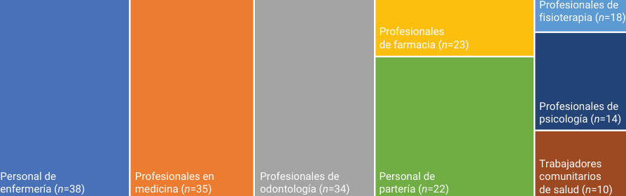

Nota: Número de países de un total de 39 países y territorios posibles. El término “personal de enfermería” refiere a las tres subcategorías de las cuentas nacionales del personal de salud (CNPS): profesionales de enfermería; profesionales de nivel medio de enfermería y enfermeras sin especificación. De manera análoga, el término “personal de partería” incluye las tres subcategorías de las CNPS: profesionales de partería; profesionales de nivel medio de partería y parteras sin especificación.

23 Panorama de la fuerza de trabajo en salud

<!-- PAGE: 40/84 -->

Del total de indicadores prioritarios de RHS para la Región de las Américas detallados en el cuadro 2, se seleccionaron diez de tipo cuantitativo, que fueron agrupados en cuatro categorías:

- Disponibilidad de trabajadores de salud o Densidad de trabajadores o Densidad a nivel subnacional • Distribución de los trabajadores de salud o Distribución según el género o Distribución según la edad o Distribución según la titularidad del establecimiento de salud o Distribución según el tipo de establecimiento • Producción de trabajadores de salud o Graduados con respecto a las reservas de personal • Flujos de trabajadores de salud o Flujo según el lugar de formación o Flujo según el lugar de nacimiento o Flujo de ingreso de trabajadores extranjeros

- Disponibilidad de trabajadores de salud

o Densidad de trabajadores

o Densidad a nivel subnacional

- Distribución de los trabajadores de salud

o Distribución según el género

o Distribución según la edad

o Distribución según la titularidad del establecimiento de salud

o Distribución según el tipo de establecimiento

- Producción de trabajadores de salud

o Graduados con respecto a las reservas de personal

- Flujos de trabajadores de salud

o Flujo según el lugar de formación

o Flujo según el lugar de nacimiento

o Flujo de ingreso de trabajadores extranjeros

## Disponibilidad de trabajadores de salud

La disponibilidad de los RHS es crucial para garantizar el acceso y la calidad de los servicios de salud. Este concepto engloba la presencia y la accesibilidad de personal calificado para la prestación de cuidados y servicios. Este es un factor crítico para el acceso de las personas a los servicios y para lograr resultados favorables.

Las CNPS definen tres categorías principales (77) que pueden variar según el país:

- Trabajadores en ejercicio: son aquellos que prestan servicios de atención directa a los pacientes y comunidades en instalaciones de salud, habiendo recibido la formación correspondiente para ello. • Trabajadores profesionalmente activos: incluye tanto a los que están en atención directa (practicando su profesión) como a aquellos que no prestan servicios directamente, pero cuya formación es un requisito para la ejecución del trabajo (por ejemplo, en educación, investigación o administración pública). • Trabajadores con licencia para ejercer: son aquellos que están registrados y/o matriculados, con autorización para ejercer.

- Trabajadores en ejercicio: son aquellos que prestan servicios de atención directa a los pacientes y comunidades en instalaciones de salud, habiendo recibido la formación correspondiente para ello.

- Trabajadores profesionalmente activos: incluye tanto a los que están en atención directa (practicando su profesión) como a aquellos que no prestan servicios directamente, pero cuya formación es un requisito para la ejecución del trabajo (por ejemplo, en educación, investigación o administración pública).

- Trabajadores con licencia para ejercer: son aquellos que están registrados y/o matriculados, con autorización para ejercer.

Se privilegió la información sobre trabajadores en ejercicio; en su defecto se utilizaron datos sobre trabajadores de salud profesionalmente activos. En caso de no contar con información sobre ninguno de estos dos grupos, se informan los correspondientes a trabajadores de salud con licencia para ejercer (76, 77).

## Densidad de trabajadores de salud

La densidad de profesionales de medicina, personal de enfermería y personal de partería por 10 000 habitantes se presenta utilizando los últimos datos disponibles para cada país para el período comprendido entre el 2017 y el 2021 (figura 4).

De acuerdo con la recomendación de la OMS sobre la densidad del personal de salud, en las ocupaciones de medicina, enfermería y partería, una meta deseable es de 44,5 trabajadores por cada 10 000 habitantes (2).

24 LA FUERZA DE TRABAJO EN SALUD EN LAS AMÉRICAS

<!-- PAGE: 41/84 -->

FIGURA 4. Densidad de trabajadores de salud en comparación con la meta de la Organización Mundial de la Salud (OMS), por subregión y por país, Región de las Américas, período 2017-2021 (tasa por 10 000 habitantes)

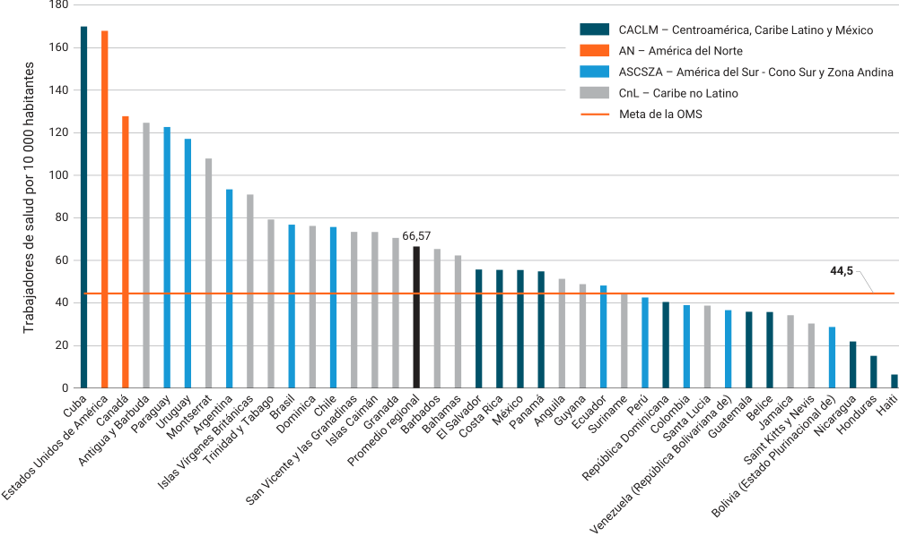

Nota: Islas Caimán, Islas Vírgenes Británicas, Montserrat y San Vicente y las Granadinas solo poseen datos de personal de enfermería; Saint Kitts y Nevis solo tiene datos de profesionales de medicina; Dominica, Bahamas, República Dominicana, Granada, Bolivia (Estado Plurinacional de), Colombia, Costa Rica, Cuba, Ecuador, El Salvador, Guatemala y Nicaragua no tienen datos de personal de partería. El promedio regional corresponde a 39 países y territorios.

a Para más información acerca de esta meta, véase: Organización Mundial de la Salud. Estrategia mundial de recursos humanos para la salud: personal sanitario 2030. Ginebra: OMS; 2016. Disponible en: https://iris.who.int/handle/10665/254600.

En el período estudiado, las densidades oscilan entre 169,97 (Cuba) y 6,38 (Haití), con una media de 66,57 para la Región. La subregión con el promedio más alto es América del Norte con 147,85, mientras que las tasas más bajas corresponden a la subregión que incluye Centroamérica, Caribe Latino y México, con 49,75. Catorce de los 39 países con datos disponibles están por debajo de la meta de 44,5 (35,82%), con densidades que oscilan entre 44,32 (Suriname) y 6,38 (Haití).

Los valores de densidad más altos de profesionales de medicina son los de Cuba (94,29), Uruguay (45,08) y Trinidad y Tabago (41,93), mientras los más bajos son los de Honduras (4,89) y Haití (2,37). La subregión con el promedio de densidad más alto es América del Norte con 30,36 profesionales de medicina y la que tiene el promedio más bajo es el Caribe no Latino con 20,65. Seis de los 39 países y territorios tienen una densidad inferior a la mitad del promedio de la Región (figura 5).

25 Panorama de la fuerza de trabajo en salud

<!-- PAGE: 42/84 -->

FIGURA 5. Densidad de profesionales de medicina, por subregión y por país, Región de las Américas, período 2017-2021 (tasa por 10 000 habitantes)

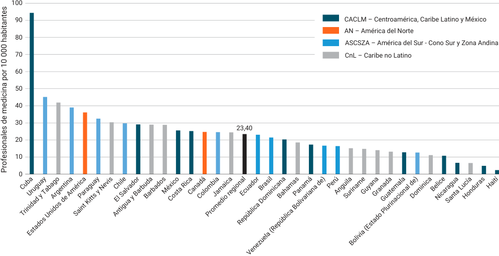

*Nota: El promedio regional incluye datos para 35 de 39 países y territorios. Islas Caimán, Islas Vírgenes Británicas, Montserrat y San Vicente y las Granadinas no disponen de datos de profesionales de medicina para el período analizado.*

Treinta y ocho países y territorios y territorios presentaron datos sobre la densidad del personal de enfermería. Se observan variaciones importantes entre ellos, que van desde 3,84 trabajadores por 10 000 habitantes para Haití y 7,13 para Honduras, hasta 102,70, 107,91 y 131,50 para Canadá, Montserrat y Estados Unidos de América, respectivamente. Nueve registran una densidad inferior a la mitad del promedio de la Región, que es de 44,37 (figura 6).

Si bien las variaciones observadas son producto de las inequidades presentes en la Región, es necesario explorar cómo cada país define y conceptualiza la profesión de “enfermería”. Además, aunque las CNPS definen las distintas categorías de enfermería, los límites de lo que se considera enfermería profesional y enfermería asociada revisten características particulares en algunos países.

La densidad del personal de enfermería considera la suma de las cantidades reportadas por los países para profesionales de enfermería, profesionales de nivel medio de enfermería y profesionales de enfermería sin especificaciones definidas.6 Diez países informaron solo una categoría: profesionales sin especificaciones definidas fue informada por Barbados, Dominica, Guyana, Haití y Santa Lucía, mientras que Anguila, Chile, Colombia, Costa Rica y Perú reportaron profesionales de enfermería.

6 La expresión “profesionales de enfermería sin especificaciones definidas” (del inglés, not further defined) se refiere a aquellos trabajadores para los cuales no fue posible esclarecer una categoría profesional específica (profesional o asociada). Por esta razón, han sido incluidos dentro de esta denominación general.

26 LA FUERZA DE TRABAJO EN SALUD EN LAS AMÉRICAS

<!-- PAGE: 43/84 -->

FIGURA 6. Densidad del personal de enfermería, por subregión y por país, Región de las Américas, período 2017-2021 (tasa por 10 000 habitantes)

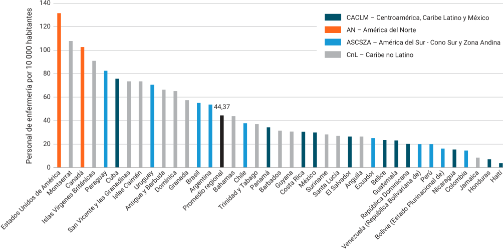

*Nota: El promedio regional se calculó con datos para 38 de los 39 países y territorios posibles. Saint Kitts y Nevis no dispone de datos sobre el personal de enfermería para el período analizado. El término “personal de enfermería” refiere a las tres subcategorías de las cuentas nacionales del personal de salud: profesionales de enfermería; profesionales de nivel medio de enfermería y enfermeras sin especificación.*

La subregión con el promedio de densidad más alto del personal de enfermería es América del Norte con 117,10, mientras que los valores más bajos corresponden a Centroamérica, Caribe Latino y México con 26,32.

La densidad del personal de partería se identificó en 22 de los 39 países y territorios analizados, encontrándose una variación considerable, que oscila entre 29,53 en Antigua y Barbuda, y 0,003 en México. La subregión con el promedio más alto es el Caribe no Latino con 4,17, y la que registra el promedio más bajo es América del Norte con 0,39 (figura 7).

La ocupación de partería, que abarca formaciones de nivel de grado y técnico, puede no existir en algunos países. En estos casos, las funciones relacionadas son asumidas por otra ocupación, como la de enfermería con formación en partería, o ser desempeñadas por parteras sin educación formal - no consideradas en las CNPS.

Se informaron datos sobre profesionales de odontología en 34 de los 39 países y territorios analizados. El mayor valor de densidad se encontró en Cuba (16,71), seguida por Chile (14,81) y Paraguay (12,81), mientras que las densidades más bajas se registraron en Haití (0,22) y Honduras (0,32) (figura 8). La subregión con el promedio de densidad más alto es América del Norte con 6,31, y la que tiene el más bajo es el Caribe no Latino con 1,82.

Los datos sobre profesionales de farmacia están presentes en 23 de los 39 países analizados. La mayor densidad se registró en Costa Rica, seguida por Canadá y Estados Unidos de América, con densidades de 11,56, 10,54 y 10,45, respectivamente. Haití con 0,31 y Guyana con 0,59 presentan los valores más bajos (figura 9). La subregión con el promedio de densidad más alto es América del Norte con 10,50, y el más bajo corresponde al Caribe no Latino con 3,14.

## 27 Panorama de la fuerza de trabajo en salud

Panorama de la fuerza de trabajo en salud

27

<!-- PAGE: 44/84 -->

FIGURA 7. Densidad del personal de partería, por subregión y por país, Región de las Américas, período 2017-2021 (tasa por 10 000 habitantes)

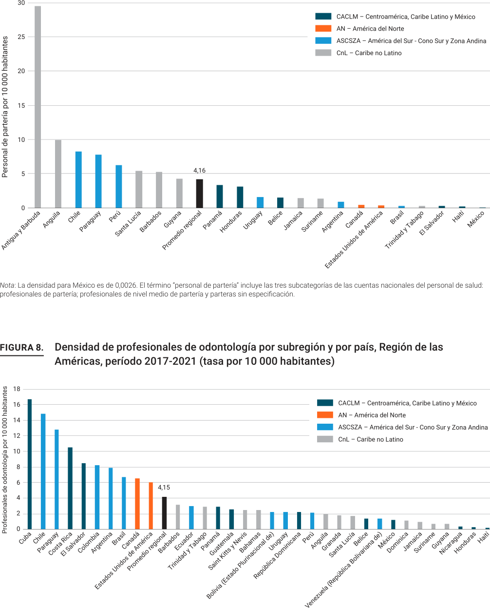

Nota: La densidad para México es de 0,0026. El término “personal de partería” incluye las tres subcategorías de las cuentas nacionales del personal de salud: profesionales de partería; profesionales de nivel medio de partería y parteras sin especificación.

FIGURA 8. Densidad de profesionales de odontología por subregión y por país, Región de las Américas, período 2017-2021 (tasa por 10 000 habitantes)

28 LA FUERZA DE TRABAJO EN SALUD EN LAS AMÉRICAS

<!-- PAGE: 45/84 -->

FIGURA 9. Densidad de profesionales de farmacia, por subregión y por país, Región de las Américas, período 2017-2021 (tasa por 10 000 habitantes)

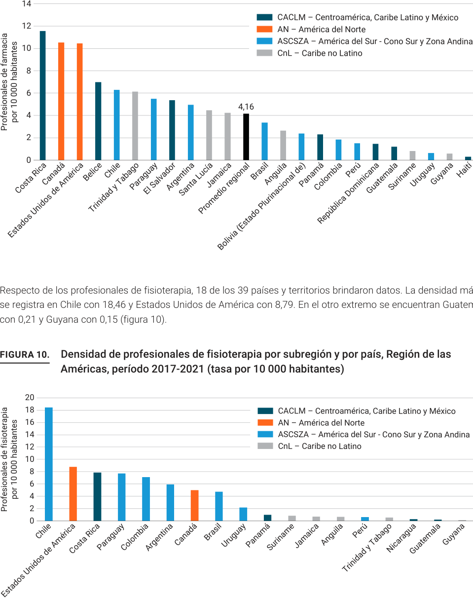

Respecto de los profesionales de fisioterapia, 18 de los 39 países y territorios brindaron datos. La densidad más alta se registra en Chile con 18,46 y Estados Unidos de América con 8,79. En el otro extremo se encuentran Guatemala con 0,21 y Guyana con 0,15 (figura 10).

Respecto de los profesionales de fisioterapia, 18 de los 39 países y territorios brindaron datos. La densidad más alta se registra en Chile con 18,46 y Estados Unidos de América con 8,79. En el otro extremo se encuentran Guatemala con 0,21 y Guyana con 0,15 (figura 10).

FIGURA 10. Densidad de profesionales de fisioterapia por subregión y por país, Región de las Américas, período 2017-2021 (tasa por 10 000 habitantes)

Nota: El promedio regional para profesionales de fisioterapia no se presenta, ya que solo se calcula cuando más de la mitad de los países reportan datos.

29 Panorama de la fuerza de trabajo en salud

<!-- PAGE: 46/84 -->

Los datos sobre profesionales de psicología solo fueron provistos por 14 de los 39 países analizados. La mayor densidad se identificó en Argentina con 17,98, seguida por Costa Rica con 16,85, en tanto las menores cifras pertenecen a Trinidad y Tabago y Suriname con 0,23 e 0,57, respectivamente (figura 11).

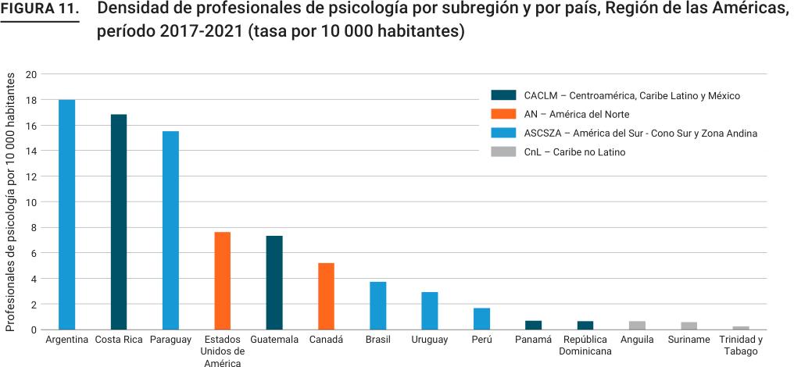

*FIGURA 12. Densidad de trabajadores comunitarios de salud por subregión y por país, Región de las Américas, período 2017-2021 (tasa por 10 000 habitantes)*

Nota: El promedio regional para profesionales de psicologías no se presenta, ya que solo se calcula cuando más de la mitad de los países reportan datos.

Los datos sobre trabajadores comunitarios de salud son escasos. Solo reportaron datos 10 de los 39 países y territorios analizados. La densidad más alta es de Brasil (13,28) y la menor de Guatemala (0,13) (figura 12).

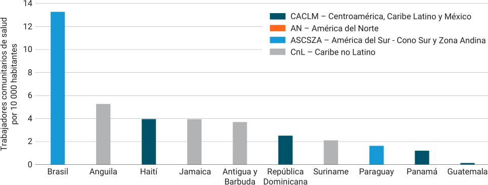

Nota: El promedio regional para trabajadores comunitarios no se presenta, ya que solo se calcula cuando más de la mitad de los países reportan datos.

30 LA FUERZA DE TRABAJO EN SALUD EN LAS AMÉRICAS

<!-- PAGE: 47/84 -->

## Densidad a nivel subnacional

Este apartado presenta información sobre el grado de completitud de los datos informados en relación con la densidad a nivel subnacional, con el objetivo de ofrecer una visión general de la situación. Contar con información de este nivel es importante para valorar las condiciones de equidad en la distribución de estos trabajadores y para desarrollar estrategias que mejoren el acceso a la salud en las distintas regiones dentro de cada país.

Se analizaron datos de densidad a nivel subnacional para profesionales de medicina, personal de enfermería y personal de partería, con información disponible de ocho países (cuadro 5). Sin embargo, solo tres de ellos proporcionaron información sobre las tres ocupaciones.

## CUADRO 5. Densidad a nivel subnacional (profesionales de medicina, y personal de enfermería y de partería), para ocho países de la Región de las Américas, años 2019, 2020 y 2021

| País | Profesionales de medicina | Personal de enfermería | Personal de partería | Año |
| --- | --- | --- | --- | --- |
| Argentina | x | x | x | 2020 |
| Brasil | x | x |  | 2021 |
| Canadá | x | x |  | 2021 |
| Colombia | x | a |  | 2021 |
| Panamá | x | x | x | 2021 |
| Perú | x | a | x | 2021 |
| República Dominicana | x | x |  | 2019 |
| Uruguay | x | x | x | 2021 |

a Colombia y Perú presentaron datos de la categoría de profesionales de enfermería.

Distribución de los trabajadores de salud Distribución según el género A continuación se describe la distribución por género de los profesionales de medicina y el personal de enfermería. Estas dos ocupaciones son las que cuentan con el mayor caudal de información en la Región. En la actualidad, las CNPS solo presentan dos opciones de género: mujeres y hombres.

## Distribución de los trabajadores de salud

## Distribución según el género

A continuación se describe la distribución por género de los profesionales de medicina y el personal de enfermería. Estas dos ocupaciones son las que cuentan con el mayor caudal de información en la Región. En la actualidad, las CNPS solo presentan dos opciones de género: mujeres y hombres.

Se identificaron datos sobre el género de los profesionales de medicina en 18 países y territorios, con un promedio del 48,67% de mujeres y del 51,32% de hombres. En Anguila, Argentina, Costa Rica, República Dominicana, Paraguay y Uruguay, más del 50% de los profesionales de medicina son mujeres (figura 13).

31 Panorama de la fuerza de trabajo en salud

Panorama de la fuerza de trabajo en salud

31

<!-- PAGE: 48/84 -->

FIGURA 13. Distribución de profesionales de medicina según el género, por país, Región de las Américas, período 2017-2021 (porcentaje)

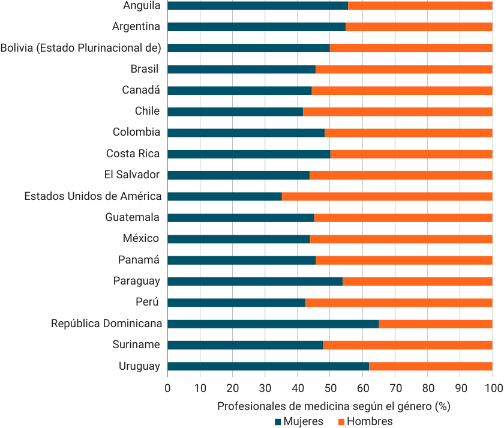

*Treinta y dos países presentaron datos de género del personal de enfermería. En todos los casos se verificó una predominancia femenina, con un promedio del 89,78% de mujeres y del 10,16% de hombres. En 12 países y territorios las mujeres representan más del 90%: Antigua y Barbuda, Bolivia (Estado Plurinacional de), Belice, Canadá, Granada, Guyana, Jamaica, Honduras, República Dominicana, Montserrat, San Vicente y las Granadinas, y Suriname (figura 14).*

## Distribución según la edad

El envejecimiento de la FTS constituye un tema de interés para la planificación de los países, ya que los trabajadores con 55 años o más están próximos a la jubilación, y corresponde anticiparse al recambio generacional generando condiciones de formación apropiadas. El rango de edad con mayor número de profesionales de medicina fue el de 35 a 44 años (figura 15).

Diecisiete países presentaron datos sobre la distribución según la edad de los profesionales de medicina (figura 15).

Al analizar a los trabajadores con 55 años o más y a los menores de 35 años (en el inicio de sus carreras), se observa que en Estados Unidos casi la mitad tiene 55 o más (48,90%), seguido de Guatemala con el 46,80%. En Colombia y Paraguay los profesionales de medicina son más jóvenes. En Anguila no se identificaron datos en ese rango etario. Argentina no brindó información de trabajadores que superan la edad jubilatoria (65 años) (figura 16).

32 LA FUERZA DE TRABAJO EN SALUD EN LAS AMÉRICAS

<!-- PAGE: 49/84 -->

## FIGURA 14. Distribución del personal de enfermería según el género, por país, Región de las Américas, período 2017-2021 (porcentaje)

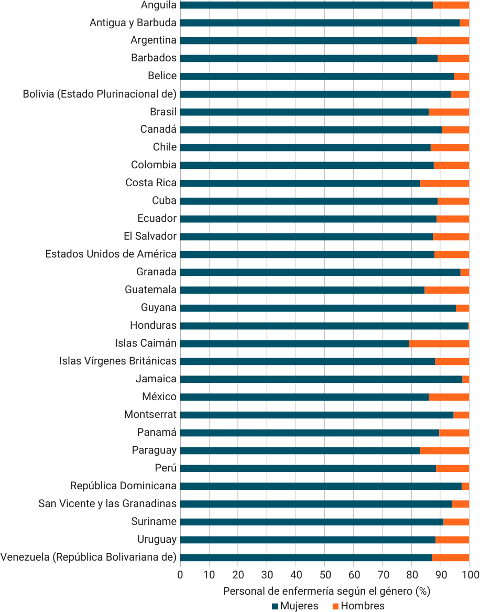

*Nota: El término “personal de enfermería” refiere a las tres subcategorías de las cuentas nacionales del personal de salud: profesionales de enfermería; profesionales de nivel medio de enfermería y enfermeras sin especificación.*

33 Panorama de la fuerza de trabajo en salud

Panorama de la fuerza de trabajo en salud

33

<!-- PAGE: 50/84 -->

## FIGURA 15. Distribución de profesionales de medicina según la edad, por país, Región de las Américas, período 2017-2021 (porcentaje)

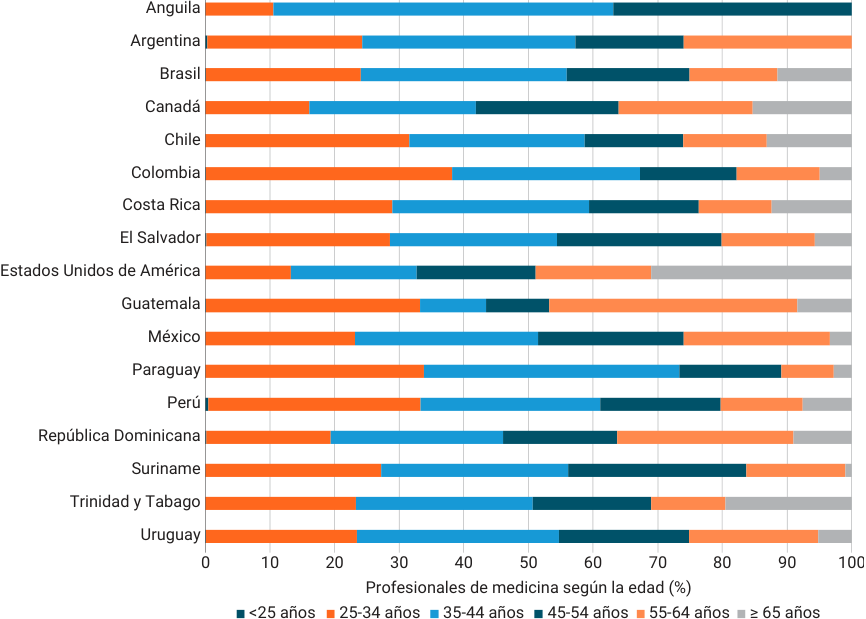

*FIGURA 16. Distribución de profesionales de medicina con 55 años o más, y menores de 35 años, por país, Región de las Américas, período 2017-2021 (porcentaje)*

## Estados Unidos de América

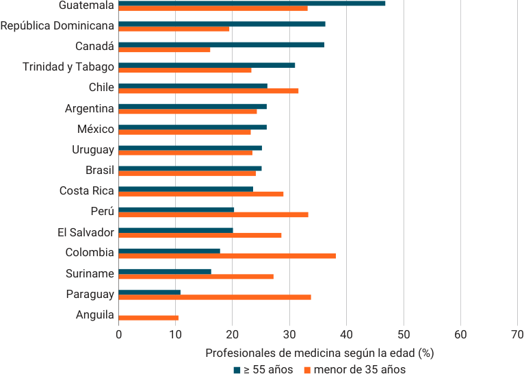

34 LA FUERZA DE TRABAJO EN SALUD EN LAS AMÉRICAS

<!-- PAGE: 51/84 -->

Para el personal de enfermería, solo 32 países y territorios de los 39 informaron datos sobre la distribución por edad. También en este caso, el rango etario más frecuente fue el de 35 a 44 años (figura 17).

FIGURA 17. Distribución del personal de enfermería según la edad, por país, Región de las Américas, período 2017-2021 (porcentaje)

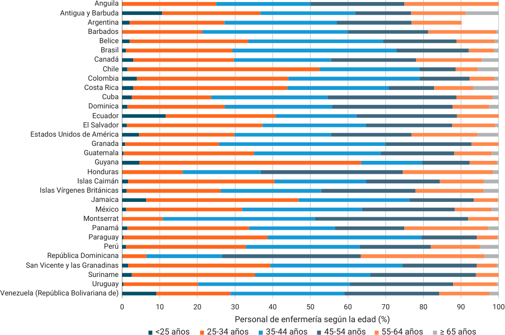

Nota: El término “personal de enfermería” refiere a las tres subcategorías de las cuentas nacionales del personal de salud: profesionales de enfermería; profesionales de nivel medio de enfermería y enfermeras sin especificación.

Los datos del personal de enfermería muestran que República Dominicana y Honduras poseen la mayor proporción de trabajadores con 55 años o más, con el 36,60% y el 25,50% respectivamente, y Guyana cuenta con la mayor cantidad de jóvenes (63,50%) (figura 18).

Para interpretar mejor esta información, sería importante conocer si se trata de trabajadores en ejercicio o simplemente con licencia para ejercer. En el segundo caso, y según las condiciones de actualización para el ejercicio profesional, podrían incluirse trabajadores de edad avanzada que no ejercen, o que hayan migrado a otros países.

Distribución según la titularidad del establecimiento de salud Las categorías correspondientes a la distribución de trabajadores por titularidad del establecimiento de salud incluyen el sector público, el sector privado con fines de lucro y el sector privado sin fines de lucro.

## Distribución según la titularidad del establecimiento de salud

Las categorías correspondientes a la distribución de trabajadores por titularidad del establecimiento de salud incluyen el sector público, el sector privado con fines de lucro y el sector privado sin fines de lucro.

Para el caso de los profesionales de medicina se identificaron datos de ocho países (figura 19). Bolivia (Estado Plurinacional de) y Estados Unidos de América solo presentaron datos del sector público.

35 Panorama de la fuerza de trabajo en salud

<!-- PAGE: 52/84 -->

## FIGURA 18. Distribución del personal de enfermería con 55 años o más, y menores de 35 años, por país, Región de las Américas, período 2017-2021 (porcentaje)

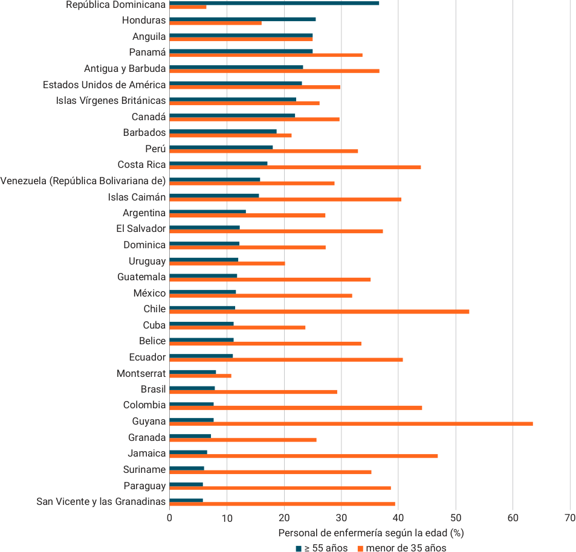

*Nota: El término “personal de enfermería” refiere a las tres subcategorías de las cuentas nacionales del personal de salud: profesionales de enfermería; profesionales de nivel medio de enfermería y enfermeras sin especificación.*

36 LA FUERZA DE TRABAJO EN SALUD EN LAS AMÉRICAS

<!-- PAGE: 53/84 -->

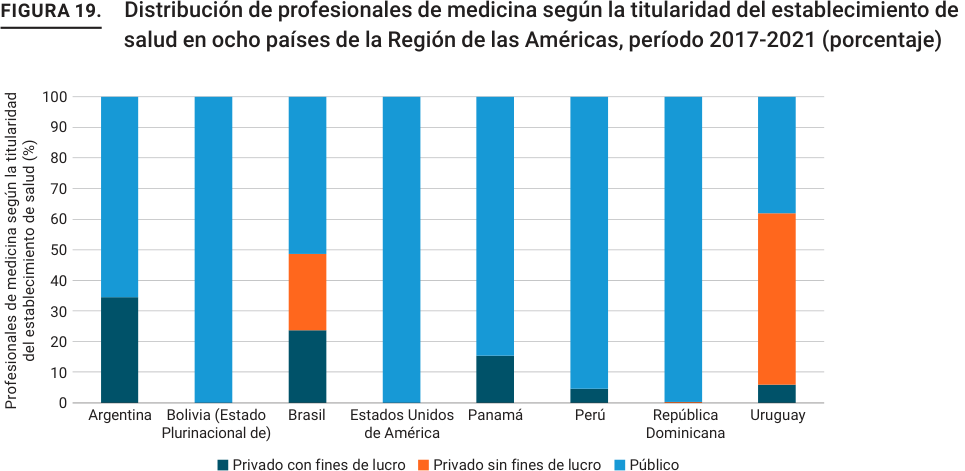

*Nota: El término “personal de enfermería” refiere a las tres subcategorías de las cuentas nacionales del personal de salud: profesionales de enfermería; profesionales de nivel medio de enfermería y enfermeras sin especificación.*

Nota: El porcentaje correspondiente al sector privado sin fines de lucro para República Dominicana es del 0,34%.

En cuanto al personal de enfermería, 27 países y territorios presentaron información sobre la titularidad del establecimiento (figura 20). Barbados solo informó datos del sector privado con fines de lucro, mientras que 9 países y territorios reportaron datos del sector público: Belice, Bolivia (Estado Plurinacional de), Cuba, El Salvador, Granada, Honduras, Montserrat, Trinidad y Tabago, y Venezuela (República Bolivariana de).

FIGURA 20. Distribución del personal de enfermería según la titularidad del establecimiento de salud, por país, período 2017-2021 (porcentaje)

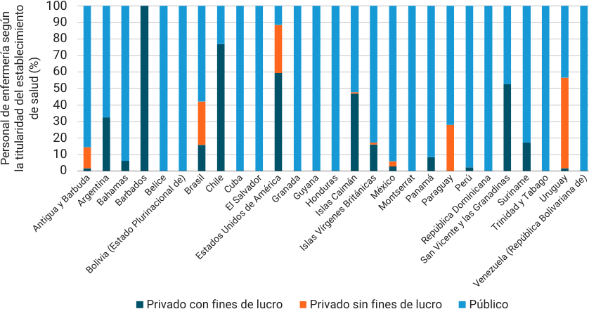

37 Panorama de la fuerza de trabajo en salud

<!-- PAGE: 54/84 -->

Los países enfrentan dificultades para identificar los datos de la titularidad de los establecimientos privados, con y sin fines de lucro, y de otros tipos. En muchos casos la información está fragmentada e incompleta, lo que dificulta obtener una visión integral y precisa de la situación de los RHS en este aspecto, subrayando la necesidad de fortalecer la gobernanza en la recopilación y el reporte de la información.

Es significativa la diferencia entre el reporte de la titularidad de establecimientos de la profesión de medicina y el de enfermería, lo que hace presumir que las fuentes de información no son las mismas. En el caso de enfermería, los datos se obtuvieron del informe Situación de la enfermería en el mundo 2020 (82), que tomó por primera vez datos de las CNPS e impulsó su implementación.

## Distribución según el tipo de establecimiento

Existen diversos tipos de establecimientos en los que los trabajadores de salud pueden desempeñar sus funciones. La clasificación utilizada por las CNPS incluye:

- Hospitales; • Establecimientos residenciales de atención a largo plazo; • Proveedores de atención médica ambulatoria; • Servicios auxiliares; • Minoristas, y • Proveedores de atención preventiva.

- Hospitales;

- Establecimientos residenciales de atención a largo plazo;

- Proveedores de atención médica ambulatoria;

- Servicios auxiliares;

- Minoristas, y

- Proveedores de atención preventiva.

Esta categorización refleja la diversidad y complejidad del sector de salud (77) y requiere una homologación por parte de los países.

Solo cinco países informaron datos relacionados con la distribución por tipo de establecimiento para profesionales de medicina (figura 21). Entre ellos Estados Unidos de América, que solo presentó datos de hospitales.

## FIGURA 21. Distribución de profesionales de medicina según el tipo de establecimiento en cinco países de la Región de las Américas, período 2017-2021 (porcentaje)

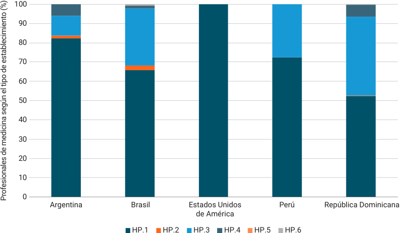

*Nota: HP.1: hospitales; HP.2: establecimientos residenciales de atención a largo plazo; HP.3: proveedores de atención médica ambulatoria; HP.4: servicios auxiliares; HP.5: minoristas; HP.6: proveedores de atención preventiva.*

38 LA FUERZA DE TRABAJO EN SALUD EN LAS AMÉRICAS

<!-- PAGE: 55/84 -->

Respecto del personal de enfermería, 22 de los 39 países presentaron información. Belice y Chile solo brindaron datos del personal que trabaja en hospitales (figura 22).

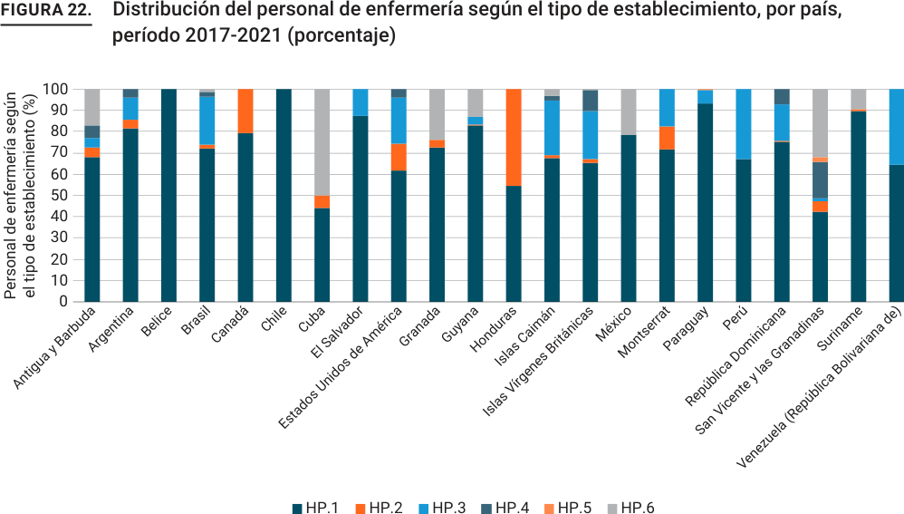

Nota: El término “personal de enfermería” refiere a las tres subcategorías de las cuentas nacionales del personal de salud: profesionales de enfermería; profesionales de nivel medio de enfermería y enfermeras sin especificación.

HP.1: hospitales; HP.2: establecimientos residenciales de atención a largo plazo; HP.3: proveedores de atención médica ambulatoria; HP.4: servicios auxiliares; HP.5: minoristas; HP.6: proveedores de atención preventiva.

Caben aquí similares consideraciones que las formuladas sobre la titularidad de establecimientos respecto de las fuentes de datos y los informes del personal de enfermería.

## Producción de trabajadores de salud

La producción de trabajadores de salud en las Américas tiene implicaciones significativas sobre la planificación de la fuerza laboral y la prestación de servicios de salud. Un número bajo de graduados podría indicar que en los próximos años el país no contará con personal suficiente para reemplazar a quienes se están retirando del mercado laboral debido a la jubilación o la transición a otras áreas.

Durante el período 2020-2021 muchos países de la Región enfrentaron interrupciones en los programas de formación de trabajadores de la salud debido a la pandemia de la COVID-19. Algunos optaron por adelantar la graduación de estudiantes para responder a la demanda urgente, mientras que en otros países los programas de formación y egreso se vieron temporalmente suspendidos, situación que generó variabilidad en la disponibilidad de personal capacitado durante dicho periodo (83).

39 Panorama de la fuerza de trabajo en salud

Panorama de la fuerza de trabajo en salud

39

<!-- PAGE: 56/84 -->

## Graduados con respecto a las reservas de personal

A continuación se presenta la tasa de graduación de profesionales de las cinco ocupaciones consideradas prioritarias, sobre una base poblacional de 100 000 habitantes. Se destaca que la subregión del Caribe no Latino solamente presentó datos sobre graduados en enfermería y partería.

Se analizaron datos de graduados en medicina de 12 de los 39 países y territorios. Se puede observar que la tasa varía entre 33,92 en República Dominicana y 4,32 en Costa Rica (figura 23).

## FIGURA 23. Graduados en medicina por subregión y por país, Región de las Américas, período 2017-2021 (tasa por 100 000 habitantes)

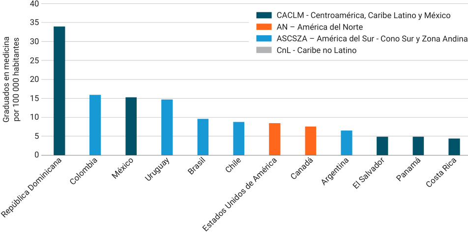

Nota: Ocho países reportaron datos del período de pandemia: Argentina y Uruguay en el 2020, y Canadá, Colombia, Costa Rica, Estados Unidos de América, México y Panamá en el 2021.

Respecto de los graduados en enfermería, se identificaron datos de 22 países y territorios, con tasas que varían entre 110,27 en Estados Unidos de América y 2,14 en Guatemala (figura 24).

Se reportaron datos de graduados en partería en 11 de los 39 países y territorios. La tasa de nuevos graduados varía entre 13,02 en Antigua y Barbuda y 0,02 en Estados Unidos de América (figura 25).

40 LA FUERZA DE TRABAJO EN SALUD EN LAS AMÉRICAS

<!-- PAGE: 57/84 -->

FIGURA 24. Graduados en enfermería por subregión y por país, Región de las Américas, período 2017-2021 (tasa por 100 000 habitantes)

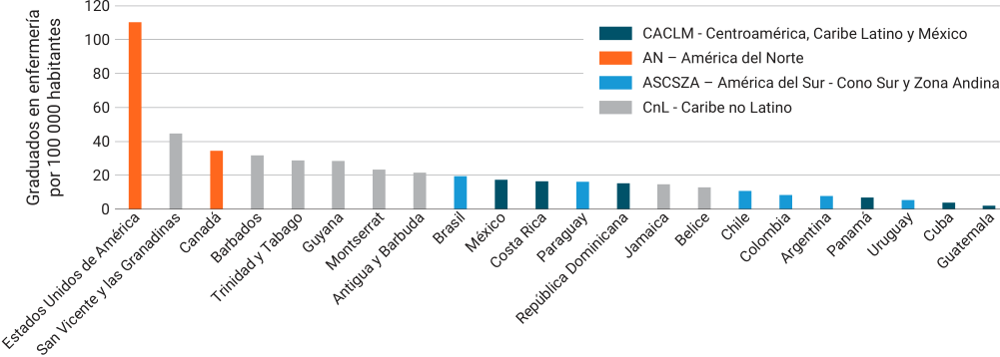

*Nota: Ocho países reportaron datos del período de pandemia: Argentina y Uruguay en el 2020, y Canadá, Colombia, Costa Rica, Estados Unidos de América, México y Panamá en el 2021.*

## FIGURA 25. Graduados en partería por subregión y por país, Región de las Américas, período 2017-2021 (tasa por 100 000 habitantes)

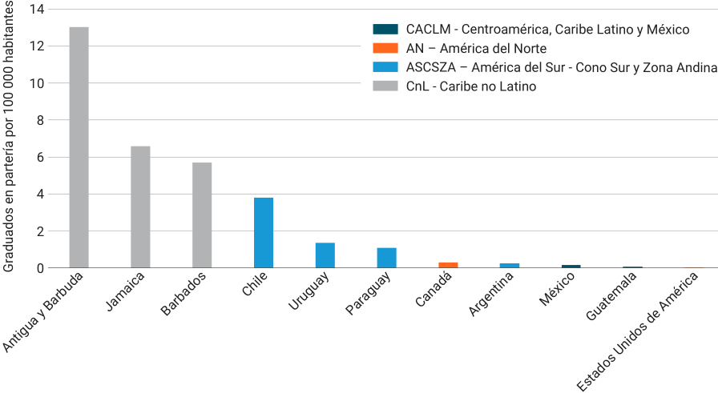

*Nota: Los valores para Guatemala y Estados Unidos de América fueron de 0,08 y 0,02, respectivamente. Cuatro países reportaron datos del período de pandemia: Argentina y Uruguay (2020), y Canadá y Estados Unidos de América (2021).*

41 Panorama de la fuerza de trabajo en salud

Panorama de la fuerza de trabajo en salud

41

<!-- PAGE: 58/84 -->

Debe recordarse lo oportunamente señalado, respecto de la inexistencia de la carrera de partería en algunos de los países de la Región.

Para graduados en odontología se identificaron datos en 10 de los 39 países, con valores que oscilan entre 8,80 en Chile, 8,76 en Brasil y 0,73 en Panamá (figura 26).

## FIGURA 26. Graduados en odontología por subregión y por país, Región de las Américas, período 2017-2021 (tasa por 100 000 habitantes)

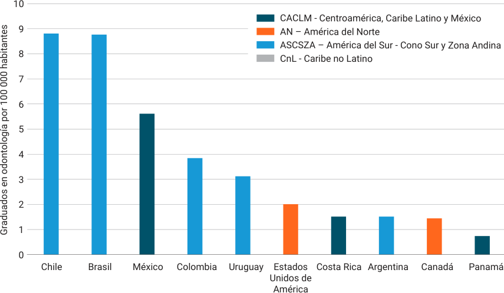

*Nota: Ocho países reportaron datos del período de pandemia: Argentina y Uruguay en el 2020, y Canadá, Colombia, Costa Rica, Estados Unidos de América, México y Panamá en el 2021.*

Los datos de graduados en farmacia se informaron en 10 de los 39 países y territorios. Se puede observar que la tasa varía entre 8,18 en Brasil y 1,08 para Argentina y Colombia (figura 27).

42 LA FUERZA DE TRABAJO EN SALUD EN LAS AMÉRICAS

<!-- PAGE: 59/84 -->

## FIGURA 27. Graduados en farmacia, por subregión y por país, Región de las Américas, período 2017-2021 (tasa por 100 000 habitantes)

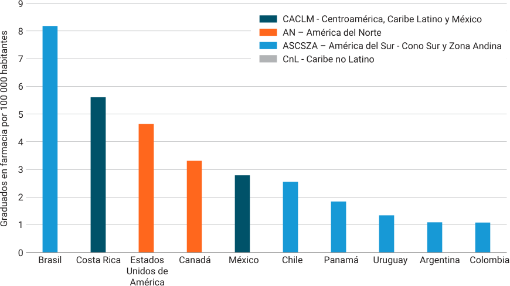

Nota: Ocho países reportaron datos del período de pandemia: Argentina y Uruguay en el 2020, y Canadá, Colombia, Costa Rica, Estados Unidos de América, México y Panamá en el 2021.

Flujos de los trabajadores de salud Flujos según el lugar de formación Los datos relacionados con el lugar de formación de los profesionales de medicina y el personal de enfermería ofrecen un panorama regional de la capacidad formativa, la atracción de estas ocupaciones y las condiciones de trabajo.

## Flujos de los trabajadores de salud

## Flujos según el lugar de formación

Los datos relacionados con el lugar de formación de los profesionales de medicina y el personal de enfermería ofrecen un panorama regional de la capacidad formativa, la atracción de estas ocupaciones y las condiciones de trabajo.

Los flujos de trabajadores de salud pueden afectar significativamente la disponibilidad y distribución de RHS, generando desafíos en la planificación de los países de origen y los de destino. La migración o movilidad pueden provocar escasez de trabajadores en regiones que ya enfrentan dificultades para cubrir sus necesidades de salud, mientras que los países receptores enfrentan el desafío de integrarlos en sus sistemas.

En cuanto al porcentaje de profesionales de medicina formados en el extranjero y en el propio país, se analizaron datos de nueve países. Belice y Santa Lucía destacan con el 100% y el 91,37% de los profesionales formados en el extranjero, respectivamente. En contraste, El Salvador se sitúa en el otro extremo, con un 1,77% (figura 28).

Esta proporción de graduados en el extranjero debe ser analizada en conjunto con la cantidad total de profesionales y las tasas de graduación, para obtener un panorama más completo de la autonomía de formación de los países. Belice y Santa Lucía, por ejemplo, no cuentan con carreras completas para la formación de profesionales de medicina en su territorio, lo que explica su alta dependencia de graduados en el extranjero.

En cuanto a los datos de los profesionales de enfermería, solo 22 países y territorios presentaron información. Se observa que los países del Caribe no Latino tienen un mayor porcentaje de profesionales formados en el extranjero, como Belice, Islas Caimán, Islas Vírgenes Británicas y Montserrat (figura 29).

43 Panorama de la fuerza de trabajo en salud

Panorama de la fuerza de trabajo en salud

43

<!-- PAGE: 60/84 -->

## FIGURA 28. Profesionales de medicina según el lugar de formación, por país, Región de las Américas, período 2017-2021 (porcentaje)

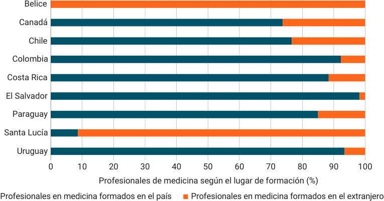

*FIGURA 29. Profesionales de enfermería según el lugar de formación, por país, Región de las Américas, período 2017-2021 (porcentaje)*

Nota: Belice solo informó datos de profesionales de medicina formados en el extranjero.

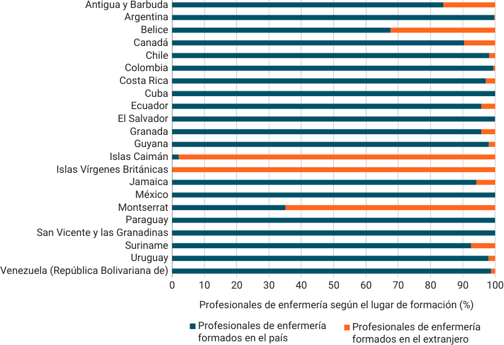

Nota: Islas Vírgenes Británicas solo proporcionó datos de profesionales capacitados en el extranjero; Cuba, San Vicente y las Granadinas, y México, solo informaron sobre profesionales capacitados en el país. Paraguay cuenta con el 99,96% de los profesionales de enfermería capacitados en el país; El Salvador cuenta con el 99,93% de los profesionales capacitados en el país, y Argentina presenta un 99,81% de profesionales capacitados en el país.

44 LA FUERZA DE TRABAJO EN SALUD EN LAS AMÉRICAS

<!-- PAGE: 61/84 -->

## Flujos según el lugar de nacimiento

A partir de las CNPS se analizó la información sobre el lugar de nacimiento de los profesionales de medicina y el personal de enfermería. Se identificaron datos sobre el número de profesionales de medicina nacionales y extranjeros en 6 de los 39 países y territorios evaluados. Entre ellos, los 2 países del Caribe no Latino que brindaron datos (Santa Lucía y Trinidad y Tabago) presentan el mayor porcentaje de profesionales extranjeros en su fuerza de trabajo (figura 30).

## FIGURA 30. Distribución de profesionales de medicina según el lugar de nacimiento, por país, Región de las Américas, período 2017-2021 (porcentaje)

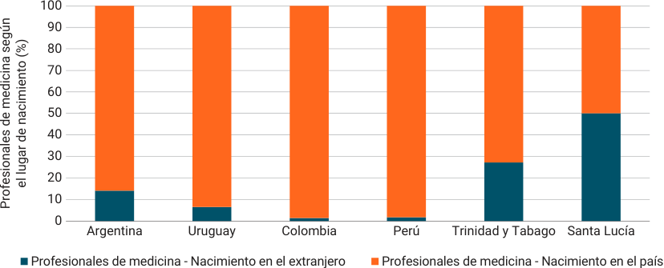

*Región de las Américas, período 2017-2021 (porcentaje)*

Para el personal de enfermería, 24 de los 39 países y territorios presentaron datos. Tres de ellos (Islas Caimán, Islas Vírgenes Británicas y Montserrat) informaron que más de la mitad del personal de enfermería nació en el exterior. En contraste, Ecuador, Guyana, Perú y El Salvador tienen menos del 1% de trabajadores nacidos fuera de su territorio (figura 31).

## FIGURA 31. Distribución del personal de enfermería según el lugar de nacimiento, por país,

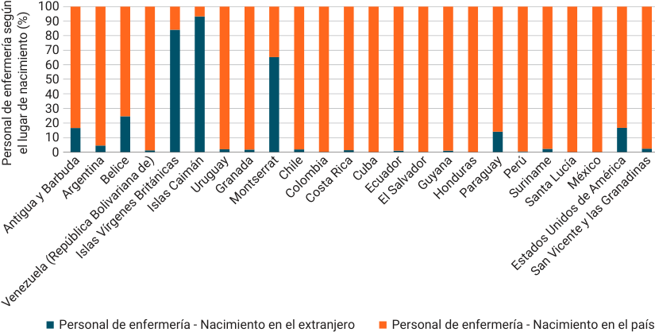

Nota: Cuba, Honduras, México y Santa Lucía presentaran datos de personal de enfermería nacidos en el país. El término “personal de enfermería” refiere a las tres subcategorías de las cuentas nacionales del personal de salud: profesionales de enfermería; profesionales de nivel medio de enfermería y enfermeras sin especificación.

45 Panorama de la fuerza de trabajo en salud

<!-- PAGE: 62/84 -->

## Flujos de trabajadores de reciente ingreso formado en el extranjero

En relación con los flujos de reciente ingreso de profesionales de medicina formados en el extranjero, se obtuvieron datos de solo 4 países: Chile (3,08), Canadá (2,91), Estados Unidos (0,66) y Uruguay (2,91). Para el personal de enfermería, 11 países presentaron datos correspondientes al período 2017-2021. De estos, 7 pertenecen al Caribe no Latino. Existe una alta variación en las tasas de ingreso anual, que va desde 15,55 en las Islas Caimán hasta 0,07 en Chile (figura 32).

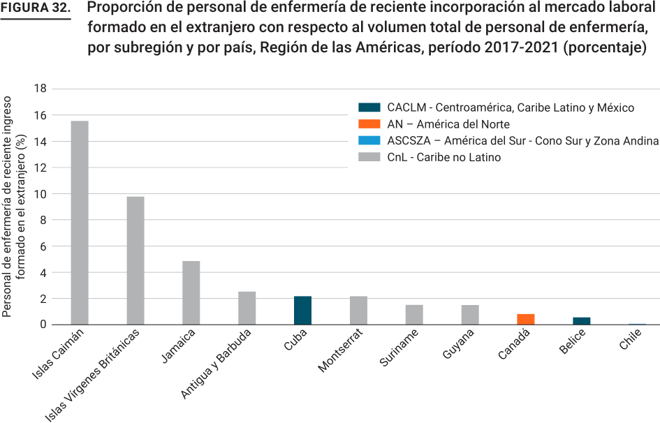

Nota: El término “personal de enfermería” refiere a las tres subcategorías de las cuentas nacionales del personal de salud: profesionales de enfermería; profesionales de nivel medio de enfermería y enfermeras sin especificación.

La información obtenida sobre los trabajadores de salud formados en el extranjero, los nacidos en el extranjero y el flujo anual de entrada, es clave para comprender la dinámica de la FTS y las migraciones, tema que ocupa hoy la atención de la Región. Sin embargo, los datos correspondientes a profesionales de medicina han sido escasamente informados, incluso por los países de la Región que integran la Organización para la Cooperación y el Desarrollo Económicos (OCDE) y tienen el compromiso de presentarlos de forma anual.

Un aspecto relevante es la presencia de trabajadores nativos que se formaron en el extranjero y regresaron a su país para ejercer la ocupación. Este fenómeno puede reflejar varias situaciones, entre ellas, que el país de origen no tiene la suficiente capacidad para formar a sus propios trabajadores, lo que genera una dependencia de la movilidad internacional para suplir esta necesidad.

46 LA FUERZA DE TRABAJO EN SALUD EN LAS AMÉRICAS

<!-- PAGE: 63/84 -->

## CAPÍTULO 4

## Consideraciones finales: escenario regional y reflexiones para la acción

El presente informe, el primero de este tipo para la Región de las Américas, se elaboró con la información disponible en la plataforma de las cuentas nacionales del personal de salud (CNPS). Es el resultado del continuo trabajo colaborativo del equipo de Evidencia e Información de la Unidad de Recursos Humanos para la Salud del Departamento de Sistemas y Servicios de Salud de la Organización Panamericana de la Salud (OPS), y los puntos focales de los países, complementado con los resultados del taller regional sobre sistemas de información de recursos humanos de salud (SIRHS), realizado en Panamá del 11 al 15 de septiembre del 2023.

En los últimos años, se observó un aumento significativo en la disponibilidad de datos relacionados con la fuerza de trabajo en salud (FTS) en los países, reflejando su compromiso con este tema. El lanzamiento de la Política sobre el Personal de Salud 2030: Fortalecimiento de los Recursos Humanos para la Salud a Fin de Lograr Sistemas de Salud Resilientes de la OPS subraya aún más su importancia y promueve políticas que valoren a los trabajadores de salud en toda la Región.

La evolución de los datos y las brechas identificadas, así como las necesidades y acciones de cooperación técnica orientadas a fortalecer el desarrollo de los SIRHS, permiten trazar un escenario regional y establecer lineamientos de trabajo para el desarrollo y fortalecimiento de estos sistemas.

## Panorama de las ocupaciones prioritarias

Tal como señalan diversas publicaciones, la Región presenta un escenario de alta inequidad en términos de acceso a la salud, como reflejan los resultados del análisis de los datos de las CNPS. Esto requiere acciones de cooperación técnica para el desarrollo de estrategias y políticas de formación, atracción, captación, retención y capacitación de trabajadores de salud, con especial énfasis en los países más desfavorecidos.

Aunque la densidad promedio de los profesionales de medicina, y personal de enfermería y de partería de la Región (57, 66) supera la recomendación establecida por la Organización Mundial de la Salud (OMS) de 44,5 trabajadores por cada 100 000 habitantes, más de un tercio de los 39 países y territorios analizados (14) no alcanza este umbral. Seis de ellos, ubicados en Centroamérica, Caribe Latino y México, presentan cifras extremadamente bajas, siendo Haití y Honduras los más afectados. En contraste, Cuba y Estados Unidos casi cuadruplican la tasa recomendada.

Los valores de densidad más altos de las ocupaciones presentadas en este informe corresponden al personal de enfermería. Estados Unidos tiene la mayor tasa, seguido por Montserrat y Canadá, en proporciones similares.

Consideraciones finales: escenario regional y reflexiones para la acción

47

<!-- PAGE: 64/84 -->

Para el caso de los profesionales de medicina, Cuba lidera las tasas de densidad, tanto a nivel regional como global, duplicando la de Uruguay, el segundo país con mayor valor. Por otro lado, Honduras y Haití registran las tasas más bajas para ambas ocupaciones, con cifras de enfermería similares a las de Jamaica.

La ocupación de partería es clave para la iniciativa de Cero Muertes Maternas (84), ya que la atención brindada por trabajadores capacitados durante el embarazo, el parto y el puerperio puede suponer para la mujer y el niño la diferencia entre la vida y la muerte. Sin embargo, muestra un bajo desarrollo a nivel regional y no incide en general en la densidad total de trabajadores de los países, excepto en los del Caribe anglófono, como Antigua y Barbuda, y en algunos países de América del Sur, como Chile. Promover el reconocimiento de la formación y regulación de esta profesión en los distintos países, así como su integración en los equipos de salud de primer nivel, constituye un objetivo de cooperación técnica. Este esfuerzo se lleva a cabo de manera conjunta por la Unidad de Recursos Humanos para la Salud y el Centro Latinoamericano de Perinatología, Salud de la Mujer, y Reproductiva (CLAP/SMR).

Excepto en Brasil y algunos países de Centroamérica y el Caribe no Latino, que incorporaron explícitamente al grupo de trabajadores comunitarios de salud en sus equipos básicos, se dispone de escasa información sobre esta ocupación de interés. Al no estar regulada en la mayoría de los países, los datos disponibles suelen basarse en los registros de contrataciones, que con frecuencia son inconsistentes. Para que estos trabajadores puedan desempeñar su papel de manera efectiva en los equipos de salud de primer nivel, es crucial avanzar en la creación de un marco de formación y regulación que facilite su inserción laboral y registro formal.

Tras la pandemia, los temas de salud mental cobraron mayor visibilidad. Los profesionales de psicología representan un pilar fundamental para el abordaje de los trastornos mentales, que aumentan el riesgo de desarrollar otras enfermedades y contribuyen a lesiones, tanto intencionales como no intencionales.

A pesar de ello, se registran brechas en el acceso a la atención de diversas afecciones de salud mental (85). Es necesario profundizar en el análisis, para averiguar si estas brechas de información sobre esta profesión se deben a la escasez o la ausencia de programas de formación en algunos países, a una limitada orientación de dichos programas hacia la atención de la salud, o incluso a la posible predominancia de estos profesionales en el sector privado. Este diagnóstico será clave para promover las estrategias adecuadas y específicas para cada país.

La ocupación de enfermería es la que cuenta con la mayor cantidad de información disponible. Esto se debe en parte a que los distintos mandatos regionales y globales han promovido monitoreos sobre indicadores de los profesionales de medicina y el personal de enfermería. Además, los informes globales periódicos desempeñan un papel clave en la recolección de estos datos.

En el ámbito de los SIRHS, las ocupaciones incluidas deben reflejar adecuadamente la realidad de los profesionales, comenzando por lograr consensos sobre actividades y responsabilidades específicas de cada profesión en los distintos países. El mapeo de ocupaciones basado en la Clasificación Internacional Uniforme de Ocupaciones 2008 (CIUO-08), de la Organización Internacional del Trabajo (OIT), facilita la elaboración de informes alineados con estándares internacionales y permite realizar comparaciones a nivel global.

De la misma manera se debería proceder con los clasificadores de los establecimientos de salud, donde también se evidencian discrepancias entre los países que reportan datos sobre profesionales de medicina y personal de enfermería en los diferentes tipos de establecimientos.

48 LA FUERZA DE TRABAJO EN SALUD EN LAS AMÉRICAS

<!-- PAGE: 65/84 -->

## ¿Quiénes son y dónde están los profesionales de medicina y el personal de enfermería?

En relación con las características demográficas de los profesionales de medicina y el personal de enfermería, puede observarse una mayoría de mujeres en la ocupación de enfermería, tanto en la media regional como en la totalidad de los países. En contraste, los datos presentados sobre la profesión de medicina muestran un promedio regional del 51,32% a favor del sexo masculino. Sin embargo, un tercio de los países informados supera el 50% de mujeres, en sintonía con el proceso de feminización creciente de esta profesión, descripto a nivel global (82). Este fenómeno requiere un análisis continuo, así como mayor evidencia y acciones sobre las condiciones de trabajo y empleo, para favorecer la incorporación y retención de las mujeres, y evitar que se profundicen brechas en la disponibilidad de la FTS.

La información sobre los grupos etarios varía, pero el rango de edad más común se encuentra entre los 35 y 44 años, lo que indica que se trata de una población relativamente joven. Es importante que cada país trabaje en su tasa de reemplazo para asegurar la sostenibilidad de su FTS. En el caso del personal de enfermería, en la mayoría de los países el grupo de menores de 35 años supera al de mayores de 55. Sin embargo, en el grupo de profesionales de medicina, la situación es diferente: en países como Canadá y Estados Unidos, la población mayor de 55 años supera en un 20% al 30% a la de menores de 35, lo que deberá ser considerado en sus estrategias de planificación para garantizar su reemplazo.

Las CNPS ofrecen una valiosa herramienta para analizar la densidad de los trabajadores de salud a nivel subnacional, así como la distribución por titularidad y por tipo de establecimiento, lo que permitiría profundizar sobre la situación de acceso a la salud en cada uno de los países. El número de países que informaron estos datos todavía es bajo; solo 8 disponen de información a nivel subnacional.

Los datos sobre la distribución de trabajadores por la titularidad de los establecimientos muestran diferencias notables: mientras solo 8 países reportan información sobre los profesionales de medicina, 27 lo hacen sobre el personal de enfermería. Esto posiblemente se deba a los esfuerzos previamente mencionados para mejorar el reporte de datos de la ocupación de enfermería, y al hecho de que, en países con sistemas de salud mixtos, los datos informados pertenecen principalmente al sector público.

En cuanto a la distribución de trabajadores por tipo de establecimiento, se visualiza una presencia mayoritaria de profesionales de medicina y personal de enfermería en hospitales, con proporciones que varían entre más del 50% y el 100%. Una excepción a esta tendencia se observa en el personal de enfermería, donde San Vicente y las Granadinas reportan un 42,34% y Cuba un 44,26% del personal en hospitales. Las categorías de establecimientos de atención ambulatoria y proveedores de atención preventiva incluyen en sus definiciones a los centros del primer nivel de atención. En este sentido, para enfermería, Cuba y San Vicente y las Granadinas cuentan con el 50,09% y el 31,99% del personal en establecimientos de atención preventiva respectivamente, mientras Venezuela (República Bolivariana de) y Perú informan proporciones entre el 35,64% y el 32,71% en los de atención ambulatoria. Estos últimos datos indicarían una estructura de servicios del primer nivel con mayor presencia en esos países.

Formación y migraciones Los datos sobre el número de graduados y la formación profesional integran el grupo de indicadores esenciales sobre los RHS, ya que esta información es indispensable para planificar las tasas de reemplazo.

## Formación y migraciones

Los datos sobre el número de graduados y la formación profesional integran el grupo de indicadores esenciales sobre los RHS, ya que esta información es indispensable para planificar las tasas de reemplazo.

Consideraciones finales: escenario regional y reflexiones para la acción

49

<!-- PAGE: 66/84 -->

Enfermería es la carrera sobre la que han informado mayor número de países (22). En cuanto a las demás profesiones, menos de un tercio de los países han reportado datos. En la subregión del Caribe no Latino, solo se presentaron datos sobre graduados en enfermería y partería.

Durante la pandemia de la COVID-19, muchas instituciones de educación superior adelantaron la graduación de estudiantes de carreras de salud para responder a la urgente necesidad de personal en la primera línea de combate contra el virus. Sin embargo, la sobrecarga de trabajo, el riesgo constante de contagio y el agotamiento físico y emocional, llevaron a numerosos trabajadores a abandonar sus ocupaciones, una situación que obliga a pensar en la importancia de mejorar sus condiciones laborales y brindar el apoyo emocional adecuado.

La migración de trabajadores de salud es otro tema de interés que afecta la dinámica y la distribución de la FTS. Tanto en los datos sobre lugar de formación, como en los de nacimiento, se observó que la mayoría de la información reportada corresponde al personal de enfermería. La subregión del Caribe no Latino fue la que presentó más trabajadores nacidos y formados en el extranjero.

Las CNPS pueden ser una herramienta importante para el análisis de información sobre tendencias migratorias, en la medida que se incremente el reporte de los indicadores específicos. Aunque algunos países de la Región son miembros de la OCDE e informan anualmente los indicadores de lugar de formación y flujo anual de trabajadores extranjeros, estos datos no siempre se incluyen en las CNPS, lo que subraya la necesidad de fortalecer las buenas prácticas.

## Acerca del fortalecimiento de la gobernanza de los sistemas de información de recursos humanos para la salud

La escasez de información sobre distribución y formación de trabajadores de salud pone en evidencia que la gobernanza de los sistemas de información es el mayor desafío en la Región. Los datos sobre los RHS muestran solidez cuando provienen de registros o bases de datos bajo la responsabilidad primaria de los Ministerios de Salud. Sin embargo, su confiabilidad disminuye cuando dependen de la interacción con otras carteras de gobierno, el sector privado e incluso los niveles subnacionales.

La importancia del trabajo intersectorial, en el que gestores y políticos de diversos sectores colaboren, se destaca como un aspecto crítico que los países deben evaluar. Es fundamental realizar un mapeo de actores que permita a cada país identificar las distintas fuentes de información relacionadas con los RHS, y promueva los acuerdos y regulaciones necesarios para garantizar su interoperabilidad. Además, es esencial contar con un registro preciso de los metadatos que permita monitorear la congruencia de las fuentes en los distintos períodos, y valorar indicadores clave, como el nivel de actividad.

Para garantizar una buena gobernanza, sobre todo en el proceso de recolección, gestión y análisis de la información, es indispensable contar con el liderazgo político de los Ministerios de Salud, respaldado por equipos preparados y sostenibles que preserven la historia y continuidad de los procesos. En los últimos tres años, un seguimiento cercano de la carga de datos permitió observar una alta rotación de puntos focales de las CNPS en los distintos países, así como la falta de equipos técnicos capacitados para asegurar la continuidad en la recolección, gestión y análisis de la información sobre RHS. Esta situación compromete la sostenibilidad de los esfuerzos para consolidar datos confiables, y afecta la capacidad de los sistemas de salud para formular políticas informadas y tomar decisiones estratégicas en RHS.

50 LA FUERZA DE TRABAJO EN SALUD EN LAS AMÉRICAS

<!-- PAGE: 67/84 -->

Una vez recolectados los datos, el desafío radica en analizarlos en función de las demandas y necesidades de salud de la población. Las CNPS proveen una diversidad de indicadores para monitorear el mercado laboral de la salud. Cada país podrá determinar cuáles son más adecuados para un seguimiento sistemático de los flujos de trabajadores, considerando sus posibilidades y prioridades. Los acuerdos regionales sobre los indicadores presentados en este informe, también ofrecen una base sólida para esta priorización.

## La cooperación técnica regional

Este informe, precursor en la presentación de datos de las CNPS en la Región de las Américas, ofrece un punto de referencia para futuras investigaciones y políticas sobre los RHS. Al presentar indicadores prioritarios y destacar algunos de los desafíos identificados, establece un marco para comprender la situación actual y propiciar el uso de datos de RHS y el desarrollo de SIRHS en los países.

La cooperación técnica de la OPS ha desempeñado un papel fundamental en este proceso, apoyando a los países en la construcción de hojas de ruta hacia SIRHS robustos. Desde el nivel regional, ha contribuido con la elaboración de lineamientos y herramientas que ofrecen metodologías y recursos prácticos para fortalecer los SIRHS, como el mapeo de actores y ocupaciones, la evaluación de la madurez de los SIRHS y la implementación de las CNPS. Esto incluye la creación de videos tutoriales en los idiomas oficiales de la Región, para capacitar a los puntos focales de las CNPS, así como seminarios web para desarrollar temas específicos, como los informes regionales y globales.

A nivel nacional, la cooperación facilita espacios de diálogo y el desarrollo de capacidades técnicas, en la búsqueda de las mejores opciones para que cada SIRHS responda a las necesidades locales.

En conjunto, la OPS y los países promueven y valoran el intercambio de buenas prácticas y la identificación de estrategias comunes orientadas hacia el desarrollo de políticas de RHS fundadas en datos precisos y evidencia sólida. Informes como éste serán fundamentales para el monitoreo y evaluación de los escenarios regionales y locales, sentando las bases para decisiones estratégicas informadas.

Consideraciones finales: escenario regional y reflexiones para la acción

51

<!-- PAGE: 68/84 -->

## Referencias

1. Organización Panamericana de la Salud. Salud en las Américas 2022 - Panorama de la Región de las Américas en el contexto de la pandemia de COVID-19. Washington, D.C.: OPS; 2022. Disponible en: https://iris.paho.org/handle/10665.2/56471.

2. Organización Mundial de la Salud. Global Strategy on Human Resources for Health: Workforce 2030. Ginebra: OMS; 2016. Disponible en: https://iris.who.int/bitstream/handle/10665/250368/9789241511131-eng.pdf.

3. Organización Panamericana de la Salud. Política sobre el personal de salud 2030: fortalecimiento de los recursos humanos para la salud a fin de lograr sistemas de salud resilientes. 60o Consejo Directivo; 75a sesión del Comité Regional de la OMS para las Américas. Washington, D.C.; 25 al 29 de septiembre del 2023. Washington, D.C.: OPS; 2023. Disponible en: https://www.paho.org/ es/documentos/cd606-politica-sobre-personal-salud-2030-fortalecimiento-recursos-humanos-para-salud-fin.

4. Cavalcante de Oliveira AP, Galante ML, Maia LS, Craveiro I, da Silva AP, Fronteira I, et al. Implementation of policy and management interventions to improve health and care workforce capacity to address the COVID-19 pandemic response: a systematic review. Hum Resour Health. 2023;21(1):80. Disponible en: https://doi.org/10.1186/s12960-023-00856-y.

5. Organización Panamericana de la Salud. Strengthening Human Resources for Health (HRH) to respond to COVID-19 and other emerging pandemics in the Caribbean. Washington, D.C.: OPS; 2021. Disponible en: https://www.paho.org/en/documents/policy- brief-strengthening-human-resources-health-hrh-respond-covid-19-and-other-emerging.

6. Organización Panamericana de la Salud. Impact of COVID-19 on Human Resources for Health and Policy Response: the Case of Belize, Grenada, and Jamaica. Washington, D.C.: OPS; 2022. Disponible en: https://iris.paho.org/handle/10665.2/56262.

7. GBD 2019 Human Resources for Health, Haakenstad A, Irvine CMS, Knight M, Bintz C, Aravkin AY, et al. Measuring the availability of human resources for health and its relationship to universal health coverage for 204 countries and territories from 1990 to 2019: a systematic analysis for the Global Burden of Disease Study 2019. Lancet. 2022;399(10341):2129–2154. Disponible en: https://doi.org/10.1016/S0140-6736(22)00532-3.

8. Organización Panamericana de la Salud. Estrategia de recursos humanos para el acceso universal a la salud y la cobertura universal de salud. 29ª Conferencia Sanitaria Panamericana, 69a sesión del Comité Regional de la OMS para las Américas. Washington, D.C.; 25 al 29 de septiembre del 2017. Washington, D.C.: OPS; 2017. Disponible en: https://iris.paho.org/bitstream/ handle/10665.2/34964/CSP29-10-s.pdf.

9. Dal Poz MR, Gupta N, Quain E, Soucat ALB, Organización Mundial de la Salud, Banco Mundial, et al. Handbook on monitoring and evaluation of human resources for health: with special applications for low- and middle-income countries. Ginebra: OMS; 2009. Disponible en: https://iris.who.int/handle/10665/44097.

10. Organización Mundial de la Salud. Developing health management information systems: a practical guide for developing countries. Ginebra: OMS; 2004. Disponible en: https://iris.who.int/bitstream/handle/10665/207050/9290611650_eng.pdf;sequence=1.

11. Organización Panamericana de la Salud. Introducción a la interoperabilidad semántica. Washington, D.C.: OPS; 2021. Disponible en: https://iris.paho.org/handle/10665.2/54797.

12. Waters KP, Zuber A, Simbini T, Bangani Z, Krishnamurthy RS. Zimbabwe’s Human Resources for health Information System (ZHRIS)—an assessment in the context of establishing a global standard. Int J Med Inform. 2017;100:121–128. Disponible en: https://doi.org/10.1016/j.ijmedinf.2017.01.011.

13. Riley PL, Zuber A, Vindigni SM, Gupta N, Verani AR, Sunderland NL, et al. Information systems on human resources for health: a global review. Hum Resour Health. 2012;10:7. Disponible en: https://doi.org/10.1186/1478-4491-10-7.

14. Benito GAV, Licheski AP. Sistemas de Informação apoiando a gestão do trabalho em saúde. Rev Bras Enferm. 2009;62(3):447– 450. Disponible en: https://www.scielo.br/j/reben/a/CVrVqCsxdkmJmDpSZpbkCDh/abstract/?lang=pt.

52 LA FUERZA DE TRABAJO EN SALUD EN LAS AMÉRICAS

<!-- PAGE: 69/84 -->

15. Caffrey M, Tancred T, Falkenbach M, Raven J. What can intersectoral governance do to strengthen the health and care workforce? Structures and mechanisms to improve the education, employment and retention of health and care workers. Bruselas: European Observatory on Health Systems and Policies; 2023. Disponible en: https://eurohealthobservatory.who.int/publications/i/ what-can-intersectoral-governance-do-to-strengthen-the-health-and-care-workforce-structures-and-mechanisms-to-improve- the-education-employment-and-retention-of-health-and-care-workers.

16. Tursunbayeva A, Bunduchi R, Franco M, Pagliari C. Human resource information systems in health care: a systematic evidence review. J Am Med Informatics Assoc. 2017;24(3):633–654. Disponible en: https://doi.org/10.1093/jamia/ocw141.

17. Pereira GMC, Oliveira ID de, Silva RD da, Hékis HR, Valentim RA de M. Sistemas de informação como apoio à gestão de Recursos Humanos em Saúde. Rev Bras Inovação Tecnol Saúde. 2015;5(4):21-41. Disponible en: https://periodicos.ufrn.br/reb/article/ download/8196/6232/0.

18. Siyam A, Diallo K, Lopes S, Campbell J. Data to Monitor and Manage the Health Workforce. En: Macfarlane SB, AbouZahr C (eds). The Palgrave Handbook of Global Health Data Methods for Policy and Practice. Londres: Palgrave Macmillan; 2019. Disponible en: https://doi.org/10.1057/978-1-137-54984-6_12.

19. Organización Panamericana de la Salud. Plan de acción para el fortalecimiento de los sistemas de información para la salud 2019-2023. 57o Consejo Directivo, 71a sesión del Comité Regional de la OMS para las Américas. Washington, D.C.; 30 de septiembre al 4 de octubre del 2019. Washington, D.C.: OPS; 2019. Disponible en: https://iris.paho.org/bitstream/ handle/10665.2/59459/CD57-9-Rev1_spa.pdf?sequence=1&isAllowed=y.

20. Naser A (coord.). Gobernanza digital e interoperabilidad gubernamental: una guía para su implementación. Santiago: CEPAL; 2021. Disponible en: https://repositorio.cepal.org/server/api/core/bitstreams/6a12e389-3dcb-4cba-830a-99f038835423/content.

21. Coelho Neto GC, Chioro A. Afinal, quantos Sistemas de Informação em Saúde de base nacional existem no Brasil? Cad Saúde Pública. 2021;37(7):e00182119. Disponible en: https://doi.org/10.1590/0102-311X00182119.

22. Diallo K, Zurn P, Gupta N, Dal Poz M. Monitoring and evaluation of human resources for health: an international perspective. Hum Resour Health. 2003;1(1):3. Disponible en: https://doi.org/10.1186/1478-4491-1-3.

23. Wakibi S. Data Quality Considerations in Human Resources Information Systems (HRIS) Strengthening. Chapel Hill, NC: The Capacity Project; 2008. Disponible en: https://www.capacityplus.org/files/resources/projectTechBrief_10.pdf.

24. De Vries DH, Settle D, Mcquide PA. The Impact of Human Resources Information Systems (HRIS) Strengthening. Chapel Hill, NC: The Capacity Project; 2009. Disponible en: https://www.intrahealth.org/sites/default/files/attachment-files/legacyseries_6.pdf.

25. Velasco Abad MV, Carrera Herrera G. Análisis comparado de los sistemas de información de profesionales de la salud en los países de Centroamérica. Atarfe, Granada: Entorno Gráfico; 2015. Disponible en: https://www.observatoriorh.org/sites/default/ files/webfiles/fulltext/2015/sis_inform_ca_mpdc.pdf.

26. Ministerio de Salud de la Nación. Dirección Nacional de Capital Humano y Salud Ocupacional. La construcción de la Matriz Mínima de Datos de profesionales de la salud del MERCOSUR desde sus inicios hasta el 2014 en Argentina, Brasil y Uruguay. Ciudad Autónoma de Buenos Aires: Ministerio de Salud de la Nación, Dirección Nacional de Capital Humano y Salud Ocupacional; 2015. Disponible en: https://www.observatoriorh.org/sites/default/files/webfiles/fulltext/2016/mmm_prof_salud_mercosur.pdf.

27. Organización para la Cooperación y el Desarrollo Económico. Health at a Glance 2023: OECD Indicators. París: OECD Publishing; 2023. Disponible en: https://www.oecd.org/en/publications/health-at-a-glance-2023_7a7afb35-en/full-report.html.

28. Organización Panamericana de la Salud. Cuentas Nacionales del Personal de Salud [Internet]. Washington, D.C.: OPS; 2024 [consultado el 15 de julio del 2024]. Disponible en: https://www.paho.org/es/temas/evidencia-e-informacion-recursos-humanos- para-salud/cuentas-nacionales-personal-salud.

29. Boniol M, Kunjumen T, Nair TS, Siyam A, Campbell J, Diallo K. The global health workforce stock and distribution in 2020 and 2030: a threat to equity and ‘universal’ health coverage? BMJ Glob Heal. 2022;7(6):e009316. Disponible en: https://gh.bmj.com/ content/7/6/e009316.

30. Bustamante Izquierdo JP, Puertas EB, Hernández Hernández D, Sepúlveda H. COVID-19 and human resources for health: analysis of planning, policy responses and actions in Latin American and Caribbean countries. Hum Resour Health. 2023;21(1):21. Disponible en: https://www.researchgate.net/publication/369234318_COVID-19_and_human_resources_for_health_analysis_of_ planning_policy_responses_and_actions_in_Latin_American_and_Caribbean_countries.

53 Referencias

<!-- PAGE: 70/84 -->

31. Chibuzor M, Arikpo I, Aquaisua E, Esu E, Okoroafor SC, Omar S, et al. Implementation of health workforce information systems: a review of eight sub-Saharan country experiences. J Public Health (Oxf). 2021;43(Suppl 1):i27–i40. Disponible en: https://pubmed. ncbi.nlm.nih.gov/33856471/.

32. McQuide PA, Brown AN, Diallo K, Siyam A. Correction: The transition of human resources for health information systems from the MDGs into the SDGs and the post-pandemic era: reviewing the evidence from 2000 to 2022. Hum Resour Health. 2024;22(1):7. Disponible en: https://pubmed.ncbi.nlm.nih.gov/38041066/.

33. Banco Mundial. The role of Belize´s primary health care system in pandemic preparedness and response: a qualitative study. Washington, D.C.: BM; 2023. Disponible en: https://documentos.bancomundial.org/es/publication/documents-reports/documen tdetail/099121523193711443/p1598650d8288b06e0a29d08d012253bcfb.

34. Statistical Institute of Belize. Mid year estimates by age group and sex 2011-2024. Belmopan: SIB; 2024. Disponible en: https:// sib.org.bz/statistics/population/.

35. Organización Panamericana de la Salud. Belice: Country Cooperation Strategy 2023-2027. Washington, D.C.: OPS; 2023. Disponible en: https://www.paho.org/en/documents/belize-country-cooperation-strategy-2023-2027.

36. Organización Mundial de la Salud. Health Systems Challenges: Workforce and Medicines. SIDS Summit for Health: For a healthy and resilient future in Small Island Developing States. Ginebra: OMS; 2021. Disponible en: https://cdn.who.int/media/docs/ default-source/sids-summit/sids-health-systems-policy-brief.pdf?sfvrsn=b57828e8_5.

37. Ministerio de Salud y Bienestar de Belice, Organización Panamericana de la Salud. Belize Health Sector Strategic Plan 2014-2024. Belmopán: Ministerio de Salud y Bienestar; 2014. Disponible en: https://extranet.who.int/countryplanningcycles/sites/default/ files/planning_cycle_repository/belize/blz._health_sector_strategic_plan_2014-2024.pdf.

38. Organización Panamericana de la Salud. Belize takes a significant step towards ensuring universal health access by removing all fees in public hospitals [Internet]. Washington, D.C.: OPS; 2023 [consultado el 30 de noviembre del 2024]. Disponible en: https:// www.paho.org/pt/node/93636.

39. Almeida PF de, Oliveira SC de, Giovanella L. Integração de rede e coordenação do cuidado: o caso do sistema de saúde do Chile. Ciênc Saúde Colet. 2018;23(7):2213–2228. Disponible en: https://doi.org/10.1590/1413-81232018237.09622018.

40. Goldstein E, Castro Paredes L. El recurso humano en el sector de la Salud en Chile. Chile: Biblioteca del Congreso Nacional de Chile; 2021. Disponible en: https://obtienearchivo.bcn.cl/obtienearchivo?id=repositorio/10221/32110/2/BCN_Aproximacion_al_ recurso_humano_en_Salud_EG_Final_2.pdf.

41. Ministerio de Desarrollo Social y Familia, Subsecretaría de Evaluación Social, División de Observatorio Social. Acceso a Salud en la Población chilena. Encuesta CASEN 2022. Chile: Ministerio de Desarrollo Social y Familia; 2024. Disponible en: https:// observatorio.ministeriodesarrollosocial.gob.cl/storage/docs/casen/2022/Resultados_Salud_Casen2022.pdf.

42. Orellana CIP. Programa de médicos en etapa de destinación y formación EDF-ex médico general de zona: una alternativa para mejorar la estrategia de retención del plan de formación de especialistas. Santiago de Chile: Universidad de Chile; 2022.

43. Guillou M, Carabantes J, Bustos V. Los recursos humanos en salud: planificación de los médicos especialistas. Medwave. 2010;10(8). Disponible en: http://doi.org/10.5867/medwave.2010.08.4741.

44. Villarroel González SR. Planificación de recursos humanos de la salud en Chile: breve tránsito histórico de sus políticas públicas. Medwave. 2016;16(10):e66011. Disponible en: https://www.medwave.cl/revisiones/analisis/6611.html.

45. Guillou M, Carabantes CJ, Bustos FV. Disponibilidad de médicos y especialistas en Chile. Rev Med Chile. 2011;139(5):559–570. Disponible en: http://dx.doi.org/10.4067/S0034-98872011000500001.

46. Gobierno de Chile, Banco Mundial. Estudio de brechas de oferta y demanda de médicos especialistas en Chile. Washington, D.C.: Banco Mundial; 2009. Disponible en: https://documentos.bancomundial.org/es/publication/documents-reports/documentdeta il/824501468010509985/chile-estudio-de-brechas-de-oferta-y-demanda-de-medicos-especialistas-en-chile.

47. Gobierno de Chile, Ministerio de Salud, Subsecretaría de Redes Asistenciales, División de Gestión y Desarrollo de las Personas, Departamento de Planificación de RHS y Gestión de la Dotación de Personal en el Sistema Nacional de Servicios de Salud - Oferta y Brecha del Personal de Salud. Informe Anual Glosa N.° 01 Letra d - Ley de Presupuesto N.° 21 516. Junio del 2023. Santiago; 2023. Disponible en: https://www.dipres.gob.cl/597/articles-299417_doc_pdf.pdf.

54 LA FUERZA DE TRABAJO EN SALUD EN LAS AMÉRICAS

<!-- PAGE: 71/84 -->

48. Gobierno de Chile, Ministerio de Salud, Subsecretaría de Redes Asistenciales, División de Gestión y Desarrollo de las Personas, Departamento de Planificación de RHS y Gestión de la Información. Dotación de Personal en el Sistema Nacional de Servicios de Salud - Brechas de personal en el sistema nacional de servicios de salud. Planes de disminución, Glosa N.° 32 Ley de Presupuesto N.° 21 289. Junio del 2021. Santiago; 2021. Disponible en:. https://www.camara.cl/verDoc.aspx?prmTIPO=DOCUM ENTOCOMUNICACIONCUENTA&prmID=104498.

49. Gobierno de Chile, Ministerio de Salud, Subsecretaría de Redes Asistenciales, División de Gestión y Desarrollo de las Personas, Departamento de Planificación de RHS y Gestión de la Información. Estudio de determinación de brecha de médicos generales y especialistas según metodología de tasas de uso de prestaciones médicas y especializadas en Chile: Informe Final. Santiago: Medwave; 2017. Disponible en: https://docs.bvsalud.org/biblioref/minsal_chile/3/7/4873.pdf.

50. Gobierno de Chile, Ministerio de Salud. Reunión de gestión del observatorio y sistemas de información de recursos humanos en salud de Sudamérica. Lima; 5 al 6 de septiembre del 2012. Lima: Ministerio de Salud; 2012. Disponible en: http://www.ensp. fiocruz.br/observarh/arquivos/apresentacao observatorio Chile.pdf.

51. Organización Panamericana de la Salud. Perfil del sistema y servicios de salud de Costa Rica con base al marco de monitoreo de la Estrategia Regional de Salud Universal. San José, Costa Rica: OPS; 2019. Disponible en: https://iris.paho.org/bitstream/ handle/10665.2/38590/OPSCRI19001_spa.pdf?sequence=1.

52. Caja Costarricense de Seguro Social. Servicios de Salud de la CCSS. San José: CCSS; 2021. Disponible en: https://docs.bvsalud. org/biblioref/2023/01/1411945/organizacion-y-establecimientos-de-salud-de-la-ccss-al-31-12-2021.pdf.

53. Vázquez Peñaranda CMV, Borrell Bentz RM. Recursos humanos en salud en Costa Rica: información actual y desafíos para una década. San José, Costa Rica: OPS; 2006. Disponible en: https://pesquisa.bvsalud.org/portal/resource/pt/biblio-981844.

54. Picado Chacón G. Sistema de Información de Recursos Humanos de la Caja Costarricense de Seguro Social. Taller de Sistemas de Información de Recursos Humanos en Salud. Brasil; 4 al 6 de octubre del 2011. Brasília, DF: OPS; 2011. Disponible en: https:// www.observatoriorh.org/sites/default/files/webfiles/informacion/reubraoct2011/cor_picado.pdf.

55. Martínez Mora I. Gestión de datos del personal de salud: resumen del país. Taller sobre Cuentas Nacionales de Personal de Salud. Brasilia; 28 al 30 de agosto del 2019. Brasília, DF: Ministerio de Salud; 2019. Disponible en: https://www.observatoriorh. org/sites/default/files/webfiles/fulltext/2019/nhwa_ago_bra/6_costarica_cuentas.pdf.

56. Jiménez R, Campos W, Rivera L, Villalobos S, Vásquez C. Sistemas de Información Recursos Humanos en Salud. Costa Rica: Ministerio de Salud; 2014. Disponible en: https://centro.observatoriorh.org/sites/default/files/webfiles/2014/curso_plan/ses3_cor.pdf.

57. Organización Panamericana de la Salud, Ministerio de Salud de Costa Rica. Estructura, composición y dinámica de la fuerza de trabajo en salud en Costa Rica, en el contexto de la COVID-19. Washington, D.C.: OPS; 2024. Disponible en: https://iris.paho.org/ bitstream/handle/10665.2/60342/OPSCRIHSS240001_esp.pdf?sequence=1&isAllowed=y.

58. Giovanella L. Sistemas de Salud en Suramérica. Rio de Janeiro: Instituto Suramericano de Gobierno en Salud, UNASUR. 2012. Disponible en: https://redeaps.org.br/wp-content/uploads/2019/07/livro_sistema_saude_2012_esp-1.pdf.

59. Cavalleri F, Buglioli M, Silvariño R, Boggia J. La oferta de médicos especialistas en Uruguay, 2020. El caso de la nefrología. Rev Méd Urug. 2022;38(3)e38309. Disponible en: https://revista.rmu.org.uy/index.php/rmu/article/view/901/882.

60. Ministerio de Salud Pública, División de Evaluación y Monitoreo del Personal de Salud. Sistema de Información del Personal de la Salud (SIPS). Montevideo: Ministerio de Salud Pública; 2024. Disponible en: https://www.gub.uy/ministerio-salud-publica/datos- y-estadisticas/microdatos/sistema-informacion-del-personal-salud-sips.

61. Ministerio de Salud Pública, División de Evaluación y Monitoreo del Personal de Salud. Manual de cargado del sistema de información del personal de salud (SIPS). Montevideo: Ministerio de Salud Pública; 2022. Disponible en: https://www.gub.uy/ ministerio-salud-publica/sites/ministerio-salud-publica/files/2023-04/Manual%20SIPS.pdf.

62. Ministerio de Salud Pública. Datos básicos sobre el personal de salud Dempesa – 2021. Montevideo: Ministerio de Salud Pública; 2021. Disponible en: https://www.gub.uy/ministerio-salud-publica/sites/ministerio-salud-publica/files/documentos/ publicaciones/Datos%20b%C3%A1sicos_final.pdf.

63. Ministerio de Salud Pública. Transparencia y rendición de cuentas sobre la gestión, políticas y programas de salud. Mirador de Gobierno Abierto. Montevideo: Ministerio de Salud Pública; 2023. Disponible en: https://miradordegobiernoabierto.agesic.gub.uy/ SigesVisualizador/gu/o/GA/p/2262.

55 Referencias

Referencias

55

<!-- PAGE: 72/84 -->

64. Organización Mundial de la Salud. Informe sobre la salud en el mundo 2006: Colaboremos por la salud. Ginebra: OMS; 2006. Disponible en: https://iris.who.int/handle/10665/43434.

65. Organización Mundial de la Salud. Código de prácticas mundial de la OMS sobre contratación internacional de personal de salud. 63a Asamblea Mundial de la Salud. Ginebra; 21 de mayo del 2010. Ginebra: OMS; 2010. Disponible en: https://iris.who.int/ handle/10665/5182.

66. Organización Panamericana de la Salud. Estrategia para el acceso universal a la salud y la cobertura universal de salud. 53o Consejo Directivo, 66a sesión del Comité Regional de la OMS para las Américas. Washington, D.C.; 29 de septiembre - 3 de octubre del 2014. Washington, D.C.: OPS; 2014. Disponible en: https://iris.paho.org/bitstream/handle/10665.2/60629/CD53-5- Rev2_spa.pdf?sequence=1&isAllowed=y.

67. Organización Mundial de la Salud. Estrategia mundial de recursos humanos para la salud: personal sanitario 2030. 69a Asamblea Mundial de la Salud. Washington, D.C.; 28 de mayo del 2016. Ginebra: OMS; 2016. Disponible en: https://apps.who.int/gb/ebwha/ pdf_files/WHA69/A69_R19-sp.pdf.

68. Organización Panamericana de la Salud. CD56/10, Rev. 1 - Plan de acción sobre recursos humanos para el acceso universal a la salud y la cobertura universal de salud 2018-2023. Washington, D.C.: OPS; 2018. Disponible en: https://iris.paho.org/ handle/10665.2/59832.

69. Organización Panamericana de la Salud. Plan de acción para fortalecer los sistemas de información para la salud 2019-2023: Informe final. 174a sesión del Comité Ejecutivo. Washington, D.C.; 24 al 28 de junio del 2024. Washington, D.C.: OPS; 2024. Disponible en: https://www.paho.org/es/documentos/ce174inf6-plan-accion-para-fortalecer-sistemas-informacion-para-salud- 2019-2023-informe.

70. Organización Panamericana de la Salud. Países de América Latina y el Caribe avanzan en el desarrollo de los sistemas de información de recursos humanos para la salud [Internet]. Washington, D.C.: OPS, 2023 [consultado el 10 de junio del 2024]. Disponible en: https://www.paho.org/es/noticias/20-9-2023-paises-america-latina-caribe-avanzan-desarrollo-sistemas- informacion-recursos.

71. Organización Internacional del Trabajo. Clasificación internacional uniforme de ocupaciones (CIUO-08) [Internet]. 2008 [consultado el 4 de abril del 2024]. Disponible en: https://webapps.ilo.org/public/spanish/bureau/stat/isco/index.htm.

72. Sousa A, Scheffler RM, Nyoni J, Boerma T. A comprehensive health labour market framework for universal health coverage. Bull World Health Organ. 2013;91(11):892–894. Disponible en: https://iris.who.int/handle/10665/271428.

73. Organización Mundial de la Salud. Cuentas Nacionales del Personal de Salud: Guía de implementación. Ginebra: OMS; 2018. Disponible en: https://iris.who.int/bitstream/handle/10665/330360/9789243514444-spa.pdf.

74. Alazraqui M, Mota E, Spinelli H. Sistemas de Información en Salud: de sistemas cerrados a la ciudadanía social. Un desafío en la reducción de desigualdades en la gestión local. Cad Saúde Pública. 2006;22(12):2693–2702. Disponible en: https://doi. org/10.1590/S0102-311X2006001200018.

75. Choi BCK, Barengo NC, Diaz PA. Public health surveillance and the data, information, knowledge, intelligence and wisdom paradigm. Rev Panam Salud Pública. 2024;48:1. Disponible en: https://doi.org/10.26633/RPSP.2024.9.

76. Organización Mundial de la Salud. Cuentas nacionales del personal de salud: un manual. Ginebra: OMS; 2019. Disponible en: https://iris.who.int/bitstream/handle/10665/330361/9789243513119-spa.pdf.

77. Organización Mundial de la Salud. Cuentas Nacionales del Personal de Salud: un manual. 2ª ed. Ginebra: OMS; 2024. Disponible en: https://www.who.int/es/publications/b/70803.

78. Organización Panamericana de la Salud. Strengthening human resources for health in the Caribbean: Report on HRH core indicators. Washington, D.C.: OPS; 2023. Disponible en: https://iris.paho.org/bitstream/handle/10665.2/58667/PAHOCRBHRH230005_eng. pdf?sequence=1.

79. Organización Mundial de la Salud. Strengthening the collection, analysis and use of health workforce data and information: a handbook. Ginebra OMS; 2022. Disponible en: https://iris.who.int/bitstream/handle/10665/365680/9789240058712-eng. pdf?sequence=1.

80. Organización Mundial de la Salud. Guía para el análisis del mercado laboral de la salud. Ginebra: OMS; 2021. Disponible en: https://www.who.int/es/publications/i/item/9789240035546.

56 LA FUERZA DE TRABAJO EN SALUD EN LAS AMÉRICAS

<!-- PAGE: 73/84 -->

81. Naciones Unidas, Departamento de Asuntos Económicos y Sociales – División de Población. World Population Prospects 2024 [Internet]. Nueva York: Naciones Unidas; 2024 [consultado el 3 de agosto del 2023]. Disponible en: https://population.un.org/ wpp/.

82. Organización Mundial de la Salud. Situación de la enfermería en el mundo 2020: invertir en educación, empleo y liderazgo. Ginebra: OMS; 2020. Disponible en: https://www.who.int/es/publications/i/item/9789240003279.

83. Organización Mundial de la Salud. Impacto de la COVID-19 en los recursos humanos para la salud y respuesta de política: el caso del Estado Plurinacional de Bolivia, Chile, Colombia, Ecuador y el Perú - Síntesis de hallazgos en cinco países de América Latina. Ginebra: OMS; 2021. Disponible en: https://www.who.int/es/publications/i/item/9789240039001.

84. Organización Panamericana de la Salud. Cero Muertes Maternas. Evitar lo evitable [Internet]. Washington, D.C.: OPS; 2024 [consultado el 3 de septiembre del 2024]. Disponible en: https://www.paho.org/es/campanas/cero-muertes-maternas-evitar-lo- evitable.

85. Organización Panamericana de la Salud. Salud mental [Internet]. Washington, D.C.: OPS; 2024 [consultado el 3 de septiembre del 2024]. Disponible en: https://www.paho.org/es/temas/salud-mental.

57 Referencias

<!-- PAGE: 74/84 -->

# Anexos

## Anexos

Anexo 1. Llamados internacionales y regionales para fortalecer la evidencia y el monitoreo de los recursos humanos para la salud en los países

A continuación, el cuadro A1.1 presenta las fuentes de donde se tomaron los documentos dirigidos a fortalecer la información, la evidencia y el monitoreo de la fuerza de trabajo en salud (FTS).

CUADRO A1.1 Fuentes de los documentos dirigidos al fortalecimiento de la información, la evidencia y el seguimiento de los recursos humanos en salud, Región de las Américas, años seleccionados

Año Fuente Descripción Enlace electrónico

https://www.paho.org/es/ documentos/cd606-politica- sobre-personal-salud-2030- fortalecimiento-recursos- humanos-para-salud-fin Subraya la importancia de las políticas nacionales de RHS acordadas entre sectores. Su primer objetivo destaca el desarrollo de información sobre los sistemas de RHS. 2023 Organización Panamericana de la Salud. Política sobre el personal de salud 2030: fortalecimiento de los recursos humanos para la salud a fin de lograr sistemas de salud resilientes. 60o Consejo Directivo; 75a sesión del Comité Regional de la OMS para las Américas. Washington, D.C., 25 al 29 de septiembre del 2023. Washington, D.C.: OPS; 2023.

Organización Panamericana de la Salud. Strengthening human resources for health in the Caribbean: Report on HRH core indicators. Washington, D.C.: OPS; 2023. https://iris.paho. org/bitstream/ handle/10665.2/58667/ PAHOCRBHRH230005_eng. pdf?sequence=1. Presenta un conjunto de 32 indicadores de RHS acordados por la actual Comisión de RHS del Caribe, sobre la herramienta de las CNPS de la OMS.

58 LA FUERZA DE TRABAJO EN SALUD EN LAS AMÉRICAS

<!-- PAGE: 75/84 -->

CUADRO A1.1 Fuentes de los documentos dirigidos al fortalecimiento de la información, la evidencia y el seguimiento de los recursos humanos en salud, Región de las Américas, años seleccionados (continuación)

| Año | Fuente | Descripción | Enlace electrónico |
| --- | --- | --- | --- |
| 2021 | Organización Panamericana de la Salud. | Presenta una recomendación de | https://www.paho.org/en/ |
|  | Strengthening Human Resources for Health | política para apoyar y fortalecer la | documents/policy-brief- |
|  | (HRH) to respond to COVID-19 and other | capacidad de los Estados Miembros | strengthening-human- |
|  | emerging pandemics in the Caribbean. | para responder a la COVID-19 y | resources-health-hrh-respond- |
|  | Washington, D.C.: OPS; 2021. | a otras pandemias emergentes, | covid-19-and-other-emerging |
|  |  | considerando cuatro componentes: i) planificación; ii) protección de los RHS; iii) formación y comunicación de los RHS, y iv) mecanismos que |  |
|  |  | permiten una respuesta rápida por |  |
|  |  | parte de RHS. |  |
|  | Organización Panamericana de la Salud. | Presenta un informe de avance y el | https://www.paho.org/es/ |
|  | Plan de acción sobre recursos humanos | informe final de dos resoluciones | documentos/cd59inf16- |
|  | para el acceso universal a la salud y la | relacionadas con este plan: | plan-accion-sobre-recursos- |
|  | cobertura universal de salud 2018-2023: | Resolución CD45.R9 (Observatorio | humanos-para-acceso- |
|  | informe de progreso. 56o Consejo Directivo; | de Recursos Humanos en Salud), | universal-salud-cobertura |
|  | 73a sesión del Comité Regional de la OMS | y Resolución CD52. R13 (RHS: |  |
|  | para las Américas. Sesión virtual; 20 - 24 de | Aumentar el Acceso a Personal de |  |
|  | septiembre del 2021. Washington, D.C.: OPS; | Salud Capacitado en Sistemas de |  |
|  | 2021. | Salud Basados en la APS). |  |
| 2019 | Organización Panamericana de la Salud. | Propone líneas estratégicas | https://www3.paho.org/ |
|  | Plan de acción para el fortalecimiento de | de acción y herramientas para | hq/index.php?option=com_ |
|  | los sistemas de información para la salud | fortalecer los SIS y su uso en la | docman&view=download |
|  | 2019-2023. 57o Consejo Directivo; 71a sesión | toma de decisiones, formulación de | &alias=49676-cd57-9-s-pda- |
|  | del Comité Regional de la OMS para las | políticas, monitoreo y evaluación, y | sistemas-informacion |
|  | Américas. Washington, D.C.; 30 de septiembre | en la producción de información de | &category_slug=cd57- |
|  | – 4 de octubre del 2019. Washington, D.C.: | inteligencia. | es&Itemid=270&lang=es |
|  | OPS; 2019. |  |  |
| 2018 | Organismo Andino de Salud. Política Andina | Actualiza, en el contexto actual, | https://www.orasconhu. |
|  | de Salud Intercultural. Lima: ORAS, CONHU; | los compromisos y necesidades | org/sites/default/files/file/ |
|  | 2019. | internacionales de los países andinos | webfiles/doc/Politica_Andina_ |
|  |  | con el objetivo de contribuir al | de_Salud_Intercultural_2019. |
|  |  | ejercicio efectivo del derecho a la | pdf |
|  |  | salud. En su segunda línea de acción |  |
|  |  | estratégica, reitera la importancia de |  |
|  |  | la información sobre el personal de |  |
|  |  | salud y la formación en la gestión del |  |
|  |  | trabajo sanitario. |  |
|  | Organización Panamericana de la Salud. | Un documento conjunto de 15 | https://www.paho.org/en/ |
|  | Caribbean Roadmap on Human Resources | Estados Miembros de la CARICOM, | documents/caribbean- |
|  | for Universal Health, 2018-2022. Washington, | con el apoyo técnico de la OPS, | roadmap-human-resources- |
|  | D.C.: OPS; 2018. | que identifica desafíos, objetivos y | universal-health-2018-2022 |
|  |  | mejores prácticas, estableciendo un |  |
|  |  | enfoque subregional integral para que |  |
|  |  | los países desarrollen estándares y |  |
|  |  | directrices comunes para el desarrollo |  |
|  |  | de políticas de RHS. |  |

59 Anexos

Anexos

59

<!-- PAGE: 76/84 -->

CUADRO A1.1 Fuentes de los documentos dirigidos al fortalecimiento de la información, la evidencia y el seguimiento de los recursos humanos en salud, Región de las Américas, años seleccionados (continuación)

Año Fuente Descripción Enlace electrónico

2017 Organización Mundial de la Salud. Framing the health workforce agenda for the Sustainable Development Goals - Biennium report 2016-2017 WHO health workforce. Ginebra: OMS; 2017. https://cdn.who.int/media /docs/default-source/health -workforce/bienniumreport revised_web_20dec2017. pdf?sfvrsn=1421629a_1& download=true Destaca los desafíos enfrentados y los progresos realizados en la gestión de los RHS a nivel mundial. Detalla las estrategias e iniciativas adoptadas para mejorar la distribución, capacitación y retención de los trabajadores de salud. Además, enfatiza la importancia de la colaboración entre países y organizaciones para fortalecer los sistemas y lograr la cobertura universal de salud.

https://cdn.who.int/media/ docs/default-source/health- workforce/20171117-4gf- dublin-declaration.pdf?sfvrsn =7f5f7414_3&download=true Organización Mundial de la Salud. Dublin Declaration on Human Resources for Health: Building the Health Workforce of the Future. 4o Foro Mundial sobre Recursos Humanos para la Salud. Dublin; 13 - 17 de noviembre del 2017. Dublin: OMS; 2017. Insta a los países a desglosar los datos sobre la cantidad y distribución de todas las profesiones de salud y apoyar la implementación progresiva de las CNPS para lograr proyecciones con respecto a la demanda de trabajadores de salud.

https://iris.paho. org/bitstream/ handle/10665.2/34964/ CSP29-10-s.pdf Tiene como objetivo orientar las políticas nacionales de recursos humanos de acuerdo con los principios de acceso equitativo y no discriminatorio a servicios de salud integrales, adecuados, oportunos y de calidad, y atendiendo al contexto de cada país. Organización Panamericana de la Salud. Estrategia de recursos humanos para el acceso universal a la salud y la cobertura universal de salud. 29ª Conferencia Sanitaria Panamericana, 69a sesión del Comité Regional de la OMS para las Américas. Washington, D.C.; 25 - 29 de septiembre del 2017. Washington, D.C.: OPS; 2017.

https://iris.who.int/ bitstream/handle/10665/ 259360/9789241513111 Organización Mundial de la Salud. National Health Workforce Accounts: A Handbook. Ginebra: OMS; 2017. Presenta una herramienta cuyo objetivo es facilitar la estandarización e IO de la información del personal de

https://iris.who.int/ bitstream/handle/10665/ 259360/9789241513111 -eng.pdf Presenta una herramienta cuyo objetivo es facilitar la estandarización e IO de la información del personal de salud, a través de la cual los países pueden mejorar progresivamente la disponibilidad, la calidad y el uso de los datos de FTS mediante el seguimiento de un conjunto de indicadores.

60 LA FUERZA DE TRABAJO EN SALUD EN LAS AMÉRICAS

<!-- PAGE: 77/84 -->

## CUADRO A1.1 Fuentes de los documentos dirigidos al fortalecimiento de la información, la evidencia y el seguimiento de los recursos humanos en salud, Región de las Américas, años seleccionados (continuación)

|  | ( | ( ) |  |
| --- | --- | --- | --- |
| Año | Fuente | Descripción | Enlace electrónico |
| 2016 | Organización Mundial de la Salud. Working | Presenta diez recomendaciones | https://www.who. |
|  | for health and growth: Investing in the health | de la Comisión, con el objetivo de | int/publications/i/ |
|  | workforce - High-Level Comission on Health | fortalecer los sistemas de salud y | item/9789241511308 |
|  | Employemnt and Economic Growth. Ginebra: | protección social, como la creación |  |
|  | OMS; 2016. | de empleo, la igualdad de género, la |  |
|  |  | educación, la prestación de servicios, |  |
|  |  | las tecnologías y la innovación, las |  |
|  |  | inversiones, la protección social |  |
|  |  | y la cooperación internacional, la |  |
|  |  | gobernanza y el seguimiento. |  |
|  | COMISCA. Plan de Salud de Centroamérica | Establece cuatro líneas de acción | https://www.observatoriorh. |
|  | y República Dominicana 2016-2020. El | que se espera promover para lograr | org/sites/default/files/ |
|  | Salvador: COMISCA; 2016. | políticas nacionales de gestión de | webfiles/fulltext/2016/plan_ |
|  |  | recursos humanos orientadas a la | salud_comisca_2016_2020. |
|  |  | integración regional: i) desarrollar e | pdf |
|  |  | implementar mecanismos integrados de información; ii) fortalecer las |  |
|  |  | estrategias para el desarrollo de los recursos humanos; iii) desarrollar |  |
|  |  | herramientas para el seguimiento |  |
|  |  | y la evaluación del componente de capacidad, y iv) mejorar la gestión |  |
|  |  | estratégica del desarrollo de los RHS. |  |
|  | Organización Mundial de la Salud. Global | Presenta acuerdos sobre política | https://iris.who.int/bit |
|  | strategy on human resources for health: | global de la FTS. En el objetivo 4 | stream/handle/10665/ |
|  | Workforce 2030. Ginebra: OMS; 2016. | se propone fortalecer los datos | 250368/9789241511131- |
|  |  | sobre los RHS para el seguimiento | eng.pdf |
|  |  | y la rendición de cuentas en la |  |
|  |  | implementación de estrategias |  |
|  |  | nacionales y regionales. En los |  |
|  |  | marcos de estrategia mundial se |  |
|  |  | establecen metas sobre el registro, |  |
|  |  | la evaluación y el intercambio de |  |
|  |  | información de la FTS. |  |
|  | Organización Mundial de la Salud. Estrategia | En su Resolución 69.19 alienta a los | https://apps.who.int/gb/ |
|  | mundial de recursos humanos para la salud: | Estados Miembros a implementar | ebwha/pdf_files/WHA69/ |
|  | personal sanitario 2030. 69a Asamblea | progresivamente las CNPS. Tanto la | A69_R19-sp.pdf |
|  | Mundial de la Salud. Ginebra; 28 de mayo del | ComHEEG como la Resolución de la |  |
|  | 2016. Ginebra: OMS; 2016. | Asamblea General de las Naciones Unidas (A/RES/71/159) adoptada |  |
|  |  | en diciembre del 2016, apoyan su |  |
|  |  | implementación. |  |

61 Anexos

Anexos

61

<!-- PAGE: 78/84 -->

## CUADRO A1.1 Fuentes de los documentos dirigidos al fortalecimiento de la información, la evidencia y el seguimiento de los recursos humanos en salud, Región de las Américas, años seleccionados (continuación)

|  | Organización Panamericana de la Salud. | Destaca la importancia de la | https://iris.paho.org/handle/ |
| --- | --- | --- | --- |
|  | Resolución CD52.R13: Recursos humanos | educación y formación continua | 10665.2/61070 |
|  | para la salud: aumentar el acceso al personal | de los trabajadores para satisfacer |  |
|  | sanitario capacitado en sistemas de salud | las necesidades de salud pública. |  |
|  | basados en la atención primaria de salud. | Además, busca garantizar la |  |
|  | 52o Consejo Directivo; 65a sesión del Comité | distribución equitativa de los |  |
|  | Regional. Washington, D.C.; 30 de septiembre | trabajadores de salud, especialmente |  |
|  | al 4 de octubre del 2013. Washington, D.C.: | en las zonas vulnerables y de difícil |  |
|  | OPS; 2013. | acceso, e implementar políticas |  |
|  |  | que alienten a estos trabajadores a |  |
|  |  | permanecer en sus comunidades. |  |
|  |  | Destaca la necesidad de fortalecer |  |
|  |  | las capacidades de los sistemas de |  |
|  |  | salud para desarrollar y gestionar |  |
|  |  | eficazmente los RHS, así como |  |
|  |  | de fomentar la cooperación |  |
|  |  | internacional para compartir buenas |  |
|  |  | prácticas y experiencias en su |  |
|  |  | gestión. |  |
| 2012 | Organización Mundial de la Salud. WHO | Presenta una herramienta para | https://www.who.int/ |
|  | country assessment tool on the uses and | realizar un diagnóstico sobre la | publications/i/item/who- |
|  | sources for human resources for health | calidad de los datos sobre RHS y | country-assessment-tool-on- |
|  | (HRH) data. Ginebra: OMS; 2012. | el grado en que la información es | the-uses-and-sources-for- |
|  |  | utilizada por los países en la toma de | human-resources-for-health- |
|  |  | decisiones. | (hrh)-data |

62 LA FUERZA DE TRABAJO EN SALUD EN LAS AMÉRICAS

<!-- PAGE: 79/84 -->

CUADRO A1.1 Fuentes de los documentos dirigidos al fortalecimiento de la información, la evidencia y el seguimiento de los recursos humanos en salud, Región de las Américas, años seleccionados (continuación)

|  | ( | ( ) |  |
| --- | --- | --- | --- |
| Año | Fuente | Descripción | Enlace electrónico |
| 2011 | Organización Mundial de la Salud. From | Se examinaron los progresos | https://aidos.it/wp-content/ |
|  | Kampala to Bangkok: Reviewing Progress, | realizados y se renovó el | uploads/2011/02/bangkok_ |
|  | Renewing Commitments Outcome Statement | compromiso de fortalecer el personal | outcome_statement.pdf |
|  | of the Second Global Forum on Human | de salud a nivel global, reafirmando |  |
|  | Resources for Health. 2o Foro Mundial sobre | la necesidad de que todos los países |  |
|  | Recursos Humanos para la Salud. Bangkok; | cuenten con una gran capacidad para |  |
|  | 27 al 29 de enero del 2011; Ginebra: OMS; | reunir, compilar, analizar y compartir |  |
|  | 2011. | periódicamente datos que sirvan de |  |
|  |  | base para la formulación de políticas, |  |
|  |  | la planificación y la gestión. Se |  |
|  |  | destacó que se necesitarán nuevos |  |
|  |  | parámetros de referencia para |  |
|  |  | reflexionar sobre la diversidad en la |  |
|  |  | composición del personal de salud. |  |
| 2010 | Organización Mundial de la Salud. Código | Alienta a los Estados Miembros | https://iris.who.int/ |
|  | de prácticas mundial de la OMS sobre | a promover el establecimiento o | handle/10665/5182 |
|  | contratación internacional de personal de | el fortalecimiento del intercambio |  |
|  | salud. 63a Asamblea Mundial de la Salud. | de información sobre la migración |  |
|  | Ginebra; 21 de mayo del 2010. Ginebra: OMS; | internacional del personal de salud. |  |
|  | 2010. | Cada Estado debería: i) establecer |  |
|  |  | progresivamente y mantener una |  |
|  |  | base de datos actualizada de las |  |
|  |  | leyes y reglamentos relacionados |  |
|  |  | con la contratación y la migración del personal de salud; ii) establecer |  |
|  |  | y mantener progresivamente |  |
|  |  | actualizados los datos de los SIRHS, y iii) proporcionar los datos |  |
|  |  | recopilados a la Secretaría de la OMS |  |
|  |  | cada 3 años. |  |
| 2009 | Dal Poz MR, Gupta N, Quain E, Soucat ALB, | Se analizan los principales | https://iris.who.int/ |
|  | Organización Mundial de la Salud, Banco | desafíos que plantea el uso de la | handle/10665/44187 |
|  | Mundial. Manual de seguimiento y evaluación | información sobre el personal de |  |
|  | de los recursos humanos para la salud, con | salud, para orientar la planificación, |  |
|  | aplicaciones especiales para los países de | la formulación de políticas y la |  |
|  | ingresos bajos y medianos. Ginebra: OMS; | toma de decisiones, y se presentan |  |
|  | 2009. | recomendaciones teóricas para |  |
|  |  | abordar las etapas del desarrollo de |  |
|  |  | un SIRHS. |  |

63 Anexos

Anexos

63

<!-- PAGE: 80/84 -->

## CUADRO A1.1 Fuentes de los documentos dirigidos al fortalecimiento de la información, la evidencia y el seguimiento de los recursos humanos en salud, Región de las Américas, años seleccionados (continuación)

|  | ( | ) |  |
| --- | --- | --- | --- |
| Año | Fuente | Descripción | Enlace electrónico |
| 2008 | Organización Mundial de la Salud. Declaración | Insta a los países a crear sistemas | https://iris.who.int/ |
|  | de Kampala y prioridades para la acción | de información sobre el personal | handle/10665/77831 |
|  | internacional. Ginebra: OMS; 2008. | de salud, mejorar la investigación |  |
|  |  | y desarrollar la capacidad para |  |
|  |  | la gestión de datos; elaborar |  |
|  |  | indicadores normalizados; fortalecer |  |
|  |  | la capacidad estadística, y supervisar |  |
|  |  | los flujos de trabajadores de salud |  |
|  |  | que entran y salen de los países, |  |
|  |  | poniendo a disposición estos datos |  |
|  |  | de manera transparente y utilizando |  |
|  |  | esta información para fundamentar |  |
|  |  | las decisiones de política y gestión. |  |
| 2007 | Organización Mundial de la Salud. WHA60.27 | Insta a los Estados Miembros a | https://iris.who.int/ |
|  | Fortalecimiento de los sistemas de | movilizar los recursos científicos, | handle/10665/25985 |
|  | información sanitaria. 60a Asamblea Mundial | técnicos, sociales, políticos, humanos |  |
|  | de la Salud. Ginebra; 23 de mayo del 2007. | y financieros necesarios para |  |
|  | Ginebra: OMS; 2007. | establecer y poner en funcionamiento |  |
|  |  | SIS, como estrategia central para |  |
|  |  | fortalecer sus sistemas nacionales |  |
|  |  | de salud. |  |
|  | Organización Panamericana de la Salud. | Insta a los países a considerar la | https://iris.paho. |
|  | Resolución CE140.R13: Plan regional | posibilidad de elaborar un plan de | org/bitstream/ |
|  | de acción de recursos humanos para la | acción nacional de RHS con metas | handle/10665.2/5599/ |
|  | salud. 140a sesión del Comité Ejecutivo. | y objetivos específicos, un conjunto | ce140.r13-s. |
|  | Washington, D.C.; 25 al 29 de junio del 2007. | adecuado de indicadores y un | pdf?sequence=2&isAllowed=y |
|  | Washington, D.C.: OPS; 2007. | sistema de seguimiento, con el fin de |  |
|  |  | fortalecer la APS y las capacidades |  |
|  |  | integradas de salud pública, así como |  |
|  |  | de mejorar el acceso a los servicios |  |
|  |  | de las poblaciones y comunidades |  |
|  |  | desatendidas. |  |
|  | Organización Panamericana de la Salud. | Sobre la base de cinco desafíos | https://iris.paho. |
|  | Metas regionales en materia de recursos | críticos en materia de RHS del | org/bitstream/ |
|  | humanos para la salud 2007-2015. 27a | Llamado a la Acción de Toronto, | handle/10665.2/4157/csp27- |
|  | Conferencia Sanitaria Panamericana, 59a | presenta 20 objetivos regionales. | 10-s.pdf?sequence=2& |
|  | sesión del Comité Regional. Washington, D.C.; | Uno de ellos destaca la necesidad de | isAllowed=y |
|  | 1 al 5 de octubre del 2007. Washington, D.C.: | contar con sistemas de información |  |
|  | OPS; 2007. | para la planificación y la gestión. |  |

64 LA FUERZA DE TRABAJO EN SALUD EN LAS AMÉRICAS

<!-- PAGE: 81/84 -->

CUADRO A1.1 Fuentes de los documentos dirigidos al fortalecimiento de la información, la evidencia y el seguimiento de los recursos humanos en salud, Región de las Américas, años seleccionados (continuación)

|  | ( | ( ) |  |
| --- | --- | --- | --- |
| Año | Fuente | Descripción | Enlace electrónico |
| 2006 | Organización Mundial de la Salud. | Tiene como objetivo apoyar a los | https://iris.who.int/ |
|  | Informe sobre la salud en el mundo 2006: | países en el desarrollo de un personal | handle/10665/43434 |
|  | colaboremos por la salud. Ginebra: OMS; | de salud eficiente para que los |  |
|  | 2006. | sistemas nacionales de salud puedan |  |
|  |  | responder a los desafíos actuales |  |
|  |  | y emergentes. Presenta un plan |  |
|  |  | de acción para la década basado |  |
|  |  | en 2 pilares: liderazgo nacional (gestión, planificación y formación) y solidaridad global (conocimiento |  |
|  |  | y aprendizaje, políticas facilitadoras y respuestas a las crisis), con |  |
|  |  | previsiones de acciones inmediatas, |  |
|  |  | y a mediano y largo plazo. |  |
|  | Organización Mundial de la Salud. WHA59.27 | Solicita a los Estados Miembros que | https://iris.who.int/ |
|  | Fortalecimiento de la enfermeria y la parteria. | presten apoyo para la recopilación | handle/10665/24641 |
|  | 59a Asamblea Mundial de la Salud. Ginebra; | y el uso de datos esenciales de |  |
|  | 27 de mayo del 2006. Ginebra: OMS; 2006. | enfermería y partería como parte de |  |
|  |  | los SIS. |  |
| 2005 | Organización Panamericana de la Salud, | Presenta 5 líneas de acción por | https://iris.paho.org/ |
|  | Ministerio de Salud. Chamado à Ação de | desarrollar a nivel nacional, regional | bitstream/123456789/ |
|  | Toronto: 2006-2015: rumo a uma década de | y subregional, capaces de asegurar | 3603/1/Acao-Toronto-2006- |
|  | recursos humanos em saúde nas américas. | que a fines del 2015 cada país | 2015.pdf |
|  | Reunião Regional dos Observatórios de | avance en el desarrollo de sus |  |
|  | Recursos Humanos em Saúde. Brasília, DF: | fuerzas de trabajo para enfrentar |  |
|  | Ministerio de Salud; 2006. | sus problemas críticos y desafíos de |  |
|  |  | RHS. |  |

APS: atención primaria de salud; CARICOM: Comunidad del Caribe, por su sigla en inglés; CNPS: cuentas nacionales del personal de salud; ComHEEG: Comisión de Alto Nivel sobre el Empleo en el Ámbito de la Salud y el Crecimiento Económico, por su sigla en inglés; COVID-19: enfermedad infecciosa causada por el coronavirus SARS-CoV-2; FTS: fuerza de trabajo en salud; IO: interoperabilidad; OMS: Organización Mundial de la Salud; OPS: Organización Panamericana de la Salud; RHS: recursos humanos para la salud; SIRHS: sistemas de información de recursos humanos para la salud; SIS: sistema de información de salud.

Fuente: Elaboración propia, con base en Riley PL, Zuber A, Vindigni SM, Gupta N, Verani AR, Sunderland NL, et al. Information systems on human resources for health: a global review. Hum Resour Health. 2012;10:7. Disponible en: https://doi.org/10.1186/1478-4491-10-7.

65 Anexos

Anexos

65

<!-- PAGE: 82/84 -->

## Anexo 2. Perfiles de los países en materia de recursos humanos para la salud en la Región de las Américas

A continuación, se presentan los perfiles de los países y territorios de la Región de las Américas para referencia del lector, junto con los indicadores cuantitativos analizados en el informe. También se detalla el número de trabajadores según el año informado.

Para acceder al anexo, haga click aquí.

66 LA FUERZA DE TRABAJO EN SALUD EN LAS AMÉRICAS

<!-- PAGE: 83/84 -->

_[Página en blanco]_

<!-- PAGE: 84/84 -->

El presente es el primer informe de la Región de las Américas que provee información sobre la disponibilidad, la distribución, las características y el flujo de los trabajadores de salud.

Desarrollado por la Unidad de Recursos Humanos en Salud de la Organización Panamericana de la Salud (OPS), este trabajo examina y analiza los datos de las cuentas nacionales del personal de salud (CNPS) para el período 2017-2021. Las CNPS reúnen datos suministrados por los países, lo que proporciona un buen panorama de los avances y desafíos que enfrenta la Región respecto de su fuerza de trabajo, y hacia la construcción de sistemas de información robustos y de calidad.

Según la disponibilidad de datos de cada país, el informe expone la situación del personal de salud a partir de una serie de indicadores referidos a ocho ocupaciones: medicina, enfermería, partería, odontología, farmacia, fisioterapia, psicología y trabajadores comunitarios de salud. Proporciona también información desagregada por país y un análisis comparativo de los indicadores de densidad, flujo y formación de los trabajadores de salud en el lapso de estudio, entre otros aspectos.

La OPS pone a disposición de los países su cooperación técnica para aumentar la disponibilidad de datos sobre el personal de salud y suministrar orientaciones basadas en evidencia que faciliten la planificación y la toma de decisiones informadas en las Américas.

9 789275 329702 www.paho.org

www.paho.org

9 789275 329702
