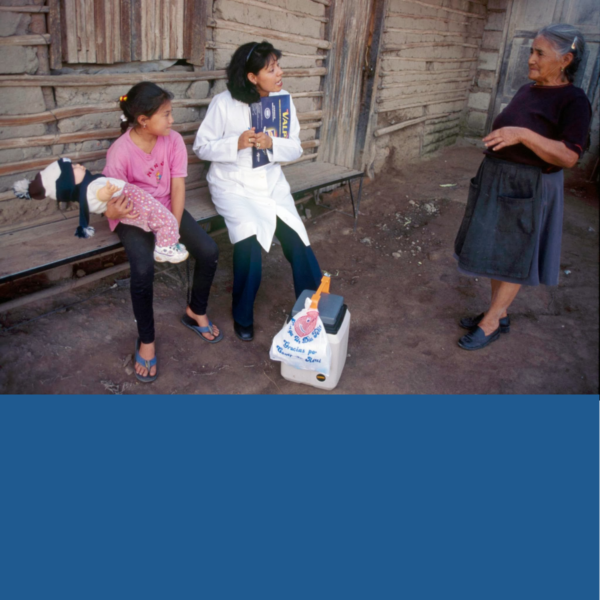
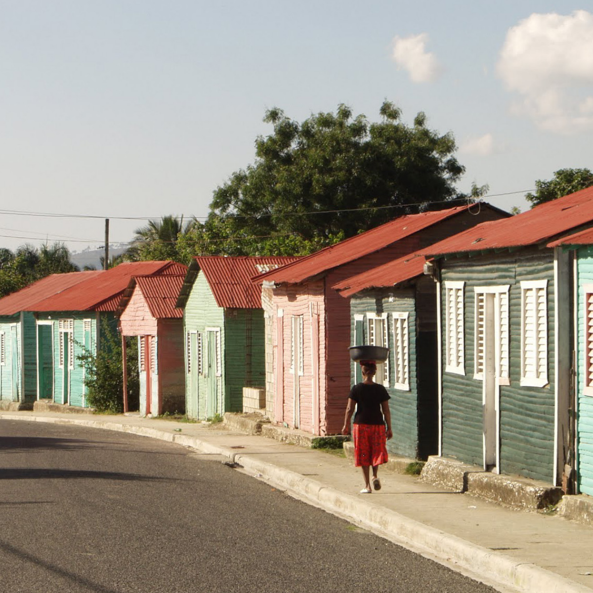
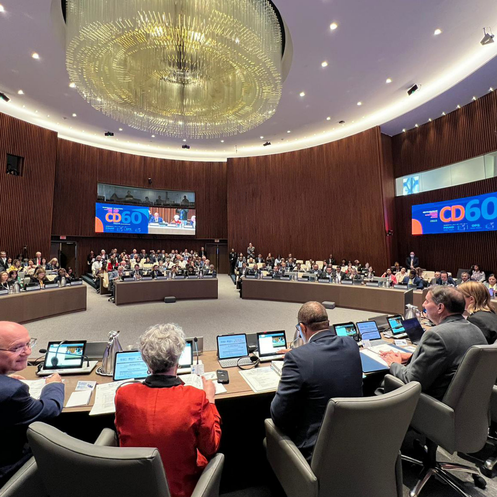
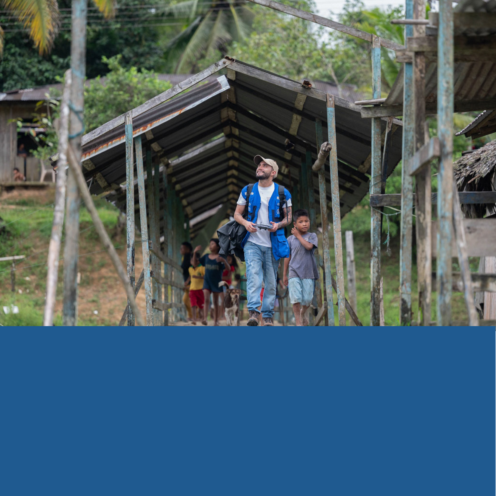

<!-- Extracted and reviewed by rhs-agent from sources/pdf/paho_pdfs/PDF_ENG/doc_02_link.1_politica-ingles-2030-english-final.pdf. -->
<!-- PAGE: 1/40 -->

Policy on the Health Workforce 2030: Strengthening Human Resources for Health to Achieve Resilient Health Systems

<!-- PAGE: 2/40 -->

_[Página en blanco]_

<!-- PAGE: 3/40 -->

Policy on the Health Workforce 2030: Strengthening Human Resources for Health to Achieve Resilient Health Systems

# 60th DIRECTING COUNCIL

## 60th DIRECTING COUNCIL

75th SESSION OF THE REGIONAL COMMITTEE OF WHO FOR THE AMERICAS

Washington, D.C., USA, 25–29 September 2023

Provisional agenda item 4.3 CD60/6 2 August 2023 Original: Spanish

Provisional agenda item 4.3

CD60/6 2 August 2023 Original: Spanish

# Policy on the Health Workforce 2030: Strengthening Human Resources for Health to Achieve Resilient Health Systems

<!-- PAGE: 4/40 -->

_[Página visual sin texto legible; contenido gráfico preservado como imagen]_

<!-- PAGE: 5/40 -->

Policy on the Health Workforce 2030: Strengthening Human Resources for Health to Achieve Resilient Health Systems

## Introduction

1 The COVID-19 pandemic has taken a severe toll on the Region of the Americas. In the economic sphere, gross domestic product (GDP) in Latin America dropped by 6.8%, and 209 million people have fallen into poverty and 78 million into extreme poverty (1). COVID-19 has also had a significant negative impact on the delivery and quality of health services; 93% of the countries in the Region continue to report disruptions in essential health services (2) and limitations in ensuring essential public health functions.

2 The pandemic had a severe impact on the availability, distribution, and quality of health personnel and exacerbated health inequities (between and within countries, between levels of care, and between the public and private sectors), with low retention of personnel in rural and underserved areas and high rates of mobility and migration. In addition, there is a high degree of instability in working

conditions, a lack of psychosocial support, with repercussions on the mental health and well- being of health personnel, low productivity and poor-quality performance, as well challenges in the training of groups of professionals, all of which hinders the progressive expansion and improvement of health services and the improvement of their quality, especially at the first level of care.

3 The purpose of this Policy on the Health Workforce 2030: Strengthening Human Resources for Health to Achieve Resilient Health Systems is to provide Member States with strategic and technical guidance for the development and implementation of strategies and initiatives aimed at strengthening human resources for health (HRH) so that these resources can contribute to the development of resilient health systems.

3

<!-- PAGE: 6/40 -->

## Background

4 HRH have been key to the response to the COVID-19 pandemic and remain critical to the ongoing social and economic recovery. They are also essential to building resilient health systems of the future. The health crisis has once again highlighted the chronic shortfall and poor distribution of HRH in the Region and the lack of policies, strategic planning processes, and sufficient investment in the production, training, and professional development of a fit-for-purpose health workforce, including measures to protect the well-being of health workers. The pandemic has also exposed the limitations of many information systems in terms of data on the availability and distribution of HRH at different levels of care, disaggregation by professional categories, and the composition and characteristics of interprofessional health teams.

5 Several policies and strategies approved by the Member States of the Pan American Health Organization (PAHO) include definitions and recommendations for strengthening HRH, such as: the Strategy for Building Resilient Health Systems and Post- COVID-19 Recovery to Sustain and Protect Public Health Gains (Document CD59/11) (3); the Action Plan on Health and Resilience in the Americas, adopted at the Ninth Summit of the Americas in 2022 (4, 5), in which the Heads of State and Government of the Region committed to strengthening the health workforce through education, research, and other investments; the Strategy on Human Resources for Universal Access to Health and Universal Health Coverage (Document CSP29/10) (6); and the Plan of Action on Human Resources for Universal Access to Health and Universal Health Coverage 2018– 2023 (Document CD56/10, Rev. 1) (7).

<!-- PAGE: 7/40 -->

Policy on the Health Workforce 2030: Strengthening Human Resources for Health to Achieve Resilient Health Systems

CD55.R8) (9). These policies are aligned with the Sustainable Health Agenda for the Americas 2018–2030 (10) and the PAHO Strategic Plan 2020–2025 (11). 6 Other resolutions and strategies that address the need to strengthen the health workforce include the Strategy for Universal Access to Health and Universal Health Coverage (Document CD53/5, Rev. 2) (8) and Resilient Health Systems (Resolution

6 Other resolutions and strategies that address the need to strengthen the health workforce include the Strategy for Universal Access to Health and Universal Health Coverage (Document CD53/5, Rev. 2) (8) and Resilient Health Systems (Resolution

CD55.R8) (9). These policies are aligned with the Sustainable Health Agenda for the Americas 2018–2030 (10) and the PAHO Strategic Plan 2020–2025 (11).

<!-- PAGE: 8/40 -->

## Situation Analysis

7 In the Americas, the COVID-19 pande- mic outbreak occurred in a context of high social inequality and generated negative synergies with other preexisting epidemics (12). Health personnel in the Region are not spared from this situation, as they have been the most exposed as a result of their work in places of high transmission, such as points of care.

than 115,000 deaths from COVID-19 among health personnel worldwide between January 2020 and May 2021, including some 60,000 deaths in the Region of the Americas during that period (14). Added to this are problems related to workers’ mental health and well- being, which have had negative repercussions on their families and on their work dynamics, and problems related to social stigma and violence, as well as the lack of support networks during the first two years of the pandemic (15). During the COVID-19 pandemic, health workers experienced high levels of stress, long shifts, and excessive workloads, in addition to the uncertainty associated with dealing with a new disease and concern about contracting it and exposing their own families to it. The pandemic had consequences for the mental health of health personnel in various countries of the Region, with high rates of depression symptoms, suicidal ideation, and psychological malaise.

8 From the confirmation of the first cases of COVID-19 in the Region to 27 November 2021, at least 2,397,335 cases of the disease and 12,898 deaths have been reported among health personnel, according to information available from 41 countries and territories of the Americas. These cases represent 16% of the total health workforce in the Region, which is estimated at 15 million (13). Recent studies led by the World Health Organization (WHO) have estimated that there were more

<!-- PAGE: 9/40 -->

Policy on the Health Workforce 2030: Strengthening Human Resources for Health to Achieve Resilient Health Systems

Between 14.7% and 22% of health workers in most countries had symptoms suggesting a depressive episode (15).

9 The COVID-19 pandemic has highli- ghted the chronic shortfall and poor distribution of HRH in the Region, as well as the lack of policies, strategic planning processes, and sufficient investment in the production, training, and professional development of a fit-for-purpose health workforce in many countries. The pandemic also exposed the limitations of many information systems in terms of data on the availability and distribution of HRH at different levels of care, disaggregation by professional categories, and the composition and characteristics of interprofessional health teams. In addition, the pandemic revealed major differences in the capacities of health personnel to implement evidence-informed policies and recommendations in the local context and the need to strengthen such capacities (16).

10 As health systems expanded their capacity during the pandemic, countries faced challenges in the recruitment, deployment, protection, and retention of health personnel and in the provision of psychosocial support to frontline health workers. The countries of the Region developed various strategies aimed at optimizing the availability of human resources while ensuring their safety and working conditions. These strategies included

the provision of personal protective equipment and guidance on its safe use by staff, adaptation of digital health and data and information management solutions, economic incentives for those working in the direct care of patients with COVID-19, recognition of COVID-19 as an occupational disease, life insurance coverage for staff, and interventions to address their mental health and well-being (15, 16).

11 HRH availability in the Region im- proved as a result of the measures taken by countries to respond to the COVID-19 pandemic, bolstered by the allocation of nece- ssary human resources, health technologies, and financial support (17), but the shortage of HRH remains substantial, mainly due to lack of investment in the medium and long term. By the end of 2021, 93% of countries had reported interruptions in the provision of essential health services through all modalities, with 26% reporting interruptions in between 75% and 100% of services, with the extent of the interruptions averaging 55% in the 66 services analyzed. For both primary care and for palliative care and rehabilitation services, 70% of countries reported interruptions (2). Moreover, the need for rapid responses often had a detrimental effect on the formalization of working arrangements, leading to job instability.

<!-- PAGE: 10/40 -->

12 The Region of the Americas has seen growth in the migration of health workers, especially from the English- speaking Caribbean to the health systems of North America and Europe. A 2019 analysis on this issue (18) indicates that a combination of attractive wages and better living and working conditions in destination countries, together with a lack of career development opportunities and inadequate working conditions and wages in countries of origin, are the main factors contributing to this health workforce mobility. Of health professionals currently residing in the English-speaking Caribbean who were surveyed, 92% stated that they would be less interested in migrating if they had opportunities for promotion and professional advancement in their countries of origin (18).

13 Preliminary results of a study con- ducted by PAHO on mobility among nurses, midwives, and physicians in the Caribbean indicated that the proportion of health workers leaving the profession increased gradually during the period studied (2016–2020), especially in small countries, with resignation being the most common reason.1 Not only young nurses but also more experienced nurses are exploring options abroad. The combination of lack of incentives and willingness to accept opportunities abroad, coupled with the increasingly aggressive recruitment tactics of many foreign institutions, creates a scenario in which health personnel do not consider staying

to work in their home countries.2 Although 28 countries in the Americas have designated a national authority to report on this situation under the WHO Global Code of Practice on the International Recruitment of Health Personnel, only 12 countries submitted information to WHO in 2022 (19).

14 In 2022, WHO projected a shortage of at least 600,000 health professionals in Latin America and the Caribbean by 2030, based on the target of 44.5 professionals (medical, nursing, and midwifery personnel) per 10,000 population (20). A recent study reported a regional density of physicians in countries of Latin America and the Caribbean of 19.5 per 10,000 population and a density of nursing and midwifery personnel of 44.3 per 10,000 population (21).3 To achieve the desirable target of 80% on the universal health coverage effective coverage index, it was estimated that at least 20.7 physicians per 10,000 population, 70.6 nurses and midwives per 10,000 population, 8.2 dentistry professionals per 10,000 population, and 9.4 pharmaceutical professionals per 10,000

1 Pan American Health Organization. Mobility of nurses, midwives, and physicians in selected countries and territo­ ries of the English Caribbean. Forthcoming.

2 Ibid.

3 The 95% uncertainty intervals for the data provided are 14.6–25.5 for the regional density of physicians and 34.5–55.9 for the density of nurses and midwives.

<!-- PAGE: 11/40 -->

Policy on the Health Workforce 2030: Strengthening Human Resources for Health to Achieve Resilient Health Systems

population would be needed (see Annex A). This means that between 66% and 93.9% of Latin American and Caribbean countries would not have reached the minimum thresholds in 2019 and that there would be a shortage of around two million health professionals in the Region by 2030 (21). 15 The majority (70%) of the health and care workforce worldwide are women. In the Region, 56% of HRH are nurses, and women make up 89% of the nursing workforce (22). In addition to their work responsibilities, women often have greater domestic responsibilities, including caring for family and community members; in many cases they are also the primary breadwinners for their households. This situation means that they are exposed to gender-based violence and may experience psychological symptoms and other health problems (which were exacerbated during the pandemic), in addition to suffering persistent disparities in working conditions and disadvantageous pay gaps (23, 24). 16 From a health systems perspective, inclusive digital health approaches, such as telemedicine, have played an important role in the provision of essential health services during the pandemic, improving access to health services through consultations at the first level of care and facilitating continuity of service

population would be needed (see Annex A). This means that between 66% and 93.9% of Latin American and Caribbean countries would not have reached the minimum thresholds in 2019 and that there would be a shortage of around two million health professionals in the Region by 2030 (21).

15 The majority (70%) of the health and care workforce worldwide are women. In the Region, 56% of HRH are nurses, and women make up 89% of the nursing workforce (22). In addition to their work responsibilities, women often have greater domestic responsibilities, including caring for family and community members; in many cases they are also the primary breadwinners for their households. This situation means that they are exposed to gender-based violence and may experience psychological symptoms and other health problems (which were exacerbated during the pandemic), in addition to suffering persistent disparities in working conditions and disadvantageous pay gaps (23, 24).

16 From a health systems perspective, inclusive digital health approaches, such as telemedicine, have played an important role in the provision of essential health services during the pandemic, improving access to health services through consultations at the first level of care and facilitating continuity of service

delivery, with improvements in the quality– price ratio of care. Telemedicine services reduce subsequent (and more expensive) use of health care and decrease the likelihood that patients will miss appointments or decide to forgo care (25).

17 The COVID-19 pandemic has exposed underinvestment in the training, retention, and employment of health personnel and demonstrated that health systems were unprepared to respond to a global crisis. There is an urgent need for countries and international actors to prioritize investment in the health workforce and in decent work with working conditions that encourage the development of professional careers and the strengthening of HRH (26).

17

<!-- PAGE: 12/40 -->

Proposal 18 This policy proposes priority actions to strengthen HRH so that they can contribute to the development of resilient health systems, the recovery of public health

## Proposal

gains that were eroded during the pandemic, and the resumption of progress towards meeting the Sustainable Development Goals by 2030. The policy proposes the following five strategic lines of action.

18 This policy proposes priority actions to strengthen HRH so that they can contribute to the development of resilient health systems, the recovery of public health

<!-- PAGE: 13/40 -->

Policy on the Health Workforce 2030: Strengthening Human Resources for Health to Achieve Resilient Health Systems

## Strengthen governance and promote national policies and plans for human resources for health

19 It is essential to have an intersec- torally agreed national HRH policy in order to consolidate the stewardship of the health authority and strengthen, among other aspects, HRH planning and forecasting, the development of HRH information systems, and curriculum development that encourages the use of science, evidence, and innovation, reinforcing unconventional aspects of the digital transformation of the health sector. Skills profiles, working conditions, career paths, and staff distribution will need to be strengthened in

line with the needs of health systems based on primary health care and oriented towards the achievement of universal health. These policies and plans must be comprehensive and inclusive and must involve a range of health personnel, from community workers to specialists and health managers, with actions to be carried out in the short, medium, and long terms, and with the aim of broadening the vision of health systems.

<!-- PAGE: 14/40 -->

## Develop and consolidate regulatory mechanisms related to human resources for health

20 There is a need to adapt the regula- tion of professional practice and update legal and remunerative frameworks, as well as to advance in cooperation between countries to effectively support health personnel who migrate. The quality of training for health professionals should also be regulated through systems for the evaluation and accreditation of training programs and institutions, in both undergraduate and continuing education, so that the standards prioritize scientific and technical knowledge, together with the inclusion of social skills criteria, in the profiles of graduates and so that contextualized learning programs are developed for each health profession.

21 The development of appropriate regulatory frameworks can encou- rage the delegation and redistribution of tasks within health teams to address staff shortages and help to improve the response of health systems to health emergencies (27). Health personnel need to be trained in accordance with national needs and priorities, with a continuing education plan oriented towards the achievement of universal health, quality in the provision of health services, and an efficient response to health emergencies.

21

<!-- PAGE: 15/40 -->

Policy on the Health Workforce 2030: Strengthening Human Resources for Health to Achieve Resilient Health Systems

Strengthen the formation of interprofessional teams and their integration into integrated health services networks based on primary health care

22 It is important to put in place inter- professional teams at the first level of care, with response capacity, the right skills, and an intercultural and social determinants approach to health in order to deal with the particular circumstances of populations in conditions of vulnerability. The main tasks to be carried out by interprofessional teams include promoting health and disseminating health information, applying preventive measures, mitigating health risks, conducting epidemiological surveillance, ensuring timely diagnoses through adequate screening, and ensuring access to treatment, follow-up, and monitoring for each case—all while applying a comprehensive health care approach and incorporating traditional medicine.

23 The adoption and systematization of technological innovations, especially at the first level of care, will serve to improve the efficiency of the workforce through digital health literacy training for interprofessional teams, the reorganization of models of care, development of new skills, and regulation of the use of these innovations. Innovative models of care should be developed, based on the territorial context, with interprofessional teams organized jointly with communities and with digital health support, with special emphasis on underserved areas and populations in conditions of high vulnerability, including Indigenous communities.

## 23

<!-- PAGE: 16/40 -->

Enhance workforce capacity-building to address population health priorities and support public health emergency preparedness and response

24 It is essential to coordinate collabo- ration between the education and health sectors through competency-based teaching, particularly for interprofessional teams at the first level of care. Among these core competencies are knowledge and skills for comprehensive and continuous person-centered care; identification of and appropriate care for the most common clinical problems; emphasis on health promotion, disease prevention, and interdisciplinary and intersectoral work; a biopsychosocial approach to the health-disease process and professional ethics; and interventions to address the health needs and demands of the community.

25 Continuing education strategies should be implemented based on flexible training pathways, incorporating micro-credentials that are linked to processes of regulation, accreditation, and relicensing of health personnel and that allow for the participation of professional associations and public-private educational partnerships in their development. These strategies will also serve to extend the use of virtual training, simulation, and fields of practice in the framework of the digital transformation of the health sector.

<!-- PAGE: 17/40 -->

In this context, PAHO is collaborating with regional and global initiatives to develop a well-trained, qualified, and equitably distributed workforce for countries’ response to COVID-19 and future pandemics.4

26 The use and expansion of access to PAHO’s Virtual Campus for Public Health as a space for the convergence of high-quality learning programs is key to the development of the skills and capacities of health personnel in the Region, in particular in the priority areas of maternal and child health, chronic noncommunicable diseases, infectious diseases, promotion and prevention of risk factors, and social determinants of health.

4 Americas Health Corps is a joint initiative between the Government of the United States and PAHO that seeks to train 500,000 health workers in five years.

<!-- PAGE: 18/40 -->

Promote decent working conditions, protection of the physical and mental health of health workers, and an adequate supply of human resources for health through financing and regulation

27 Adequate working conditions should be promoted to improve the development and well-being of health personnel through an intersectoral approach involving the health, labor, and education sectors. It is also essential to implement strategies to attract, retain, and maintain the workforce and achieve improvements in the availability of HRH in the health systems of the Region, and to reduce workforce migration, both internal and external, and ensure ethical recruitment of and comprehensive protection against exploitation and trafficking for professionals who migrate.

There is also a need to boost technical and economic cooperation from recipient countries through existing international development channels and bilateral agreements that are in line with the recommendations of the WHO Global Code of Practice on the International Recruitment of Health Personnel.

28 A gender perspective needs to be incorporated into employment policies in the health sector, including policies relating to childcare and family protection,

28

<!-- PAGE: 19/40 -->

Policy on the Health Workforce 2030: Strengthening Human Resources for Health to Achieve Resilient Health Systems

29 Sufficient and sustained investment in the education, training, employ- ment, and retention of the Region’s health workforce will help build human capital, enhance the capacity of health systems, and expand access to health services.

since most health and care-providing personnel are women, who face discrepancies in working conditions and disadvantageous pay gaps. Mental health and social welfare policies for health personnel must also be developed, and their protection and decent employment conditions must be ensured, with guarantees of remuneration without gender differences for health workers.

29

<!-- PAGE: 20/40 -->

## Monitoring and Evaluation

30 This policy will contribute to the achievement of the objectives of the PAHO Strategic Plan 2020–2025 and the Sustainable Health Agenda for the Americas 2018–2030. The monitoring and assessment of this policy will be aligned with the results-based management frameworks of both PAHO and WHO and with their performance, monitoring, and assessment processes. The Governing Bodies of PAHO will be informed of the progress made and the challenges encountered in the implementation of the policy through a progress report in 2027 and a final report in 2031.

## Financial Implications

31 Under the strategic lines of action of this policy, it will be necessary to mobilize significant additional resources to support countries and regional initiatives. It is estimated that for the period 2023–2030, US$ 46.9 million will be required, including both additional resources and resources already programmed in the work plan, to implement the policy and provide technical cooperation to Member States (see Annex C).

## Action by the Directing Council

32 The Directing Council is invited to review the information presented in this document, provide any comments it deems pertinent, and consider adopting the proposed resolution presented in Annex B.

<!-- PAGE: 21/40 -->

Policy on the Health Workforce 2030: Strengthening Human Resources for Health to Achieve Resilient Health Systems

## Annexes

## References

4 Organization of American States. Action Plan on Health and Resilience in the Americas. Ninth Summit of the Americas; 8–10 June 2022. Los Angeles (United States): OAS; 2022. Available from: http://summit-americas.org/documentos_ oficiales_ixsummit/CMBRS02291e02.pdf.

1 Economic Commission for Latin America and the Caribbean. Economic Survey of Latin America and the Caribbean 2021: Labour dynamics and employment policies for sustainable and inclusive recovery beyond the COVID-19 crisis. Santiago: ECLAC; 2021. Available from: https://www.cepal. org/en/publications/47193-economic-survey-latin- america-and-caribbean-2021-labour-dynamics- and-employment.

5 Pan American Health Organization. Americas Health Corps – PAHO and the United States present plan to improve quality and availability of health workers in the region. Washington D.C.: PAHO, 26 September 2022 [cited 2 June 2023]. Available from: https://www.paho.org/en/news/26-9-2022- americas-health-corps-paho-and-united-states- present-plan-improve-quality-and.

2 Pan American Health Organization. Third round of the National Survey on the Continuity of Essential Health Services during the COVID-19 Pandemic: November-December 2021. Interim Report for the Region of the Americas, January 2022. Washington, D.C.: PAHO; 2022. Available from: https://iris.paho.org/handle/10665.2/56128.

6 Pan American Health Organization. Strategy on Human Resources for Universal Access to Health and Universal Health Coverage [Document CSP29/10]. 29th Pan American Sanitary Conference, 69th Session of the Regional Committee of WHO for the Americas; 25–29 September 2017; Washington, D.C.: PAHO; 2017. Available from: https://www.paho.org/ en/documents/csp2910-strategy-human-resources- universal-access-health-and-universal-health- coverage.

3 Pan American Health Organization. Strategy for Building Resilient Health Systems and Post- COVID-19 Pandemic Recovery to Sustain and Protect Public Health Gains [Document CD59/11]. 59th PAHO Directing Council, 73rd Session of the Regional Committee of WHO for the Americas; 20–24 September 2021. Washington, D.C.: PAHO; 2021. Available from: https://www.paho.org/en/ documents/cd5911-strategy-building-resilient- health-systems-and-post-covid-19-pandemic- recovery.

<!-- PAGE: 22/40 -->

7 Pan American Health Organization. Plan of Action on Human Resources for Universal Access to Health and Universal Health Coverage 2018–2023 [Document CD56/10, Rev. 1]. 56th PAHO Directing Council, 70th Session of the Regional Committee of WHO for the Americas; 23–27 September 2018. Washington, D.C.: PAHO; 2018. Available from: https://iris.paho.org/handle/10665.2/49213.

8 Pan American Health Organization. Strategy for Universal Access to Health and Universal Health Coverage [Document CD53/5, Rev. 2]. 53rd PAHO Directing Council, 66th Session of the Regional Committee of WHO for the Americas; 29 September 29–Oct 3 2014. Washington, D.C.: PAHO; 2014. Available from: https://www3.paho. org/hq/dmdocuments/2014/CD53-5-e.pdf.

9 Pan American Health Organization. Resilient Health Systems [Resolution CD55.R8]. 55th PAHO Directing Council, 68th Session of the Regional Committee of WHO for the Americas; 26–30 September 2016. Washington, D.C.: PAHO; 2016. Available from: https://www3.paho.org/hq/dmdocuments/2016/ CD55-R8-e.pdf.

10 Pan American Health Organization. Sustainable Health Agenda for the Americas 2018–2030: A call to action for health and well-being in the Region [Document CSP29/6, Rev.3]. 29th Pan American Sanitary Conference, 69th Session of the Regional Committee of WHO for the Americas; 25–29 September 2017; Washington, D.C.: PAHO; 2017. Available from: https://iris.paho.org/ handle/10665.2/34194.

11 Pan American Health Organization. Strategic Plan of the Pan American Health Organization 2020–2025: Equity at the Heart of Health [Official Document 359]. 57th PAHO Directing Council, 71st Session of the Regional Committee of WHO for the Americas; 30 September–4 October 2019. Washington, D.C.: PAHO; 2017. Available from: https://iris.paho.org/handle/10665.2/51599.

12 Pan American Health Organization. Health in the Americas 2022. Overview of the Region of the Americas in the Context of the COVID-19 Pandemic. Washington, D.C.: PAHO; 2022. Available from: https://iris.paho.org/handle/10665.2/56472.

13 Pan American Health Organization. Epidemiological Update: Coronavirus disease (COVID-19) - 2 December 2021. Washington, D.C.: PAHO; 2021. Available from: https://www.paho. org/en/documents/epidemiological-update- coronavirus-disease-covid-19-2-december-2021.

14 World Health Organization. The impact of COVID-19 on health and care workers: A closer look at deaths. Geneva: WHO; 2021. Available from: https://apps.who.int/iris/handle/10665/345300.

.

15 Pan American Health Organization. The COVID-19 Health Care Workers Study (HEROES): Regional Report from the Americas. Washington, D.C.: PAHO; 2022. https://iris.paho.org/handle/10665.2/55972.

16 Etienne CF. COVID-19 has revealed a pandemic of inequality. Nat Med. 2022;28(17):17. Available from: https://www. nature.com/articles/s41591-021-01596-z.

<!-- PAGE: 23/40 -->

Policy on the Health Workforce 2030: Strengthening Human Resources for Health to Achieve Resilient Health Systems

17 Báscolo E, Houghton N, Del Riego A, Fitzgerald J, Jarboe R. Contributions of the new framework for essential public health functions to addressing the COVID-19 pandemic. Rev Panam Salud Publica. 2022;46:E8. Available from: http://dx.doi. org/10.26633/RPSP.2022.8.

18 Pan American Health Organization. Health Workers Perception and Migration in the Caribbean Region. Washington, D.C.: PAHO; 2020. Available from: https://www.paho.org/en/documents/health- workers-perception-and-migration-caribbean- region.

19 World Health Organization. Human resources for health: WHO Global Code of Practice on the International Recruitment of Health Personnel: fourth round of national reporting (Document A75/14). 75th World Health Assembly; 22–28 May 2022; Geneva: WHO; 2022. Available from: https://apps.who.int/gb/ebwha/pdf_files/WHA75/ A75_14-en.pdf.

20 World Health Organization. Global strategy on human resources for health: Workforce 2030. Geneva; WHO; 2016. Available from: https://apps.who.int/iris/bitstream/hand le/10665/250368/9789241511131-eng.pdf.

21 GBD 2019 Human Resources for Health Collaborators. Measuring the availability of human resources for health and its relationship to universal health coverage for 204 countries and territories from 1990 to 2019: a systematic analysis for the Global Burden of Disease Study 2019. Lancet. 2022;399(10341):2129–2154. Available from: https://doi.org/10.1016/S0140- 6736(22)00532-3.

22 World Health Organization. Health labour market analysis guidebook. Geneva: WHO; 2021. Available from: https://www.who.int/publications/i/ item/9789240035546.

23 Pan American Health Organization. Five questions regarding women’s mental health before, during and after COVID-19. Washington, D.C.: PAHO; 2022. Available from: https://www.paho.org/en/events/ five-questions-regarding-womens-mental-health- during-and-after-covid-19.

24 World Health Organization; International Labour Organization. The gender pay gap in the health and care sector: A global analysis in times of COVID-19. Geneva: WHO/ILO; 2022. Available from: https://www.who.int/publications/i/ item/9789240052895.

25 Organización Panamericana de la Salud. Salud digital inclusiva. Washington, D.C.: PAHO; 2023. Available from: https://iris.paho.org/ handle/10665.2/57199.

26 McPake B, Dayal P, Zimmermann J, Williams GA. What steps can improve and promote investment in the health and care workforce? Enhancing efficiency of spending and rethinking domestic and international financing. Geneva: WHO; 2023. Available from: https://apps.who.int/iris/rest/ bitstreams/1495452/retrieve.

27 Cho M, Levin R. Implementación del plan de acción de recursos humanos en salud y la respuesta a la pandemia por la COVID-19 [Implementation of the Plan of Action for Human Resources for Health and the COVID-19 Pandemic Response]. Rev Panam Salud Publica. 2022;46:e52. https://iris.paho.org/ handle/10665.2/56069.

<!-- PAGE: 24/40 -->

_[Página visual sin texto legible; contenido gráfico preservado como imagen]_

<!-- PAGE: 25/40 -->

Policy on the Health Workforce 2030: Strengthening Human Resources for Health to Achieve Resilient Health Systems

## Annex A

## Shortage of human resources for health, Latin America and the Caribbean, 2019

|  | countries with shortages | countries with shortages* (%) | p workers) |
| --- | --- | --- | --- |
| Physicians (threshold: 20.7 per 10,000 population) | 22 | 66.7 | 238,000 |
| Nurses and midwives (threshold: 70.6 per 10,000 population) | 31 | 93.9 | 1,570,000 |
| Dentistry personnel (threshold: 8.2 per 10,000 population) | 23 | 69.7 | 32,800 |
| Pharmaceutical personnel (threshold: 9.4 per 10,000 population) | 28 | 84.8 | 263,000 |

Source: GBD 2019 Human Resources for Health Collaborators. Measuring the availability of human resources for health and its relationship to universal health coverage for 204 countries and territories from 1990 to 2019: a systematic analysis for the Global Burden of Disease Study 2019. The Lancet. 2022;399(10341):2129–2154.

- Proportion of countries and territories in Latin America and the Caribbean that have shortages in four groups of human resour­ ces for health in relation to the number needed to achieve 80% on the universal health coverage effective coverage index.

<!-- PAGE: 26/40 -->

_[Página visual sin texto legible; contenido gráfico preservado como imagen]_

<!-- PAGE: 27/40 -->

Policy on the Health Workforce 2030: Strengthening Human Resources for Health to Achieve Resilient Health Systems

Annex B

## 60th DIRECTING COUNCIL

75th SESSION OF THE REGIONAL COMMITTEE OF WHO FOR THE AMERICAS

Washington, D.C., USA, 25–29 September 2023

CD60/6 Original: Spanish

## PROPOSED RESOLUTION

POLICY ON THE HEALTH WORKFORCE 2030: STRENGTHENING HUMAN RESOURCES FOR HEALTH TO ACHIEVE RESILIENT HEALTH SYSTEMS

<!-- PAGE: 28/40 -->

## THE 60th DIRECTING COUNCIL,

(PP1) Having considered the Policy on the Health Workforce 2030: Strengthening Human Resources for Health to Achieve Resilient Health Systems (Document CD60/6);

(PP2) Considering that the COVID-19 pandemic has demonstrated the importance of having health personnel who are prepared to respond effectively to health emergency events and to rebuild resilient health systems;

(PP3) Considering that in order to achieve resilient health systems, recover public health gains, and contribute to social and economic recovery, it is necessary to strengthen the health workforce by taking actions to better protect the health of individuals, their families, and their communities;

(PP4) Recognizing that, in order to ensure the functioning of health systems in the Region of the Americas, it is necessary to continue to make changes in strategic planning and regulation of the activities of health personnel, as demonstrated during the COVID-19 pandemic, as well as to implement support measures, improve capacities, and broaden fields of professional practice;

(PP5) Recognizing that, despite the progress achieved, challenges remain, especially with regard to the availability and distribution of health personnel; planning; governance; intercultural, gender, and income equity among personnel; coordination between sectors; and training, in accordance with the needs of health systems in relation to universal access to health and universal health coverage,

<!-- PAGE: 29/40 -->

Policy on the Health Workforce 2030: Strengthening Human Resources for Health to Achieve Resilient Health Systems

## RESOLVES:

(OP)1. To approve the Policy on the Health Workforce 2030: Strengthening Human Resources for Health to Achieve Resilient Health Systems (Document CD60/6);

(OP)2. To urge Member States, considering their contexts, needs, vulnerabilities, and priorities, to:

a strengthen the governance of and promote national policies and plans for human resources for health, in line with processes of health systems transformation towards universal health and resilience;

b develop and consolidate regulatory mechanisms for the organization of their human resources for health, education and licensing processes, and professional practice to improve quality and equity, and promote regional integration;

c strengthen the formation of interprofessional teams in integrated health services networks based on primary health care, especially in underserved areas;

d enhance workforce capacity-building to address population health priorities and for public health emergency preparedness and response; epromote decent working conditions, protect the physical and mental health of health workers, facilitate their participation in determining the organization of work processes, and improve financing and regulation to attract, retain, and sustain an adequate supply of human resources for health;

f improve the working conditions of health personnel in order to mitigate the effects of migration, and promote the development of information systems and the reporting of labor mobility at the international level, in accordance with the WHO Global Code of Practice on the International Recruitment of Health Personnel.

<!-- PAGE: 30/40 -->

## (OP)3. To request the Director to:

a provide technical cooperation to Member States to strengthen capacities that will contribute to the implementation of the policy and its strategic lines of action;

b support the development of national policies, regulatory frameworks, and national capacities that will contribute to the strengthening of human resources for health;

c continue to prioritize the development of the Virtual Campus for Public Health as PAHO’s educational platform, building capacities among health personnel, and supporting the achievement of public health goals in the Americas, in collaboration with academic institutions in the Region;

d report periodically to the Governing Bodies of PAHO on the progress made and the challenges encountered in the implementation of this policy through a progress report in 2027 and a final report in 2031.

<!-- PAGE: 31/40 -->

Policy on the Health Workforce 2030: Strengthening Human Resources for Health to Achieve Resilient Health Systems

## Annex C

CD60/6

Report on the Financial and Administrative Implications of the Proposed Resolution for the Pan American Sanitary Bureau

1. Agenda item: 4.3 - Policy on the Health Workforce 2030: Strengthening Human Resources for Health to Achieve Resilient Health Systems

2. Linkage to Program Budget of the Pan American Health Organization 2022-2023:

Outcome 1. Access to comprehensive and quality health services. Increased response capacity of integrated health services networks (IHSNs), with emphasis on the first level of care, to improve access to comprehensive, quality health services that are equitable, gender- and culturally sensitive, rights-based, and people-, family- and community-centered, in order to advance towards universal health.

Outcome 7. Health workforce. Adequate availability and distribution of a competent health workforce.

<!-- PAGE: 32/40 -->

## 3. Financial Implications

a Total estimated cost for implementation over the lifecycle of the resolution (including staff and activities):

Área Costo estimado

| Área Area | Estimated cost (US$) |
| --- | --- |
| Recursos humanos | 23,450,000 |
| Capacitación | 4,690,000 |
| Consultores/contrato de servicios | 11,725,000 |
| Viajes y reuniones | 4,690,000 |
| Publicaciones | 350,000 |
| Materiales y otros gastos | 1,995,000 |
| Total | 46,900,000 |

b Estimated cost for the 2024-2025 biennium (including staff and activities):

US$ 14,000,000

c Of the estimated cost noted in b), what can be subsumed under existing programmed activities?

All of the costs noted in b) can be subsumed under existing programmed activities.

4. Administrative implications:

a Indicate the levels of the Organization at which the work will be undertaken:

All levels of the Organization will be involved.

b Additional staffing requirements (indicate additional required staff full-time equivalents, noting necessary skills profile):

No additional staffing is required.

c Time frames (indicate broad time frames for implementation and evaluation):

Seven years, with a progress report in 2027 and a final report in 2031.

<!-- PAGE: 33/40 -->

Policy on the Health Workforce 2030: Strengthening Human Resources for Health to Achieve Resilient Health Systems

## Annex D

CD60/6

## Analytical Form to Link Agenda Item with Organizational Mandates

1. Agenda item: 4.3 – Policy on the Health Workforce 2030: Strengthening Human Resources for Health to Achieve Resilient Health Systems

2. Responsible unit: Health Systems and Services/Human Resources for Health (HSS/HR)

3. Preparing officer: E. Benjamín Puertas

4. Link between Agenda item and Sustainable Health Agenda for the Americas 2018-2030:

Goal 3: Strengthen the management and development of human resources for health (HRH) with skills that facilitate a comprehensive approach to health

Target 1: Ensure adequate availability of a health workforce (44.5 health workers per 10,000 population) that is qualified, culturally and linguistically appropriate, and well distributed (adaptation of target 3.c of the Sustainable Development Goals (SDGs) and PAHO Strategic Plan outcome 4.5).

Target 2: Develop policies on human resources for health and intersectoral coordination and collaboration mechanisms between the health and education sectors, as well as other social actors, to address the requirements of the health system and the health needs of the population (PAHO Strategy on Human Resources for Universal Health Access and Universal Health Coverage, Document CE160/18 [2017]).

Target 3: Strengthen the quality of professional health education in collaboration with the education sector, through evaluation systems and the accreditation of training institutions and degree programs (adaptation of the PAHO Strategy on Human Resources for Universal Access to Health, Document CE160/18 [2017]).

<!-- PAGE: 34/40 -->

Target 4: Develop working conditions that foster the attraction and retention of health personnel, as well as their participation in and commitment to health management, including through collaboration with organizations representing health workers (unions and syndicates) and other social actors (adapted from SDG target 3.c and PAHO Strategic Plan outcome 4.5).

5. Link between Agenda item and the Strategic Plan of the Pan American Health Organization 2020-2025:

Outcome 1: Access to comprehensive and quality health services.

Indicators:

1.a Number of countries and territories that show a reduction of at least 10% in hospitalizations for ambulatory care-sensitive conditions.

Baseline (2019): 8 countries / Target 2025: 20 countries.

1.b: Number of countries and territories that have implemented strategies to strengthen the response capacity of the first level of care.

Baseline (2019): N/D / Target 2025: 20 countries.

Outcome 7: Health workforce; adequate availability and distribution of a competent health workforce.

Indicators:

7.a: Number of countries and territories that have reduced the density gap with respect to physicians, nurses, and midwives, achieving at least 25 health workers per 10,000 population in underserved areas, keeping in mind the global target of 44.5 by 2030. Baseline (2019): 7 countries / Target 2025: 16 countries.

7.b: Number of countries and territories that have an interprofessional health team at the first level of care, consistent with their model of care. Baseline (2019): 12 countries / Target 2025: 21 countries.

<!-- PAGE: 35/40 -->

Policy on the Health Workforce 2030: Strengthening Human Resources for Health to Achieve Resilient Health Systems

6. List of collaborating centers and national institutions linked to this Agenda item:

6. List of collaborating centers and national institutions linked to this Agenda

## item:

## Planning of Human Resources for Health

Department of Health Planning and Administration (DPAS), Institute of Social Medicine (IMS), University of the State of Rio de Janeiro (Brazil)

School of Nursing, Faculty of Health, Dalhousie University (Canada)

## Medical Training

School of Medicine and Health Sciences, Université de Sherbrooke (Canada)

Office of International Health, Health Sciences Center, University of New Mexico (United States of America)

National Center for Rural Health Professions, University of Illinois at Rockford (United States of America)

## Nursing, Midwifery and Health Technicians

- School of Nursing, University of North Carolina at Chapel Hill (United States of America)

- School of Nursing, University of the West Indies at St. Augustine (Trinidad and Tobago)

- School of Nursing and Health Studies, University of Miami (United States of America)

- Center for Global Nursing, Johns Hopkins School of Nursing (United States of America)

- School of Nursing, Office of International Affairs, University of Michigan (United States of America)

- School of Nursing, Columbia University (United States of America)

- School of Nursing, University of Alabama at Birmingham (UAB) (United States of America)

<!-- PAGE: 36/40 -->

- School of Nursing, University of Pennsylvania (United States of America)

- College of Nursing, University of Illinois at Chicago (United States of America) • National School of Nursing and Midwifery, Universidad Nacional Autónoma (UNAM) (Mexico)

- School of Nursing (UWISON), University of the West Indies (Jamaica)

- School of Nursing, Pontificia Universidad Católica de Chile (Chile)

- School of Nursing, Faculty of Health Sciences, McMaster University (Canada)

- Ribeirão Preto School of Nursing, Universidade de São Paulo (Brazil)

- Joaquim Venancio Polytechnic School of Health (EPSJV), Fundação Oswaldo Cruz (FIOCRUZ)

7. Best practices in this area and examples from countries within the Region of the Americas:

Linking response actions in the field of human resources for health in the context of the COVID- 19 pandemic with the strategic lines, objectives, and indicators of the Plan of Action on Human Resources for Universal Access to Health and Universal Health Coverage 2018- 2023 (Resolution CD56.R5) revealed the following generic best practices for strengthening resilient health systems in the post-pandemic recovery period:

- The capacity to respond appropriately and in a timely manner to health emergencies depends on the strength of countries’ governance and stewardship and their capacity for management of human resources for health. This was evidenced in the response to the identification of needs, planning, and training of human resources for health, and demonstrates the central role of primary health care, essential public health functions, and models of care.

- The protection of human resources for health ensures the functioning of health systems and the maintenance of essential health care services. The pandemic and the actions taken in response to COVID-19 highlighted opportunities (and innovations, such as telehealth) for mitigating chronic and recurring problems relating to the availability and distribution of human resources for health.

- Countries with a good information system on human resources for health provided timely responses in projecting, planning, and filling gaps through calculation and allocation of human resources. The existence of an operational

<!-- PAGE: 37/40 -->

Policy on the Health Workforce 2030: Strengthening Human Resources for Health to Achieve Resilient Health Systems

and integrated national information system on human resources for health, with reliable, accurate, and verifiable information, is an important structural capacity that makes it possible to plan for and respond to health workforce needs.

- The COVID-19 pandemic demonstrated the importance of strengthening the capacities of human resources for health at the first level of care, which reduces the overburdening of and the breakdown of care in hospitals and makes it possible to ensure equitable, quality health care in accordance with the health needs of the population.

- Women make up 70% of the global health workforce, and they played an essential role during the COVID-19 pandemic, not only as health workers, but also in the family context, as caregivers for the sick, the disabled, and children.

- There were widespread increases in the hiring of human resources for health during the COVID-19 pandemic. Monitoring should be done to verify that these jobs are maintained over time and to assess their impact in terms of improving access to health systems. Progress is needed on important issues such as precarious contractual arrangements, working conditions, joint negotiations, and internal and external mobility of health personnel.

- Intersectoral action between the education and health sectors made it possible to cover some health personnel needs during the pandemic. Flexible arrangements that made it possible to use trainee health workers for the response to COVID-19 and the various processes of continuing education, lifelong learning, skills-building, and on-the-job training (supported by digital technologies) are lines of action that should continue to be pursued throughout the Region.

<!-- PAGE: 38/40 -->

## Annex E

## References

Cho M, Levin R. Implementación del plan de acción de recursos humanos en salud y la respuesta a la pandemia por la COVID-19 [Implementation of the Plan of Action for Human Resources for Health and the COVID-19 Pandemic Response]. Rev Panam Salud Publica. 2022;46:e52. https://iris.paho.org/handle/10665.2/56069.

Pan American Health Organization. Impact of COVID-19 on Human Resources for Health and Policy Response: The Case of Belize, Grenada, and Jamaica. Washington, D.C.: PAHO; 2022. Available from: https://iris.paho.org/ handle/10665.2/56262.

World Health Organization. Impact of COVID-19 on human resources for health and policy response: The case of Plurinational State of Bolivia, Chile, Colombia, Ecuador and Peru. Overview of findings from five Latin American countries. Geneva: WHO; 2021. Available from: https://www.who.int/publications/i/item/9789240039001.

<!-- PAGE: 39/40 -->

_[Página visual sin texto legible; contenido gráfico preservado como imagen]_

<!-- PAGE: 40/40 -->

525 Twenty-third Street, N.W. Washington, D.C. 20037 202-974-3000 https://www.paho.org/en/topics/human-resources-health
