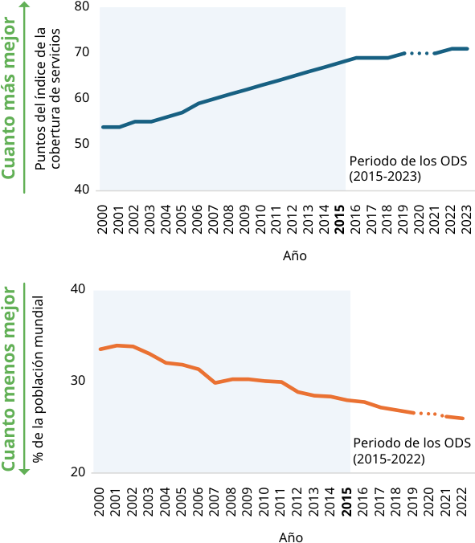
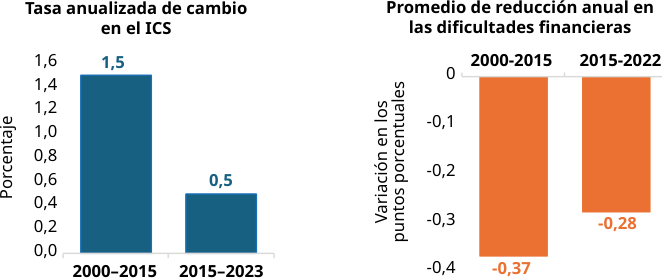
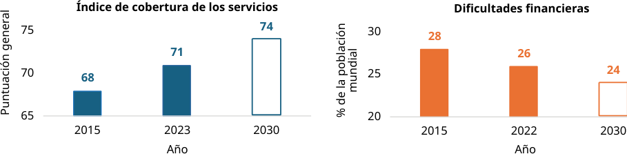

<!-- Extracted and reviewed by rhs-agent from sources/pdf/paho_pdfs/PDF_SPA/doc_11_link_sub2_03_content.pdf. -->
<!-- PAGE: 1/16 -->

# Seguimiento de la cobertura universal de salud Informe de monitoreo mundial 2025

## Resumen ejecutivo

<!-- PAGE: 2/16 -->

_[Página en blanco]_

<!-- PAGE: 3/16 -->

Seguimiento de la cobertura universal de salud Informe de monitoreo mundial 2025

## Resumen ejecutivo

<!-- PAGE: 4/16 -->

## © Organización Mundial de la Salud 2026

Algunos derechos reservados. Esta obra está disponible en virtud de la licencia 3.0 OIG Reconocimiento-NoComercial- CompartirIgual de Creative Commons (CC BY-NC-SA 3.0 IGO; https://creativecommons.org/licenses/by-nc-sa/3.0/igo).

Con arreglo a las condiciones de la licencia, se permite copiar, redistribuir y adaptar la obra para fines no comerciales, siempre que se cite correctamente, como se indica a continuación. En ningún uso que se haga de esta obra debe darse a entender que la OMS refrenda una organización, productos o servicios específicos. No está permitido utilizar el logotipo de la OMS. En caso de adaptación, debe concederse a la obra resultante la misma licencia o una licencia equivalente de Creative Commons. Si la obra se traduce, debe añadirse la siguiente nota de descargo junto con la forma de cita propuesta: «La presente traducción no es obra de la Organización Mundial de la Salud (OMS). La OMS no se hace responsable del contenido ni de la exactitud de la traducción. La edición original en inglés será el texto auténtico y vinculante».

Toda mediación relativa a las controversias que se deriven con respecto a la licencia se llevará a cabo de conformidad con el Reglamento de Mediación de la Organización Mundial de la Propiedad Intelectual (https://www.wipo.int/amc/es/ mediation/rules).

Forma de cita propuesta. Seguimiento de la cobertura universal de salud: informe de monitoreo mundial 2025. Resumen ejecutivo [Tracking universal health coverage: 2025 global monitoring report. Executive summary]. Ginebra: Organización Mundial de la Salud; 2026. https://doi.org/10.2471/B09756. Licencia: CC BY-NC-SA 3.0 IGO.

Este documento es la traducción al español del resumen ejecutivo de «Tracking universal health coverage: 2025 global monitoring report». El resumen ejecutivo no se publica como documento independiente en inglés; está incluido en el informe completo, que puede consultarse en: https://iris.who.int/handle/10665/384883.

## Catalogación (CIP). Puede consultarse en https://iris.who.int/?locale-attribute=es&

.

Ventas, derechos y licencias. Para comprar publicaciones de la OMS, véase https://www.who.int/publications/book- orders. Para presentar solicitudes de uso comercial y consultas sobre derechos y licencias, véase https://www.who.int/es/ copyright.

Materiales de terceros. Si se desea reutilizar material contenido en esta obra que sea propiedad de terceros, por ejemplo cuadros, figuras o imágenes, corresponde al usuario determinar si se necesita autorización para tal reutilización y obtener la autorización del titular del derecho de autor. Recae exclusivamente sobre el usuario el riesgo de que se deriven reclamaciones de la infracción de los derechos de uso de un elemento que sea propiedad de terceros.

Notas de descargo generales. Las denominaciones empleadas en esta publicación y la forma en que aparecen presentados los datos que contiene no implican, por parte de la OMS, juicio alguno sobre la condición jurídica de países, territorios, ciudades o zonas, o de sus autoridades, ni respecto del trazado de sus fronteras o límites. Las líneas discontinuas en los mapas representan de manera aproximada fronteras respecto de las cuales puede que no haya pleno acuerdo.

La mención de determinadas sociedades mercantiles o de nombres comerciales de ciertos productos no implica que la OMS los apruebe o recomiende con preferencia a otros análogos. Salvo error u omisión, las denominaciones de productos patentados llevan letra inicial mayúscula.

La OMS ha adoptado todas las precauciones razonables para verificar la información que figura en la presente publicación, no obstante lo cual, el material publicado se distribuye sin garantía de ningún tipo, ni explícita ni implícita. El lector es responsable de la interpretación y el uso que haga de ese material, y en ningún caso la OMS podrá ser considerada responsable de daño alguno causado por su utilización.

Edición, diseño y maquetación: Inis Communication

<!-- PAGE: 5/16 -->

# Prefacio

## Prefacio

La cobertura universal de salud (CUS) es crucial para construir sociedades más resilientes, equitativas y prósperas, al prometer mejoras en los resultados de salud, mayor acumulación de capital humano y protección frente a las dificultades financieras debidas a la necesidad de buscar atención de salud. Además, la atención de salud también genera empleos e impulsa el desarrollo inclusivo. Las personas que gozan de salud están mejor equipadas para aprovechar oportunidades y fomentar la expansión económica. Podemos lograr verdaderos progresos que mejoren la salud, transformen vidas y construyan economías más sólidas.

Ahora bien, necesitamos invertir mucho más en salud y acelerar los progresos si queremos que la aspiración de la cobertura universal de salud sea una realidad en la que todas las personas, en todas partes, puedan acceder a la atención que necesitan sin enfrentarse a dificultades financieras.

Los últimos datos confirman tanto los progresos conseguidos como la magnitud de los retos que quedan por delante. Un decenio después de establecerse el compromiso de alcanzar la CUS a más tardar en 2030 en el marco de los Objetivos de Desarrollo Sostenible, el presente informe de monitoreo mundial ofrece la más completa evaluación de la situación actual y de lo que debe cambiar para acelerar los progresos.

Se ha avanzado a escala mundial en la ampliación del acceso a servicios de salud esenciales y en la reducción de las dificultades financieras debidas a los gastos directos en salud. Sin embargo, los progresos han sido desiguales y, en plena multicrisis mundial, se han ralentizado en los últimos años. En 2023, según las estimaciones, 4600 millones de personas seguían sin cobertura para los servicios de salud esenciales y, en 2022, 2100 millones de personas tenían dificultades financieras debidas a los gastos directos en salud.

Los progresos en el control de las enfermedades infecciosas contrastan con la lentitud de los logros en otros ámbitos de la salud. Las dificultades financieras siguen afectando de forma desproporcionada a las personas más pobres y vulnerables: en 2022, 1600 millones de personas se vieron empujadas hacia la pobreza, o se hundieron aún más en ella, por los gastos directos en salud. Los factores sociodemográficos —como el lugar de residencia, la composición del hogar, el sexo y la edad— agravan aún más esas inequidades.

La senda que debemos tomar está clara. Una financiación pública adecuada debe sustentar la cobertura de salud —especialmente para las personas sin recursos económicos— mediante conjuntos de prestaciones esenciales sin participación en la financiación de los gastos, o con participación mínima. Fortalecer los servicios de salud a lo largo del curso de la vida y colaborar estratégicamente con el sector privado pueden acelerar los progresos equitativos. Será crucial reducir el elevado gasto en medicamentos —el principal componente de los gastos directos— y promover una atención costoeficaz, el uso eficiente de los recursos y funciones más sólidas de salud pública.

Lograr esos objetivos requiere compromiso político sostenido, inversiones más inteligentes y prestar atención inquebrantable a quienes más riesgos corren.

1 Prefacio

1 Prefacio

<!-- PAGE: 6/16 -->

A tan solo cinco años de 2030, el presente informe pone de relieve tanto los progresos logrados como la urgencia de actuar. Lo que se necesita ahora es liderazgo para transformar los compromisos en acción y conseguir que la salud sea una realidad que vivan todas las personas.

## Dra. Yukiko Nakatani

Subdirectora General, Sistemas de Salud Organización Mundial de la Salud

2 

## Mamta Murthi

Vicepresidenta, Sector Vertical Personas Grupo Banco Mundial

2

<!-- PAGE: 7/16 -->

## Resumen ejecutivo

La cobertura universal de salud (CUS) significa que todas las personas pueden recibir los servicios de salud de calidad que necesitan sin enfrentarse a dificultades económicas. En 2015, los Estados Miembros de las Naciones Unidas reconocieron su importancia y se comprometieron a conseguir la cobertura universal de salud a más tardar en 2030 en el contexto de los Objetivos de Desarrollo Sostenible (ODS).

Hacer seguimiento de los progresos hacia la CUS exige prestar atención a esas dos dimensiones, dada la complejidad de ampliar la cobertura y a la vez reducir las dificultades financieras. Las instancias normativas deben con frecuencia tomar decisiones difíciles sobre a qué grupos de población y servicios dar prioridad y hasta qué punto introducir una participación en la financiación de los gastos (tarifas).

En 2015, en el marco de monitoreo mundial de los ODS, se adoptaron dos indicadores importantes (los indicadores 3.8.1 y 3.8.2 de los ODS). En 2025, la Comisión de Estadística de las Naciones Unidas aprobó propuestas de revisión de los indicadores de los ODS para la CUS formuladas conjuntamente por la Organización Mundial de la Salud y el Banco Mundial, como parte de un examen exhaustivo de todos los indicadores de los ODS. En el marco de monitoreo mundial revisado de la CUS se utilizan los dos indicadores siguientes:

1. El indicador 3.8.1 de los ODS es el índice de cobertura de los servicios de CUS, un índice compuesto con una puntuación de 0 a 100, integrado por 14 indicadores de seguimiento en los cuatro ámbitos de salud principales: la salud reproductiva, materna, neonatal e infantil; las enfermedades infecciosas; las enfermedades no transmisibles; y la capacidad de los servicios y el acceso a estos.

2. Con el indicador 3.8.2 de los ODS se hace seguimiento de la proporción de la población que se enfrenta a dificultades financieras en materia de salud, al reflejar el gasto directo en salud que reduce la capacidad de los hogares de atender a sus necesidades básicas (gasto directo en salud empobrecedor) o que reduce considerablemente su capacidad para consumir otros bienes y servicios (gasto directo en salud elevado).1

En este Informe de monitoreo mundial 2025 se presenta la primera ronda de seguimiento de la CUS en la que se utilizan los parámetros actualizados y se reproducen todos los resultados mundiales, regionales y por país desde el año 2000.

1 La definición técnica del indicador 3.8.2 revisado de los ODS es «la proporción de la población cuyo gasto directo positivo en salud supera el 40 % del presupuesto discrecional del hogar (presupuesto neto del costo de las necesidades básicas)». El presupuesto corresponde al consumo o ingreso total y el costo de las necesidades básicas se mide con el umbral de pobreza social.

3 Resumen ejecutivo

<!-- PAGE: 8/16 -->

## Lento progreso mundial hacia la CUS

Desde el año 2000, se ha avanzado en los dos pilares de la CUS: ampliación de la cobertura de los servicios de salud y reducción de las dificultades financieras. El índice de cobertura mundial de los servicios de CUS (ICS) ascendió de 54 puntos en 2000 a 71 en 2023. La proporción de la población mundial que se enfrenta a dificultades financieras debido a los gastos directos en salud se redujo del 34 % en 2000 al 26 % en 2022 (figura 1).2

Figura 1. Tendencias mundiales del índice de cobertura de los servicios de CUS (gráfico superior) y de las dificultades financieras (gráfico inferior), 2000-2022/2023

*Nota: Los años de mayor impacto de la pandemia de COVID-19 se muestran con líneas discontinuas porque los datos de ese periodo no dan cuenta de todas las repercusiones de la pandemia. Fuente: Indicador 3.8.1 y 3.8.2 de los ODS (definiciones de 2025), Bases de datos mundiales sobre la cobertura de los servicios y las dificultades financieras recopiladas por la OMS y el Banco Mundial, actualización de 2025 (1,2).*

Durante el periodo de los ODS, los progresos mundiales hacia la CUS se han ralentizado, lo que pone de relieve la necesidad de redoblar los esfuerzos para acelerar los logros. Los progresos mundiales en la cobertura de los servicios de salud se redujeron a un tercio de la tasa anualizada del periodo 2000‑2015, mientras que las reducciones anuales en las dificultades financieras fueron un 23 % más lentas que antes de 2015 (figura 2). A mitad del periodo de los ODS, en 2023, 4600 millones de personas a escala mundial seguían sin

2 Las tendencias previas comparadas con la revisión se examinan más adelante en este resumen y en la sección 1.6.

4 

4

<!-- PAGE: 9/16 -->

tener acceso a servicios de salud esenciales y, en 2022, 2100 millones se enfrentaban a dificultades financieras en materia de salud.

Figura 2. Tasas anuales mundiales de progreso, 2000-2015 y 2015-2022/2023

Notas: Cálculos de los autores. ICS, índice de cobertura de los servicios.

Fuente: Indicador 3.8.1 y 3.8.2 de los ODS (definiciones de 2025), Bases de datos mundiales sobre la cobertura de los servicios y las dificultades financieras recopiladas por la OMS y el Banco Mundial, actualización de 2025 (1,2).

Al ritmo actual, el mundo está lejos de alcanzar la CUS. El índice mundial de cobertura de los servicios de CUS se mantendrá por debajo de 80 y casi 1 de cada 4 personas en todo el mundo seguirá teniendo dificultades financieras en materia de salud en 2030, año final de los ODS (figura 3).

## Figura 3. Estimaciones mundiales y valores proyectados de los pilares de la CUS hasta 2030

Notas: Cálculos de los autores asumiendo que el ritmo de progreso del periodo de los ODS entre 2015-2022 o 2015-2023 continúa.

Fuente: Indicador 3.8.1 y 3.8.2 de los ODS (definiciones de 2025), Bases de datos mundiales sobre la cobertura de los servicios y las dificultades financieras recopiladas por la OMS y el Banco Mundial, actualización de 2025 (1,2).

5 Resumen ejecutivo

<!-- PAGE: 10/16 -->

La desaceleración del impulso también se refleja en los datos de los países, ya que cada vez menos países avanzan simultáneamente en las dos dimensiones de la CUS. Si bien el 53 % de los países progresó en ambos pilares entre 2000 y 2022/2023, la proporción cayó al 38 % durante el periodo de los ODS (2015-2022/2023).

La mayoría de los grupos de países según su ingreso y todas las regiones registraron avances en el periodo de los ODS. Todos los grupos de países según su ingreso, excepto los países de ingreso alto, lograron progresos en la cobertura de los servicios y redujeron las dificultades financieras entre 2015 y 2022/2023. Los resultados de los países de ingreso alto se han mantenido mayormente estáticos durante el periodo de los ODS, pero partían de niveles ya relativamente altos. Como grupo, los países de ingreso bajo registraron los avances más rápidos, aunque siguen teniendo las mayores deficiencias que subsanar. Todas las Regiones de la OMS registraron avances en la cobertura de los servicios y en la mitad de ellas (África, Asia Sudoriental y el Pacífico Occidental) también se redujeron las dificultades financieras.

## Progresos desiguales en la cobertura de los servicios

Los indicadores de enfermedades infecciosas han impulsado el aumento mundial en la cobertura de los servicios desde el año 2000, mientras que los logros en las enfermedades no transmisibles (ENT) fueron más lentos. Entre 2000 y 2023 el subíndice de enfermedades infecciosas representó el 52 % del cambio en el índice mundial de cobertura de los servicios. La desaceleración de los progresos se debe al estancamiento en los subíndices de salud reproductiva, materna, neonatal e infantil (SRMNI), y de capacidad y acceso a los servicios. Las puntuaciones del subíndice de las ENT aumentaron a escala mundial y en las Regiones de la OMS, pero las ENT terminaron el periodo con la puntuación más baja de los cuatro subíndices de la cobertura.

Las brechas de cobertura de los servicios entre países se están estrechando. Los países que más han avanzado son los que inicialmente iban rezagados y el número de países con cobertura baja o muy baja (índice de cobertura <40) se redujo de 55 en 2000 a solo 8 en 2023. A escala mundial, el índice de cobertura de los servicios de CUS y sus subíndices atestiguaron la disminución de la desigualdad entre países, al converger los valores del índice hacia niveles más altos.

Persisten las desigualdades internas en el acceso a la atención y en las necesidades no atendidas. Los datos procedentes de un subgrupo de países de ingreso bajo y mediano apuntan a considerables desigualdades internas en el acceso a los servicios de salud. En un mismo país, las mujeres que viven en la pobreza, en zonas rurales y con menor nivel educativo declaran más dificultades para acceder a la atención, y la diferencia entre las mujeres de la quinta parte más rica y las de la quinta parte más pobre de la población apenas se ha reducido en el último decenio (unos 5 puntos porcentuales). Incluso en los países de la Región de Europa, que registra algunos de los resultados más altos en materia de CUS, algunos subgrupos de población –como las personas discapacitadas o las más pobres– siguen declarando mayores necesidades no atendidas.

6 

6

<!-- PAGE: 11/16 -->

## La reducción de la pobreza a escala mundial impulsó progresos en las dificultades financieras en materia de salud

La tendencia a la baja en las dificultades financieras se debe a que una proporción decreciente de la población se enfrenta a gastos directos en salud empobrecedores desde el año 2000.3 La tasa de gastos directos en salud empobrecedores —los que empujan hacia la pobreza o empobrecen aún más debido a los pagos directos en salud— se redujo del 29 % en el año 2000 al 20 % en 2022, porcentaje que corresponde a 1600 millones de personas que se enfrentaron a gastos directos en salud empobrecedores ese año. En un momento determinado, la mayoría de las personas que atraviesan dificultades financieras en materia de salud se enfrentan a gastos directos en salud empobrecedores.

Menos personas viven en la pobreza, pero una mayor proporción de las personas pobres se empobrece aún más debido a los gastos directos en salud. Las tasas mundiales de pobreza disminuyeron desde el año 2000 del 43 % al 25 %,4 lo que redujo el número total de personas en riesgo de empobrecerse aún más debido a los gastos directos en salud. En el mismo periodo, la proporción de personas que viven en la pobreza y realizan gastos directos en salud ha aumentado del 64 % al 76 %. Ello sugiere que la disminución en los gastos directos empobrecedores en salud se debió a la reducción de la pobreza a escala mundial más que a la capacidad de los sistemas de salud para ofrecer mejor protección financiera a las personas pobres.

Las dificultades financieras en materia de salud también afectan a una proporción menor pero creciente de las personas que no están en situación de pobreza a escala mundial, que se enfrentan a gastos directos en salud desproporcionadamente elevados. Esos gastos representan más del 40 % del presupuesto discrecional del hogar (presupuesto neto del costo de las necesidades básicas) y, por tanto, suponen una reducción considerable del nivel de vida. La tasa de población con gastos directos en salud elevados pero no empobrecedores aumentó del 5 % en el año 2000, lo que representa casi 290 millones de personas, al 6 % en 2022, lo que representa casi 450 millones de personas. Esta tendencia se concentra en los países de ingreso mediano, donde la ampliación de la cobertura de los servicios suele lograrse recurriendo a los gastos directos.

La experiencia de las dificultades financieras en materia de salud también varía según los factores demográficos. El análisis de los datos primarios procedentes de un amplio conjunto de países muestra que las poblaciones rurales hacen frente a una tasa mediana de dificultades financieras un 13,7 % superior a la de las poblaciones urbanas. Las personas que viven en hogares multigeneracionales se enfrentan a tasas más elevadas de gastos directos en salud empobrecedores en comparación con quienes viven en hogares con otras composiciones demográficas, mientras que los adultos mayores de 60 años se enfrentan a tasas superiores de gastos directos en salud elevados.

El gasto en medicamentos representa más de la mitad del gasto directo en salud de la población en la mayoría de los países. Entre los países, la proporción típica del gasto directo en salud destinado a medicamentos es del 56 %. La proporción es aún mayor, en torno al 60 %, entre la quinta parte más pobre de la población.

3 Las tasas de gastos directos en salud empobrecedores son diferentes de las estimaciones del Banco Mundial sobre el número de personas que se ven empujadas a la pobreza o que salen de ella. Los gastos directos en salud empobrecedores reflejan tanto a quienes se ven empujados hacia la pobreza como a quienes se empobrecen aún más debido a esos gastos. Tampoco es un cálculo de la variación en las tasas de pobreza de un año a otro, sino más bien una evaluación de hasta qué punto el gasto directo en salud es empobrecedor en un año determinado.

4 Según mediciones en función del umbral de pobreza social.

7 Resumen ejecutivo

<!-- PAGE: 12/16 -->

## Implicaciones de la revisión de los indicadores para las tendencias mundiales

El índice revisado de cobertura de los servicios muestra una tendencia similar a la presentada en la edición anterior del informe con el indicador original. En comparación con el índice original, en la revisión se actualizaron las definiciones de tres de los 14 indicadores de seguimiento reemplazando un indicador indirecto por una medición de cobertura recientemente disponible y alineando dos indicadores con otros indicadores de los ODS. También se introdujo una nueva ponderación de los indicadores de cobertura de los servicios con el fin de reflejar mejor la población afectada por cada indicador. La revisión no alteró la tendencia mundial de alto nivel, que muestra que en gran medida el incremento en el índice de cobertura de los servicios se produjo entre 2000 y 2015, seguido de una desaceleración durante el periodo de los ODS.

Las tendencias del indicador 3.8.2 de los ODS original y del indicador revisado no son directamente comparables. El indicador original medía la incidencia de los gastos directos en salud catastróficos, definidos como los gastos directos en salud superiores al 10 % y el 25 % del presupuesto total del hogar, y presentaba un deterioro continuo en esta medición parcial de las dificultades financieras. El indicador revisado mide ahora el gasto directo en salud, ya sea empobrecedor o elevado.5 En el gasto directo en salud empobrecedor se clasifica como dificultad financiera cualquier gasto realizado por personas que no pueden cubrir sus necesidades básicas. La reducción en el indicador revisado se debe a una reducción en su componente de pago directo empobrecedor. El componente de pago directo elevado del indicador revisado refleja un deterioro, que está en consonancia con el del indicador 3.8.2 original de los ODS.

## Implicaciones para las políticas: proteger los progresos, acelerar el cambio

Las tendencias descritas anteriormente ponen de relieve deficiencias y desafíos específicos para acelerar los progresos hacia la CUS, que se traducen en las siguientes orientaciones normativas de alto nivel pertinentes para muchos países, pero que requieren examen y adaptación al contexto de cada país:

- Garantizar que la atención de salud esencial sea gratuita en el punto de acceso para las personas en situación de pobreza con el fin de reducir la creciente proporción de personas que viven en la pobreza y que deben destinar recursos económicos a la atención de salud.

- Reforzar la cobertura prepagada obligatoria financiada con fondos públicos para acelerar la reducción en las dificultades financieras entre toda la población y reducir la tasa de gastos directos elevados.

- Hacer frente al elevado gasto directo en salud en medicamentos, que absorbe en promedio el 56 % del gasto directo en salud en la mayoría de los países.

- Acelerar la ampliación de los servicios esenciales para las ENT, ya que el subíndice relativo a dichas enfermedades tiene la puntuación más baja mientras que la carga conexa va en aumento, una tendencia que no solo incrementa las necesidades de la población en materia de salud, sino que además ejerce presión financiera en quienes se ven obligados a realizar pagos directos en salud para la atención crónica.

5 Este valor se obtiene teniendo en cuenta el gasto directo en salud en relación con el presupuesto discrecional del hogar en lugar del presupuesto total.

8 

8

<!-- PAGE: 13/16 -->

- Fortalecer la atención primaria de salud, a fin de que abarque la prevención y la detección y tratamiento precoces para reducir los obstáculos que dificultan el acceso a los servicios de salud o perturban su continuidad.

- Adoptar enfoques multisectoriales en materia de CUS, ya que los principales determinantes de la salud y los factores impulsores de la CUS se sitúan también fuera del sector de la salud. En efecto, la reducción de la pobreza a escala mundial ha entrañado reducciones en las dificultades financieras y el acceso a servicios básicos de saneamiento ha impulsado avances en la cobertura de los servicios.

Se requiere un firme compromiso político. Las evidencias disponibles hasta la fecha han demostrado que los países que logran mejores resultados en la cobertura de los servicios y las dificultades financieras son los que más se apoyan en el gasto público, que está impulsado a su vez principalmente por el crecimiento, pero que también refleja la capacidad de los gobiernos para recaudar ingresos y la voluntad política de dar prioridad a la salud en los presupuestos. Dado que muchos países se enfrentan a la incertidumbre macroeconómica y un un espacio fiscal limitado, el compromiso político es más importante que nunca. Ahora es el momento de tomar medidas audaces para proteger los progresos y acelerar logros inclusivos, con el fin de ofrecer servicios de salud esenciales a todas las personas sin que tengan que enfrentarse a dificultades financieras.

9 Resumen ejecutivo

<!-- PAGE: 14/16 -->

# Referencias

## Referencias

1. Base de datos mundial de la OMS sobre la cobertura de los servicios [sitio web]. Global Health Observatory. Geneva: World Health Organization; 2025 (https://www.who.int/data/gho/data/ themes/topics/service-coverage).

2. Base de datos mundial sobre las dificultades financieras recopilada por la OMS y el Banco Mundial, 2025 actualización [sitio web]. Global Health Observatory. Geneva: World Health Organization; 2025 (https://www.who.int/data/gho/data/themes/topics/financial-protection).

10 

10

<!-- PAGE: 15/16 -->

_[Página en blanco]_

<!-- PAGE: 16/16 -->

_[Página visual sin texto legible; contenido gráfico preservado como imagen]_
